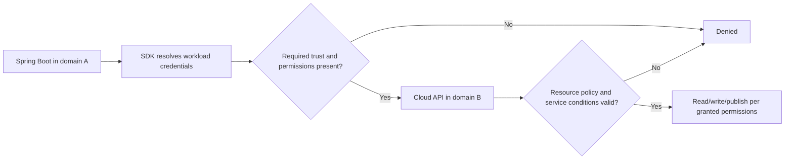
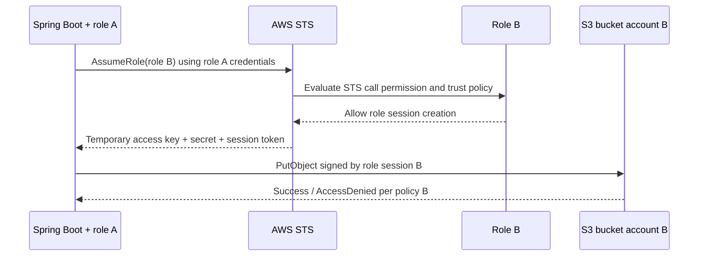
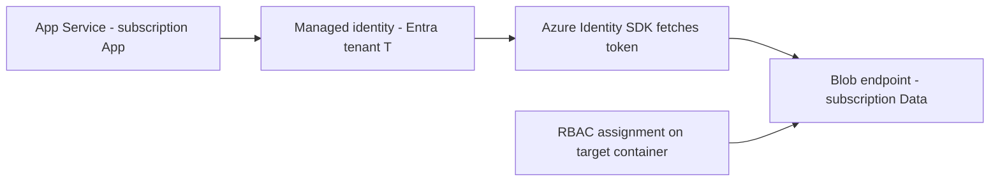
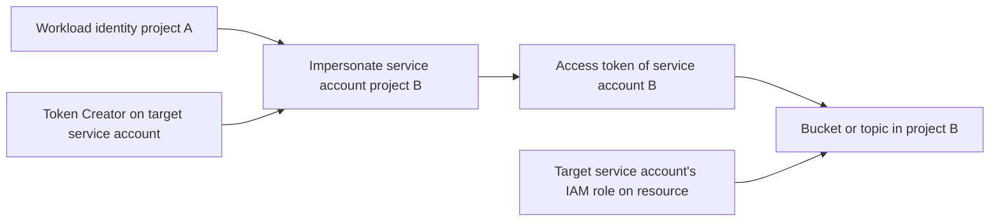

# Cross-Account, Cross-Subscription, and Cross-Project Access

A Spring Boot system is often deployed in one cloud administrative boundary yet needs to access resources in another. For example: `invoice-api` runs in **AWS account A** and writes files to a bucket owned by **AWS account B**; an **Azure App Service** in an application subscription needs to read blobs in a data subscription; or **Cloud Run** in an application project needs to publish messages to a Pub/Sub topic in an integration project. The caller's SDK successfully obtaining credentials **does not guarantee** the receiving side will permit the operation.

This lesson belongs to the **Identity and Access** chapter of the **SPRING_CLOUD_PROVIDER_INTEGRATION** module. While practicing Spring Boot integration with Spring Cloud AWS, Spring Cloud Azure, and Spring Cloud GCP, we will design cross-account, cross-subscription, and cross-project access for storage, messaging, data, and secrets—while verifying identities, scoping down permissions, and running integration tests on dedicated resources.

## 1. Learning Outcomes

After this lesson, you will be able to:

- Distinguish **source principal**, **target resource**, **administrative boundary**, **trust**, and **permissions** when crossing accounts/subscriptions/projects.
- Choose between **AWS cross-account role assumption** and **resource-based policies**, and explain when each fits.
- Grant **Azure RBAC** across subscriptions/resources within the **same Microsoft Entra tenant**, and recognize when **cross-tenant** setups require a distinct identity design.
- Grant **Google Cloud IAM** to a service account from another project, and recognize when service account impersonation or Workload Identity Federation is needed.
- Configure Spring Boot to use the right workload credentials when accessing resources outside its host administrative boundary.
- Test **allowed**, **missing-permission**, **wrong-principal**, **wrong-resource**, and **network/encryption-blocked** cases.
- Avoid opening account-, subscription-, or project-wide administrative permissions just to fix a denied request.

## 2. Understanding Administrative Boundaries and Access Flows

Suppose an organization splits its system into two domains:

| Component | Application Domain | Data Domain |
| --- | --- | --- |
| Where it runs | `invoice-api-prod` in account/subscription/project A | Bucket/container/topic/secret in account/subscription/project B |
| Identity | Spring Boot's IAM role, managed identity, or service account | Resource owner and IAM/RBAC on side B |
| Responsibility | Write invoices, emit events, read config | Allow only the intended workload to perform the intended actions |
| Boundary | Credential issuance and policies of domain A | Resource permissions, org policies, and conditions on domain B |



In the table and diagram, **domain** does not mean the exact same organizational unit across all clouds:

- An **AWS account** is a primary IAM and billing boundary. Cross-account access typically requires permissions on both the caller side and the resource-owner side, or having the caller assume a role in the target account.
- An **Azure subscription** is a resource and cost management boundary; multiple subscriptions can belong to the **same Microsoft Entra tenant**. Cross-subscription access within the same tenant usually relies on Azure RBAC at the target scope. **Cross-tenant** access is a different identity-federation problem, not just swapping a subscription ID.
- A **Google Cloud project** scopes resources, IAM, and billing. A service account in project A can be granted roles directly on a resource in project B if organizational policies permit it. There is no requirement to export a service account key or impersonate another account.

**Authentication** answers "who is calling the API?" **Authorization** answers "is that principal allowed to perform this action on that resource?" Adding a role in project A does not automatically grant access to a bucket in project B. Pointing a client at an endpoint in subscription B does not automatically mint a token trusted by B.

### 2.1. Three Common Design Patterns

| Pattern | Essence | When to Use |
| --- | --- | --- |
| **Grant directly to the source principal** | Target resource allows the identity in domain A to perform the action | AWS S3 bucket policy paired with A's IAM permissions; Azure RBAC within the same tenant; GCP bucket/topic IAM binding |
| **Assume a temporary identity in the target domain** | Principal A is trusted to assume/impersonate an identity in B; client calls APIs as the target identity | AWS STS `AssumeRole`; Google service account impersonation; specially designed Azure cross-identity flows |
| **Access via an intermediary API** | A calls an authenticated API in B, and service B uses its own workload identity | Sensitive data requiring business checks, tenant isolation, or application-layer auditing |

The goal is not forcing every service into one identical mold. Pick the pattern supported by the **target service**, **business needs**, and **administrative boundaries** of each cloud.

## 3. AWS: Two Ways to Access Cross-Account Resources

Suppose:

- **Account A:** `111111111111` runs `invoice-api-prod` on ECS with IAM role `arn:aws:iam::111111111111:role/invoice-api-prod`.
- **Account B:** `222222222222` owns bucket `invoice-archive-prod`.
- The application only needs to **create new objects** under `exports/` in Account B's bucket.

Two standard approaches exist: (1) use Account A's IAM role and allow it directly in Account B's bucket policy; (2) let workload A assume an IAM role created in B.

### 3.1. Approach A: Caller Permissions Plus Bucket Policy in Account B

In Account A, grant least-privilege permission to the workload's IAM role:

```json
{
  "Version": "2012-10-17",
  "Statement": [
    {
      "Sid": "WriteToPartnerBucket",
      "Effect": "Allow",
      "Action": "s3:PutObject",
      "Resource": "arn:aws:s3:::invoice-archive-prod/exports/*"
    }
  ]
}
```

In Account B, the bucket policy allows specifically A's role to write under the target prefix:

```json
{
  "Version": "2012-10-17",
  "Statement": [
    {
      "Sid": "AllowInvoiceExporterFromAccountA",
      "Effect": "Allow",
      "Principal": {
        "AWS": "arn:aws:iam::111111111111:role/invoice-api-prod"
      },
      "Action": "s3:PutObject",
      "Resource": "arn:aws:s3:::invoice-archive-prod/exports/*"
    }
  ]
}
```

For standard cross-account S3 requests, **both the source account's permissions and the target account's bucket policy**—alongside all remaining policy layers—are evaluated. The two `Allow` statements here do not override explicit denies, SCPs, permission boundaries, required conditions, or KMS key restrictions. A bucket policy is a **resource-based policy**; it creates no new credentials. Requests remain signed with Account A's role credentials.

If Account B enforces **Object Ownership: Bucket owner enforced**, the bucket owner owns newly uploaded objects and ACLs are disabled; this avoids ownership complexity when uploading across accounts. Do not apply legacy `bucket-owner-full-control` ACL habits without checking the bucket's actual Object Ownership setting.

### 3.2. Approach B: Account A Assumes an IAM Role in Account B

In Account B, create IAM role `invoice-cross-account-writer`. Its **trust policy** allows only A's role to call `sts:AssumeRole`:

```json
{
  "Version": "2012-10-17",
  "Statement": [
    {
      "Sid": "TrustInvoiceApiFromAccountA",
      "Effect": "Allow",
      "Principal": {
        "AWS": "arn:aws:iam::111111111111:role/invoice-api-prod"
      },
      "Action": "sts:AssumeRole"
    }
  ]
}
```

In Account A, `invoice-api-prod` must be permitted to assume the target role:

```json
{
  "Version": "2012-10-17",
  "Statement": [
    {
      "Sid": "AssumeArchiveWriter",
      "Effect": "Allow",
      "Action": "sts:AssumeRole",
      "Resource": "arn:aws:iam::222222222222:role/invoice-cross-account-writer"
    }
  ]
}
```

In Account B, attach the **permission policy** to `invoice-cross-account-writer`:

```json
{
  "Version": "2012-10-17",
  "Statement": [
    {
      "Sid": "WriteExportObjects",
      "Effect": "Allow",
      "Action": "s3:PutObject",
      "Resource": "arn:aws:s3:::invoice-archive-prod/exports/*"
    }
  ]
}
```

Flow:



Here, S3 sees **Account B's role session**. Because the bucket also belongs to B, Role B's permissions can usually be granted directly without a separate bucket policy for Role B, provided no explicit deny or other condition blocks it. This model is helpful when Account B wants to centrally manage all resource permissions under its own roles.

**Note:** B's trust policy authorizes assuming the role, while the permission policy attached to Role B authorizes calling S3. Missing either part breaks the flow. If MFA or an `ExternalId` is required for a third-party integration, configure matching conditions consistently in both the trust policy and STS request; never add `ExternalId` to the trust policy and forget to pass it during assumption.

### 3.3. Spring Boot Role Assumption with AWS SDK for Java 2.x

The snippet creates an S3 client using temporary credentials for Account B's role. The ECS app in Account A **first** resolves its own task role credentials via the default provider, then uses STS to assume the role in B:

```java
@Configuration
public class CrossAccountS3Configuration {

    @Bean
    StsClient stsClient(@Value("${app.aws.region}") String region) {
        return StsClient.builder()
                .region(Region.of(region))
                .credentialsProvider(DefaultCredentialsProvider.create())
                .build();
    }

    @Bean(destroyMethod = "close")
    StsAssumeRoleCredentialsProvider archiveCredentials(
            StsClient sts,
            @Value("${app.aws.archive-role-arn}") String roleArn) {
        return StsAssumeRoleCredentialsProvider.builder()
                .stsClient(sts)
                .refreshRequest(AssumeRoleRequest.builder()
                        .roleArn(roleArn)
                        .roleSessionName("invoice-api-archive")
                        .build())
                .build();
    }

    @Bean
    S3Client archiveS3Client(
            StsAssumeRoleCredentialsProvider archiveCredentials,
            @Value("${app.aws.region}") String region) {
        return S3Client.builder()
                .region(Region.of(region))
                .credentialsProvider(archiveCredentials)
                .build();
    }
}
```

Deployment configuration holds only ARNs/resource names, **never secrets**:

```yaml
app:
  aws:
    region: ${AWS_REGION:ap-southeast-1}
    archive-role-arn: ${ARCHIVE_WRITER_ROLE_ARN}
    archive-bucket: ${ARCHIVE_BUCKET}
```

In a real project, add the AWS SDK dependencies for S3 and STS, manage shared bean lifecycles cleanly, and avoid recreating clients per request. `StsAssumeRoleCredentialsProvider` manages session credentials and handles SDK-driven refresh. If using a Spring Cloud AWS starter, check existing beans/auto-configuration before declaring a custom client. Keep the **internal-bucket client** and **cross-account assumed-role client** clearly separated by bean name or `@Qualifier`; avoid accidentally using B's credentials for A's own services.

### 3.4. AWS Cross-Account Calls Can Still Fail at Other Layers

| Scenario | Additional Checks |
| --- | --- |
| Bucket uses **SSE-KMS customer-managed key** | Check the KMS key policy, caller permissions, and actions like `kms:GenerateDataKey`; some upload/read paths also need `kms:Decrypt`. AWS managed keys are unsuitable for every cross-account sharing case |
| S3 bucket policy has an explicit deny | Check denies on VPC endpoint, principal, transport, encryption, or other conditions |
| Organizations/SCP or permissions boundary restricts principal | Operations can still be blocked even when role and bucket policies allow them |
| Bucket and app are in different regions | Verify endpoint, SDK configured region, and resource policies rather than mistaking network/region issues for IAM |
| S3 write succeeds but SQS send in B fails | `sqs:SendMessage` and queue resource policies/role permissions are separate; never infer from S3 rights |
| Accessing Account B via a role in B | Inspect the actual assumed-role session ARN rather than looking only at source Role A's ARN |

## 4. Azure: Cross-Subscription and Cross-Tenant Are Two Different Problems

In Azure, a **subscription** holds resources and provides an administrative/billing boundary. Every subscription belongs to a single **Microsoft Entra tenant** at any given time. Therefore, you must determine whether two subscriptions share the **same tenant** before choosing an identity pattern.

### 4.1. Two Subscriptions in the Same Entra Tenant

Suppose:

- Subscription `App` hosts an Azure App Service running `invoice-api` with a **managed identity**.
- Subscription `Data` in the same tenant owns storage account `stinvoicearchive` and blob container `invoices`.
- The application must upload blobs using an Entra ID token.

The administrator of subscription `Data` can **assign an Azure RBAC data role at the target resource scope** to the principal ID of the managed identity from subscription `App`. There is no need to grant `Contributor` on the entire `Data` subscription or move the App Service into another subscription.



Example Azure CLI assigning a data role on the exact container:

```bash
az role assignment create \
  --assignee-object-id "<MANAGED_IDENTITY_PRINCIPAL_ID>" \
  --assignee-principal-type ServicePrincipal \
  --role "Storage Blob Data Contributor" \
  --scope "/subscriptions/<DATA_SUBSCRIPTION_ID>/resourceGroups/rg-data/providers/Microsoft.Storage/storageAccounts/stinvoicearchive/blobServices/default/containers/invoices"
```

`<MANAGED_IDENTITY_PRINCIPAL_ID>` is the **object/principal ID** of the managed identity in the Entra tenant, not a subscription ID or App Service name. This scope applies to that container in subscription `Data`; roles assigned here do not extend to other containers. Effective data access also depends on conditions, deny assignments, firewalls, private endpoints, and other constraints.

**Narrowness note:** `Storage Blob Data Contributor` allows multiple data operations, including operations broader than "create blob only." The example above illustrates **narrowing scope**; if stricter action limits are needed, evaluate a custom role with specific `DataActions`, supported role assignment conditions, and SDK behavior. Do not assume Azure RBAC supports every object/prefix restriction identically to AWS S3.

### 4.2. Spring Boot Pointing to a Blob in Another Subscription

The Azure Blob SDK talks to the storage account's **data-plane endpoint**. Normally `BlobServiceClient` does not need a subscription ID passed in to upload blobs: the subscription defines **where the storage resource is managed**, while Azure Identity credentials and RBAC decide whether the principal can access that endpoint.

```java
@Configuration
public class CrossSubscriptionBlobConfiguration {

    @Bean
    TokenCredential azureCredential() {
        return new DefaultAzureCredentialBuilder().build();
    }

    @Bean
    BlobServiceClient archiveBlobServiceClient(
            TokenCredential azureCredential,
            @Value("${app.azure.archive-endpoint}") String endpoint) {
        return new BlobServiceClientBuilder()
                .endpoint(endpoint)
                .credential(azureCredential)
                .buildClient();
    }
}
```

```yaml
app:
  azure:
    archive-endpoint: ${ARCHIVE_BLOB_ENDPOINT}
    archive-container: ${ARCHIVE_BLOB_CONTAINER}
```

On App Service, when no other credential source overrides it and managed identity is supported/properly enabled, `DefaultAzureCredential` acquires a managed identity token. When **multiple user-assigned managed identities** are attached, specify the client ID per SDK configuration—or construct `ManagedIdentityCredential` explicitly on supported runtimes. With a Spring Cloud Azure starter, check auto-configuration and token sources on the existing client rather than adding extra clients with unclear precedence.

**Distinction:** `az account set --subscription ...` only changes the target subscription for Azure CLI commands; it grants no data roles to the Java client. When using a service principal/managed identity, `403` errors typically require checking **principal object ID**, **data role**, **scope**, and actual endpoint.

### 4.3. When Subscriptions Belong to Different Entra Tenants

This is a **cross-tenant** scenario, more complex than cross-subscription access within one tenant. A managed identity principal from tenant A does not automatically become assignable in Azure RBAC for a subscription in tenant B. You must pick an **identity model recognized by side B** according to service support, such as:

- **Multitenant application registration:** side B performs appropriate consent/onboarding to provision a service principal representing the app inside tenant B, and assigns roles on B's resources. The app requests tokens targeting the **appropriate tenant and resource** using an approved app authentication mechanism—preferring federation/certificates over long-lived client secrets where suitable.
- **B2B collaboration:** for **user** access or supported scenarios, guest accounts in tenant B can receive role assignments at target scopes. This is not automatically a solution for a Spring Boot workload identity.
- **Azure Lighthouse:** supports **delegated resource management via Azure Resource Manager** across tenants within configured scopes. Never assume Lighthouse automatically grants **data-plane** tokens/permissions to read/write blobs, Service Bus messages, or Key Vault secrets.

Never assume `DefaultAzureCredential` on an App Service in tenant A automatically switches to tenant B just because the endpoint changed. When cross-tenant data access is required, explicitly design the token-issuing tenant, principal in tenant B, consent/trust, role assignments, and network path. Sometimes a cleaner, better-controlled solution is an intermediary API in tenant B using B's own managed identity and enforcing business authorization.

### 4.4. Commonly Missed Azure Checks

| Error or Requirement | What to Verify |
| --- | --- |
| Valid Entra token yet Blob returns `403` | `Storage Blob Data Contributor` or custom data role on the **target scope**; right principal and tenant |
| Holds Azure `Contributor` on resource group | ARM management role does not grant Entra ID Blob data-plane access |
| Cross-subscription, same tenant | Role assignment on target subscription/resource; no need to copy credentials across subscriptions |
| Cross-tenant | Representative identity in the resource tenant, consent/trust, and token tenant/audience; cannot rely on source-tenant managed identity by default |
| Blob behind private endpoint/firewall | Valid IAM/RBAC can still fail due to DNS, networking, private endpoint, or firewall rules |
| Key Vault or Service Bus | Each service has separate permissions; a blob role grants no secret/message rights |

## 5. Google Cloud: Accessing Resources in Another Project

In Google Cloud, a service account in project A can be granted IAM roles on a resource in project B **without moving the service account into project B**. This is usually the simplest pattern for Spring Boot running on Cloud Run/GKE/Compute Engine.

Suppose:

- Project A: `invoice-app-prod` runs Cloud Run with service account `invoice-api@invoice-app-prod.iam.gserviceaccount.com`.
- Project B: `invoice-data-prod` hosts Cloud Storage bucket `invoice-archive-prod` and Pub/Sub topic `invoice-created`.
- The workload needs to create new objects in B's bucket and publish messages to B's topic.

### 5.1. Binding Roles Directly to Project A's Service Account

On Project B's bucket, bind a narrow role to the source service account:

```bash
gcloud storage buckets add-iam-policy-binding gs://invoice-archive-prod \
  --member="serviceAccount:invoice-api@invoice-app-prod.iam.gserviceaccount.com" \
  --role="roles/storage.objectCreator"
```

On Project B's Pub/Sub topic, grant publisher separately:

```bash
gcloud pubsub topics add-iam-policy-binding invoice-created \
  --project=invoice-data-prod \
  --member="serviceAccount:invoice-api@invoice-app-prod.iam.gserviceaccount.com" \
  --role="roles/pubsub.publisher"
```

The resources belong to project B while the service account is created and managed in project A. Bindings on the target bucket/topic govern permissions of the **source principal**. There is no need to grant `roles/editor` on project B—and no need to load a JSON key file for the source service account into the runtime.

For a secret in project B, grant `roles/secretmanager.secretAccessor` on the **specific secret**, and verify `secretmanager.versions.access`. For managed databases, IAM connection permission may only be part of the requirement: Cloud SQL can also enforce **in-database authentication and privileges** depending on the connection mode.

### 5.2. Spring Boot and Google Cloud ADC

Example Spring Boot Storage client using ADC inside Cloud Run with Project A's service account, uploading to Project B's bucket:

```java
@Configuration
public class CrossProjectStorageConfiguration {

    @Bean
    Storage storage() {
        // ADC resolves the workload identity per runtime configuration.
        return StorageOptions.getDefaultInstance().getService();
    }
}

@Service
public class InvoiceArchive {

    private final Storage storage;

    public InvoiceArchive(Storage storage) {
        this.storage = storage;
    }

    public void create(String bucket, String key, byte[] json) {
        BlobInfo blob = BlobInfo.newBuilder(BlobId.of(bucket, key))
                .setContentType("application/json")
                .build();

        storage.create(blob, json,
                Storage.BlobTargetOption.doesNotExist());
    }
}
```

This example requires the Google Cloud Storage Java client dependency; you can also use beans/clients auto-configured by your **Spring Cloud GCP starter** version. `bucket` comes from environment config—for example `invoice-archive-prod` in **project B**. ADC still resolves the runtime principal from **project A**. `doesNotExist()` is a create-only precondition preventing overwrites of existing objects; it does not replace IAM controls. If the target project uses Requester Pays or special quota/billing settings, add the corresponding client config; the target project does not determine the client's identity.

**Note:** a `GOOGLE_APPLICATION_CREDENTIALS` variable pointing to a credential file has higher precedence than metadata and can cause the Java client to use a **different principal** than Cloud Run's service account. Changing `GOOGLE_CLOUD_PROJECT` or the client's project ID also does not change the principal.

### 5.3. When Is Service Account Impersonation Needed?

Sometimes project B prefers requests to arrive under a **target service account managed by B**, rather than granting IAM directly to A's service account. In that case, you can use **service account impersonation**:

1. A's service account or principal is granted permission to **mint tokens for the target service account in B**, via a role such as `roles/iam.serviceAccountTokenCreator` on the target service account and any applicable conditions.
2. The target service account holds the required IAM roles on B's bucket/topic/secret.
3. A's SDK or credential tooling acquires an **expiring access token** for the target service account and calls APIs under that identity.



Do not confuse `roles/iam.serviceAccountTokenCreator` with bucket access. Impersonation permission only allows **obtaining a token representing the target identity** in a supported manner; the **target service account** still needs permissions on the resource. Whenever direct IAM bindings on the target bucket/topic meet governance requirements, the direct approach is usually simpler.

When using **Workload Identity Federation** from CI or Kubernetes, principal mapping, impersonation, and binding steps depend on the pool/provider and runtime type. GKE has its own Workload Identity Federation for GKE mechanism; never apply GitHub OIDC assumptions to GKE Pods.

### 5.4. Constraints from Organization Policies and Networking

Cross-project access is not always granted merely by adding a bucket binding:

- **Organization policies** may block principals from external domains/organizations or restrict IAM sharing.
- **VPC Service Controls**, if enabled, can block requests crossing a perimeter even when IAM allows them.
- **CMEK/KMS** keys and service agents may require separate encryption/decryption permissions depending on the service and key setup.
- **IAM Deny** or principal access boundaries may override permissions allowed by bindings.
- **Requester Pays**, quota projects, and billing contexts can affect operations even after authentication succeeds.

Treat these as additional verification layers—never blindly broaden IAM when a request is rejected.

## 6. Comparing the Three Platforms

| Criterion | AWS Cross-Account | Azure Cross-Subscription | Google Cloud Cross-Project |
| --- | --- | --- | --- |
| Source identity | IAM role/session in Account A | Managed identity/service principal in Entra tenant | Service account/federated principal in Project A |
| Direct permission grant | Identity policy in A + resource policy in B for supported services like S3 | Role assignment on subscription B's resource/scope, typically within the same Entra tenant | Direct IAM binding on Project B's bucket/topic/secret |
| Assuming a target identity | STS `AssumeRole` with role trust + assume permission | Cross-tenant identity/consent model when needed; no default AssumeRole equivalent | Service account impersonation or WIF where supported |
| Credentials sent on calls | AWS temporary role credentials or Role A credentials | Microsoft Entra access token with right tenant/audience | Google OAuth access token from ADC/impersonation |
| Storage example | `s3:PutObject` on object ARN | Blob data role/custom data action on container/account | `storage.objects.create` on bucket |
| Configuration pitfalls | Adding only bucket policy without caller permissions; wrong ARN; KMS or SCP block | Tenant mismatch; `Contributor` role lacking data-plane rights | Over-broad project-level role; missing binding; VPC SC/org policy block |
| How to verify | STS caller identity and CloudTrail; principal seen by target request | Azure Identity logs, principal/tenant, and Azure role assignments | ADC source, service account/federated principal, Cloud Audit Logs |

There is no cloud-neutral "grant cross-cloud" command: role names, authentication flows, policy evaluation, and resource scopes differ by service. Always verify against the **exact operation**, such as creating an object, publishing a message, or reading a secret version.

## 7. Designing Least-Privilege Across Boundaries

Apply the same method across all three clouds:

```text
1. Who is the source principal? Where is the app running?
2. Which account/subscription/project owns the target resource?
3. What is the exact operation? Are secondary permissions needed?
4. Is assuming/impersonating a target identity required?
5. Which side declares trust and permissions?
6. Are there additional denies, conditions, network rules, or KMS checks?
7. Have both allowed and out-of-scope operations been tested?
```

Illustrative matrix for `invoice-service-prod`:

| Caller | Resource Owner | Action | Minimal Scope | Do Not Grant |
| --- | --- | --- | --- | --- |
| App A workload | Storage B | Create invoice objects | Bucket/container B and prefix where genuinely supported by provider | Delete/read across all of Storage B |
| App A workload | Messaging B | Publish events | One queue/topic in B | Messaging admin or receive/delete messages |
| App A workload | Secret store B | Read config secret | One authorized secret/version | List, create, or delete all secrets |
| CI pipeline | App A infra | Deploy artifacts | A's deploy services and deploy roles | Full data access in B or runtime secrets |
| Dedicated worker | Database B | Only required DB operations | Dedicated DB role and cloud permissions | Project-wide Owner/Admin |

Some controls cannot be expressed by IAM alone. If workload A uses a single credential allowed to write anywhere in a multi-tenant bucket, the cloud does not automatically know which end user called the Spring Boot API. The application must still verify tenant ownership from the user's identity and construct safe object keys; where stronger cloud isolation is needed, split buckets/containers and workload identities by tenant or function.

### 7.1. Secrets and Credentials: How Should They Be Distributed?

- **AWS:** ECS task role/EKS identity/instance profile receives temporary credentials. When assuming Role B, STS issues an expiring role session and the SDK handles refresh; never copy access keys from Account B into container images.
- **Azure:** prefer managed/workload identities and Entra ID tokens; cross-tenant scenarios require a valid identity design rather than embedding client secrets into Spring config to silence `403` errors.
- **Google Cloud:** attach a service account to Cloud Run/GKE and use ADC; when federation or impersonation is needed, rely on library-managed expiring credentials. Never issue a service account JSON key solely to reach a bucket in Project B.

Spring configuration should store **endpoints**, **buckets/containers/topics**, **regions/projects**, and target identity ARNs/IDs when required. Those values are not **secrets** and do not themselves grant IAM/RBAC permissions.

## 8. Diagnostic Workflow When Target-Domain Access Is Denied

A `403` error can come from authentication, IAM/RBAC, resource policies, networking, or service constraints. Follow this order:

1. **Identify the application's actual principal:** do not guess from a terminal profile. Use STS `GetCallerIdentity` with the exact JVM provider on AWS; Azure Identity logs and principal/tenant; ADC source and Cloud Audit Logs on GCP.
2. **Verify the target resource:** are account ID, subscription ID, tenant ID, project ID, bucket/container/topic/secret, region, endpoint, and object key all right?
3. **Verify the access mechanism:** direct access or role assumption/impersonation? When assuming/impersonating, separate **obtaining the target identity** from **calling the API as the target identity**.
4. **Verify required permissions:** which API is actually invoked? `PutObject` differs from `ListBucket`; Azure management roles differ from Blob data roles; Google `storage.objects.create` differs from `storage.objects.get`.
5. **Inspect extra policy layers:** explicit denies, resource policies, parent scopes, IAM Conditions, KMS key policies, organization policies, VPC Service Controls, or firewalls/private endpoints.
6. **Check audit logs and run isolated tests:** same principal, same operation, same test resource, with request IDs and evidence of both allow and deny results.

| Symptom | First Hypothesis | How to Check |
| --- | --- | --- |
| AWS `AssumeRole` into B returns `AccessDenied` | A lacks `sts:AssumeRole` or B's trust policy rejects A | Check A's identity policy, B's trust policy, principal ARN, and conditions |
| `AssumeRole` succeeds yet S3 in B denies | Role B lacks `s3:PutObject`, wrong object ARN/prefix, bucket deny/KMS | Check role session, B's permission policy, bucket/key, and encryption |
| AWS Role A calling Bucket B directly is denied | Missing Allow on one of the two sides, or explicit deny | Inspect A's identity policy and B's bucket policy |
| Azure Blob in Subscription B returns `403` | Managed identity lacks data role at right scope; wrong tenant/principal | Verify principal object ID, data role, container/account, and token audience |
| Azure Subscription B is in a different Entra tenant | Principal A is not automatically recognized in Tenant B | Check supported multitenant/B2B/delegation design and consent |
| GCP Bucket B returns `PermissionDenied` | Service account A lacks bucket IAM binding or is blocked by org/VPC SC | Verify actual ADC, Bucket B, IAM policy, and perimeter |
| GCP impersonation fails before Storage call | Missing `roles/iam.serviceAccountTokenCreator` or wrong source trust | Check IAM on target service account and source credentials |
| CI deploys successfully, runtime fails on Secret B | CI principal has permission while workload principal does not | Distinguish the two identities; inspect B's secret policy for runtime |

**Never grant `AdministratorAccess`, `Owner`, or `Contributor` at org-wide scope just because an authorization error occurred.** Pinpoint the failing layer and add only the required action and scope.

## 9. Integration Testing Cross-Boundary Permissions Properly

Unit tests with mocked SDKs test API-calling logic only; they do not prove trust policies, role assignments, or IAM bindings across cloud boundaries are right. Design tests using **dedicated resources** and a **test workload principal**.

| Case | Setup | Expected Result |
| --- | --- | --- |
| A — Allow in target domain | Workload A uploads a new object to granted bucket/container B | Succeeds; audit log shows the expected principal |
| B — Deny wrong resource | Same workload tries writing to unpermitted bucket/container C | Denied |
| C — Deny wrong operation | Workload with create-only permission attempts read/delete/list without permission | Denied per effective permissions |
| D — Broken trust | AWS A tries assuming Role B without trust; or GCP tries impersonating SA B without permission | Fails before or during target credential acquisition |
| E — Valid token, missing data permission | Same-tenant Azure app gets managed identity token, with data role removed on test resource | Blob operation is denied |
| F — Swap runtime identity | Deploy the same artifact with another workload identity lacking access in B | Access to B is denied |
| G — Extra protection layer | Use a test resource with managed network/KMS policy | Diagnose the block at that layer rather than "fixing" it by widening IAM |

Never run destructive operations on production data. For negative cases testing `DeleteObject` or blob deletion, create a dedicated **test object** and verify it still exists after the denied request; some delete APIs return non-obvious responses on non-existent keys.

### 9.1. Provider-Specific Verification Points

**AWS:** Check the actual principal ARN—Role A in the direct bucket policy pattern, or **assumed-role session B** in the STS pattern. CloudTrail in the relevant accounts helps trace requests. Use the same credential provider as the production client; AWS CLI commands on a laptop reflect only the CLI identity.

**Azure:** Cross-check **tenant ID**, **principal/object ID**, data role assignments, and **target scope**. Never rely solely on `az account show` on a dev machine to verify an App Service managed identity. Also check endpoints and firewalls once a token is valid.

**Google Cloud:** Inspect the live Cloud Run/GKE service identity/ADC, IAM bindings on resource B, and audit logs; when using impersonation, distinguish the **source caller** from the **target service account** in token/API traces. Never log raw access tokens or service account key contents.

### 9.2. What Should and Should Not Be Logged

You may log **service name, environment, principal ID**, account/subscription/project, resource, API operation, request ID, error, and timestamp as long as no secrets are exposed. Never log **AWS secret access keys/session tokens, OAuth tokens, client secrets, private keys**, signed requests, or Authorization headers. SDK debug logging should only be enabled in secure environments with proper redaction.

## 10. Hands-On Exercise: Invoice Service Accessing Resources in the Data Domain

**Context:** `invoice-api` owned by the application team runs in domain A. The data team manages storage and messaging in domain B. Operations requires separating permissions between the two teams while still letting the application create invoices and publish events.

**Task:** Choose one of AWS, Azure, or Google Cloud for an end-to-end test deployment. Compare the equivalent setup on the other two providers using the table in Section 6.

1. **Specify both domains:** record source and target account/subscription/project, tenant if using Azure, source runtime principal, and target resource names.
2. **Build a permission matrix:** `create object` and `publish event` are the two operations; list exact provider permissions and operations that must be denied.
3. **Choose an access model:** AWS direct bucket resource policy or assume Role B; Azure role assignment at scope B in the same tenant or supported cross-tenant model; GCP direct IAM binding for service account A or impersonation of B if needed.
4. **Grant least privilege:** restrict bucket/container/topic, adding prefix/conditions only where truly supported by the cloud; evaluate KMS and networking. Keep runtime identity separate from CI.
5. **Configure Spring Boot:** keep SDK code free of secrets; pass endpoints, region, resources, and required ARNs/IDs via environment config; inject only the appropriate credential provider.
6. **Test allowed operations:** create a new test JSON object, publish a test event, and correlate principal and resource in audit logs.
7. **Test out-of-scope operations:** write to another resource, read/delete objects if ungranted; simulate broken trust in a separate test environment.
8. **Report evidence:** authentication flow, permission grant path, configured policies/bindings, operations, and test results.

Recording template:

| Field | Value to Record |
| --- | --- |
| Workload principal | IAM role A / Azure managed identity / GCP service account A |
| Target resource | Bucket/container/topic/secret owned by domain B |
| Pattern | Direct resource policy / role assumption / cross-subscription RBAC / IAM binding / impersonation |
| Trust or identity mapping | Trusted role ARN; Entra tenant and principal ID; WIF/impersonation if used |
| Permission | Specific action/role and scope |
| Positive test | Request ID, resource, operation, succeeded as expected principal |
| Negative test | Out-of-scope resource/operation denied, error code, and audit entry |
| Additional conditions | KMS, networking, org policies, or constraints verified |

**Pass criteria:** the application uses the right workload identity, succeeds on granted target resources, is denied on out-of-scope resources/operations, and requires no static secrets copied between domains.

## 11. Self-Check Questions

1. In AWS, when should you grant permissions directly via a bucket policy to a role in Account A, and when should the workload assume a role in Account B?
2. In the STS `AssumeRole` model, how do B's trust policy and A/B's permission policies play distinct roles?
3. If assuming Role B succeeds yet S3 Bucket B still denies `PutObject`, which policy layers would you inspect?
4. An Azure App Service in Subscription A needs to upload blobs in Subscription B within the **same tenant**. At which scope do you assign the role, and whose principal ID do you use?
5. Why can two Azure subscriptions in **different Entra tenants** not be handled simply by swapping the subscription ID in the client?
6. Why is Azure Lighthouse not an automatic answer for cross-tenant Blob Storage data read/write access?
7. Cloud Run in Project A needs to create objects in a bucket in Project B. Where must the role be bound, to which principal, and is impersonating a service account in B mandatory?
8. In GCP, how does `roles/iam.serviceAccountTokenCreator` on a target service account differ from `roles/storage.objectCreator` on a bucket?
9. Does a successful upload test to Bucket B prove the service lacks delete access in B or access to Bucket C? What additional tests are needed?
10. Why can a cross-boundary request still fail due to KMS, private endpoints, or VPC Service Controls even when IAM/RBAC is properly granted?

## 12. Takeaways

**Cross-account, cross-subscription, or cross-project access is about aligning source identity, target resource, and policies across administrative boundaries.** AWS generally requires checking both caller and resource owner or using STS `AssumeRole` in the target account. Azure grants RBAC at the target subscription's scope within the same tenant; cross-tenant scenarios require dedicated identity/consent design. Google Cloud can bind IAM roles directly to a service account from another project, reserving impersonation for cases where governance truly requires it.

With Spring Boot, let Spring Cloud/Java SDKs use standard credential providers, verify which principal was actually selected, scope storage, messaging, database, and secret permissions to the narrowest action and resource, test both allow and deny cases on sandbox resources, and keep runtime identities separate from CI/developers. **Changing the target account, subscription, or project neither changes the application's identity nor grants access on its own.**
