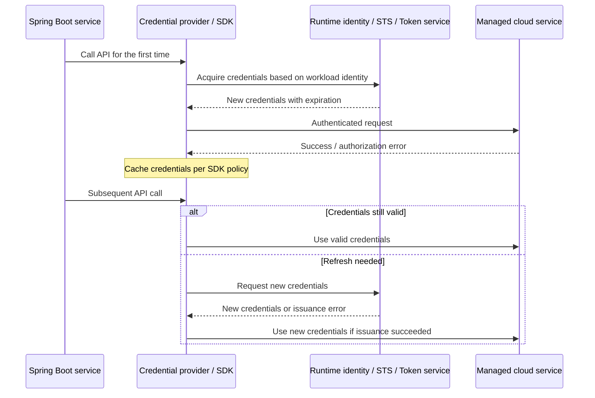
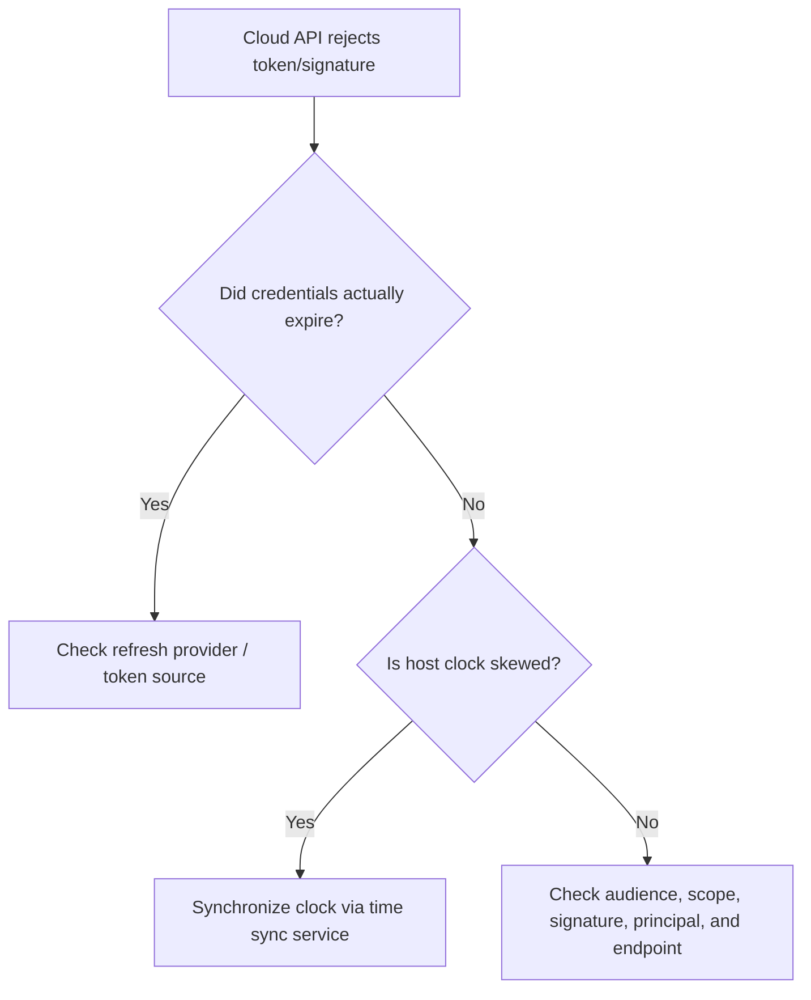

# Token Expiration, Credential Refresh, and System Time

A Spring Boot service might upload invoices to Amazon S3 right after startup, then begin failing authentication a few hours later. Another workload might acquire a Microsoft Entra ID access token when deployed to Azure App Service, yet fail during long-running execution. On Google Cloud, an application using a service account or Application Default Credentials (ADC) can still stop working if tokens are not refreshed properly. These failures raise three questions: **how long are credentials valid, who is responsible for refreshing them, and is the system clock accurate?**

This lesson belongs to the **Identity and Access** chapter of the **SPRING_CLOUD_PROVIDER_INTEGRATION** module. When integrating Spring Boot with managed services across **AWS, Azure, and Google Cloud** using the corresponding Spring Cloud libraries, we must handle the authentication lifecycle properly for storage, messaging, data, and secret managers. Good design lets long-running workloads operate with short-lived credentials without placing access keys, client secrets, tokens, or JSON keys in source code and without restarting the application whenever a token expires.

## 1. Learning Outcomes

After this lesson, you will be able to:

- Explain **issued-at, not-before, expiration, remaining lifetime** of a token/credential, and the impact of **clock skew**.
- Distinguish **refreshable credentials**, **already-issued access tokens**, **OIDC ID tokens**, **AWS STS temporary credentials**, and **IAM/RBAC permissions**.
- Understand how AWS SDK for Java 2.x, Azure Identity for Java, and Google Auth Library/ADC acquire and refresh credentials inside a Spring Boot application.
- Avoid pitfalls such as caching an access token in a `static` field, copying an STS session into `application.yml`, or assuming the SDK will switch identities after a `403`.
- Distinguish system-clock errors from missing permissions, wrong audience/scope, unreachable metadata endpoints, and revoked tokens.
- Design tests using a simulated clock and controlled integration tests, while recording diagnostic logs without leaking credentials.

## 2. Key Time Boundaries

Short-lived credentials are valid only within a bounded interval. Formats represent timestamps differently, but shared concepts include:

| Property | Meaning | Where It Commonly Appears |
| --- | --- | --- |
| **Issued at (`iat`)** | Timestamp when the issuer created the token | Claim in JWT |
| **Not before (`nbf`)** | Token is not accepted prior to this timestamp, if present | JWT/OIDC token |
| **Expiration (`exp`)** | Timestamp from which the token is no longer valid under verification rules | JWT/OIDC token |
| **ExpiresAt / Expiration** | Timestamp when credentials/access token expire, sometimes returned as external metadata | Azure Identity `AccessToken`, AWS STS `Credentials` |
| **Time to live (TTL)** | Remaining duration before credentials expire | Derived from expiration and current time |
| **Refresh window / safety margin** | Buffer window to fetch new tokens before the old one expires | Library caching/refresh strategy |
| **Clock skew** | Drift between the sender's system clock and the verifier's clock | AWS request signing, JWT validation, token issuance |

In JWTs, `iat`, `nbf`, and `exp` claims are typically **NumericDate** values: seconds since the Unix epoch, inherently independent of a machine's display time zone. Clock drift is what breaks verification; a developer's machine displaying Vietnam time while the cloud displays UTC is **not a bug** as long as both systems agree on the exact instant in time.

Illustrative timeline:

```text
Time (UTC)       ---------------------------------------------------->
               t0              t1              t2              t3
               |               |               |               |
            issued         valid from     should refresh    expires
             iat              nbf          before expiry      exp

            |<--------------------- valid window ------------------->|
                                                |<- safety margin -->|
```

**Pre-expiry refresh** prevents in-flight requests from breaking right as a token expires. The exact safety margin depends on the SDK, token type, request duration, and network latency; there is no universal "always refresh 5 minutes early" rule across all clouds. For several providers, client libraries implement their own refresh policies that should not be overridden arbitrarily.

### 2.1. Can an Expired Token Be Extended Directly?

Distinguish **refreshing credentials** from **extending an existing old access token**:

- An already-issued OAuth access token generally **cannot be extended in place**. A credential provider obtains a **new access token** using managed identity, a refresh token, federation, or fresh identity proof.
- Expired AWS STS session credentials cannot be extended by modifying `Expiration`; the provider must **obtain a new set of temporary credentials** via role/metadata/STS.
- An OIDC ID token minted for a CI/Kubernetes run is typically short-lived. Token exchange or projected tokens must satisfy trust and audience; if the token source is no longer valid, the cloud cannot mint new credentials merely because the app wants to refresh.
- An IAM role, Azure managed identity, or Google service account continues to exist long after the **current session's** token expires. Identity and permissions are configured separately from credential lifetimes.

## 3. Credential Lifecycle in a Long-Running Application



For workloads running on ECS/EKS/EC2, Azure App Service/AKS, or Cloud Run/GKE, the core components are:

1. **Runtime-attached identity:** IAM role, managed identity, service account, or workload identity federation.
2. **Credential issuer:** metadata/container endpoint, STS, Microsoft Entra token endpoint, or Google token service depending on platform.
3. **Cache/refresh provider:** Java SDK or Identity/Auth library. A single long-lived client obtains fresh credentials through the provider without recreating the entire client.
4. **IAM/RBAC on resources:** every request still needs authorization on the target S3, Blob Storage, Cloud Storage, queue/topic, database, or secret.

### 3.1. Scenarios That Refresh Alone Cannot Fix

| Scenario | Can Refresh Help? | Action Required |
| --- | --- | --- |
| Token expired while provider can still reach identity source | **Yes**, if SDK is properly configured | Let the provider acquire fresh credentials |
| Metadata endpoint or token service unreachable | No, until connectivity is restored | Check network, DNS, endpoint, workload binding, and proper retries |
| Workload identity detached or federated trust invalidated | No | Fix identity issuance / trust configuration per design |
| Credentials valid yet principal lacks `PutObject` permission | No | Inspect IAM/RBAC, operation, resource, and conditions |
| Token issued for a different audience/scope than target API | Fetching the right token type helps; re-fetching the wrong token does not | Inspect request scope/resource and client configuration |
| Host clock significantly fast or slow | Not sustainably | Restore time synchronization; use standard providers |
| Application manually caches a copy of an access token | Unreliable | Remove manual caching; use a refreshing credential provider |

**Key rule:** a cloud request returning `403` for missing permissions does not cause the credential chain to switch to another identity. Changing principals on error makes application behavior unpredictable and can hide permission misconfigurations.

## 4. AWS: STS Temporary Credentials, SigV4, and Clocks

### 4.1. What Lifetimes Exist in AWS?

AWS SDK for Java 2.x can receive credentials from the environment, shared profiles, IAM Identity Center, web identity, ECS task roles, or EC2 instance profiles depending on workload setup. With an **IAM role**, the SDK typically uses temporary credentials consisting of:

```text
AccessKeyId      : temporary access key identifier
SecretAccessKey  : secret used to sign requests
SessionToken     : session token required with temporary credentials
Expiration       : timestamp when session credentials expire
```

The SDK signs service calls like S3 or SQS using **AWS Signature Version 4 (SigV4)**. This is not an OAuth bearer access token. The signature embeds the request timestamp (such as `x-amz-date` where applicable); AWS services verify the signature and validity window to prevent replay attacks. **System clock skew** can cause signatures to be rejected even when the access key and session token have not expired.

Two independent problems:

- **Expired session credentials:** requests may fail with an error such as `ExpiredToken`; the provider needs fresh credentials.
- **Significantly skewed request signing time:** errors like `RequestTimeTooSkewed`, `RequestExpired`, `SignatureDoesNotMatch`, or similar may occur depending on the service and signing method. Check system time, region/endpoint, and signing logic—do not just create a new role.

Error names and codes vary across APIs; never rely solely on HTTP `403` to conclude which layer failed.

### 4.2. Using DefaultCredentialsProvider in Spring Boot

Example creating a **shared provider** for AWS clients within the same workload:

```java
@Configuration
public class AwsIdentityConfiguration {

    @Bean
    AwsCredentialsProvider awsCredentialsProvider() {
        return DefaultCredentialsProvider.create();
    }

    @Bean
    S3Client s3Client(
            AwsCredentialsProvider credentialsProvider,
            @Value("${app.aws.region}") String region) {

        return S3Client.builder()
                .region(Region.of(region))
                .credentialsProvider(credentialsProvider)
                .build();
    }

    @Bean
    SqsClient sqsClient(
            AwsCredentialsProvider credentialsProvider,
            @Value("${app.aws.region}") String region) {

        return SqsClient.builder()
                .region(Region.of(region))
                .credentialsProvider(credentialsProvider)
                .build();
    }
}
```

With an IAM role supplied by ECS/EKS/EC2 and no higher-precedence source overriding the default chain, the provider fetches and refreshes credentials as supported by the SDK. Refresh rules and cache behavior vary by credential source. The snippet puts no secret keys in Spring configuration.

If you already use a Spring Cloud AWS starter that auto-configures clients/providers, inspect your starter version's behavior before declaring custom beans. The goal is **giving the client a refresh-capable provider**, not taking a one-time snapshot of temporary keys and freezing them as static credentials.

**Anti-pattern example:**

```java
// Do not use with expiring credentials.
// Takes only a single snapshot of credentials and uses it forever.
AwsCredentials snapshot = DefaultCredentialsProvider.create()
        .resolveCredentials();

AwsCredentialsProvider frozen = StaticCredentialsProvider.create(snapshot);

S3Client client = S3Client.builder()
        .region(Region.AP_SOUTHEAST_1)
        .credentialsProvider(frozen)
        .build();
```

`StaticCredentialsProvider` keeps whatever credentials it received at creation time. When that snapshot is a role session credential, this provider **will not go back to ECS/STS for a new session**. A client may work initially and then fail once the session token expires. Nor should you paste STS `AccessKeyId`, `SecretAccessKey`, and `SessionToken` into static environment variables for an app to run across multiple days.

### 4.3. AssumeRole: Let the Credential Provider Manage New Sessions

When `invoice-service` in Account A must assume a role in Account B, use `StsAssumeRoleCredentialsProvider` instead of calling `sts.assumeRole(...)` once and caching the result forever:

```java
@Bean
StsAssumeRoleCredentialsProvider archiveRoleCredentials(
        StsClient stsClient,
        @Value("${app.aws.archive-role-arn}") String roleArn) {

    return StsAssumeRoleCredentialsProvider.builder()
            .stsClient(stsClient)
            .refreshRequest(AssumeRoleRequest.builder()
                    .roleArn(roleArn)
                    .roleSessionName("invoice-archive-service")
                    .build())
            .build();
}

@Bean
S3Client archiveS3Client(
        StsAssumeRoleCredentialsProvider archiveRoleCredentials,
        @Value("${app.aws.region}") String region) {

    return S3Client.builder()
            .region(Region.of(region))
            .credentialsProvider(archiveRoleCredentials)
            .build();
}
```

This assumes `StsClient` is configured to resolve the workload's **source** credentials. `StsAssumeRoleCredentialsProvider` caches and refreshes role sessions while respecting STS issuance lifetimes. In production code, close the provider and STS client cleanly when the application context shuts down, pass the role ARN via environment config, and avoid accidentally using Role B credentials for clients meant to use Role A.

**Refresh cannot fix broken trust:** if the source role loses `sts:AssumeRole` permission or the target role's trust policy rejects it, acquiring a new session will fail. If STS succeeds yet S3 in B returns `AccessDenied`, check Role B's permissions, bucket policies, and KMS.

### 4.4. Local and CI/CD Specifics

- With AWS IAM Identity Center, local profiles have session login lifetimes. When an SSO session requires re-authentication, run `aws sso login --profile team-dev` per developer workflow—never replace it with long-lived access keys.
- With GitHub Actions OIDC, each job requests an ID token and STS issues temporary role credentials. Each job/workflow must acquire its own credentials per configured trust; never export CI credentials into the application's Docker image.
- With ECS/EKS/EC2, applications should rely on runtime-issued credentials. Java system properties or environment access keys can take precedence over the runtime role, causing the entire refresh lifecycle to run against an **unintended** source.

## 5. Azure: Entra ID Access Tokens and TokenCredential

### 5.1. Access Token Lifetimes Differ from Managed Identity Lifecycles

An Azure App Service or VM can have an attached **managed identity**; AKS can use **Microsoft Entra Workload ID** to exchange a Pod's projected token. That identity is managed independently of each **OAuth 2.0 access token** the application receives when calling Azure services.

An `AccessToken` in the Azure Identity SDK represents a token and its **expiration timestamp**. Target clients typically request tokens for the **exact resource scope/audience**, for example:

| Service | Typical Scope |
| --- | --- |
| Azure Blob Storage | `https://storage.azure.com/.default` |
| Azure Service Bus | `https://servicebus.azure.net/.default` |
| Azure Key Vault | `https://vault.azure.net/.default` |

A token minted for one audience cannot serve as a universal token across every Azure service. An expired token is a **time** issue; a missing data role or wrong scope is an **authorization/token-configuration** issue. For instance, if a managed identity acquires a Blob token without `Storage Blob Data Contributor` or a custom data role on the target container, uploads will still be denied.

### 5.2. Letting Azure Identity and Client Libraries Coordinate Refresh

```java
@Configuration
public class AzureIdentityConfiguration {

    @Bean
    TokenCredential azureTokenCredential() {
        return new DefaultAzureCredentialBuilder().build();
    }

    @Bean
    BlobServiceClient blobServiceClient(
            TokenCredential azureTokenCredential,
            @Value("${app.azure.blob-endpoint}") String endpoint) {

        return new BlobServiceClientBuilder()
                .endpoint(endpoint)
                .credential(azureTokenCredential)
                .buildClient();
    }
}
```

The client receives a **`TokenCredential`**, rather than a previously fetched token string. Azure SDK/Identity acquires tokens as required by the service and handles caching and refresh per library version. When using a Spring Cloud Azure starter, inspect the starter's auto-configured client and credential to ensure you do not accidentally wire two separate credential chains inside the same app.

**Anti-pattern:**

```java
// Anti-pattern illustration: fetch token once and pass a fixed string.
// String token = tokenCredential.getToken(requestContext).block().getToken();
// customHttpClient.setAuthorizationHeader("Bearer " + token);
// ... keep reusing this token for hours without requesting a new one ...
```

Even if the token is valid at startup, baking it into a static header on a custom HTTP client causes requests to fail once it expires. If a custom HTTP client is genuinely required, pair it with a thread-safe caching/refreshing token supplier requesting the right scope per service, and never log tokens. For Azure Blob/Service Bus/Key Vault, prefer official client libraries and `TokenCredential`.

### 5.3. Which Sources Can DefaultAzureCredential Use?

Locally, `DefaultAzureCredential` can acquire tokens from developer logins via supported tools; in the cloud, it can pick environment, workload identity, or managed identity. **Exact ordering and fallback behavior depend on the `azure-identity` version.**

Token expiration on a valid source can be handled by SDK refresh. However, these errors need separate attention:

- **Managed identity not enabled or wrong client ID:** cannot acquire an access token because the source principal is invalid.
- **AKS Pod has wrong federated token/tenant/client ID:** token exchange is rejected; adding storage RBAC will not fix it.
- **Developer credentials require interactive re-login:** local runs may need `az login` or the relevant tool; never rely on developer sessions for production.
- **Environment service principal config has an expired secret:** a higher-precedence source may be chosen or fail before managed identity depending on the chain. Remove unintended credentials and use the designed runtime identity.
- **New role assignment has propagation delay:** token is valid yet requests return `403`; wait for service permission synchronization and verify principal/scope rather than issuing a new secret to fix the wrong layer.

Never log raw developer access tokens or refresh tokens. To inspect expiration during controlled diagnostics, use `expiresAt` metadata without exposing the token string itself.

## 6. Google Cloud: ADC, Refresh Tokens, and Metadata

### 6.1. ADC Finds the Identity Source; the Provider Refreshes Tokens

Google Cloud Java client libraries use **Application Default Credentials (ADC)**. The common lookup order is:

1. The file pointed to by `GOOGLE_APPLICATION_CREDENTIALS`, which may be a federation configuration or service account config; avoid long-lived JSON private key files.
2. The local ADC file generated by `gcloud auth application-default login`.
3. Google Cloud environment metadata, such as Cloud Run, Compute Engine, or GKE per configured identity mechanisms.

The selected source determines the **principal**. Access token refreshes follow that same source—the library does not switch to a different service account when Cloud Storage returns `403`.

In local development, ADC may rely on authorized-user credentials and a refresh token issued by the developer sign-in flow. That refresh token has its own lifecycle and revocation rules; if it becomes invalid, the developer must re-authenticate per policy. On Cloud Run/GCE/GKE, metadata or workload federation provides short-lived credentials without issuing JSON private keys to workloads.

### 6.2. Java Clients Using GoogleCredentials Instead of Holding Raw Tokens

```java
@Configuration
public class GoogleStorageConfiguration {

    @Bean
    Storage storage(
            @Value("${app.gcp.project-id}") String projectId) throws IOException {

        GoogleCredentials credentials =
                GoogleCredentials.getApplicationDefault();

        return StorageOptions.newBuilder()
                .setProjectId(projectId)
                .setCredentials(credentials)
                .build()
                .getService();
    }
}
```

This example requires the Google Cloud Storage Java client and Google Auth Library. The client accepts a credential object, letting the library manage token issuance and refresh via supported mechanisms. When a Spring Cloud GCP starter auto-configures the client, verify the actual credential and project properties before overriding beans.

**What not to do:**

```java
// Anti-pattern: fetch one AccessToken and cache the token string forever.
GoogleCredentials adc = GoogleCredentials.getApplicationDefault();
adc.refreshIfExpired();
String frozenAccessToken = adc.getAccessToken().getTokenValue();

// frozenAccessToken becomes stale once expired.
// Never store this variable in application.yml, DB, or a long-lived cache.
```

Calling `refreshIfExpired()` on a credential object is not wrong when a raw token is needed for a special case, but copying an **access token string** and reusing it forever defeats the provider's refresh capability. When calling APIs with official client libraries, pass the credential object to the client.

### 6.3. Federation and Time-Related Errors

With Workload Identity Federation (CI outside GCP or GKE), the OIDC token issuer must provide valid tokens matching the recipient's configured **issuer, audience, subject, lifetime, and signature**. A JWT that is expired, not yet valid due to clock skew, or carries an unreasonable `iat` can be rejected at the **token exchange** step before the Java client ever touches Cloud Storage.

If Cloud Storage requests still return `PermissionDenied` after ADC acquires a valid token, inspect IAM on the target bucket for the service account/federated principal as well as constraints like IAM Deny or VPC Service Controls; **that error is not necessarily a refresh issue**. Also note that changing `GOOGLE_CLOUD_PROJECT` does not change which principal ADC uses.

## 7. Comparing the Refresh Cycles Across All Three Clouds

| Aspect | AWS | Azure | Google Cloud |
| --- | --- | --- | --- |
| Typical API credential | AWS temporary credentials; SigV4 signing | Microsoft Entra ID OAuth access token | OAuth access token from Google Auth/ADC |
| Typical workload identity | ECS task role, EKS IRSA/Pod Identity, EC2 instance profile | Managed identity, AKS Workload Identity | Runtime service account, GKE Workload Identity Federation |
| Token/credential source | STS, container/instance metadata, federation | Azure Identity with Entra/managed identity endpoint | ADC with local credentials, metadata, or external account |
| How SDK refreshes | `AwsCredentialsProvider` / `StsAssumeRoleCredentialsProvider` and refreshable sources | `TokenCredential`, Azure client libraries, version-dependent caching/refresh | `GoogleCredentials` and client libraries, refreshing per ADC source |
| Typical timing failures | Expired session, skewed SigV4 signing timestamp | Expired/not-yet-valid token, assertion/federation time mismatch | Expired access token, federation JWT time mismatch |
| Failures refresh cannot fix | Role missing permission, broken trust, bucket deny | Wrong data role/scope, wrong tenant or audience | Missing bucket IAM binding, org policy/VPC SC block |
| What to avoid | `StaticCredentialsProvider` holding a role credential snapshot | Fixed bearer token in HTTP headers | Fixed `String` access token, long-lived service account key |

Important difference: **the AWS SDK does not send an OAuth bearer token to call S3**, whereas Azure and GCP typically send OAuth access tokens. Even so, application design stays parallel: pass a **refresh-capable credential provider** to the cloud client and grant least-privilege permissions to the principal.

## 8. System Time: UTC, Clock Skew, and Request Signatures

### 8.1. Display Time Zones Are Not Clock Skew

In Java, distinguish these time types:

- `Instant.now()` represents an absolute point in time in UTC/epoch.
- `ZonedDateTime.now(ZoneId.of("Asia/Ho_Chi_Minh"))` displays that instant in the Vietnam time zone.
- `OffsetDateTime` includes an offset, useful for representing token expiration timestamps.
- **Clock skew** occurs when the sender or token issuer's actual system clock runs fast or slow relative to standard time, regardless of display time zone.

Two machines showing `16:00+07:00` and `09:00Z` represent the exact same instant, which is completely valid. Yet if one machine's clock is actually 12 minutes ahead, SigV4 requests or JWT validation may be rejected.



### 8.2. Components Requiring Time Synchronization

| Runtime Host | What to Watch |
| --- | --- |
| Developer laptop/desktop | OS time sync must stay enabled; disabling sync or manual clock edits break CLIs/SDKs |
| VM / EC2 / Compute Engine | Use provider- or OS-supported time sync services per infrastructure policy |
| Docker / Kubernetes | Containers generally share the host/node kernel clock; changing `TZ` only alters display, not a skewed host clock |
| CI runner | Runner nodes/VMs must stay time-synchronized for OIDC tokens and cloud signatures to validate |
| OAuth/OIDC issuer or internal system | Clocks and issuance timestamps must be accurate; `nbf`/`iat` too far in the future can break token exchange |

Identify the **actual host** running the process. On Kubernetes, check the node hosting the Pod before attempting time adjustments inside a container. Use NTP/chrony or cloud-provided time synchronization with drift monitoring. Never disable `exp` verification, arbitrarily widen tolerances, or manually adjust production clocks to patch authentication errors.

Helpful clock-inspection commands (depending on OS/installed tools):

```bash
# Linux: check sync status; do not adjust the clock.
timedatectl status

# Linux with chrony:
chronyc tracking

# Display UTC for log correlation:
date -u
```

```powershell
# Windows: Windows Time Service status
w32tm /query /status

# Display UTC time in PowerShell
(Get-Date).ToUniversalTime().ToString("o")
```

These commands are purely diagnostic. Minimal containers may lack `timedatectl` or `chronyc`; clock-sync checks belong on the host/node or infrastructure monitoring layer.

### 8.3. Controlling Time in Java Code

For business logic that compares expirations (such as internal tokens or application-owned TTL caches), inject `java.time.Clock` for deterministic tests rather than altering the system clock:

```java
public final class ExpirationPolicy {
    private final Clock clock;
    private final Duration safetyMargin;

    public ExpirationPolicy(Clock clock, Duration safetyMargin) {
        this.clock = clock;
        this.safetyMargin = safetyMargin;
    }

    public boolean needsRefresh(Instant expiresAt) {
        // Pre-expiry margin: once this threshold is reached, a new token can be requested.
        Instant threshold = expiresAt.minus(safetyMargin);
        return !clock.instant().isBefore(threshold);
    }
}
```

**This is an example for testing application-owned time logic, not a recommendation to rewrite refresh logic inside the AWS/Azure/GCP SDKs.** Cloud SDKs have their own caching, backoff, and refresh policies. In production, rely on the SDK's native credential providers rather than injecting a mock `Clock` across the entire library.

Example unit test without waiting for real tokens to expire:

```java
@Test
void refreshesBeforeExpirationThreshold() {
    Instant now = Instant.parse("2026-11-24T09:00:00Z");
    Clock clock = Clock.fixed(now, ZoneOffset.UTC);
    ExpirationPolicy policy =
            new ExpirationPolicy(clock, Duration.ofMinutes(2));

    // One minute left: already inside the two-minute safety margin.
    assertTrue(policy.needsRefresh(now.plus(Duration.ofMinutes(1))));

    // Ten minutes left: no refresh needed yet.
    assertFalse(policy.needsRefresh(now.plus(Duration.ofMinutes(10))));
}
```

There is no need to inject a fake `Clock` into the entire Spring Boot context just to test time math in one service. For SDK credentials, use fake providers or HTTP stubs matching the library contract in unit tests; for integration tests, verify real credential sources in an isolated test environment.

## 9. Diagnosis: Expired Token, Clock Skew, or Missing Permission?

Start troubleshooting from the **credential type and actual principal**:

1. Identify **which credential source** the client is using: AWS profile/role/STS, Azure developer credential/managed identity, or GCP ADC/federation.
2. Verify **whether credentials are still valid** using available metadata without printing tokens/secrets. If missing, inspect the provider chain and token-issuance path.
3. Check **host/node UTC time and clock drift** if errors mention signing timestamps, `iat`, `nbf`, `exp`, or invalid assertions.
4. Check **scope/audience and principal**. On Azure/GCP, a valid token might target a different service; on AWS, requests might be signed for the wrong region/endpoint.
5. Check **IAM/RBAC** when credentials are valid yet the API denies access. Separate token-exchange failures from resource-permission failures.
6. Correlate **logs and request IDs** from the SDK and cloud service; re-test in a sandbox after fixing the root cause rather than issuing long-lived keys as a workaround.

| Symptom | Primary Cause to Inspect | Remediation Path |
| --- | --- | --- |
| AWS requests succeed initially, then `ExpiredToken` | STS credentials expired; code cached a snapshot; provider cannot refresh | Use a refresh-capable provider; inspect STS/metadata endpoint and role trust |
| AWS `RequestTimeTooSkewed`, `RequestExpired`, or time-related signature error | Host clock skewed or signing timestamp outside accepted window | Check UTC/NTP/chrony, region/endpoint, and signing behavior |
| Persistent AWS `AccessDenied` despite fresh credentials | IAM role/bucket policy/KMS lacks permission or explicit deny applies | Verify role session and resource/action rather than just refreshing |
| Azure SDK cannot acquire managed identity token | Misconfigured endpoint, client ID, tenant, workload federation, or network | Trace token source via secret-redacted Azure Identity logs |
| Valid Azure access token yet Blob returns `403` | Missing data role on scope, wrong audience, or network rule | Check principal, tenant, `https://storage.azure.com/.default`, and role assignment |
| Google Cloud `invalid_grant` or JWT time error at token exchange | Expired assertion, wrong `iat/nbf/exp`, clock skew, or broken federation | Check OIDC issuer, host time, and provider trust |
| Google Cloud client cannot acquire fresh access token | Local ADC/metadata/federation invalid or endpoint unreachable | Verify ADC source; re-login locally if needed; fix workload binding |
| Google Cloud `PermissionDenied` on bucket | Wrong IAM binding/service account, wrong resource, org policy, or VPC SC | Check principal in audit logs and bucket permissions |
| Burst of simultaneous failures right at refresh time | Slow/unavailable token endpoint, concurrent refresh stampede, or aggressive retries | Use standard caching/refreshing providers, bounded backoff, and monitor refresh counts |

**Note:** exception names and error codes are diagnostic clues, not absolute proof. The same HTTP `401` or `403` status can surface from multiple layers depending on provider and API. Never classify causes purely by status code; read the error details, request ID, and live context.

## 10. Resilient Design When Token Issuance Is Disrupted

To keep a Spring Boot service resilient when token services are slow or metadata endpoints blip briefly, handle lifecycle properly at the client layer:

- **Reuse clients and providers:** never instantiate a new cloud client or run login/STS manually per incoming user HTTP request. Leverage SDK-level caching and thread-safe refresh.
- **Bounded timeouts:** configure network timeouts on cloud clients aligned with SLAs; never let credential refreshes hang indefinitely.
- **Retries with backoff and jitter:** apply appropriate SDK retry policies for transient errors/rate limits; avoid infinite retries, retry storms, or retrying `403` permission errors.
- **Never cache raw tokens in Redis or a database:** long-lived cached bearer tokens expire, risk exposure, or mismatch audiences. If business metadata must be stored, store only non-secret fields like application-managed expiration timestamps.
- **Monitor key signals:** track credential acquisition/refresh failure rates, exception types, remaining validity (when safely observable), clock drift, and metadata/token endpoint health.
- **Never silently fail over principals:** if the current role/managed identity fails to refresh, surface a clear error—never fall back to an admin account or static keys.
- **Safeguard retryable operations:** object uploads or event publishing can have side effects. When retrying a business operation after an auth or network hiccup, use idempotency keys, object generation preconditions, or transactional outboxes to avoid duplicate data.

### 10.1. Spring Boot Config Without Tokens

Illustrative configuration holding only **target resources** and deployment parameters:

```yaml
app:
  aws:
    region: ${AWS_REGION:ap-southeast-1}
  azure:
    blob-endpoint: ${AZURE_BLOB_ENDPOINT}
  gcp:
    project-id: ${GCP_PROJECT_ID}
  storage:
    target-name: ${INVOICE_STORAGE_TARGET}
```

Never place `AWS_SECRET_ACCESS_KEY`, `AZURE_CLIENT_SECRET`, or `GOOGLE_APPLICATION_CREDENTIALS` pointing to private key files inside `application.yml`. Sensitive values belong in managed runtime identities or controlled secret managers when genuinely required. Remember that project IDs, bucket names, and endpoints **do not determine which identity** the credential provider selects.

### 10.2. Minimal Diagnostic Logging

Data useful when observing errors:

| Log Under Security Policy | Never Log |
| --- | --- |
| Service name, environment, cloud provider, credential source type | Raw access tokens, OIDC ID tokens, refresh tokens |
| Approved principal/role identifier, account/project/tenant | AWS secret access keys, STS session tokens |
| Resource, operation, request ID, error code, UTC timestamp | Client secrets, private keys, service account JSON file contents |
| Refresh failure counts, retry counts, measured clock drift | HTTP Authorization headers, signed URLs containing signatures/tokens |
| Expiration timestamp **as metadata** where appropriate and controlled | Unredacted SDK debug dumps containing sensitive material |

Logs can complement AWS CloudTrail, Azure diagnostics/Entra logs, and Google Cloud Audit Logs. Always correlate against **the running workload itself**, as a CLI command on a laptop may use a different identity than the application's JVM.

## 11. Testing the Credential Lifecycle Without Waiting for Production Outages

Include both **unit tests for time logic** and **live integration tests**:

| Case | How to Test | Expected Evidence |
| --- | --- | --- |
| A — Valid token | Use a fake provider or `Clock` logic test near issuance time | Does not refresh prematurely outside policy |
| B — Near expiration | Fix simulated clock inside the pre-expiry safety margin | Application-owned logic requests a new token before expiry |
| C — Expired | Fake provider returns expired credentials or library token error | Client/app does not keep reusing stale tokens forever |
| D — Transient refresh failure | Simulate token endpoint timeout, rate limit, or unavailable metadata | Clear error; bounded retries; does not switch to a high-privilege principal |
| E — Clock skew | Simulate skewed signing/assertion time in an isolated test environment | Time error detected and diagnosed; authentication is not disabled |
| F — Valid token, missing permission | Use a test runtime principal with valid credentials lacking storage rights | Denied; repeated refreshes do not fix it |
| G — Post-deployment | Run with workload identity in a cloud test environment; repeat operations across natural provider refresh cycles or supported test conditions | Continues using the right principal with no restarts or static secrets |

**Testing limits:** mocked SDKs verify code branches, but they **do not prove** AWS STS, Azure managed identity, or GCP ADC actually issue valid credentials. Include at least one integration test on sandbox cloud resources whenever features depend on identity lifecycles; never skew production node clocks or sever metadata endpoints on customer-serving workloads.

### Step-by-Step Hands-On Lab

**Context:** `invoice-service` runs continuously and must create objects and publish events using a workload identity. Pick **one primary provider** (AWS, Azure, or Google Cloud), then map out the equivalent approach on the other two providers.

1. **Create test identity and scope:** attach a role/managed identity/service account to the runtime; grant only required permissions on one test bucket/container and one test queue/topic.
2. **Construct SDK clients via providers:** use `DefaultCredentialsProvider`, `DefaultAzureCredential`/`ManagedIdentityCredential`, or ADC. Ensure the same client is reused and no token string is stored in a global variable.
3. **Call APIs initially:** confirm operations succeed and audit logs show the workload principal—not a developer or CI account.
4. **Record credential state:** where observable, record expiration metadata cleanly redacted; check host UTC time and time sync status.
5. **Test refresh failure in isolation:** use a fake provider or a dedicated test workload with a broken token source to observe exceptions, retries, and diagnostic logs. Never alter production clocks or revoke production roles.
6. **Test negative authorization:** let the principal acquire valid credentials, then call an unpermitted resource. Confirm authorization errors behave distinctly from expiration errors.
7. **Observe controlled long-running behavior:** in an appropriate test run, send requests across a provider refresh cycle; compare principals before and after, ensuring no static tokens are used.
8. **Compare across all three clouds:** AWS STS & SigV4, Azure OAuth/Entra `TokenCredential`, and Google OAuth/ADC; highlight where expiration, refresh sources, and resource permissions are verified on each.

Results template:

| Field | Recorded Value |
| --- | --- |
| Cloud / runtime | ECS/EKS/EC2, App Service/AKS, or Cloud Run/GKE |
| Active principal | Authenticated role/session, managed identity, or service account |
| Credential source | STS/metadata, Azure Identity, ADC/federation |
| Lifetime / clock | Expiration metadata, host UTC timestamp, sync status |
| Allowed operations | Request IDs and outcomes for storage/messaging |
| Intentional refresh failure | Exception, retry behavior, simulated cause |
| Missing-permission failure | Denied resource/operation, principal still intact |
| Secret hygiene | Zero raw tokens/secrets in source, config, images, or logs |

## 12. Self-Check Questions

1. Why can an **IAM role** or **managed identity** continue existing after one session's credentials/token have expired?
2. Why can fetching a single set of AWS STS credentials and wrapping them in `StaticCredentialsProvider` cause an application to fail a few hours later?
3. How does clock skew affect AWS SigV4? Why does changing the JVM's display time zone not fix a skewed host clock?
4. With Azure Blob Storage, if the access token is still valid yet the API returns `403`, what factors must be checked before forcing a refresh?
5. How do `gcloud auth login` and `gcloud auth application-default login` differ for the Google Cloud Java SDK and its refresh cycle?
6. Why does a token with audience `https://management.azure.com/` not work for the Blob Storage data plane?
7. When an OIDC token for Workload Identity Federation carries an `nbf` timestamp in the future relative to the cloud's clock, what should you inspect?
8. Why should you rely on a caching/refreshing provider instead of storing a bearer token string in a `static` field?
9. A service only fails after running for a long time under heavy load. How do you distinguish concurrent refresh issues, an unavailable token endpoint, clock skew, and missing permissions?
10. In integration tests, how can you test credential lifecycles without altering production system clocks or disabling production metadata endpoints?

## 13. Takeaways

**Credential expiration, token refresh, and system time are three parts of one authentication lifecycle that must be diagnosed independently.** AWS role sessions rely on temporary credentials and SigV4; Azure Identity acquires Microsoft Entra access tokens per target service; Google Auth Library/ADC acquires access tokens from local or workload identities. Standard SDKs handle caching and refreshing, while Spring Boot's job is supplying the **credential provider**, configuring environment targets cleanly, and never freezing startup tokens.

Even when credentials refresh smoothly, **IAM/RBAC still decides** whether that principal can access storage, messaging, databases, or secret managers. Keep host clocks synchronized, monitor errors and expirations safely, test both token expiration and permission denial, use runtime identities instead of static keys, and keep sensitive credentials out of logs. Doing so keeps Spring Boot applications running reliably long-term across AWS, Azure, and Google Cloud.
