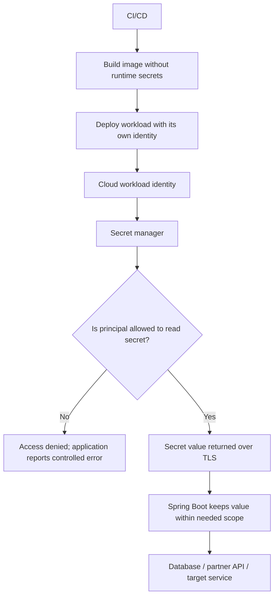
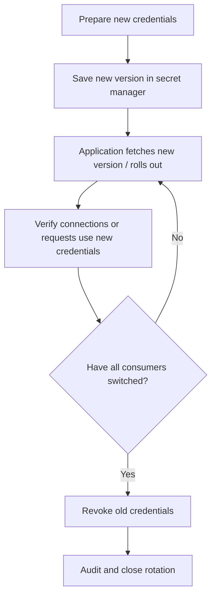

# Keeping Secrets Out of Source Code, Container Images, and Logs

A Spring Boot application typically needs database passwords, partner API keys, signing keys, or credentials to call cloud services. Placing those values into **application.yml**, committing **.env** files, passing them via Docker **ARG**, or printing full configurations to logs might speed up quick experiments, but it leaves copies scattered across Git, build caches, image layers, CI artifacts, terminal histories, and observability systems. Deleting a config line from source afterward **does not revoke** an exposed credential.

This lesson belongs to the **Identity and Access** chapter of the **SPRING_CLOUD_PROVIDER_INTEGRATION** module. When integrating Spring Boot with managed services from AWS, Azure, and Google Cloud, we must protect secrets for storage, messaging, databases, and external services. The goal is managing secret lifecycles in one controlled place, granting read access to the right workloads, injecting secrets when needed, keeping sensitive values out of source code/container images/logs, and maintaining a rotation process whenever credentials change.

## 1. Learning Outcomes

After this lesson, you will be able to:

- Distinguish **secrets**, **configuration**, **identity credentials**, and **secret names/identifiers**.
- Identify places where secrets can linger: Git history, build context, Docker images/layers, CI logs, artifacts, environment variables, heap dumps, and application logs.
- Design secret retrieval flows from **AWS Secrets Manager/SSM Parameter Store**, **Azure Key Vault**, and **Google Cloud Secret Manager** using workload identities.
- Integrate Secret Manager clients with Spring Boot without hardcoding secrets or printing values to logs.
- Choose how secrets enter a process—direct reads from a secret manager, file mounts, or environment injection—and weigh their trade-offs.
- Rotate secrets safely, handle caches/connection pools, and minimize blast radius when credentials leak.
- Test allow/deny permissions and verify that source code, images, pipelines, and logs contain no secrets.

## 2. What Is a Secret and How Does It Differ from Regular Configuration?

A **secret** is data restricted to authorized people or processes because exposure enables impersonation, unauthorized access, or decryption. Examples:

- Database passwords, partner API keys, OAuth client secrets.
- Private keys, certificates bundled with private keys, signing keys, webhook signing secrets.
- Access tokens, refresh tokens, AWS access keys/secrets/session tokens.
- Connection strings embedding a username/password, or URLs containing signed query parameters.
- Application-managed encryption keys and bootstrap credentials capable of unlocking other secrets.

**Configuration** describes how an application behaves—such as bucket names, regions, endpoints, queue names, project IDs, feature flags, or timeouts. Non-secret configuration can live in YAML, environment variables, or config services. However, any connection URL embedding a password or request-signing query parameter must be treated as a secret.

| Data Type | Examples | How to Manage |
| --- | --- | --- |
| Non-secret configuration | AWS_REGION, bucket name, queue URL, log level | Environment-specific config |
| Identifiers | IAM role ARN, managed identity client ID, service account email | Can live in deployment config; still govern metadata per organizational policy |
| Application secrets | DB password, partner API key, webhook secret | Secret manager or dedicated secret store; restrict readable principals |
| Workload credentials | AWS temporary credentials, OAuth access tokens, federated assertions | Managed by SDK/runtime identity; never stored as static config |
| Sensitive business data | Customer records, payment details, confidential payloads | Separate data governance, encryption, access control, and retention |

A **secret identifier** such as **prod/invoice/db-password** or a Key Vault resource ID is not itself the secret value. Still, secret names can reveal system architecture; expose them only where needed. **Do not confuse encrypting a secret with controlling who can decrypt it.** Encryption at rest/in transit protects storage and transport, while IAM/RBAC decides which principal can read the value.

## 3. Where Can Secrets Leak?

Secrets do not live only in source files. One careless **COPY . .** or **printenv** can copy secrets into places accessible to many people and systems.

| Location | How It Leaks | Examples to Avoid |
| --- | --- | --- |
| Source code | Committing keys/passwords into Java, YAML, properties, or scripts | Production password in application-prod.yml |
| Git history | Removing a secret in a newer commit while the old value remains in history | Committing a .env file, then simply deleting it in the next commit |
| Build context | Docker sends unneeded local files to the builder | Copying the entire repo puts .env, .aws/credentials, or private keys into the context |
| Dockerfile / image layer | ARG, ENV, COPY, or build steps embed secrets into metadata/layers | ARG NPM_TOKEN, ENV DB_PASSWORD |
| Build cache | Secrets remain inside cached layers or build step logs | Deleting a file in a later layer while the earlier layer still holds its contents |
| CI/CD logs | echo, shell tracing, variable dumps, or response body logs | set -x, printenv, logging curl commands with tokens |
| Artifacts | Packaging configs, test reports, or debug files | Uploading .env, heap dumps, or logs containing Authorization headers |
| Runtime process | Environment, process arguments, mounted files, or heap dumps readable by others | Host users able to inspect process env or unrestricted volumes |
| Application logs / tracing | Exceptions, request/response logs, SQL URLs, or toString() exposing credentials | Logging full DataSourceProperties or HTTP headers |
| Monitoring / support bundles | Exporting logs/traces/dumps to external systems | Sending unredacted diagnostic bundles to vendors |

### 3.1. Deleting from Source Does Not Make a Secret Safe

If an API key was committed to Git:

1. **Revoke or rotate the credential immediately** using the owning system's process.
2. Inspect audit logs to see where, when, and by which principal the credential was used.
3. Remove the value from source and lingering copies/artifacts; if Git history must be rewritten, coordinate with repository maintainers because rewriting alters commit hashes and clones.
4. Check Docker registries, build caches, CI logs, artifacts, packages, and backups that may still retain the value.
5. Locate all other copies, migrate consumers to the new secret, and verify the old secret no longer works.

**Rewriting Git history without rotating the credential is not enough.** Someone may already have cloned the repo or downloaded an artifact; deleting history does not invalidate the leaked key.

## 4. Designing a Secure Secret Flow

A standard model for Spring Boot:



Follow this flow:

1. **Create secrets in a secret manager** or organization-approved vault; track version, owner, environment, rotation schedule, and access policy.
2. **Attach a workload identity** to the application: IAM role, managed identity, or service account/federated principal. This identity can read only the secrets the app truly needs.
3. **Fetch secrets at runtime** through an SDK/secret integration over TLS using standard credential providers. Never bootstrap with another long-lived client secret when the platform supports workload identity.
4. **Keep values in memory or restricted file mounts** with tight read permissions. Never write them to source, images, logs, metric labels, tracing attributes, or error messages.
5. **Cache thoughtfully:** reduce calls to the secret manager while still honoring rotation requirements; define TTL, refresh behavior, and behavior during brief secret service outages.
6. **Rotate and revoke:** create a new version, update consumers, verify behavior, and then deactivate the old credential on schedule.
7. **Audit:** log principal, secret identifier, version, operation, and request ID where appropriate; never log the secret value.

### 4.1. Direct SDK Reads vs. Mounted/Injected Secrets

| Delivery Approach | Advantages | Risks / Considerations |
| --- | --- | --- |
| Read directly from secret manager via SDK | Per-secret read permissions; supports fetching new versions and auditing each access | App depends on secret API/network; must design caching, retries, refresh, and startup behavior |
| Mount as files via CSI driver / secret integration | App reads standard files; can support file updates on version change | Must protect volumes, file permissions, nodes/Pods, and update flows; app must reload files to pick up new versions |
| Inject as runtime environment variables | Easy compatibility with legacy frameworks/libraries | Values can leak via process inspection, crash dumps, diagnostic tools, or logs; changes usually require restarting the process |
| Read from config files provisioned at deploy | Simple for the application | Files can be packaged/backed up/copied mistakenly; requires strict permissions, rotation, and lifecycle control |

No single option fits every workload. For services needing frequent rotation, reading via a provider/secret integration with explicit caching/refresh is easier to govern. When using env injection, restrict host/process inspection rights and never dump the environment to logs. When mounting files, ensure the app reloads on secret changes or rolls Pods/processes cleanly.

## 5. Keeping Secrets Out of Git and Source Code

### 5.1. Spring Boot Configuration Without Secret Values

Avoid:

```yaml
spring:
  datasource:
    url: jdbc:postgresql://db.internal:5432/invoices
    username: invoice_app
    password: "real-production-password"

partner:
  api-key: "real-partner-api-key"
```

Replace with config specifying only **secret names** or runtime-supplied placeholders:

```yaml
spring:
  datasource:
    url: ${DB_JDBC_URL}
    username: ${DB_USERNAME}
    password: ${DB_PASSWORD}

partner:
  api-key: ${PARTNER_API_KEY}
```

The second snippet does not fetch secrets on its own; it requires the deployment/runtime to supply those properties via environment injection, mounted secret files/config trees, or secret manager integration. Lock down Actuator `env`, `configprops`, `heapdump`, and debug endpoints so bound values are never exposed.

One option is a **Spring Boot config tree** backed by a directory of files, depending on your Spring Boot version:

```yaml
spring:
  config:
    import: "optional:configtree:/run/secrets/"
```

Each file in `/run/secrets/` has a filename matching a property key and contents holding the property value—for example, a `DB_PASSWORD` file mounted by a secret integration binds to `DB_PASSWORD`. The `optional:` prefix lets the app start when the directory is absent; **never use `optional:` casually for mandatory secrets**, or the app may boot in a misconfigured state. In production, generally fail fast if a required secret is missing. Verify exact syntax and behavior against your project's Spring Boot version.

### 5.2. Example Files Containing Only Placeholders

You can commit `application-local.example.yml` or `.env.example` with non-functional dummy values:

```dotenv
DB_JDBC_URL=jdbc:postgresql://localhost:5432/invoices
DB_USERNAME=invoice_local
DB_PASSWORD=replace-with-local-test-secret
PARTNER_API_KEY=not-a-real-key
```

Never commit `.env` files holding real values. Configure ignore rules appropriately, for example:

```gitignore
.env
.env.*
!.env.example
*.pem
*.key
.aws/
secrets/
```

These patterns are examples—adapt them to your repository. Do not ignore an entire `secrets/` folder if the project keeps non-sensitive fixtures under version control; review file types individually. `.gitignore` **does not** protect files that were already tracked and does not replace secret scanning.

### 5.3. Keeping Secrets Out of Docker Build Contexts

Use `.dockerignore` to prevent unnecessary local files from being sent to the builder:

```dockerignore
.git
.env
.env.*
!.env.example
.aws
*.pem
*.key
secrets/
target/
build/
```

Carefully verify exceptions and directories needed for the build. Never include a production `.env` in the build context under the excuse that the app reads it at runtime. An image should contain **code and dependencies**, not environment-specific secrets.

## 6. Keeping Secrets Out of Dockerfiles, Images, and Build Caches

### 6.1. Why ARG and ENV Are Not Secret Stores

Unsafe example:

```dockerfile
FROM eclipse-temurin:21-jre
ARG DB_PASSWORD
ENV DB_PASSWORD=${DB_PASSWORD}
COPY target/invoice-service.jar /app/app.jar
ENTRYPOINT ["java", "-jar", "/app/app.jar"]
```

`ARG` and `ENV` are not secure secret storage mechanisms. Values can leak via build history/metadata, image config, layers, logs, or inspection tools depending on how images are built. Putting a secret into `ENV` also bakes it into container runtime config. Deleting a variable in a later layer does not erase contents from earlier layers.

**Runtime Dockerfiles should accept only non-secret configuration**, while secrets are supplied when the workload runs:

```dockerfile
FROM eclipse-temurin:21-jre
WORKDIR /app
COPY target/invoice-service.jar /app/app.jar
USER 10001
ENTRYPOINT ["java", "-jar", "/app/app.jar"]
```

The container runtime can mount secret files or provide a workload identity so the app reads from a secret manager. Never bake production credentials into an image build "to make multi-environment deployment convenient."

### 6.2. What If the Build Truly Needs a Credential?

Some build steps need a token to download dependencies from a private Maven/NPM repository. That is a **build-time credential**, distinct from application runtime secrets. Prefer builder secret-mount mechanisms such as Docker BuildKit:

```dockerfile
# syntax=docker/dockerfile:1
FROM maven:3.9-eclipse-temurin-21 AS build
WORKDIR /workspace

COPY pom.xml .
RUN --mount=type=secret,id=maven_settings,target=/root/.m2/settings.xml \
    mvn -B -DskipTests dependency:go-offline

COPY src ./src
RUN mvn -B -DskipTests package

FROM eclipse-temurin:21-jre
WORKDIR /app
COPY --from=build /workspace/target/invoice-service.jar /app/app.jar
USER 10001
ENTRYPOINT ["java", "-jar", "/app/app.jar"]
```

Build commands can pass secrets from CI using BuildKit syntax supported by your builder. The mounted file exists only during that `RUN` step and does not become an ordinary layer. Even so, **the build command can still accidentally print the secret**, copy it elsewhere, or write it into artifacts/caches. Audit build commands, dependency tooling, and logs. Whenever possible, use short-lived credentials or federation for package registries rather than long-lived tokens.

Multi-stage builds keep build tooling out of the runtime image, but they **do not automatically remove secrets** copied into layers or published artifacts. Never rely on "we only copy the JAR from the build stage" as an excuse to pass secrets unsafely into builds.

### 6.3. Inspecting Images Before Release

- Inspect Dockerfiles, build args, image configs, and build history for credential traces.
- Scan image layers and filesystems with your organization's approved secret-scanning tools.
- Confirm `.dockerignore` excludes `.env`, credential files, private keys, and sensitive local directories from the build context.
- Inspect CI logs/artifacts and caches; restrict permissions to pull images or debug layers.
- Ensure the exact same image digest can deploy to dev/staging/prod while **secrets are supplied separately at runtime**.

## 7. AWS: Secrets Manager and SSM Parameter Store

### 7.1. Using Workload Identity to Read Secrets

AWS Secrets Manager stores versioned secrets and supports rotation workflows and CloudTrail auditing. AWS Systems Manager Parameter Store can store `SecureString` parameters encrypted with AWS KMS as configured. Choose the service based on needs: credential management and rotation, data types, cost, integrations, and operational requirements.

Example ECS task role policy allowing read access only to the invoice database secret:

```json
{
  "Version": "2012-10-17",
  "Statement": [
    {
      "Effect": "Allow",
      "Action": "secretsmanager:GetSecretValue",
      "Resource": "arn:aws:secretsmanager:ap-southeast-1:123456789012:secret:prod/invoice/db-AbCdEf"
    }
  ]
}
```

If the secret is encrypted with a customer-managed KMS key, also check the key policy and required KMS permissions such as `kms:Decrypt` for reads. Never grant `secretsmanager:*` or `kms:*` across all secrets/keys just to avoid errors.

### 7.2. Spring Boot Reading AWS Secrets Manager via SDK

Example service fetching a secret by identifier. In production, manage the client as a Spring bean and use the workload's credential provider:

```java
@Configuration
public class AwsSecretsConfiguration {

    @Bean
    SecretsManagerClient secretsManagerClient(
            AwsCredentialsProvider credentialsProvider,
            @Value("${app.aws.region}") String region) {
        return SecretsManagerClient.builder()
                .region(Region.of(region))
                .credentialsProvider(credentialsProvider)
                .build();
    }
}

@Service
public class InvoiceSecretReader {

    private final SecretsManagerClient client;

    public InvoiceSecretReader(SecretsManagerClient client) {
        this.client = client;
    }

    public String readDatabaseSecret() {
        GetSecretValueResponse response = client.getSecretValue(
                GetSecretValueRequest.builder()
                        .secretId("prod/invoice/db")
                        .build());

        return response.secretString();
    }
}
```

**Never log `secretString` or the response object.** In production, the secret identifier should come from environment-specific non-secret config; the task role's `GetSecretValue` permission should be scoped to that exact secret. The SDK client uses HTTPS/TLS and the credential provider; never pass access keys manually into methods.

Returning `String` is for illustration. Java `String` is immutable and cannot be actively wiped from memory immediately after use; avoid creating extra copies, retaining references longer than needed, or embedding secrets in exception messages. For database passwords, integrate secret retrieval into `DataSource` configuration with appropriate reload/rotation support.

### 7.3. Parameter Store SecureString

When using Parameter Store, read permissions may include `ssm:GetParameter` or equivalent API permissions; decrypting a `SecureString` requires corresponding KMS permissions when using a customer-managed key. Illustrative CLI command showing metadata inspection in an authorized environment:

```bash
aws ssm get-parameter \
  --name "/prod/invoice/db-password" \
  --with-decryption \
  --query "Parameter.Name"
```

Never add `--output text` or `--query Parameter.Value` in commands running inside public CI logs. Secret outputs must be handled as sensitive data. For Spring Boot applications, use the appropriate AWS SDK/SSM integration and cache/refresh as needed. Do not treat parameter names as secrets, yet never grant read access to an entire parameter path if only a specific subset is needed.

### 7.4. Rotation and Versions

Secrets Manager supports rotation via Lambda/rotation workflows depending on credential type. Applications must read the right version and handle changes to database or partner API credentials. When rotating database passwords, ensure the database accepts the new credential before the app switches to it, or use an overlap/dual-credential transition window if supported. If a connection pool holds open connections authenticated with the old password, fetching the new secret alone does not update credentials on existing pooled connections.

## 8. Azure: Key Vault and Managed Identity

### 8.1. Secrets in Key Vault, Access via Entra ID

Azure Key Vault manages versioned secrets and exposes APIs to retrieve values over HTTPS. Workloads on App Service/VM/AKS should use **managed identity or workload identity** to acquire an access token from Microsoft Entra ID. The identity receives read permissions on the exact secrets according to the vault's permission model:

- If the vault uses the **Azure RBAC permission model**, assign an appropriate data-plane role such as `Key Vault Secrets User` at the vault or supported scope.
- If the vault uses the **Vault access policy model** (legacy / explicitly configured this way), grant appropriate secret permissions via an access policy. Never assume an RBAC role assignment replaces an access policy when the vault runs in access-policy mode.

ARM resource management rights do not automatically grant permission to read secret values. Firewalls/private endpoints, network ACLs, and token tenant/audience also affect access.

### 8.2. Spring Boot Using SecretClient and DefaultAzureCredential

```java
@Configuration
public class AzureKeyVaultConfiguration {

    @Bean
    SecretClient secretClient(
            @Value("${app.azure.key-vault-url}") String vaultUrl) {

        return new SecretClientBuilder()
                .vaultUrl(vaultUrl)
                .credential(new DefaultAzureCredentialBuilder().build())
                .buildClient();
    }
}

@Service
public class PartnerCredentialReader {

    private final SecretClient secretClient;

    public PartnerCredentialReader(SecretClient secretClient) {
        this.secretClient = secretClient;
    }

    public String readPartnerApiKey() {
        KeyVaultSecret secret = secretClient.getSecret("partner-api-key");
        return secret.getValue();
    }
}
```

This example requires the Azure Key Vault Secrets and Azure Identity dependencies. Locally it can use a supported developer identity; in Azure runtime it can use managed identity. To avoid picking the wrong principal, enable Azure Identity diagnostic logging in a safe environment and verify which identity was chosen. With a Spring Cloud Azure starter, check your project version's auto-configuration/properties before declaring a custom `SecretClient`.

Never log `secret.getValue()` or the full `KeyVaultSecret` object. The secret name `partner-api-key` can live in deployment config; the secret value should be passed only to the component that needs it.

### 8.3. Versions and Rotation

Key Vault stores multiple versions of a secret. When no version is specified, the client fetches the current default version; the application must decide how long to cache it and when to re-read. Pinning a specific version in config prevents the app from automatically picking up rotated versions. Fetching the latest version on every single request increases latency and call volume; balance this with a TTL cache and refresh strategy.

When rotating a partner API key, a safe sequence is:

1. Generate the new key on the partner side.
2. Save the new version in Key Vault.
3. Refresh/roll out the application or cache to read the new version.
4. Confirm live requests succeed with the new key and show no auth errors.
5. Revoke the old key once all consumers have switched.

Never delete the old version before confirming all workloads have migrated, unless responding to an emergency revocation incident.

## 9. Google Cloud: Secret Manager and Service Identity

### 9.1. Granting Read Access to the Exact Secret

Google Cloud Secret Manager stores secrets and **secret versions**. Workloads use a service account or federated identity via ADC. To read a version's payload, the principal needs `secretmanager.versions.access`; the standard built-in role is `roles/secretmanager.secretAccessor`, which can be bound on **a specific secret**:

```bash
gcloud secrets add-iam-policy-binding invoice-db-password \
  --project=invoice-prod \
  --member="serviceAccount:invoice-api@invoice-prod.iam.gserviceaccount.com" \
  --role="roles/secretmanager.secretAccessor"
```

Do not bind the role at the project level when the service needs only one secret. Do not confuse secret read permissions with secret creation, modification, or admin permissions. If using CMEK, evaluate permissions and key policies on the KMS key per encryption requirements.

### 9.2. Spring Boot Using Secret Manager Java Client

```java
@Configuration
public class GcpSecretManagerConfiguration {

    @Bean(destroyMethod = "close")
    SecretManagerServiceClient secretManagerClient() throws IOException {
        return SecretManagerServiceClient.create();
    }
}

@Service
public class InvoiceDatabaseSecretReader {

    private final SecretManagerServiceClient client;
    private final String secretVersionName;

    public InvoiceDatabaseSecretReader(
            SecretManagerServiceClient client,
            @Value("${app.gcp.database-secret-version}") String secretVersionName) {
        this.client = client;
        this.secretVersionName = secretVersionName;
    }

    public String readPassword() {
        AccessSecretVersionResponse response = client.accessSecretVersion(
                AccessSecretVersionRequest.newBuilder()
                        .setName(secretVersionName)
                        .build());

        return response.getPayload().getData().toStringUtf8();
    }
}
```

The version name takes the form `projects/PROJECT_ID/secrets/SECRET_ID/versions/latest` or a specific version number. `latest` picks up new versions easily but requires controlled caching/refresh; pinning a version aids reproducibility but must be updated during rotation. `SecretManagerServiceClient` uses ADC from the environment; on Cloud Run/GKE, the service identity must hold permissions on the secret. When a Spring Cloud GCP starter auto-configures the client, avoid creating a second client with an unintended credential source.

Never log the payload or returned secret string. Verify `secretVersionName` is non-secret configuration; knowing a secret ID does not bypass IAM permissions.

### 9.3. Secret Versions, Disabling, and Destroying

Secret Manager distinguishes version states: `enabled`, `disabled`, and `destroyed`. You can add a new version, switch workloads to it, disable the old version after verification, and eventually destroy it per organizational retention/recovery policy. Disable/destroy operations require separate administrative permissions; the runtime application should only hold access to read the versions it uses.

## 10. CI/CD: Builds and Deployments Must Not Expose Secrets

Many people can often inspect CI pipeline logs, artifacts, runners, and workflows. Scope secret access strictly by job and purpose:

- Prefer **OIDC federation** so pipelines acquire short-lived cloud credentials instead of AWS access keys, Azure client secrets, or Google service account JSON keys.
- Supply deployment secrets only to jobs that need them; separate build/test jobs from deploy jobs when permissions differ.
- Use protected environments, reviewers, branch restrictions, and trusted runners for production deployments.
- Enable CI masking/redaction as a supporting layer, but **never rely on masking as absolute protection**. Values can be transformed, encoded, split, or echoed by another tool.
- Never run `set -x`, echo secrets, `printenv`, `env`, `curl` commands with tokens on the command line, or Maven debug logs containing credentials.
- Never upload `.env`, `settings.xml`, JSON credential files, heap dumps, test reports, or unredacted logs as shared artifacts.
- Never pass runtime secrets into image build steps. Deploy jobs only need deploy permissions; the runtime service gets its own identity to read secrets while running.

### 10.1. Example GitHub Actions Using OIDC Only for Deployment

Abbreviated AWS example where the job acquires temporary role credentials via OIDC and simply verifies the principal:

```yaml
name: Deploy staging
on:
  push:
    branches: [main]

permissions:
  contents: read
  id-token: write

jobs:
  deploy:
    runs-on: ubuntu-latest
    steps:
      - uses: actions/checkout@v4
      - uses: aws-actions/configure-aws-credentials@v4
        with:
          role-to-assume: arn:aws:iam::123456789012:role/invoice-staging-deployer
          aws-region: ap-southeast-1
      - name: Verify identity
        run: aws sts get-caller-identity
```

In production, pin actions to organization-approved commits/versions, restrict trust policies to the exact repository/branch/environment, and grant IAM permissions sufficient only for deployment. There is no need to store `AWS_SECRET_ACCESS_KEY` in GitHub repository secrets. On Azure/GCP, use the matching federation action and restrict issuer/subject/audience and role bindings; never turn returned access tokens into artifacts.

## 11. Logs, Tracing, and Diagnostics Must Contain No Secrets

### 11.1. Never Log Sensitive Requests or Responses

Common accidental leak points:

- Logging full HTTP request/response headers, especially `Authorization`, `Cookie`, `Set-Cookie`, and `X-Api-Key`.
- Logging URLs whose query parameters contain tokens or signed URLs.
- Logging SQL JDBC URLs containing username/password.
- Logging partner API request/response bodies containing sensitive data.
- Logging exceptions or SDK request objects containing authentication details.
- Logging the full `Environment`, `System.getenv()`, Spring `@ConfigurationProperties`, or `toString()` outputs holding secrets.

Instead of logging values, log only necessary **metadata**:

```java
log.info("Calling partner API: partner={}, requestId={}",
        partnerName, requestId);

// Do not do:
// log.info("Partner API key={}", apiKey);
// log.debug("Authorization={}", authorizationHeader);
```

When diagnosing authentication failures, log provider, principal identifier (when permitted), endpoint/resource, operation, status/error code, request ID, and timestamp. Never log raw tokens, passwords, or secret payloads. For databases, avoid logging full JDBC URLs if credentials appear inside the URL.

### 11.2. Spring Boot Actuator and Sensitive Configuration

Management endpoints such as `env`, `configprops`, `heapdump`, `logfile`, or custom endpoints can expose configuration or sensitive data if overly exposed. You must:

- Expose only endpoints actually needed, over internal networks with proper authentication and authorization.
- Ensure secret sanitization/masking stays enabled and is not disabled by custom settings.
- Restrict access to heap dumps, thread dumps, diagnostic bundles, and backups.
- Never return secret values in health endpoints or error responses.
- Never use secrets as metric labels, trace span attributes, or correlation IDs.

Framework sanitization is a **secondary defense**, not a license to print secrets into logs. An endpoint might mask fields named `password` yet miss custom properties or credentials encoded inside a URL.

### 11.3. Redaction Must Target Data Patterns, Not Just Field Names

Some secrets live in fields without the words `password` or `token`: connection URIs, signed URLs, custom headers, nested JSON, or library exceptions. Build redaction policies covering:

| Data Category | Examples to Redact |
| --- | --- |
| Authorization | Bearer tokens, Basic auth, AWS signatures/headers |
| Credentials | password, client_secret, API keys, private keys |
| Connection strings | JDBC URLs with user/password, URIs with query secrets |
| Sessions | Cookies, refresh tokens, session tokens, sensitive CSRF tokens |
| Cloud metadata | Temporary access keys/session tokens, federated assertions, service account keys |
| Signed resources | Presigned URLs, SAS tokens, URLs containing signatures/query credentials |

## 12. Secret Rotation and Updating the Application

Secret managers store multiple versions, yet applications still need to know **when to fetch a new version**. If Spring Boot reads a secret once at startup and stores it inside a `DataSource` or singleton bean, rotating the secret in the secret manager does not automatically update passwords on existing pooled connections.

A safe rotation workflow:



### 12.1. Caching and Reload Strategies

| Strategy | Advantages | Limitations |
| --- | --- | --- |
| Read on every request | Picks up new versions immediately | Increases latency, cost, and dependency on secret manager; usually unnecessary |
| Short-TTL cache | Reduces requests and bounds old-version usage | Must define behavior when refresh fails and maximum acceptable staleness |
| Proactive / scheduled refresh | Can update ahead of rotation windows | Must handle synchronization, refresh failures, and concurrency |
| Reload via file mount / config integration | Leverages platform secret updates | App must detect file changes and refresh clients/connection pools |
| Workload restart / rollout | Simple when app reads secrets only at startup | Requires controlled rollout, readiness probes, and rollback support |

For database passwords, a common pattern is creating a new credential, allowing both credentials to remain valid during a transition window if the DB supports it, rolling out or refreshing apps to establish new connections, verifying pools use the new credential, and only then revoking the old one. Never rotate a password immediately if running instances cannot yet update and would drop connections simultaneously.

### 12.2. When the Secret Manager Is Temporarily Unavailable

Define availability requirements upfront:

- If the application already holds a valid cached secret, it may continue using the **policy-bounded cached value** briefly if that risk is acceptable.
- If the application is starting up fresh and cannot fetch a mandatory secret, fail fast or withhold traffic rather than falling back to a default password.
- Never write secrets to persistent temp files solely to "keep the app running no matter what."
- Configure timeouts/retries with backoff, circuit breakers, and alerts when secret retrieval/refresh fails.
- When an old credential was revoked due to a security incident, never keep serving from an old cache just for availability; prioritize incident response.

## 13. Scoping Secret Read Permissions by Workload

Each application should have its own identity or identity group aligned with responsibility boundaries:

| Workload | Secrets Allowed to Read | Should Not Access |
| --- | --- | --- |
| `invoice-api-prod` | Invoice DB connection secret, partner API key needed for invoice flow | Any payment, payroll, or analytics secrets |
| `invoice-worker-prod` | Queue consumer / worker DB secrets if genuinely required | Unrelated API signing keys |
| `reporting-service` | Reporting data-source credentials | Data-write API keys or deployment secrets |
| `invoice-deployer` (CI) | Dedicated deploy secret if OIDC cannot cover a specific step | Runtime database or partner API secrets |
| Local developer | Dev/test secrets scoped to developer account | Production database passwords and production signing keys |

Common permission examples:

| Provider | Read Secret | Recommended Scope |
| --- | --- | --- |
| AWS Secrets Manager | `secretsmanager:GetSecretValue` (plus KMS permissions when needed) | Specific secret ARN |
| AWS SSM Parameter Store | `ssm:GetParameter` / matching API; KMS decrypt for `SecureString` if needed | Specific parameter path |
| Azure Key Vault | Data-plane role `Key Vault Secrets User` or matching access policy | Vault or supported scope, narrowed per secret where supported |
| Google Secret Manager | `secretmanager.versions.access`, typically via `roles/secretmanager.secretAccessor` | Specific secret |

Never grant permission to list all secrets if the application already knows the secret names it needs. Enumerating secrets reveals names, structure, and system scope. If an app needs a dynamic set of secrets, group secrets per workload or introduce a controlled config layer rather than granting vault-wide access.

## 14. Responding When a Secret Leaks

When a key/password/token is discovered in Git, images, logs, or artifacts:

1. **Identify the secret type and owner**: database credential, cloud key, signing key, API token, or other secret; identify every consumer.
2. **Revoke/rotate immediately per risk level**: prioritize invalidating the leaked credential, issuing a new value, and updating consumers. For workload identities, review roles/trusts and revoke/cut access as needed.
3. **Assess unauthorized usage**: check audit logs, API usage, source IPs, principals, request IDs, and timestamps. Preserve evidence per incident response procedures.
4. **Find all copies**: Git history, forks/clones, CI logs, caches, Docker images/layers, registries, artifacts, support bundles, backups, and centralized log systems.
5. **Clean up and tighten access**: purge secrets from storage per procedure; restrict access to logs/artifacts; update scanning rules.
6. **Verify the old credential no longer works**: confirm via safe testing and audit logs rather than relying on text deletion from files.
7. **Record root cause and prevent recurrence**: fix pipelines/Dockerfiles, add secret scanning, adjust policies, and update runbooks.

If a cloud key leaked, merely removing it from Git without revoking leaves attackers able to keep using it. If a secret was baked into a pushed Docker image, address image/tags/digests, registry access, and the embedded credentials—deleting a tag does not guarantee already-pulled or cached layers are gone.

## 15. Testing and Automating Secret Controls

A strong pipeline layers multiple checks:

- **Pre-commit / local scan:** warns before secrets enter Git.
- **Repository scan:** scans new commits and history per security policy.
- **Build context check:** confirms `.dockerignore` excludes sensitive files.
- **Image scan:** inspects filesystem/layers/metadata post-build.
- **CI log / artifact review:** checks command output, test reports, caches, and artifacts.
- **Runtime permission test:** principal reads only its own service's secrets; reading other secrets is denied.
- **Rotation test:** updates secret version, confirms app adopts new credentials and connection pools/clients work.
- **Incident drill:** uses a fake canary secret in a test environment to verify alerting/rotation—never use real credentials as bait.

### 15.1. Negative Permission Tests

Suppose `invoice-api`'s runtime identity can only read `prod/invoice/db`. Integration tests should prove:

| Case | Action | Result |
| --- | --- | --- |
| A | Read assigned invoice database secret | Succeeds without logging payload |
| B | Read unassigned `prod/payroll/admin` secret | Denied |
| C | List all secrets | Denied when unneeded |
| D | CI deploy principal tries reading runtime secret | Denied |
| E | App lacks required secret at startup | Withholds traffic / fails startup per design |
| F | Secret version is rotated | App reloads/rolls out cleanly; new requests use new credential |

Tests B/C/D must execute under the exact runtime or CI principal. If a negative test unexpectedly succeeds, hunt down inherited roles/policies, selected principals, broader scopes, or resource policies. Never mock an exception and claim real IAM blocked the request.

### 15.2. Example Test Ensuring Secrets Are Not Logged

A unit test can use a test double to confirm application logs contain no dummy secret:

```java
@Test
void secretValueIsNotWrittenToApplicationLog() {
    String canary = "TEST_ONLY_SECRET_CANARY_9f3a";
    SecretReader reader = new FakeSecretReader(canary);

    // Invoke the business flow that uses the secret.
    service.callPartner(reader);

    String capturedLogs = testLogAppender.getOutput();

    assertFalse(capturedLogs.contains(canary));
}
```

This tests only **logs from components wired to that appender**. Also verify HTTP client wire logging, SDK debug logs, CI logs, exception handlers, and tracing exporters; one unit test does not prove external systems redact properly. Use fake canary strings—never copy production secrets into tests.

## 16. Hands-On Exercise: Integrating Secret Manager with Spring Boot

**Context:** `invoice-service` runs on a cloud provider and must read a database password and a partner API key. Requirements: share one container image across environments, separate secrets across dev/staging/prod, grant the workload identity read access only to its own secrets, and keep sensitive values out of Git, images, and logs.

Choose **one primary provider** for end-to-end practice; compare against the others:

- AWS: ECS task role / EC2 / EKS identity + Secrets Manager or SSM SecureString.
- Azure: App Service managed identity / AKS Workload Identity + Key Vault.
- Google Cloud: Cloud Run / GKE service identity + Secret Manager.

### Execution Steps

1. **Create test-environment secrets:** dummy database credential and partner API key with clear names/versions.
2. **Attach workload identity:** put no static credentials in the image; grant the runtime principal read access only to those two secrets.
3. **Build Spring Boot client:** use standard SDK/secret integration, inject secrets into consuming components; never log values or full responses.
4. **Build image:** confirm the Dockerfile uses no runtime secrets in `ARG`/`ENV`/`COPY`; `.dockerignore` excludes `.env`, credential files, keys, and sensitive folders.
5. **Deploy the same image digest** to staging with staging secrets; verify the app reads staging secrets rather than dev/prod values.
6. **Run allow/deny tests:** reading assigned secrets succeeds; reading another service's secret is denied.
7. **Rotate a test secret:** add a new version, update consumers/connection pools per procedure; verify new requests succeed with the new credential and deactivate the old value.
8. **Inspect logs/artifacts/images:** search for a fake canary string across CI logs, image layers, test reports, Actuator, and traces.
9. **Write a runbook:** secret owner, IAM role/identity, scope, rotation procedure, cache TTL, rollback, and incident response steps on leak.

### Completion Criteria

| Check | Pass Condition |
| --- | --- |
| Source | No real secrets in code, YAML, properties, or new Git history |
| Image | No runtime secrets in Dockerfile metadata, image config, or filesystem/layers |
| CI/CD | No echoed secrets, no sensitive artifacts uploaded; uses federation where possible |
| Runtime identity | Application fetches secrets using the exact workload principal |
| Least privilege | Reads only assigned secrets; out-of-scope secrets are denied |
| Rotation | Application transitions to new versions by design without keeping stale credentials indefinitely |
| Logging | No secrets/tokens in logs, traces, metrics, or exceptions |
| Incident response | Documented revoke/rotate steps and verification that old credentials stop working |

## 17. Self-Check Questions

1. Why does removing an API key from `application.yml` in a new commit not invalidate a key already exposed in Git history?
2. Why are Docker `ARG` and `ENV` unsafe places for secrets? Does deleting a file in a later layer erase the contents of an earlier layer?
3. If a Maven build step needs a token to download private dependencies, what mechanism passes the token without saving it in image layers?
4. An ECS task role has `secretsmanager:GetSecretValue` yet cannot read a secret encrypted with a customer-managed KMS key. What else must be checked?
5. Azure App Service obtains a managed identity token yet Key Vault denies reading a secret. How do you distinguish the RBAC permission model from the access policy model?
6. A Google Cloud service account was granted `roles/secretmanager.secretAccessor` at the project level. Why is binding at the specific secret level usually better?
7. If an application caches a DB password at startup, what happens when the secret manager rotates that password? How must connection pools be handled?
8. Why can enabling HTTP client debug logging or Actuator `env` leak secrets even if the code never calls `log.info(secret)`?
9. When a production secret is found inside a pushed Docker image, why is deleting the tag or rebuilding the image insufficient?
10. How do you prove that the runtime can read only the service's own secrets, while CI/developers do not share the runtime's privileges?

## 18. Takeaways

**Secrets must be managed across their entire lifecycle, not merely hidden from one source file.** Store sensitive values in a secret manager or dedicated vault, grant read access via workload identities, supply them to Spring Boot at runtime, bound caching and rotate versions, and guard every leak path across Git, build contexts, Docker layers, CI, logs, traces, and diagnostic endpoints.

AWS Secrets Manager/SSM, Azure Key Vault, and Google Cloud Secret Manager differ in storage, versioning, and auditing, yet all require matching principals and permissions. **Encryption does not replace authorization; masking does not replace avoiding logging secrets; deleting from source does not replace revoking/rotating.** A secure integration lets one image run across environments, restricts each workload to its own secrets, and proves through tests and audits that sensitive values are never exposed.
