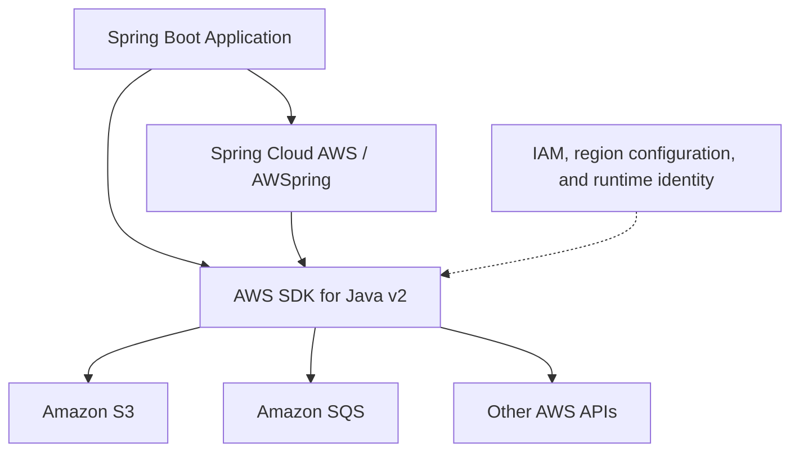

# Spring Cloud AWS by AWSpring and the Boundary with AWS SDK for Java

## 1. Context: How Does a Spring Boot Application Communicate with AWS?

When a Spring Boot application needs to store documents in Amazon S3, process messages from Amazon SQS, or read configuration from AWS Secrets Manager, it must call the API of the corresponding AWS service. Two layers of tooling commonly appear in Java code:

- **AWS SDK for Java**: the library suite developed by AWS, providing service-specific clients such as `S3Client`, `SqsClient`, and `SecretsManagerClient`. The SDK handles request signing, authentication, sending HTTP requests, receiving responses, retries, and mapping AWS API models.
- **Spring Cloud AWS**: a project in the **AWSpring** ecosystem that integrates the AWS SDK with Spring Boot through auto-configuration, dependency injection, properties, templates, listeners, and familiar Spring integrations.

The two tools **do not compete in an either-or manner**. Spring Cloud AWS uses the AWS SDK underneath; an application can use `S3Template` for common operations while also injecting `S3Client` to call specialized APIs.



**Lesson objectives:** distinguish the responsibilities of AWSpring, the AWS SDK, and AWS infrastructure; choose the appropriate level of abstraction; implement a basic S3/SQS flow; and identify issues related to credentials, IAM, errors, and testing when running in the cloud.

## 2. What Is Spring Cloud AWS and What Is AWSpring?

**AWSpring** is the name of the community/project developing **Spring Cloud AWS**. The library appears in modern Maven/Gradle dependencies under the `io.awspring.cloud` group; its integration classes also reside under the `io.awspring.cloud.*` namespace. This is an integration layer for Spring applications, **not another name for the AWS SDK** and not a managed service deployed on AWS.

Spring Cloud AWS leverages core Spring mechanisms:

| Capability | What does AWSpring support? | Limitations to understand |
| --- | --- | --- |
| Auto-configuration | Creates and configures client, template, and listener beans when the appropriate starter is present | Does not automatically grant IAM permissions or provision AWS resources in all cases |
| Configuration management | Connects Spring properties, AWS region, and credential chains; integrates configuration sources such as Parameter Store/Secrets Manager when the corresponding module is enabled | Secrets still need to be protected in IAM and during operations |
| S3 | Provides Spring-style APIs such as `S3Template` for common operations | Specific API options still require `S3Client`/`S3AsyncClient` or the appropriate SDK components |
| SQS | Provides `@SqsListener`, `SqsTemplate`, payload conversion, and listener container management | Delivery, retries, visibility timeout, DLQ, and processing order still follow SQS rules |
| Spring integration | Bean injection, environment configuration, lifecycle, and familiar message handling patterns | Does not eliminate the specific characteristics of each cloud service |

Specific starter scope, APIs, and versions may vary by release. Examples in this lesson use **the Spring Cloud AWS 3.x line with AWS SDK for Java 2.x**, which aligns architecturally with the Spring Boot 3.x ecosystem. When creating an actual project, verify the compatibility matrix of the exact Spring Boot, Spring Cloud AWS, and Java versions in use. Do not assume that every 3.x release is compatible with every Spring Boot 3.x release, or that 2.x configuration can be copied directly into 3.x.

## 3. Responsibility Boundaries Between AWSpring, the SDK, and AWS

### 3.1. AWS SDK Closely Tracks Service APIs

AWS SDK for Java v2 provides clients and request/response types close to the AWS API. For example, `S3Client.headObject(...)` accepts a `HeadObjectRequest` and returns a `HeadObjectResponse`; the response object contains `contentLength`, `eTag`, metadata, and fields provided by S3.

This layer is suitable when you need to:

- Use an operation or option not covered by AWSpring's templates.
- Finely control timeouts, HTTP transport, retries, endpoints, checksums, metadata, or async I/O according to actual requirements.
- Write a Spring-independent Java library or reuse code in applications not using Spring Boot.
- Call AWS services that do not yet have a suitable Spring Cloud AWS integration for the version in use.

Using the SDK directly **does not require** implementing IAM mechanics, request signing, or HTTP retries from scratch; the SDK already includes these mechanisms. However, developers typically must manage client lifecycle, error mapping, data conversion, and integration with Spring abstractions themselves if the application needs them.

### 3.2. AWSpring Brings AWS APIs into the Spring Application Model

AWSpring is appropriate when needs align with tasks that starters support well, such as sending/receiving events via SQS or storing/reading simple objects in S3. Starters reduce client initialization boilerplate, leverage Spring Boot auto-configuration, and bring cloud operations into the Spring application flow.

This **does not** turn AWSpring into a universal abstraction across AWS, Azure, and Google Cloud. `S3Template` remains tied to S3; `@SqsListener` remains tied to SQS semantics. Switching providers typically requires replacing adapters, configurations, and resource deployments, as well as re-testing behavioral differences.

### 3.3. AWS Controls Identity, Permissions, and Service Behavior

The application sends requests using a **principal** (an IAM role or an IAM user where appropriate). AWS evaluates permissions against the target resource. Whether called through a template or the SDK directly, a `PutObject` operation still requires the corresponding S3 permission; reading messages from a queue still requires the corresponding SQS permissions. Both libraries also depend on region, endpoint, network configuration, KMS policies, and the actual state of the service.

A useful way to separate responsibilities:

| Question | Primary place of responsibility |
| --- | --- |
| How are `PutObject`, `HeadObject`, and `SendMessage` called over AWS protocols? | AWS SDK |
| How are client beans injected, listeners run, and payloads converted in Spring? | Spring Cloud AWS + Spring Boot |
| Does the principal have permissions on the bucket/queue? | IAM, resource policy, and KMS policy where applicable |
| Do the bucket/queue exist, in the right region, with proper encryption/DLQ configuration? | AWS infrastructure and configuration |
| How are business retries, duplicate prevention, and error observability handled? | Application design combined with SDK/SQS/AWS mechanisms |

## 4. Setting Up Dependencies and Auto-Configuration

The following Maven example outlines the core **dependency management** of a Spring Boot 3.x project. The `spring-cloud-aws.version` property must be defined with a **specific release version verified for compatibility** with the project; do not copy an arbitrary version number simply because it shares the same major version.

```xml
<dependencyManagement>
    <dependencies>
        <dependency>
            <groupId>io.awspring.cloud</groupId>
            <artifactId>spring-cloud-aws-dependencies</artifactId>
            <version>${spring-cloud-aws.version}</version>
            <type>pom</type>
            <scope>import</scope>
        </dependency>
    </dependencies>
</dependencyManagement>

<dependencies>
    <dependency>
        <groupId>io.awspring.cloud</groupId>
        <artifactId>spring-cloud-aws-starter-s3</artifactId>
    </dependency>
    <dependency>
        <groupId>io.awspring.cloud</groupId>
        <artifactId>spring-cloud-aws-starter-sqs</artifactId>
    </dependency>
</dependencies>
```

These starters pull in the required Spring integrations and AWS SDK dependencies according to the selected BOM. If a Java application only uses the SDK for S3, the foundational dependency can be `software.amazon.awssdk:s3`, without adding AWSpring just to call the S3 API.

When Spring Boot starts, auto-configuration inspects the classpath, configuration, and existing beans to provide the appropriate AWS components. Therefore, in many applications you can inject `S3Template`, `SqsTemplate`, or configuration-provided SDK clients. **Do not assume every client or every abstraction exists by default**: they depend on starters, modules, auto-configuration conditions, and specific versions. When deep customization is needed, configure beans intentionally and check auto-configuration back-off rules.

### AWS Region Configuration

Example declaring the region explicitly while letting the SDK obtain identity information from the runtime environment:

```yaml
spring:
  cloud:
    aws:
      region:
        static: ${AWS_REGION}

app:
  aws:
    s3:
      bucket: ${APP_S3_BUCKET}
    sqs:
      orders-queue: ${APP_ORDERS_QUEUE}
```

`AWS_REGION`, `APP_S3_BUCKET`, and `APP_ORDERS_QUEUE` are environment variables that must be provided when running the example; they are not automatically present on every machine. The client's region must match the resources and how the AWS service uses endpoints. You can rely on the SDK's default region provider chain where appropriate, but explicit configuration helps reduce mistakes when an application is deployed across multiple environments.

### Credential Chain and Permissions

With AWS SDK for Java v2, the standard approach is to use the **default credentials provider chain**, such as credentials from environment variables or a shared AWS profile during development, and an **IAM role attached to the workload** in AWS environments (EC2 instance profile, ECS task role, or role mechanisms for EKS). AWSpring can configure the credential provider for SDK beans, but it does not invent its own permission system.

Best practices:

1. Prefer temporary credentials from roles during deployment; apply least privilege based on the operations and resource ARNs actually needed.
2. Never hard-code access keys/secret keys in YAML, source code, Docker images, logs, or tests.
3. If using an AWS profile during development, control which profile is active to avoid accidentally accessing production environments.
4. For S3, also review bucket policies and KMS key policies (if using SSE-KMS); for SQS, review queue policies and KMS when customer-managed encryption is used.

## 5. S3 Example: Templates for Common Operations, SDK for Detailed APIs

Suppose the business logic needs to store receipt files in a dedicated bucket and inspect an object's size. With the S3 starter, a simple upload operation can go through `S3Template`:

```java
import io.awspring.cloud.s3.S3Template;
import java.io.ByteArrayInputStream;
import org.springframework.beans.factory.annotation.Value;
import org.springframework.stereotype.Service;

@Service
public class ReceiptStorage {
    private final S3Template s3Template;
    private final String bucket;

    public ReceiptStorage(S3Template s3Template,
                          @Value("${app.aws.s3.bucket}") String bucket) {
        this.s3Template = s3Template;
        this.bucket = bucket;
    }

    public void store(String key, byte[] content) {
        s3Template.upload(bucket, key, new ByteArrayInputStream(content));
    }
}
```

The snippet illustrates a small payload already in memory as a `byte[]`. When processing large files, consider streaming APIs and appropriate memory limits instead of loading all data onto the heap. The application must also validate `key`, content type, size, access permissions, and encryption requirements according to business rules.

When specialized information needs to be retrieved from S3, you can use the **same lower-level SDK client** that AWSpring can configure for the application:

```java
import org.springframework.stereotype.Service;
import software.amazon.awssdk.services.s3.S3Client;

@Service
public class ReceiptMetadataReader {
    private final S3Client s3;

    public ReceiptMetadataReader(S3Client s3) {
        this.s3 = s3;
    }

    public long sizeInBytes(String bucket, String key) {
        return s3.headObject(request -> request
                .bucket(bucket)
                .key(key))
            .contentLength();
    }
}
```

`S3Client` in the second example is a class from **AWS SDK for Java v2** (`software.amazon.awssdk.*`), whereas `S3Template` is an integration class from AWSpring (`io.awspring.cloud.*`). Both approaches send requests to S3 and both require appropriate IAM permissions. `HeadObject` can be affected by object-related permissions and policies, including scenarios where the object does not exist.

**When should you go straight down to the SDK?** Examples include needing to set specific S3 request attributes, using a presigner, calling an API not clearly expressed by `S3Template`, or tuning advanced client settings. Start at the abstraction level that keeps business code clear, then use the SDK where specific requirements demand it. Do not create an adapter that merely forwards individual SDK calls without providing testing or design benefits.

## 6. SQS Example: Spring Convenience Does Not Change Messaging Semantics

Suppose an ordering system publishes an `OrderCreated` event to a queue for another service to process. With the SQS starter, the application can send messages via `SqsTemplate` and register a handler method using `@SqsListener`.

```java
import io.awspring.cloud.sqs.operations.SqsTemplate;
import org.springframework.beans.factory.annotation.Value;
import org.springframework.stereotype.Service;

record OrderCreated(String orderId, String customerId) {}

@Service
public class OrderEventPublisher {
    private final SqsTemplate sqsTemplate;
    private final String queue;

    public OrderEventPublisher(SqsTemplate sqsTemplate,
                               @Value("${app.aws.sqs.orders-queue}") String queue) {
        this.sqsTemplate = sqsTemplate;
        this.queue = queue;
    }

    public void publish(OrderCreated event) {
        sqsTemplate.send(to -> to.queue(queue).payload(event));
    }
}
```

```java
import io.awspring.cloud.sqs.annotation.SqsListener;
import org.springframework.stereotype.Component;

@Component
public class OrderEventHandler {
    @SqsListener("${app.aws.sqs.orders-queue}")
    public void onOrderCreated(OrderCreated event) {
        // Idempotent processing: record that orderId has been received.
        // Throw an exception on failure so the error/ack mechanism handles it appropriately.
    }
}
```

The example assumes the queue already exists, IAM permissions are granted, and JSON/payload conversion has suitable dependencies/configuration. `SqsTemplate` and listeners reduce queue communication boilerplate, but key characteristics are still determined by SQS and listener configuration:

- **The same message can be received again.** Standard queues use *at-least-once delivery*; consumers must process idempotently, for instance using `eventId`/`orderId` combined with a unique constraint or a processing tracking table.
- **Visibility timeout** determines how long an in-flight message is hidden from other receive attempts. This duration must suit processing time; longer jobs may require adjustment or extension.
- **Acknowledgement and errors** must be understood according to the configured acknowledgement mode/listener container. In standard flows, successful processing results in deleting/acknowledging the message; errors can cause the message to reappear after the visibility timeout.
- **Dead-letter queue (DLQ)** and redrive policies are determined by SQS configuration to isolate repeatedly failing messages. Logging and alerting on DLQ message counts must be designed separately.
- **Ordering and deduplication** differ between Standard and FIFO queues; FIFO does not remove the need for error handling or automatically guarantee business transaction correctness.
- **IAM permissions** must account for actual operations such as receiving and deleting messages, querying queue attributes/URLs, and changing visibility when used; producers need send permissions.

Notably, **AWS SDK retries** (retrying HTTP/API requests on eligible errors) and **SQS redelivering a message for consumer processing** are two separate mechanisms. Both must be evaluated to avoid sending duplicate events or duplicating side effects.

## 7. Secrets Manager, Parameter Store, and Security Boundaries

Spring Boot applications often need environment-specific configuration: external endpoints, feature flags, API tokens, and database passwords. Spring Cloud AWS integrations can be used to bring values from **AWS Systems Manager Parameter Store** or **AWS Secrets Manager** into Spring's configuration mechanism, depending on the selected starter and version.

This is a significant difference from calling the SDK directly: instead of manually calling `GetSecretValue` and mapping results into beans/config objects, Spring Cloud AWS can integrate configuration loading into the application lifecycle. However, you must clearly define the source, property precedence, failure handling when secrets are inaccessible, least-privilege IAM permissions, and secret rotation policies.

Do not confuse the three protection layers:

1. **Storage**: use an appropriate secret/parameter management service with encryption and proper access policies.
2. **Read permissions**: the workload role must be allowed to read the exact secret ARN/path needed; if a customer-managed KMS key is involved, appropriate decrypt permissions are required.
3. **In-application usage**: avoid printing secrets to logs, exceptions, tracing, actuator endpoints, or responses; verify refresh behavior when secrets change. Do not assume configuration loaded at startup will automatically refresh without additional design.

A `SecretsManagerClient` from the AWS SDK is still needed if business logic must call secret management APIs, control secret versions, or perform operations beyond what the library's configuration integration provides.

## 8. Choosing a Library by Problem, Not by Service Name

| Scenario | Reasonable starting point | Reason |
| --- | --- | --- |
| Routine file storage in a Spring Boot application | AWSpring's `S3Template` | Less integration code, suitable for simple operations |
| Retrieving object metadata, configuring specific S3 requests | AWS SDK's `S3Client`/`S3AsyncClient` | Direct access to S3 operations and options |
| Receiving events from SQS as a Spring message handler | AWSpring's `@SqsListener` | Integrates listener container and payload handling |
| Managing custom polling, batching, or specialized SQS requests | `SqsClient`/`SqsAsyncClient` | Fine-grained control over API call lifecycle |
| Loading secrets/parameters into Spring Environment | AWSpring configuration integration module | Leverages Spring's configuration mechanism |
| Non-Spring Java service | AWS SDK for Java | Avoids unnecessary Spring dependencies |
| AWS service without a suitable abstraction in your AWSpring version | Direct AWS SDK | SDK scope generally covers more service APIs |

A system can **combine** both approaches within the same module. What should remain stable is the boundary of business code: the service layer should expose behaviors such as `storeReceipt`, `publishOrderCreated`, and `fetchSecret`, while AWS call details are placed in an appropriate adapter/infrastructure layer for easier change and testing.

### Common Misconceptions

**"Adding the starter means you can call AWS immediately."** Not enough: you also need the right region/endpoint, a principal with credentials, IAM permissions, existing resources, and network connectivity.

**"AWSpring replaces the entire SDK."** False: AWSpring builds on the SDK and only provides abstractions for supported use cases.

**"Spring Cloud AWS is a generic Spring Cloud layer for every cloud provider."** False: this integration is designed for AWS services. Azure and Google Cloud typically have corresponding Spring integration projects, but their APIs, identity models, permissions, storage, and messaging differ.

**"Mocked client tests passing means the system works on AWS."** Not necessarily: mocks do not prove IAM permissions, endpoints, serialization, visibility timeouts, network policies, or real quotas.

**"An SQS listener runs once, so idempotency isn't needed."** False for reliable design: messages can be redelivered, and a consumer can crash after causing a side effect but before acknowledging.

## 9. Integration Testing and Real-World Deployment

Split testing into layers to catch errors in the right place:

| Test layer | Purpose | Limitations |
| --- | --- | --- |
| Unit tests | Verify business logic, mapping, and exception handling with fake/mock adapters | Does not validate real interactions with AWS |
| Integration tests with an emulator such as LocalStack | Verify SDK/Spring connectivity, S3/SQS operations, and sent/received data in a near-real environment | Parity does not fully guarantee IAM, operational behavior, and every AWS API |
| Smoke/integration tests on a dedicated AWS account | Verify IAM, networking, region, resources, encryption, and end-to-end path from producer to consumer | Consumes resources; requires limiting scope, data, and cost |

A minimal deployment checklist for the S3/SQS example:

1. **Provision** the bucket/queue in the test environment; configure encryption, lifecycle policies, and DLQ as required.
2. **IAM** for the service role: grant only the operations and resources actually needed; test a request using the actual workload identity.
3. **Configure** region, bucket, queue, endpoint, and credential provider per environment; keep secrets outside the repository.
4. **Observe** logs with correlation IDs, metrics for errors, latency, queue backlog, and DLQ message counts; avoid logging sensitive payloads.
5. **Failure testing**: queue temporarily unreachable, S3 returning errors, message redelivery, consumer taking longer than visibility timeout; verify retries/idempotency and alerting.

During integration testing, you can use Testcontainers to spin up LocalStack, then override endpoint/region/credentials only in test configuration. When running on real AWS, prefer the credential chain/role and default service endpoints. Never let LocalStack endpoints or static test credentials leak into production configuration.

## 10. Applied Exercise

**Scenario:** a team is building a Spring Boot service that receives report export requests, stores reports in S3, and then pushes a `ReportReady` message to SQS so a worker can send notifications. When deployed to ECS, the service has a task role; on local developer machines, developers use a personal AWS profile.

Perform or design the following steps:

1. Choose the appropriate starters, declare a compatible BOM, and trace the path of a request from `S3Template` or `SqsTemplate` down to the AWS SDK and AWS API.
2. List the required permissions for the producer (`s3:PutObject`, `sqs:SendMessage` on specific resources). For the worker, specify the permissions needed to receive/acknowledge messages and read permissions on objects if the worker genuinely needs the report content.
3. Write an adapter to store reports using `S3Template`; use `S3Client` if a specific metadata field/API is required that the template does not support.
4. Design an idempotency key for `ReportReady`, configure a DLQ, and handle retries when the worker fails after sending the notification but before acknowledging.
5. Describe how to perform unit testing, LocalStack testing, and a smoke test on a restricted AWS account. State what each test layer cannot guarantee.

**Self-check questions:** If `@SqsListener` starts up but continuously encounters queue access errors, should you modify `@SqsListener` or check IAM first? If S3 uploads succeed in unit tests but fail in ECS, where should you look regarding the credential provider, task role, bucket policy, region, and network? These questions force separating issues between the **integration library**, the **SDK**, and **AWS infrastructure**.

## 11. Conclusion

In the module on integrating Spring Boot with cloud provider managed services, **Spring Cloud AWS by AWSpring** serves as the Spring-style support layer, while the **AWS SDK for Java** is the client layer executing AWS APIs. The two layers work together; choosing templates/listeners versus direct clients depends on the level of control the problem requires. Regardless of the choice, the system must still be designed accurately for IAM, credentials, regions, delivery semantics, retries, idempotency, operations, and testing in the target environment.
