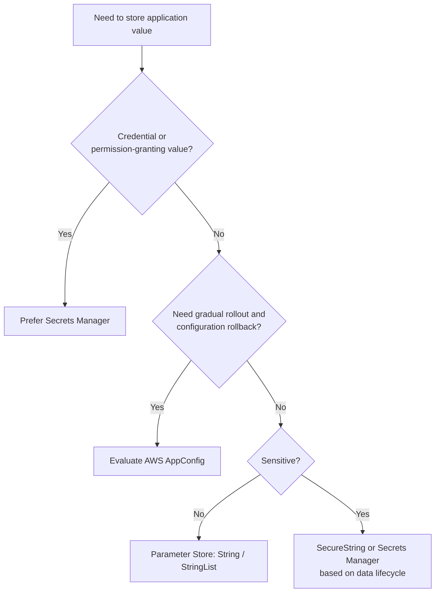
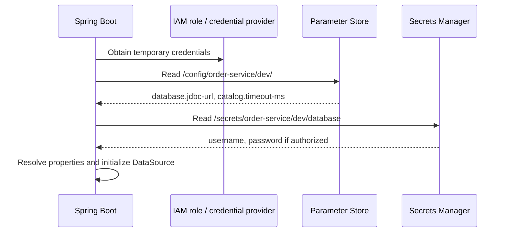

# Choosing Parameter Store or Secrets Manager by Data Type

## Objectives

In the **SPRING_CLOUD_PROVIDER_INTEGRATION** module, learners practice integrating Spring Boot with managed services from AWS, Azure, and Google Cloud. In the **AWS Configuration** chapter, we need to know where to store endpoints, queue names, database passwords, or API keys so they are secure, easy to operate, and cost-optimized.

After this lesson, you will be able to:

1. Distinguish between standard configuration, sensitive configuration, and **access-granting secrets**.
2. Choose **AWS Systems Manager Parameter Store** or **AWS Secrets Manager** based on data type, rotation requirements, security, quotas, and cost.
3. Load both sources into Spring Boot via **Spring Cloud AWS** using an IAM role.
4. Design read permissions, secret updates, caching, and integration testing.

> **Starting rule:** Parameter Store is suitable for key-value configuration; Secrets Manager is the preferred choice for passwords, tokens, API keys, and secrets whose lifecycle needs to be managed. `SecureString` encrypts a value but does not automatically provide a **rotation** workflow like Secrets Manager does.

## 1. Understanding the Two Services Correctly

### Parameter Store: Path-Based Configuration Store

AWS Systems Manager Parameter Store stores name/value pairs with a hierarchical structure:

```text
/config/order-service/dev/database.jdbc-url
/config/order-service/dev/catalog.timeout-ms
/config/order-service/prod/catalog.base-url
```

| Parameter type | Characteristics | Examples |
| --- | --- | --- |
| `String` | Text-based configuration string | Endpoints without credentials, S3 bucket/SQS queue names |
| `StringList` | Multiple comma-separated values | Allowed Regions |
| `SecureString` | Value encrypted using AWS KMS | Sensitive license keys or secret configuration that does not require dedicated rotation |

Parameter Store supports version management, IAM-based authorization, and reading by path. The **Standard** tier has a **4 KB/value** limit, and the **Advanced** tier has an **8 KB/value** limit. Standard generally incurs no charge for storing parameters or reading at default throughput; Advanced and higher throughput incur charges, and KMS charges may also apply. **Parameter Store does not have a dedicated automatic credential rotation mechanism**. Advanced parameter policies apply to conditions such as expiration/notifications and do not replace rotation.

With `SecureString`, AWS encrypts the **value**, while the **name, description, and metadata** are not encrypted in that way. Therefore, do not put tokens or sensitive data in the path name.

### Secrets Manager: Secret Lifecycle Management

AWS Secrets Manager is designed for values that allow a holder to log in, sign requests, or access resources: database passwords, API keys, OAuth tokens, private keys, and third-party service credentials. A secret can be a string, multi-field JSON, or binary data, with a **64 KB** limit. The service encrypts content with KMS, controls access using IAM/resource policies, tracks versions with labels such as `AWSCURRENT` and `AWSPREVIOUS`, and supports rotation and secret replication to other Regions.

**Rotation must be enabled and properly configured**. For some supported databases/services, managed rotation can be used; in other cases, Lambda or custom integration is usually required to change credentials on the target system. If an API key provider does not offer an API to generate a new key, Secrets Manager cannot generate a key on its behalf.

## 2. Choosing by Data Type

| Application data | Preferred choice | Reason |
| --- | --- | --- |
| Internal service URLs, connection ports | Parameter Store `String` | Does not directly grant access |
| S3 bucket, SQS queue, SNS topic names | Parameter Store `String` | Identifiers only; IAM determines operation permissions |
| Timeouts, retry counts, batch sizes | Parameter Store `String` | Simple application configuration |
| Region lists, public partner codes | Parameter Store `StringList` | Small, non-sensitive lists |
| JDBC URL **without a password** | Parameter Store `String` | Only describes the database location |
| Database username/password | Secrets Manager | Credentials; often need periodic rotation |
| Payment API keys, bearer tokens, OAuth refresh tokens | Secrets Manager | Exposing the value exposes permissions |
| Private keys, webhook signing secrets | Secrets Manager | Secrets requiring controlled distribution and replacement |
| License keys or sensitive configuration that rarely changes | `SecureString` or Secrets Manager | Weigh audit, KMS, rotation, and cost requirements |
| Secrets requiring managed replicas in multiple Regions | Secrets Manager | Supports replication |

Decision-making workflow:

1. **Is the value used to authenticate, sign data, or obtain access permissions?** If yes, prefer Secrets Manager.
2. **Do you need rotation, cross-account access, Region replication, or management of multiple secret versions?** If yes, evaluate Secrets Manager first.
3. **Is it just small, relatively stable configuration?** Choose Parameter Store. If sensitive but not a credential and encryption is needed, evaluate `SecureString`.
4. **Is it a feature flag or frequently changing configuration requiring staged rollouts and automatic rollback?** Evaluate **AWS AppConfig**, a service dedicated to managing dynamic configuration deployments.
5. **Tight budget?** Compare the total cost of storage, APIs, KMS, operating rotation, and incidents—not just the storage cost of a single value.



### Feature Comparison

| Criterion | Parameter Store | Secrets Manager |
| --- | --- | --- |
| Primary purpose | Hierarchical configuration management | Secret and lifecycle management |
| Value encryption | Choose `SecureString` with KMS; `String`/`StringList` do not use this value encryption | KMS encrypts secret content |
| Value size limit | 4 KB Standard; 8 KB Advanced | 64 KB |
| Versioning | Parameter versions | Secret versions and staging labels |
| Automatic rotation | Not built in | Supported mechanisms, must be configured |
| Account sharing | Sharing supported with Advanced tier | Resource policies and appropriate KMS setup |
| Multi-Region replication | Requires custom design | Supports replication |
| Pricing | Standard storage is generally free; Advanced/higher throughput is billed | Billed per secret and API call; additional related fees if used |

Quotas, API limits, and pricing may vary by Region, tier, and time; check the official pricing documentation during implementation. You should not pay to manage 300 secrets just to store 300 timeout and URL values, whereas a database password requiring rotation may justify using Secrets Manager.

## 3. Hands-on Example with Spring Boot

Suppose `order-service` needs to connect to PostgreSQL and call the Catalog API. We organize configuration by **service/environment**:

```text
Parameter Store
  /config/order-service/dev/database.jdbc-url
  /config/order-service/dev/catalog.timeout-ms

Secrets Manager
  /secrets/order-service/dev/database
```

| Source | Name | Sample value |
| --- | --- | --- |
| `String` | `/config/order-service/dev/database.jdbc-url` | `jdbc:postgresql://db.dev.internal:5432/orders` |
| `String` | `/config/order-service/dev/catalog.timeout-ms` | `2500` |
| JSON secret | `/secrets/order-service/dev/database` | `{"username":"orders_app","password":"<secret value>"}` |

The paths and database details above are **illustrative** data. On a real system, never put passwords in code, commits, shell history, or CI logs.

### 3.1. Creating Non-Sensitive Parameters

Example with the AWS CLI:

```bash
aws ssm put-parameter \
  --name "/config/order-service/dev/database.jdbc-url" \
  --type "String" \
  --value "jdbc:postgresql://db.dev.internal:5432/orders"

aws ssm put-parameter \
  --name "/config/order-service/dev/catalog.timeout-ms" \
  --type "String" \
  --value "2500"
```

To replace an existing parameter, add `--overwrite`. For secrets, use the AWS Console or a secure secret provisioning workflow to create a JSON secret named `/secrets/order-service/dev/database` with two fields: `username` and `password`. Avoid entering real values directly as command-line arguments because shell history and logs may record them.

### 3.2. Declaring Spring Cloud AWS

Configure a Spring Cloud AWS BOM compatible with Spring Boot in `pom.xml`:

```xml
<dependencyManagement>
    <dependencies>
        <dependency>
            <groupId>io.awspring.cloud</groupId>
            <artifactId>spring-cloud-aws-dependencies</artifactId>
            <version>${spring-cloud-aws.version}</version>
            <type>pom</type>
            <scope>import</scope>
        </dependency>
    </dependencies>
</dependencyManagement>

<dependencies>
    <dependency>
        <groupId>io.awspring.cloud</groupId>
        <artifactId>spring-cloud-aws-starter-parameter-store</artifactId>
    </dependency>
    <dependency>
        <groupId>io.awspring.cloud</groupId>
        <artifactId>spring-cloud-aws-starter-secrets-manager</artifactId>
    </dependency>
</dependencies>
```

The Maven property `${spring-cloud-aws.version}` must be declared by the project as a version compatible with the Spring Boot version in use; this is a structural example and does not prescribe one default version for all projects.

In `application.yml`:

```yaml
spring:
  application:
    name: order-service
  config:
    import:
      - "aws-parameterstore:/config/order-service/dev/"
      - "aws-secretsmanager:/secrets/order-service/dev/database?prefix=database."
  datasource:
    url: "${database.jdbc-url}"
    username: "${database.username}"
    password: "${database.password}"
```

Spring Cloud AWS loads `database.jdbc-url` and `catalog.timeout-ms` from the Parameter Store path into the Spring Environment. When the JSON secret contains the `username` and `password` fields, the `?prefix=database.` option names the properties `database.username` and `database.password` to avoid name collisions with other sources. The trailing dot in the prefix is intentional. Spring Boot resolves them into `DataSource` properties.

Example of binding Catalog configuration:

```java
import org.springframework.boot.context.properties.ConfigurationProperties;

@ConfigurationProperties(prefix = "catalog")
public record CatalogProperties(int timeoutMs) {}
```

Register it via `@ConfigurationPropertiesScan` or `@EnableConfigurationProperties(CatalogProperties.class)`. Spring Boot maps `catalog.timeout-ms` to `timeoutMs`.

The `dev` segment in the import can be replaced with the path for each Spring profile/deployment, but you must separate the AWS accounts, Regions, and access permissions properly for dev/prod. If a **required** configuration source does not exist, the application should fail at startup. Only use `optional:aws-parameterstore:...` or `optional:aws-secretsmanager:...` when the value is truly optional; `optional:` does not help a bean that uses a missing placeholder work.

### 3.3. Using IAM Roles Instead of Static Access Keys

Applications on ECS, EKS, EC2, or Lambda should obtain **temporary workload identities**: an ECS task role, EKS Pod Identity/IRSA, EC2 instance profile, or an appropriate execution role. Developer machines can use an authorized AWS profile/SSO. Never put AWS access keys in `application.yml` or source code.

Example policy dedicated to `order-service` in the `dev` environment (replace the placeholder account/Region with real values):

```json
{
  "Version": "2012-10-17",
  "Statement": [
    {
      "Sid": "ReadOrderServiceDevParameters",
      "Effect": "Allow",
      "Action": [
        "ssm:GetParameter",
        "ssm:GetParameters",
        "ssm:GetParametersByPath"
      ],
      "Resource": "arn:aws:ssm:ap-southeast-1:111122223333:parameter/config/order-service/dev/*"
    },
    {
      "Sid": "ReadOrderServiceDevDbSecret",
      "Effect": "Allow",
      "Action": "secretsmanager:GetSecretValue",
      "Resource": "arn:aws:secretsmanager:ap-southeast-1:111122223333:secret:/secrets/order-service/dev/database-*"
    }
  ]
}
```

`GetParametersByPath` allows recursive reading by path; be especially careful when granting permissions on a **parent path** and verify that the ARN matches the actual command. The policy above only grants read access; permissions to create, modify, or delete configuration should belong to a separate operations/CI IAM role. Additional supporting permissions may be needed depending on the actual operations and library version.

If a secret or `SecureString` uses a **customer managed KMS key**, the read flow may also require `kms:Decrypt` on that specific key and a corresponding key policy. Write/rotation flows may require additional KMS permissions. Do not resolve `AccessDenied` by granting `kms:*`, `ssm:*`, or `secretsmanager:*` across all resources. With AWS managed keys, KMS permission details may differ; check the configuration of the key in use.

### 3.4. Configuration Loading Flow



When using `spring.config.import`, data is loaded during Spring Boot's configuration phase. **Rotating a secret in AWS does not automatically update the password in an already initialized `DataSource`**. If runtime updates are required, you must explicitly design how to re-read, cache, refresh the connection pool, or perform a controlled rollout/restart. Do not assume all Spring Cloud AWS versions have the same refresh mechanism.

## 4. Rotation, Caching, and Availability

**Parameter Store:** For rarely changing timeouts, queue names, or endpoints, put updates through a review workflow, version management, and a rollback plan. A changed parameter will return the new value on the next read from the service; existing application beans only change when an appropriate refresh/rebind mechanism is designed.

**Secrets Manager:** Build a verifiable credential lifecycle:

1. Provision the initial secret and verify that the target system (e.g., PostgreSQL) accepts the corresponding credential.
2. Enable scheduled rotation and choose managed rotation, Lambda, or a service-supported method.
3. Rehearse rotation in a staging environment: the new credential works, and the old credential is revoked according to policy without causing widespread errors.
4. Check `AWSCURRENT`/`AWSPREVIOUS` version labels, rotation failures, alerts, and fallback paths.
5. Ensure the application picks up the new credential after the cache TTL, refresh, or rollout and replaces the connection pool safely.

If a third-party API has no automatic key generation/revocation mechanism, a manual runbook or custom integration is required. **Staging labels do not automatically replace passwords in already open database connections.**

**Caching and quotas:** Querying the configuration source on *every HTTP request* typically increases latency, API call counts, cost, and throttling risk. For rarely changing configuration, loading at startup is reasonable; for credentials requiring continuous rotation, apply SDK caching/refreshing with an appropriate TTL. A TTL that is too long causes the application to use stale credentials; a TTL that is too short causes excessive requests and network dependency. When AWS APIs experience transient errors, distinguish between **required** data that must fail fast and **optional** data that has a safe fallback.

**Monitoring:** AWS CloudTrail records corresponding administrative/API access calls; configure alerts for `AccessDenied` errors, rotation failures, throttling, and abnormal API call volume. Never log secret contents in logs, stack traces, traces, CI output, or actuator endpoints.

## 5. Common Mistakes and How to Avoid Them

| Design mistake | Risk | Mitigation |
| --- | --- | --- |
| Storing passwords in `String` or JDBC URLs containing `?password=...` | Exposes credentials to config readers | Separate passwords into secrets and restrict access |
| Allowing every application to read all of `/config/` or all secrets | Cross-environment/cross-service data exposure | Per-application/per-environment IAM roles and resource ARNs |
| Sharing credentials between dev and prod | Dev incidents affect prod | Separate accounts/roles, secrets, and KMS keys as required |
| Assuming creating a secret enables rotation | Secrets may persist for years | Configure rotation, rehearse, and monitor |
| Assuming rotation automatically updates a running `DataSource` | Old credentials expire, new connections fail | Define a cache TTL, refresh, or rollout strategy |
| Putting secrets into logs, history, commits, or tags | Leaks outside the encrypted store | Mask and restrict where values can be observed |
| Using `optional:` for a required password | Application fails late or starts in a broken state | Require the import, validate configuration early |
| Missing `kms:Decrypt` or key policy | Decryption fails despite API read permissions | Check IAM + KMS on the exact resource |
| Choosing Parameter Store for continuously changing feature flags | Lacks staged rollout/auto rollback | Use AppConfig when dynamic configuration deployment management is needed |

Paths, descriptions, tags, and secret names can also appear in audit logs; never place secret values in metadata.

## 6. Integration Testing and Troubleshooting

Testing should be split into two layers:

- **Testing Spring Boot logic:** use mock test properties to verify binding, configuration conditions, and application error handling without connecting to AWS.
- **AWS integration testing:** run in a sandbox account with restricted IAM roles to verify real APIs, KMS, paths, Regions, rotation, quotas, and permission-denied behavior. LocalStack can help partially, but it does not replace testing real IAM/KMS/rotation mechanisms.

| Scenario | What to verify |
| --- | --- |
| Correct account/Region, valid parameters and secrets | Application starts, binds timeouts properly, and connects to the database |
| Missing required Parameter Store path | Clear configuration error at startup |
| Missing required secret | Fails fast, does not print sensitive values |
| Role denied `secretsmanager:GetSecretValue` | Distinguish permission errors from missing secret errors |
| Missing `kms:Decrypt` for custom key | Identify key policy/role issues instead of opening all permissions |
| Credential rotated under active traffic | New connections succeed after the refresh/rollout strategy |
| Multiple instances starting simultaneously | Does not exceed quotas or suffer uncontrolled throttling |

When debugging, check in this order: **resource name/path → AWS account/Region → IAM role → KMS key → secret status/version → Spring property source order and cache**. `aws secretsmanager describe-secret --secret-id /secrets/order-service/dev/database` is used to inspect metadata without printing the value; avoid running `get-secret-value` into shared consoles/logs. Check CloudTrail and appropriate metrics when permission or rotation errors occur.

## 7. Applied Exercise

`payment-service` has the following values:

```text
payment.gateway-url
payment.timeout-ms
payment.api-key
payment.webhook-signing-secret
sqs.payment-events-queue
database.username
database.password
```

Propose a storage layout for `/config/payment-service/prod/` and `/secrets/payment-service/prod/`:

1. Store `gateway-url`, `timeout-ms`, and the queue name in Parameter Store `String`, provided the URL contains no sensitive tokens.
2. Store `api-key`, `webhook-signing-secret`, and database credentials in Secrets Manager; if rotation is needed, determine which party can create, activate, and revoke credentials.
3. Write `spring.config.import`, the JSON secret structure, and the IAM role policy for reading only `payment-service` configuration in the prod environment.
4. Describe the behavior when a key is revoked: how long until the cache expires, how the application loads the new value, what alerts appear, and how to roll back.

**Completion criteria:** Include a classification table with rationale, namespaces, least-privilege principles, Spring Boot configuration, and a rotation/testing scenario.

## 8. Connection to Azure and Google Cloud

This module integrates multiple cloud providers, so focus on **needs** rather than mechanically looking for identical service names:

| Need | AWS | Azure | Google Cloud |
| --- | --- | --- | --- |
| Non-secret configuration | Parameter Store, or AppConfig when rollout is needed | Azure App Configuration | Configuration from the runtime platform such as environment/ConfigMap on GKE; no 1:1 equivalent for every Parameter Store feature |
| Secrets and credentials | Secrets Manager | Azure Key Vault | Google Cloud Secret Manager |
| Workload identity | IAM role | Managed Identity | Service Account / Workload Identity |

Authorization mechanisms, SDKs, rotation, and how configuration is loaded into Spring Boot differ across providers. Do not assume that `spring.config.import` from two different Spring Cloud libraries shares the same syntax or refresh mechanism.

## Conclusion

**Parameter Store** is a sound choice for hierarchical, infrequently changing configuration. **Secrets Manager** is preferred for credentials requiring protection and lifecycle management. When deciding, simultaneously evaluate data nature, rotation/replication requirements, IAM/KMS, caching, quotas, cost, and testing scenarios. A secure secret store is only effective when the application also protects values after reading them.

## References

- [AWS Systems Manager Parameter Store](https://docs.aws.amazon.com/systems-manager/latest/userguide/systems-manager-parameter-store.html) — parameter types, limits, pricing, and selection criteria.
- [Parameter Store reference](https://docs.aws.amazon.com/systems-manager/latest/userguide/what-is-a-parameter.html) — `SecureString` security and metadata.
- [What is AWS Secrets Manager?](https://docs.aws.amazon.com/secretsmanager/latest/userguide/) — secrets, KMS, rotation, versions, and pricing.
- [AWS Security Blog: How to choose the right AWS service for managing secrets and configurations](https://aws.amazon.com/blogs/security/how-to-choose-the-right-aws-service-for-managing-secrets-and-configurations/) — comparison of Parameter Store, AppConfig, and Secrets Manager.
- [Spring Cloud AWS Reference 3.4.2](https://docs.awspring.io/spring-cloud-aws/docs/3.4.2/reference/html/index.html) — dependencies, `spring.config.import`, prefixes, and Spring Boot integration; cross-check against the version used in your project.
