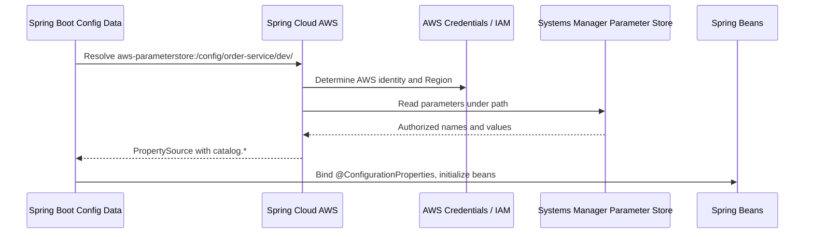

# Loading Parameter Store with Config Data

## Objectives and Context

In the **SPRING_CLOUD_PROVIDER_INTEGRATION** module, we practice integrating Spring Boot with managed services from AWS, Azure, and Google Cloud using the corresponding Spring Cloud libraries. When deploying an application on AWS, values such as service URLs, timeouts, retry counts, and bucket or queue names typically differ across `dev`, `staging`, and `prod`. Putting those values into source code or repackaging the application every time configuration changes makes operations hard to control.

In the **AWS Configuration** chapter, this lesson focuses on using the **Spring Boot Config Data API** together with **Spring Cloud AWS Parameter Store** to load values from AWS Systems Manager Parameter Store into the Spring `Environment` at application startup.

After this lesson, you will be able to:

1. Explain the `spring.config.import` mechanism and the difference between Config Data loading and calling the AWS SDK manually.
2. Organize Parameter Store paths by application/environment and map parameter names to Spring Boot properties.
3. Configure dependencies, imports, `@ConfigurationProperties`, AWS Region, and IAM roles.
4. Handle required/optional configuration, protect `SecureString`, test, and troubleshoot startup failures.
5. Evaluate when a dedicated reload mechanism or another configuration service such as AWS AppConfig is needed.

> **Scope:** Examples use Spring Boot with **Config Data** support (since Spring Boot 2.4) and the **Spring Cloud AWS 3.x** (`io.awspring.cloud`) library family. You must choose a Spring Cloud AWS version compatible with your project's actual Spring Boot version; starter/configuration names may differ in older library generations.

## 1. How Does Config Data Work?

### 1.1. From Parameter to Property

Suppose `order-service` needs two configuration entries:

```text
/config/order-service/dev/catalog.base-url     = https://catalog.dev.example.internal
/config/order-service/dev/catalog.timeout      = 2s
```

Parameter Store stores **names** and **values**. Spring Cloud AWS reads the parameters under the `/config/order-service/dev/` path and strips the path prefix to provide:

```properties
catalog.base-url=https://catalog.dev.example.internal
catalog.timeout=2s
```

These properties participate in Spring Boot's configuration system, so you use `${catalog.base-url}`, `@Value`, `@ConfigurationProperties`, or `@ConditionalOnProperty` just like data from `application.yml`.

When the application starts, Spring Boot processes the declaration:

```yaml
spring:
  config:
    import: "aws-parameterstore:/config/order-service/dev/"
```

`aws-parameterstore:` is the **Config Data location resolver** provided by the Spring Cloud AWS starter. Spring Boot asks the resolver to load the data during the configuration preparation phase, before most application beans are created.



**Config Data vs. runtime SDK calls:** When calling `SsmClient` yourself inside a `@Service`, the bean must know when to invoke it and handle caching, retries, and property updates; by contrast, Config Data integrates loading into Spring Boot's externalized configuration mechanism. Changing a parameter in AWS **does not automatically update already initialized beans**: an appropriate reload and rebind/refresh mechanism, or an application redeployment, is required.

### 1.2. Why Use Config Data Instead of the Legacy Bootstrap Approach?

Since Spring Boot 2.4, `spring.config.import` has been the official way to import additional configuration sources during startup. Some legacy Spring Cloud tutorials use `bootstrap.yml` or `spring.cloud.config...`; do not copy that approach verbatim into Spring Cloud AWS 3.x applications.

Config Data provides these benefits:

- One clear declaration point: the application knows which path is imported right inside the profile-specific configuration file.
- Values from AWS participate in Spring's placeholder resolution and configuration object binding.
- You can choose **required sources** or **optional sources** via the `optional:` prefix.
- Configuration loading errors can be observed right during startup, before the application serves requests.

## 2. Designing Parameter Store Before Writing Code

### 2.1. Organizing by Application and Environment

A manageable naming convention is:

```text
/config/order-service/dev/catalog.base-url
/config/order-service/dev/catalog.timeout
/config/order-service/dev/catalog.max-retries

/config/order-service/prod/catalog.base-url
/config/order-service/prod/catalog.timeout
/config/order-service/prod/catalog.max-retries
```

| Component | Meaning | Convention |
| --- | --- | --- |
| `/config/` | Application configuration namespace | Separate from `/secrets/` when managing secrets |
| `order-service` | Workload owning the configuration | Each service has its own tree |
| `dev` or `prod` | Deployment environment | Do not share paths between dev and prod |
| `catalog.timeout` | Property name after stripping prefix | Named in a Spring Boot-friendly binding format |

A path is a **design convention**, not a security boundary by itself. IAM permissions and KMS policies determine which workload can read or modify parameters.

### 2.2. Choosing Data Types

Parameter Store has three common value types:

| Type | Used for | Notes |
| --- | --- | --- |
| `String` | URLs, timeouts, retry counts, resource names | Do not place credentials or tokens in the value |
| `StringList` | A short list of strings | Watch out for commas when binding to a `List` |
| `SecureString` | Sensitive configuration requiring AWS KMS encryption | IAM permissions, KMS, and lifecycle management must be considered separately |

Standard parameters have a **4 KB** per-value limit; Advanced parameters allow **8 KB**. Parameter Store is suited for small, relatively stable configuration. For passwords, API keys, or tokens requiring rotation and lifecycle management, evaluate **AWS Secrets Manager**. For staged rollouts and automatic configuration rollback, consider **AWS AppConfig**.

### 2.3. Creating Sample Data

The commands below create **non-secret configuration** only. Assume the AWS CLI is already configured for your sandbox account and target Region:

```bash
aws ssm put-parameter \
  --name "/config/order-service/dev/catalog.base-url" \
  --type "String" \
  --value "https://catalog.dev.example.internal"

aws ssm put-parameter \
  --name "/config/order-service/dev/catalog.timeout" \
  --type "String" \
  --value "2s"

aws ssm put-parameter \
  --name "/config/order-service/dev/catalog.max-retries" \
  --type "String" \
  --value "3"
```

To update an existing parameter, use `--overwrite` under a reviewed workflow with version tracking. Parameters in AWS hold string values; `Duration`, `int`, `boolean`, or Java objects are types **converted by Spring Boot during binding**, not types natively stored by Parameter Store.

In production, avoid creating parameters from scripts containing plaintext secrets or putting credentials into shell history, CI/CD logs, and commits.

## 3. Adding the Spring Cloud AWS Dependency

The sample application uses Spring Boot and Maven. Declare the Spring Cloud AWS BOM along with the Parameter Store starter:

```xml
<dependencyManagement>
    <dependencies>
        <dependency>
            <groupId>io.awspring.cloud</groupId>
            <artifactId>spring-cloud-aws-dependencies</artifactId>
            <version>${spring-cloud-aws.version}</version>
            <type>pom</type>
            <scope>import</scope>
        </dependency>
    </dependencies>
</dependencyManagement>

<dependencies>
    <dependency>
        <groupId>io.awspring.cloud</groupId>
        <artifactId>spring-cloud-aws-starter-parameter-store</artifactId>
    </dependency>
</dependencies>
```

The `${spring-cloud-aws.version}` property is declared in the project's `pom.xml`/version management after checking the **Spring Boot – Spring Cloud AWS compatibility matrix**. The BOM keeps Spring Cloud AWS artifacts on aligned versions. Do not add the Secrets Manager starter if the exercise only needs Parameter Store.

If the application needs configuration validation via Jakarta Bean Validation (`@Validated`, `@NotNull`, etc.), also declare `spring-boot-starter-validation` matching the project's Spring Boot version; the main example below only needs basic binding.

## 4. Loading Parameters with `spring.config.import`

### 4.1. Development Environment

Create `src/main/resources/application-dev.yml`:

```yaml
spring:
  config:
    import: "aws-parameterstore:/config/order-service/dev/"
```

When running with the `dev` profile, Spring Boot imports the parameters under the specified path. In the sample project, `application.yml` does not declare a mandatory AWS import shared across all profiles, so that the `test` profile can run without AWS.

```bash
java -jar order-service.jar --spring.profiles.active=dev
```

For the production environment, `application-prod.yml` uses its own path:

```yaml
spring:
  config:
    import: "aws-parameterstore:/config/order-service/prod/"
```

Having separate files per profile **does not replace** separating IAM roles, accounts, and Regions by environment. A prod workload should not have permission to read dev configuration just because the path format is similar.

When importing a path, use an explicit trailing `/` and place the corresponding keys under that path. For example, `catalog.timeout` resides at `/config/order-service/dev/catalog.timeout`; do not use the entire long path as the property name. An import can list multiple locations when needed, but avoid having two sources produce the same property where precedence becomes unclear.

### 4.2. Binding Configuration into Java

Spring Boot supports relaxed binding: `catalog.base-url` binds to `baseUrl`, and `catalog.max-retries` binds to `maxRetries`. Java example:

```java
import java.net.URI;
import java.time.Duration;

import org.springframework.boot.context.properties.ConfigurationProperties;

@ConfigurationProperties(prefix = "catalog")
public record CatalogProperties(
        URI baseUrl,
        Duration timeout,
        int maxRetries
) {}
```

Register the configuration class:

```java
import org.springframework.boot.SpringApplication;
import org.springframework.boot.autoconfigure.SpringBootApplication;
import org.springframework.boot.context.properties.ConfigurationPropertiesScan;

@SpringBootApplication
@ConfigurationPropertiesScan
public class OrderServiceApplication {
    public static void main(String[] args) {
        SpringApplication.run(OrderServiceApplication.class, args);
    }
}
```

A service receives configuration via constructor injection:

```java
import org.springframework.stereotype.Service;

@Service
public class CatalogGateway {
    private final CatalogProperties config;

    public CatalogGateway(CatalogProperties config) {
        this.config = config;
    }

    public int maximumRetries() {
        return config.maxRetries();
    }
}
```

With the sample data, `baseUrl` is `URI("https://catalog.dev.example.internal")`, `timeout` is `Duration.ofSeconds(2)`, and `maxRetries` is `3`. When values must be required and valid, add `@Validated`, appropriate constraints like `@NotNull` and `@Min`, and the validation dependency; avoid letting a missing `int` property silently default to `0` and cause unexpected behavior.

### 4.3. Configuration Precedence Order

Sources imported via `spring.config.import` participate in Spring Boot's **Config Data** system. Under this mechanism, values in an imported document generally take higher precedence than values with the same name in the document that declared the import. Higher-precedence sources such as command-line arguments, environment variables, or test properties can still override them according to Spring Boot's configuration precedence order.

For example, if `application-dev.yml` both imports Parameter Store and sets `catalog.timeout: 5s`, understand that the imported value can override `5s`. A simpler approach is to pick one **authoritative source** per property per environment, then apply controlled overrides when needed. When an issue occurs, inspect all configuration sources and active profiles instead of only checking the value in AWS.

## 5. AWS Identity, Region, and IAM

### 5.1. How Does the Application Authenticate to AWS?

Spring Cloud AWS uses the AWS SDK and the environment's credential provider chain. On a developer workstation, you can use an AWS CLI profile or AWS IAM Identity Center sign-in; in AWS environments, prefer **temporary workload credentials**:

| Runtime location | Recommended identity mechanism |
| --- | --- |
| Local development | Scoped AWS profile/SSO |
| Amazon ECS | ECS task role |
| Amazon EKS | EKS Pod Identity or IRSA per cluster design |
| Amazon EC2 | Instance profile |
| AWS Lambda | Lambda execution role |

Do not embed static access keys in `application.yml`, source code, or packaged JAR files. Also do not place credentials in parameter names, tags, or logs. The `aws sts get-caller-identity` command shows which identity the CLI is using, but **it does not guarantee the Spring Boot process is running under that same identity** if the two processes use different profiles or roles.

The AWS SDK needs to know the **Region** containing the parameters. You can configure the Region explicitly in Spring Cloud AWS:

```yaml
spring:
  cloud:
    aws:
      region:
        static: ap-southeast-1
```

In many deployment environments, the Region can also come from the AWS SDK's default Region provider chain (such as `AWS_REGION`, shared AWS config, or the runtime environment). When debugging, check **both the account and the Region**, because the same path name may exist in multiple accounts/Regions with different values.

### 5.2. Read-Only Policy for a Single Path

Example IAM policy for `order-service` in `dev`, using placeholder account and Region values:

```json
{
  "Version": "2012-10-17",
  "Statement": [
    {
      "Sid": "ReadDevCatalogConfig",
      "Effect": "Allow",
      "Action": [
        "ssm:GetParameter",
        "ssm:GetParameters",
        "ssm:GetParametersByPath"
      ],
      "Resource": [
        "arn:aws:ssm:ap-southeast-1:111122223333:parameter/config/order-service/dev",
        "arn:aws:ssm:ap-southeast-1:111122223333:parameter/config/order-service/dev/*"
      ]
    }
  ]
}
```

The IAM ARN for an SSM parameter uses the format `parameter/config/...` (with no `/` immediately after the `:`). The example above illustrates resources for the path and parameters beneath it; verify it using the IAM policy simulator or in a sandbox account with actual API calls.

Do not grant `ssm:*` or `Resource: "*"`, and separate write/deployment roles from read-only roles. Special note: granting `GetParametersByPath` on a **parent path** with recursive reading can grant read access to child paths; do not rely on a separate `Deny` on one child parameter to consider the entire tree safe. Design namespaces to align with IAM policies before grouping data from multiple teams under one path.

### 5.3. When `SecureString` Is Present

When importing a path containing `SecureString`, decryption depends on IAM/KMS permissions, service configuration, and the library's reading mechanism. With a **customer managed KMS key**, the reading role typically needs `kms:Decrypt` on that exact key and an allowing key policy; unlike `ssm:GetParametersByPath`, which only permits reading metadata/values from SSM.

For example, KMS conditions should be scoped to the appropriate application, account, and key; do not open `kms:*` just to fix errors. Do not print `SecureString` values to the console just to "check whether it can be read." If you only need the parameter name or type, prefer metadata inspection APIs. For passwords, tokens, or API keys requiring periodic rotation, **AWS Secrets Manager** is more appropriate because it provides secret lifecycle management features.

## 6. Required, Optional, and Error Scenarios

### 6.1. Required Import

```yaml
spring:
  config:
    import: "aws-parameterstore:/config/order-service/prod/"
```

When a required location does not exist or cannot be loaded, startup typically fails during the Config Data phase. This is appropriate for values without which the application would be unsafe or unable to serve requests.

In addition to requiring the path to exist, you must **validate specific properties**. A valid path may still be missing `catalog.base-url` while containing other parameters; in that case, you cannot rely solely on the import to conclude all required properties are present.

### 6.2. Optional Import

```yaml
spring:
  config:
    import: "optional:aws-parameterstore:/config/order-service/dev/"
catalog:
  timeout: 1s
```

`optional:` allows handling a **missing location** under Config Data rules; for example, dev configuration can fall back to a default `catalog.timeout` when the path has not been created yet. However, `optional:` should not be treated as a mechanism that ignores all AWS errors: IAM, KMS, Region, network, or throttling issues may still cause startup failures depending on the error type and library version.

Do not use `optional:` for credentials, required endpoints, or critical prod configuration if the consequence is the application running with unsuitable defaults. For non-required config, explicitly define defaults and safe behavior when values are missing.

### 6.3. Config Data Does Not Automatically Hot-Reload

Changing `catalog.timeout` from `2s` to `5s` via the AWS CLI creates a new parameter version, but a `CatalogProperties` bound during startup **does not automatically switch to 5s**. Three common strategies exist:

1. **Controlled restart/rollout:** fits infrequently changing configuration, Kubernetes/ECS infrastructure, and managed deployment pipelines.
2. **Refresh supported by the library version:** requires verifying the exact feature, configuration, whether beans are rebound, and the impact of refresh on open connections.
3. **Runtime reads via AWS SDK or scheduled caching:** fits when on-demand updates are genuinely needed, but adds responsibility for handling IAM, timeouts, retries, TTLs, and value consistency.

Parameter Store is not an instant feature-flag distribution mechanism; if you need percentage-based user rollouts or automatic rollback on alarms, evaluate **AWS AppConfig**. Do not call the Parameter Store API on every HTTP request due to latency, quotas, and cost.

## 7. Testing and Observability

### 7.1. Testing Workflow in an AWS Sandbox

1. Create the sample parameters in a sandbox account/Region.
2. Grant the workload an IAM role that can only read that exact path.
3. Run Spring Boot with the `dev` profile and observe the application starting successfully.
4. Verify that `CatalogProperties` receives the expected `URI`, `Duration`, and `int`, rather than reading from a same-named fallback file.
5. Update `catalog.timeout` using `put-parameter --overwrite`, restart, and observe the new value being bound.
6. Switch to an IAM role without `ssm:GetParametersByPath`, then verify the permission-denied error.
7. Delete or rename the path in the sandbox and observe the difference between required and `optional:` imports.

You can inspect **non-sensitive parameters** from the CLI:

```bash
aws ssm get-parameter \
  --name "/config/order-service/dev/catalog.timeout" \
  --region ap-southeast-1 \
  --query "Parameter.Value" \
  --output text
```

Do not run commands that output `SecureString` or real secrets in shared terminals, pipelines that retain logs, or public demos. For sensitive values, rely on permission checks and application behavior tests instead of printing values.

### 7.2. Testing Spring Boot Without Depending on AWS

For unit tests and tests not meant to verify AWS integration, use a `test` profile without an `aws-parameterstore:` import. Example `application-test.yml`:

```yaml
catalog:
  base-url: "http://127.0.0.1:18080"
  timeout: 100ms
  max-retries: 0
```

A test can use `@ActiveProfiles("test")` and assert the fields of `CatalogProperties`. This works when the shared `application.yml` **does not contain a required AWS import**. If the application still imports AWS from another Config Data document, adjust the configuration/profile file layout so tests are genuinely independent rather than relying only on `@TestPropertySource`.

Example of binding tests with an isolated context:

```java
import static org.assertj.core.api.Assertions.assertThat;

import java.time.Duration;

import org.junit.jupiter.api.Test;
import org.springframework.boot.test.context.runner.ApplicationContextRunner;
import org.springframework.boot.context.properties.EnableConfigurationProperties;
import org.springframework.context.annotation.Configuration;

class CatalogPropertiesTest {
    @Configuration(proxyBeanMethods = false)
    @EnableConfigurationProperties(CatalogProperties.class)
    static class TestConfig {}

    private final ApplicationContextRunner contextRunner =
            new ApplicationContextRunner()
                    .withUserConfiguration(TestConfig.class)
                    .withPropertyValues(
                            "catalog.base-url=https://catalog.test.example",
                            "catalog.timeout=250ms",
                            "catalog.max-retries=2"
                    );

    @Test
    void bindsCatalogProperties() {
        contextRunner.run(context -> {
            CatalogProperties properties =
                    context.getBean(CatalogProperties.class);

            assertThat(properties.timeout())
                    .isEqualTo(Duration.ofMillis(250));
            assertThat(properties.maxRetries()).isEqualTo(2);
        });
    }
}
```

This test uses JUnit Jupiter, AssertJ, and `ApplicationContextRunner` from Spring Boot's testing dependency suite; `spring-boot-starter-test` must be included with `test` scope in the project.

This is a **binding test**, not a verification of AWS IAM, KMS, or the parameter loading library. For integration tests, use an AWS sandbox or an emulator with a clearly verified support scope, and still verify sensitive capabilities like IAM/KMS on real AWS.

### 7.3. Required Test Scenarios

| Scenario | Expected observation |
| --- | --- |
| Correct Region, role, and path | Startup succeeds; all properties bind properly |
| Path exists but a required parameter is missing | Validation or placeholder fails early, reporting the missing property |
| Required import cannot find location | Startup fails in Config Data |
| `optional:` import when location does not exist | Can proceed using appropriate defaults |
| IAM role lacks `GetParametersByPath` | Receives `AccessDenied`, without broadening global permissions |
| `SecureString` uses custom KMS key without decryption permission | Pinpoints the exact IAM/KMS error |
| Parameter changes while application is running | Existing bean values remain until an appropriate refresh/restart |
| Multiple instances starting simultaneously | Evaluate API limits, retries, and startup time |

## 8. Diagnosing Real-World Issues

| Symptom | Possible cause | How to check |
| --- | --- | --- |
| `aws-parameterstore:` not recognized | Missing starter or Spring Cloud AWS incompatible with Spring Boot | Check dependencies/BOM and version compatibility matrix |
| Properties missing after import | Wrong path or profile; mismatched parameter names | Check `spring.profiles.active`, path, and property names after prefix stripping |
| `AccessDenied` from SSM | Current role lacks read access to the path | Check workload identity and IAM resource ARN |
| `AccessDenied` reading `SecureString` | IAM/KMS key policy does not permit decryption | Check the key used and `kms:Decrypt` permission |
| Import cannot find path even though created | Wrong AWS account/Region, wrong `/` or hierarchy | Compare account, Region, path name, and permissions |
| Value stays stale after changing parameter | Value was bound at startup and not reloaded | Check update mechanism and bean lifecycle |
| A property has an unexpected value | Multiple configuration sources define the same key | Inspect Config Data, environment variables, CLI args, and profiles |
| Slow startup/intermittent failures | Network issues, API rate limits, throttling, retries | Inspect AWS SDK logs, metrics, and concurrent instance count |

**Debugging order:** sequentially check **library version → active profile → path name → account/Region → IAM role → KMS permissions → property precedence → refresh/cache**. When diagnosing startup, log only parameter names, record counts, or error states; never log `SecureString` contents, auth headers, or the entire Spring Environment.

## 9. Comprehensive Exercise

`notification-service` runs on ECS and uses:

```text
notification.endpoint
notification.connect-timeout
notification.max-attempts
aws.sqs.queue-name
```

Build a configuration loading workflow from Parameter Store:

1. Create two trees `/config/notification-service/dev/` and `/config/notification-service/prod/` using `String`, with environment-specific values.
2. Write `application-dev.yml` and `application-prod.yml` using `spring.config.import` with the appropriate paths.
3. Create `@ConfigurationProperties(prefix = "notification")` with `URI endpoint`, `Duration connectTimeout`, and `int maxAttempts`; add validation for required fields.
4. Design an ECS task IAM role that only reads the prod path, has no write permissions, and cannot accidentally read another service's config.
5. Describe and test three failure cases: non-existent path, missing `GetParametersByPath` permission, and wrong AWS Region.
6. Change the timeout in Parameter Store, compare the value **before and after rolling out the application**, and explain why the existing bean's value does not change automatically.

**Completion criteria:** Include Config Data YAML, consistent parameter names, a properly typed binding bean, a least-privilege read policy, a test plan, and an operational configuration update procedure.

## 10. Connection to Azure and Google Cloud

Within **SPRING_CLOUD_PROVIDER_INTEGRATION**, the goal is to understand the principles of loading managed configuration into Spring Boot, then evaluate differences across providers:

| Need | AWS | Azure | Google Cloud |
| --- | --- | --- | --- |
| Application configuration outside the JAR | Systems Manager Parameter Store; AppConfig when dynamic rollout is needed | Azure App Configuration | Runtime-platform configuration sources (e.g., environment, Kubernetes ConfigMap); no 1:1 feature mapping |
| Secrets requiring lifecycle management | AWS Secrets Manager | Azure Key Vault | Google Cloud Secret Manager |
| Workload authentication | IAM role | Managed Identity | Service Account/Workload Identity |
| Loading into Spring Boot | Spring Cloud AWS Config Data | Spring Cloud Azure and its corresponding Config Data mechanism | SDK/library and configuration matching the chosen service |

Do not assume `spring.config.import` uses the same prefix or refresh behavior across all clouds. AWS IAM, Azure RBAC, and Google Cloud IAM limits and policies differ; always test with the actual workload identity.

## Summary

**Config Data** lets Spring Boot receive configuration from Parameter Store during startup as an externalized configuration source. To use it safely and reliably, organize paths by service/environment, declare a compatible starter, bind properties with proper types, grant a least-privilege IAM role, set the exact Region, and distinguish between required and optional imports. Changing a parameter in AWS does not mean already running beans update automatically; refreshing or rolling out is a separate operational decision.

## References

- [Spring Boot: Externalized Configuration](https://docs.spring.io/spring-boot/reference/features/external-config.html) — Config Data, `spring.config.import`, profiles, and property source precedence.
- [Spring Cloud AWS Reference 3.4.2](https://docs.awspring.io/spring-cloud-aws/docs/3.4.2/reference/html/index.html) — Parameter Store integration, starter, and AWS configuration.
- [AWS Systems Manager Parameter Store](https://docs.aws.amazon.com/systems-manager/latest/userguide/systems-manager-parameter-store.html) — parameter types, limits, permissions, and usage.
- [AWS IAM permissions for Parameter Store](https://docs.aws.amazon.com/systems-manager/latest/userguide/sysman-paramstore-access.html) — IAM policies, path control, and KMS.
- [AWS Systems Manager Pricing](https://aws.amazon.com/systems-manager/pricing/) — tiers, throughput, and Parameter Store costs.
