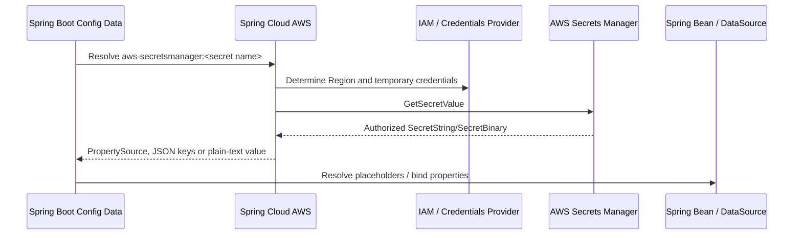
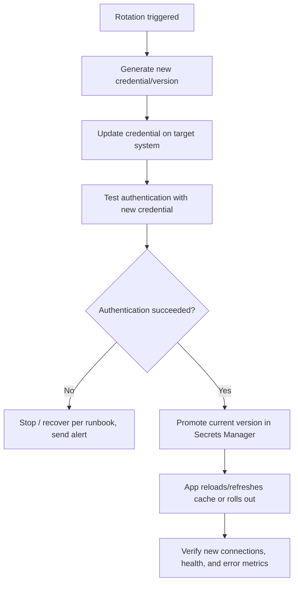

# Loading Secrets Manager with Config Data

## 1. Context and Learning Objectives

In the **SPRING_CLOUD_PROVIDER_INTEGRATION** module, learners practice integrating Spring Boot with managed services from **AWS, Azure, and Google Cloud** using the corresponding Spring Cloud libraries. A core part of this integration is using **workload identities** to access services, protect secrets, test, and operate safely when configuration changes.

In the **AWS Configuration** chapter, we need to bring database passwords, API keys, or third-party service credentials into Spring Boot without embedding them in `application.yml`, source code, container images, or Git history. AWS Secrets Manager provides an encrypted secret store with IAM policies, versioning, and rotation design capabilities. **Spring Cloud AWS** lets an application load secrets into the Spring `Environment` through Spring Boot's **Config Data** mechanism.

After completing this lesson, you will be able to:

1. Explain `spring.config.import=aws-secretsmanager:...` and when Config Data is loaded in the Spring Boot lifecycle.
2. Organize secrets by application/environment; distinguish between JSON secrets, plain-text secrets, and `SecretBinary`.
3. Integrate Spring Cloud AWS 3.x and use `?prefix=`, placeholders, and `@ConfigurationProperties` to read secrets.
4. Grant least-privilege access using an IAM role, distinguishing Secrets Manager permissions from AWS KMS decryption permissions.
5. Handle required/optional secrets, rotation, reloading, multi-environment configuration, and common errors.
6. Design tests capable of verifying real behavior without exposing secrets.

> **Principle:** Config Data helps **load** secrets as properties at application startup; it does not by itself rotate credentials on the target system, nor does it automatically update all open connections. The rotation lifecycle and application refresh must be designed as two separate concerns.

## 2. Distinguishing the Roles of Secrets Manager and Config Data

AWS Secrets Manager is a service for storing and managing **secrets used to authenticate or grant access**, such as:

- PostgreSQL or MySQL usernames/passwords.
- Payment gateway API keys.
- OAuth client secrets or refresh tokens.
- Webhook signing secrets, private keys, or third-party system credentials.

Secrets Manager stores `SecretString` or `SecretBinary`, encrypts content at rest with AWS KMS, uses IAM/resource policies to control read/write access, and manages multiple versions. The `AWSCURRENT` label typically denotes the current version; `AWSPREVIOUS` can be used during rotation or recovery workflows depending on the design. **Creating a secret does not automatically enable rotation**: updating credentials in a database or third-party API also requires a supported mechanism or custom logic.

Spring Boot's **Config Data API** (introduced in Spring Boot 2.4) lets you load additional configuration sources during startup. When the Secrets Manager integration starter is present, declaring:

```properties
spring.config.import=aws-secretsmanager:/secrets/order-service/dev/database
```

instructs Spring Cloud AWS to fetch the corresponding secret and contribute its properties to the `Environment`. Those properties can then be used via `${...}`, `@Value`, or `@ConfigurationProperties`.



With Config Data, the application still needs to reach AWS successfully during startup. Values fetched from AWS reside in **process memory** for Spring to use. Storing secrets encrypted in AWS does not mean values cannot appear in the heap, logs, or monitoring endpoints if the application is deployed insecurely.

### Compared with Parameter Store

| Criterion | Parameter Store | Secrets Manager |
| --- | --- | --- |
| Typical data | URLs, queue names, timeouts, rarely changing config | Passwords, tokens, API keys, private keys |
| Config Data prefix | `aws-parameterstore:` | `aws-secretsmanager:` |
| Imported source | **Path** containing parameters | **Name/ARN of each secret** |
| Data structure | `String`, `StringList`, `SecureString` | JSON, plain-text `SecretString`, `SecretBinary` |
| Credential lifecycle management | No dedicated automatic rotation | Scheduled rotation capable when configured properly |
| Typical read IAM action | `ssm:GetParametersByPath` | `secretsmanager:GetSecretValue` |
| KMS | Check KMS permissions when using `SecureString` | Check KMS key policy and `kms:Decrypt` when using a customer managed key |

Do not use Secrets Manager just to store hundreds of non-sensitive timeout values. Conversely, do not put real passwords into a Parameter Store `String` merely because reading it looks simpler.

## 3. Designing Secrets for a Spring Boot Application

Suppose `order-service` runs on AWS and needs to access PostgreSQL. Design secrets by **service/environment/purpose**:

```text
/secrets/order-service/dev/database
/secrets/order-service/staging/database
/secrets/order-service/prod/database
```

Each environment has its own secret and IAM role. Example **JSON `SecretString`** payload for `/secrets/order-service/dev/database`:

```json
{
  "username": "orders_app",
  "password": "<SECRET_VALUE_ONLY_IN_AWS>"
}
```

`<SECRET_VALUE_ONLY_IN_AWS>` is only a documentation placeholder, **not a password for deployment**. On real AWS, replace it with a value provisioned through a secure workflow, and never commit JSON containing passwords to a repository.

There are only two top-level JSON fields: `username` and `password`. Spring Cloud AWS exposes those two fields as properties when the secret is imported. Multi-field top-level JSON is well suited for closely related credentials; do not assume arbitrary deeply nested JSON acts as a bindable property tree like YAML. If you want complex structures, test the mapping on your exact library version.

| Name segment | Role | Notes |
| --- | --- | --- |
| `/secrets/` | Namespace distinct from regular config | A secret name is not an automatic security boundary |
| `order-service` | Workload owning the credentials | Avoid sharing accounts/secrets across services |
| `dev`, `prod` | Environment | Separate access permissions and rotation policies |
| `database` | Credential purpose | Tags may be attached for governance; never put secret values in tags |

**Secret creation practice:** Create a JSON secret named `/secrets/order-service/dev/database` through the AWS Console or an organization-approved secret provisioning workflow. Choose the appropriate AWS Region, KMS key, and write IAM role. Avoid typing real passwords directly as command-line arguments because they can be captured in shell history, telemetry, or logs. If automating via CLI, pass the payload using a secure data-passing method supported by your CI/CD environment, protect temporary files, and delete them securely after use.

## 4. Declaring Spring Cloud AWS 3.x

The examples use modern Spring Boot and the Spring Cloud AWS **3.x** (`io.awspring.cloud`) branch. Choose versions based on your project's Spring Boot/Spring Cloud AWS **compatibility matrix**; starter syntax in Spring Cloud AWS 2.x may differ.

Add the BOM and Secrets Manager starter in `pom.xml`:

```xml
<dependencyManagement>
    <dependencies>
        <dependency>
            <groupId>io.awspring.cloud</groupId>
            <artifactId>spring-cloud-aws-dependencies</artifactId>
            <version>${spring-cloud-aws.version}</version>
            <type>pom</type>
            <scope>import</scope>
        </dependency>
    </dependencies>
</dependencyManagement>

<dependencies>
    <dependency>
        <groupId>io.awspring.cloud</groupId>
        <artifactId>spring-cloud-aws-starter-secrets-manager</artifactId>
    </dependency>
</dependencies>
```

Here `${spring-cloud-aws.version}` is a Maven property defined by the project; pick a compatible version rather than an arbitrary one. The BOM aligns Spring Cloud AWS artifact versions. If the application uses Spring Data JDBC/JPA, the PostgreSQL driver, or `spring-boot-starter-jdbc`, declare those dependencies according to application needs; they are not specific requirements of Config Data.

`spring-cloud-aws-starter-secrets-manager` registers the Config Data location resolver for the `aws-secretsmanager:` prefix and auto-configures `SecretsManagerClient` in the Spring context. Learners do not need to write a custom `@PostConstruct` calling the AWS SDK to read secrets and inject them manually into `Environment`.

## 5. Loading a JSON Secret with `spring.config.import`

### 5.1. Profile-Specific Required Import

Create `src/main/resources/application-dev.yml`:

```yaml
spring:
  config:
    import: "aws-secretsmanager:/secrets/order-service/dev/database?prefix=database."
  datasource:
    url: "${ORDERS_JDBC_URL}"
    username: "${database.username}"
    password: "${database.password}"
```

In this example:

1. Spring Boot runs with the `dev` profile, so it loads `application-dev.yml`.
2. The Config Data resolver calls AWS Secrets Manager to retrieve `/secrets/order-service/dev/database`.
3. Spring Cloud AWS parses the top-level JSON fields `username` and `password`.
4. `?prefix=database.` turns them into `database.username` and `database.password`, which are used as DataSource configuration placeholders.
5. The password-free JDBC URL is supplied via the `ORDERS_JDBC_URL` environment variable, such as `jdbc:postgresql://db.dev.internal:5432/orders`, to keep this lesson focused on secrets.

**The trailing `.` in the prefix is necessary:** The prefix is prepended verbatim to property names. With `prefix=database` (without the dot), the names become `databaseusername` and `databasepassword`, not `database.username` and `database.password`.

For production deployment, `application-prod.yml` points to the **prod secret**:

```yaml
spring:
  config:
    import: "aws-secretsmanager:/secrets/order-service/prod/database?prefix=database."
  datasource:
    url: "${ORDERS_JDBC_URL}"
    username: "${database.username}"
    password: "${database.password}"
```

Run locally with the development configuration:

```bash
java -jar order-service.jar --spring.profiles.active=dev
```

Only declare the import in profiles that need AWS. Putting a required import in the shared `application.yml` can cause even tests running under the `test` profile to call Secrets Manager at startup. Separating imports by profile keeps unit tests from needing AWS permissions. At the same time, **profiles are not a security layer**: the prod workload's IAM role must not be permitted to read dev secrets, and vice versa.

### 5.2. Why Is a Prefix Needed?

Without a prefix, a JSON secret with `username` and `password` produces two very generic property names. If the application also imports a Redis secret or an API provider secret, the `username` key can collide; the final value depends on PropertySource precedence.

Example with two secrets:

| Secret name | JSON keys | Prefix | Spring properties |
| --- | --- | --- | --- |
| `/secrets/order-service/dev/database` | `username`, `password` | `db.` | `db.username`, `db.password` |
| `/secrets/order-service/dev/payment` | `apiKey`, `webhookSecret` | `payment.` | `payment.apiKey`, `payment.webhookSecret` |

Choose prefixes by function to reduce key collisions and make the code clearly express where data originates.

### 5.3. Loading Multiple Secrets

Spring Cloud AWS supports declaring multiple secret names separated by `;` in a single location, for example:

```properties
spring.config.import=aws-secretsmanager:/secrets/order-service/dev/database;/secrets/order-service/dev/payment
```

However, when you need **separate prefixes** or want to mix required and optional secrets, declare the locations as individual entries:

```yaml
spring:
  config:
    import:
      - "aws-secretsmanager:/secrets/order-service/dev/database?prefix=db."
      - "optional:aws-secretsmanager:/secrets/order-service/dev/payment?prefix=payment."
```

Here the database secret is required for startup; the payment secret may be absent when payment integration is not yet enabled. If a payment bean still requires `${payment.apiKey}` when the secret does not exist, creating that bean will still fail. `optional:` only makes sense when the application flow can genuinely tolerate the missing secret.

If the application spans multiple accounts, Spring Cloud AWS documentation also supports importing secrets by **ARN** instead of name, for example:

```properties
spring.config.import=aws-secretsmanager:arn:aws:secretsmanager:ap-southeast-1:111122223333:secret:team/shared/token-AbCdEf
```

The sample ARN must be replaced with a real ARN; cross-account reads also depend on the **resource policy**, IAM policy, KMS key policy, and network/Region setup, rather than working automatically just by providing the ARN.

## 6. Secret Formats and How to Access Properties

### 6.1. JSON Secret: Multiple Related Properties

A JSON secret is easy to manage when a system issues a credential pair, such as:

```json
{
  "clientId": "orders-client",
  "clientSecret": "<SECRET_VALUE_ONLY_IN_AWS>"
}
```

If named `/secrets/order-service/dev/oauth` and imported with:

```properties
spring.config.import=aws-secretsmanager:/secrets/order-service/dev/oauth?prefix=oauth.
```

the properties are `oauth.clientId` and `oauth.clientSecret`. You can use them as follows:

```java
import org.springframework.beans.factory.annotation.Value;
import org.springframework.stereotype.Service;

@Service
public class OAuthCredentialProvider {
    private final String clientId;
    private final String clientSecret;

    public OAuthCredentialProvider(
            @Value("${oauth.clientId}") String clientId,
            @Value("${oauth.clientSecret}") String clientSecret) {
        this.clientId = clientId;
        this.clientSecret = clientSecret;
    }

    // Use these values in the authentication client; do not log them.
}
```

The constructor above illustrates **injecting properties loaded by Config Data**. Do not log `clientSecret`, return the property in an HTTP response, or write a `toString()` that exposes credentials. When grouping multiple fields, you can use `@ConfigurationProperties` with validation; watch out for default `record.toString()`, Lombok `@Data`, and loggers that automatically dump whole objects.

### 6.2. Plain-Text Secret: A Single Value

Secrets Manager also stores a `SecretString` containing just **one string**. For example, secret `/secrets/order-service/dev/webhook-signing-key` holds a single system-issued value. After importing:

```yaml
spring:
  config:
    import: "aws-secretsmanager:/secrets/order-service/dev/webhook-signing-key"
```

with Spring Cloud AWS 3.x secret-name mapping, you can reference the **final segment** of the secret name:

```properties
webhook.signing-key=${webhook-signing-key}
```

For plain text or `SecretBinary`, Spring Cloud AWS documentation describes using the secret name segment as the property; however, carefully consider data representation if it is truly binary key material. **Do not use Config Data as a mechanism for managing certificate files, binary key material, or complex byte structures unless you have tested the conversion and usage**. When binary byte-level handling or explicit version selection is needed, you can use the AWS SDK `SecretsManagerClient` with an explicit caching/security workflow.

### 6.3. Using `@ConfigurationProperties` with a Group of Secrets

Suppose the application also has a JSON payment secret:

```json
{
  "apiKey": "<SECRET_VALUE_ONLY_IN_AWS>",
  "webhookSecret": "<SECRET_VALUE_ONLY_IN_AWS>"
}
```

Load it via `?prefix=payment.` and bind it to a configuration class:

```java
import org.springframework.boot.context.properties.ConfigurationProperties;

@ConfigurationProperties(prefix = "payment")
public record PaymentSecrets(
        String apiKey,
        String webhookSecret) {

    // Prevent the default record.toString() from exposing credentials if logged.
    @Override
    public String toString() {
        return "PaymentSecrets[REDACTED]";
    }
}
```

Register it with `@ConfigurationPropertiesScan` on the main class or `@EnableConfigurationProperties(PaymentSecrets.class)`. If both values are required, use `spring-boot-starter-validation`, `@Validated`, and constraints such as `@NotBlank` on parameters/fields to catch missing data at startup. For example, avoid using `optional:` with a bean that requires these properties.

> **Remember:** The Spring `Environment` may still hold the secret as a string after import. Writing a class with a redacted `toString()` only addresses one leak vector; it does not eliminate the risk of secrets leaking via HTTP diagnostics, actuator configuration, request logs, debuggers, or memory dumps.

## 7. IAM, KMS, and Workload Authentication

### 7.1. Assigning Identity to the Application

Applications running on AWS should obtain **temporary credentials** for the workload:

| Environment | Appropriate identity |
| --- | --- |
| Developer machine | AWS IAM Identity Center / scoped AWS CLI profile |
| Amazon ECS | Service task role |
| Amazon EKS | EKS Pod Identity or IAM Roles for Service Accounts (IRSA) |
| Amazon EC2 | EC2 instance profile |
| AWS Lambda | Lambda execution role |

Do not put real `AWS_ACCESS_KEY_ID` or `AWS_SECRET_ACCESS_KEY` values in committed configuration files, Docker images, or code examples. When running on AWS, Spring Cloud AWS/AWS SDK uses the environment's credential and Region resolution chain. Without a valid Region, Config Data can fail before the application creates beans.

You can specify the Region for Secrets Manager:

```yaml
spring:
  cloud:
    aws:
      secretsmanager:
        region: ap-southeast-1
```

Or use the workload/SDK default Region when consistent with your design. **The same secret name can exist in multiple accounts or Regions**; always verify the actual identity and Region, especially when working across `dev` and `prod`.

### 7.2. Least-Privilege Read Policy

For the path `/secrets/order-service/dev/database`, the secret ARN includes an AWS-assigned **random suffix**; use the **exact** ARN obtained from the actual resource. Sample policy (account, Region, and suffix are illustrative):

```json
{
  "Version": "2012-10-17",
  "Statement": [
    {
      "Sid": "ReadOnlyDevDatabaseSecret",
      "Effect": "Allow",
      "Action": "secretsmanager:GetSecretValue",
      "Resource": "arn:aws:secretsmanager:ap-southeast-1:111122223333:secret:/secrets/order-service/dev/database-AbCdEf"
    }
  ]
}
```

This policy permits only **reading the secret content**, not creating, deleting, updating, or rotating it. The IAM role for secret provisioning/rotation workflows needs different permissions and should be separated under the **least privilege** principle. If using a wildcard such as `database-*`, understand that it is a broader permission pattern than a specific ARN and carefully inspect which resources could match.

To check the ARN or metadata once appropriate permissions exist, you can use the CLI **without reading out the secret value**:

```bash
aws secretsmanager describe-secret \
  --secret-id /secrets/order-service/dev/database \
  --region ap-southeast-1 \
  --query "{Name:Name,ARN:ARN,RotationEnabled:RotationEnabled}"
```

This command only illustrates metadata inspection. Permission to call `DescribeSecret` can be granted separately to operations teams and does not necessarily need to be granted to an application role that only needs `GetSecretValue`.

### 7.3. When Using a KMS Customer Managed Key

Secrets Manager encrypts secret content using KMS. If your organization uses a **customer managed KMS key**, the application role may also need `kms:Decrypt`, and the key policy must allow this operation. Example statement scoped to an illustrative key:

```json
{
  "Sid": "DecryptDevDatabaseSecret",
  "Effect": "Allow",
  "Action": "kms:Decrypt",
  "Resource": "arn:aws:kms:ap-southeast-1:111122223333:key/11111111-2222-3333-4444-555555555555",
  "Condition": {
    "StringEquals": {
      "kms:ViaService": "secretsmanager.ap-southeast-1.amazonaws.com"
    }
  }
}
```

Only include the KMS statement in the policy when that exact key is actually used; IAM permissions alone are insufficient if the **key policy**, grants, or other controls do not allow it. KMS conditions can also be narrowed further via the secret's encryption context according to organizational design. With AWS managed keys, permission details and cross-account sharing capabilities differ; verify each case individually.

**Do not fix `AccessDenied` errors with `Resource: "*"` or `kms:*` across all keys.** Identify exactly which request was denied: `GetSecretValue` on the secret or `Decrypt` on the KMS key.

### 7.4. Sharing Secrets Across Accounts/Regions

Loading a secret cross-account is not just replacing a name with an ARN. AWS requires coordination across:

1. The calling role's identity policy allowing the exact secret ARN.
2. A resource-based policy on the secret allowing the chosen principal.
3. A KMS key and policy permitting decryption accordingly; AWS managed keys have limitations for cross-account sharing.
4. Network routing and Region connecting to where the secret resides.

When multi-Region availability is required, you can evaluate Secrets Manager **multi-Region secret replication**, though the application must point to the appropriate ARN/name in the Region it serves, and rotation, failover, and caching workflows must be aligned.

## 8. Required, Optional, and Configuration Precedence Order

### 8.1. Required Secret

```properties
spring.config.import=aws-secretsmanager:/secrets/order-service/prod/database
```

If the secret does not exist, a required import prevents the application from starting successfully. This is usually the desired behavior when database credentials are essential for the service to operate properly.

A secret existing while **missing the `password` key** is a different scenario. The import may still return the remaining properties; `${database.password}` will fail to resolve if there is no fallback source. Use **configuration validation** to detect missing fields early and surface meaningful errors—never dump secrets in exceptions.

### 8.2. Optional Secret

```yaml
spring:
  config:
    import: "optional:aws-secretsmanager:/secrets/order-service/dev/experimental-api?prefix=experimental."
```

`optional:` handles the case of a **non-existent location** under Config Data rules. It does not mean all IAM, KMS, timeout, or network errors are ignored. A secret is truly optional when the service can **skip initializing** that integration and still operate properly, such as toggling a feature via an independent flag.

### 8.3. Property Precedence

Properties coming from Secrets Manager participate in Spring Boot's property source hierarchy. When imported via Config Data, they follow Config Data precedence rules; higher-precedence sources such as command-line arguments or certain environment overrides may override them depending on configuration.

**Security:** Do not assume that just because a secret in AWS is correct, the value the application is using is that value. Same-named configuration from the runtime environment/CLI can override it. On the other hand, never pass real credentials via CLI arguments as a quick deployment fix; this leaks secrets into command history and process inspection.

Give each secret its own prefix, avoid declaring the same property across multiple sources, and explicitly control import order. If two secrets both produce `password` without a prefix, the application might silently use an unintended credential.

## 9. Rotation, Reloading, and Impact on Running Applications

### 9.1. Distinguishing Three Changes

| Activity | Which system handles it? | Practical impact |
| --- | --- | --- |
| **Changing the secret value** | Secrets Manager API and an authorized writer/workflow | Creates a new secret version; the current label may shift |
| **Changing credentials on the target service** | Database, API provider, Lambda rotation, or supported rotation mechanism | Old credentials may expire; target system accepts new credentials |
| **Updating credentials in the application** | Spring Boot, SDK cache, client/connection pool, or rollout | New requests/connections use the currently active credentials |

All three activities must be coordinated. For example, if rotation successfully changes the PostgreSQL password while `HikariDataSource` in a pod still holds the old password from startup, new connections may fail once the connection pool needs to open fresh connections. Conversely, updating a property inside the JVM does not guarantee the database already accepts the new credential.

### 9.2. Default Config Data Behavior

With configuration:

```yaml
spring:
  config:
    import: "aws-secretsmanager:/secrets/order-service/prod/database?prefix=database."
```

Spring Cloud AWS loads the secret during the **startup phase**. If a new version of the secret later becomes `AWSCURRENT`, already-created properties and beans **do not update immediately**.

Three common deployment approaches exist:

1. **Controlled application rollout/restart:** re-reads the secret on the next startup; usually simple and observable for services with sound release pipelines.
2. **Using Spring Cloud AWS PropertySource reload:** polls for changes and triggers configuration `refresh` or an application context restart; requires extra dependencies and testing per bean type.
3. **Using AWS SDK/secret caching at runtime:** suitable when the system must swap credentials dynamically; requires managing TTL, retries, concurrency, and connection pool lifecycle in code.

### 9.3. Configuring PropertySource Reload When Truly Needed

Spring Cloud AWS 3.4.x provides a reload feature that is **disabled by default**. When enabled, the library can poll secrets and trigger a refresh strategy. Example enabling `refresh`:

```yaml
spring:
  cloud:
    aws:
      secretsmanager:
        reload:
          strategy: refresh
          period: 1m
```

Per Spring Cloud AWS 3.4.x documentation, this feature requires supporting dependencies such as:

```xml
<dependencies>
    <dependency>
        <groupId>org.springframework.boot</groupId>
        <artifactId>spring-boot-starter-actuator</artifactId>
    </dependency>
    <dependency>
        <groupId>org.springframework.cloud</groupId>
        <artifactId>spring-cloud-commons</artifactId>
    </dependency>
    <dependency>
        <groupId>org.springframework.cloud</groupId>
        <artifactId>spring-cloud-context</artifactId>
    </dependency>
</dependencies>
```

Two strategies are documented:

- `refresh`: uses Spring Cloud Context to refresh configuration beans via `@ConfigurationProperties` or `@RefreshScope` mechanisms. Other beans, connection pools, or HTTP clients **are not guaranteed to rebuild automatically** merely because a property changed.
- `restart_context`: attempts to restart the Spring application context. This strategy imposes additional requirements on the Spring Boot Actuator restart endpoint, library compatibility, permissions, and downtime during restart; **never casually expose a public restart endpoint** in production.

`period: 1m` is an example polling cadence, not a guarantee that every pod receives the value simultaneously after exactly one minute. You must verify detection timing, rotation race-condition handling, connection pools, application state, and retries.

To choose a strategy:

| System | Reference approach | What to verify |
| --- | --- | --- |
| App with infrequent secret changes, rolling updates | Controlled restart/rollout | New pods read the new secret; old pods drain safely |
| Simple configuration beans needing periodic updates | `refresh` | Beans actually receive new properties and threads use the new values |
| Container with many interdependent singletons | Consider context restart or rollout | Downtime, resource cleanup, readiness, sessions |
| Frequently rotated database credentials | AWS SDK caching/refresh or rollout | Connection pool picks up new credentials and reconnects cleanly |
| App needing secrets at specific request times | SDK client + suitable cache | API quotas, IAM, TTL, and network error handling |

**Note:** Reload configuration and dependencies can change across Spring Cloud AWS versions. Check the exact documentation for the version in use before enabling it in production.

### 9.4. Designing a Database Rotation Workflow

Suppose the database password is rotated automatically:



This is a **conceptual** diagram. Real AWS rotation mechanisms may use steps/labels such as `AWSPENDING` and `AWSCURRENT`; details depend on managed rotation, Lambda rotation, single-user/alternating-user strategy, and database engine. Do not manually alter version labels without understanding the rotation workflow.

In real system design, define the overlap window during which both old and new credentials are valid, how new connections are opened, timeouts, retries, and rollback procedures if credential verification fails. A rotation workflow missing application-connection verification can cause an outage even if updating the secret in AWS succeeds.

### 9.5. TTL, Quotas, and Cost

Secrets Manager charges based on the number of secrets, API calls, and associated services depending on configuration/Region. With `GetSecretValue` polling or equivalent, call volume scales with instance count and polling frequency. When using caching or reload:

- Approximate request count: **instances × polls per instance × secrets**, plus startup calls and retries (exact behavior depends on library implementation).
- Align refresh intervals with rotation and freshness requirements; avoid calling Secrets Manager on every HTTP request.
- Watch for rate limiting/throttling when hundreds of pods start simultaneously or after a deployment.
- Monitor secret retrieval errors, retries, database connections, and API costs rather than only tracking when AWS updates a secret.

Do not cache indefinitely if a secret might be revoked, and do not export secrets to a distributed cache without proper encryption and access controls.

## 10. Testing Config Data and Secrets Safely

### 10.1. Testing Business Logic Without Calling AWS

Separate files containing AWS imports by profile. For example:

```yaml
# application-dev.yml: uses real AWS in the dev environment
spring:
  config:
    import: "aws-secretsmanager:/secrets/order-service/dev/payment?prefix=payment."
```

```yaml
# application-test.yml: uses fake data dedicated to tests
payment:
  api-key: test-only-placeholder-key
  webhook-secret: test-only-placeholder-webhook-key
```

Do not put a required `spring.config.import` pointing to AWS in the shared `application.yml` if you want tests to run completely offline; merely adding test properties does not stop Config Data from attempting to connect to AWS during startup.

Example unit test for `PaymentSecrets` using `ApplicationContextRunner` (requires `spring-boot-starter-test` in test scope):

```java
import static org.assertj.core.api.Assertions.assertThat;

import org.junit.jupiter.api.Test;
import org.springframework.boot.context.properties.EnableConfigurationProperties;
import org.springframework.boot.test.context.runner.ApplicationContextRunner;
import org.springframework.context.annotation.Configuration;

class PaymentSecretsBindingTest {
    @Configuration(proxyBeanMethods = false)
    @EnableConfigurationProperties(PaymentSecrets.class)
    static class TestConfig {
    }

    private final ApplicationContextRunner contextRunner =
            new ApplicationContextRunner()
                    .withUserConfiguration(TestConfig.class)
                    .withPropertyValues(
                            "payment.api-key=test-only-placeholder-key",
                            "payment.webhook-secret=test-only-placeholder-webhook-key"
                    );

    @Test
    void bindsSecretPropertiesWithoutAws() {
        contextRunner.run(context -> {
            PaymentSecrets value = context.getBean(PaymentSecrets.class);
            assertThat(value.apiKey()).isEqualTo("test-only-placeholder-key");
            assertThat(value.webhookSecret())
                    .isEqualTo("test-only-placeholder-webhook-key");
            assertThat(value.toString()).doesNotContain("test-only-placeholder-key");
        });
    }
}
```

This test verifies property **binding** into Java, not Secrets Manager networking, IAM, or KMS behavior. Real integration verification requires an AWS sandbox environment. Emulators like LocalStack can be used when the target behavior is supported, but should not be treated as sole proof of IAM/KMS permissions, rotation, and cross-account access.

### 10.2. Integration Testing in a Sandbox Account

Prepare a JSON secret containing sandbox-only credentials, an IAM role scoped to that exact ARN, and run the application under the `dev` profile. Then verify:

| Scenario | Expected observation |
| --- | --- |
| Correct account, Region, secret name, and IAM role | Application starts up and binds all JSON fields |
| Wrong Region or account | Secret not found; contextual error without leaking data |
| Required secret deleted/renamed | Startup fails during the Config Data phase |
| Optional secret absent | Optional integration does not initialize; app remains stable |
| Secret exists but required JSON key is missing | Placeholder/binding/validation fails clearly |
| Role lacks `secretsmanager:GetSecretValue` | `AccessDenied` from Secrets Manager |
| Uses custom KMS key without decryption permission | Identifies KMS/IAM policy or key policy error |
| Two JSON secrets both have key `password` | Prefix prevents collision/overwriting properties |
| Secret rotated while DataSource holds active connections | Verify when new connections pick up the new credential |
| 50–100 instances starting concurrently | Observe timeouts/throttling, startup latency, and retries |

Tests using real secrets should run in a sandbox account using short-lived, least-privilege credentials, and test resources should be deleted via an approved process after completion.

### 10.3. Testing Without Exposing Secret Values

For security mechanisms, what needs verification is usually **whether the right credential can be retrieved and used to access the target system**, not printing the credential value to a terminal. Avoid:

- Calling `aws secretsmanager get-secret-value` and sending the entire output to CI/CD logs or support tickets.
- Logging `Environment`, `@ConfigurationProperties` containing secrets, HTTP authentication headers, or connection strings with passwords.
- Publicly exposing Spring Boot Actuator endpoints `/env`, `/configprops`, `/heapdump`, or debug dumps.
- Putting real JSON secrets into test fixtures, screenshots, error messages, traces, or guides.

Even though Spring Boot provides Actuator sanitization mechanisms, configure endpoints and access controls properly; do not rely solely on naming a key `password` to prevent every form of data exposure.

## 11. Diagnosing Real-World Issues

| Symptom | Common cause | How to check |
| --- | --- | --- |
| `aws-secretsmanager:` prefix not recognized | Missing starter, incompatible BOM/version | Check Maven dependencies and Spring Cloud AWS docs for your version |
| `ResourceNotFoundException` | Wrong name/ARN, Region, or account | Compare `spring.config.import`, secret metadata, and running identity |
| `AccessDeniedException` on API call | IAM role lacks `GetSecretValue` or resource policy denies | Check workload role and specific ARN |
| Denied during decryption | Customer managed KMS key does not allow `Decrypt` | Inspect key policy, IAM policy, and KMS conditions |
| `${database.password}` fails to resolve | Missing JSON key or wrong `?prefix=` | Check **key name** and prefix; do not print the password |
| App reads credentials from another environment | Wrong active profile, Region, account, or override | Compare config locations, role, profile, and property sources |
| Secret updated but DB login still fails | Connection pool/bean has not received new value, rotation out of sync | Check rotation status, refresh/rollout, and new connections |
| Slow startup or intermittent failures | Network, VPC endpoint, DNS, throttling, retries | Verify network path to Secrets Manager and metrics/SDK errors |
| Secret unchanged even with reload enabled | Missing dependencies, strategy disabled, bean does not support refresh | Cross-check reload configuration and bean lifecycle |
| `optional:` still fails to start | IAM/KMS/network error or bean still requires mandatory property | Distinguish missing location from retrieval or binding errors |

Suggested debugging order: **starter/version → active profile → secret name/ARN → account/Region → IAM/resource policy → KMS → JSON structure/prefix → property precedence → reload/rotation → target resource**.

When checking permissions, use metadata (`DescribeSecret`) and CloudTrail within authorized scope. Never retrieve secret values just to take screenshots or attach to support requests.

## 12. Comprehensive Hands-On Exercise

A `payment-service` application running on ECS requires:

```text
payment.api-key
payment.webhook-secret
database.username
database.password
payment.gateway-url
payment.timeout
```

Design the Secrets Manager integration with Config Data according to these requirements:

1. Create two JSON secrets in **sandbox**: `/secrets/payment-service/dev/gateway` containing `apiKey` and `webhookSecret`, and `/secrets/payment-service/dev/database` containing `username` and `password`.
2. Place `gateway-url` and `timeout` in a **non-secret** configuration source (such as Parameter Store), without storing credentials in the URL.
3. Declare `application-dev.yml` with two `spring.config.import` entries and respective prefixes `payment.` and `database.`; use `${payment.apiKey}` and `${database.password}` in the appropriate client/DataSource.
4. Write an ECS task IAM role that is **read-only** for those two specific ARNs. If one secret uses a customer managed KMS key, add decryption permission on that exact key along with an appropriate key policy.
5. Create `application-test.yml` using dummy values for offline binding tests without connecting to AWS.
6. Describe the scenarios when the gateway secret is absent, when a JSON key is missing, when the role loses read permission, and when the database password is rotated. Distinguish startup errors from runtime connection errors.
7. Choose a post-rotation strategy (`rollout`, `refresh`, `restart_context`, or SDK cache) and demonstrate how the application continues serving requests after the old credential expires.

**Expected deliverables:** Environment-scoped secret naming tree, JSON schema, Maven dependencies, Config Data YAML, IAM/KMS policies, binding tests, and a verifiable rotation/rollback plan.

## 13. Connection to Azure and Google Cloud

In the **SPRING_CLOUD_PROVIDER_INTEGRATION** module, relate the same requirement of **securely loading secrets into Spring Boot** across the other platforms:

| Aspect | AWS | Azure | Google Cloud |
| --- | --- | --- | --- |
| Secret service | AWS Secrets Manager | Azure Key Vault | Google Cloud Secret Manager |
| Workload identity | IAM role | Managed Identity | Service Account / Workload Identity |
| Authorization | IAM, resource policies, KMS key policies | Azure RBAC/access policies and proper key management | Google Cloud IAM and Cloud KMS when using customer-managed encryption |
| Loading into Spring Boot | Spring Cloud AWS Config Data `aws-secretsmanager:` | Spring Cloud Azure or Azure SDK with appropriate config | Google Cloud/Spring integration library or SDK per service and version |
| Updating secrets at runtime | Requires reload/cache/rollout strategy | Must inspect Azure refresh and client update behavior | Must inspect Google Cloud secret versions, refresh, and client lifecycle |

Do not copy `spring.config.import` prefixes, IAM policy structures, versioning schemes, or refresh defaults verbatim from one provider to another. Choose exact mechanisms according to the SDK, framework, and rules of your deployment environment.

## Summary

To **load Secrets Manager with Config Data**, add a compatible Spring Cloud AWS starter, declare `aws-secretsmanager:` pointing to the **secret name/ARN**, organize JSON keys cleanly, use `?prefix=` to avoid name collisions, and bind values into the application via the Spring `Environment`. A reliable implementation requires a **least-privilege read-only IAM role**, appropriate KMS setup, dev/prod isolation, proper handling of required/optional secrets, and protection of every path that could leak loaded values. When rotation occurs, verify **both the application and the target service** are using the new credential; merely seeing `AWSCURRENT` change is not enough.

## References

- [Spring Cloud AWS 3.4.2 Reference — Secrets Manager Integration](https://docs.awspring.io/spring-cloud-aws/docs/3.4.2/reference/html/index.html#secrets-manager-integration) — `spring.config.import`, JSON, plain text, prefix, IAM, and reload.
- [Spring Boot Reference — Externalized Configuration](https://docs.spring.io/spring-boot/reference/features/external-config.html) — Config Data, profiles, placeholders, property precedence.
- [AWS Secrets Manager User Guide](https://docs.aws.amazon.com/secretsmanager/latest/userguide/) — secret management, encryption, versions, and rotation.
- [AWS: Authentication and access control for Secrets Manager](https://docs.aws.amazon.com/secretsmanager/latest/userguide/auth-and-access.html) — IAM/resource policies and KMS.
- [AWS: Rotate Secrets](https://docs.aws.amazon.com/secretsmanager/latest/userguide/rotating-secrets.html) — rotation schedules and mechanisms.
- [AWS Secrets Manager Pricing](https://aws.amazon.com/secrets-manager/pricing/) — evaluating secret, API, and related costs.
