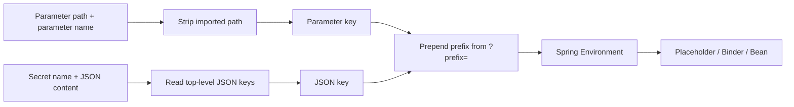

# Mapping Paths, Prefixes, and Secret Keys to Spring Properties

## Lesson Objectives

The **SPRING_CLOUD_PROVIDER_INTEGRATION** module guides learners through integrating Spring Boot with managed services from **AWS, Azure, and Google Cloud** using their corresponding Spring Cloud libraries—from identity and access permissions to storage, messaging, data, secrets, and integration testing. In the **AWS Configuration** chapter, merely loading data from Parameter Store or Secrets Manager is only the first step. The application must also know **under what property name that value appears in the Spring `Environment`** and how to prevent name collisions across multiple services and environments.

For example, an application has two secrets that both contain a `password` key: one database password and one partner system password. If both are imported without managing property names, Spring may see two sources providing `password`. This ambiguity can lead to connection errors, overwritten configuration, or unintended access exposure.

After this lesson, you will be able to:

1. Explain the three naming layers: **AWS resource name**, **element name inside the resource**, and **final property name in Spring**.
2. Map parameter names by path using `aws-parameterstore:` and JSON secret keys using `aws-secretsmanager:`.
3. Use `?prefix=` with exact syntax, including the trailing `/` on paths and the trailing `.` on prefixes.
4. Load multiple configuration sources while keeping namespaces isolated, bind into `@ConfigurationProperties`, and detect missing values.
5. Verify precedence, profiles, IAM/KMS, rotation, and troubleshoot mapping errors in Spring Boot deployments.

> **Version scope:** Examples use **Spring Boot Config Data** and **Spring Cloud AWS 3.x** (`io.awspring.cloud`), illustrated with the reference syntax of Spring Cloud AWS 3.4.2. Before adopting in a real project, choose a Spring Cloud AWS version compatible with your Spring Boot version and consult the documentation for that exact version.

## 1. Three Naming Layers in a Single Mapping

Distinguish the concepts before configuring:

| Layer | Parameter Store | Secrets Manager | Meaning for Spring Boot |
| --- | --- | --- | --- |
| **Resource name** | `/config/order-service/dev/catalog.timeout` | `/secrets/order-service/dev/database` | Indicates **where to read the data from** |
| **Raw key** | `catalog.timeout` after stripping imported path prefix | `username`, `password` in the JSON secret | Indicates the **initial property name** |
| **Property prefix** | `app.` if import has `?prefix=app.` | `db.` if import has `?prefix=db.` | **Prepended verbatim** to the raw key |
| **Spring property** | `app.catalog.timeout` | `db.username`, `db.password` | Name read by the app via `${...}` or the binder |

A resource name can be very long; it does not force the Spring property to be equally long. For instance:

```text
AWS Parameter Store:
  imported path   = /config/order-service/dev/
  full name       = /config/order-service/dev/catalog.timeout
  raw key         = catalog.timeout
  prefix          = app.
  Spring property = app.catalog.timeout

AWS Secrets Manager:
  imported secret = /secrets/order-service/dev/database
  JSON key        = password
  prefix          = db.
  Spring property = db.password
```



`Spring Environment` can contain multiple `PropertySource` entries providing the same name. When a conflict occurs, the effective value depends on **property source precedence**. Therefore, proactively design namespaces so sources do not collide, rather than relying on import order to mask duplicates.

## 2. Mapping Parameter Store: Paths, Parameter Names, and Prefixes

### 2.1. Without a Prefix: Using Names Beneath the Path

Suppose AWS Systems Manager Parameter Store contains three `String` parameters:

| Full name in AWS | Sample value | Property name after import |
| --- | --- | --- |
| `/config/order-service/dev/catalog.base-url` | `https://catalog.dev.example.internal` | `catalog.base-url` |
| `/config/order-service/dev/catalog.timeout` | `2s` | `catalog.timeout` |
| `/config/order-service/dev/catalog.max-retries` | `3` | `catalog.max-retries` |

In `application-dev.yml`:

```yaml
spring:
  config:
    import: "aws-parameterstore:/config/order-service/dev/"
```

Spring Cloud AWS reads parameters under the `/config/order-service/dev/` path. With the sample parameters above, the path portion is stripped from the property name, and the remaining keys are placed into the Spring `Environment`.

Example in code:

```java
@Value("${catalog.timeout}")
private Duration timeout;
```

`2s` is converted into a `Duration` by Spring Boot during binding. AWS still stores it as a **string**; `Duration` is an application-side type.

**The trailing `/` on the path matters.** In Spring Cloud AWS 3.x, the path after `aws-parameterstore:` is used to look up parameters. Writing `/config/order-service/dev/` in full separates the path prefix from the property name and prevents incorrect path concatenation; do not assume the framework automatically inserts `/` for every name.

### 2.2. Adding a Prefix to Avoid Name Collisions

Suppose another library also uses `catalog.timeout`. We want to group properties managed by the operations team under `app.`:

```yaml
spring:
  config:
    import: "aws-parameterstore:/config/order-service/dev/?prefix=app."
```

Result:

| Parameter name | Key before prefix | Key after prefix |
| --- | --- | --- |
| `/config/order-service/dev/catalog.base-url` | `catalog.base-url` | `app.catalog.base-url` |
| `/config/order-service/dev/catalog.timeout` | `catalog.timeout` | `app.catalog.timeout` |
| `/config/order-service/dev/catalog.max-retries` | `catalog.max-retries` | `app.catalog.max-retries` |

The `?prefix=app.` query string is **part of the Config Data import location**, not appended to the parameter name in AWS.

The prefix is **concatenated verbatim**, without automatically adding a separator:

| Import syntax | Resulting property from `catalog.timeout` |
| --- | --- |
| `...?prefix=app.` | `app.catalog.timeout` |
| `...?prefix=app` | `appcatalog.timeout` |
| No `?prefix=` | `catalog.timeout` |

Therefore, `?prefix=app` is usually a bug when the goal is to group properties under the `app` namespace. Including the trailing `.` in the prefix is the designer's responsibility.

### 2.3. Loading Multiple Paths and Separating Shared vs. Service-Specific Config

An application can use both shared configuration and service-specific configuration, for example:

```text
/config/shared/dev/http.timeout
/config/shared/dev/http.connect-timeout

/config/order-service/dev/catalog.timeout
/config/order-service/dev/catalog.base-url
```

These can be imported as two locations with separate prefixes:

```yaml
spring:
  config:
    import:
      - "aws-parameterstore:/config/shared/dev/?prefix=shared."
      - "aws-parameterstore:/config/order-service/dev/?prefix=app."
```

The result is `shared.http.timeout`, `shared.http.connect-timeout`, `app.catalog.timeout`, and `app.catalog.base-url`. Separating namespaces lets readers tell which source each property came from. If you intentionally want the same namespace to override defaults, you must understand and test precedence for your Spring Boot version; do not create duplicate keys accidentally.

Spring Cloud AWS also allows listing multiple paths separated by `;`, such as:

```properties
spring.config.import=aws-parameterstore:/config/shared/dev/;/config/order-service/dev/
```

When you need **different prefixes** or want to mix required and optional imports, declaring separate `spring.config.import` entries as in the YAML example is easier to verify.

### 2.4. Special Names and Indexed Lists

Spring property names support dot notation, hyphenated names, and indexed syntax. Spring Cloud AWS 3.4.2 documentation mentions a parameter naming convention like:

```text
/config/order-service/dev/worker.names_0_
/config/order-service/dev/worker.names_1_
```

which resolves to names like `worker.names[0]` and `worker.names[1]`. If the path import has `?prefix=app.`, the names become `app.worker.names[0]` and `app.worker.names[1]`, which works smoothly when binding `List<String>`.

However, do not assume every nested naming convention, underscore, or special character is converted exactly as intended. Test post-import names with the binder; AWS resource names must also satisfy Parameter Store naming rules. For short, rarely changing lists, `StringList` can work, though you should verify how Spring splits commas and values containing delimiters.

## 3. Mapping Secrets Manager: Secret Names, JSON Keys, and Prefixes

### 3.1. JSON Secret: Each Top-Level Key Becomes a Property

Secret named:

```text
/secrets/order-service/dev/database
```

Sample JSON `SecretString` content:

```json
{
  "username": "orders_app",
  "password": "<secret-value-in-AWS>"
}
```

For the import:

```yaml
spring:
  config:
    import: "aws-secretsmanager:/secrets/order-service/dev/database"
```

the **top-level** JSON keys are placed into `Environment` as `username` and `password`. These names are too generic if the application uses multiple credentials.

Add a prefix:

```yaml
spring:
  config:
    import: "aws-secretsmanager:/secrets/order-service/dev/database?prefix=db."
```

Result:

| JSON key | Prefix | Spring property |
| --- | --- | --- |
| `username` | `db.` | `db.username` |
| `password` | `db.` | `db.password` |

Then you can write:

```yaml
spring:
  datasource:
    username: "${db.username}"
    password: "${db.password}"
```

**Never put real passwords into examples, repositories, container images, or logs.** In the JSON example, `<secret-value-in-AWS>` is only a documentation placeholder, not a value for a real system.

### 3.2. Two Secrets Both Containing `password`: Namespaces Must Be Separated

Suppose Secrets Manager stores two secrets:

```text
/secrets/order-service/dev/database
  {"username":"orders_app","password":"<placeholder>"}

/secrets/order-service/dev/partner-api
  {"username":"partner_client","password":"<placeholder>"}
```

If both are imported without prefixes, both create `username` and `password`. Referencing `${password}` becomes ambiguous and depends on precedence order. Instead, use:

```yaml
spring:
  config:
    import:
      - "aws-secretsmanager:/secrets/order-service/dev/database?prefix=db."
      - "aws-secretsmanager:/secrets/order-service/dev/partner-api?prefix=partner."
```

The properties are now:

```text
db.username
db.password
partner.username
partner.password
```

This design is easier to audit, reduces the chance of passing the wrong credential to another client, and avoids fragility when import order changes.

### 3.3. Plain-Text Secrets vs. JSON

Not every secret is JSON. For a plain-string `SecretString`, or `SecretBinary` depending on library support, Spring Cloud AWS 3.4.2 uses the **final segment** of the secret name as the property name.

For example, a secret named `/secrets/order-service/dev/webhook-signing-key` holds a plain-text secret value. When imported:

```properties
spring.config.import=aws-secretsmanager:/secrets/order-service/dev/webhook-signing-key
```

the resulting property is named `webhook-signing-key`, and can be referenced as:

```yaml
webhook:
  signing-key: "${webhook-signing-key}"
```

If `?prefix=partner.` is added, the name becomes `partner.webhook-signing-key`. Do **not** use the full path `/secrets/order-service/dev/...` as the property name.

For true binary secrets, verify how byte data is represented/converted in the exact Spring Cloud AWS version in use. If the application handles certificates, encryption keys, or data requiring lossless `byte[]`, the AWS SDK `SecretsManagerClient` may be more appropriate than string placeholders.

### 3.4. Caution with Multi-Level JSON

Spring Cloud AWS documentation describes **top-level keys** of a JSON `SecretString` as properties. Do not assume deeply nested JSON like:

```json
{
  "database": {
    "username": "orders_app",
    "password": "<placeholder>"
  }
}
```

will automatically flatten into `database.username` and `database.password`. For reliable mapping, use flat JSON with `?prefix=db.` as in the earlier example, or verify complex JSON behavior with an integration test on your exact library version. Do not extrapolate from Spring Boot's JSON/YAML syntax, because how the resolver translates AWS payloads into properties is a separate step.

## 4. Complete Spring Boot Integration Example

### 4.1. Source Data

Consider `order-service` running in an AWS sandbox account under the `dev` profile. The application calls the Catalog API, connects to PostgreSQL, and authenticates with a shipping partner. Design as follows:

| AWS source | Data | Import prefix | Spring property |
| --- | --- | --- | --- |
| Parameter `/config/order-service/dev/catalog.base-url` | URL without token | `app.` | `app.catalog.base-url` |
| Parameter `/config/order-service/dev/catalog.timeout` | `3s` | `app.` | `app.catalog.timeout` |
| Parameter `/config/order-service/dev/catalog.max-retries` | `2` | `app.` | `app.catalog.max-retries` |
| Parameter `/config/order-service/dev/database.jdbc-url` | JDBC URL without password | `app.` | `app.database.jdbc-url` |
| JSON secret `/secrets/order-service/dev/database`, key `username` | Username | `db.` | `db.username` |
| JSON secret `/secrets/order-service/dev/database`, key `password` | Password | `db.` | `db.password` |
| JSON secret `/secrets/order-service/dev/partner`, key `apiKey` | API key | `partner.` | `partner.apiKey` |

Real secrets must be provisioned via a secure channel. Use dummy values only for exercises; paths and endpoints in the table are illustrative.

From this table, we have three Config Data imports:

```text
aws-parameterstore:/config/order-service/dev/?prefix=app.
aws-secretsmanager:/secrets/order-service/dev/database?prefix=db.
aws-secretsmanager:/secrets/order-service/dev/partner?prefix=partner.
```

### 4.2. Maven Dependencies

Use a Spring Cloud AWS BOM compatible with the Spring Boot version in use:

```xml
<dependencyManagement>
    <dependencies>
        <dependency>
            <groupId>io.awspring.cloud</groupId>
            <artifactId>spring-cloud-aws-dependencies</artifactId>
            <version>${spring-cloud-aws.version}</version>
            <type>pom</type>
            <scope>import</scope>
        </dependency>
    </dependencies>
</dependencyManagement>

<dependencies>
    <dependency>
        <groupId>io.awspring.cloud</groupId>
        <artifactId>spring-cloud-aws-starter-parameter-store</artifactId>
    </dependency>
    <dependency>
        <groupId>io.awspring.cloud</groupId>
        <artifactId>spring-cloud-aws-starter-secrets-manager</artifactId>
    </dependency>
    <dependency>
        <groupId>org.springframework.boot</groupId>
        <artifactId>spring-boot-starter-validation</artifactId>
    </dependency>
</dependencies>
```

`${spring-cloud-aws.version}` is a Maven property that must be defined by the project with a compatibility-verified version. If the example needs a real PostgreSQL connection, the project also needs a JDBC or JPA starter, a JDBC driver, and connection pool configuration; those dependencies belong to the application's data integration layer.

### 4.3. Profile-Specific Configuration Files

In the shared `application.yml`:

```yaml
spring:
  application:
    name: order-service
```

In `application-dev.yml`:

```yaml
spring:
  config:
    import:
      - "aws-parameterstore:/config/order-service/dev/?prefix=app."
      - "aws-secretsmanager:/secrets/order-service/dev/database?prefix=db."
      - "aws-secretsmanager:/secrets/order-service/dev/partner?prefix=partner."
  cloud:
    aws:
      region:
        static: ap-southeast-1
  datasource:
    url: "${app.database.jdbc-url}"
    username: "${db.username}"
    password: "${db.password}"
```

Here:

1. `aws-parameterstore:` imports a **path**, takes parameter name segments, and prepends `app.`.
2. `aws-secretsmanager:` imports **individual secret names**, takes JSON keys, and prepends `db.` or `partner.`.
3. Spring Boot uses `${...}` to feed data into `spring.datasource` and can bind the remaining properties to beans.
4. `spring.cloud.aws.region.static` is an illustrative Region setting containing no credentials. Deployment platforms may rely on the AWS SDK's default Region resolution mechanism when appropriate.

The corresponding parameters and secrets must be created in the **chosen account/Region**. Run with:

```bash
java -jar order-service.jar --spring.profiles.active=dev
```

Do not put **required** AWS imports in the shared configuration file if you want unit tests to run completely offline. For `prod`, create `application-prod.yml` pointing to `/prod/`, use a dedicated production IAM role, and verify data before release. Switching profiles does not automatically create an AWS access boundary; IAM policies determine which resources can be read.

### 4.4. Binding Standard Properties with `@ConfigurationProperties`

The `app.catalog.*` properties are bound to a Java record:

```java
import java.net.URI;
import java.time.Duration;

import jakarta.validation.constraints.Min;
import jakarta.validation.constraints.NotNull;
import org.springframework.boot.context.properties.ConfigurationProperties;
import org.springframework.validation.annotation.Validated;

@Validated
@ConfigurationProperties(prefix = "app.catalog")
public record CatalogProperties(
        @NotNull URI baseUrl,
        @NotNull Duration timeout,
        @Min(0) int maxRetries
) {}
```

Add `@ConfigurationPropertiesScan` to the application:

```java
import org.springframework.boot.SpringApplication;
import org.springframework.boot.autoconfigure.SpringBootApplication;
import org.springframework.boot.context.properties.ConfigurationPropertiesScan;

@SpringBootApplication
@ConfigurationPropertiesScan
public class OrderServiceApplication {
    public static void main(String[] args) {
        SpringApplication.run(OrderServiceApplication.class, args);
    }
}
```

Spring Boot supports **relaxed binding**: `app.catalog.base-url` binds to `baseUrl`, `app.catalog.max-retries` binds to `maxRetries`, and `3s` is converted to `Duration.ofSeconds(3)`. Bean validation detects missing required URLs and timeouts while rejecting negative `maxRetries`.

`@NotNull` only checks presence; it does not prove that a URL or timeout makes business sense. If a timeout must be greater than 0 or a URL must use HTTPS, add appropriate custom validation and test invalid values.

### 4.5. Binding Secrets Without Accidentally Logging Credentials

The partner JSON secret can look like:

```json
{
  "apiKey": "<secret-value-in-AWS>"
}
```

With `?prefix=partner.`, the binder looks up `partner.apiKey`. Example:

```java
import jakarta.validation.constraints.NotBlank;
import org.springframework.boot.context.properties.ConfigurationProperties;
import org.springframework.validation.annotation.Validated;

@Validated
@ConfigurationProperties(prefix = "partner")
public record PartnerCredentials(@NotBlank String apiKey) {
    @Override
    public String toString() {
        return "PartnerCredentials[REDACTED]";
    }
}
```

The application can inject `PartnerCredentials` into its outbound request client, but must not log `apiKey`, return it in API responses, or expose it through Spring Boot Actuator. Overriding `toString()` closes one common leak path for Java records; it does **not** eliminate secret exposure risks from HTTP header logs, debuggers, heap dumps, traces, or management endpoints.

**When accessing a single property**, you can write:

```java
@Value("${db.username}")
private String databaseUsername;
```

In production, database configuration is typically bound by Spring Boot from `spring.datasource.username/password`. For new secrets or multiple related fields, validated `@ConfigurationProperties` generally keeps the configuration contract cleaner than scattering `${...}` strings across dozens of classes.

## 5. Avoiding Collisions and Understanding Precedence

### 5.1. Common Collisions

| Scenario | Consequence | Solution |
| --- | --- | --- |
| Two JSON secrets both contain `password` | `password` comes from whichever source wins precedence, potentially the wrong one | Use `db.` and `partner.` |
| Two Parameter Store paths both contain `timeout` | Unclear which timeout is active | Use `app.`, `shared.`, or component-specific keys |
| Prefix missing trailing `.` | `dbpassword` instead of `db.password` | Write `?prefix=db.` |
| SSM path missing trailing `/` | May load unexpected names/paths | Use standard paths like `/config/service/env/` |
| Different plain-text secrets share basename `token` | Same `token` key in Spring | Use functional prefixes or distinct secret names |
| Created JSON key `apiKey` but code reads `${partner.api-key}` | May depend on placeholder rules rather than the binder | Use consistent property names; prefer canonical kebab-case in new designs and test it |
| Multiple locations produce the same key | Becomes dependent on property source ordering | Choose non-overlapping namespaces or document an explicit override strategy |

**Important:** `@ConfigurationProperties` has **relaxed binding** to translate forms like `api-key` ↔ `apiKey` when binding to Java. Do not treat that as a guarantee that all spellings inside `${...}` behave identically across every `PropertySource` and scenario. When writing placeholders, use the exact name produced by the resolver or a tested canonical convention.

### 5.2. Configuration Precedence Is a Separate Layer from Mapping

Mapping answers **"What property name does the value get?"** Precedence answers **"If multiple sources provide the same name, which source wins?"**

In Spring Boot Config Data, an imported document generally has higher precedence than the document that declared the import; location order, document/profile order, and configuration sources outside Config Data (such as environment variables or command-line arguments) also affect the final result. For example:

```yaml
spring:
  config:
    import: "aws-parameterstore:/config/order-service/dev/?prefix=app."
app:
  catalog:
    timeout: 1s
```

If Parameter Store contains `catalog.timeout=3s`, the application can receive `app.catalog.timeout=3s` from the import rather than the `1s` fallback in the same document. Do not assume writing a default in YAML guarantees it takes effect when AWS already has a value.

At runtime, a higher-priority environment variable or CLI argument can still override an imported property. For credentials, this can cause the application to use a different value than the `AWSCURRENT` secret in AWS. Inspect override sources during deployment, but **never print secret contents** to find which source won.

If you truly need **shared defaults overridden per service**, explicitly define the canonical source, profile, and import order, then write integration tests verifying the post-resolution keys. Do not rely on key collisions as an implicit override mechanism without tests.

### 5.3. Checklist for Code Review

- Every Parameter Store import path ends with `/`, and every hierarchical `?prefix=` ends with `.`.
- Secret and parameter names are clearly separated by application/environment; there is no single "all passwords combined" JSON secret shared across multiple services.
- Every `spring.config.import` has a clear purpose; `optional:` is used only for genuinely optional integrations.
- Placeholders and prefixes match, e.g., `?prefix=db.` pairs with `${db.password}`.
- `@ConfigurationProperties` classes use meaningful package names and prefixes, with validation on required values.
- Each IAM role can read only the exact paths/secrets declared in its imports; do not use an overly permissive role even in exercises.
- No real secret data exists in test files, documentation, CI/CD output, or publicly exposed actuator configurations.

## 6. Correct Mapping Still Requires Correct IAM, KMS, and Region

`spring.config.import` only declares **which resources the application wants to read**; it grants no AWS permissions. For example, `?prefix=db.` is a Spring-side property renaming operation—it does **not** rename the secret, move data to a different KMS key, or create new access policies.

### 6.1. Workload Identity

For Spring Boot deployed on AWS, prefer temporary credentials obtained via:

| Platform | Recommended identity |
| --- | --- |
| ECS | ECS task role |
| EKS | EKS Pod Identity or IRSA per cluster design |
| EC2 | Instance profile |
| Lambda | Execution role |
| Developer machine | AWS IAM Identity Center / appropriately scoped AWS CLI profile |

Never place static access keys in YAML, inside a `String` parameter, or inside another secret just so the application can read Secrets Manager. Know which **account and Region** the Spring process is using; the CLI in a developer's terminal may use different credentials than the process running inside an IDE or container.

### 6.2. Example Least-Privilege Read Policy

The illustrative policy below is for `order-service` dev in Region `ap-southeast-1` and placeholder account `111122223333`. For secrets, use the **actual ARN** with its random suffix (e.g., `-AbCdEf`) rather than trying to construct the ARN manually from the name:

```json
{
  "Version": "2012-10-17",
  "Statement": [
    {
      "Sid": "ReadOrderServiceDevConfig",
      "Effect": "Allow",
      "Action": "ssm:GetParametersByPath",
      "Resource": [
        "arn:aws:ssm:ap-southeast-1:111122223333:parameter/config/order-service/dev",
        "arn:aws:ssm:ap-southeast-1:111122223333:parameter/config/order-service/dev/*"
      ]
    },
    {
      "Sid": "ReadOrderServiceDevSecrets",
      "Effect": "Allow",
      "Action": "secretsmanager:GetSecretValue",
      "Resource": [
        "arn:aws:secretsmanager:ap-southeast-1:111122223333:secret:/secrets/order-service/dev/database-AbCdEf",
        "arn:aws:secretsmanager:ap-southeast-1:111122223333:secret:/secrets/order-service/dev/partner-GhIjKl"
      ]
    }
  ]
}
```

This policy illustrates **read permissions**. Permissions to create, update, delete, or rotate belong to operational workflows with separate roles. Do not grant `ssm:*`, `secretsmanager:*`, or `Resource: "*"` to workloads to bypass configuration errors. With `GetParametersByPath`, permission on a parent path can permit recursive reads of child paths; restrict queries and grant permissions strictly to the application's namespace.

When Parameter Store has `SecureString` or Secrets Manager uses a **customer managed KMS key**, IAM/key policies must permit decryption accordingly—typically `kms:Decrypt` on that exact key. `GetSecretValue` permission cannot override a key policy that denies decryption. For cross-account access, also account for the secret's resource policy and KMS conditions.

### 6.3. Keeping Sensitive Data Out of Names and Metadata

Prefixes and paths often appear in logs or resource metadata. Therefore:

- Names like `/secrets/order-service/prod/database` describe **purpose**, without containing passwords or tokens.
- Never put API keys, private emails, or sensitive identifiers inside parameter names, secret names, tags, or prefixes.
- Never log the entire Spring `Environment`, `PropertySource`, `@ConfigurationProperties` containing credentials, or `GetSecretValue` responses.
- When using Actuator, enforce authentication/authorization and never publicly expose `/env`, `/configprops`, `/heapdump`, or high-risk management endpoints.

## 7. Required, Optional Imports, and Property Updates

### 7.1. When a Location Does Not Exist

Required sources can be imported directly:

```yaml
spring:
  config:
    import:
      - "aws-parameterstore:/config/order-service/prod/?prefix=app."
      - "aws-secretsmanager:/secrets/order-service/prod/database?prefix=db."
```

When a required Parameter Store path or secret does not exist, Config Data typically fails application startup. This is appropriate when missing configuration prevents the application from operating correctly.

For a genuinely optional integration:

```yaml
spring:
  config:
    import: "optional:aws-secretsmanager:/secrets/order-service/dev/experimental?prefix=experimental."
```

`optional:` handles the case of a **missing location**. It does not guarantee ignoring network errors, `AccessDenied`, KMS errors, or all SDK errors. If a bean still requires `${experimental.apiKey}`, the missing secret can still cause that bean to fail during creation. Therefore, pair it with conditional beans, safe fallbacks, or validation aligned with what "optional" means.

**An existing path does not guarantee all keys are present:** An SSM path might contain `catalog.timeout` while missing `catalog.base-url`; a JSON secret might have `username` without `password`. The resolver may succeed in loading the location while the application still lacks data. Validate each required property after binding.

### 7.2. Parameter Updates and Secret Rotation

Changing a value in AWS **does not automatically** update property values inside already running beans. Distinguish:

1. A new SSM parameter version or a new `AWSCURRENT` version in Secrets Manager is created.
2. Spring Cloud AWS reloads data per its configured mechanism, or the application is restarted.
3. Beans, HTTP clients, and `DataSource` receive the new values properly.

For instance, a `HikariDataSource` that receives `${db.password}` at startup will not automatically open new connections with a newly rotated password unless a mechanism updates the datasource/connection pool. For systems requiring rotation, coordinate changing the database password, updating the secret in Secrets Manager, and rolling out/refreshing/caching in the application.

Spring Cloud AWS offers a PropertySource reload mechanism in some versions, but enable it only after testing the exact dependencies, strategy (`refresh`, `restart_context`), and impact on beans. For infrequently changing configuration, a controlled rollout is easy to govern. For dynamically read secrets, SDK caching with an appropriate TTL can be used; do not call AWS APIs on every request just to avoid designing a cache.

## 8. Testing Mapping Without Exposing Secrets

Testing should be split into two layers: **Spring Boot binding** (no AWS connection needed) and **real Config Data/AWS mapping** (sandbox with a scoped IAM role).

### 8.1. Testing Binding Inside the JVM

Example test verifying that `app.catalog.*` binds to the right types from the **expected property names**. This test requires `spring-boot-starter-test` in `test` scope; the configuration class is the one declared in section 4:

```java
import static org.assertj.core.api.Assertions.assertThat;

import java.time.Duration;

import org.junit.jupiter.api.Test;
import org.springframework.boot.context.properties.EnableConfigurationProperties;
import org.springframework.boot.test.context.runner.ApplicationContextRunner;
import org.springframework.context.annotation.Configuration;

class CatalogPropertyBindingTest {
    @Configuration(proxyBeanMethods = false)
    @EnableConfigurationProperties(CatalogProperties.class)
    static class TestConfig {}

    private final ApplicationContextRunner runner =
            new ApplicationContextRunner()
                    .withUserConfiguration(TestConfig.class)
                    .withPropertyValues(
                            "app.catalog.base-url=https://catalog.test.example",
                            "app.catalog.timeout=250ms",
                            "app.catalog.max-retries=2"
                    );

    @Test
    void mapsCanonicalPropertyNamesToJava() {
        runner.run(context -> {
            CatalogProperties props = context.getBean(CatalogProperties.class);
            assertThat(props.timeout()).isEqualTo(Duration.ofMillis(250));
            assertThat(props.maxRetries()).isEqualTo(2);
        });
    }
}
```

A passing test proves **Spring Boot binds the property names properly**, not that Parameter Store actually produced those names. Never put real secret values into test properties. For secrets, use strings like `test-only-placeholder-key` and verify the bean works without logging the contents.

### 8.2. Testing Config Data in an AWS Sandbox

Create **mock resources containing no production credentials** per the table in section 4; run the application with the `dev` profile and an IAM role scoped to those resources. Verify:

| Scenario | What to verify |
| --- | --- |
| Valid path `/config/order-service/dev/` and prefix `app.` | `app.catalog.timeout` exists; value binds as `Duration` |
| SSM prefix changed from `app.` to `app` | Expected key `app.catalog.timeout` is no longer created |
| Database JSON secret has `username`, `password` | `db.username` and `db.password` exist thanks to `?prefix=db.` |
| Two JSON secrets both have `password` | `db.password` and `partner.password` remain separate with distinct prefixes |
| JSON secret missing `password` key | Validation or required placeholder catches the error |
| Plain-text secret named `/secrets/.../webhook-key` | Property matching basename `webhook-key` appears |
| Wrong profile or Region | Wrong/non-existent location read; app fails or receives unexpected data |
| Role lacks `GetParametersByPath` or `GetSecretValue` | Permission error occurs; do not add wildcards as a "fix" |
| Parameter changed while app is running | Existing beans retain old value unless reload is configured |
| Environment variable matches AWS property name | Observe precedence per Spring Boot configuration without printing secrets |

For integration tests, you can use a **mock environment** or metadata to verify that a property name **exists** without printing its value. However, `containsProperty()` only proves presence; to verify the credential works, test authenticating against the sandbox target system without outputting the credential.

Example of verifying AWS metadata without displaying the secret value:

```bash
aws secretsmanager describe-secret \
  --secret-id /secrets/order-service/dev/database \
  --region ap-southeast-1 \
  --query "{Name:Name,ARN:ARN}"
```

Metadata commands require appropriate `DescribeSecret` permission. Do not run `get-secret-value` and send its output into CI logs or support tickets. Both LocalStack and similar emulators only support part of AWS's mechanics; conclusions about IAM/KMS and rotation must be verified on real AWS where permitted.

### 8.3. Debugging Techniques Without Outputting Secret Values

When the app does not receive expected values, check in order:

1. **Starter/version:** Are both `spring-cloud-aws-starter-parameter-store` and `spring-cloud-aws-starter-secrets-manager` present and compatible with Spring Boot?
2. **Active profile:** Is `application-dev.yml` or `application-prod.yml` being loaded? Is the import in the right profile?
3. **AWS name:** Does the SSM path have the right `/`, and does the secret have the exact name or ARN?
4. **Prefix:** Are `?prefix=app.` / `?prefix=db.` present with the trailing `.`?
5. **Key name:** Is the SSM parameter named `catalog.timeout`? Does the JSON secret have `password` or `passwd`? Are JSON keys at the top level?
6. **Identity/permissions:** Are the AWS account, Region, IAM, resource policy, and KMS correct?
7. **Precedence:** Is any environment variable or command-line argument overriding the property?
8. **Lifecycle:** Were beans restarted/refreshed after updating the secret or parameter?

Record key names, source loading statuses, and SDK error codes when needed; avoid printing AWS payloads or the full Spring Environment.

## 9. Applied Exercise

A `notification-service` system uses SQS and calls an external email service outside AWS. Inputs:

```text
Parameter Store:
  /config/notification-service/prod/email.endpoint
  /config/notification-service/prod/email.timeout
  /config/notification-service/prod/sqs.queue-name

Secrets Manager:
  /secrets/notification-service/prod/email-provider
    JSON keys: clientId, clientSecret
  /secrets/notification-service/prod/webhook-key
    plain text
```

Requirements:

1. Write `spring.config.import` for all three sources so parameters have prefix `app.`, the JSON secret has prefix `emailAuth.`, and the plain-text secret has prefix `webhook.`.
2. Build a complete mapping table: AWS name → raw key → prefix → Spring property name. Pay attention to `/` in SSM paths and `.` in prefixes.
3. Write `@ConfigurationProperties` for `app.email` to bind `URI endpoint` and `Duration timeout`; write a class receiving `emailAuth.clientId` and `emailAuth.clientSecret` without exposing values via `toString()`/logs.
4. Propose an IAM role with read-only access to the `notification-service/prod` path and the two prod secrets, adding KMS permissions when using a customer managed key.
5. Design three test cases: malformed prefix (`app` instead of `app.`), renamed JSON key (`clientSecret` to `secret`), and secret existing in a different Region.
6. Explain how to confirm that properties and the client received the new secret after rotation without printing the secret to the console.

**Result verification hints:** With `?prefix=app.`, `email.timeout` must become `app.email.timeout`. With `?prefix=emailAuth.`, `clientSecret` must become `emailAuth.clientSecret`. With plain-text `webhook-key` and `?prefix=webhook.`, the property is `webhook.webhook-key`. Choosing clean namespaces makes code readable and keeps values from different credentials separated.

## 10. Comparing Mapping Principles Across Clouds

The broader goal of **SPRING_CLOUD_PROVIDER_INTEGRATION** is to practice integrating Spring Boot with managed services across **AWS, Azure, and Google Cloud**, while evaluating differences in identity, access control, configuration data, secrets, and testing. Terms like "path", "key", and "prefix" may look similar, yet each library's resolver does not necessarily follow the same rules.

| Aspect | AWS | Azure | Google Cloud |
| --- | --- | --- | --- |
| Configuration store | Systems Manager Parameter Store | Azure App Configuration | Runtime or selected service configuration; no 1:1 equivalent mapping |
| Secret store | AWS Secrets Manager | Azure Key Vault | Google Cloud Secret Manager |
| Workload identity | IAM role | Managed Identity | Service Account/Workload Identity |
| Spring mapping layer | `aws-parameterstore:`, `aws-secretsmanager:` from Spring Cloud AWS | Spring Cloud Azure/SDK and corresponding config mechanism | Spring/Google Cloud integration or corresponding SDK |
| What to verify | Path, JSON keys, prefix, Spring precedence | Key/label names, secret references, and resolver rules | Secret version, resource name, binding approach, and cache mechanism |

When switching providers, keep the **application's configuration contract**—such as `app.catalog.timeout`, `db.username`, and `db.password`—intact whenever possible, and swap out the source loader and IAM mechanism. Do not assume `spring.config.import` prefixes, JSON conventions, or auto-refresh behavior are identical across clouds.

## Summary

To map AWS configuration into Spring Boot reliably, understand clearly:

- **Parameter Store:** Import by path, strip the declared path, and use the parameter name as the key; `?prefix=` adds a new namespace.
- **Secrets Manager:** Import by secret name/ARN; JSON creates properties from top-level keys, while plain-text secrets can use the basename; `?prefix=` keeps credentials distinct.
- **Spring Boot:** The binder and placeholders read the final property name. Property source precedence, active profiles, and override sources determine the effective value when keys collide.
- **Operations:** IAM/KMS permissions are independent of prefixes; Config Data loads configuration at startup, while rotation/reload requires its own strategy.

Proactively designing names, placing `.` in prefixes properly, validating required fields, and testing mappings in a sandbox helps applications avoid subtle configuration bugs—especially when integrating multiple AWS services at once.

## References

- [Spring Cloud AWS Reference 3.4.2](https://docs.awspring.io/spring-cloud-aws/docs/3.4.2/reference/html/index.html) — **Secrets Manager Integration** and **Parameter Store Integration** sections, `?prefix=` usage, JSON/plain text, Config Data, and reload.
- [Spring Boot — Externalized Configuration](https://docs.spring.io/spring-boot/reference/features/external-config.html) — Config Data, precedence, placeholders, and profile-specific configuration.
- [Spring Boot — Type-safe Configuration Properties](https://docs.spring.io/spring-boot/reference/features/external-config.html#features.external-config.typesafe-configuration-properties) — relaxed binding, type conversion, and validation.
- [AWS Systems Manager Parameter Store](https://docs.aws.amazon.com/systems-manager/latest/userguide/systems-manager-parameter-store.html) — names/paths, parameter types, and IAM.
- [AWS Secrets Manager User Guide](https://docs.aws.amazon.com/secretsmanager/latest/userguide/) — secret naming, JSON, KMS, versioning/rotation.
- [AWS Parameter Store IAM Access](https://docs.aws.amazon.com/systems-manager/latest/userguide/sysman-paramstore-access.html) — `GetParametersByPath` permissions and path control.
