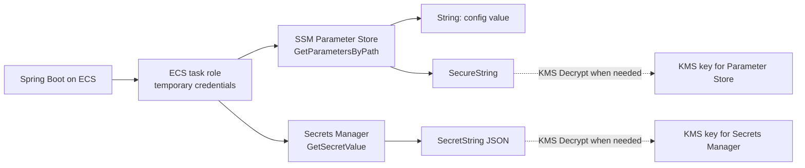

# Authorizing Read Access to Parameters, Secrets, and Associated KMS Keys

## Lesson Objectives

In the **SPRING_CLOUD_PROVIDER_INTEGRATION** module, learners practice integrating Spring Boot with managed services from **AWS, Azure, and Google Cloud** using their corresponding Spring Cloud libraries. Beyond accessing storage, messaging, and data, a cloud application needs a well-defined **workload identity**, read access strictly limited to its own configuration and secrets, and verifiable authorization policies.

In the **AWS Configuration** chapter, we design permissions across three related layers:

1. **AWS Systems Manager Parameter Store**: reading regular or `SecureString` configuration parameters.
2. **AWS Secrets Manager**: reading passwords, API keys, tokens, and application secrets.
3. **AWS Key Management Service (KMS)**: using the appropriate key to decrypt encrypted values, especially with **customer managed keys**.

After this lesson, you will be able to:

- Distinguish between an IAM role **trust policy**, workload **permission policy**, **resource policy**, and **KMS key policy**.
- Identify the required read permissions for each API: `ssm:GetParameter`, `ssm:GetParameters`, `ssm:GetParametersByPath`, `secretsmanager:GetSecretValue`, and `kms:Decrypt`.
- Write narrow policies scoped by **AWS account, Region, application, and environment**, avoiding overly broad wildcards.
- Integrate IAM roles with Spring Cloud AWS Config Data and handle behavior when permissions are missing or secrets are rotated.
- Test data retrieval in a sandbox account without printing secrets to terminals or logs.

> **Guiding principle:** Having permission to call `ssm:GetParametersByPath` or `secretsmanager:GetSecretValue` **does not mean** you automatically have permission to decrypt with KMS. Conversely, having only `kms:Decrypt` is **not sufficient** to read a parameter or secret. Effective permissions result from evaluating multiple policies simultaneously and also depend on the actual key configuration.

## 1. Permission Map from Spring Boot to AWS Data

Suppose `order-service` runs on Amazon ECS and requires:

```text
Parameter Store
  /config/order-service/prod/catalog.base-url       (String)
  /config/order-service/prod/catalog.timeout        (String)
  /config/order-service/prod/licensing.token         (SecureString)

Secrets Manager
  /secrets/order-service/prod/database               (JSON secret)

KMS
  Dedicated CMK for SecureString licensing.token
  Dedicated CMK for database secret
```

Here `CMK` refers to a **customer managed KMS key** created and managed by the organization. The names and keys in these examples are placeholder sandbox resources; never use real system key IDs or credentials in exercises.



The diagram above illustrates **permission decisions to verify**. The application SDK usually calls the SSM/Secrets Manager APIs; those AWS services coordinate with KMS to handle encryption/decryption. Do not interpret the KMS arrow as meaning the application must always invoke `KmsClient.decrypt()` directly.

### Policy Layers

| Layer | Question to answer | Example |
| --- | --- | --- |
| **IAM role trust policy** | Who is allowed to assume the role? | `ecs-tasks.amazonaws.com` can assume the ECS task role |
| **IAM identity-based permission policy** | Which APIs can the role call, on which resources? | `ssm:GetParametersByPath` on the `order-service/prod` config tree |
| **Service resource policy** | Does the resource allow a principal to access it? | Secret allows a role from another account to read |
| **KMS key policy/grant** | Is the principal allowed to use the encryption/decryption key? | Allows `kms:Decrypt` for a specific key |
| **Boundary/SCP/explicit deny** | Do any organizational policies restrict access further? | SCP denies access to a Region or blocks `GetSecretValue` |

An API call can fail with `AccessDenied` even when the identity policy looks valid: the trust policy might prevent the app from assuming the role, or an effective `Deny`, resource policy, or KMS key policy might block the call. With KMS, authorization also depends on the **key policy**, IAM policies if allowed by the key policy, and KMS grants when applicable. Never fix permissions by guessing; identify which layer is denying the request.

## 2. Choosing the Right Parameter Store Read Permissions

### 2.1. Different APIs Serve Different Needs

| IAM action | API/meaning | When required |
| --- | --- | --- |
| `ssm:GetParameter` | Read one parameter by name or supported version/label | Service calls `GetParameter` directly |
| `ssm:GetParameters` | Read multiple explicitly named parameters | Batch retrieval by name list |
| `ssm:GetParametersByPath` | Read parameters under a path, optionally recursively | Spring Cloud AWS Config Data importing a path |
| `ssm:DescribeParameters` | List and view metadata | Operational tooling/metadata inspection; not needed by default for every app |
| `ssm:GetParameterHistory` | Read previous parameter versions | Separately authorized audit/recovery workflows |

**Do not grant every action just because they share the `Get` prefix.** Choose actions based on actual calls. For the Spring Cloud AWS 3.x example:

```yaml
spring:
  config:
    import: "aws-parameterstore:/config/order-service/prod/"
```

we evaluate `ssm:GetParametersByPath` permission on the imported tree. If another component calls `SsmClient.getParameter`, it needs `ssm:GetParameter`; permission for `GetParametersByPath` alone does not cover every other SDK call.

### 2.2. Parameter ARNs Differ from Path Names

A parameter name starts with a leading `/`:

```text
/config/order-service/prod/catalog.timeout
```

In IAM, the corresponding ARN takes the form:

```text
arn:aws:ssm:ap-southeast-1:111122223333:parameter/config/order-service/prod/catalog.timeout
```

Notice that after `parameter` in the ARN comes `/config/...`, **not** `parameter:/config/...`. `111122223333` and `ap-southeast-1` are illustrative account/Region values and must be replaced with real values when granting permissions.

Example least-privilege policy for reading the `/config/order-service/prod/` tree:

```json
{
  "Version": "2012-10-17",
  "Statement": [
    {
      "Sid": "ReadOrderServiceProdParameters",
      "Effect": "Allow",
      "Action": "ssm:GetParametersByPath",
      "Resource": [
        "arn:aws:ssm:ap-southeast-1:111122223333:parameter/config/order-service/prod",
        "arn:aws:ssm:ap-southeast-1:111122223333:parameter/config/order-service/prod/*"
      ]
    }
  ]
}
```

This template illustrates the target path and elements beneath it. Effective permissions and the resource ARN used by the API call must be verified in a sandbox with the exact client, `Recursive` setting, and organizational policies. If an application **only** reads two specific parameter names with `GetParameters`, the policy should list those two exact ARNs and `ssm:GetParameters` rather than granting read access to an entire tree.

### 2.3. Warning About Recursive `GetParametersByPath`

A common pitfall: per IAM documentation for Parameter Store, if a principal is allowed to read a **parent path** with `GetParametersByPath`, a **recursive** read call can return values from child paths even when an explicit deny exists on a child parameter under AWS's documented behavior for this API. Therefore:

```text
/config/
  team-a/
    prod/password
  team-b/
    prod/password
```

Do **not** grant `ssm:GetParametersByPath` on `/config/` and rely on a deny on `team-b`'s parameters to prevent `team-a`'s role from reading them. Separate namespaces along security boundaries and grant permissions directly on the path owned by each workload. Use separate accounts or roles when strong isolation is required.

Even parameters sharing a `prod` prefix do not necessarily share the same sensitivity. Placing an especially sensitive `SecureString` under a broad path readable by multiple applications may make IAM granularity coarser than intended; consider splitting paths and permissions or moving it to Secrets Manager.

### 2.4. `String`, `StringList`, and `SecureString`

Parameter Store has three common types:

| Type | Primary read permission | Need to think further about KMS? |
| --- | --- | --- |
| `String` | SSM permission matching the API | No `SecureString` decryption required |
| `StringList` | SSM permission matching the API | No `SecureString` decryption required |
| `SecureString` | SSM permission matching the API | Yes: AWS KMS key, `kms:Decrypt`, and key policy when plaintext is requested |

When calling SSM with `WithDecryption=true`, `SecureString` must be decrypted. AWS KMS uses the key attached to the parameter. With a **customer managed key**, verify the principal's `kms:Decrypt` permission under KMS authorization rules; when using the AWS managed key `alias/aws/ssm`, policies and permission scopes differ, so verify before assuming data is isolated.

**Never store production passwords in `String`**, nor try to solve all credential management needs with `SecureString`: Parameter Store lacks a dedicated credential rotation workflow like Secrets Manager. Critical credentials requiring rotation or dedicated lifecycle management should be evaluated for Secrets Manager.

## 3. Authorizing Secrets Manager Reads

### 3.1. `GetSecretValue` on the Exact Secret ARN

Suppose the secret name is:

```text
/secrets/order-service/prod/database
```

The actual Secrets Manager ARN includes a six-character random suffix, for example:

```text
arn:aws:secretsmanager:ap-southeast-1:111122223333:secret:/secrets/order-service/prod/database-AbCdEf
```

**Read-only** policy for this secret:

```json
{
  "Version": "2012-10-17",
  "Statement": [
    {
      "Sid": "ReadProdDatabaseSecret",
      "Effect": "Allow",
      "Action": "secretsmanager:GetSecretValue",
      "Resource": "arn:aws:secretsmanager:ap-southeast-1:111122223333:secret:/secrets/order-service/prod/database-AbCdEf"
    }
  ]
}
```

`GetSecretValue` retrieves the authorized secret content, including all fields inside a JSON secret. **IAM does not filter permissions per JSON key**: if `database` contains a username, password, and API key, an application permitted to read that secret receives all three. Split secrets by credential group and consumer whenever distinct security boundaries are needed.

Spring Cloud AWS Config Data importing a secret:

```yaml
spring:
  config:
    import: "aws-secretsmanager:/secrets/order-service/prod/database?prefix=db."
```

When the JSON secret has `username` and `password` keys, Spring can use `${db.username}` and `${db.password}` to bind configuration. `?prefix=db.` **only changes property names on the Spring side**; it neither widens nor narrows IAM. Do not confuse the prefix with the resource name evaluated by IAM.

### 3.2. Actions Not to Grant Arbitrarily

| Action | Purpose | Needed by a read-only role? |
| --- | --- | --- |
| `secretsmanager:GetSecretValue` | Read secret content | Yes, if the app reads this secret |
| `secretsmanager:DescribeSecret` | View metadata, versions, rotation config | Only if the app makes calls requiring metadata |
| `secretsmanager:ListSecrets` | List secrets | Typically **not** needed for importing by exact name |
| `secretsmanager:BatchGetSecretValue` | Read multiple secrets via batch API | Grant only if code actually uses this API |
| `secretsmanager:PutSecretValue` | Create a new secret version | **Never** grant to a read-only app role |
| `secretsmanager:UpdateSecret`, `RotateSecret`, `DeleteSecret` | Modify/rotate/delete secrets | Belongs to separate operations or rotation roles |

Choose actions based on the SDK and library version in use. Permitting `GetSecretValue` on an ARN does not inherently require adding `ListSecrets`. If a library actually requires `DescribeSecret`, add it specifically on that secret ARN after verifying the call, instead of opening all of Secrets Manager.

### 3.3. Secret Names, ARNs, and Wildcards

ARNs like `...:secret:/secrets/order-service/prod/database-*` are often used when a pattern must match the auto-generated suffix. However, wildcards can match multiple ARNs if naming prefixes overlap. When the actual ARN is known, using the **full ARN** narrows the scope much more precisely.

Similarly, `secretsmanager:GetSecretValue` with `Resource: "*"` allows reading every secret not blocked by other policies; this is far too broad for a business application. Secret names, tags, and metadata should also never contain the **secret value** itself, as they can appear in logs and management consoles.

## 4. KMS: Why a Read Request Can Still Be Denied

### 4.1. Two Key Groups and Questions to Ask

AWS KMS protects encrypted data; in the context of this lesson, SSM handles `SecureString` encryption while Secrets Manager encrypts secret content. When granting permissions, identify which key protects the value:

| Scenario | Encryption key | What to evaluate |
| --- | --- | --- |
| Parameter Store `String` / `StringList` | Not a `SecureString` | SSM read permissions; no separate KMS decryption permission needed for this value type |
| `SecureString` with default `alias/aws/ssm` | **AWS managed KMS key** | Default AWS managed key authorization behavior, IAM, and SSM read permissions |
| `SecureString` with customer managed key | Organization-managed key | `kms:Decrypt`, key policy/grants, Region, and matching KMS conditions |
| Secrets Manager with default `alias/aws/secretsmanager` | **AWS managed KMS key** | Secret read permissions and the key's default policy |
| Secrets Manager with customer managed key | Organization-managed key | `GetSecretValue`, matching decrypt permissions, key policy/grants |
| Secrets Manager read across AWS accounts | Typically requires a customer managed key with proper sharing | Identity policy, secret resource policy, and KMS key policy must all align |

An **AWS managed key** has its policy managed by AWS; organizations cannot edit its key policy the way they do for a customer managed key. For fine-grained decryption permissions or cross-account sharing, a **customer managed key** is typically required.

Do not assume adding `kms:Decrypt` on an arbitrary key will fix an error. A `SecureString` and a secret may use **two different keys**, even in different Regions. Identify the actual key ID/ARN used by each resource.

### 4.2. `kms:Decrypt` Is Not Equivalent to Secret Read Permission

For example, suppose a role has:

```json
{
  "Effect": "Allow",
  "Action": "kms:Decrypt",
  "Resource": "arn:aws:kms:ap-southeast-1:111122223333:key/11111111-2222-3333-4444-555555555555"
}
```

This statement may satisfy part of decryption permission, yet the role still **cannot read the secret** if it lacks `secretsmanager:GetSecretValue` on the secret ARN. Likewise, `ssm:GetParametersByPath` can read parameter names and non-sensitive values, but requesting `SecureString` decryption with a customer managed key will fail if KMS permissions are insufficient.

In many setups, IAM policies are evaluated alongside the key policy. For a role to decrypt using a customer managed key, an **effective KMS authorization path** must exist via the key policy, an IAM policy allowed by the key policy, or KMS grants—do not inspect just one policy file. Effective `Deny` statements from organizational or other policies can still block the action.

### 4.3. Restricting Decryption Through a Specific Service

The **`kms:ViaService`** condition key restricts key usage to calls made through a specified AWS service. Example IAM statement for a **Parameter Store customer managed key**:

```json
{
  "Sid": "DecryptOrderServiceSecureParameters",
  "Effect": "Allow",
  "Action": "kms:Decrypt",
  "Resource": "arn:aws:kms:ap-southeast-1:111122223333:key/11111111-2222-3333-4444-555555555555",
  "Condition": {
    "StringEquals": {
      "kms:ViaService": "ssm.ap-southeast-1.amazonaws.com"
    }
  }
}
```

For a **Secrets Manager customer managed key**:

```json
{
  "Sid": "DecryptOrderServiceDatabaseSecret",
  "Effect": "Allow",
  "Action": "kms:Decrypt",
  "Resource": "arn:aws:kms:ap-southeast-1:111122223333:key/66666666-7777-8888-9999-000000000000",
  "Condition": {
    "StringEquals": {
      "kms:ViaService": "secretsmanager.ap-southeast-1.amazonaws.com"
    }
  }
}
```

This condition prevents using the key directly via KMS or through other services. It does **not** specify which parameter or secret may be read: the SSM/Secrets Manager permissions above must still restrict the resources.

KMS also supports **encryption context** to bind how a value is encrypted/decrypted. SSM and Secrets Manager use different encryption context attributes; you can design additional `kms:EncryptionContext:...` conditions after verifying the exact context sent by the service. Never guess context values and push them into production, as a mismatched condition can block all decryption.

### 4.4. Key Policy Is a Separate Control Layer

For a customer managed KMS key, an **illustrative** statement in the key policy of the database secret's key might allow a specific role to use `Decrypt` via Secrets Manager:

```json
{
  "Sid": "AllowOrderServiceProdDecryptViaSecretsManager",
  "Effect": "Allow",
  "Principal": {
    "AWS": "arn:aws:iam::111122223333:role/order-service-prod-task-role"
  },
  "Action": "kms:Decrypt",
  "Resource": "*",
  "Condition": {
    "StringEquals": {
      "kms:ViaService": "secretsmanager.ap-southeast-1.amazonaws.com"
    }
  }
}
```

This is **one statement to integrate into an existing key policy**, not a complete key policy. Inside a **key policy**, `"Resource": "*"` refers to **only the KMS key that owns that policy**, not every key in the account. This distinction matters during policy reviews: the same `*` character has different scope semantics depending on the policy type.

When a key policy grants permissions directly to a role, it can authorize KMS usage independently of an identity-based allow on the role, depending on policy structure. Always evaluate **overall effective permissions**, not just the IAM permission policy. In enterprise environments, platform teams typically maintain key policies and grants, while application teams manage roles with least-privilege read permissions.

### 4.5. Default Keys, Isolation, and Rotation

With an **AWS managed key**, users cannot manage the key policy the way they can for a customer managed key. With `alias/aws/ssm`, principals with appropriate SSM permissions may be able to decrypt values under the key's default policy; therefore, do not treat `SecureString` with the default key as a strong IAM/KMS isolation boundary across mutually untrusted groups.

When a workload must only decrypt a specific group of sensitive parameters, evaluate a **dedicated customer managed key** with tightly scoped policies, or isolate the secret in Secrets Manager. However, using multiple keys introduces cost, operational workflows, and separate key policy maintenance.

**KMS key rotation and secret rotation are two different concepts.** KMS key rotation rotates the key's cryptographic material per KMS mechanics; it **does not change database passwords, API keys, or JSON secrets**. Secrets Manager rotation must coordinate the target system and the application reading the new credentials.

## 5. Combined Policy for Spring Boot Reading SSM, Secrets Manager, and KMS

### 5.1. Environment Design

The `order-service` application on production ECS requires:

- SSM path `/config/order-service/prod/`, containing a `SecureString` encrypted with customer managed key `11111111-2222-3333-4444-555555555555`.
- JSON secret `/secrets/order-service/prod/database`, with full ARN suffix `-AbCdEf`, encrypted with key `66666666-7777-8888-9999-000000000000`.
- IAM role `order-service-prod-task-role` used solely to read these two sources.

The ARNs below are **structural examples** only; real deployments must use actual ARNs, key policies, and role trust policies for the right account/Region. UUIDs in examples do not represent real resources.

### 5.2. Example IAM Permission Policy

```json
{
  "Version": "2012-10-17",
  "Statement": [
    {
      "Sid": "ReadProdParameterPath",
      "Effect": "Allow",
      "Action": "ssm:GetParametersByPath",
      "Resource": [
        "arn:aws:ssm:ap-southeast-1:111122223333:parameter/config/order-service/prod",
        "arn:aws:ssm:ap-southeast-1:111122223333:parameter/config/order-service/prod/*"
      ]
    },
    {
      "Sid": "ReadProdDatabaseSecret",
      "Effect": "Allow",
      "Action": "secretsmanager:GetSecretValue",
      "Resource": "arn:aws:secretsmanager:ap-southeast-1:111122223333:secret:/secrets/order-service/prod/database-AbCdEf"
    },
    {
      "Sid": "DecryptSecureParametersViaSSM",
      "Effect": "Allow",
      "Action": "kms:Decrypt",
      "Resource": "arn:aws:kms:ap-southeast-1:111122223333:key/11111111-2222-3333-4444-555555555555",
      "Condition": {
        "StringEquals": {
          "kms:ViaService": "ssm.ap-southeast-1.amazonaws.com"
        }
      }
    },
    {
      "Sid": "DecryptDatabaseSecretViaSecretsManager",
      "Effect": "Allow",
      "Action": "kms:Decrypt",
      "Resource": "arn:aws:kms:ap-southeast-1:111122223333:key/66666666-7777-8888-9999-000000000000",
      "Condition": {
        "StringEquals": {
          "kms:ViaService": "secretsmanager.ap-southeast-1.amazonaws.com"
        }
      }
    }
  ]
}
```

This is the **identity-based policy** attached to the role, excluding the trust policy and key policy. After attaching the policy, verify actual KMS permissions on **both keys**. If one source uses an AWS managed key instead of a customer managed key, KMS requirements differ; adjust the policy to match the actual key type and test rather than copying the example blindly.

Notice there are no write permissions in the policy: this role cannot create parameters, modify secrets, or trigger rotation from these statements alone. CI/CD, operators, and rotation Lambdas (if any) use separate roles with **scoped write/rotate** permissions.

### 5.3. Trust Policy and the Role of the ECS Task Role

ECS uses the trust policy to allow an ECS task to assume the role, while the **permission policy** in section 5.2 specifies what data the role may read. Example core of the trust policy:

```json
{
  "Version": "2012-10-17",
  "Statement": [
    {
      "Sid": "AllowECSTasksAssumeRole",
      "Effect": "Allow",
      "Principal": {
        "Service": "ecs-tasks.amazonaws.com"
      },
      "Action": "sts:AssumeRole",
      "Condition": {
        "StringEquals": {
          "aws:SourceAccount": "111122223333"
        },
        "ArnLike": {
          "aws:SourceArn": "arn:aws:ecs:ap-southeast-1:111122223333:*"
        }
      }
    }
  ]
}
```

`aws:SourceAccount` and `aws:SourceArn` help mitigate confused deputy risk as recommended by AWS; the ARN portion is scoped to the illustrative account/Region and must match your exact ECS requirements. A trust policy alone does not allow calling `GetSecretValue` if the role lacks the permission policy.

**Do not confuse the ECS task role with the ECS task execution role.** The Spring Boot application uses the **task role**'s credentials to call SSM/Secrets Manager via the AWS SDK. The **execution role** serves actions performed by the ECS agent, such as pulling images from ECR or injecting certain secrets as environment variables; that is a separate flow from the application invoking Config Data at startup.

### 5.4. Config Data Using These Permissions

In `application-prod.yml`:

```yaml
spring:
  application:
    name: order-service
  config:
    import:
      - "aws-parameterstore:/config/order-service/prod/"
      - "aws-secretsmanager:/secrets/order-service/prod/database?prefix=db."
  datasource:
    url: "${database.jdbc-url}"
    username: "${db.username}"
    password: "${db.password}"
```

The source code contains no AWS access keys or passwords. Spring Cloud AWS uses the workload's default AWS SDK credentials to fetch both sources during **Config Data initialization**. Declare version-compatible starters:

```xml
<dependencyManagement>
    <dependencies>
        <dependency>
            <groupId>io.awspring.cloud</groupId>
            <artifactId>spring-cloud-aws-dependencies</artifactId>
            <version>${spring-cloud-aws.version}</version>
            <type>pom</type>
            <scope>import</scope>
        </dependency>
    </dependencies>
</dependencyManagement>

<dependencies>
    <dependency>
        <groupId>io.awspring.cloud</groupId>
        <artifactId>spring-cloud-aws-starter-parameter-store</artifactId>
    </dependency>
    <dependency>
        <groupId>io.awspring.cloud</groupId>
        <artifactId>spring-cloud-aws-starter-secrets-manager</artifactId>
    </dependency>
</dependencies>
```

`${spring-cloud-aws.version}` is a Maven property declared by the project according to the **compatibility matrix** for the Spring Boot version in use. Locally, you can use AWS IAM Identity Center / an AWS CLI profile with sandbox permissions; on ECS, use the task role. **Never** copy local credentials into `application-prod.yml` just to make the application start.

The illustrative `database.jdbc-url` is a `String` parameter **without username/password**. For the database JSON secret:

```json
{
  "username": "orders_app",
  "password": "<SECRET_VALUE_IN_AWS_ONLY>"
}
```

`?prefix=db.` produces `db.username` and `db.password`. Verify that placeholders actually match the JSON keys. The string `<SECRET_VALUE_IN_AWS_ONLY>` is just a lesson placeholder, not a credential to upload to AWS.

SSM resources live in **one Region**; secrets and KMS keys are likewise tied to their Region/replication setup. When operating across different accounts/Regions, update paths, ARNs, Region configuration, and policies consistently rather than only changing `spring.profiles.active`.

## 6. Advanced Case: Reading Secrets Across Multiple AWS Accounts

In enterprises, a **shared-services account** may hold shared secrets while applications run in other application accounts. This requires coordinating permissions on both the **role side and the resource side**.

Suppose:

- Account A `111122223333` runs `order-service` with role `order-service-prod-task-role`.
- Account B `444455556666` owns secret `shared/payments/partner-token`.
- The secret in Account B is encrypted using B's **customer managed KMS key**.

To read the secret cross-account, verify:

1. The **identity-based policy** on the role in Account A allows `secretsmanager:GetSecretValue` on the exact ARN of the secret in B.
2. The **resource policy** attached to the secret in B allows the principal from A to read the secret.
3. The **KMS key policy/grant** in B and corresponding IAM permissions in A allow using the key to decrypt; for this kind of sharing, **the AWS managed key `aws/secretsmanager` cannot substitute for a customer managed key**.
4. The application imports by **full ARN** rather than just name when accessing across accounts, running in the matching Region.

Example of **one statement** in the Secrets Manager resource policy on B's side:

```json
{
  "Sid": "AllowOrderServiceAccountARead",
  "Effect": "Allow",
  "Principal": {
    "AWS": "arn:aws:iam::111122223333:role/order-service-prod-task-role"
  },
  "Action": "secretsmanager:GetSecretValue",
  "Resource": "*"
}
```

`Resource: "*"` is syntax for a **resource policy attached directly to the secret**. Do not copy this statement into an IAM policy attached to a role, as `"Principal"` and evaluation scope differ. Before applying, inspect the full policy structure, narrow `Principal`, and evaluate sharing using tools like **IAM Access Analyzer**. The KMS policy on B's side must be tailored to that exact role/Region/key.

When the application fetches the secret by ARN, Config Data can specify:

```properties
spring.config.import=aws-secretsmanager:arn:aws:secretsmanager:ap-southeast-1:444455556666:secret:shared/payments/partner-token-AbCdEf
```

This is an illustrative ARN. Putting an ARN in configuration **grants no permissions**; if the policy or key policy does not permit it, the call is still denied. Do not share secrets across multiple environments or accounts merely because the library supports importing by ARN. Consider replicating secrets as needed and limiting sharing scope.

For **Parameter Store**, AWS provides Advanced parameter sharing mechanisms in certain cross-account models. The sharing mechanism, RAM/resource policies, and KMS permissions differ from the Secrets Manager example; do not apply Secrets Manager resource policies directly to SSM parameters. When sharing is not required, same-account permissions on each workload's own parameter tree are simpler and easier to govern.

## 7. Layer-by-Layer Permission Troubleshooting

### 7.1. Separating Authentication, Authorization, Resource Existence, and Network Errors

| Symptom | Possible cause category | Check first |
| --- | --- | --- |
| `Unable to load credentials` / no AWS credentials found | Missing AWS profile/session or task/pod failed to receive the right role | Identity provider config; trust policy and role binding |
| `AccessDeniedException` on `GetParametersByPath` | IAM role lacks SSM action, wrong resource ARN, blocked by SCP/boundary or endpoint policy | Called API, actual role, path, IAM/resource constraints |
| `AccessDeniedException` on `GetSecretValue` | Role not allowed to read secret ARN, secret resource policy denies | Actual ARN with suffix, principal, and relevant policies |
| KMS `AccessDenied` / `DecryptionFailure` message | Wrong key, missing KMS permission, key policy, grant, or encryption context mismatch | KMS key ARN, Region, `kms:Decrypt`, and key policy |
| `ParameterNotFound` / secret `ResourceNotFoundException` | Wrong name, account, or Region; resource was deleted/renamed | Compare configured name against actual resource and environment |
| Connection timeout / SDK cannot reach endpoint | DNS, NAT, routes, security groups, VPC endpoint, proxy | Network connectivity from the workload itself and endpoint Region |
| `optional:` import still causes app failure | Error is not just a missing location, or a bean still requires the property | Root cause and Spring property/validation rules |
| Reads `String` parameters, but `SecureString` fails | SSM allows reading, but the associated KMS key cannot be decrypted | Parameter type and encryption key |
| After rotation, DB login fails | Credential changed in database, app has not refreshed, pool holds old credential | Rotation status, cache, reload/rollout, and pool |

Permission errors and not-found errors may be masked by services under security policies or due to malformed requests; do not conclude a resource exists or does not exist from a single message alone. When errors occur, compare the API and ARN in **AWS CloudTrail**, SDK exceptions, and deployment configuration; avoid putting secret payloads in logs.

### 7.2. Repeatable Debugging Workflow

1. **Verify the application's runtime identity.** On ECS, inspect the task definition and `taskRoleArn`; on EKS, inspect the service account and Pod Identity/IRSA; on EC2, inspect the instance profile. Never assume a developer workstation's role matches production.
2. **Verify account/Region.** The name `/secrets/order-service/prod/database` can exist in multiple accounts and Regions as completely separate resources.
3. **Read the exact denied API.** SSM `GetParametersByPath` differs from `GetParameter`, Secrets Manager `GetSecretValue` differs from `DescribeSecret`, and KMS `Decrypt` differs from `DescribeKey`.
4. **Cross-check the resource ARN.** Parameter ARNs use the `parameter/config/...` prefix, while secret ARNs have an auto-generated suffix; do not substitute incomplete names for real ARNs in policies.
5. **Evaluate all policies.** Identity allows, resource policies, key policies, permission boundaries, SCPs, session policies, explicit denies, and VPC endpoint policies when used.
6. **Check encryption.** `String` differs from `SecureString`; secrets using an AWS managed key differ from a customer managed key; `kms:ViaService` and encryption context must match.
7. **Retest with a sandbox workload.** Only confirm that API access succeeds and the app connects to the target system; never print secrets.

A role with valid IAM permissions can still fail with network errors if the task sits in a private subnet without NAT or a **VPC interface endpoint** to Secrets Manager/SSM. That is never a reason to loosen IAM. Conversely, an endpoint policy can deny requests even when networking is healthy and IAM allows them. Your debugging workflow must separate networking from authorization.

### 7.3. CLI Commands That Read Metadata Only

When investigating in a sandbox account, check the current identity:

```bash
aws sts get-caller-identity
```

Or fetch metadata **without secret contents**:

```bash
aws secretsmanager describe-secret \
  --secret-id "/secrets/order-service/prod/database" \
  --region ap-southeast-1 \
  --query "{Name:Name,ARN:ARN,KmsKeyId:KmsKeyId,RotationEnabled:RotationEnabled}"
```

For a KMS customer managed key, operations teams can inspect key metadata:

```bash
aws kms describe-key \
  --key-id "arn:aws:kms:ap-southeast-1:111122223333:key/66666666-7777-8888-9999-000000000000" \
  --region ap-southeast-1 \
  --query "KeyMetadata.{Arn:Arn,KeyState:KeyState,KeyManager:KeyManager}"
```

These metadata commands require **separate metadata permissions** (`secretsmanager:DescribeSecret`, `kms:DescribeKey`) if the principal does not already have them. A production role that only needs to read secrets at startup does not necessarily need these permissions. Use an authorized operations principal for debugging.

Never run `get-secret-value` or `get-parameter --with-decryption` and paste the output into tickets, shell history, CI logs, or chat apps. If you must prove access works, verify via **application behavior** (e.g., successful database authentication in sandbox) or a test that asserts status without printing payloads.

## 8. Testing Least Privilege Before Deployment

### 8.1. Test Matrix in an AWS Sandbox

Prepare sandbox resources and three roles: the narrowly scoped application role, an unauthorized role, and a test admin role. Never use production secrets.

| Test case | Expected result |
| --- | --- |
| `order-service-prod-role` reads `String` parameters in `/config/order-service/prod/` | Succeeds |
| Same role reads parameters under `/config/another-service/prod/` | Denied |
| Same role reads secret `/secrets/order-service/prod/database` | Succeeds |
| Same role reads `/secrets/another-service/prod/database` | Denied |
| Role stripped of `secretsmanager:GetSecretValue` | Reading secret fails; KMS allow cannot save it |
| Role retains SSM read but loses `kms:Decrypt` path for `SecureString`'s CMK | Reading `String` still succeeds; decrypting `SecureString` fails |
| Role has KMS decrypt but loses SSM read | Cannot read parameters via SSM |
| Secret uses a different KMS key than the authorized key | Fails at the decryption step |
| Role with parent path permission used with recursive call | Verify no unintended child paths are readable |
| Secret rotated while app has not reloaded/restarted | Observe how client/connection pool behaves with old credential |

The **denied** test cases are just as important as the passing ones. Only verifying "the app still starts" does not prove the role cannot read another workload's data.

### 8.2. Distinguishing Unit Tests from Integration Tests

For unit tests and Spring Boot business logic tests, use a `test` profile **without importing AWS** and provide mock data:

```yaml
# application-test.yml
database:
  jdbc-url: jdbc:postgresql://localhost:5432/orders_test
db:
  username: test_user
  password: test-only-placeholder
```

You can then test `@ConfigurationProperties`, validation, and application logic without needing AWS credentials. To verify actual IAM, KMS, or AWS Config Data behavior, run **integration tests in an AWS sandbox**, using the real role or an authorized assume-role flow. API emulators like LocalStack are helpful for some flows, but do not prove key policies, Organizations SCPs, KMS grants, or full real AWS IAM semantics.

A practical integration test scenario:

1. Create two sandbox `String` parameters and one `SecureString`; record their ARNs and key ARN.
2. Create a sandbox JSON secret containing a credential used solely for a test database.
3. Deploy an ECS task or test workload assuming an IAM role with the policy from section 5.
4. Start the application with `spring.config.import` pointing to the right path/secret; verify readiness and connection to the test database.
5. Use the restricted role to attempt reading a secret outside its namespace; verify denial **without printing secret values**.
6. Modify the key policy or IAM on the **sandbox resources** according to an approved scenario, observe the response, and restore the proper permissions.
7. Record results, delete test resources per environment procedures, and revoke temporary credentials if needed.

Never run "disable permissions then re-enable" experiments directly on production roles/CMKs serving users. Use an isolated sandbox to avoid outages and produce repeatable evidence.

### 8.3. Automated Evaluation and Monitoring

Throughout the deployment lifecycle, combine:

- **Policy review/IAM Access Analyzer:** detect out-of-scope secret/key sharing and policies allowing overly broad principals.
- **IAM policy simulation:** helpful for certain identity-based permissions, though you must understand simulator limits; results do not replace real testing of resource policies, KMS key policies, SCPs, and runtime conditions.
- **CloudTrail:** review API calls such as `GetSecretValue`, `GetParametersByPath`, and relevant KMS events, inspecting principal, account, Region, errors, and timestamps. CloudTrail is also an audit source; avoid placing secret values in request parameters or application logs.
- **Alerts:** detect spikes in `AccessDenied`, rotation errors, abnormal secret reads, or workloads reading resources outside their expected namespace.
- **Periodic reviews:** update role permissions when a service stops using a secret, migrates to another ARN, or changes Regions.

Policy checks should be part of CI/IaC reviews rather than waiting for a service startup failure.

## 9. Common Authorization Mistakes and Fixes

| Mistake | Why it is dangerous or ineffective | Fix |
| --- | --- | --- |
| App role has `ssm:*`, `secretsmanager:*`, `kms:*` | Can read, write, delete, or rotate too many resources | Grant only the exact actions the client calls, scoped by ARN |
| Using `Resource: "*"` for `GetSecretValue` in IAM policy | App can read secrets it does not own | Use actual secret ARNs with their random suffixes |
| Allowing `/config/` then denying specific child paths | Recursive `GetParametersByPath` semantics can expose child paths | Partition namespaces and grant narrow paths directly |
| Granting `kms:Decrypt` without SSM/Secrets Manager permission | Cannot read data even though the decryption key is permitted | Grant **both** layers appropriately per workload |
| Adding only IAM `kms:Decrypt` without checking key policy | Customer managed key may still deny | Check key policy, grants, conditions, and explicit denies |
| Assuming all secrets should share one KMS key | Broadens decryption scope and complicates app isolation | Choose keys based on security/cost/operational boundaries |
| Attaching all AWS permissions to the ECS execution role | App may not receive required permissions via the task role | Distinguish task role (app SDK) from execution role (ECS agent) |
| Sharing the same role between `dev` and `prod` | Cross-environment access expands blast radius | Separate roles, policies, paths, secrets; consider separate accounts |
| Granting write/rotation permissions to a read-only role | Compromised workload could alter credentials | Use separate provisioning/rotation roles |
| Only testing that the app reads its own secret | Does not prove it cannot read other services' secrets | Add negative tests against out-of-scope resources |
| Enabling `optional:` to ignore IAM errors | Does not solve root cause; causes late errors or missing config | Fix role/ARN/Region and validate properties |
| Logging JSON secrets to investigate `AccessDenied` | Risks leaking credentials through logs/tickets | Inspect error codes, metadata, CloudTrail; test via behavior |

During reviews, inspect both **granted permissions** and **reachable resources resulting from combined policies**. A short IAM policy is not necessarily safe if wildcards and trust policies are overly broad. Conversely, a design with several precise statements can be both safer and easier to maintain.

## 10. Scenario Exercise

A `payment-service` application runs on EKS in `prod`, integrates with a bank, and sends notifications via Amazon SQS. The application requires:

```text
Parameter Store:
  /config/payment-service/prod/payment.gateway-url   (String)
  /config/payment-service/prod/payment.timeout       (String)
  /config/payment-service/prod/license.code          (SecureString)

Secrets Manager:
  /secrets/payment-service/prod/bank-api              (JSON: clientId, clientSecret)
  /secrets/payment-service/prod/database              (JSON: username, password)

KMS:
  Key A: encrypts license.code
  Key B: encrypts bank-api
  Key C: encrypts database
```

Design the solution step by step:

1. **Identity:** Choose EKS Pod Identity or IRSA, define the Kubernetes ServiceAccount and IAM role bound to `payment-service`, ensuring other workloads cannot assume this role outside the design.
2. **SSM:** Write an IAM statement allowing `ssm:GetParametersByPath` only within `/config/payment-service/prod/`. Explain why `/config/` should not be granted to every service.
3. **Secrets Manager:** Write an IAM statement for `secretsmanager:GetSecretValue` on the **two exact secret ARNs**, without account-wide wildcards. Note that read permission on a JSON secret includes all top-level keys of that secret.
4. **KMS:** Add `kms:Decrypt` on Keys A/B/C with `kms:ViaService` set to `ssm.ap-southeast-1.amazonaws.com` or `secretsmanager.ap-southeast-1.amazonaws.com` respectively. Describe how key policies/grants authorize the role to decrypt, rather than relying on IAM allows alone.
5. **Application:** Write `spring.config.import` for Parameter Store, the bank secret, and the database secret; choose prefixes `bank.` and `db.` to prevent the two JSON secrets from generating colliding properties.
6. **Negative tests:** Verify the role cannot read `/secrets/hr-service/prod/payroll`, cannot read `/config/hr-service/prod/`, and cannot call `PutSecretValue`.
7. **Rotation:** Describe how bank and database credentials are updated, how the application receives the new credentials, and post-rotation error monitoring.
8. **Audit:** Identify which data may be recorded in CloudTrail/logs or test output, and which data must never appear in output.

### Guided Solution Hints

`payment.gateway-url` and `payment.timeout` only require SSM read permissions and do not require KMS decryption under the `SecureString` model. `license.code` requires **both SSM read and KMS** when the decrypted value is needed with a customer managed key. The two JSON secrets require `GetSecretValue` on their individual ARNs and decryption using each secret's respective key. The application role does not need write actions such as `PutParameter`, `UpdateSecret`, or `PutSecretValue`.

Config Data can be written as:

```yaml
spring:
  config:
    import:
      - "aws-parameterstore:/config/payment-service/prod/"
      - "aws-secretsmanager:/secrets/payment-service/prod/bank-api?prefix=bank."
      - "aws-secretsmanager:/secrets/payment-service/prod/database?prefix=db."
```

A strong solution must explain cases of **missing IAM**, **missing KMS**, **wrong ARN/Region**, **wrong role**, and **secrets rotated while the app is running**. Merely reading its own secrets is not enough; the exercise is complete when cross-access tests are denied and verification procedures never output secret values.

## 11. Comparing the Same Requirements on Azure and Google Cloud

Because **SPRING_CLOUD_PROVIDER_INTEGRATION** covers AWS, Azure, and Google Cloud, translate security requirements from this design to other clouds by **capability and principal**, rather than searching for a "100% identical service name."

| Need | AWS | Azure | Google Cloud |
| --- | --- | --- | --- |
| Application identity | IAM role for ECS/EKS/EC2/Lambda | Managed Identity or appropriate workload identity | Service Account / Workload Identity |
| Standard config store | Systems Manager Parameter Store | Azure App Configuration and matching RBAC | Runtime config (e.g., GKE ConfigMap), Cloud Storage, or service per architecture |
| Secret store | Secrets Manager | Azure Key Vault | Secret Manager |
| Secret read permission | `secretsmanager:GetSecretValue` on ARN | Data-plane permissions, e.g., **Key Vault Secrets User** role under RBAC | `roles/secretmanager.secretAccessor` on secret/project at appropriate scope |
| Customer-managed encryption key | AWS KMS `kms:Decrypt`, key policy/grants | Key Vault/Managed HSM and matching key permissions | Cloud KMS and **service agent permissions** when Secret Manager uses CMEK; do not assume the secret reader role itself decrypts directly |
| Verification | IAM/resource/KMS policies, CloudTrail | Azure RBAC, Key Vault access, Azure Monitor logs | Google Cloud IAM, KMS permissions, Cloud Audit Logs |

**Example difference:** With AWS Secrets Manager using a customer managed KMS key, you check KMS permissions of the principal reading the secret per AWS mechanics. With Google Cloud Secret Manager using **CMEK**, Cloud KMS is typically invoked by Secret Manager's service agent; the principal and authorization path cannot be inferred directly from AWS IAM/KMS examples. Azure uses a data-plane role and key permission model different from AWS IAM/KMS. When switching cloud providers, always verify which identity actually calls the service and which principal calls the decryption API.

Likewise, Spring Cloud AWS, Spring Cloud Azure, and Google Cloud integrations do not guarantee identical `spring.config.import` syntax, property names, or refresh mechanisms. Keep the application's configuration contract consistent where possible, while adapting integration and authorization per provider.

## Summary

Authorizing reads for parameters and secrets on AWS is about combining control layers consistently:

1. **Workload identity:** Spring Boot uses a temporary IAM role with a trust policy matching the runtime environment.
2. **Resource read permissions:** SSM requires API-specific actions (`GetParametersByPath` for path imports, `GetParameter` for single-key reads); Secrets Manager requires `GetSecretValue` on the exact secret ARN.
3. **KMS permissions:** `SecureString` and secrets using customer managed keys require a valid decryption authorization path, key policies/grants, and conditions such as `kms:ViaService` where appropriate.
4. **Isolation boundaries:** Scope accounts, Regions, namespaces, and ARNs; never grant broad parent paths or wildcards just to make the application start.
5. **Verification:** Test both **allowed** and **denied** access in a sandbox, while never logging or printing secrets to test tools.

Applying these principles makes loading configuration into Spring Boot via Config Data controllable, test-evidenced, and straightforward to evaluate when changing services, encryption keys, or cloud providers.

## References

- [AWS IAM: Policies and permissions](https://docs.aws.amazon.com/IAM/latest/UserGuide/access_policies.html) — permission models, identity-based policies, and evaluation.
- [AWS Systems Manager: Restricting access to Parameter Store parameters](https://docs.aws.amazon.com/systems-manager/latest/userguide/sysman-paramstore-access.html) — SSM IAM, paths, and recursive `GetParametersByPath` warnings.
- [AWS Systems Manager: SecureString parameters](https://docs.aws.amazon.com/systems-manager/latest/userguide/secure-string-parameter-kms-encryption.html) — how Parameter Store uses AWS KMS.
- [AWS Secrets Manager: Authentication and access control](https://docs.aws.amazon.com/secretsmanager/latest/userguide/auth-and-access.html) — IAM, resource policies, and secret access.
- [AWS Secrets Manager: Access secrets from a different AWS account](https://docs.aws.amazon.com/secretsmanager/latest/userguide/auth-and-access_examples_cross.html) — coordinating IAM, resource policies, and KMS.
- [AWS KMS: Key policies](https://docs.aws.amazon.com/kms/latest/developerguide/key-policies.html) — effective permissions for customer managed KMS keys.
- [AWS KMS: `kms:ViaService` condition](https://docs.aws.amazon.com/kms/latest/developerguide/conditions-kms.html#conditions-kms-via-service) — restricting key usage through AWS services.
- [AWS ECS: Task IAM role](https://docs.aws.amazon.com/AmazonECS/latest/developerguide/task-iam-roles.html) — distinction between task roles and application permissions.
- [Spring Cloud AWS Reference](https://docs.awspring.io/spring-cloud-aws/docs/3.4.2/reference/html/index.html) — Config Data for Parameter Store and Secrets Manager.
