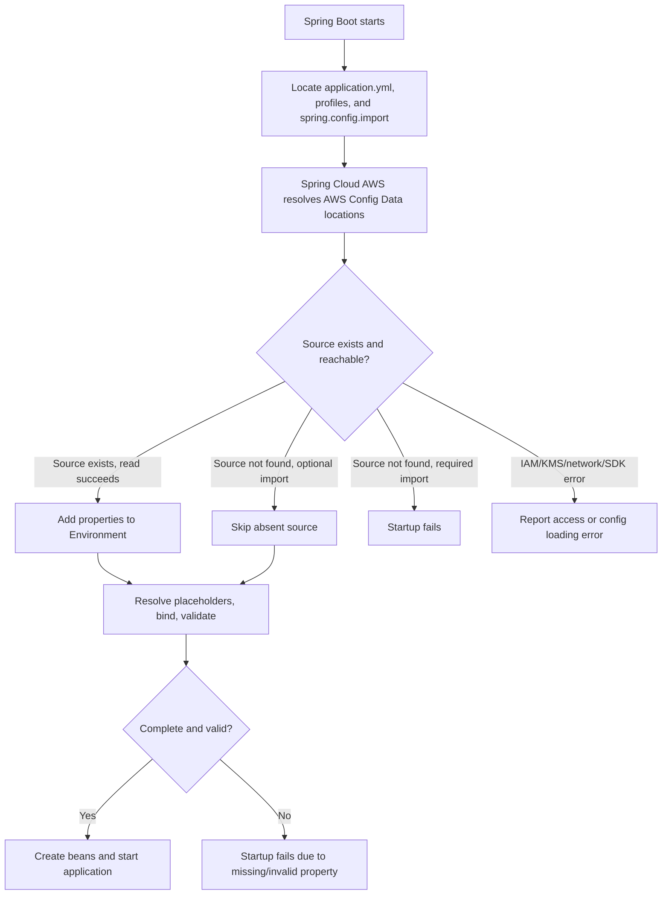

# Required vs. Optional Configuration Sources and Startup Errors

## Objectives and Context

In the **SPRING_CLOUD_PROVIDER_INTEGRATION** module, we practice integrating Spring Boot with managed services from **AWS, Azure, and Google Cloud** using their corresponding Spring Cloud libraries. Alongside storage, messaging, and databases, using the right **workload identity**, **IAM/KMS**, configuration store, and secret store determines whether an application can start up safely.

The **AWS Configuration** chapter raises an important question: when Spring Boot reads **AWS Systems Manager Parameter Store** or **AWS Secrets Manager** via Config Data, what happens if a path/secret does not exist, a property is missing, or access fails due to IAM, KMS, or network errors?

After this lesson, you will be able to:

1. Distinguish between **required configuration sources**, **optional sources**, and **required configuration keys** within an imported source.
2. Configure `spring.config.import` with `aws-parameterstore:`, `aws-secretsmanager:`, and the `optional:` prefix appropriately.
3. Classify **missing location**, **missing property**, **authorization**, **decryption**, **network**, **binding**, and **validation** errors during startup.
4. Design **fail fast**, safe fallbacks, Spring profiles, and environment-appropriate validation.
5. Test success/failure scenarios in an isolated environment without exposing secrets.
6. Relate startup principles to Azure and Google Cloud integrations.

> **Core principle:** `optional:` only indicates that the application **accepts a missing Config Data location** under the conditions supported by the loader. It **does not turn every AWS error into success**, does not grant IAM/KMS permissions, and does not guarantee that properties required by beans will exist.

## 1. Layers to Distinguish

Suppose `order-service` needs the Catalog API URL, timeout settings, and PostgreSQL password. We have:

```text
Parameter Store:
  /config/order-service/prod/catalog.base-url
  /config/order-service/prod/catalog.timeout
  /config/order-service/prod/database.jdbc-url

Secrets Manager:
  /secrets/order-service/prod/database
    JSON keys: username, password
```

There are at least three independent contracts:

| Layer | Question | Example |
| --- | --- | --- |
| **Config Data location** | Can the declared **source** be found and loaded? | Path `/config/order-service/prod/` or secret `.../database` |
| **Property** | After loading, do the **keys** required by the app exist? | `catalog.base-url`, `db.password` |
| **Business value** | Are the values **validly formatted, non-empty, and suitable**? | `https://...`, positive timeout, valid credentials |

For example, a Parameter Store path exists and is readable, yet contains only `catalog.timeout`: Config Data may have loaded the source successfully while the application is still missing `catalog.base-url`. Likewise, a JSON secret exists with `username` but without `password`. `optional:` is not a solution for these missing-key cases.

Distinguish **"missing source"** from **"source exists, but access failed"**:

- *Missing location*: the secret name does not exist, or the resolver treats an empty path as source not found.
- *Access denied*: the resource may exist, but the IAM role is not permitted to call `GetSecretValue`/`GetParametersByPath`.
- *Decryption failure*: the role can call the service API, but lacks the proper KMS authorization path for the key in use.
- *Connectivity/availability*: the SDK cannot reach the AWS endpoint due to timeouts, DNS, VPC endpoint issues, or throttling.
- *Missing property*: a `PropertySource` was created, but a needed key is absent due to a missing JSON field, wrong prefix, or typo in the key name.
- *Invalid property*: the key exists, but its value has the wrong type (`catalog.timeout=abc`) or violates a constraint (`max-retries=-2`).

**The required/optional decision belongs to business requirements**, not just framework syntax capabilities. Without the database password, `order-service` cannot serve requests properly; if configuration for an unenabled experimental integration is absent, the system can skip that integration and run normally.

## 2. When Does Config Data Run During Startup?

Starting with version **2.4**, Spring Boot provides the **Config Data API**. With Spring Cloud AWS 3.x, the relevant starters register support for resolving locations such as:

```properties
spring.config.import=aws-parameterstore:/config/order-service/prod/
```

or:

```properties
spring.config.import=aws-secretsmanager:/secrets/order-service/prod/database?prefix=db.
```

Spring Boot processes imports while preparing the `Environment`, **before most Spring beans are created**. Conceptual steps:



The diagram highlights **error categories**, rather than prescribing fixed exception classes across every library version. Some errors surface during resolution, binding, or bean creation; read the **root cause** in the stack trace to pinpoint where it occurred.

Config Data differs from having a `@Service` call `SsmClient` or `SecretsManagerClient` manually after startup. Under Config Data, if a required source fails to load, application startup normally halts before the server becomes ready for traffic. This provides **fail fast** behavior for essential configuration.

## 3. Required Sources: Default Without `optional:`

### 3.1. Production Environment Example

In `application-prod.yml`:

```yaml
spring:
  config:
    import:
      - "aws-parameterstore:/config/order-service/prod/"
      - "aws-secretsmanager:/secrets/order-service/prod/database?prefix=db."
  datasource:
    url: "${database.jdbc-url}"
    username: "${db.username}"
    password: "${db.password}"
```

Assume Parameter Store provides `database.jdbc-url` and Secrets Manager provides the JSON secret:

```json
{
  "username": "orders_app",
  "password": "<SECRET_ONLY_IN_AWS>"
}
```

`<SECRET_ONLY_IN_AWS>` is merely a lesson placeholder; **it is not a credential to use in AWS**. In real environments, values are provisioned from a secret management system and never placed in Git, code examples, logs, or container images.

If a secret is declared as required but **does not exist**, the application cannot load the location and startup fails via Config Data. This behavior is beneficial: a new version of `order-service` should never silently fall back to a "default" password or another database just to finish booting.

In production, connection URLs, read permissions, and credentials are usually **required inputs**. Even when data lives in an AWS source, per-property validation is still needed; a path containing at least one parameter does not prove it holds every required key.

### 3.2. Reading Required-Source Errors Accurately

When an error occurs in Config Data, logs may report that a location was not found or `ConfigDataLocationNotFoundException`/a related exception, depending on the source type and resolver. However, if the cause is an IAM or KMS failure, the result is typically wrapped in an AWS SDK exception such as `AccessDeniedException`, `SdkClientException`, or equivalent.

Do not just spot the word `optional` in the message and blindly add `optional:` to "fix" it. First determine:

1. **Is the resource/path name correct?**
2. **Are the AWS account and Region right?**
3. **Did the workload obtain credentials for the right role?**
4. **Was the right SSM/Secrets Manager API called?**
5. **Does the encryption key require KMS decryption?**
6. **Did the source load, yet a property is missing or malformed?**

## 4. Optional Sources: `optional:` and Safe Fallbacks

### 4.1. Exact Syntax

Config Data allows prepending the `optional:` prefix **before the location name**:

```yaml
spring:
  config:
    import:
      - "aws-parameterstore:/config/order-service/dev/"
      - "optional:aws-secretsmanager:/secrets/order-service/dev/experimental-api?prefix=experimental."
```

Here the SSM path is required, while the `experimental-api` secret is optional. If the resolver recognizes the optional secret as **non-existent**, it can skip the location and continue preparing configuration. When the JSON secret includes an `apiKey` key, the import above creates `experimental.apiKey`.

`optional:` is a **location** prefix—not part of the AWS secret name, not a query parameter (`?optional=true`), and not an IAM parameter. Correct example:

```properties
spring.config.import=optional:aws-secretsmanager:/secrets/order-service/dev/experimental-api
```

A valid use case is an experimental SMS notification feature enabled only in dev; when the SMS secret does not exist, the application simply runs its other features.

### 4.2. `optional:` Does Not Mean "Ignore All Errors"

| Scenario | Can `optional:` allow startup to continue? | Why? |
| --- | --- | --- |
| Experimental secret genuinely does not exist | **Yes**, if the resolver supports skipping missing locations | That feature is not needed to run |
| Optional config path has not been created yet | **Yes**, per the resolver's missing-location semantics | A fallback exists or the feature is disabled |
| Role lacks `secretsmanager:GetSecretValue` | **Should not be expected** | This is an authorization error, not a missing source |
| Customer managed KMS key denies `Decrypt` | **No** | Missing decryption permission; IAM/key policy must be fixed |
| Network outage or AWS API call timeout | **Should not be expected** | Does not prove the source is absent; likely a transient outage |
| JSON secret has `apiKey` but lacks `token` required by a bean | **No** | Location loaded; the error is a missing property |
| Value `catalog.timeout=not-a-duration` | **No** | Key exists, but binding fails |

Spring Boot and Spring Cloud AWS versions may differ in how they report or classify certain exceptions. Any `optional:` behavior must be verified with an integration test using the exact starter, IAM, account, and Region of the target deployment environment. Never use it to mask production incidents.

### 4.3. `optional:` and Feature-Disable Logic Must Go Together

Example of a webhook notification feature that only runs when enabled:

```yaml
spring:
  config:
    import: "optional:aws-secretsmanager:/secrets/order-service/dev/webhook?prefix=webhook."

features:
  webhook-enabled: false
```

A bean created only when the feature is enabled:

```java
import org.springframework.boot.autoconfigure.condition.ConditionalOnProperty;
import org.springframework.stereotype.Component;

@Component
@ConditionalOnProperty(
        prefix = "features",
        name = "webhook-enabled",
        havingValue = "true"
)
public class WebhookClient {
    // In a real app, the constructor reads webhook.* and validates when the bean is enabled.
}
```

When `features.webhook-enabled=false`, the application does not create `WebhookClient`. If switched to `true`, **validation must exist** to ensure `webhook.apiKey` or the corresponding secret is present—for example, a constructor requiring the property or a validated `@ConfigurationProperties`. `optional:` does not replace that check. Any other component depending on `WebhookClient` must also be designed to tolerate the feature being disabled.

### 4.4. Should You Use `spring.config.on-not-found=ignore`?

Spring Boot provides the setting:

```properties
spring.config.on-not-found=ignore
```

It ignores **missing Config Data locations** per Spring Boot's rules on a **global scope**, rather than only a single location marked `optional:`. For critical configuration, this easily hides wrong paths or missing sources during deployment. Do not use this global flag to replace explicit required/optional design. It also **does not** ignore IAM, KMS, or property-binding errors.

## 5. Validating Required Values After Loading Sources

### 5.1. Why Importing Alone Is Not Enough

A JSON secret can load successfully even when `password` is missing. Similarly, `/config/order-service/prod/` can be readable and contain `catalog.timeout` while missing `catalog.base-url`.

If Spring needs `${db.password}` and the property is missing, placeholder resolution or bean creation may fail. Yet if code uses default values, primitive types, or reads the property lazily only when a request arrives, the failure may surface much later. **Startup validation** catches missing configuration and produces a clear error before accepting traffic.

### 5.2. Using `@ConfigurationProperties` and Bean Validation

Maven needs Spring Boot, compatible AWS configuration starters, and the validation starter:

```xml
<dependencyManagement>
    <dependencies>
        <dependency>
            <groupId>io.awspring.cloud</groupId>
            <artifactId>spring-cloud-aws-dependencies</artifactId>
            <version>${spring-cloud-aws.version}</version>
            <type>pom</type>
            <scope>import</scope>
        </dependency>
    </dependencies>
</dependencyManagement>

<dependencies>
    <dependency>
        <groupId>io.awspring.cloud</groupId>
        <artifactId>spring-cloud-aws-starter-parameter-store</artifactId>
    </dependency>
    <dependency>
        <groupId>io.awspring.cloud</groupId>
        <artifactId>spring-cloud-aws-starter-secrets-manager</artifactId>
    </dependency>
    <dependency>
        <groupId>org.springframework.boot</groupId>
        <artifactId>spring-boot-starter-validation</artifactId>
    </dependency>
</dependencies>
```

`${spring-cloud-aws.version}` is a Maven property that must be defined by the project according to the **Spring Boot/Spring Cloud AWS compatibility matrix**. Older Spring Cloud AWS generations may have different starters or bootstrap models.

Define configuration types:

```java
import java.net.URI;
import java.time.Duration;

import jakarta.validation.constraints.Min;
import jakarta.validation.constraints.NotNull;
import org.springframework.boot.context.properties.ConfigurationProperties;
import org.springframework.validation.annotation.Validated;

@Validated
@ConfigurationProperties(prefix = "catalog")
public record CatalogSettings(
        @NotNull URI baseUrl,
        @NotNull Duration timeout,
        @Min(0) int maxRetries
) {}
```

And credential configuration:

```java
import jakarta.validation.constraints.NotBlank;
import org.springframework.boot.context.properties.ConfigurationProperties;
import org.springframework.validation.annotation.Validated;

@Validated
@ConfigurationProperties(prefix = "db")
public record DatabaseCredentials(
        @NotBlank String username,
        @NotBlank String password
) {
    @Override
    public String toString() {
        return "DatabaseCredentials[REDACTED]";
    }
}
```

Register with `@ConfigurationPropertiesScan` on the main class or `@EnableConfigurationProperties(...)` in Spring configuration. In `CatalogSettings`, `@NotNull` verifies that `URI` and `Duration` are present; `@Min(0)` rejects negative retry counts. If the timeout must be **strictly positive** or the URL must use HTTPS, add corresponding business constraints. For `DatabaseCredentials`, `@NotBlank` catches missing or empty values right at bind time.

**Note on secrets in exceptions and logs:** Never build exception messages containing passwords; never log the full `DatabaseCredentials`, Spring `Environment`, or resolved placeholders. A redacted `toString()` only blocks one leak vector; it does not protect all exposure paths such as heap dumps, traces, or Actuator.

### 5.3. Distinguishing Validation from Fallback

Suppose `catalog.max-retries` can safely take a default, while the Catalog API URL must be supplied. Configuration:

```yaml
spring:
  config:
    import: "aws-parameterstore:/config/order-service/dev/"

catalog:
  max-retries: 2
```

lets `max-retries` default to `2` from YAML if the imported source does not provide that property. When Parameter Store contains `catalog.max-retries=5`, the imported property takes higher precedence than the default in the importing document per Config Data rules. However, if `catalog.base-url` is missing, `@NotNull URI baseUrl` must still fail rather than falling back to another prod/dev endpoint.

Key behaviors to note:

| Scenario | How the application should handle it |
| --- | --- |
| Missing `catalog.max-retries`, safe default exists | Use the reviewed and tested default |
| `catalog.max-retries=-1` | Validation fails; do not silently pick another default |
| Missing required `catalog.base-url` | Fail immediately during binding/validation |
| Missing `db.password` | Never open a JDBC connection with an empty password |
| `db.password` present, but rejected by PostgreSQL | Config loading succeeded; error occurs during database authentication |
| Missing optional webhook secret and feature is off | Do not create WebhookClient; core features continue running |
| Webhook enabled but secret missing | Fail fast on that feature's config/bean |

A valid **default** must be operationally safe. For example, a `2s` timeout default can be approved; a `changeme` password or a hardcoded production URL across all environments is never a safe fallback.

## 6. Designing Environment-Specific Config to Prevent Startup Errors

### 6.1. Do Not Require AWS Imports in Every Profile When Testing Offline

Suggested layout:

```text
src/main/resources/
  application.yml
  application-dev.yml
  application-prod.yml
  application-test.yml
```

The shared `application.yml` keeps only settings applicable to all environments:

```yaml
spring:
  application:
    name: order-service
```

`application-prod.yml` imports **required** production sources:

```yaml
spring:
  config:
    import:
      - "aws-parameterstore:/config/order-service/prod/"
      - "aws-secretsmanager:/secrets/order-service/prod/database?prefix=db."
  datasource:
    url: "${database.jdbc-url}"
    username: "${db.username}"
    password: "${db.password}"
```

`application-dev.yml` may include an optional integration:

```yaml
spring:
  config:
    import:
      - "aws-parameterstore:/config/order-service/dev/"
      - "aws-secretsmanager:/secrets/order-service/dev/database?prefix=db."
      - "optional:aws-secretsmanager:/secrets/order-service/dev/webhook?prefix=webhook."

features:
  webhook-enabled: false
```

`application-test.yml` is dedicated to tests without AWS connectivity:

```yaml
catalog:
  base-url: "http://localhost:18080"
  timeout: 250ms
  max-retries: 0
db:
  username: test_user
  password: test-only-placeholder
```

With this layout, running `@ActiveProfiles("test")` does not read the AWS-importing `dev`/`prod` files. If a required import remains inside another Config Data document loaded by tests, merely adding test properties **is not enough** to stop Spring Boot from trying to reach AWS before creating the test context. Always inspect the actual file and profile layout.

**Never treat profiles as an IAM mechanism.** An application running with the `prod` profile but misconfigured with a dev AWS profile or task role can still read the wrong source or fail. Separate accounts, IAM roles, parameter paths, and secret ARNs by environment.

### 6.2. Avoiding Colliding Property Names

When loading:

```yaml
spring:
  config:
    import:
      - "aws-secretsmanager:/secrets/order-service/dev/database"
      - "aws-secretsmanager:/secrets/order-service/dev/partner"
```

if both JSON secrets contain a `password` key, both create a property named `password`. The final value depends on property source precedence. A clearer approach:

```yaml
spring:
  config:
    import:
      - "aws-secretsmanager:/secrets/order-service/dev/database?prefix=db."
      - "optional:aws-secretsmanager:/secrets/order-service/dev/partner?prefix=partner."
```

Then `db.password` and `partner.password` do not collide. The trailing `.` in `?prefix=db.` is intentional; writing `?prefix=db` concatenates the name into `dbpassword`, causing placeholder errors.

For Parameter Store, importing `/config/order-service/dev/` reads the path, and the parameter name segment below the path becomes the property. For example, `/config/order-service/dev/catalog.timeout` becomes `catalog.timeout`. If `?prefix=app.` is also specified, the property becomes `app.catalog.timeout`, and `@ConfigurationProperties(prefix="catalog")` must be updated accordingly to `app.catalog`.

## 7. Why Can an Existing Source Still Fail Startup?

### 7.1. Diagnostic Table by Error Layer

| Symptom / cause | Layer where it occurs | What to check |
| --- | --- | --- |
| Spring does not recognize `aws-secretsmanager:` / `aws-parameterstore:` | Config Data resolver | Are the Spring Cloud AWS starter, compatible BOM, and right versions present? |
| `ConfigDataLocationNotFoundException` or similar not-found error | Source resolution | Are the path/secret name, profile, account, and Region correct? |
| `ResourceNotFoundException` from Secrets Manager | AWS SDK/resource | Was the secret deleted, or is the name/ARN, account, or Region wrong? |
| `AccessDeniedException` from `GetSecretValue` | IAM/resource policy | Does the role have permission on the secret's **actual ARN**? |
| `AccessDeniedException` from `GetParametersByPath` | IAM for SSM | Does the role have permission to read the **imported path**? |
| `kms:Decrypt` / `DecryptionFailure` error | KMS | Are the KMS key, IAM/key policy, Region, and encryption context right? |
| SDK reports no credentials | AWS identity chain | Are the ECS task role, EKS Pod Identity/IRSA, EC2 instance profile, or local profile set properly? |
| Timeout, `SdkClientException`, DNS/TLS errors | AWS connectivity | Check routes, NAT/VPC endpoints, proxy, endpoint policy, and Region config |
| API throttling | Quotas/request rate | Concurrent pod startups, retries/backoff, service quotas |
| `Could not resolve placeholder 'db.password'` | Spring placeholders | Does JSON key `password` exist? Is the prefix `db.`? |
| Binding `Duration` or integer fails | Type conversion | Is the value formatted validly such as `2s`, `500ms`, `3`? |
| Validation reports `must not be blank` | Bean Validation | Missing/empty credential or wrong key name? |
| App starts, but DB login fails | Target service/runtime | Are credentials valid/rotated, endpoint address right, database role configured? |

Exception names can vary across Spring Boot, AWS SDK, and Spring Cloud AWS versions. Always read the **cause chain** rather than just the outer error message. For example, `Failed to bind properties under 'db'` describes a binding failure, while the root cause may be a missing key because the JSON secret had the wrong structure.

### 7.2. Distinguishing `AccessDenied` from `ResourceNotFound`

Suppose code requests `/secrets/order-service/prod/database`:

1. If the **name/Region/account is wrong**, the secret truly may not exist where the application is looking.
2. If the **role lacks read access**, the call can receive `AccessDenied` even when the secret exists.
3. If the **encryption key denies access**, the call can fail at KMS even when `GetSecretValue` is allowed.
4. If the **network fails**, you cannot yet tell whether the secret exists.

Do not treat every "secret load failure" as "absent secret that can be skipped." Skipping authorization or network errors can leave the system running with unintended configuration and mask permission issues that must be fixed.

### 7.3. Configuring IAM, KMS, and Region

An ECS task or EKS app should read data via the **workload's IAM role** rather than long-lived access keys embedded in files. Examples by environment:

| Runtime location | Appropriate identity |
| --- | --- |
| Developer machine | Authorized AWS IAM Identity Center / AWS CLI profile |
| ECS | ECS task role |
| EKS | EKS Pod Identity or IRSA |
| EC2 | EC2 instance profile |
| Lambda | Lambda execution role |

When Spring Boot uses `aws-parameterstore:/config/order-service/prod/`, the action to verify is `ssm:GetParametersByPath`. When using `aws-secretsmanager:/secrets/order-service/prod/database`, the primary action is `secretsmanager:GetSecretValue`. If a `SecureString` parameter or secret is encrypted with a **customer managed KMS key**, reading plaintext also depends on `kms:Decrypt`, key policies, or matching grants.

Example read-only identity-based policy for both sources (ARNs/account/Region are illustrative; replace with real sandbox resources):

```json
{
  "Version": "2012-10-17",
  "Statement": [
    {
      "Sid": "ReadProdConfig",
      "Effect": "Allow",
      "Action": "ssm:GetParametersByPath",
      "Resource": [
        "arn:aws:ssm:ap-southeast-1:111122223333:parameter/config/order-service/prod",
        "arn:aws:ssm:ap-southeast-1:111122223333:parameter/config/order-service/prod/*"
      ]
    },
    {
      "Sid": "ReadProdDatabaseSecret",
      "Effect": "Allow",
      "Action": "secretsmanager:GetSecretValue",
      "Resource": "arn:aws:secretsmanager:ap-southeast-1:111122223333:secret:/secrets/order-service/prod/database-AbCdEf"
    }
  ]
}
```

Secrets Manager ARNs include a random suffix, such as `-AbCdEf` in the illustrative ARN above. This IAM policy contains no write permissions; provisioning/rotation roles must be managed separately. When using a customer managed KMS key, add decryption permission on **that exact key** and align the key policy, rather than granting `kms:*` across the entire account.

Resources differ across Regions and accounts. `prod` in the path is only a naming convention; a role can still be configured for the wrong Region. To debug, run `aws sts get-caller-identity` using the workload's actual credentials or inspect which role is attached to the task/service account; output from an operator's shell does not automatically reflect the application's credentials.

### 7.4. Never Print Secrets While Investigating Errors

You do not need to print a plaintext password to confirm an IAM error or whether a secret exists:

```bash
aws secretsmanager describe-secret \
  --secret-id "/secrets/order-service/prod/database" \
  --region ap-southeast-1 \
  --query "{Name:Name,ARN:ARN,RotationEnabled:RotationEnabled}"
```

This command fetches only metadata and requires separate `secretsmanager:DescribeSecret` permission. It is intended for authorized operations teams and does not mean application roles should have describe permissions on every secret. When debugging KMS, inspect the key ARN, key policy, and CloudTrail errors with appropriate permissions. Never paste `get-secret-value`, `GetParameter(WithDecryption=true)`, or a Spring `Environment` containing secrets into logs/tickets.

## 8. Designing Fail Fast, Fallbacks, Timeouts, and Availability

### 8.1. Choosing Fail Fast Based on the Impact of Missing Data

An operational decision must consider **what happens if configuration is missing or unusable**.

| Data | Recommended decision | What if missing? |
| --- | --- | --- |
| Database credentials for core functionality | Required import + validation | Do not allow the instance to serve requests |
| Mandatory payment API endpoint | Required/validated property | Never switch to a random endpoint or another environment |
| Timeouts/retry limits with approved defaults | Default with validation | Can continue with safe values |
| Secret for an unenabled experimental integration | Optional import or omit import in that profile | Do not initialize the corresponding client |
| Monitoring config that does not affect business logic | Can be optional + suitable default | App still runs, but missing config must be observable |
| Feature flags needing metric/alarm-driven rollout | Consider AppConfig instead of Parameter Store | Provides dedicated rollout/rollback mechanisms |

**Fail fast** is appropriate when starting without configuration puts the application into an invalid or dangerous state. Fail fast does not mean the entire system goes down when a new instance cannot start: the deployment platform should keep existing healthy instances serving and roll out based on readiness.

For **fallbacks**, explicitly specify the owner, value, environment scope, and observability. A safe default for `dev` is not necessarily safe in `prod`. If `prod` cannot read credentials, falling back to an old password written in a config file is a security anti-pattern.

### 8.2. When AWS Temporarily Stops Responding

Suppose Secrets Manager is healthy, but the ECS task's network path to the AWS endpoint times out during a deployment. This is an **availability** error. It does not mean the secret was deleted, and it cannot be solved properly by marking the import `optional`.

Layers to design:

1. **Bounded timeouts** on the AWS SDK/HTTP client so failures do not hang startup indefinitely.
2. **Appropriate retries/backoff**, accounting for AWS SDK defaults and API limits. Never retry infinitely or trigger a request storm when many pods/tasks start simultaneously.
3. **Safe rollouts**: readiness only reports ready once the instance actually has configuration and core components initialized; keep old instances serving until new ones are healthy.
4. **Failure observability**: log SDK error codes, endpoint/Region, non-sensitive location names, and request IDs when available; never log secret values.
5. **Alerting**: spikes in startup failures, IAM/KMS denials, and API timeouts should alert the operations team.

A container with only a **liveness probe** is not enough: the process may be alive yet unready to serve traffic. With Kubernetes or ECS, combine readiness/health checks and rolling deployment rules to avoid routing traffic prematurely.

**Do not confuse post-startup errors with Config Data errors:** A secret loaded successfully at startup that is later rotated can cause new database connections to fail. That is a credential update, cache, connection pool, and refresh/restart problem; adding `optional:` to the import will not solve it.

### 8.3. When Should an Optional Source Not Be Imported at All?

Even with `optional:`, Spring Cloud AWS may still **attempt to read** the location if it is declared. If a feature is completely turned off and the source is unneeded, the design can **omit the import from the active profile/configuration document**. This avoids depending on IAM, KMS, and availability for an unused integration.

For example, an application ships with two deployment configurations:

- `application-prod.yml`: imports only configuration and secrets required for the core service.
- `application-sms.yml`: activated only in deployments with SMS integration enabled; imports the SMS secret as **required** when that feature is on.

This approach is sometimes clearer than `optional:` because there is no ambiguous state where "the feature is on, yet the secret is missing." Whichever approach is chosen, thoroughly test the **active profile combinations** for each deployment.

## 9. Three-Layer Testing: Binding, Config Data, and IAM

### 9.1. Completely Offline Binding Tests

Example using `ApplicationContextRunner` to test `CatalogSettings` and `DatabaseCredentials` declared in section 5, with `spring-boot-starter-test` in `test` scope and the validation starter on the classpath:

```java
import static org.assertj.core.api.Assertions.assertThat;

import org.junit.jupiter.api.Test;
import org.springframework.boot.context.properties.EnableConfigurationProperties;
import org.springframework.boot.test.context.runner.ApplicationContextRunner;
import org.springframework.context.annotation.Configuration;

class RequiredConfigurationTest {
    @Configuration(proxyBeanMethods = false)
    @EnableConfigurationProperties({
            CatalogSettings.class,
            DatabaseCredentials.class
    })
    static class Config {}

    private final ApplicationContextRunner runner =
            new ApplicationContextRunner()
                    .withUserConfiguration(Config.class)
                    .withPropertyValues(
                            "catalog.base-url=https://catalog.test.example",
                            "catalog.timeout=500ms",
                            "catalog.max-retries=2",
                            "db.username=test_user",
                            "db.password=test-only-placeholder"
                    );

    @Test
    void startsWhenRequiredPropertiesExist() {
        runner.run(context -> {
            assertThat(context).hasNotFailed();
            assertThat(context.getBean(CatalogSettings.class).maxRetries())
                    .isEqualTo(2);
            assertThat(context.getBean(DatabaseCredentials.class).username())
                    .isEqualTo("test_user");
        });
    }

    @Test
    void failsWhenRequiredPasswordIsMissing() {
        runner.withPropertyValues("db.password=")
              .run(context ->
                      assertThat(context.getStartupFailure()).isNotNull());
    }
}
```

This test verifies Spring Boot **binding and validation**. It does not invoke the AWS SDK, prove Config Data location resolver behavior, or test IAM/KMS. `db.password` is strictly a dummy test string; never put real credentials into test fixtures.

If you want to test `catalog.timeout=not-a-duration`, write a similar test overriding the property with a value that cannot convert to `Duration`, then assert context startup failure. These cases separate **loaded with invalid type** from **missing location**.

### 9.2. Testing Config Data and IAM in an AWS Sandbox

Testing `required` and `optional` behavior must run on the exact Spring Boot/Spring Cloud AWS versions and credentials closely mirroring deployment. A sandbox account with scoped resources and narrow roles fits well. To avoid impacting real users, **never delete production secrets or revoke production role permissions just to test failures**.

| Scenario | Error category | Expected result |
| --- | --- | --- |
| Required SSM path and secret have complete data | Success | Startup and validation succeed |
| Required secret does not exist | Missing location | Startup fails; root cause clearly identifies the location |
| Optional secret does not exist, feature disabled | Missing optional location | Startup can continue; client is not initialized |
| Optional secret exists, but role is denied | Authorization | Do not expect `optional:` to swallow `AccessDenied` |
| Path exists, but `catalog.base-url` is missing | Missing property | `@NotNull`/placeholder catches the error |
| JSON secret missing `password` | Missing property | `@NotBlank` or placeholder catches the error |
| Timeout given as malformed `abc` | Type conversion | Binding/validation fails |
| Secret uses customer managed key without decrypt permission | KMS | Startup fails decryption; do not add wildcards arbitrarily |
| Wrong AWS Region, though secret exists in another Region | Resource resolution | Source not found in current Region |
| AWS endpoint temporarily times out | Network/availability | Startup fails within bounded time; rollout retains old instances |
| 50 instances starting simultaneously | Quotas/load | Observe retries/throttling; avoid request storms |
| Secret just rotated, but client still uses old credential | Runtime lifecycle | Verify refresh/restart and new connection capability |

A typical test plan:

1. Create **sandbox parameters and secrets**, using no production credentials.
2. Grant the IAM role read access only to the exact required path and secret ARN; for sandbox KMS keys, grant matching decryption permissions.
3. Run the deployment with `required` imports and verify it starts using the existing resources.
4. On a separate test run, point the import to a non-existent sandbox source name to observe how `required` and `optional` differ.
5. Test missing JSON/SSM keys, wrong prefixes, and invalid types to prove validation works.
6. Use a restricted role to trigger an intentional IAM failure on **sandbox resources**; observe the root cause without logging secrets.
7. Repeat with a wrong Region, network unavailability (if the test environment permits), and rollout strategy tests.

**Negative tests** are essential: not only verify the app can read its own secrets, but also confirm the role cannot read another app's secrets. Emulators like LocalStack help only within the APIs/behaviors they support; conclusions about IAM, KMS, SCPs, and real cloud behavior must be verified on AWS.

### 9.3. Collecting Evidence Without Leaking Information

Record **test conditions**, non-sensitive resource details, library versions, profiles, error codes, request IDs, timestamps, and pass/fail results. To prove credentials work, execute a safe operation against a sandbox service (e.g., opening a connection successfully) instead of printing plaintext secrets. When using CloudTrail, gather only authorized events; never place `GetSecretValue` contents into tickets, screenshots, or logs.

With Spring Boot Actuator, restrict access to `/env`, `/configprops`, and `/heapdump`. Even though some endpoints mask values per configuration, never treat that as your sole layer of defense.

## 10. Common Mistakes

| Incorrect practice | Consequence | Fix |
| --- | --- | --- |
| Marking a production DB secret `optional:` because "AWS is occasionally slow" | Masks outages and risks missing configuration | Keep it required; design timeouts/retries, rollouts, and alerts |
| Using `spring.config.on-not-found=ignore` application-wide | Silently ignores unexpected missing locations | Mark only genuinely optional sources as `optional:` |
| Thinking `optional:` ignores `AccessDenied` | Startup still fails, and the cause is misunderstood | Inspect IAM role, policies, SCPs, and ARNs |
| Thinking `kms:Decrypt` alone is enough to read a secret | Still lacks `GetSecretValue` or resource policy permission | Verify all layers: IAM, Secrets Manager, and KMS |
| Assuming a successful import means all JSON keys exist | Late placeholder/binding failures | Validate every required property |
| Using default `password: changeme` | Service may run with weak/wrong credentials | Never use fallback production credentials |
| Putting required AWS imports in `application.yml` shared by all profiles | Offline unit tests still try to reach AWS | Move imports to profile/deployment-specific files |
| Prefix `db` instead of `db.` | Produces `dbpassword` instead of `db.password` | Use `?prefix=db.` and test resulting key names |
| Granting `secretsmanager:*`/`ssm:*` to make errors disappear | Over-broadens privileges unnecessarily | Grant only the APIs, paths, and ARNs actually used |
| Logging the entire config to find a missing property | Secrets can leak into logs/CI | Log non-sensitive key names, error codes, and statuses |
| Restarting all instances simultaneously during an AWS outage | Drops healthy serving instances and triggers an API storm | Use rolling deployments, readiness checks, and concurrency limits |
| Skipping tests where the role is denied | Fails to catch policy bugs or overly broad permissions | Test both allowed and denied cases in sandbox |
| Assuming rotating a credential updates `DataSource` automatically | New connections may use the old password | Refresh/cache/recreate pool or perform a controlled rollout |

During code reviews, ask: *Which sources are truly required for core functionality? Which properties need validation? If unreadable, does the app halt or continue in what state? Can we diagnose the exact root cause without printing secrets?*

## 11. Hands-On Exercise: Deploying `notification-service`

A notification service running on ECS in `ap-southeast-1` has the following configuration:

```text
Parameter Store:
  /config/notification-service/prod/email.endpoint      (String)
  /config/notification-service/prod/email.timeout       (String)
  /config/notification-service/prod/email.max-attempts  (String)

Secrets Manager:
  /secrets/notification-service/prod/email-provider      (JSON)
    keys: clientId, clientSecret

Experimental integration:
  /secrets/notification-service/prod/sms-provider        (JSON, may not exist yet)
    keys: apiKey
```

Business requirements:

- Sending emails is a **core** feature, requiring a valid endpoint, valid timeout, and the `email-provider` secret.
- SMS sending is currently disabled via a feature flag, so the `sms-provider` secret is not needed for the app to run.
- When SMS is enabled in a new deployment, `apiKey` must become **required**.
- The application role may only read the `notification-service/prod` namespace; it must not modify or delete secrets.
- Every failure case must be observable without printing secret values.

Tasks:

1. Write `spring.config.import` for Parameter Store and the **required** `email-provider`. Use prefix `emailAuth.` to isolate `clientId` and `clientSecret`.
2. Explain two approaches for SMS—**optional import while the feature is off** vs. **omitting the import in profiles where the feature is off**—and choose your preferred approach.
3. Design `@ConfigurationProperties(prefix="email")` with `URI endpoint`, `Duration timeout`, and `int maxAttempts`; verify failures on missing URL or malformed timeout.
4. Design `@ConfigurationProperties(prefix="emailAuth")` with `@NotBlank` on `clientId`/`clientSecret`; ensure values are not printed in `toString()` or logs.
5. Write an IAM policy for `GetParametersByPath` on the prod path and `GetSecretValue` on the email secret ARN. Identify when `kms:Decrypt` must be added for a customer managed key.
6. Test scenarios: missing parameter path, missing JSON key `clientSecret`, non-existent secret, role receiving `AccessDenied`, KMS key denied, AWS API timeout, and a timeout unconvertible to `Duration`.
7. Use a `test` profile containing only dummy values for offline binding tests; use a sandbox account to verify `required`, `optional`, and real IAM.
8. Define readiness/rollout behavior when the core secret is unreadable during deployment of a new version, so existing healthy instances keep serving traffic.

### Suggested Starting Configuration

```yaml
# application-prod.yml (SMS not yet enabled)
spring:
  config:
    import:
      - "aws-parameterstore:/config/notification-service/prod/"
      - "aws-secretsmanager:/secrets/notification-service/prod/email-provider?prefix=emailAuth."

features:
  sms-enabled: false
```

When SMS is enabled, the deployment configuration adds:

```yaml
spring:
  config:
    import:
      - "aws-parameterstore:/config/notification-service/prod/"
      - "aws-secretsmanager:/secrets/notification-service/prod/email-provider?prefix=emailAuth."
      - "aws-secretsmanager:/secrets/notification-service/prod/sms-provider?prefix=smsAuth."

features:
  sms-enabled: true
```

This clearly expresses: **when SMS is enabled, the SMS secret must be present**. If you prefer using `optional:`, demonstrate that the SMS bean is only created when enabled and validate the secret before sending messages. Do not simply flip `optional` to `required` across every profile while forgetting to scope the SMS feature by environment.

**Completion criteria:** The exercise includes a business-driven required/optional classification table, Config Data files, property validation, least-privilege IAM/KMS policies, an error matrix, denied-access tests, and a rollout plan for temporary AWS unavailability.

## 12. Connection to Azure and Google Cloud

In **SPRING_CLOUD_PROVIDER_INTEGRATION**, we also integrate Spring Boot with managed services from **Azure** and **Google Cloud**, so keep the same **questions about required/optional and validation** even when changing cloud providers.

| Requirement | AWS | Azure | Google Cloud |
| --- | --- | --- | --- |
| External configuration store | Parameter Store, AppConfig when rollout is needed | Azure App Configuration | Appropriate runtime/service config, such as GKE ConfigMap or environment config |
| Secret store | AWS Secrets Manager | Azure Key Vault | Google Cloud Secret Manager |
| Workload identity | IAM role | Appropriate Managed Identity/Workload Identity | Service Account/Workload Identity |
| Read permissions | IAM for SSM/Secrets Manager, KMS | Azure RBAC and Key Vault data-plane permissions | Google Cloud IAM for secrets, matching CMEK config when used |
| Loading into Spring Boot | `aws-parameterstore:`, `aws-secretsmanager:` via Spring Cloud AWS | Spring Cloud Azure or SDK depending on version | Spring/Google Cloud integration or matching SDK |
| Handling missing sources | Required/`optional:` per Config Data and resolver | Depends on Azure integration mechanism/version | Depends on Google's library/SDK and resource/version model |

For example, a PostgreSQL password is **required** regardless of whether it lives in AWS Secrets Manager, Azure Key Vault, or Google Cloud Secret Manager. If the source does not exist, you need fail fast or a deliberately designed business strategy; if the source exists but the principal lacks permission, it is an authentication/authorization issue to resolve on that provider.

However, **do not assume `optional:` syntax, JSON mapping, property source ordering, or reload mechanisms are identical** across Spring Cloud AWS, Spring Cloud Azure, and Google Cloud libraries. Always consult the documentation for your integration version, identity policies, and each SDK's exception rules.

## Summary

**Required configuration sources** must load successfully before a Spring Boot service depending on them operates. **Optional sources** should only be skipped when truly unnecessary for active features, and `optional:` is primarily intended for **non-existent locations** under Config Data semantics. Both decisions are distinct from checking **required properties**: a path or JSON secret can load successfully yet still lack a key, contain an empty value, or have the wrong type.

Therefore, a resilient design combines `spring.config.import`, proper profiles, validated `@ConfigurationProperties`, least-privilege IAM/KMS, timeouts/retries, health/readiness probes, and testing for both missing sources and denied access. When causes are classified accurately, an application can **fail fast when needed**, **fall back when safe**, and avoid turning configuration errors into security incidents or widespread outages.

## References

- [Spring Boot — Externalized Configuration](https://docs.spring.io/spring-boot/reference/features/external-config.html) — `spring.config.import`, `optional:`, `spring.config.on-not-found`, profiles, and property source ordering.
- [Spring Boot — Type-safe Configuration Properties](https://docs.spring.io/spring-boot/reference/features/external-config.html#features.external-config.typesafe-configuration-properties) — binding, validation, and type conversion.
- [Spring Cloud AWS Reference 3.4.2](https://docs.awspring.io/spring-cloud-aws/docs/3.4.2/reference/html/index.html) — Parameter Store, Secrets Manager, Config Data locations, and integration features.
- [AWS Systems Manager Parameter Store](https://docs.aws.amazon.com/systems-manager/latest/userguide/systems-manager-parameter-store.html) — storing and retrieving parameters.
- [AWS IAM permissions for Parameter Store](https://docs.aws.amazon.com/systems-manager/latest/userguide/sysman-paramstore-access.html) — `GetParametersByPath` and permission boundaries.
- [AWS Secrets Manager User Guide](https://docs.aws.amazon.com/secretsmanager/latest/userguide/) — read permissions, KMS, lifecycle, and rotation.
- [AWS Secrets Manager — Authentication and access control](https://docs.aws.amazon.com/secretsmanager/latest/userguide/auth-and-access.html) — IAM, resource policies, and decryption permissions.
- [AWS SDK for Java 2.x — Retry strategy](https://docs.aws.amazon.com/sdk-for-java/latest/developer-guide/retry-strategy.html) — retry/backoff principles when calling AWS APIs.
