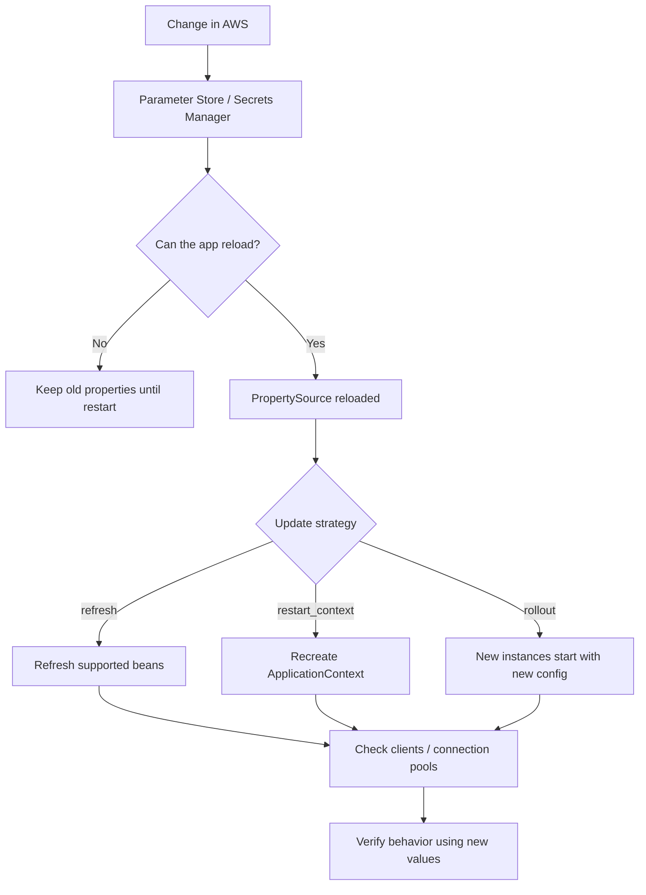
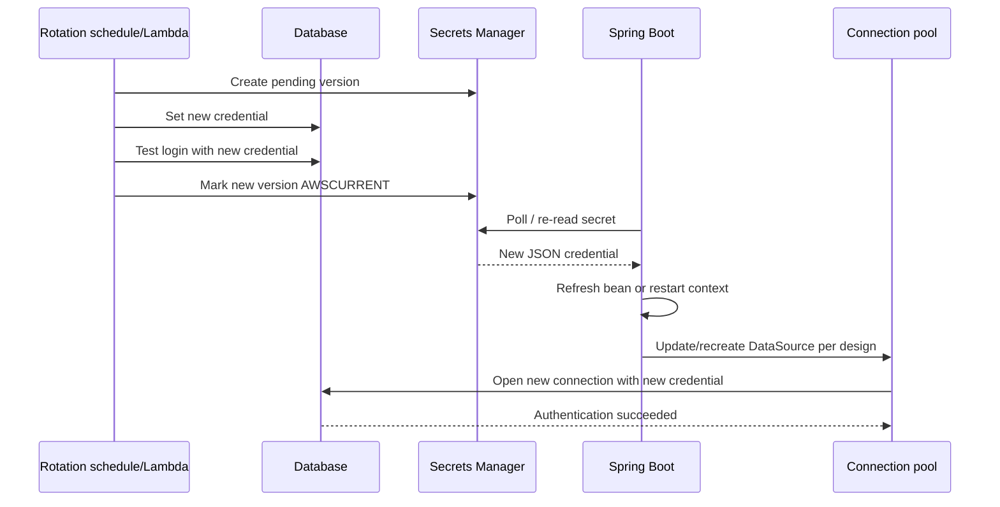

# Reloading Configuration and Rotating Secrets by Version Capabilities

## Lesson Objectives

In the **SPRING_CLOUD_PROVIDER_INTEGRATION** module, we practice integrating Spring Boot with managed services from AWS, Azure, and Google Cloud using their corresponding Spring Cloud libraries. For **AWS Configuration**, applications need to read Parameter Store and Secrets Manager at startup; however, in operations, parameters can change, API keys can be revoked, and database passwords must be rotated.

Two things that are often confused are **configuration reload** and **secret rotation**. Reloading updates values inside the application after the configuration source changes. Rotation changes credentials on the target system and updates the secret version. For a running application to use new credentials, these two processes must coordinate with the lifecycle of beans, HTTP clients, and connection pools.

After this lesson, you will be able to:

1. Distinguish between startup Config Data loading, property source reload, Spring bean refresh, application context restart, and secret rotation.
2. Identify capabilities across **Spring Cloud AWS 2.x, 3.x, and 4.x**, avoiding mixing starters and properties from different versions.
3. Configure polling reload for Parameter Store and Secrets Manager in Spring Cloud AWS 3.x.
4. Choose `refresh`, `restart_context`, rolling deployments, or SDK/cache-based secret reads based on application type.
5. Design rotation for database passwords and API keys without exposing secrets or causing unintended outages.
6. Test change detection, bean updates, new connections, rollbacks, and behavior when AWS is temporarily unreachable.

> **Version note:** Specific properties in the main examples are based on **Spring Cloud AWS 3.4.2** documentation. Before applying, cross-check the Spring Boot, Spring Cloud, and Spring Cloud AWS BOM used by your project. Never copy 2.x configuration to 3.x or 4.x without checking the migration guide.

## 1. Four Concepts That Must Be Separated

Suppose `order-service` is running with the configuration:

```text
Parameter Store:
  /config/order-service/prod/catalog.timeout = 2s
  /config/order-service/prod/catalog.max-retries = 3

Secrets Manager:
  /secrets/order-service/prod/database
    JSON keys: username, password
```

The application read these values at startup. Later, operations changes `catalog.timeout` to `5s` and Secrets Manager transitions to a new database password. Four layers must be handled:

| Concept | What changes? | Example |
| --- | --- | --- |
| **Remote source** | Value in AWS is updated | New parameter, new secret version tagged `AWSCURRENT` |
| **Property source reload** | Spring re-reads the source and updates `Environment` | Polling detects `catalog.timeout=5s` |
| **Bean refresh/restart** | Java objects receive the new configuration | `CatalogSettings` is rebound, or the context recreates beans |
| **Secret rotation** | Credentials on the target system are changed/revoked | PostgreSQL accepts the new password and Secrets Manager stores the matching version |

Never assume one step automatically triggers all the others. For example:

- Parameter Store has a new value, but if Spring does not poll, `Environment` still holds the old value.
- `Environment` has a new value, but if a singleton bean does not support refresh, the application still uses the old value.
- A credential bean is refreshed, but if HikariCP still keeps a `DataSource` with the old password, new connections can fail.
- Secrets Manager switched `AWSCURRENT`, but if the database does not yet accept the new credential, the application still cannot log in.



The diagram shows the conceptual flow. **Secret rotation** also requires changing credentials on the target service and verifying the new credential works; merely updating properties in Spring does not complete rotation.

## 2. Capabilities by Spring Cloud AWS Generation

### 2.1. Version Orientation Table

| Spring Cloud AWS branch | Typical Spring platform | Configuration integration | What to note |
| --- | --- | --- | --- |
| **2.4.x** | Spring Boot 2.6.x/2.7.x, Spring Cloud 2021.0.x, AWS SDK v1 | Legacy branch, legacy starters and config mechanisms; has version-specific reload properties | In maintenance mode; do not apply 3.x syntax/properties directly |
| **3.0.x–3.2.x** | Spring Boot 3.0–3.3, AWS SDK v2 | Config Data via `spring.config.import`; supports reload for Parameter Store and Secrets Manager | Changed packages and property prefixes compared to 2.x; pick the right BOM |
| **3.3.x–3.4.x** | Spring Boot 3.4–3.5, AWS SDK v2 | Config Data and PropertySource reload with `refresh`/`restart_context` | 3.4.x is the branch compatible with Spring Boot 3.5.x per the project's compatibility matrix |
| **4.0.x–4.1.x** | Spring Boot 4.x, Spring Framework 7.x, AWS SDK v2 | Continues Config Data and reload support; 4.1.x adds AWS AppConfig integration | Must upgrade Spring Boot/Cloud in sync; do not use 4.x BOM in Boot 3.x apps |

This table is a compatibility orientation, not a substitute for the official version matrix. Some minor/patch releases change properties or dependencies. For instance, Spring Cloud AWS 2.4.x uses the Spring Boot 2 ecosystem and AWS SDK v1; from 3.0.0-M3 onward, the project moved to Spring Boot 3.0. The 3.x releases use group `io.awspring.cloud` and starters such as `spring-cloud-aws-starter-parameter-store` and `spring-cloud-aws-starter-secrets-manager`.

### 2.2. Differences When Upgrading from 2.x to 3.x

Several properties were renamed. Examples from the migration guide:

| 2.x branch | 3.x branch |
| --- | --- |
| `cloud.aws.credentials.access-key` | `spring.cloud.aws.credentials.access-key` |
| `cloud.aws.credentials.secret-key` | `spring.cloud.aws.credentials.secret-key` |
| `aws.paramstore.region` | `spring.cloud.aws.parameterstore.region` |
| `aws.secretsmanager.region` | `spring.cloud.aws.secretsmanager.region` |

2.x and 3.x also differ in starters, packages, and configuration integration. In 3.x applications, use Spring Boot Config Data:

```yaml
spring:
  config:
    import:
      - "aws-parameterstore:/config/order-service/prod/"
      - "aws-secretsmanager:/secrets/order-service/prod/database?prefix=db."
```

For existing 2.x applications, read the exact 2.4.x documentation and migration guide before changing `bootstrap.yml`, starter names, or prefixes. **Do not just bump the dependency version while leaving all properties unchanged**. In particular, do not assume `spring.config.import` and `spring.cloud.aws.*.reload.*` properties in 3.x examples work verbatim across all 2.x projects.

### 2.3. AppConfig Appears in Newer Branches

Spring Cloud AWS **4.1.x** adds AWS AppConfig integration. AppConfig fits configuration that needs environment-by-environment deployment, rollout control, and continuous change delivery. According to the published integration matrix, AppConfig has no integration starter in 2.x, 3.x, or 4.0.x; that capability appears in 4.1.x.

AppConfig does not replace Secrets Manager for passwords/API keys. A clean division of responsibilities:

- Parameter Store: simple, infrequently changing configuration.
- Secrets Manager: credentials and secrets needing lifecycle/rotation.
- AppConfig: dynamic configuration, feature flags, and staged rollouts.

If an application is still on Spring Boot 3.x and Spring Cloud AWS 3.4.x, you cannot just add `spring-cloud-aws-starter-app-config` from 4.1.x. Choose a design compatible with your current framework branch.

## 3. Built-in Reload in Spring Cloud AWS 3.4.2

### 3.1. Startup-Only Loading Is the Default

With Config Data:

```properties
spring.config.import=aws-parameterstore:/config/order-service/prod/
```

or:

```properties
spring.config.import=aws-secretsmanager:/secrets/order-service/prod/database
```

Spring Cloud AWS loads sources during startup. **PropertySource reload is disabled by default**. To detect changes after startup, you must enable reload via the corresponding properties and add the required dependencies.

Parameter Store reload and Secrets Manager reload are configured **independently**. If you only enable:

```yaml
spring:
  cloud:
    aws:
      secretsmanager:
        reload:
          strategy: refresh
```

only the Secrets Manager source reloads under this config; it does not automatically enable reload for Parameter Store.

### 3.2. Required Dependencies

In Maven, beyond the Parameter Store/Secrets Manager starters and Spring Cloud AWS BOM, reload requires the following Spring components per 3.4.2 documentation:

```xml
<dependencies>
    <dependency>
        <groupId>io.awspring.cloud</groupId>
        <artifactId>spring-cloud-aws-starter-parameter-store</artifactId>
    </dependency>
    <dependency>
        <groupId>io.awspring.cloud</groupId>
        <artifactId>spring-cloud-aws-starter-secrets-manager</artifactId>
    </dependency>
    <dependency>
        <groupId>org.springframework.boot</groupId>
        <artifactId>spring-boot-starter-actuator</artifactId>
    </dependency>
    <dependency>
        <groupId>org.springframework.cloud</groupId>
        <artifactId>spring-cloud-commons</artifactId>
    </dependency>
    <dependency>
        <groupId>org.springframework.cloud</groupId>
        <artifactId>spring-cloud-context</artifactId>
    </dependency>
</dependencies>
```

Spring Cloud dependencies must be compatible with the application's Spring Boot/Spring Cloud release train; the Spring Cloud AWS BOM does not imply arbitrary Spring Cloud versions are supported.

### 3.3. Configuring Periodic Reload

Example configuring both sources in `application-prod.yml`:

```yaml
spring:
  cloud:
    aws:
      parameterstore:
        reload:
          strategy: refresh
          period: 30s
      secretsmanager:
        reload:
          strategy: refresh
          period: 30s
```

In this example:

- `strategy: refresh` asks Spring Cloud Context to refresh supported configuration beans when property source changes are detected.
- `period: 30s` is an explicitly declared polling interval; it is **not** a guarantee that every instance sees the new value after exactly 30 seconds.
- Each poll can invoke AWS APIs again; grant read permissions and plan quotas/costs accordingly.

Properties listed in Spring Cloud AWS 3.4.2 documentation:

| Source | Property | Meaning |
| --- | --- | --- |
| Parameter Store | `spring.cloud.aws.parameterstore.reload.strategy` | `refresh` or `restart_context` |
| Parameter Store | `spring.cloud.aws.parameterstore.reload.period` | Interval for checking changes |
| Parameter Store | `spring.cloud.aws.parameterstore.reload.max-wait-time-for-restart` | Maximum wait time before restarting context |
| Secrets Manager | `spring.cloud.aws.secretsmanager.reload.strategy` | `refresh` or `restart_context` |
| Secrets Manager | `spring.cloud.aws.secretsmanager.reload.period` | Interval for checking changes |
| Secrets Manager | `spring.cloud.aws.secretsmanager.reload.max-wait-time-for-restart` | Maximum wait time before restarting context |

**Documentation version note:** In the 3.4.2 reference, the polling description mentions a default interval of `1 minute`, while the configuration properties table lists `15s` for `reload.period`. To avoid relying on defaults that may be inconsistent between prose and metadata, set `period` explicitly in your application and verify the docs/API of your exact patch release.

## 4. Choosing Strategy `refresh` vs. `restart_context`

### 4.1. `refresh`: Updating Supported Configuration Beans

`refresh` leverages Spring Cloud Context. Per Spring Cloud AWS documentation, supported beans are:

- Beans bound with `@ConfigurationProperties`.
- Beans annotated with `@RefreshScope`.

Other singletons are not recreated automatically. For example, a client bean initialized with `new Client(config.apiKey())` in its constructor may retain the old API key even after another configuration bean receives the new value.

Example of a mutable configuration bean:

```java
import org.springframework.boot.context.properties.ConfigurationProperties;

@ConfigurationProperties(prefix = "catalog")
public class CatalogSettings {
    private String baseUrl;
    private int timeoutMillis;

    public String getBaseUrl() {
        return baseUrl;
    }

    public void setBaseUrl(String baseUrl) {
        this.baseUrl = baseUrl;
    }

    public int getTimeoutMillis() {
        return timeoutMillis;
    }

    public void setTimeoutMillis(int timeoutMillis) {
        this.timeoutMillis = timeoutMillis;
    }
}
```

Register with `@ConfigurationPropertiesScan` or `@EnableConfigurationProperties(CatalogSettings.class)`. When reload succeeds, Spring Cloud Context can rebind configuration for eligible beans. Consumer beans must read from the refreshed object properly; avoid copying configuration fields into separate fields at initialization time if you want changes to take effect.

`refresh` is better suited for lightweight values such as timeouts, retry limits, non-sensitive endpoints, or feature settings. For secrets, verify whether every client holding old credentials is updated.

### 4.2. `restart_context`: Recreating the Entire Spring ApplicationContext

If beans/clients must be rebuilt, you can use:

```yaml
spring:
  cloud:
    aws:
      secretsmanager:
        reload:
          strategy: restart_context
          period: 30s
          max-wait-time-for-restart: 5s
```

This strategy gracefully restarts the Spring `ApplicationContext` so beans are recreated with the new configuration. Per documentation, the Actuator restart endpoint must be enabled and exposed:

```yaml
management:
  endpoint:
    restart:
      enabled: true
  endpoints:
    web:
      exposure:
        include: restart
```

**Never expose the restart endpoint to the Internet or general user networks.** Administrative endpoints can disrupt the entire process; permit calls only through authenticated internal channels with network and operator restrictions. In containerized environments, test how a context restart interacts with liveness/readiness probes, listener threads, schedulers, and connection pools.

`restart_context` has a much broader blast radius than `refresh`. It can solve cases where singletons/clients hold stale state, yet it can also drop in-flight requests if the shutdown/startup lifecycle is not designed properly. Do not treat it as the default choice for every configuration change.

### 4.3. Comparing the Options

| Criterion | `refresh` | `restart_context` |
| --- | --- | --- |
| Scope | Supported `@ConfigurationProperties`/`@RefreshScope` beans | Entire Spring ApplicationContext |
| Impact | Lighter; does not reinitialize the entire application | Recreates beans and resources |
| Best suited for | Application parameters, rebindable configuration | Clients/beans that must be recreated from config |
| Limitations | Singletons/clients without refresh support may keep old values | Can cause downtime and consume startup time |
| Additional requirements | Spring Cloud Context and reload dependencies | Requires Actuator and safely enabling/exposing the restart endpoint |
| Risks | Half-old/half-new state if consumers cache values separately | Simultaneous restarts across instances or non-graceful shutdown |

## 5. Secret Rotation Is Not Property Reload

### 5.1. Rotation Lifecycle

For database credentials, a rotation workflow typically involves these steps:

1. A rotation schedule or operational job triggers the process.
2. The rotation mechanism generates new credentials or prepares a pending version.
3. The target database/API is updated to accept the new credentials under the chosen strategy.
4. Secrets Manager updates secret versions and labels, typically promoting `AWSCURRENT` to the new version after the workflow succeeds.
5. The application detects the secret change via polling, refresh/restart, or rollout.
6. Clients/connection pools use the new credentials; verify new connections succeed and monitor authentication errors.
7. Old credentials are revoked per the rotation policy once the system has safely transitioned.



This is a conceptual diagram. Real implementations depend on the database engine, rotation Lambda/managed rotation, and single-user/alternating-user strategy. Never manually flip the `AWSCURRENT` label as a substitute for a verified rotation workflow.

### 5.2. Why Can HikariCP Still Use the Old Password?

Suppose Spring Boot creates:

```yaml
spring:
  datasource:
    username: "${db.username}"
    password: "${db.password}"
```

At startup, Spring Boot builds a `DataSource`, and HikariCP stores authentication settings for opening new connections. When `db.password` is refreshed in `Environment` or a configuration bean:

- There is no guarantee `HikariDataSource` picks up the new value automatically.
- Already open connections do not change their passwords on the fly.
- When the pool opens a new connection, it may still use the credentials retained from startup.

Therefore, for database credential rotation, explicitly choose one of these approaches:

1. **Rolling deployment/restart:** new instances read `AWSCURRENT` and build a fresh `DataSource`; old instances remain serving during the overlap window per the rotation strategy.
2. **`restart_context`:** recreates the `DataSource` and pool inside the same process, followed by readiness checks and in-flight request handling.
3. **Credential-updating pool/client:** implement a dedicated component, tested to open new connections with the current secret and retire old connections at the right time.

Do not check only the bean holding `password`; verify that **actual new connections** to the database succeed after rotation.

### 5.3. Rotating Third-Party Service API Keys

An API key may lack automatic rotation support from the provider. The workflow typically requires coordination:

1. Generate a new key with the provider.
2. Update the secret in Secrets Manager.
3. Load the new key into the application via reload/rollout.
4. Send a test request to a side-effect-free sandbox/health endpoint.
5. Monitor `401/403` rates, request signing errors, and latency.
6. Revoke the old key only after every instance uses the new key and no requests require the old credential.

If the provider allows **two active keys simultaneously**, you can transition with minimal disruption: create the new key, migrate all workloads, then revoke the old key. If only one key is allowed, schedule a maintenance window or a business-approved brief error tolerance.

### 5.4. Rotation and Reload Can Fall Out of Sync

Polling only detects changes on the next check. For example, a 30-second period means detection can take nearly 30 seconds plus AWS API and processing latency; multiple instances do not necessarily detect changes at the exact same moment. If the old credential is revoked as soon as `AWSCURRENT` flips, instances that have not reloaded yet will fail authentication.

Accordingly:

- Choose a polling period well within the overlap window where the old credential remains valid.
- If two simultaneous credentials cannot be maintained, consider controlled rolling deployments or a specialized rotation mechanism.
- Monitor secret versions/rotation status, reload timestamps, new connection health, and authentication errors.
- Maintain a rollback or credential recovery runbook if rotation verification fails.

## 6. Complete Configuration Example for Spring Cloud AWS 3.4.2

### 6.1. Maven Dependencies

Example using a BOM compatible with Spring Boot 3.5.x and Spring Cloud AWS 3.4.x:

```xml
<dependencyManagement>
    <dependencies>
        <dependency>
            <groupId>io.awspring.cloud</groupId>
            <artifactId>spring-cloud-aws-dependencies</artifactId>
            <version>${spring-cloud-aws.version}</version>
            <type>pom</type>
            <scope>import</scope>
        </dependency>
    </dependencies>
</dependencyManagement>

<dependencies>
    <dependency>
        <groupId>io.awspring.cloud</groupId>
        <artifactId>spring-cloud-aws-starter-parameter-store</artifactId>
    </dependency>
    <dependency>
        <groupId>io.awspring.cloud</groupId>
        <artifactId>spring-cloud-aws-starter-secrets-manager</artifactId>
    </dependency>
    <dependency>
        <groupId>org.springframework.boot</groupId>
        <artifactId>spring-boot-starter-actuator</artifactId>
    </dependency>
    <dependency>
        <groupId>org.springframework.cloud</groupId>
        <artifactId>spring-cloud-commons</artifactId>
    </dependency>
    <dependency>
        <groupId>org.springframework.cloud</groupId>
        <artifactId>spring-cloud-context</artifactId>
    </dependency>
</dependencies>
```

`${spring-cloud-aws.version}` must be declared as a compatible 3.4.x version in the project. Do not mix 4.x artifacts into a Spring Boot 3.x application.

### 6.2. `application-prod.yml`

```yaml
spring:
  application:
    name: order-service
  config:
    import:
      - "aws-parameterstore:/config/order-service/prod/"
      - "aws-secretsmanager:/secrets/order-service/prod/database?prefix=db."
  cloud:
    aws:
      region:
        static: ap-southeast-1
      parameterstore:
        reload:
          strategy: refresh
          period: 30s
      secretsmanager:
        reload:
          strategy: refresh
          period: 30s
  datasource:
    url: "${database.jdbc-url}"
    username: "${db.username}"
    password: "${db.password}"
```

This example enables polling reload separately for SSM and Secrets Manager. It **does not guarantee** HikariCP updates credentials automatically; test real behavior and choose `restart_context` or a rollout if the DataSource does not update properly.

If choosing `restart_context`, for example:

```yaml
spring:
  cloud:
    aws:
      secretsmanager:
        reload:
          strategy: restart_context
          period: 30s
          max-wait-time-for-restart: 5s

management:
  endpoint:
    restart:
      enabled: true
  endpoints:
    web:
      exposure:
        include: restart
```

This is an example only for a **protected internal endpoint**. Never expose the restart endpoint on a public network. If the same application also reloads Parameter Store, configure the corresponding strategy for `parameterstore` under the same principles.

### 6.3. IAM Permissions When Reload Is Enabled

Reload polling continues calling read APIs. The application role needs the corresponding least-privilege permissions:

| Source | Primary permission |
| --- | --- |
| Parameter Store path import | `ssm:GetParametersByPath` |
| Secrets Manager secret import | `secretsmanager:GetSecretValue` |
| `SecureString` or secret using a customer managed KMS key | `kms:Decrypt` on that exact key, if required by KMS config |

Reload does not require the application role to have `PutParameter`, `PutSecretValue`, `UpdateSecret`, `RotateSecret`, or `DeleteSecret`. Write and rotation permissions should belong to a separate operations pipeline/role or rotation Lambda.

## 7. Choosing a Strategy by Configuration Type

| Changing data | Reference strategy | Why |
| --- | --- | --- |
| Timeouts, retries, load limits | `refresh` | Configuration beans can rebind without rebuilding the whole app |
| Low-risk feature settings | `refresh` or AppConfig in supported versions | Verify consumers read the updated values |
| Changing HTTP endpoints | Refresh if the client reads config dynamically; if cached on construction, restart/rollout | HTTP clients may cache the base URL |
| Provider API keys | Refresh if the client supports updating headers/keys; otherwise recreate client or rollout | Credentials may live inside singletons |
| Database passwords | Rolling restart, `restart_context`, or specialized pool mechanism | DataSource/pool retains credentials |
| TLS certificates/private keys | Reload/recreate SSL context and connections/clients | Existing connections may retain the old certificate |
| Feature flags needing staged rollout/rollback | AppConfig if supported by Spring Cloud AWS version, or a feature flag platform | Parameter Store polling does not replace deployment strategies |

Do not pick `restart_context` merely to avoid writing refresh-aware code if the application runs across hundreds of instances. Simultaneous restarts can cause startup storms, API throttling, and loss of serving capacity. For rollouts, use concurrency limits, readiness checks, graceful shutdown, and load testing.

## 8. Polling Intervals, Quotas, and System Load

### 8.1. Estimating Call Volume

If each instance checks one secret and one path every 30 seconds, across 40 instances:

```text
Checks per hour per instance = 3600 / 30 = 120
Total checks per hour system-wide = 120 × 40 = 4,800
```

This illustrates source check counts; actual AWS API calls may differ depending on how the resolver fetches paginated parameters, retries, batching, independent polling, and location count. When 200 instances start up or detect changes simultaneously, account for burst load as well.

### 8.2. Choosing `period`

- Polling too fast increases API traffic, costs, and throttling risk.
- Polling too slowly extends how long the application keeps using stale values.
- For credentials with a short overlap window, the polling interval must fit safely inside the transition window plus retry and rollout time.
- Set `period` explicitly so you do not depend on defaults that may differ across versions or documentation.

When many instances detect a change at once, consider controlled rollouts, limiting concurrent restarts, and monitoring readiness. The 3.4.2 documentation includes `max-wait-time-for-restart` for `restart_context`; verify the exact property metadata for your patch release before configuring it.

### 8.3. Retries and Transient AWS Errors

If polling encounters `AccessDenied`, a KMS error, or a network timeout, do not treat it as a successful reload. You should:

- Retain the last verified configuration if the application can safely continue.
- Log the error code/request ID and failing source; never log secret values.
- Distinguish transient outages from revoked IAM policies or deleted secrets.
- Use bounded retries/backoff per AWS SDK recommendations and monitor throttling.
- When old credentials are nearing expiration, fire early alerts so operators have time to intervene.

Never fall back automatically to a hardcoded default password or API key when reload fails.

## 9. Testing Reload and Rotation

### 9.1. Testing Binding Without AWS

Separate the configuration layer and consumer logic into components testable offline. Example of a `@ConfigurationProperties` class:

```java
import org.springframework.boot.context.properties.ConfigurationProperties;

@ConfigurationProperties(prefix = "catalog")
public class CatalogSettings {
    private String endpoint;
    private int timeoutMillis;

    public String getEndpoint() {
        return endpoint;
    }

    public void setEndpoint(String endpoint) {
        this.endpoint = endpoint;
    }

    public int getTimeoutMillis() {
        return timeoutMillis;
    }

    public void setTimeoutMillis(int timeoutMillis) {
        this.timeoutMillis = timeoutMillis;
    }
}
```

In unit tests, supply dummy properties via `ApplicationContextRunner` or `@SpringBootTest` with a `test` profile that does not import AWS. Verify the binder receives the values and consumer beans use them. This test does not prove AWS polling, KMS, or real rotation.

### 9.2. Testing PropertySource Reload

In an AWS sandbox:

1. Create parameter `catalog.timeout=2s` and a JSON secret with dummy credentials solely for a test database.
2. Start the application with an IAM role scoped strictly to that path and secret ARN.
3. Enable reload with a short `period` suitable for testing.
4. Change the parameter to `5s` and observe the `CatalogSettings` bean refresh.
5. Update a key in the sandbox secret and observe the property source/bean updating without printing values.
6. Test `refresh` with a bean lacking `@ConfigurationProperties`/`@RefreshScope` to confirm it is not recreated automatically.
7. Test `restart_context` in an isolated environment, observing restart duration, readiness, and in-flight requests.

### 9.3. Testing Database Secret Rotation

Do not check only `AWSCURRENT`. A thorough test case should:

1. Create a sandbox user/database and initial credentials.
2. Let the application open connections through the pool.
3. Execute rotation via the supported workflow.
4. Verify the new secret version became current.
5. Verify the application picked up the new value via reload/rollout.
6. Open a **new connection** through the pool and verify login succeeds.
7. Check in-flight requests, existing connections, and authentication errors during the transition window.
8. Test rollback when a rotation step or new credential verification fails.

### 9.4. Required Scenario Matrix

| Scenario | What to verify |
| --- | --- |
| Parameter Store changed, reload disabled | App keeps old value until restart |
| Parameter Store changed, `refresh` enabled | Supported config bean receives new value |
| Secret changed, `refresh` enabled | `@ConfigurationProperties`/`@RefreshScope` bean updates |
| Secret changed, but singleton client holds key in constructor | Client may still use old key; recreate/refresh client |
| Database password rotated, property refreshed only | Check pool; do not assume DataSource switches automatically |
| Database password rotated, restart/rollout | New connections use current credentials |
| IAM loses read permission during polling | Reload fails, alert recorded, no secrets logged |
| KMS denies decryption | Distinguish KMS error from non-existent secret |
| Multiple instances detect change simultaneously | Do not restart all at once and lose serving capacity |
| Roll back to previous secret version | Both app and target service accept the restored credentials |

## 10. Observability and Troubleshooting

### 10.1. Metrics to Monitor

- Time when a change is detected and time when beans/clients receive the new config.
- Polling errors, SDK errors, `AccessDenied`, KMS `Decrypt` failures, and throttling.
- Startup/restart duration, ready instance count, readiness status, and request error rate.
- Database/API authentication failures (relevant `SQLState`, HTTP 401/403) after rotation.
- Current secret version/label, rotation status, and verification step outcomes.

Never put secret values, passwords, API keys, or tokens into metric labels, trace tags, logs, or exception messages.

### 10.2. Common Errors

| Symptom | Possible cause | Resolution |
| --- | --- | --- |
| Changed in AWS, but app did not change | Reload not enabled or wrong property prefix | Check library branch and `parameterstore`/`secretsmanager` properties |
| Polling does not run | Missing required `spring-cloud-context`/`spring-cloud-commons`/Actuator or strategy unconfigured | Cross-check dependencies and configuration for your exact release |
| `@Value` bean stays stale | Bean is not refreshable or copied value into a field | Move to refreshable config or recreate consumer |
| `@ConfigurationProperties` changed, but DataSource did not | Pool holds startup credentials | Use restart/rollout or a tested pool reconfiguration |
| `restart_context` does nothing | Actuator restart endpoint not enabled/exposed, or incompatible versions | Check configuration and dependencies; protect the endpoint |
| App restarts continuously | Period too short, repeated changes, or conflicting sources | Inspect detector, polling, config, and restart limits |
| Secret rotation succeeded, but DB login fails | Database and app are out of sync | Check AWSCURRENT, credential overlap, refresh, and connection pool |
| New API key gets 401 | Client has not picked up new key or provider has not activated it | Check lifecycle on both sides and recreate client |
| Many pods fail simultaneously while polling | Shared IAM/KMS/network issue or throttling | Inspect CloudTrail, endpoints, IAM, and retries/backoff |

### 10.3. Runbook When Rotation Fails

1. Halt further scheduled rotation changes per the operational runbook; never edit secrets manually outside the process.
2. Check rotation status and version labels via metadata without logging plaintext secrets.
3. Determine which credentials the database/API provider currently accepts.
4. Check whether the application role can still read the secret and has proper KMS permissions.
5. Check whether instances have reloaded/restarted or still hold old clients/pools.
6. If rolling back, restore credentials **in sync** on the target service and secret version per supported procedures.
7. Resume traffic/rotation only after new connections and health checks pass.

## 11. Hands-On Exercise

A `payment-service` running on ECS has:

```text
Parameter Store:
  /config/payment-service/prod/payment.timeout = 2s
  /config/payment-service/prod/payment.retry-count = 3

Secrets Manager:
  /secrets/payment-service/prod/gateway
    JSON: apiKey, merchantId
  /secrets/payment-service/prod/database
    JSON: username, password
```

Requirements:

1. Select a Spring Cloud AWS version compatible with your current Spring Boot version and explain why 2.x/3.x/4.x starters cannot be mixed.
2. Configure Config Data imports and reload polling for Parameter Store/Secrets Manager for your chosen version.
3. Create `@ConfigurationProperties` for payment timeout/retry and the gateway secret; do not log `apiKey`.
4. Choose `refresh`, `restart_context`, or rolling deployment for the API key and database password; explain the impact on the HTTP client and HikariCP.
5. Design a database rotation workflow: update database, update `AWSCURRENT`, reload/rollout, verify new connections, revoke old credentials.
6. Write sandbox tests changing `payment.timeout`, updating the gateway secret, and rotating the database password.
7. Create negative test cases: IAM role loses `GetSecretValue`, missing `kms:Decrypt`, polling timeout, and one instance failing to reload.
8. Propose an alert when the secret version has changed yet some instances still use old credentials.

**Expected deliverables:** Lifecycle diagram, version compatibility table, reload YAML, refresh/restart/rollout strategy, test matrix, and rotation runbook with rollback.

## 12. Connection to Azure and Google Cloud

The goal of **SPRING_CLOUD_PROVIDER_INTEGRATION** is to evaluate differences across cloud providers. The principle of **updating source value – reloading properties – updating clients – updating credentials on the target system** holds true everywhere, though implementation mechanisms differ:

| Aspect | AWS | Azure | Google Cloud |
| --- | --- | --- | --- |
| Configuration store | Parameter Store; AppConfig when dynamic rollout is needed | Azure App Configuration | Config/runtime or selected configuration service |
| Secret store | Secrets Manager | Azure Key Vault | Secret Manager |
| Workload identity | IAM role | Managed Identity/Workload Identity | Service Account/Workload Identity |
| Change detection | Spring Cloud AWS PropertySource polling; AppConfig Data in 4.1.x | Spring Cloud Azure/SDK refresh mechanism per service and version | Polling/refresh mechanism of the corresponding SDK or integration |
| Bean update | Spring Cloud Context `refresh` or `restart_context` | Refresh capabilities of the integration/version | Inspect how the library and clients manage lifecycle |
| Rotation | Secrets Manager rotation and app reload/rollout | Key Vault rotation policy plus consumer refresh | Secret Manager rotation/integration per secret type and workload |

Do not assume Spring Cloud libraries on Azure/Google share the same property names, polling intervals, or bean refresh scopes as Spring Cloud AWS. When switching platforms, check the documentation for the exact version and test with real clients.

## Summary

**Configuration reload** and **secret rotation** are two related yet independent processes. Spring Cloud AWS 3.4.2 supports polling reload for Parameter Store and Secrets Manager via `refresh` or `restart_context`, though it is disabled by default and requires appropriate dependencies. `refresh` only updates supported configuration beans; `restart_context` recreates the entire Spring context and requires a protected Actuator restart endpoint.

For credentials, you must also verify the target system and running clients. In particular, **a DataSource/connection pool can retain old passwords** even after property sources change. Choose refresh, restart, or rolling deployment based on bean/client lifecycle, old-to-new credential overlap windows, and availability requirements. Finally, always test both success and rollback paths in a sandbox, monitor new connections, and never write secret values to logs.

## References

- [Spring Cloud AWS 3.4.2 Reference — Secrets Manager `PropertySource` Reload](https://docs.awspring.io/spring-cloud-aws/docs/3.4.2/reference/html/index.html#secrets-manager-integration-propertysource-reload) — dependencies, strategies, and polling for secrets.
- [Spring Cloud AWS 3.4.2 Reference — Parameter Store `PropertySource` Reload](https://docs.awspring.io/spring-cloud-aws/docs/3.4.2/reference/html/index.html#parameter-store-integration-propertysource-reload) — dependencies, strategies, and polling for parameters.
- [Spring Cloud AWS 3.4.2 API — ReloadStrategy](https://docs.awspring.io/spring-cloud-aws/docs/3.4.2/apidocs/io/awspring/cloud/autoconfigure/config/reload/ReloadStrategy.html) — meaning of `REFRESH` and `RESTART_CONTEXT`.
- [Spring Cloud AWS — Compatibility and supported integrations](https://github.com/awspring/spring-cloud-aws) — Spring Cloud AWS/Spring Boot compatibility matrix and integrations by version.
- [Spring Cloud AWS 4.1.1 Reference — AppConfig Integration](https://docs.awspring.io/spring-cloud-aws/docs/4.1.1/reference/html/index.html#appconfig-integration) — AppConfig integration for dynamic configuration.
- [AWS Secrets Manager — Rotate secrets](https://docs.aws.amazon.com/secretsmanager/latest/userguide/rotating-secrets.html) — rotation mechanisms and schedules.
- [AWS Secrets Manager — GetSecretValue and version stages](https://docs.aws.amazon.com/secretsmanager/latest/apireference/API_GetSecretValue.html) — reading secrets by version/staging label.
- [Spring Cloud Context — Refresh Scope](https://docs.spring.io/spring-cloud-commons/reference/spring-cloud-commons/application-context-services.html) — bean refresh and application context behavior.
