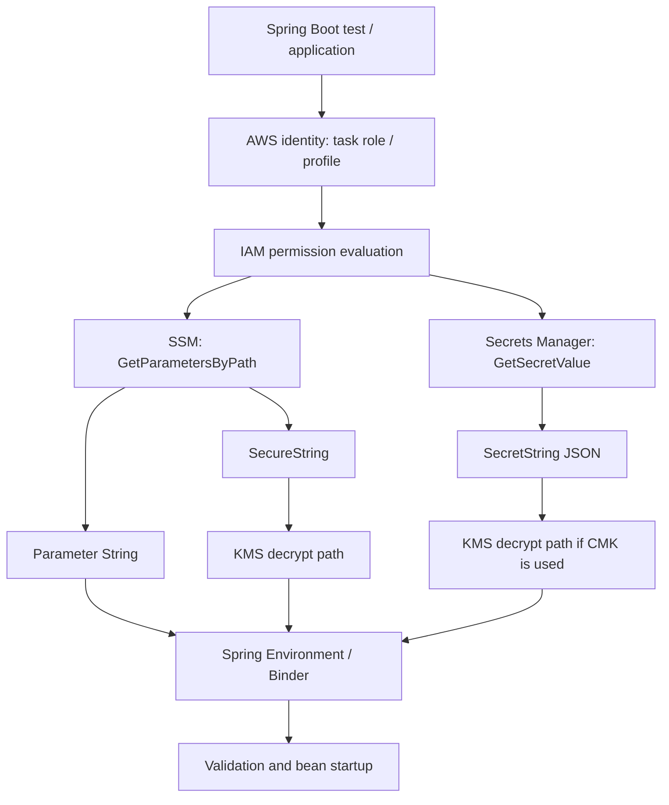

# Testing Access Permissions and Handling Missing Configuration

## Lesson Objectives

The **SPRING_CLOUD_PROVIDER_INTEGRATION** module guides learners through integrating Spring Boot with managed services from **AWS, Azure, and Google Cloud** using their corresponding Spring Cloud libraries. In practice, applications must read configuration and secrets using a workload identity, adhere to least privilege, handle errors when a source does not exist, and protect sensitive data throughout testing.

In the **AWS Configuration** chapter, this lesson focuses on integration testing across Spring Boot, AWS Systems Manager Parameter Store, AWS Secrets Manager, IAM, and AWS KMS. We will test both allowed paths and denied paths, while distinguishing missing sources, missing keys, wrong permissions, decryption failures, and network errors.

After this lesson, you will be able to:

1. Build a test matrix for read permissions across Parameter Store, Secrets Manager, and KMS.
2. Verify the application's actual identity, policy allow/deny rules, and ARN scopes.
3. Test `spring.config.import` with required sources and `optional:`.
4. Distinguish missing locations, missing properties, invalid values, `AccessDenied`, KMS errors, and connectivity errors.
5. Design unit tests, Spring context tests, and integration tests in an AWS sandbox.
6. Gather evidence from IAM Policy Simulator, AWS CLI, CloudTrail, and application logs without printing plaintext secrets.

> **Principle:** A test only proves what it actually exercises. Unit tests prove binding; LocalStack can assist with some API integration checks; IAM Policy Simulator helps evaluate certain identity policies; only testing on real AWS with the exact principal, resource, key, and deployment conditions fully proves runtime IAM/KMS behavior.

## 1. Layered Testing Model

Suppose `order-service` on ECS requires the following sources:

```text
Parameter Store
  /config/order-service/test/catalog.base-url       String
  /config/order-service/test/catalog.timeout        String
  /config/order-service/test/licensing.token         SecureString

Secrets Manager
  /secrets/order-service/test/database               JSON: username, password

KMS
  CMK-SSM: encrypts licensing.token
  CMK-DB: encrypts database secret
```

Names and resources in this lesson are **sandbox** examples. Never use production secrets in fixtures, logs, test commands, or demo accounts.



Each layer has a distinct set of failure modes and evidence:

| Layer | What to test | Evidence |
| --- | --- | --- |
| Spring binding | Keys exist, correct types, and validation rules pass | Unit tests, `ApplicationContextRunner` |
| Config Data | Imports right path/secret; required/optional behaves properly | Startup test with corresponding profile |
| AWS identity | Process uses the right role/account/Region | Task definition, identity metadata, CloudTrail principal |
| IAM SSM | Reads only its own parameter/path | IAM simulation and sandbox API tests |
| IAM Secrets Manager | Reads only its own secret ARN | Policy review, appropriate simulation, and API tests |
| KMS | Principal has a valid decrypt authorization path for the right key | Key policy/IAM/grant review and service-mediated decrypt tests |
| Network | Workload reaches AWS endpoints | SDK logs, DNS/VPC endpoint/route checks |
| Target system | Credentials work after retrieval | Sandbox database/API authentication |

Do not lump every scenario into a single "Spring context starts" test. If the context fails, you need to know whether the failure occurred in the resolver, IAM, KMS, property binding, or bean validation.

## 2. Designing the Permission Matrix Before Running Tests

### 2.1. AWS Actions to Evaluate

| Resource | Common action | Test goal |
| --- | --- | --- |
| Single SSM parameter | `ssm:GetParameter` | Read the exact parameter by name |
| Explicit list of SSM parameters | `ssm:GetParameters` | Batch read the exact list |
| Entire SSM path | `ssm:GetParametersByPath` | Spring Cloud AWS path import |
| Secret content | `secretsmanager:GetSecretValue` | Read the exact secret |
| Secret metadata | `secretsmanager:DescribeSecret` | Only when test/ops tooling needs metadata |
| Customer managed KMS key | `kms:Decrypt` | Decrypt through the service using the key |

Do not grant every action to a role just to make tests pass. Choose actions according to the **actual APIs called by the starter or code**. For example, Config Data importing a Parameter Store path requires checking `GetParametersByPath`; you cannot conclude it is permitted merely because the role has `GetParameter`.

### 2.2. Minimum Allow/Deny Table

| Principal | Resource | Expected result |
| --- | --- | --- |
| `order-service-test-role` | `/config/order-service/test/*` | Allow |
| `order-service-test-role` | `/config/other-service/test/*` | Deny |
| `order-service-test-role` | `order-service/test` database secret | Allow |
| `order-service-test-role` | `hr-service/test` payroll secret | Deny |
| `order-service-test-role` | CMK of the authorized secret | Decrypt through the service per key policy |
| `order-service-test-role` | CMK of another workload | Deny |
| `order-service-test-role` | `ssm:PutParameter` / `secretsmanager:PutSecretValue` | Deny |

**Positive tests** prove the role can do what is needed. **Negative tests** prove the role cannot step outside its designed boundaries. A role reading its own secret does not by itself prove least privilege.

### 2.3. Caution with `GetParametersByPath`

SSM `GetParametersByPath` supports recursive reads. Granting permission on too broad a parent path can expose unintended child paths; do not rely on an explicit deny on a child parameter to establish a boundary when recursive access on the parent path still permits retrieving data under AWS's documented semantics.

Example unsuitable as an isolation design:

```text
/config/
  order-service/test/
  payroll-service/test/
  payment-service/prod/
```

If a role is permitted to recursively read `/config/`, test whether it can access all subtrees. A better design grants the `order-service` role read access only to its own path, or uses separate accounts/namespaces when strong boundaries are needed.

## 3. Testing Spring Boot Without Calling AWS

### 3.1. Separating Binding from the Config Data Resolver

Unit tests for `@ConfigurationProperties` should supply mock properties. These tests verify:

- Spring converts `2s` into a `Duration`.
- Required properties bind properly.
- Invalid values are rejected by validation.
- Dummy secret placeholders are used without being written to logs.

Example configuration class:

```java
import java.net.URI;
import java.time.Duration;

import jakarta.validation.constraints.Min;
import jakarta.validation.constraints.NotNull;
import org.springframework.boot.context.properties.ConfigurationProperties;
import org.springframework.validation.annotation.Validated;

@Validated
@ConfigurationProperties(prefix = "catalog")
public record CatalogSettings(
        @NotNull URI baseUrl,
        @NotNull Duration timeout,
        @Min(0) int maxRetries
) {}
```

Example test using `ApplicationContextRunner` (requires `spring-boot-starter-test` and `spring-boot-starter-validation`):

```java
import static org.assertj.core.api.Assertions.assertThat;

import java.time.Duration;

import org.junit.jupiter.api.Test;
import org.springframework.boot.context.properties.EnableConfigurationProperties;
import org.springframework.boot.test.context.runner.ApplicationContextRunner;
import org.springframework.context.annotation.Configuration;

class CatalogSettingsTest {
    @Configuration(proxyBeanMethods = false)
    @EnableConfigurationProperties(CatalogSettings.class)
    static class TestConfig {}

    private final ApplicationContextRunner runner =
            new ApplicationContextRunner()
                    .withUserConfiguration(TestConfig.class)
                    .withPropertyValues(
                            "catalog.base-url=https://catalog.test.example",
                            "catalog.timeout=250ms",
                            "catalog.max-retries=2"
                    );

    @Test
    void bindsValidProperties() {
        runner.run(context -> {
            assertThat(context).hasNotFailed();
            CatalogSettings settings =
                    context.getBean(CatalogSettings.class);
            assertThat(settings.timeout())
                    .isEqualTo(Duration.ofMillis(250));
            assertThat(settings.maxRetries()).isEqualTo(2);
        });
    }

    @Test
    void rejectsNegativeRetryCount() {
        runner.withPropertyValues("catalog.max-retries=-1")
                .run(context ->
                        assertThat(context.getStartupFailure()).isNotNull());
    }
}
```

This is a **binding test**; it does not verify AWS IAM, the Config Data resolver, or KMS. Do not put an AWS-pointing `spring.config.import` in a shared file loaded by tests when the goal is offline execution; if the import lives in `application.yml`, tests may try to reach AWS before `ApplicationContextRunner` supplies mock properties.

### 3.2. Testing Missing Properties and Invalid Types

Add dedicated test cases:

| Property | Test value | Result |
| --- | --- | --- |
| `catalog.base-url` | Omitted | Validation reports missing URL |
| `catalog.timeout` | `not-a-duration` | Type conversion fails |
| `catalog.max-retries` | `-1` | `@Min(0)` fails |
| `db.username` | Empty string | `@NotBlank` fails |
| `db.password` | Omitted | Required validation/placeholder fails |

Never use real passwords in tests. For `DatabaseCredentials`, override `toString()` or avoid logging the object so test output never prints credentials.

### 3.3. Testing Optional Conditions

Suppose a webhook feature can be disabled:

```yaml
features:
  webhook-enabled: false
```

The bean can be conditional:

```java
@Component
@ConditionalOnProperty(
        prefix = "features",
        name = "webhook-enabled",
        havingValue = "true"
)
public class WebhookClient {
    // Created only when the feature is enabled; credentials must then be valid.
}
```

Tests should verify:

1. When `webhook-enabled=false`, the context does not create `WebhookClient`.
2. When `webhook-enabled=true` with valid dummy credentials, the bean is created.
3. When `webhook-enabled=true` but credentials are missing, startup fails fast.

This bean-condition test does not itself test `optional:aws-secretsmanager:`. Confirming that the resolver skips a missing location must be tested separately with a Config Data integration test.

## 4. Testing Config Data Against Real AWS Sources

### 4.1. Separating Profiles for Offline and Sandbox Testing

A common layout:

```text
src/main/resources/
  application.yml
  application-test.yml
  application-aws-test.yml
  application-prod.yml
```

Shared file has no required AWS import:

```yaml
spring:
  application:
    name: order-service
```

`application-test.yml` uses only dummy data:

```yaml
catalog:
  base-url: https://catalog.test.example
  timeout: 250ms
  max-retries: 0
db:
  username: test_user
  password: test-only-placeholder
```

`application-aws-test.yml` uses the AWS sandbox:

```yaml
spring:
  config:
    import:
      - "aws-parameterstore:/config/order-service/test/"
      - "aws-secretsmanager:/secrets/order-service/test/database?prefix=db."
  cloud:
    aws:
      region:
        static: ap-southeast-1
```

Run the offline profile:

```bash
java -jar order-service.jar --spring.profiles.active=test
```

Run integration tests against the AWS sandbox:

```bash
java -jar order-service.jar --spring.profiles.active=aws-test
```

Ensure no required AWS import exists in the shared document or any other profile loaded by tests. **Profiles are not an IAM boundary**: the `aws-test` process must still run with a role scoped strictly to the sandbox, never production credentials.

### 4.2. Testing Required and Optional Imports

Create two test variants in the sandbox:

```yaml
# Required
spring:
  config:
    import: "aws-secretsmanager:/secrets/order-service/test/database?prefix=db."
```

```yaml
# Optional
spring:
  config:
    import: "optional:aws-secretsmanager:/secrets/order-service/test/experimental?prefix=experimental."
```

Verify against this matrix:

| Scenario | Required | Optional |
| --- | --- | --- |
| Secret exists and role has permission | Loads successfully | Loads successfully |
| Secret does not exist | Startup fails due to missing location | Can continue per Config Data semantics |
| Secret exists, but role gets `AccessDenied` | Access error | Do not expect `optional:` to hide authorization errors |
| Customer managed key denies decrypt | KMS error | Do not expect `optional:` to hide decrypt errors |
| Secret exists, but JSON key `password` is missing | Import may succeed; validation/placeholder fails | Still missing property if a bean requires it |
| JSON secret has `password`, but value is wrong | Binding may succeed; target system authentication fails | Same |

When testing a missing location, use a sandbox secret name confirmed not to exist so it is not confused with a wrong account/Region error. When testing `AccessDenied`, keep the resource constant and vary the **role/policy** in a controlled way to isolate the cause.

### 4.3. Testing `GetParametersByPath` and SSM Paths

For Parameter Store, create two trees:

```text
/config/order-service/test/catalog.timeout
/config/other-service/test/catalog.timeout
```

Role `order-service-test-role` should only read the `order-service` tree. Perform:

1. Import `/config/order-service/test/` and verify the application receives the expected properties.
2. Attempt to read `/config/other-service/test/` with the same role; expect denial.
3. Attempt to read the parent path `/config/` in the sandbox to prove permission boundaries are not unexpectedly wide.
4. Check `Recursive` and actual policies; never assume an explicit deny on a child path always blocks a recursive query permitted at the parent.
5. If `SecureString` is present, test `String` and `SecureString` separately to isolate SSM and KMS permissions.

You can inspect a non-sensitive parameter via CLI:

```bash
aws ssm get-parameter \
  --name "/config/order-service/test/catalog.timeout" \
  --region ap-southeast-1 \
  --query "Parameter.{Name:Name,Type:Type,Version:Version}"
```

This command returns metadata only, without printing `Value`. To prove the application read the content, check binding results or business behavior in sandbox tests rather than logging the entire `Environment`.

## 5. Testing IAM Policies

### 5.1. Reviewing Policies Before Calling APIs

Example read-only policy for a Parameter Store path:

```json
{
  "Version": "2012-10-17",
  "Statement": [
    {
      "Sid": "ReadOrderServiceTestParameters",
      "Effect": "Allow",
      "Action": "ssm:GetParametersByPath",
      "Resource": [
        "arn:aws:ssm:ap-southeast-1:111122223333:parameter/config/order-service/test",
        "arn:aws:ssm:ap-southeast-1:111122223333:parameter/config/order-service/test/*"
      ]
    }
  ]
}
```

Example read-only policy for the database secret:

```json
{
  "Version": "2012-10-17",
  "Statement": [
    {
      "Sid": "ReadOrderServiceTestDatabaseSecret",
      "Effect": "Allow",
      "Action": "secretsmanager:GetSecretValue",
      "Resource": "arn:aws:secretsmanager:ap-southeast-1:111122223333:secret:/secrets/order-service/test/database-AbCdEf"
    }
  ]
}
```

The ARNs and account ID above are examples only. Secret ARNs carry an AWS-assigned random suffix; in real policies, take the exact ARN from the resource rather than guessing the suffix. Never use `Resource: "*"` for an application that only reads one secret or one path.

### 5.2. IAM Policy Simulator

IAM Policy Simulator helps check certain identity-based policy decisions prior to deployment. Example:

```bash
aws iam simulate-principal-policy \
  --policy-source-arn arn:aws:iam::111122223333:role/order-service-test-role \
  --action-names ssm:GetParametersByPath \
  --resource-arns arn:aws:ssm:ap-southeast-1:111122223333:parameter/config/order-service/test/catalog.timeout
```

Check secret read permission:

```bash
aws iam simulate-principal-policy \
  --policy-source-arn arn:aws:iam::111122223333:role/order-service-test-role \
  --action-names secretsmanager:GetSecretValue \
  --resource-arns arn:aws:secretsmanager:ap-southeast-1:111122223333:secret:/secrets/order-service/test/database-AbCdEf
```

To test negative cases, replace the resource ARN with a secret/path belonging to `other-service`; expect `implicitDeny` or `explicitDeny` depending on the policy.

**Important limitation:** IAM Policy Simulator does not replace real API calls in every situation. Simulation capability depends on policy types and context; resource-based policies, KMS key policies/grants, SCPs, permission boundaries, session policies, VPC endpoint policies, trust relationships, and runtime conditions may not be fully simulated as in the real environment. An `allowed` result from the simulator does not guarantee every runtime request will succeed.

### 5.3. Verifying Workload Identity

In the runtime environment, verify which role is actually attached:

| Platform | Where to check |
| --- | --- |
| ECS | `taskRoleArn` in the task definition and running task |
| EKS | ServiceAccount, EKS Pod Identity association, or IRSA annotation |
| EC2 | Instance profile attached to the instance |
| Lambda | Function's execution role |
| Local development | Selected AWS IAM Identity Center / AWS CLI profile |

`aws sts get-caller-identity` shows the identity of the **credentials the CLI command is currently using**. If run from a local terminal, the output does not prove an application running in ECS/EKS uses the same credentials. When verification is needed, run a check from the workload itself or inspect the principal in CloudTrail.

### 5.4. Negative Tests for Write Permissions

A read-only application role should not have:

```text
ssm:PutParameter
ssm:DeleteParameter
secretsmanager:PutSecretValue
secretsmanager:UpdateSecret
secretsmanager:DeleteSecret
secretsmanager:RotateSecret
```

IAM Policy Simulator or policy review should confirm these actions are not allowed on the application's resources. If you must invoke a write API to prove denial, do so strictly in a sandbox using a dedicated test-only resource name; never run `DeleteSecret` or overwrite active resources. You do not need to perform destructive actions to prove permissions are denied if simulator/negative policy review already satisfies the goal.

## 6. Testing KMS Decryption Permissions

### 6.1. Both Permission Layers Must Be Valid Together

For `SecureString` or secrets encrypted with a customer managed KMS key, distinguish:

1. **Source API permission:** `ssm:GetParameter(s)`, `ssm:GetParametersByPath`, or `secretsmanager:GetSecretValue`.
2. **Key usage permission:** `kms:Decrypt` via an appropriate IAM policy/key policy/grant.

| Scenario | Source permission | KMS permission | Expected result |
| --- | --- | --- | --- |
| A | Allow | Allow on exact key | Plaintext can be read if other conditions hold |
| B | Allow | Deny | `String` reads succeed; decrypting CMK-backed `SecureString`/secret fails |
| C | Deny | Allow | Cannot read the source at all |
| D | Allow on exact path | Allow on different key | Cannot decrypt with the resource's key |

Do not use a single secret test to draw conclusions for both SSM and KMS. Each source has its own encryption mechanics, key ARN, encryption context, and service conditions.

### 6.2. Testing `SecureString`

In the sandbox, create one `String` parameter and one `SecureString` encrypted with a customer managed key, such as `/config/order-service/test/licensing.token`. Run the same workload role with policy variants:

| Variant | SSM read | KMS decrypt on CMK | Result |
| --- | --- | --- | --- |
| A | Allow | Allow on exact key and conditions | Reads `String` and decrypts `SecureString` |
| B | Allow | No effective permission | Reads `String`; `SecureString` fails when plaintext is requested |
| C | Deny | Allow | Cannot read parameters via SSM |
| D | Allow on exact path | Allow on different key | `SecureString` cannot be decrypted with its key |

In the application, verify the sandbox bean can use the loaded value—for instance, calling a sandbox API using the test token. **Never print the token** or run commands outputting plaintext to a terminal just to prove decryption worked.

### 6.3. Testing Secrets Using Customer Managed Keys

Create two sandbox secrets: one using Secrets Manager's default key and one using customer managed key `CMK-DB-TEST`. Then:

1. Grant `secretsmanager:GetSecretValue` on both secret ARNs.
2. Verify the default-key secret is readable under the corresponding policy.
3. For the CMK-backed secret, verify the role has `kms:Decrypt` on that exact key and the key policy allows it.
4. Remove decrypt permission from the **sandbox role** to verify the KMS failure.
5. Restore the policy, re-read via the application, and confirm the sandbox database connection succeeds.

Example IAM statement restricting decryption through Secrets Manager:

```json
{
  "Sid": "DecryptOnlyThroughSecretsManager",
  "Effect": "Allow",
  "Action": "kms:Decrypt",
  "Resource": "arn:aws:kms:ap-southeast-1:111122223333:key/66666666-7777-8888-9999-000000000000",
  "Condition": {
    "StringEquals": {
      "kms:ViaService": "secretsmanager.ap-southeast-1.amazonaws.com"
    }
  }
}
```

This is an illustrative statement for a customer managed key, not a complete key policy. When testing SSM `SecureString`, `kms:ViaService` must point to `ssm.ap-southeast-1.amazonaws.com` and the parameter's exact key. If your organization uses encryption context conditions, take the exact context from AWS documentation and service policies—never guess.

### 6.4. Do Not Use IAM Simulator Instead of KMS Runtime Tests

IAM Policy Simulator can help evaluate certain identity permissions, but it does not fully verify customer managed key policies, KMS grants, encryption contexts, `kms:ViaService`, and the key actually bound to a resource. To prove KMS integration, test in an AWS sandbox using dedicated keys, dummy secrets/parameters, and scoped roles. Never alter the key or policy of production resources to test negative cases.

## 7. Handling Missing Sources and Startup Errors

### 7.1. Required/Optional Matrix

| Scenario | Required import | `optional:` import |
| --- | --- | --- |
| SSM path/secret does not exist | Startup fails due to missing location per resolver | Can continue if the resolver treats it as a missing location |
| Resource exists, role gets `AccessDenied` | Access error | Does not ignore permission errors by default |
| Customer managed key denies decrypt | KMS error | Does not ignore KMS errors by default |
| Secret exists, but required JSON key is missing | Import may succeed; placeholder/validation fails | Still fails if a bean needs that key |
| Parameter exists, but value has invalid type | Binding fails | Still fails |
| AWS API times out or endpoint is unreachable | Startup can fail | Do not treat timeouts as a non-existent source |
| Optional feature is disabled, secret absent | Import may not be needed | Optional or omit import in that profile |

`optional:` helps Spring handle **missing Config Data locations** according to Spring Boot and resolver mechanics. It does not grant IAM permissions, fix KMS, or prove a fallback is safe.

### 7.2. Testing a Missing Location

In the sandbox, use a dedicated resource name that has not been created:

```yaml
spring:
  config:
    import: "aws-secretsmanager:/secrets/order-service/test/does-not-exist"
```

This is a required import; startup must fail during Config Data loading. Change it to:

```yaml
spring:
  config:
    import: "optional:aws-secretsmanager:/secrets/order-service/test/does-not-exist"
```

and the application can continue if the resolver recognizes the error as a non-existent location and beans do not require that property. If a bean still requires `${does-not-exist}` or mandatory credentials, startup will fail in a later step.

Do not use global `spring.config.on-not-found=ignore` just to make tests pass. That setting has broad scope and can mask many misspelled critical locations.

### 7.3. Testing Missing Keys in a Loaded Source

Create a sandbox JSON secret:

```json
{
  "username": "test_user"
}
```

Import:

```yaml
spring:
  config:
    import: "aws-secretsmanager:/secrets/order-service/test/database?prefix=db."
```

The secret exists and is readable, yet `db.password` is absent. The `DatabaseCredentials` bean using `@NotBlank` on `username/password` must report a validation error. This is a **missing property**, not a `ResourceNotFoundException`.

For Parameter Store, create a path with `catalog.timeout` while omitting `catalog.base-url`; importing the path may succeed, yet `CatalogSettings` requiring `@NotNull URI baseUrl` must fail. This proves that a readable source does not guarantee complete configuration.

### 7.4. Distinguishing Errors by Root Cause

| Root cause / error group | Layer | Remediation |
| --- | --- | --- |
| `ConfigDataLocationNotFoundException` or equivalent not-found error | Config Data resolver | Check location, resource name, profile |
| `ResourceNotFoundException` | AWS resource lookup | Check name, account, Region, resource |
| `AccessDeniedException` | IAM/resource policy | Check principal, action, ARN, explicit denies |
| `DecryptionFailure` or KMS `AccessDenied` | KMS | Check CMK, `kms:Decrypt`, key policy/grant, conditions |
| `SdkClientException`, timeout, DNS/TLS | Network/AWS SDK | Check endpoints, routes, NAT/VPC endpoint, retries |
| `Could not resolve placeholder` | Spring Environment | Check JSON keys, prefixes, profiles, property sources |
| `BindException`/conversion error | Spring Binder | Check data type format |
| Validation error | Bean Validation | Check required properties and business constraints |
| JDBC authentication failure | Database runtime | Check credentials used by the pool and rotation |

Exception names can be wrapped across multiple layers. Read the `Caused by` chain to find the deepest cause. Never catch every exception and return a default value; that can turn an IAM failure into an application running with unintended configuration.

## 8. LocalStack, Testcontainers, and Emulator Limits

### 8.1. When to Use LocalStack?

LocalStack or an AWS-emulation environment helps test early:

- Whether the application initializes AWS SDK clients and calls the right service endpoints.
- Whether Parameter Store/Secrets Manager API calls pass properly formatted resource names and payloads.
- JSON structure, how the app processes properties, and the basic startup flow.
- Fast repeatable CI tests without provisioning real AWS resources on every run.

You can use **Testcontainers** to launch LocalStack in Java integration tests. Tests can then create dummy parameters/secrets, configure endpoint overrides on AWS SDK clients, and start a Spring context with a dedicated profile. Exact module details, image versions, and supported APIs depend on LocalStack/Testcontainers versions; pin versions and read the corresponding docs.

### 8.2. What LocalStack Does Not Prove

Do not treat LocalStack tests as sufficient proof of:

- IAM policy evaluation matching real AWS in every case.
- Trust policies, ECS task roles, EKS Pod Identity/IRSA, and STS runtime credentials.
- Customer managed KMS key policies, grants, encryption contexts, and `kms:ViaService`.
- AWS Organizations SCPs, permission boundaries, VPC endpoint policies, or complex resource policies.
- CloudTrail events, quotas/throttling, multi-account, multi-Region, and real managed rotation behavior.

An emulated test may allow access where a real AWS policy would deny, or may not fully emulate a feature. Therefore:

| Goal | LocalStack/Testcontainers | AWS sandbox |
| --- | --- | --- |
| Verify code calls right API/endpoint | Suitable within supported API scope | Yes |
| Verify JSON mapping and app logic | Helpful | Yes |
| Verify exact runtime IAM deny/allow | Insufficient to conclude | **Required** |
| Verify customer managed KMS keys | Insufficient to conclude | **Required** |
| Verify ECS/EKS workload identity | Cannot prove real AWS identity | **Required** |
| Verify AWS CloudTrail/rotation/quotas | Cannot replace real services | **Required** |

A solid strategy runs fast LocalStack tests for logic and API shapes, then runs a **curated set of integration tests** in an AWS sandbox to verify permissions, KMS, identity, and cloud-specific behavior.

## 9. Using AWS CLI and CloudTrail to Gather Evidence

### 9.1. Checking Identity

For the credentials currently used by the AWS CLI:

```bash
aws sts get-caller-identity
```

The output reports the principal's account, ARN, and user ID. When running inside ECS/EKS, verify the principal from the workload itself or cross-check the task role/ServiceAccount and CloudTrail. Output from a laptop terminal does not prove the cluster application runs with the same credentials.

### 9.2. Inspecting Parameter Store Metadata

Fetch parameter metadata without printing values:

```bash
aws ssm describe-parameters \
  --parameter-filters "Key=Name,Option=BeginsWith,Values=/config/order-service/test/" \
  --region ap-southeast-1 \
  --query "Parameters[].{Name:Name,Type:Type,Version:Version}"
```

`DescribeParameters` requires the corresponding IAM action if the principal lacks it. An application role that only reads a path at startup does not necessarily need metadata listing permissions; use a dedicated operations principal for debugging.

### 9.3. Inspecting Secrets Manager Metadata

```bash
aws secretsmanager describe-secret \
  --secret-id "/secrets/order-service/test/database" \
  --region ap-southeast-1 \
  --query "{Name:Name,ARN:ARN,KmsKeyId:KmsKeyId,RotationEnabled:RotationEnabled}"
```

This command inspects the name, ARN, KMS key, and rotation status without fetching `SecretString`. `DescribeSecret` is a separate action; do not add it by default to an application role that only needs `GetSecretValue`.

### 9.4. Cross-Checking CloudTrail

When an API call is denied or abnormal access occurs, CloudTrail helps identify:

- Which principal/role made the call.
- Which API was called (`GetParametersByPath`, `GetSecretValue`, related KMS events).
- Timestamp, Region, request source, and error code.
- Targeted resource, to the extent logged by the event.

CloudTrail events do not always contain full context explaining every policy decision. Combine them with actual policies, the IAM simulator, key policies, and AWS SDK logs. Never put requests/responses that might contain secrets into tickets; share only sanitized metadata and errors.

### 9.5. Why Not Use Plaintext Read Commands for Debugging?

Commands such as:

```bash
aws secretsmanager get-secret-value --secret-id "..."
aws ssm get-parameter --name "..." --with-decryption
```

can print **secret values** into the terminal. Shell transcripts, recordings, CI logs, clipboards, or screenshots may retain that content. Never run them in shared logs or paste output into tickets.

To prove read/decryption permissions, run the sandbox app under the exact role and confirm safe behavior such as connecting to a test database or authenticating with a sandbox API. If a CLI test is unavoidable, use a dummy value carrying no real privileges and control output; never use production secrets.

## 10. Troubleshooting Workflow for Missing Configuration

When Spring Boot fails to start due to an AWS source, proceed in order:

1. **Verify profile and import location.** Check active profiles and declared path/secret names; do not log values.
2. **Classify the root cause.** Separate missing locations from `AccessDenied`, KMS, timeouts, placeholders, and validation.
3. **Check account/Region.** Identical resource names can exist across multiple environments.
4. **Verify workload identity.** Confirm the right task role/Pod Identity/IRSA; do not infer from local AWS CLI.
5. **Check IAM resource scope.** Do actions match actual APIs? Does the SSM ARN include `parameter/`? Does the secret ARN have the real suffix?
6. **Check KMS.** Is the data a `SecureString` or CMK-backed secret? Do key policies/grants permit decryption?
7. **Check property mapping.** Do the SSM path, JSON keys, `?prefix=`, placeholders, and `@ConfigurationProperties` names align?
8. **Check types/validation.** Do `Duration`, `URI`, integer, and non-blank constraints match format and rules?
9. **Check network/quotas.** Check VPC endpoints, NAT, DNS, TLS, SDK retries, throttling, and startup concurrency.
10. **Re-run positive and negative tests.** Prove the role reads its own sources and is denied outside its namespace.

Never add IAM wildcards or flip every import to `optional:` before classifying the error. Those shortcuts may let startup proceed while leaving overly broad permissions or an app running with missing configuration.

### Quick Decision Table

| Observation | Next action |
| --- | --- |
| Required location does not exist | Fix name/path or provision the resource; keep required if business needs it |
| Optional location does not exist and feature is off | Can continue; record feature status |
| `AccessDenied` | Check principal, action, ARN, explicit denies, and resource policies |
| KMS decrypt denied | Check key ARN, key policy, grants, `kms:ViaService`/context |
| Location exists, but key is missing | Fix JSON/parameter schema or validation |
| Key exists, but type is invalid | Fix source value or converter/constraints |
| AWS endpoint times out | Check networking, retries, readiness, and rollout |
| LocalStack passes, but AWS fails | Check IAM/KMS/identity/Region/endpoint policies on real AWS |

## 11. Comprehensive Hands-On Exercise

A `payment-service` application running on ECS in the `test` environment requires:

```text
Parameter Store:
  /config/payment-service/test/payment.gateway-url      String
  /config/payment-service/test/payment.timeout          String
  /config/payment-service/test/license.code             SecureString

Secrets Manager:
  /secrets/payment-service/test/bank-api                JSON: clientId, clientSecret
  /secrets/payment-service/test/database                JSON: username, password

KMS:
  CMK-LICENSE-TEST
  CMK-BANK-TEST
  CMK-DATABASE-TEST
```

Design and execute a test plan:

1. Create ECS task role `payment-service-test-role` with an ECS trust relationship and read-only access strictly to that parameter path and those two secret ARNs.
2. Grant `kms:Decrypt` on the required CMKs, scoped by the right service and Region; check key policies/grants.
3. Write `spring.config.import` for SSM, the bank secret with prefix `bank.`, and the database secret with prefix `db.`.
4. Write `@ConfigurationProperties` for payment settings and credentials with required validation.
5. Run offline unit tests for binding, missing properties, invalid `Duration`, and negative retry counts.
6. Run integration tests in an AWS sandbox with full required permissions; confirm the app starts and authenticates to the test database.
7. Run negative tests: the role cannot read `hr-service` secrets, cannot read another service's paths, and cannot call `PutSecretValue`.
8. Create sandbox role variants missing `GetSecretValue`, missing `kms:Decrypt`, and using the wrong Region; record errors at the right layer.
9. Delete an unused sandbox secret to test required/optional; create a secret with JSON missing `password` to test validation.
10. Collect evidence from test reports, AWS metadata, and CloudTrail without outputting plaintext secrets.

### Evaluation Criteria

| Criterion | Passing condition |
| --- | --- |
| Identity | Application uses the exact ECS task role with no embedded access keys |
| IAM least privilege | Allows exact paths/ARNs and denies out-of-scope resources |
| KMS | Reads CMK-backed `SecureString`/secrets when authorized and is denied when lacking permission |
| Required/optional | Missing locations are handled properly; missing keys are still caught by validation |
| Spring binding | Properties bind to proper types without logging secrets |
| Troubleshooting | Accurately classifies IAM, KMS, resource, network, and binding errors |
| Evidence | Repeatable test results containing no credentials |

## 12. Connection to Azure and Google Cloud

The **SPRING_CLOUD_PROVIDER_INTEGRATION** module requires evaluating differences across cloud providers. When porting a test suite from AWS to another platform, preserve the **security goals and configuration contracts**, while swapping how identities, policies, and APIs are verified:

| Test goal | AWS | Azure | Google Cloud |
| --- | --- | --- | --- |
| Workload identity | ECS/EKS/EC2/Lambda IAM role | Managed Identity/Workload Identity | Service Account/Workload Identity |
| Config store | Systems Manager Parameter Store | Azure App Configuration | Runtime config or appropriate service |
| Secret store | Secrets Manager | Azure Key Vault | Secret Manager |
| Secret read permission | `secretsmanager:GetSecretValue` | Key Vault data-plane permissions/RBAC | `roles/secretmanager.secretAccessor` |
| Customer-managed key | KMS key policy/grants, `kms:Decrypt` | Key Vault/Managed HSM permissions | Cloud KMS and service agent permissions when using CMEK |
| Audit evidence | CloudTrail | Azure Monitor/diagnostic logs | Cloud Audit Logs |
| Missing source | Config Data resolver + `optional:` per integration | Depends on Spring Cloud Azure/SDK/version | Depends on Spring/Google Cloud integration/SDK |

For example, with Google Cloud Secret Manager using CMEK, Secret Manager's service agent may be the principal calling Cloud KMS; do not assume the application role needs direct decryption permissions as in AWS. Azure Key Vault also has its own data-plane permissions and RBAC model. Therefore, test each provider in a real environment with the actual principal, rather than just swapping an endpoint in the same test.

## Summary

Testing access permissions and missing configuration must cover **allowed paths**, **denied paths**, and **missing/invalid states**. Unit tests verify Spring binding; Config Data integration tests verify imports and required/optional behavior; IAM policy reviews/simulators help evaluate parts of policies; an AWS sandbox verifies identity, resource policies, KMS, and actual runtime behavior.

Always separate missing location, missing property, invalid value, IAM `AccessDenied`, KMS decryption, and network timeout errors. Use `optional:` only for genuinely unneeded sources; never broaden IAM to hide errors. Finally, collect evidence via metadata, test reports, and audit events without printing plaintext secrets to terminals, logs, or tickets.

## References

- [AWS IAM Policy Simulator](https://docs.aws.amazon.com/IAM/latest/UserGuide/access_policies_testing-policies.html) — simulating certain identity-based permissions and simulator limitations.
- [AWS Systems Manager Parameter Store access control](https://docs.aws.amazon.com/systems-manager/latest/userguide/sysman-paramstore-access.html) — SSM permissions and path access.
- [AWS Secrets Manager authentication and access control](https://docs.aws.amazon.com/secretsmanager/latest/userguide/auth-and-access.html) — IAM, resource policies, and KMS.
- [AWS KMS key policies](https://docs.aws.amazon.com/kms/latest/developerguide/key-policies.html) — permissions for using customer managed keys.
- [AWS CloudTrail user guide](https://docs.aws.amazon.com/awscloudtrail/latest/userguide/cloudtrail-user-guide.html) — auditing API activity.
- [Spring Boot Externalized Configuration](https://docs.spring.io/spring-boot/reference/features/external-config.html) — Config Data, profiles, and property precedence.
- [Spring Cloud AWS 3.4.2 Reference](https://docs.awspring.io/spring-cloud-aws/docs/3.4.2/reference/html/index.html) — Parameter Store and Secrets Manager Config Data.
- [Testcontainers LocalStack module](https://java.testcontainers.org/modules/localstack/) — integration testing emulated AWS services in Java.
- [LocalStack documentation](https://docs.localstack.cloud/) — supported scope and configuration for AWS emulation environments.
