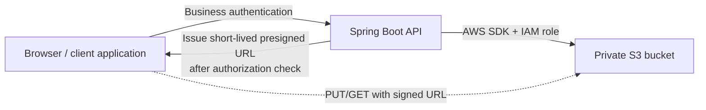

# Amazon S3: Bucket, object key, metadata, and the object access model

## 1. What does S3 store?

Amazon Simple Storage Service (Amazon S3) is an AWS-managed **object storage** service. Spring Boot applications commonly use S3 to store images, documents, report exports, backups, or input data for asynchronous processing. Applications do not need to operate file servers themselves, but they still must design identities, access permissions, object naming, metadata, and data lifecycles.

Unlike traditional file systems, S3 operates primarily on **entire objects** through APIs such as `PutObject`, `GetObject`, `HeadObject`, `ListObjectsV2`, and `DeleteObject`. You cannot open an object to modify a few bytes in the middle like writing to a local file. To change content, an application normally uploads a new version of the content; some workflows may use multipart upload or specialized features.

An object is identified by **bucket + object key**, plus a **version ID** if you need to specify a particular version in a versioning-enabled bucket.

| Component | Meaning | Example |
| --- | --- | --- |
| Bucket | Container space for objects, created in an AWS Region | `demo-provider-files` |
| Object key | Exact identifier name of the object **inside the bucket** | `documents/2026/report-42.pdf` |
| Object body | Sequence of data bytes | PDF content |
| System metadata | S3/HTTP attributes such as `Content-Type`, `Cache-Control`, `Content-Length` | `application/pdf` |
| User-defined metadata | Key–value pairs attached to the object by the application | `x-amz-meta-source: portal` |
| Object tags | Key–value pairs for classification, lifecycle control, or permission conditions | `classification=internal` |
| Version ID | Version identifier when the bucket has versioning enabled | ID returned by S3 |

For example, `s3://demo-provider-files/documents/2026/report-42.pdf` is an **S3 location representation**, where the bucket is `demo-provider-files` and the key is `documents/2026/report-42.pdf`. This is not by default a public HTTP URL.

## 2. Bucket: storage scope and foundational configuration

A bucket is the foundational unit for selecting a Region, access policies, versioning, lifecycle rules, and many data protection settings.

- **Bucket name** must follow S3 naming rules and be unique within an AWS partition (for example, the standard commercial AWS partition). Do not assume you can use the same name across every environment or every account.
- **Region** is chosen when creating the bucket. It should be placed close to the application or primary processing system to manage latency, data transfer costs, and data residency requirements.
- **Block Public Access** should be kept enabled for private buckets. New S3 buckets block public access by default and apply the **Bucket owner enforced** Object Ownership mode, in which ACLs are disabled.
- **Encryption at rest**: S3 automatically applies SSE-S3 server-side encryption to new objects by default. If managing your own keys is required, you can choose SSE-KMS and configure additional KMS permissions.
- **Versioning** retains multiple versions of the same key. When versioning is enabled, a standard delete can create a *delete marker* instead of permanently deleting older versions.
- **Lifecycle** supports transitioning storage classes and expiring objects/versions according to rules. Consider recoverability and costs before applying them.

In real systems, buckets are often separated by environment or security requirements, such as `dev`, `staging`, `production`. Whether to separate buckets or share a bucket with multiple prefixes is a design decision; a prefix by itself **does not create a security boundary**.

### Buckets and objects have different ARNs

IAM uses Amazon Resource Names (ARNs) to describe resources:

```text
Bucket ARN:  arn:aws:s3:::demo-provider-files
Object ARN:  arn:aws:s3:::demo-provider-files/documents/2026/report-42.pdf
Prefix ARN:  arn:aws:s3:::demo-provider-files/documents/*
```

`s3:ListBucket` applies to the **bucket ARN**, whereas `s3:GetObject` and `s3:PutObject` apply to the **object ARN**. Confusing the two ARN types is a common cause of `AccessDenied` errors.

## 3. Object key: exact names, prefixes, and data organization

A bucket can contain keys such as:

```text
documents/2026/report-42.pdf
documents/2026/report-43.pdf
images/profiles/u_783/5b7d2a.png
exports/2026-11-24/part-0001.csv
```

Strings like `documents/`, `images/`, or `exports/` are **prefixes**. The `/` character is just a character in the key; S3 does not require real directories to exist. The console may display prefixes as a folder tree for easier browsing. An object with the key `documents/` can also be created as a separate object, often used to simulate an empty folder.

Key properties to remember:

1. Keys are **case-sensitive**: `Invoice.pdf` and `invoice.pdf` are two different keys.
2. A key has a maximum length of **1,024 bytes when UTF-8 encoded**; the number of visible characters does not always equal the number of bytes.
3. Two PUT requests to the **same bucket and same key** result in a logical overwrite unless conditional mechanisms are used; when versioning is enabled, S3 can retain the older version. Do not assume PUT always creates a new file.
4. For standard PUT, DELETE, and GET/LIST operations, S3 provides strong consistency after an operation succeeds. The application does not need to add its own wait step for a successfully PUT object to appear in LIST.
5. S3 does not provide a file-system-style rename command. The typical workflow is to **copy to the new key and then delete the old key**, and these two operations do not form an atomic transaction.
6. Prefixes help filter results in `ListObjectsV2` and can be used in IAM conditions, but they are **not** a search index over content or user metadata.

### Key design recommendations

```text
tenants/{tenantId}/invoices/{year}/{generatedId}.pdf
```

Example: `tenants/t_42/invoices/2026/9f8a7b61.pdf`.

Prefer collision-resistant IDs, consistent prefix conventions, and storing object–user–business relationships in the application database. Avoid putting emails, national ID numbers, tokens, or sensitive information into keys. Do not concatenate raw user-submitted filenames directly into keys without handling special characters and checking access permissions.

**Scenario:** if an application needs to query "all invoices of customer X with approved status", use a database table or business index to find the keys, then access S3. Do not scan the entire bucket trying to filter by `x-amz-meta-status`.

## 4. Metadata: information attached to an object, not the object's content

S3 stores metadata alongside the object and returns the appropriate fields when calling `HeadObject` or `GetObject`.

| Category | Examples | Characteristics |
| --- | --- | --- |
| Application-supplied system metadata | `Content-Type`, `Cache-Control`, `Content-Disposition`, `Content-Encoding` | Affects how clients receive and handle the data |
| S3-managed system metadata | `Content-Length`, `Last-Modified`, `ETag`, encryption info, version ID | Reflects object state and operation results |
| User-defined metadata | `x-amz-meta-source: spring-api`, `x-amz-meta-document-type: invoice` | Small text values attached to the object, subject to header size limits |
| Object tags | `classification=internal`, `retention=short` | Managed via a separate tagging API; can be changed without replacing the body |

Example when uploading a PDF:

```http
PUT /documents/2026/report-42.pdf HTTP/1.1
Host: demo-provider-files.s3.ap-southeast-1.amazonaws.com
Content-Type: application/pdf
Cache-Control: private, max-age=60
x-amz-meta-source: spring-api

<binary PDF body>
```

The HTTP snippet above is only to illustrate the request structure. Actual S3 calls must be **signed for authentication** with AWS Signature Version 4 or use a valid presigned URL. The AWS SDK handles request signing using the application's credentials.

Notes:

- `Content-Type` should accurately describe the validated format. If set incorrectly, browsers may display or download the file unexpectedly.
- `Content-Disposition: attachment` is usually appropriate when you want the browser to download the file instead of displaying it inline.
- **Changing user-defined metadata or many system metadata fields usually requires recreating/copying the object** with the new metadata; there is no single command to update all metadata in place. By contrast, object tags have dedicated APIs such as `PutObjectTagging`.
- `ETag` is not always equal to the MD5 of the content (for example, with multipart upload or certain encryption modes). When verifying data integrity, use the checksum mechanisms supported by S3/SDK instead of assuming ETag is MD5.
- Do not put secrets or sensitive personal data into metadata. Metadata is neither a secret store nor an access control system.

**Metadata, tags, and keys serve different roles:** keys identify objects; metadata describes object handling/characteristics; tags support classification and policies. They do not replace IAM permissions.

## 5. Access model: who can do what with an object?

A secure design typically keeps the **bucket in private mode** and lets the Spring Boot application access it using an **IAM role**. End users interact with the application API or receive a time-limited presigned URL when they need to upload/download an object directly.



### Access control layers

- **IAM identity-based policy:** attached to an IAM role/user, defining which actions can be performed on buckets and objects.
- **Bucket policy (resource-based):** attached to a bucket, useful for access conditions, cross-account access control, or cases requiring resource-level policies.
- **Block Public Access and Object Ownership:** reduce the risk of accidental public exposure or ACLs. For new buckets, ACLs are disabled by default under *Bucket owner enforced* mode.
- **Additional constraints:** AWS Organizations SCPs, VPC endpoint policies, policy conditions, and AWS KMS key policies can affect effective permissions.

When AWS evaluates permissions, an IAM allow statement does not guarantee successful access if there is an **explicit deny**, missing KMS permissions, or a block from a higher-level policy. Permission for `s3:ListBucket` also does not automatically grant `s3:GetObject`, and vice versa.

Example of a minimal **identity policy** for a service that only reads, writes, and lists objects under `documents/`:

```json
{
  "Version": "2012-10-17",
  "Statement": [
    {
      "Sid": "ListDocumentsOnly",
      "Effect": "Allow",
      "Action": "s3:ListBucket",
      "Resource": "arn:aws:s3:::demo-provider-files",
      "Condition": {
        "StringLike": {
          "s3:prefix": ["documents/", "documents/*"]
        }
      }
    },
    {
      "Sid": "ReadWriteDocumentsOnly",
      "Effect": "Allow",
      "Action": ["s3:GetObject", "s3:PutObject"],
      "Resource": "arn:aws:s3:::demo-provider-files/documents/*"
    }
  ]
}
```

This policy is an example for learning resource scopes; replace it with the actual bucket name and restrict permissions per business requirements. It does not grant `DeleteObject`, does not grant access outside `documents/`, and does not replace user/tenant authorization checks in the API. The `s3:prefix` condition only restricts **LIST requests**; to restrict GET/PUT, narrow the corresponding **object ARN**.

### Presigned URLs do not make an object public

A presigned URL allows the recipient to perform **one signed type of request** against an object within a defined expiration window, based on the permissions of the signing identity. This model lets browsers transfer files directly with S3 without the Spring Boot API acting as a proxy transferring all the bytes.

Common upload flow:

1. The client authenticates with Spring Boot and requests to upload a file.
2. Spring Boot checks business permissions, generates a **server-controlled key**, and issues a short-lived presigned PUT URL for that key and selected constraints.
3. The client PUTs the file to S3 using the signed URL and signed headers.
4. The client notifies completion; the backend can call `HeadObject` to verify size, metadata, and status before recording the business data.

A signed URL is effectively a **bearer capability**: anyone holding a valid, unexpired URL can use it within the signed scope. Therefore, do not log URLs in public logs, do not set overly long expirations, and do not rely solely on a presigned URL to verify the accessor's identity. If a browser calls S3 from a different origin, appropriate **CORS** configuration is also needed; CORS does not grant S3 permissions and does not replace IAM.

### Object permissions do not equal application-user permissions

Suppose the backend's IAM role has `GetObject` on `documents/*`. That role can read many objects, yet user A is **not automatically allowed** to view user B's documents. The backend must verify the tenant/owner via the database or business rules before returning data or signing a URL. If stronger isolation is needed, combine IAM conditions, per-tenant prefixes, separate roles, or separate buckets depending on the system.

## 6. Integrating into Spring Boot with Spring Cloud AWS

In the Spring Boot managed cloud service integration module, **Spring Cloud AWS** helps configure the AWS SDK and provides S3 integration components. The example below uses `S3Client` from **AWS SDK for Java v2**, configured by the Spring Cloud AWS starter so it can be injected into a Spring service.

### 6.1. Dependencies and configuration

When using Maven, import the **Spring Cloud AWS BOM version compatible with your project's Spring Boot version**; then declare the S3 starter:

```xml
<dependencyManagement>
    <dependencies>
        <dependency>
            <groupId>io.awspring.cloud</groupId>
            <artifactId>spring-cloud-aws-dependencies</artifactId>
            <version>${spring-cloud-aws.version}</version>
            <type>pom</type>
            <scope>import</scope>
        </dependency>
    </dependencies>
</dependencyManagement>

<dependencies>
    <dependency>
        <groupId>io.awspring.cloud</groupId>
        <artifactId>spring-cloud-aws-starter-s3</artifactId>
    </dependency>
</dependencies>
```

`spring-cloud-aws.version` is a property the project must declare according to the compatibility matrix of the version in use; the example intentionally does not pin a single version for all projects.

```yaml
# application.yml
spring:
  cloud:
    aws:
      region:
        static: ap-southeast-1

app:
  storage:
    bucket: ${S3_BUCKET_NAME}
```

On a development machine, you can use an AWS profile or a credential provider supported by the AWS SDK. When deploying on AWS, prefer an IAM role attached to the workload (such as an ECS task role, EC2 instance profile, or an appropriate role for EKS). **Do not hard-code access keys/secret keys** in source code or `application.yml`. The configured Region must match the bucket's actual Region.

### 6.2. Service for uploading and reading small objects

```java
import java.util.Map;
import java.util.UUID;

import org.springframework.beans.factory.annotation.Value;
import org.springframework.stereotype.Service;

import software.amazon.awssdk.core.sync.RequestBody;
import software.amazon.awssdk.services.s3.S3Client;
import software.amazon.awssdk.services.s3.model.GetObjectRequest;
import software.amazon.awssdk.services.s3.model.PutObjectRequest;

@Service
public class DocumentObjectStorage {
    private final S3Client s3Client;
    private final String bucket;

    public DocumentObjectStorage(
            S3Client s3Client,
            @Value("${app.storage.bucket}") String bucket) {
        this.s3Client = s3Client;
        this.bucket = bucket;
    }

    public String upload(byte[] bytes, String declaredContentType) {
        // Server generates the key; do not use the user-provided filename directly.
        String key = "documents/" + UUID.randomUUID();
        String contentType = (declaredContentType == null
                || declaredContentType.isBlank())
                ? "application/octet-stream" : declaredContentType;

        PutObjectRequest request = PutObjectRequest.builder()
                .bucket(bucket)
                .key(key)
                .contentType(contentType)
                .metadata(Map.of("source", "spring-api"))
                .build();

        s3Client.putObject(request, RequestBody.fromBytes(bytes));
        return key; // Store this key in the application's business record.
    }

    public byte[] downloadSmallObject(String key) {
        if (key == null || !key.startsWith("documents/")) {
            throw new IllegalArgumentException("Invalid object key");
        }

        GetObjectRequest request = GetObjectRequest.builder()
                .bucket(bucket)
                .key(key)
                .build();
        return s3Client.getObjectAsBytes(request).asByteArray();
    }
}
```

In the code:

- `bucket` comes from configuration; `key` is generated by the backend. Each upload creates an object under the `documents/` prefix.
- `contentType` is **system metadata**; `metadata(Map.of("source", ...))` produces **user-defined metadata** which S3 represents with the `x-amz-meta-source` header.
- `S3Client` signs requests using the runtime identity credentials. IAM role permissions are still required for `s3:PutObject` and `s3:GetObject`.
- `getObjectAsBytes` and `RequestBody.fromBytes` are suitable for demos with small files. For large files, prefer streaming/multipart upload or presigned URLs to avoid loading the entire file into RAM.
- The prefix check in the method is only an input validation example, **not document authorization**. A real API must look up the owner and authenticate the user before calling the method.
- For client-supplied files, the backend must validate format, size, upload policy, and intended use rather than trusting `declaredContentType` blindly.

If higher-level abstractions are needed, Spring Cloud AWS also provides `S3Template`. Using `S3Client` directly here makes the bucket, key, metadata, and AWS APIs being called clearly visible.

### 6.3. Reading metadata without downloading the body

```java
var response = s3Client.headObject(builder -> builder
        .bucket(bucket)
        .key("documents/9f8a7b61.pdf"));

System.out.println(response.contentType());
System.out.println(response.contentLength());
System.out.println(response.metadata().get("source"));
```

`HeadObject` is convenient for checking existence and attributes, yet still requires appropriate access permissions. For a non-existent key, S3 may return **404** if the principal has `s3:ListBucket`; without that permission, the result may be **403**. Therefore, do not interpret every 403 error as "the file definitely exists but reading is forbidden".

## 7. Design decision example for a document storage system

Suppose an API allows users to download PDF invoices, with a requirement to isolate documents between tenants.

| Concern | Recommended design | Why |
| --- | --- | --- |
| Storage | Private bucket in an appropriate Region | Data is not accidentally exposed publicly |
| Identification | `tenants/{opaqueTenantId}/invoices/{uuid}.pdf` | Low-collision keys, convenient prefix organization |
| Metadata | `Content-Type: application/pdf` and small non-sensitive metadata | Clients handle the format properly |
| Business index | Database stores `tenantId`, `invoiceId`, `bucket`, `key`, status | Query by business criteria instead of scanning S3 |
| Backend permissions | IAM role with only necessary actions and object scopes | Limits blast radius if code has bugs |
| User permissions | Backend verifies tenant and authorized invoice | Backend IAM role does not replace application authorization |
| Download | Streaming API or short-lived presigned GET URL | Enforces authorization before downloading |
| Recovery | Versioning/lifecycle per retention policy | Reduces impact of accidental overwrites or deletions |

A common mistake is putting `tenantId` in the key and assuming that alone prevents cross-tenant access. If the backend allows clients to pass any key to generate a presigned URL, an attacker can still guess or probe another tenant's key. **Key naming** is an organizational convention; **authorization** is an independent verification step.

## 8. Comparison across AWS, Azure, and Google Cloud

The Spring Cloud Provider Integration module also covers other managed services. Object storage concepts are similar, though resource names and access mechanisms differ:

| Concept | AWS | Azure | Google Cloud |
| --- | --- | --- | --- |
| Object storage | Amazon S3 | Azure Blob Storage | Google Cloud Storage |
| Container space | Bucket | Storage account → container | Bucket |
| Object identifier | Object key | Blob name | Object name |
| Typical workload identity | IAM role | Managed identity and Azure RBAC | Service account and IAM |
| Temporary access sharing | Presigned URL | SAS token/URL | Signed URL |

All providers support API-based access and metadata, though you cannot copy policy configurations, roles, or signing requirements verbatim from one cloud to another. Azure Data Lake Storage Gen2 also has its own hierarchical namespace mode; do not use that characteristic to infer that S3 prefixes are real directories.

## 9. Hands-on practice and self-check

Using a private sandbox bucket and an IAM role with only the required permissions, perform the following:

1. Upload a small file to `documents/lab/example.txt`, setting `Content-Type: text/plain` and user metadata `source=lab`.
2. Call `HeadObject` to inspect `contentType`, content length, and `metadata().get("source")` without downloading the body.
3. Call `ListObjectsV2` with prefix `documents/lab/` and compare the returned keys. Try another prefix to understand the filter.
4. Upload different content to **that exact same key**; observe the result with versioning enabled vs. disabled.
5. Try calling GET with a role missing `s3:GetObject`, then add the proper permission in the test environment; verify the bucket ARN and object ARN.
6. From Spring Boot, generate a new key per file, save the key in a test business record, and allow downloading only when the owner is authenticated.

**Review questions**

- How do a bucket and an object key differ? Why is `photos/2026/` not by default a folder?
- How do `Content-Type`, user-defined metadata, and object tags differ? In which cases might changing metadata require copying the object?
- Why does an IAM policy with `s3:ListBucket` but missing `s3:GetObject` still fail to download content?
- Does a presigned URL change a bucket's private status, or only grant permission to perform a scoped request?
- Why must the backend verify document ownership even when the key already has a per-tenant prefix?

Upon completion, learners should be able to read an S3 URI to identify the **bucket/key** accurately, design metadata and keys for Spring Boot applications, grant IAM permissions using **bucket ARN/object ARN**, and explain the data flow and access control in a private S3 system.
