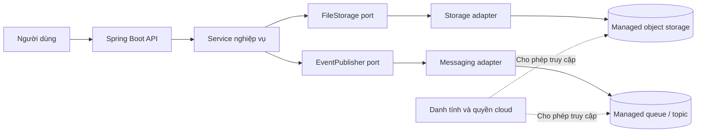

# Tích hợp nhà cung cấp đám mây là gì và giải quyết vấn đề nào?

> **Chương:** Định hướng  
> **Phạm vi:** Tích hợp ứng dụng Spring Boot với các dịch vụ managed của Amazon Web Services (AWS), Microsoft Azure và Google Cloud bằng những thư viện Spring Cloud tương ứng.

## 1. Từ ứng dụng chạy được đến ứng dụng vận hành được

Một ứng dụng Spring Boot có thể xử lý HTTP, truy vấn cơ sở dữ liệu và lưu tệp trên máy của lập trình viên. Nhưng khi triển khai cho nhiều người dùng, những lựa chọn đơn giản ban đầu thường bộc lộ giới hạn:

- **Lưu ảnh vào ổ đĩa cục bộ:** tệp có thể biến mất khi container bị thay thế; nhiều bản sao ứng dụng không tự chia sẻ cùng một thư mục.
- **Gửi email hoặc tạo báo cáo ngay trong HTTP request:** người dùng phải đợi tác vụ chậm; lỗi của dịch vụ phụ thuộc có thể làm request thất bại.
- **Tự chạy và bảo trì hạ tầng:** đội phát triển phải lo sao lưu, tính sẵn sàng, giám sát, phục hồi và mở rộng.
- **Đưa mật khẩu, khóa API vào `application.yml`:** bí mật dễ bị đẩy lên Git hoặc lộ trong log, ảnh container và pipeline.
- **Tạo khóa truy cập cloud dùng chung:** khó giới hạn quyền và khó truy vết ứng dụng nào đã thực hiện hành động nào.

Các nhà cung cấp cloud có những **dịch vụ managed** để xử lý các năng lực hạ tầng này: object storage, hàng đợi, pub/sub, cơ sở dữ liệu, kho bí mật, quản lý danh tính, giám sát, v.v. “Managed” có nghĩa là nhà cung cấp vận hành một phần đáng kể của hệ thống nền; **đội ứng dụng vẫn chịu trách nhiệm** về dữ liệu, cấu hình quyền, khả năng chịu lỗi, chi phí và cách sử dụng dịch vụ.

**Tích hợp nhà cung cấp đám mây** là quá trình kết nối ứng dụng với các dịch vụ ấy thông qua API/SDK, thư viện tích hợp, cấu hình và cơ chế xác thực thích hợp. Đối với module này, trọng tâm là **Spring Boot kết hợp Spring Cloud AWS, Spring Cloud Azure và Spring Cloud GCP**.

## 2. Tích hợp cloud khác gì với triển khai lên cloud?

Hai việc thường đi cùng nhau nhưng không đồng nhất:

| Khái niệm | Câu hỏi cần trả lời | Ví dụ |
| --- | --- | --- |
| **Triển khai lên cloud** | Ứng dụng chạy ở đâu? | Đưa Docker image của Spring Boot lên AWS ECS, Azure Container Apps hoặc Google Cloud Run. |
| **Tích hợp dịch vụ cloud** | Ứng dụng sử dụng năng lực nào của cloud và bằng cách nào? | Ghi file vào Amazon S3, Azure Blob Storage hoặc Google Cloud Storage. |
| **Vận hành cloud** | Hệ thống được bảo mật, quan sát và khôi phục ra sao? | Cấp quyền theo vai trò, lưu log, theo dõi lỗi, sao lưu và đặt cảnh báo chi phí. |

Một ứng dụng chạy trên laptop vẫn có thể truy cập một bucket trên cloud nếu có mạng và quyền hợp lệ. Ngược lại, một ứng dụng đã chạy trên cloud có thể hoàn toàn chưa dùng các dịch vụ managed ngoài nơi chạy máy chủ.

### Luồng tích hợp điển hình



Ở đây, **port** là giao diện do ứng dụng sở hữu (chẳng hạn `FileStorage`), còn **adapter** chứa phần gọi thư viện/SDK dành riêng cho từng nhà cung cấp. Kiểu tổ chức này không bắt buộc cho mọi dự án nhỏ, nhưng đặc biệt có ích khi cần thử nghiệm, kiểm soát mức độ phụ thuộc nhà cung cấp hoặc thay implementation sau này.

Một thao tác cloud thông thường trải qua các bước:

1. Ứng dụng nhận yêu cầu nghiệp vụ và xác định tài nguyên cần dùng (bucket, queue, database...).
2. Client của SDK lấy **danh tính** phù hợp với môi trường chạy.
3. Dịch vụ cloud xác thực danh tính và kiểm tra **quyền** đối với hành động và tài nguyên cụ thể.
4. API thực hiện thao tác; ứng dụng xử lý kết quả, lỗi tạm thời, timeout và quan sát hệ thống.

> **Nguyên tắc:** Có cấu hình đúng endpoint và tên tài nguyên chưa đủ. Danh tính đang chạy ứng dụng phải được cấp đúng quyền; mạng, region, định dạng dữ liệu và giới hạn dịch vụ cũng phải phù hợp.

## 3. Các bài toán nào được dịch vụ managed giải quyết?

| Nhu cầu ứng dụng | Dịch vụ AWS | Dịch vụ Azure | Dịch vụ Google Cloud | Vấn đề được giải quyết |
| --- | --- | --- | --- | --- |
| Lưu tệp, ảnh, tài liệu | Amazon S3 | Azure Blob Storage | Cloud Storage | Tách dữ liệu tệp khỏi vòng đời container, truy cập và mở rộng dung lượng độc lập. |
| Xử lý tác vụ bất đồng bộ | Amazon SQS | Azure Service Bus | Pub/Sub (subscription) | Giảm phụ thuộc thời gian giữa phía gửi và phía xử lý; hấp thụ lưu lượng tăng đột biến. |
| Phân phối sự kiện | Amazon SNS, EventBridge | Azure Service Bus topics, Event Grid | Pub/Sub | Cho phép nhiều bộ xử lý phản ứng với một sự kiện theo mô hình phù hợp. |
| Cơ sở dữ liệu quan hệ managed | Amazon RDS/Aurora | Azure Database for PostgreSQL | Cloud SQL | Giảm gánh nặng vận hành database, hỗ trợ sao lưu và tùy chọn độ sẵn sàng cao. |
| Quản lý bí mật | AWS Secrets Manager, Systems Manager Parameter Store | Azure Key Vault | Secret Manager | Tách secret khỏi mã nguồn; quản lý truy cập, audit và vòng đời secret. |
| Danh tính cho workload | IAM role và cơ chế cấp danh tính cho workload | Managed Identity qua Microsoft Entra ID | Service account / Workload Identity | Cấp quyền có phạm vi cho ứng dụng, hạn chế khóa truy cập cố định. |
| Quan sát hệ thống | CloudWatch | Azure Monitor | Cloud Monitoring / Cloud Logging | Thu thập chỉ số, log và cảnh báo để tìm nguyên nhân sự cố. |

Bảng trên là **ánh xạ theo nhu cầu**, không hàm ý các sản phẩm tương đương hoàn toàn. Ví dụ, SQS là dịch vụ hàng đợi, còn Pub/Sub nhấn mạnh mô hình topic/subscription; các đặc tính thứ tự, fan-out, retry, lọc thông điệp và thời gian lưu giữ cần được đối chiếu theo trường hợp cụ thể.

### Ví dụ 1: Lưu tài liệu tải lên

Nếu dùng thư mục `/uploads` của một container để lưu giấy tờ, việc scale ứng dụng thành nhiều instance hoặc thay container gây khó khăn khi truy cập lại tệp. Với object storage, API nhận và kiểm tra tệp, tạo object key, rồi ghi vào bucket/container. Cơ sở dữ liệu chỉ cần lưu **metadata** như ID tài liệu, chủ sở hữu, object key, loại tệp và trạng thái xử lý.

Lợi ích chính: dữ liệu tệp có vòng đời độc lập với ứng dụng; có thể áp dụng giới hạn quyền, chính sách vòng đời, mã hóa và cơ chế tải xuống có kiểm soát. Đổi lại, ứng dụng phải tính đến độ trễ mạng, chi phí request/egress và hành vi khi dịch vụ không khả dụng.

### Ví dụ 2: Xử lý đơn hàng không làm chậm API

Sau khi ghi nhận đơn hàng, ứng dụng có thể phát sự kiện `OrderCreated`. Một worker nhận sự kiện để gửi thông báo hoặc cập nhật hệ thống bên ngoài. HTTP request có thể trả về sớm hơn và hệ thống xử lý có thể tăng số worker khi tải cao.

Hàng đợi **không tự bảo đảm chính xác một lần xử lý**. Với nhiều cấu hình phổ biến, thông điệp có thể được giao lại sau timeout hoặc lỗi. Consumer nên **idempotent**: xử lý lặp cùng một `eventId` không tạo tác dụng phụ lặp, ví dụ không gửi lại hóa đơn hoặc trừ tiền hai lần. Cần xác định retry, dead-letter queue/subscription, khả năng xử lý thông điệp lỗi và cách theo dõi backlog.

### Ví dụ 3: Kết nối cơ sở dữ liệu managed

Spring Boot có thể tiếp tục dùng JDBC, Spring Data JPA hoặc R2DBC với một database managed. Ở đây, SDK Spring Cloud **không nhất thiết là lớp truy cập dữ liệu chính**: ứng dụng vẫn dùng driver và thư viện truy cập database, trong khi hạ tầng cloud phụ trách provisioning, sao lưu và một số tính năng vận hành. Những vấn đề như pool kết nối, migration schema, transaction, giới hạn kết nối và phương thức xác thực vẫn cần thiết kế riêng.

### Ví dụ 4: Bảo vệ secret

Thay vì ghi mật khẩu database trong Git, ứng dụng được cấp danh tính và quyền đọc secret tương ứng khi chạy. Spring Cloud hoặc SDK có thể hỗ trợ lấy secret và gắn vào cấu hình ứng dụng tùy nền tảng. Việc dùng secret manager **không tự loại bỏ mọi rủi ro**: ứng dụng vẫn phải tránh log giá trị bí mật, giới hạn quyền đọc và có phương án khi secret được thay đổi.

## 4. Spring Boot, Spring Cloud và SDK phối hợp thế nào?

Spring Boot cung cấp nền tảng xây ứng dụng: dependency injection, cấu hình, web, data access, health checks, metrics và khả năng chạy độc lập. SDK của nhà cung cấp đóng vai trò **gọi API** theo kiểu và quy ước cụ thể của họ. Các dự án Spring Cloud dành cho từng nhà cung cấp giúp tích hợp SDK vào hệ sinh thái Spring: starter dependency, tự cấu hình client, liên kết thuộc tính cấu hình và, ở một số dịch vụ, cung cấp template hoặc listener theo phong cách Spring.

| Lớp | Vai trò | Ví dụ |
| --- | --- | --- |
| Nghiệp vụ Spring Boot | Xác định khi nào cần lưu tệp/phát sự kiện | `DocumentService`, `OrderService` |
| Port của ứng dụng | Định nghĩa khả năng cần có | `FileStorage.put(...)` |
| Spring Cloud integration | Kết nối starter, cấu hình bean, hỗ trợ listener/template khi có | Spring Cloud AWS / Azure / GCP |
| Cloud SDK | Tạo request, ký/xác thực và gọi API cloud | AWS SDK for Java, Azure SDK for Java, Google Cloud Java client libraries |
| Dịch vụ managed | Lưu hoặc xử lý tài nguyên thực tế | S3, Blob Storage, Cloud Storage... |

Một số tên starter thường gặp (phụ thuộc phiên bản dự án):

- **AWS:** `io.awspring.cloud:spring-cloud-aws-starter-s3`, `io.awspring.cloud:spring-cloud-aws-starter-sqs`.
- **Azure:** `com.azure.spring:spring-cloud-azure-starter-storage-blob`, `com.azure.spring:spring-cloud-azure-starter-servicebus`.
- **Google Cloud:** `com.google.cloud:spring-cloud-gcp-starter-storage`, `com.google.cloud:spring-cloud-gcp-starter-pubsub`.

**Phải chọn phiên bản starter và BOM tương thích với phiên bản Spring Boot đang dùng**, kiểm tra tài liệu chính thức của từng dự án trước khi cài. Không giả định cả ba nhà cung cấp có cùng annotation, property key hoặc kiểu dữ liệu. Một hệ thống cũng không bắt buộc phải dùng Spring Cloud cho mọi dịch vụ: gọi SDK trực tiếp, JDBC/JPA hoặc giao thức chuẩn có thể là lựa chọn hợp lý.

## 5. Danh tính, xác thực và phân quyền: điểm bắt đầu quan trọng nhất

Đối với tích hợp cloud, cần phân biệt ba câu hỏi:

- **Ứng dụng là ai?** Danh tính (identity) có thể là AWS role, Azure Managed Identity hoặc Google service account/workload identity.
- **Ứng dụng chứng minh danh tính bằng gì?** Credential có thể là token ngắn hạn nhận từ môi trường chạy, đăng nhập local hoặc một phương thức khác do SDK hỗ trợ.
- **Ứng dụng được làm gì?** Chính sách quyền quy định hành động (ví dụ đọc object) trên tài nguyên cụ thể (ví dụ một bucket hoặc đường dẫn object).

### Local và production

| Môi trường | Cách tiếp cận thường dùng | Điều cần kiểm tra |
| --- | --- | --- |
| Máy phát triển | AWS CLI profile/SSO, `az login`, Google Application Default Credentials (`gcloud auth application-default login`) tùy dịch vụ | Danh tính phát triển có quyền tối thiểu; không commit credential. |
| Cloud runtime | AWS IAM role gắn workload, Azure Managed Identity, GCP service account/Workload Identity | Runtime nhận token/credential từ cơ chế chuẩn; policy chỉ cho phép tài nguyên cần dùng. |
| CI/CD | Workload identity federation hoặc danh tính workload ngắn hạn khi nền tảng hỗ trợ | Tách quyền triển khai và quyền chạy ứng dụng; không dùng khóa lâu dài nếu có lựa chọn an toàn hơn. |

**Nguyên tắc least privilege:** service chỉ cần ghi tài liệu không nên có quyền xóa toàn bộ bucket hay đọc mọi secret. Phân quyền cũng cần xét ranh giới môi trường: tài khoản dev không mặc nhiên được truy cập dữ liệu production.

Khi gặp lỗi, hãy chẩn đoán theo lớp: thiếu credential hoặc token hết hạn; danh tính hợp lệ nhưng không có quyền; sai resource/region/project/subscription; chặn mạng; quota/rate limit; lỗi dịch vụ. Một lỗi HTTP 403 thường gợi ý cần kiểm tra phân quyền, nhưng cũng phải xem mã lỗi cụ thể từ SDK và log phía cloud thay vì tự động mở rộng quyền.

## 6. Ví dụ tối giản: Spring Boot lưu tài liệu lên Amazon S3

Giả sử ứng dụng cần lưu bản PDF sau khi đã xác thực người dùng, kiểm tra loại tệp và giới hạn kích thước. Ví dụ này dùng **Spring Cloud AWS** để tạo bean client S3 và dùng **AWS SDK for Java v2** để thực hiện thao tác ghi. Nó chỉ minh họa một adapter; các môi trường Azure và GCP sẽ có adapter khác nhưng vẫn có thể dùng chung port nghiệp vụ.

**Dependency Maven** (version được quản lý bằng BOM Spring Cloud AWS tương thích với Spring Boot của dự án):

```xml
<dependency>
    <groupId>io.awspring.cloud</groupId>
    <artifactId>spring-cloud-aws-starter-s3</artifactId>
</dependency>
```

**Cấu hình ví dụ** trong `application.yml`:

```yaml
app:
  files:
    bucket: ${APP_FILES_BUCKET}
spring:
  cloud:
    aws:
      region:
        static: ${AWS_REGION:ap-southeast-1}
```

`APP_FILES_BUCKET` là tên bucket được cấp cho môi trường. Region cần khớp vùng của tài nguyên. Cấu hình này **không chứa access key/secret key**: client sử dụng cơ chế cung cấp credential thích hợp cho môi trường (chẳng hạn local profile hoặc IAM role cho workload).

**Port nghiệp vụ**:

```java
public interface FileStorage {
    void put(String key, byte[] content, String contentType);
}
```

**Adapter S3**:

```java
import org.springframework.beans.factory.annotation.Value;
import org.springframework.stereotype.Component;
import software.amazon.awssdk.core.sync.RequestBody;
import software.amazon.awssdk.services.s3.S3Client;
import software.amazon.awssdk.services.s3.model.PutObjectRequest;

@Component
public class S3FileStorage implements FileStorage {
    private final S3Client s3;
    private final String bucket;

    public S3FileStorage(S3Client s3,
                         @Value("${app.files.bucket}") String bucket) {
        this.s3 = s3;
        this.bucket = bucket;
    }

    @Override
    public void put(String key, byte[] content, String contentType) {
        PutObjectRequest request = PutObjectRequest.builder()
                .bucket(bucket)
                .key(key)
                .contentType(contentType)
                .build();

        s3.putObject(request, RequestBody.fromBytes(content));
    }
}
```

Điều kiện của ví dụ: bucket đã tồn tại; quyền ghi đối tượng tương ứng đã được cấp; dependency, BOM và cấu hình xác thực hợp lệ. Để sử dụng thực tế còn cần xử lý kích thước file lớn theo kiểu streaming/multipart, xác thực chủ sở hữu, đặt object key khó đoán, xác minh loại nội dung, quy định mã hóa, logging có chọn lọc, timeout và chiến lược retry phù hợp. Với tệp lớn, giữ toàn bộ nội dung trong `byte[]` có thể tốn bộ nhớ.

Nếu muốn chuyển sang Blob Storage hoặc Cloud Storage, service nghiệp vụ gọi `FileStorage` có thể giữ nguyên, nhưng bạn phải **viết adapter tương ứng và kiểm thử lại hành vi**, vì chính sách truy cập, metadata, phiên bản object và một số tính năng không đồng nhất giữa các provider.

## 7. Thiết kế tích hợp để chịu được lỗi và lưu lượng thật

Tích hợp với managed service nghĩa là phụ thuộc vào một **hệ thống qua mạng**. Ngay cả khi API và SDK đơn giản, ứng dụng nên có kế hoạch cho các tình huống:

| Tình huống | Biểu hiện | Hướng xử lý |
| --- | --- | --- |
| Timeout hoặc gián đoạn mạng | Request lưu tệp/gửi message không có kết quả rõ ràng | Đặt timeout; kiểm tra kết quả trước khi thử lại thao tác có tác dụng phụ. |
| Quota hoặc rate limit | Lỗi throttling, độ trễ tăng | Retry có backoff và jitter, giới hạn concurrency, theo dõi quota. |
| Giao thông điệp lặp | Một sự kiện được xử lý nhiều lần | Dùng `eventId`/business key và idempotency; quản lý acknowledgement đúng cách. |
| Thông điệp không xử lý được | Worker retry vô hạn, backlog tăng | Giới hạn lần thử, chuyển sang dead-letter và có quy trình phân tích/replay. |
| Sai quyền truy cập | Lỗi authorization khi đọc/ghi | Kiểm tra danh tính runtime, phạm vi policy và đúng resource; tránh cấp quyền quá rộng. |
| Thất bại giữa ghi DB và phát sự kiện | Đã lưu đơn hàng nhưng không có message (hoặc ngược lại) | Cân nhắc transactional outbox, đồng bộ trạng thái và cơ chế phát lại đáng tin cậy. |
| Tăng chi phí bất ngờ | Nhiều request, egress, dữ liệu tồn đọng | Gắn nhãn tài nguyên, theo dõi usage, quota và lifecycle/retention. |

**Retry chỉ phù hợp với lỗi tạm thời**. Thử lại mọi lỗi 4xx do quyền hoặc cấu hình có thể làm hệ thống chậm và che giấu nguyên nhân. Với nghiệp vụ nhạy cảm (thanh toán, phát hành hóa đơn), phải thiết kế idempotency và tính nhất quán dữ liệu trước khi bật retry.

### Khi nào cần lớp trừu tượng chung?

Nếu một sản phẩm chắc chắn chỉ chạy trên một provider và dùng ít tính năng, gọi SDK từ một adapter gọn có thể đủ. Nếu sản phẩm có mục tiêu triển khai đa cloud, cần local fake để kiểm thử hoặc muốn tránh phụ thuộc SDK trong nghiệp vụ, hãy thiết kế port riêng ở **ranh giới năng lực thực sự cần** như `FileStorage`, `EventPublisher`, `SecretReader`.

Tránh cố “đồng nhất” tất cả tính năng cloud vào một API khổng lồ: presigned URL, chính sách quyền truy cập, độ trễ, retry, ordering, delivery guarantee và pricing có thể khác đáng kể. Trừu tượng tốt là giữ ổn định **hợp đồng của ứng dụng** và nêu rõ các đặc tính mà nghiệp vụ thực sự dựa vào.

## 8. Kiểm thử tích hợp cloud theo từng tầng

1. **Unit test:** giả lập `FileStorage` hoặc `EventPublisher`; xác minh quy tắc nghiệp vụ mà không gọi cloud.
2. **Integration test ở môi trường giả lập:** dùng các công cụ thích hợp, ví dụ LocalStack cho một số API AWS, Azurite cho Azure Storage, hoặc Pub/Sub emulator cho Google Cloud Pub/Sub. Có thể kết hợp Testcontainers nếu môi trường chạy hỗ trợ. Kiểm tra serialization, cấu hình client và hành vi kết nối cơ bản.
3. **Integration test trên tài nguyên cloud thử nghiệm:** xác nhận IAM/Managed Identity/service account, mạng, region, policy, SDK, hành vi retry và tính năng không được emulator hỗ trợ.
4. **Kiểm thử các tình huống thất bại:** credentials thiếu hoặc hết hạn, không đủ quyền, tài nguyên không tồn tại, message lặp, timeout, throttling, thay đổi secret và khôi phục sau lỗi.

Không coi emulator là bằng chứng đầy đủ cho phân quyền hay mọi hành vi của dịch vụ thật. Dùng riêng project/account/subscription thử nghiệm, cấu hình tài nguyên với quyền hạn tối thiểu, dọn dữ liệu và đặt giới hạn chi phí.

Để quan sát được sự cố, cần log có correlation/request ID, metric về latency/error/retry/backlog và trace qua các thao tác chính. Tránh đưa token, nội dung tệp nhạy cảm hoặc secret vào log/tracing.

## 9. Chọn AWS, Azure hay Google Cloud theo tiêu chí nào?

Không có lựa chọn luôn tốt hơn cho mọi ứng dụng. Một nhóm nên đánh giá:

- **Hạ tầng tổ chức đang có:** danh tính doanh nghiệp, network, vận hành, kiến thức đội ngũ và chính sách của tổ chức.
- **Đúng mô hình dữ liệu và messaging:** object lifecycle, hàng đợi hay pub/sub, throughput, xử lý trùng lặp, ordering, dead-letter và khả năng replay.
- **Khả năng bảo mật:** cách cấp danh tính cho workload, giới hạn quyền theo tài nguyên, quản lý khóa mã hóa, audit và quy định lưu trữ dữ liệu.
- **Chi phí thực tế:** storage capacity, số request, data transfer, lưu lượng thông điệp, database sizing, log, môi trường thử nghiệm.
- **Phù hợp với Spring Boot:** starter/SDK được bảo trì và tương thích phiên bản; mức độ dễ debug, test và triển khai.
- **Yêu cầu chuyển đổi provider:** mức độ cần thiết của portability so với chi phí duy trì nhiều adapter và bộ kiểm thử.

Trong thực tế, nhiều dự án dùng **một provider chính**, rồi tích hợp thêm dịch vụ bên ngoài khi có lợi ích rõ ràng. Đa cloud mang lại lựa chọn nhưng cũng tăng số cơ chế danh tính, cấu hình, cách vận hành và chi phí kiểm thử.

## 10. Những nhầm lẫn thường gặp

**“Dùng Spring Cloud là ứng dụng tự động an toàn.”** Không đúng. Starter giúp nối cấu hình và SDK; tổ chức vẫn cần thiết kế IAM, phân vùng mạng, mã hóa, kiểm soát truy cập nghiệp vụ, bảo vệ secret và audit.

**“Dịch vụ managed đồng nghĩa không có sự cố.”** Không đúng. Ứng dụng vẫn phải xử lý lỗi mạng, quota, giới hạn dịch vụ, sai cấu hình, dữ liệu hỏng và lỗi ở chính mã nghiệp vụ.

**“Đổi tên dependency là chạy được trên cloud khác.”** Không đúng. Dù cùng là object storage hoặc messaging, SDK, auth, resource model và delivery semantics khác nhau; cần adapter và test riêng.

**“Mọi loại dữ liệu đều cần Spring Cloud starter.”** Không đúng. JDBC/JPA vẫn là nền tảng phù hợp cho nhiều relational database; đôi khi SDK trực tiếp hoặc giao thức chuẩn dễ hiểu hơn.

**“Đã gửi message thành công nghĩa là nghiệp vụ đã hoàn tất.”** Không đúng. Thao tác publish thành công chỉ chứng minh provider đã nhận theo API cụ thể; consumer vẫn có thể chưa xử lý, lỗi hoặc xử lý lặp.

## 11. Bài tập định hướng

**Tình huống:** Xây dịch vụ quản lý hồ sơ với Spring Boot. Người dùng tải PDF lên, hệ thống lưu tài liệu, tạo bản xem trước và gửi thông báo khi hoàn tất.

Hãy vẽ luồng xử lý và trả lời các câu hỏi:

1. Tệp PDF sẽ ở đâu để vẫn truy cập được khi ứng dụng scale lên ba instance? DB nên lưu thông tin nào thay cho nội dung file?
2. Tác vụ tạo bản xem trước có nên nằm trong request upload không? Nếu đưa vào queue/topic, cần `eventId`, retry, dead-letter và idempotency như thế nào?
3. Workload nào cần quyền **ghi** file, workload nào cần **đọc** file? Những thành phần nào được quyền đọc secret?
4. Thay đổi nào cần làm trong adapter khi dùng lần lượt S3, Blob Storage hoặc Cloud Storage?
5. Tạo kế hoạch kiểm thử unit, emulator và cloud thử nghiệm cho trường hợp không đủ quyền, timeout và xử lý thông điệp trùng lặp.

**Tiêu chí đạt:** giải thích rõ trách nhiệm của ứng dụng so với trách nhiệm của nhà cung cấp; phân biệt deploy và integration; xác định được dịch vụ managed phù hợp; mô tả cách cấp danh tính/quyền an toàn; nêu được ít nhất một tình huống lỗi và một chiến lược kiểm thử cho storage hoặc messaging.

---

### Ghi nhớ trước khi vào các bài thực hành

Tích hợp cloud giải quyết các nhu cầu về **lưu trữ bền vững, xử lý bất đồng bộ, quản lý dữ liệu, secret, danh tính và vận hành ở quy mô lớn hơn**. Spring Boot giữ vai trò tổ chức nghiệp vụ; Spring Cloud và SDK giúp giao tiếp với các dịch vụ managed. Chất lượng tích hợp được quyết định bởi **đúng hợp đồng dữ liệu, đúng quyền, xử lý lỗi có chủ đích, kiểm thử trên nhiều tầng và hiểu khác biệt của từng provider** — chứ không chỉ bởi việc gọi API thành công một lần.
