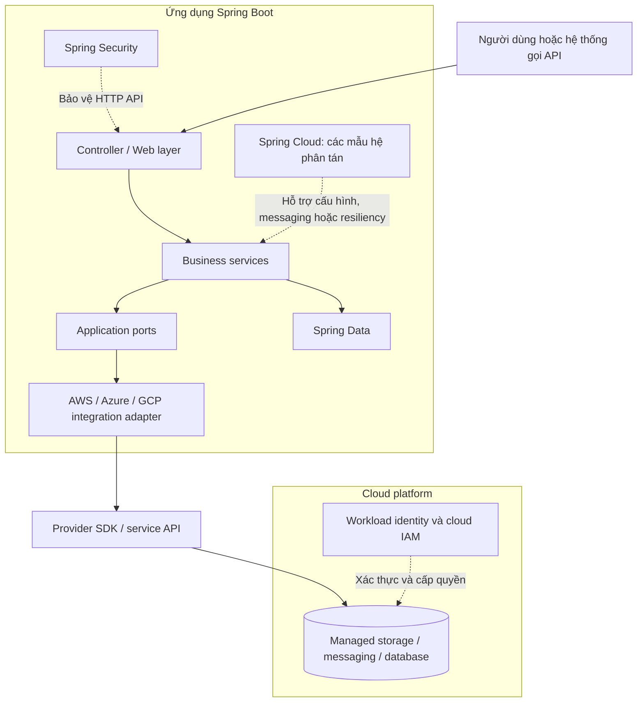
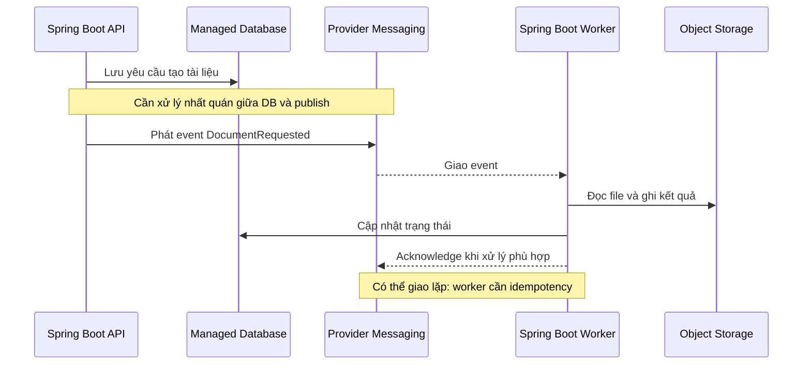
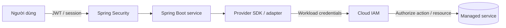

# Vị trí của tích hợp nhà cung cấp trong hệ sinh thái Spring Cloud

> **Chương:** Định hướng  
> **Module:** `SPRING_CLOUD_PROVIDER_INTEGRATION`  
> **Phạm vi:** Tích hợp Spring Boot với các dịch vụ managed của AWS, Azure và Google Cloud, bao gồm danh tính và quyền, storage, messaging, dữ liệu, secret, kiểm thử tích hợp và khác biệt giữa các cloud provider.

## 1. Tại sao cần đặt tích hợp cloud vào đúng vị trí?

Khi xây dựng ứng dụng Spring Boot, đội phát triển thường dùng đồng thời nhiều thư viện có tên gần giống nhau: Spring Framework, Spring Boot, Spring Cloud, Spring Data, Spring Security, Spring Integration và các starter dành cho AWS, Azure, Google Cloud. Nếu không phân biệt trách nhiệm của chúng, thiết kế dễ gặp các vấn đề:

- Đưa mã gọi SDK cloud trực tiếp vào controller và service nghiệp vụ, khiến việc kiểm thử và thay đổi dịch vụ khó khăn.
- Dùng một starter không đúng mục đích, ví dụ mong Spring Cloud Gateway tự kết nối object storage hoặc mong Spring Security tự cấp quyền IAM cho workload.
- Coi mọi thư viện có tên “Spring Cloud” là cùng một gói phát hành, dẫn đến chọn phiên bản dependency không tương thích.
- Nhầm lẫn giữa cơ chế kết nối dịch vụ và các yêu cầu vận hành: danh tính, quyền, timeout, retry, audit, chi phí và khả năng khôi phục.
- Cho rằng các dịch vụ cùng nhóm ở AWS, Azure, Google Cloud có API và hành vi giống hệt nhau.

**Tích hợp nhà cung cấp cloud** là một phần chuyên biệt của hệ sinh thái Spring: nó giúp ứng dụng Spring truy cập các dịch vụ do nhà cung cấp cloud vận hành. Nó **đứng bên cạnh và phối hợp với** Spring Boot, các dự án Spring Cloud và những mô-đun Spring khác; nó không thay thế phần nghiệp vụ, hệ thống bảo mật hay cách thiết kế dữ liệu.

## 2. Bản đồ hệ sinh thái Spring dưới góc nhìn ứng dụng cloud

Để hình dung quan hệ, có thể chia theo vai trò thay vì cố xem mọi thành phần là các tầng kế thừa nhau.

| Nhóm công nghệ | Trách nhiệm chính | Quan hệ với tích hợp AWS/Azure/GCP |
| --- | --- | --- |
| **Spring Framework** | Dependency injection, lập trình hướng thành phần, transaction, HTTP, abstraction cơ bản | Là nền tảng để đăng ký bean client và ghép các thành phần tích hợp vào ứng dụng. |
| **Spring Boot** | Auto-configuration, starter, cấu hình ngoài mã nguồn, Actuator, đóng gói và chạy ứng dụng | Tạo điểm tựa cho starter tích hợp cloud và cấu hình client theo môi trường. |
| **Spring Cloud (các dự án dùng chung)** | Những mẫu giải pháp cho hệ phân tán như cấu hình phân tán, gateway, discovery, circuit breaker, messaging abstraction tùy dự án | Giải quyết các vấn đề ở cấp hệ thống; có thể dùng kết hợp với client cloud. |
| **Spring Cloud AWS / Spring Cloud Azure / Spring Cloud GCP** | Tích hợp các dịch vụ managed cụ thể vào Spring | Cung cấp starter, cấu hình, template, listener hoặc cơ chế truy cập dịch vụ tương ứng; phạm vi hỗ trợ tùy dự án/phiên bản. |
| **SDK của nhà cung cấp** | Gọi API dịch vụ, nhận credentials/token, tuần tự hóa request và xử lý response | Thường là lớp client nằm dưới thư viện Spring Cloud của provider. |
| **Spring Data** | Repository, mapping, truy cập dữ liệu cho nhiều kiểu kho dữ liệu | Có thể dùng để truy cập database managed; không phải mọi database cloud đều cần starter provider. |
| **Spring Security** | Xác thực và phân quyền người dùng/API trong ứng dụng | Phối hợp nhưng khác với **IAM/Managed Identity/service account** dùng khi ứng dụng gọi cloud. |
| **Spring Integration / Spring Cloud Stream** | Enterprise integration patterns, message flow và abstraction cho các broker phù hợp | Có thể là lựa chọn cho luồng messaging, tùy nhu cầu và binder/adapter được hỗ trợ. |
| **Spring Cloud Kubernetes** | Tích hợp với API và tài nguyên Kubernetes | Phù hợp khi vận hành trên Kubernetes, không thay thế SDK/API của S3, Blob Storage hay Pub/Sub. |

Điểm quan trọng là **cùng một ứng dụng có thể đồng thời dùng nhiều nhóm trên**. Ví dụ: Spring MVC nhận request, Spring Security xác thực người dùng, Spring Data JPA ghi bản ghi đơn hàng, Spring Cloud AWS gửi message đến SQS, Spring Boot Actuator cung cấp health/metrics, và thư viện quan sát ghi trace cho request.

### Sơ đồ quan hệ theo trách nhiệm



Sơ đồ là mô hình tổ chức trách nhiệm, không phải quy tắc bắt buộc mỗi dự án phải có đúng từng lớp. Một ứng dụng nhỏ có thể inject SDK client trực tiếp vào một service tích hợp; một sản phẩm lớn có thể cần adapter riêng và hợp đồng rõ ràng để bảo vệ miền nghiệp vụ.

## 3. Spring Boot cung cấp gì cho thư viện tích hợp provider?

Spring Boot là “khung vận hành ứng dụng” nơi các tích hợp được lắp vào. Cụ thể:

1. **Dependency injection (DI):** client cloud, template, listener container và adapter được quản lý như các bean; service nghiệp vụ nhận dependency qua constructor.
2. **Auto-configuration:** starter có thể tự tạo client/bean nếu dependency và điều kiện cấu hình phù hợp. Cơ chế cụ thể khác nhau tùy provider và phiên bản.
3. **Externalized configuration:** tên bucket, queue, region, project, endpoint, namespace... được đọc từ cấu hình thay vì hardcode trong logic nghiệp vụ.
4. **Lifecycle và vận hành:** Spring Boot khởi động, dừng tài nguyên, cung cấp logging, Actuator/metrics; các tích hợp có thể đóng góp thêm chỉ số hoặc health indicator khi được hỗ trợ.
5. **Profile và môi trường:** có thể chọn cấu hình khác nhau cho local, test, staging, production mà không cần tạo nhiều bản mã nguồn.

Ví dụ, cấu hình riêng của **ứng dụng** có thể được đặt dưới prefix do đội phát triển quản lý:

```yaml
app:
  documents:
    storage-provider: aws
    bucket: ${DOCUMENTS_BUCKET}
  messaging:
    order-created-destination: ${ORDER_CREATED_DESTINATION}
```

Các thuộc tính `app.*` ở trên chỉ là **cấu hình do ứng dụng tự định nghĩa**, không tự động khiến Spring Boot kết nối cloud. Phải có starter/client phù hợp và code đọc các giá trị ấy. Không nên suy luận rằng AWS, Azure và GCP đều hiểu chung một bộ property. Property chính thức của từng starter được tài liệu của dự án đó quy định.

### Starter không có nghĩa ứng dụng tự có quyền

Thêm starter mới giải quyết lớp tích hợp thư viện. Để thực hiện thao tác thực tế, ứng dụng còn cần:

- Tài nguyên cloud tồn tại và đúng tên/region/project/subscription.
- Danh tính runtime hợp lệ.
- Quyền thực hiện hành động trên tài nguyên cụ thể.
- Mạng và endpoint cho phép truy cập.
- Kế hoạch timeout, lỗi tạm thời, retry và quan sát.

Chẳng hạn, bean client S3 được Spring Boot tạo thành công nhưng lệnh đọc bucket vẫn có thể bị từ chối do IAM policy không cấp quyền.

## 4. Các dự án Spring Cloud “dùng chung” giải quyết việc gì?

Tên “Spring Cloud” không đồng nghĩa với “thư viện để gọi dịch vụ của một cloud provider”. Đây là hệ dự án rộng, hỗ trợ nhiều mẫu thiết kế cho ứng dụng phân tán.

| Bài toán | Nhóm dự án Spring thường liên quan | Ví dụ áp dụng cùng provider integration |
| --- | --- | --- |
| Quản lý cấu hình giữa các instance | Spring Cloud Config và cơ chế cấu hình của Spring Boot | Lấy cấu hình ứng dụng tập trung; secret vẫn cần cơ chế lưu trữ và phân quyền phù hợp. |
| Định tuyến API và chính sách tại gateway | Spring Cloud Gateway | Route request vào ứng dụng; service phía sau dùng adapter để gọi cloud storage. |
| Tìm vị trí service | Spring Cloud discovery clients, tùy nền tảng | Ứng dụng nội bộ gọi nhau; kết nối đến S3/Pub/Sub thường qua endpoint của SDK, không cần service discovery nội bộ. |
| Chống lỗi dây chuyền | Spring Cloud Circuit Breaker và thư viện hỗ trợ | Cắt mạch hoặc giới hạn gọi dịch vụ khi lỗi lặp lại, nếu phù hợp với giao diện gọi. |
| Luồng sự kiện ở mức abstraction | Spring Cloud Stream | Định nghĩa producer/consumer qua binder tương thích với broker; hỗ trợ cụ thể phụ thuộc hệ binder có sẵn. |
| Các mẫu luồng xử lý message | Spring Integration | Tổ chức channel, transformer, router, adapter và xử lý bất đồng bộ. |

Một service hoàn toàn có thể sử dụng **Spring Cloud Gateway ở phía HTTP** và **Spring Cloud GCP ở phía Pub/Sub** mà không có xung đột khái niệm. Chúng giải quyết hai câu hỏi khác nhau: “request đi vào đâu?” và “service tương tác với messaging managed thế nào?”.

Không phải ứng dụng nào cũng cần Gateway, Config Server, Service Discovery hoặc Circuit Breaker. Chỉ thêm các thành phần khi kiến trúc và vấn đề vận hành thực tế yêu cầu.

## 5. Ba họ tích hợp nhà cung cấp nằm ở đâu?

Có thể coi mỗi họ tích hợp là một **cầu nối giữa cách lập trình Spring và API/dịch vụ cụ thể của provider**.

| Họ tích hợp | Nhà cung cấp | Tích hợp thường gặp | Điểm khác biệt cần nhận biết |
| --- | --- | --- | --- |
| **Spring Cloud AWS (AWSpring)** | Amazon Web Services | Amazon S3, SQS, SNS, Secrets Manager, Parameter Store và các dịch vụ khác tùy bản phát hành | Hệ quyền IAM, region, AWS credential provider chain, resource ARN; SQS là queue. |
| **Spring Cloud Azure** | Microsoft Azure | Blob Storage, Service Bus, Key Vault, Cosmos DB và các dịch vụ khác tùy bản phát hành | Azure Identity, Microsoft Entra ID/Managed Identity, subscription, resource group, namespace. |
| **Spring Cloud GCP** | Google Cloud | Cloud Storage, Pub/Sub, Secret Manager và các tích hợp GCP khác tùy bản phát hành | Application Default Credentials, service account, project ID, topic/subscription. |

Chúng có **lịch sử duy trì, vòng đời phiên bản, BOM và API khác nhau**. Tên “Spring Cloud” trong cả ba không bảo đảm cùng phiên bản tương thích hoặc cùng tính năng.

Ví dụ các tọa độ Maven thường gặp (chỉ minh họa **cách chọn starter theo dịch vụ**, chưa khai báo phiên bản):

```xml
<!-- AWS: tích hợp hàng đợi SQS -->
<dependency>
    <groupId>io.awspring.cloud</groupId>
    <artifactId>spring-cloud-aws-starter-sqs</artifactId>
</dependency>

<!-- Azure: tích hợp Service Bus -->
<dependency>
    <groupId>com.azure.spring</groupId>
    <artifactId>spring-cloud-azure-starter-servicebus</artifactId>
</dependency>

<!-- GCP: tích hợp Pub/Sub -->
<dependency>
    <groupId>com.google.cloud</groupId>
    <artifactId>spring-cloud-gcp-starter-pubsub</artifactId>
</dependency>
```

Ví dụ chỉ để so sánh. Khi tạo ứng dụng thật, hãy chọn **một bộ thư viện theo nhu cầu**, tra cứu **ma trận tương thích với phiên bản Spring Boot/JDK hiện dùng**, rồi cấu hình BOM hoặc phiên bản dependency được nhà duy trì đề xuất. Không chép cả ba dependency vào một dự án chỉ vì muốn “hỗ trợ cloud” chung chung.

### Tại sao không dùng một starter chung cho cả ba cloud?

Các provider khác biệt về **mô hình dịch vụ**:

- **AWS SQS** nhận/giao message qua queue; **Google Cloud Pub/Sub** dựa trên topic và subscription; **Azure Service Bus** hỗ trợ queue và topic/subscription với các cơ chế khóa/settlement đặc thù.
- **Amazon S3**, **Azure Blob Storage** và **Google Cloud Storage** đều lưu object nhưng khác phương thức cấp quyền, chi tiết metadata, versioning, lifecycle, URL truy cập và chi phí.
- **IAM role**, **Managed Identity** và **service account** đều có thể cấp danh tính workload nhưng khác cách tạo, liên kết và cấp quyền.
- Hỗ trợ database managed có thể dựa vào **JDBC/R2DBC/Spring Data**, không nhất thiết vào chính starter Spring Cloud của provider.

Một abstraction chung chỉ có thể thống nhất những hành vi được ứng dụng xác định rõ. Không có bảo đảm rằng đổi tên dependency sẽ giúp ứng dụng chuyển provider mà không sửa mã và kiểm thử.

## 6. Quan hệ giữa Spring Cloud Stream, Spring Integration và messaging cloud

Đây là nơi người mới thường bối rối vì cả ba đều có thể xuất hiện trong dự án xử lý message.

**Gọi client hoặc template của provider** phù hợp khi ứng dụng cần kiểm soát API và ngữ nghĩa cụ thể của dịch vụ: queue URL, subscription, lock/acknowledgement, batch hoặc thuộc tính message đặc thù.

**Spring Cloud Stream** cung cấp mô hình function/binding/binder cho một số broker và dịch vụ messaging. Khi có binder được hỗ trợ và tương thích, người phát triển có thể tập trung nhiều hơn vào hợp đồng message. Nhưng binder không tự làm biến mất khác biệt về ordering, retry, dead-letter hay transaction.

**Spring Integration** dùng channel và adapter để kết nối các luồng xử lý, định tuyến, chuyển đổi message và phối hợp nhiều hệ thống. Nó phù hợp khi ứng dụng cần nhiều bước integration flow hơn việc đơn giản gửi/nhận một message.

| Câu hỏi | Hướng tiếp cận thường phù hợp |
| --- | --- |
| Cần gọi chức năng riêng của SQS/Service Bus/Pub/Sub? | Client/template/listener tích hợp đúng nhà cung cấp. |
| Muốn định nghĩa producer/consumer với hợp đồng binding tương đối độc lập broker? | Xem xét Spring Cloud Stream **nếu có binder phù hợp**. |
| Cần lọc, định tuyến, biến đổi, kết nối nhiều channel/adapter? | Xem xét Spring Integration. |
| Chỉ cần worker nhận một queue đơn giản? | Listener/client trực tiếp có thể rõ ràng và dễ vận hành hơn. |

Không bắt buộc dùng đồng thời tất cả các lớp. Việc chọn abstraction nên xuất phát từ yêu cầu kỹ thuật thay vì số lượng thư viện trong dự án.

### Một luồng nghiệp vụ với messaging managed



Sơ đồ mô tả mục tiêu xử lý, chưa giải quyết việc ghi DB và publish event thành hai thao tác độc lập. Nếu mất kết nối giữa hai bước, có thể lưu dữ liệu thành công nhưng không phát sự kiện; với yêu cầu tin cậy cao, cân nhắc **transactional outbox**, đồng bộ và phát lại.

## 7. Quan hệ giữa Spring Data, database managed và provider integration

Một cơ sở dữ liệu chạy dưới dạng dịch vụ managed vẫn là một hệ quản trị dữ liệu có driver, giao thức và quy tắc transaction riêng.

Ví dụ, nếu ứng dụng dùng **Amazon RDS for PostgreSQL**, **Azure Database for PostgreSQL** hoặc **Google Cloud SQL for PostgreSQL**, mã truy cập bảng thường vẫn viết bằng **Spring Data JPA/JDBC** và PostgreSQL driver:

```java
public interface InvoiceRepository
        extends org.springframework.data.jpa.repository.JpaRepository<Invoice, Long> {
}
```

Lớp data abstraction không nhất thiết thay đổi khi chuyển nơi vận hành PostgreSQL. Thứ thay đổi có thể là địa chỉ kết nối, mạng, TLS, cơ chế authentication, proxy/connector, việc cung cấp credential và giới hạn kết nối.

Ngược lại, khi dùng một dịch vụ dữ liệu có mô hình riêng như **Azure Cosmos DB**, bạn cần library/SDK hoặc Spring Data module phù hợp với mô hình truy vấn, consistency và partitioning của nó. Không nên mặc định mọi database managed đều hoạt động như một PostgreSQL thông thường.

### Trách nhiệm không thể giao hết cho thư viện

Dù provider quản lý máy chủ database, ứng dụng vẫn phải thực hiện migration schema, định nghĩa transaction, cân chỉnh pool kết nối, kiểm soát truy vấn chậm, phân quyền dữ liệu và xử lý lỗi. Thư viện Spring Cloud không tự động thay thế các quyết định này.

## 8. Quan hệ giữa Spring Security, cloud IAM và secrets

Hai loại bảo mật cùng xuất hiện nhưng ở **hai ranh giới khác nhau**.

**Ranh giới người dùng → ứng dụng** thường do Spring Security xử lý: xác thực người dùng/token, bảo vệ endpoint, kiểm tra quyền nghiệp vụ. Ví dụ chỉ chủ sở hữu hồ sơ mới được yêu cầu tải tài liệu.

**Ranh giới ứng dụng → dịch vụ cloud** do cơ chế danh tính và quyền của provider kiểm soát: workload đang chạy dưới identity nào, nó có được đọc object hoặc publish message không. Ví dụ identity của service được quyền ghi object trong bucket tài liệu nhưng không được đọc mọi secret của môi trường production.



| Môi trường | Cơ chế danh tính cloud thường gặp | Lưu ý |
| --- | --- | --- |
| Local developer | AWS profile/SSO, Azure CLI credential, Google ADC phù hợp | Dùng identity phát triển có quyền giới hạn; không commit credential. |
| Production trên AWS | IAM role gắn với workload khi nền tảng hỗ trợ | SDK nhận credential từ môi trường; tránh nhúng access key. |
| Production trên Azure | Managed Identity / cơ chế Azure Identity phù hợp | Cấp role theo tài nguyên cần thiết; chú ý quyền data plane. |
| Production trên Google Cloud | Service account/Workload Identity hoặc cơ chế phù hợp | Cấp role ở phạm vi tối thiểu cho workload và tài nguyên. |
| CI/CD | Federation và credential ngắn hạn nếu nền tảng hỗ trợ | Tách quyền deploy khỏi quyền runtime. |

**Quản lý secret** là một bài toán nữa. AWS Secrets Manager, Azure Key Vault và Google Secret Manager cung cấp nơi lưu/đọc secret. Spring Boot có thể nạp cấu hình từ nguồn bên ngoài qua những integration được hỗ trợ, hoặc code đọc secret bằng SDK khi cần. Phải kiểm soát thời điểm nạp, việc refresh, lỗi truy cập, rotation và không để secret rơi vào log.

Tránh nhầm lẫn: một ứng dụng có Spring Security đúng nhưng workload có quyền admin toàn bộ cloud vẫn là cấu hình nguy hiểm. Ngược lại, IAM được giới hạn đúng cũng không thay thế kiểm tra quyền của người dùng cuối.

## 9. Ví dụ đặt provider integration đúng lớp: phát sự kiện đơn hàng

Giả sử Spring Boot ghi đơn hàng vào cơ sở dữ liệu và cần đưa thông báo đến một worker. Mục tiêu thiết kế là để **service nghiệp vụ phụ thuộc vào hành vi “phát sự kiện”**, không phụ thuộc vào tên lớp SDK. AWS SQS được dùng làm minh họa; Azure Service Bus hoặc Google Pub/Sub cần adapter riêng.

### Bước 1: Định nghĩa hợp đồng ứng dụng

```java
public record OrderCreatedEvent(String eventId, String orderId) {}

public interface OrderEventPublisher {
    void publish(OrderCreatedEvent event);
}
```

Đây là **mã Java thuần**, không cần import từ AWS/Azure/GCP. Nó thể hiện ngôn ngữ nghiệp vụ “order created”, giúp dễ kiểm thử bằng fake publisher.

### Bước 2: Service sử dụng hợp đồng đó

```java
import java.util.UUID;
import org.springframework.stereotype.Service;

@Service
public class OrderNotificationService {
    private final OrderEventPublisher publisher;

    public OrderNotificationService(OrderEventPublisher publisher) {
        this.publisher = publisher;
    }

    public void notifyCreated(String orderId) {
        publisher.publish(
            new OrderCreatedEvent(UUID.randomUUID().toString(), orderId)
        );
    }
}
```

Trong ứng dụng thực tế, `eventId` nên được tạo ở thời điểm ghi nhận sự kiện và giữ ổn định khi retry, thay vì tạo lại trong mỗi lần phát. Cần thiết kế luồng commit DB và publish để không làm mất sự kiện khi một trong hai thao tác thất bại.

### Bước 3: Adapter AWS dùng Spring Cloud AWS

Khi chọn SQS, một lựa chọn là sử dụng `SqsTemplate` trong họ Spring Cloud AWS 3.x (cách đăng ký API có thể khác ở các bản khác nhau).

```java
import io.awspring.cloud.sqs.operations.SqsTemplate;
import org.springframework.beans.factory.annotation.Value;
import org.springframework.stereotype.Component;

@Component
public class SqsOrderEventPublisher implements OrderEventPublisher {
    private final SqsTemplate sqs;
    private final String queue;

    public SqsOrderEventPublisher(
            SqsTemplate sqs,
            @Value("${app.messaging.order-created-destination}") String queue) {
        this.sqs = sqs;
        this.queue = queue;
    }

    @Override
    public void publish(OrderCreatedEvent event) {
        sqs.send(to -> to.queue(queue).payload(event));
    }
}
```

Dependency minh họa:

```xml
<dependency>
    <groupId>io.awspring.cloud</groupId>
    <artifactId>spring-cloud-aws-starter-sqs</artifactId>
</dependency>
```

Ở runtime, starter và AWS SDK cần được cấu hình để tìm đúng region, credentials và queue. Workload phải có quyền gửi message đến queue đích. Tùy bản Spring Cloud AWS, payload Java cần được serialize bằng message converter phù hợp; trong thực tế phải kiểm thử định dạng thông điệp mà worker nhận được.

Nếu chuyển sang Azure Service Bus hoặc Google Pub/Sub, mã `OrderNotificationService` vẫn có thể giữ nguyên; hãy thay implementation `OrderEventPublisher`, starter/SDK, cấu hình và kiểm thử tích hợp. Khi triển khai nhiều provider **cùng một lúc**, cần cơ chế chọn bean rõ ràng (profile, configuration hoặc điều kiện khởi tạo) để tránh nhiều bean cùng triển khai interface nhưng Spring không biết inject bean nào.

### Phân định trách nhiệm của ví dụ

| Thành phần | Có trách nhiệm gì? |
| --- | --- |
| `OrderNotificationService` | Quyết định **khi nào** nghiệp vụ cần phát sự kiện. |
| `OrderEventPublisher` | Định nghĩa **hợp đồng** mà ứng dụng yêu cầu. |
| `SqsOrderEventPublisher` | Ánh xạ hợp đồng sang API SQS cụ thể. |
| Spring Cloud AWS | Cung cấp tích hợp thuận tiện cho Spring, ví dụ template và cấu hình client. |
| AWS SDK | Giao tiếp với API của AWS và xử lý credential theo cơ chế hỗ trợ. |
| AWS IAM và SQS | Kiểm tra quyền, nhận và lưu trữ message theo ngữ nghĩa dịch vụ. |
| Worker nhận event | Xử lý message, acknowledgement, retry, idempotency và lỗi nghiệp vụ. |

Với nghiệp vụ cần bảo đảm giao sự kiện khi DB commit, bước `notifyCreated` chỉ là minh họa lớp kiến trúc; cần xem xét outbox hoặc cơ chế nhất quán khác trước khi áp dụng sản xuất.

## 10. Cấu hình và quản lý phiên bản: ranh giới dễ sai

Ba hệ thư viện provider có thể **theo các nhịp phát hành khác nhau** với Spring Boot và Spring Cloud chung. Để quản lý dependency:

1. Xác định phiên bản **JDK và Spring Boot** của dự án.
2. Xác định **provider** và **dịch vụ managed** thật sự cần tích hợp.
3. Tra ma trận tương thích của dự án Spring Cloud AWS, Azure hoặc GCP tương ứng.
4. Sử dụng BOM theo hướng dẫn chính thức để quản lý nhóm dependency **trong cùng họ thư viện**; tránh tự trộn version từng artifact khi không có lý do.
5. Kiểm tra các dependency có thể xung đột (ví dụ phiên bản SDK, Netty, Jackson, Reactor) khi tích hợp nhiều cloud hoặc nhiều starter.
6. Cố định version đã xác minh trong build, chạy integration tests và kiểm tra lại sau nâng cấp Spring Boot hoặc starter.

Lưu ý: **BOM là cơ chế đồng bộ phiên bản dependency, không có chức năng cấp quyền hay tạo tài nguyên cloud**. “Chạy được khi build” cũng không chứng minh có thể kết nối đến dịch vụ trong runtime.

### Phân biệt các loại cấu hình

| Nhóm | Ví dụ | Nên quản lý ở đâu? |
| --- | --- | --- |
| Cấu hình nghiệp vụ | Cỡ file tối đa, loại file cho phép, event name | `application.yml` / cấu hình ứng dụng. |
| Cấu hình môi trường | Bucket, queue, project, region, endpoint | Environment variables, config service hoặc cấu hình triển khai. |
| Danh tính workload | IAM role, Managed Identity, service account | Cấu hình hạ tầng và runtime của cloud. |
| Secret | Database password, third-party token | Secret manager hoặc cơ chế secret được phê duyệt, truy cập theo identity. |
| Chính sách quyền | Ai được đọc object, publish message, truy cập secret | IAM/RBAC/chính sách tài nguyên của provider. |

Không copy đoạn `access-key`/`secret-key` hoặc private key cố định vào Git để “giúp starter hoạt động”. Ưu tiên cơ chế danh tính của môi trường chạy và quyền tối thiểu cho workload.

## 11. Kiểm thử provider integration nằm ở đâu trong chiến lược test?

Vì tích hợp cloud có hai lớp khác nhau — logic ứng dụng và hành vi SDK/dịch vụ — một bộ kiểm thử thực tế nên gồm:

| Tầng | Kiểm tra | Công cụ hoặc chiến lược |
| --- | --- | --- |
| Unit test nghiệp vụ | Phát đúng sự kiện, chọn key/path và xử lý luật nghiệp vụ | Fake/stub của `OrderEventPublisher` hay `ObjectStorage`, không kết nối cloud. |
| Integration test với emulator | Serialization, listener, property, endpoint và luồng cơ bản | LocalStack cho một số API AWS; Azurite cho Blob Storage; Pub/Sub emulator cho GCP Pub/Sub, tùy use case. |
| Integration test trên cloud thử nghiệm | IAM, Managed Identity/service account, region/project, network, semantics thật | Resource tạm trong tài khoản/project/subscription test với quyền tối thiểu. |
| Failure test | Timeout, duplicate message, rate limit, secret bị thu hồi, queue lỗi | Fault injection trong môi trường phù hợp; xác nhận retry/backoff, dead-letter, idempotency. |
| Vận hành và observability | Latency, error rate, retry count, backlog, chi phí | Metrics/tracing/logs của app kết hợp giám sát cloud. |

Emulator có giới hạn, có thể không mô phỏng đầy đủ IAM, quota, giới hạn throughput và mọi đặc tính nhất quán của dịch vụ thật. Vì vậy, **unit test tốt không thay thế cloud integration test**, và chạy thử cloud một lần cũng không thay thế kiểm thử lỗi, retry và duplicate.

Trong các môi trường cloud thật, cần tách tài nguyên test khỏi production, kiểm soát dữ liệu nhạy cảm và thu dọn tài nguyên để tránh phát sinh chi phí.

## 12. Khi nào dùng Spring Cloud provider starter, SDK trực tiếp hay abstraction khác?

Không có câu trả lời áp dụng cho mọi dự án. Có thể quyết định theo các câu hỏi:

| Trường hợp | Hướng ưu tiên cân nhắc | Lý do |
| --- | --- | --- |
| Ứng dụng Spring Boot dùng service được starter hỗ trợ tốt | **Spring Cloud provider starter** | Cấu hình, DI, template/listener và quy ước Spring có thể giảm mã lặp. |
| Cần API rất mới hoặc tính năng riêng chưa được starter hỗ trợ | **Provider SDK trực tiếp** | Chủ động dùng khả năng SDK, nhưng vẫn nên bọc trong adapter có hợp đồng rõ. |
| Muốn logic messaging tập trung vào function/binding, và có binder phù hợp | **Spring Cloud Stream** | Giảm liên kết giữa producer/consumer và một số chi tiết broker. |
| Cần orchestrate nhiều bước, channel, transformer, router | **Spring Integration** | Diễn tả luồng tích hợp phức tạp theo các mẫu sẵn có. |
| Lưu dữ liệu quan hệ trên dịch vụ PostgreSQL managed | **Spring Data/JDBC + driver phù hợp** | Vẫn làm việc với mô hình dữ liệu quan hệ và transaction phổ biến. |
| Cần kiểm thử đơn giản và có thể đổi backend | **Application port + adapter** | Giữ nghiệp vụ độc lập với client, nhưng chỉ trừu tượng hành vi thật sự dùng. |

Một nguyên tắc hữu ích: **chọn abstraction theo yêu cầu nghiệp vụ và khả năng vận hành, rồi mới chọn thư viện triển khai**. Nếu ứng dụng cần exactly-once business effect, chỉ thêm một messaging starter không đủ; phải phân tích delivery semantics, idempotency, transaction/outbox và khả năng phát lại.

### Những rủi ro kiến trúc cần tránh

- **“Cloud agnostic” hình thức:** tạo interface chung quá rộng, vô tình che khuất khác biệt quan trọng về permission, ordering, retry, signed URL và consistency.
- **Để cloud SDK rò rỉ vào domain:** controller/service nghiệp vụ nhận trực tiếp kiểu `PutObjectRequest`, `ServiceBusMessage` hoặc `PubsubMessage`, khiến các test và thay đổi backend lan ra nhiều nơi.
- **Tích hợp cả ba provider dù không cần:** tăng dependency, cấu hình credential, đường kiểm thử và sự phức tạp vận hành.
- **Đồng nhất security của API với IAM:** kiểm soát người dùng cuối và giới hạn quyền workload là hai lớp phải thiết kế riêng.
- **Coi starter là runtime contract:** dependency có thể tạo được bean nhưng vẫn sai tên tài nguyên, quyền, network hoặc converter message.
- **Dựa vào retry để bảo đảm dữ liệu:** retry mù quáng có thể tạo tác dụng phụ lặp; cần idempotency và phân loại lỗi.

## 13. Bài thực hành định hướng: chọn đúng thành phần Spring

**Bối cảnh:** Một dịch vụ tài liệu Spring Boot cần xác thực người dùng, ghi metadata vào PostgreSQL managed, lưu PDF, phát sự kiện sau khi upload và tạo bản xem trước bằng worker. Doanh nghiệp đang cân nhắc triển khai ở AWS, Azure hoặc Google Cloud.

**Yêu cầu thiết kế:**

1. Chọn thành phần Spring phù hợp cho REST API, kiểm soát quyền người dùng, truy cập PostgreSQL, object storage và messaging. Giải thích vai trò của Spring Boot, Spring Security, Spring Data và thư viện provider.
2. Vẽ sơ đồ gồm controller, business service, `DocumentStorage` port, storage adapter, `DocumentEventPublisher` port, messaging adapter, worker và các dịch vụ managed. Đánh dấu chỗ kiểm tra IAM.
3. Tạo bảng mapping: `S3 + SQS`, `Blob Storage + Service Bus`, `Cloud Storage + Pub/Sub`. Với từng cặp, xác định identity cần có và ít nhất hai khác biệt chức năng phải kiểm thử.
4. Chọn chiến lược cấp quyền runtime (role, Managed Identity hoặc service account), không sử dụng credential cố định trong source code.
5. Đề xuất test unit cho nghiệp vụ; một integration test với emulator; một integration test trên cloud thử nghiệm; và một failure test cho duplicate message.
6. Giải thích tại sao việc ghi metadata vào DB thành công rồi publish message thất bại là nguy cơ, và đề xuất cách xử lý như outbox.
7. Tự đánh giá việc dùng starter, SDK trực tiếp hoặc Spring Cloud Stream theo yêu cầu và khả năng hỗ trợ thực tế.

**Tiêu chí hoàn thành:** người học phân biệt đúng nhiệm vụ của các thành phần Spring; chọn được thư viện tích hợp phù hợp với từng provider và dịch vụ; biết rằng IAM/credential nằm ngoài nghiệp vụ; mô tả được cấu trúc có thể kiểm thử và ít nhất một khác biệt về messaging cần chú ý.

---

## Ghi nhớ

Trong hệ sinh thái Spring, **Spring Boot tổ chức và vận hành ứng dụng; các dự án Spring Cloud dùng chung hỗ trợ những bài toán phân tán; Spring Cloud AWS/Azure/GCP kết nối ứng dụng với API của dịch vụ managed; SDK thực hiện giao tiếp với provider; IAM quyết định quyền truy cập cloud**. Spring Security và Spring Data giải quyết các phần việc khác nhưng thường hoạt động cùng hệ thống ấy.

Đặt tích hợp đúng lớp giúp giữ rõ trách nhiệm giữa nghiệp vụ, khả năng kết nối và hạ tầng. Muốn triển khai an toàn, luôn kiểm tra **tính tương thích phiên bản, quyền workload, hợp đồng dữ liệu, failure semantics, kiểm thử tích hợp và chi phí vận hành** trước khi coi một dịch vụ cloud đã được tích hợp hoàn chỉnh.
