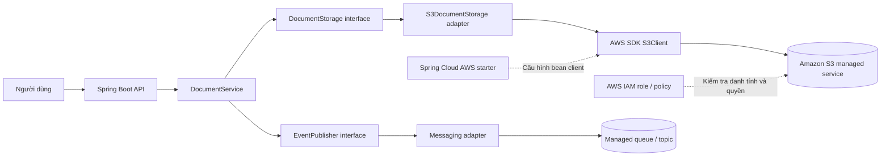
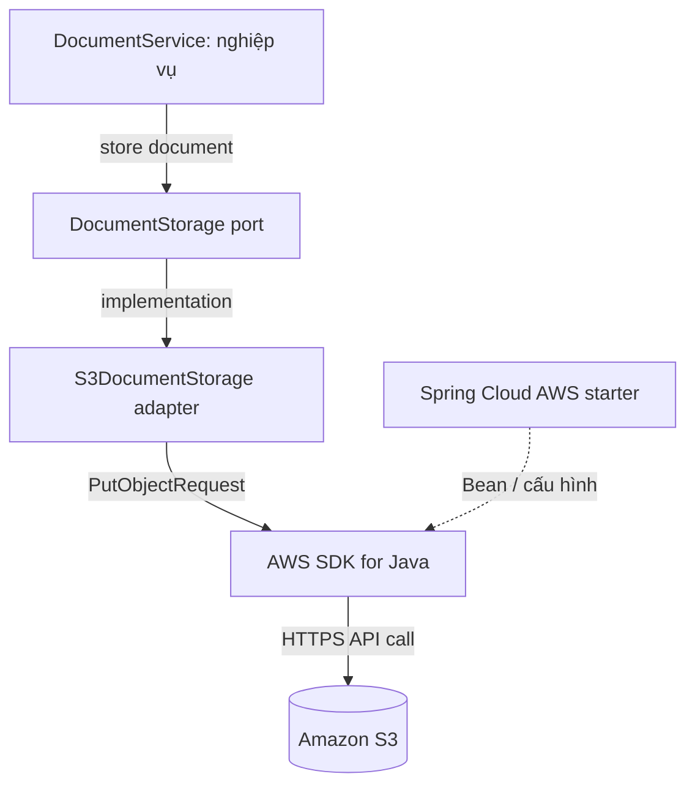
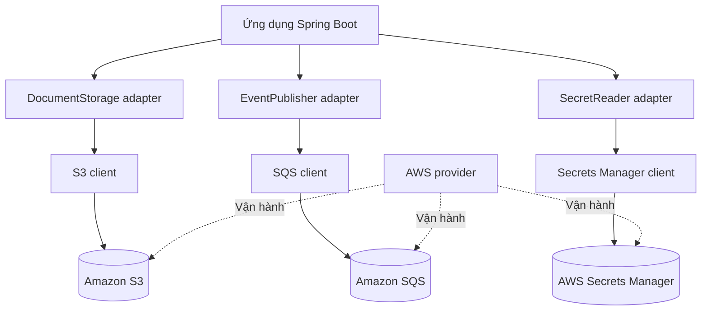

# Phân biệt nhà cung cấp, dịch vụ được quản lý, SDK, starter và adapter

> **Chương:** Định hướng  
> **Module:** `SPRING_CLOUD_PROVIDER_INTEGRATION`  
> **Phạm vi:** Spring Boot tích hợp các dịch vụ managed của AWS, Azure và Google Cloud qua Spring Cloud và các thư viện Java liên quan; từ danh tính, quyền truy cập đến storage, messaging, dữ liệu, secret và kiểm thử.

## 1. Mục tiêu bài học

Khi gặp câu “Ứng dụng Spring Boot dùng Spring Cloud để lưu tệp lên AWS”, có ít nhất **năm khái niệm khác nhau** bị gộp vào cùng một câu:

1. **Nhà cung cấp cloud (cloud provider):** AWS là tổ chức/nền tảng cung cấp năng lực điện toán và dịch vụ.
2. **Dịch vụ được quản lý (managed service):** Amazon S3 là dịch vụ cụ thể dùng để lưu object.
3. **SDK (Software Development Kit):** AWS SDK for Java cung cấp các API Java để gọi S3.
4. **Starter tích hợp Spring:** Spring Cloud AWS starter kết nối client/thành phần SDK vào cơ chế cấu hình và dependency injection của Spring Boot.
5. **Adapter của ứng dụng:** lớp do nhóm phát triển viết, sử dụng client hoặc template để thực hiện hợp đồng nghiệp vụ như `DocumentStorage.save(...)`.

Các khái niệm này **không đồng nghĩa** và cũng không cùng một loại đối tượng. Nhà cung cấp và dịch vụ là những thành phần bên ngoài ứng dụng; SDK và starter là thư viện trong ứng dụng; adapter là mã thực thi quy tắc kết nối mà chính ứng dụng sở hữu.

Đến cuối bài, người học cần trả lời được: “Đoạn mã nào thuộc nghiệp vụ, thư viện nào hỗ trợ lập trình, tài nguyên nào tồn tại trên cloud, danh tính nào được cấp quyền, và nếu thay provider thì phần nào phải sửa?”

## 2. Bức tranh tổng thể trong một ví dụ

Giả sử xây dịch vụ Spring Boot cho phép người dùng tải hợp đồng PDF lên, lưu trữ an toàn và gửi sự kiện để một worker tạo bản xem trước.



Trong sơ đồ này:

- **AWS** là provider, sở hữu hệ sinh thái tài khoản, hạ tầng và API.
- **Amazon S3** là managed service thực sự lưu dữ liệu.
- **`S3Client`** là client trong AWS SDK for Java, gọi API S3.
- **Spring Cloud AWS starter** có thể cấu hình `S3Client` trong Spring context và hỗ trợ thêm các tích hợp thích hợp.
- **`S3DocumentStorage`** là adapter do nhóm phát triển viết để chuyển yêu cầu “lưu tài liệu” thành thao tác S3.
- **`DocumentService`** là mã nghiệp vụ, không cần biết HTTP request đến S3 được xây như thế nào.
- **IAM role/policy** quyết định workload có được phép ghi object hay không. Starter không tự tạo hay cấp quyền IAM chỉ vì được thêm vào dự án.

Hướng đi của lời gọi ở runtime thường là: **nghiệp vụ → interface của ứng dụng → adapter → SDK/client → API dịch vụ managed**. Starter chủ yếu tham gia ở giai đoạn khai báo dependency, tạo/cấu hình bean và cung cấp khả năng tích hợp với vòng đời Spring.

## 3. Nhà cung cấp cloud (provider): ai cung cấp nền tảng?

**Cloud provider** là tổ chức vận hành nền tảng điện toán và cung cấp danh mục dịch vụ mà khách hàng sử dụng thông qua console, API và các cơ chế quản trị.

| Nhà cung cấp | Cách tổ chức tài nguyên điển hình | Danh tính/quyền thường gặp | Ví dụ dịch vụ |
| --- | --- | --- | --- |
| **Amazon Web Services (AWS)** | AWS account, region, tài nguyên và policy | AWS IAM user/role, policy, cơ chế danh tính workload | S3, SQS, SNS, RDS, Secrets Manager |
| **Microsoft Azure** | Tenant, subscription, resource group, resource | Microsoft Entra ID, Azure RBAC, Managed Identity | Blob Storage, Service Bus, Azure Database for PostgreSQL, Key Vault |
| **Google Cloud** | Organization/folder/project, location, tài nguyên | IAM role, service account, Workload Identity | Cloud Storage, Pub/Sub, Cloud SQL, Secret Manager |

“Chọn AWS” mới là chọn **nền tảng**, chưa xác định ứng dụng sẽ dùng dịch vụ gì, mức cam kết vận hành ra sao, API cần gọi thế nào hay quyền được cấp cho workload nào.

Những thông tin như account/subscription/project và region/location còn ảnh hưởng trực tiếp đến endpoint, phạm vi quyền, kết nối mạng, residency của dữ liệu, độ trễ và giá thành.

### Provider không phải một API thống nhất

Hai dịch vụ cùng nằm trong một provider không nhất thiết dùng chung endpoint, dữ liệu đầu vào hay chính sách quyền chi tiết. Ví dụ, việc ghi object lên S3 và gửi message qua SQS là **hai API, hai loại tài nguyên và hai tập quyền khác nhau**, dù cùng dùng cơ chế danh tính AWS.

Tương tự, “ứng dụng đã đăng nhập Azure” không có nghĩa nó tự được quyền ghi Blob Storage hay gửi message vào Service Bus; từng tài nguyên cần quyền tương ứng.

## 4. Dịch vụ được quản lý (managed service): sản phẩm nào giải quyết vấn đề?

**Managed service** là dịch vụ cloud mà nhà cung cấp đảm nhận một phần công việc cung cấp, bảo trì và vận hành hệ thống nền theo phạm vi cụ thể. Ứng dụng vẫn cần tạo/configure tài nguyên, chọn mô hình sử dụng, quản lý dữ liệu và quyền truy cập.

Một số nhu cầu thường gặp trong module:

| Bài toán | AWS | Azure | Google Cloud | Ứng dụng còn phải chịu trách nhiệm |
| --- | --- | --- | --- | --- |
| Lưu file và object | Amazon S3 | Azure Blob Storage | Cloud Storage | Đặt key, giới hạn truy cập, lifecycle, metadata, lỗi và chi phí |
| Xử lý tác vụ bất đồng bộ | Amazon SQS | Azure Service Bus queues | Pub/Sub subscriptions | Thiết kế message, retry, idempotency, dead-letter |
| Phát sự kiện tới nhiều bên xử lý | Amazon SNS/EventBridge | Azure Service Bus topics/Event Grid | Pub/Sub topics | Routing, delivery semantics, schema và consumer |
| Database quan hệ managed | RDS/Aurora | Azure Database for PostgreSQL | Cloud SQL | Schema, query, transaction, pool, quyền dữ liệu |
| Lưu secret | Secrets Manager/Parameter Store | Key Vault | Secret Manager | Ai được đọc secret, rotation, cách dùng không lộ bí mật |
| Quan sát vận hành | CloudWatch | Azure Monitor | Cloud Monitoring/Logging | Metric cần có, dashboard, alert và kiểm soát log |

**Managed** không đồng nghĩa “mọi thứ đã được bảo đảm tự động”:

- Dịch vụ có thể từ chối request vì sai quyền, sai tên tài nguyên hoặc sai region.
- Tác vụ lưu dữ liệu/gửi thông điệp có thể gặp timeout, throttling hoặc lỗi dịch vụ.
- Ứng dụng vẫn phải kiểm soát dữ liệu nhạy cảm, backup/retention phù hợp và chi phí.
- Bảo đảm giao message, thứ tự xử lý và tính nhất quán phụ thuộc vào **dịch vụ cụ thể và cấu hình**, không thể suy từ nhãn “managed”.

### Cùng chức năng, không hẳn cùng mô hình

Ví dụ **S3**, **Blob Storage** và **Cloud Storage** đều phù hợp để lưu file/object, nhưng khác nhau về tài nguyên, credential, ACL/RBAC, API upload, signed URL và một số chính sách vòng đời.

Tương tự, **SQS queue**, **Service Bus queue/topic** và **Pub/Sub topic/subscription** không thể coi là một loại queue có tên khác nhau. Để thiết kế worker, phải hiểu ack/settlement, retry, dead-letter, retention, ordering và cơ chế giao lại.

## 5. SDK: lập trình viên gọi dịch vụ managed bằng gì?

**SDK** là tập thư viện và công cụ lập trình để tương tác với API của một nền tảng. Trong dự án Java, SDK thường cung cấp:

- Client và request/response types cho từng dịch vụ.
- Cơ chế tìm, nạp hoặc làm mới credentials/token phù hợp.
- Gọi HTTP/gRPC, ký request nếu cần, serialization/deserialization.
- Cấu hình endpoint, region, timeout, retry, proxy và một số hỗ trợ quan sát.
- Exception và mã lỗi giúp ứng dụng phân loại thất bại.

Ví dụ client Java cho object storage:

| Provider | SDK/client tiêu biểu | Các đối tượng làm việc |
| --- | --- | --- |
| AWS S3 | **AWS SDK for Java v2**, `S3Client` | Bucket, object key, `PutObjectRequest` |
| Azure Blob Storage | **Azure Storage Blob SDK for Java**, `BlobServiceClient`/`BlobContainerClient` | Storage account, container, blob |
| Google Cloud Storage | **Google Cloud Java client libraries**, `Storage` | Project, bucket, blob/object |

Khi gọi trực tiếp SDK, ứng dụng đã có thể tích hợp cloud **mà không bắt buộc có Spring Cloud starter**. Ví dụ minh họa với AWS SDK for Java v2:

```java
import software.amazon.awssdk.core.sync.RequestBody;
import software.amazon.awssdk.services.s3.S3Client;
import software.amazon.awssdk.services.s3.model.PutObjectRequest;

S3Client s3 = S3Client.create();

PutObjectRequest request = PutObjectRequest.builder()
    .bucket("example-documents")
    .key("contracts/contract-123.pdf")
    .contentType("application/pdf")
    .build();

s3.putObject(request, RequestBody.fromBytes(pdfBytes));
```

Đây là **mã minh họa lõi thao tác**: `pdfBytes` phải được cung cấp, bucket phải tồn tại, credential/region phải hợp lệ và workload cần quyền ghi. Trong ứng dụng thực tế, nên cấu hình và quản lý vòng đời client có chủ đích, không tạo client mới cho từng HTTP request. SDK client đồng bộ thường là tài nguyên có thể tái sử dụng; đóng client khi ứng dụng dừng.

### SDK có thay nghiệp vụ và IAM không?

Không. SDK biết cách **yêu cầu** “put object” lên một bucket. Nó không biết người dùng này có được phép tải hợp đồng nào, object key nào là hợp lệ, metadata cần lưu ở database ra sao, hoặc khi nào gửi sự kiện.

SDK cũng không “tạo ra quyền”: nó trình credential của workload; dịch vụ cloud kiểm tra IAM/RBAC và các policy liên quan trước khi cho phép thao tác.

## 6. Starter: cách đưa tích hợp vào vòng đời Spring Boot

Trong hệ sinh thái Spring Boot, **starter** thường là dependency gom các thư viện cần thiết và kích hoạt/cung cấp cơ chế **auto-configuration** theo điều kiện. Với cloud integration, nó có thể giúp:

- Kéo đúng nhóm dependency Spring và SDK được hỗ trợ.
- Tạo/configure bean client, template, listener hoặc helper nếu điều kiện phù hợp.
- Ánh xạ thuộc tính cấu hình của Spring vào client.
- Tích hợp một phần cơ chế observability/lifecycle phù hợp với từng dự án.
- Giảm mã `@Configuration` lặp lại khi dùng dịch vụ managed phổ biến.

Ví dụ Maven artifact thuộc ba họ tích hợp:

```xml
<!-- Ví dụ AWS: S3 -->
<dependency>
    <groupId>io.awspring.cloud</groupId>
    <artifactId>spring-cloud-aws-starter-s3</artifactId>
</dependency>

<!-- Ví dụ Azure: Blob Storage -->
<dependency>
    <groupId>com.azure.spring</groupId>
    <artifactId>spring-cloud-azure-starter-storage-blob</artifactId>
</dependency>

<!-- Ví dụ GCP: Cloud Storage -->
<dependency>
    <groupId>com.google.cloud</groupId>
    <artifactId>spring-cloud-gcp-starter-storage</artifactId>
</dependency>
```

Đây là **ba phương án độc lập** để minh họa cách chọn starter, không phải yêu cầu đưa cả ba vào cùng một `pom.xml`. Phiên bản Spring Boot/JDK và BOM tương thích phải được chọn theo tài liệu của dự án Spring Cloud AWS/Azure/GCP tương ứng. Tên class/property/đường cấu hình và API hỗ trợ thay đổi theo phiên bản.

### Starter khác SDK như thế nào?

| Tiêu chí | SDK | Spring Boot/Spring Cloud starter |
| --- | --- | --- |
| Mục tiêu | Tạo lời gọi trực tiếp tới API của dịch vụ | Đưa client/công cụ tích hợp vào quy ước Spring Boot |
| Cần Spring Boot? | Không nhất thiết | Thông thường có |
| Cung cấp API request/response theo dịch vụ? | Có | Có thể tái sử dụng SDK và thêm API tiện ích |
| Tự tạo `@Bean` theo cấu hình? | Không phải trọng tâm | Có thể có auto-configuration |
| Xử lý luồng nghiệp vụ “lưu hợp đồng”? | Không | Không |
| Cấp quyền IAM/RBAC và tạo bucket/queue? | Không tự động | Không tự động |
| Có thể dùng độc lập? | Có | Phụ thuộc Spring, SDK và cấu hình tương ứng |

Một dự án có thể chọn SDK trực tiếp nếu cần tính năng mới hoặc API hiếm chưa được starter hỗ trợ. Ngược lại, khi starter được duy trì tốt và đủ chức năng, sử dụng starter giúp giảm cấu hình lặp và đặt code theo phong cách Spring.

> **BOM không phải starter:** Bill of Materials dùng để quản lý bộ phiên bản dependency. BOM không tự tạo client, không kết nối cloud, không cấp quyền và không triển khai tài nguyên.

## 7. Adapter: mã của ứng dụng nối nghiệp vụ với dịch vụ

**Adapter** trong ngữ cảnh kiến trúc ứng dụng là thành phần **do nhóm phát triển triển khai** để biến lời gọi của nghiệp vụ thành lời gọi thích hợp với một hệ thống bên ngoài. Một adapter thường implement một interface/port do ứng dụng định nghĩa.

Ví dụ, nghiệp vụ muốn **“lưu tài liệu và nhận về object key”**, còn S3 SDK yêu cầu bucket, key, content type và body. Adapter nối hai hợp đồng ấy.



Lớp adapter là nơi phù hợp để:

- Chọn tên tài nguyên từ cấu hình, chuyển đổi dữ liệu theo định dạng SDK.
- Ánh xạ lỗi kỹ thuật sang loại lỗi mà ứng dụng hiểu được.
- Áp dụng timeout/retry thích hợp cho loại thao tác và trạng thái nghiệp vụ.
- Ghi log/metric về thao tác mà không để lộ secret hoặc nội dung nhạy cảm.
- Tách code nghiệp vụ khỏi kiểu SDK và cho phép unit test bằng fake port.

**Lưu ý về từ “adapter”:** Trong Spring còn có các class framework mang chữ *Adapter*, và trong Spring Integration có channel adapter. Bài này dùng từ “adapter” theo nghĩa kiến trúc **port-and-adapter / hexagonal architecture**. Tên gọi có thể khác (`Gateway`, `Repository implementation`, `CloudClientFacade`), nhưng trách nhiệm kết nối vẫn như nhau.

### Adapter có giống starter không?

Không. **Starter là một dependency được thêm vào build** để cung cấp cơ chế tích hợp. **Adapter là mã do ứng dụng sở hữu**, gọi SDK hoặc template phù hợp với nghiệp vụ. Adapter có thể sử dụng SDK trực tiếp, SDK được starter cấu hình, hoặc một abstraction như `S3Template` nếu thư viện và phiên bản dự án hỗ trợ.

## 8. Ví dụ hoàn chỉnh: lưu tài liệu với port + AWS adapter

Ví dụ này giả định ứng dụng dùng Spring Boot, Spring Cloud AWS và Amazon S3. Mục đích là nhìn thấy ranh giới giữa **năm khái niệm**, không nhằm xây dựng hệ thống upload production đầy đủ.

### Bước 1: hợp đồng nghiệp vụ không nhắc tới AWS

```java
public interface DocumentStorage {
    void save(String objectKey, byte[] content, String contentType);
}
```

`DocumentStorage` diễn tả khả năng mà ứng dụng cần. Nó không import bất kỳ kiểu `software.amazon.*`, `com.azure.*` hay `com.google.cloud.*` nào.

Service nghiệp vụ sử dụng interface:

```java
import java.util.UUID;
import org.springframework.stereotype.Service;

@Service
public class DocumentService {
    private final DocumentStorage storage;

    public DocumentService(DocumentStorage storage) {
        this.storage = storage;
    }

    public String storePdf(byte[] pdfBytes) {
        String key = "documents/" + UUID.randomUUID() + ".pdf";
        storage.save(key, pdfBytes, "application/pdf");
        return key;
    }
}
```

Ở ví dụ này, method giả định `pdfBytes` đã được xác thực và kiểm tra kích thước/loại nội dung ở lớp phù hợp. Dữ liệu thật cần thêm ownership, authorization, metadata và giới hạn bộ nhớ; không nên tin chỉ vào phần mở rộng `.pdf` hay header do client tự khai báo.

### Bước 2: adapter sử dụng client SDK

Giả sử có dependency `spring-cloud-aws-starter-s3` tương thích với Spring Boot, cấu hình client hợp lệ và auto-configuration cung cấp `S3Client`:

```java
import org.springframework.beans.factory.annotation.Value;
import org.springframework.stereotype.Component;
import software.amazon.awssdk.core.sync.RequestBody;
import software.amazon.awssdk.services.s3.S3Client;
import software.amazon.awssdk.services.s3.model.PutObjectRequest;

@Component
public class S3DocumentStorage implements DocumentStorage {
    private final S3Client s3Client;
    private final String bucket;

    public S3DocumentStorage(
            S3Client s3Client,
            @Value("${app.documents.bucket}") String bucket) {
        this.s3Client = s3Client;
        this.bucket = bucket;
    }

    @Override
    public void save(String objectKey, byte[] content, String contentType) {
        PutObjectRequest request = PutObjectRequest.builder()
                .bucket(bucket)
                .key(objectKey)
                .contentType(contentType)
                .build();

        s3Client.putObject(request, RequestBody.fromBytes(content));
    }
}
```

Trong đoạn này:

- `S3DocumentStorage` là **adapter của ứng dụng**.
- `S3Client`, `PutObjectRequest` và `RequestBody` là API của **SDK**.
- `spring-cloud-aws-starter-s3` là **starter** giúp đăng ký/cấu hình client với Spring.
- `Amazon S3` là **managed service** thực hiện lệnh lưu.
- `AWS` là **provider** vận hành S3 và kiểm tra danh tính/quyền.

### Bước 3: cấu hình tài nguyên và danh tính

Ví dụ `application.yml`:

```yaml
app:
  documents:
    bucket: ${DOCUMENTS_BUCKET}
spring:
  cloud:
    aws:
      region:
        static: ${AWS_REGION:ap-southeast-1}
```

`app.documents.bucket` là property do **ứng dụng tự định nghĩa** và đọc bằng `@Value`. Property `spring.cloud.aws.region.static` thuộc cơ chế cấu hình của Spring Cloud AWS theo dòng phiên bản phù hợp. Region được chọn phải đúng với tài nguyên và môi trường, không được mặc định sử dụng giá trị ví dụ khi triển khai thực tế.

**Credentials không nằm trong code trên**. SDK/starter lấy credential theo chuỗi nguồn được hỗ trợ ở môi trường chạy, ví dụ local developer profile/SSO hoặc IAM role gắn với workload trên AWS. Danh tính thực tế phải được phép thực hiện thao tác tương ứng trên bucket/key. Tránh nhúng access key vào Git hay bản build.

### Bước 4: vì sao không đưa `S3Client` vào nghiệp vụ?

Nếu `DocumentService` inject trực tiếp `S3Client`, service sẽ phải biết `bucket`, `PutObjectRequest` và cách xử lý `S3Exception`. Khi chuyển sang Azure Blob Storage, code nghiệp vụ cũng phải đổi sang `BlobClient`/`BlobContainerClient` và loại exception khác.

Khi dùng port, service vẫn gọi `storage.save(...)`. Ta thay bằng implementation `AzureBlobDocumentStorage` hoặc `GcsDocumentStorage` đáp ứng đúng hợp đồng đã cam kết. **Chỉ adapter thay đổi** là mục tiêu thiết kế, nhưng không phải bảo đảm tuyệt đối: nếu nghiệp vụ phụ thuộc các tính năng khác nhau (presigned URL, object versioning, retention, metadata...), phải xem lại hợp đồng và kiểm thử để phản ánh giới hạn thực tế.

### Giới hạn của ví dụ

Ví dụ sử dụng `byte[]` để ngắn gọn. Khi xử lý file lớn, cần streaming/multipart upload hoặc cơ chế tải trực tiếp phù hợp, tránh giữ toàn bộ file trong bộ nhớ. Cần thêm xác thực người dùng, phân quyền ở lớp ứng dụng, validation, kiểm tra nội dung/tệp độc hại theo yêu cầu, mã hóa, chính sách lưu giữ, giới hạn kích thước, xử lý timeout và quan sát. Không nên xem một lệnh `putObject` thành công là đủ để kết luận tích hợp đã sẵn sàng production.

## 9. Thay provider: yếu tố nào thay, yếu tố nào giữ?

Giả sử công ty chuyển việc lưu PDF từ AWS sang Azure hoặc Google Cloud.

| Lớp/thành phần | AWS | Azure | Google Cloud | Khả năng giữ nguyên |
| --- | --- | --- | --- | --- |
| Provider | AWS | Microsoft Azure | Google Cloud | Không |
| Managed service | S3 | Blob Storage | Cloud Storage | Không |
| Cloud resource | Bucket | Storage account + container | Bucket thuộc project | Không |
| SDK/client | `S3Client` | `BlobServiceClient`/`BlobContainerClient` | `Storage` | Không |
| Starter (nếu dùng) | Spring Cloud AWS S3 | Spring Cloud Azure Blob | Spring Cloud GCP Storage | Không |
| Adapter | `S3DocumentStorage` | `AzureBlobDocumentStorage` | `GcsDocumentStorage` | Phải triển khai/kiểm thử riêng |
| Port của ứng dụng | `DocumentStorage` | `DocumentStorage` | `DocumentStorage` | **Có thể**, nếu hợp đồng đủ chung |
| Service nghiệp vụ | `DocumentService` | `DocumentService` | `DocumentService` | **Có thể**, nếu không phụ thuộc chi tiết dịch vụ |
| Cloud identity/policy | IAM role + policy | Managed Identity + Azure RBAC | Service account/Workload Identity + IAM | Không |
| Bộ integration test | Kiểm thử S3 | Kiểm thử Blob | Kiểm thử Cloud Storage | Có thể dùng chung test contract, cần bổ sung test riêng |

Tư duy phù hợp là **giữ ổn định yêu cầu ứng dụng**, không giả định provider tương đương hoàn toàn. Chẳng hạn:

- Một port yêu cầu `save(key, bytes, type)` có thể triển khai tương đối thống nhất.
- Một port yêu cầu “phát URL đọc file một lần, tồn tại đúng 30 giây, hỗ trợ một kiểu quyền rất riêng” có thể khó ánh xạ chính xác trên nhiều provider.
- Một port messaging yêu cầu ordering tuyệt đối trên toàn bộ luồng có thể không tương thích với đặc tính của dịch vụ đích.

Tính di động giữa các cloud là **một mục tiêu thiết kế có chi phí**, không phải tính năng tự động của Spring Cloud.

## 10. Trường hợp messaging: sự phân biệt càng quan trọng

Lấy bài toán “sau khi upload xong PDF, phát sự kiện để worker tạo bản xem trước”.

| Mục cần phân biệt | AWS | Azure | Google Cloud |
| --- | --- | --- | --- |
| Provider | AWS | Azure | Google Cloud |
| Managed messaging service | Amazon SQS | Azure Service Bus | Pub/Sub |
| Đối tượng nhận/gửi | Queue | Queue hoặc topic/subscription | Topic và subscription |
| SDK/client Java | AWS SDK SQS client | Azure Service Bus Java SDK | Google Cloud Pub/Sub client libraries |
| Spring integration thường gặp | Spring Cloud AWS SQS | Spring Cloud Azure Service Bus | Spring Cloud GCP Pub/Sub |
| Adapter ứng dụng | `SqsEventPublisher` | `ServiceBusEventPublisher` | `PubSubEventPublisher` |
| Port nghiệp vụ | `DocumentEventPublisher` | `DocumentEventPublisher` | `DocumentEventPublisher` |

Không nên gọi các managed service này “cùng một queue” rồi bỏ qua khác biệt. Hệ thống cần trả lời:

- Khi publish thành công, dữ liệu đã được broker nhận theo cam kết nào?
- Khi consumer lỗi, message có thể được giao lại không? Hết thời gian lock/ack deadline thì sao?
- Có bảo đảm thứ tự không, và theo phạm vi nào?
- Retry được cấu hình ở client, worker hay dịch vụ? Message độc hại sẽ đi đâu?
- Nếu cùng một sự kiện được xử lý hai lần, nghiệp vụ có an toàn không?
- Nếu đã ghi database nhưng publish thất bại, hệ thống phục hồi sự kiện bằng cách nào?

**Port chung** giúp ẩn cách gọi thư viện, nhưng **không được che giấu các bảo đảm xử lý mà nghiệp vụ cần**. Khi cần bảo đảm phát sự kiện gắn với giao dịch database, cân nhắc transactional outbox và consumer idempotent.

## 11. Một provider có thể cung cấp nhiều managed service; một adapter có thể dùng nhiều SDK

Quan hệ giữa năm khái niệm thường là **nhiều-nhiều**, không phải mỗi provider chỉ có một service và mỗi ứng dụng chỉ có một adapter.



Một module Spring Boot có thể chỉ dùng S3, hoặc dùng cả S3 + SQS + Secrets Manager với các starter/client khác nhau. Mỗi adapter nên thực hiện một nhóm trách nhiệm dễ kiểm thử; adapter không nhất thiết tương ứng 1:1 với package SDK nếu nghiệp vụ cần phối hợp nhiều lời gọi.

Tương tự, một doanh nghiệp có thể chạy ứng dụng trên Azure nhưng lưu tài liệu ở một provider khác, nếu kết nối mạng, danh tính và chính sách cho phép. **Nơi ứng dụng chạy**, **nơi dữ liệu được lưu** và **provider của SDK** là những quyết định riêng cần xác định rõ.

## 12. Danh tính, quyền và secret nằm ở đâu trong mô hình?

Có ba câu hỏi phân biệt:

1. **Ai thực hiện lời gọi?** Workload identity: AWS IAM role, Azure Managed Identity hoặc Google service account/Workload Identity phù hợp với môi trường.
2. **Được thực hiện hành động nào?** IAM policy, Azure RBAC/data role, Google Cloud IAM role và các kiểm soát theo tài nguyên khác.
3. **Ứng dụng lấy thông tin nhạy cảm từ đâu?** Secret manager, credential provider/identity mechanism và cấu hình bảo mật được phê duyệt.

| Ranh giới | Thành phần xử lý | Ví dụ |
| --- | --- | --- |
| Người dùng → Spring Boot | Spring Security và logic phân quyền nghiệp vụ | Người dùng A không đọc hợp đồng của người B |
| Spring Boot → SDK | Starter/client + credential provider | Client lấy token/credential của workload |
| SDK → managed service | API service và cơ chế IAM/RBAC | Workload chỉ được ghi vào bucket chỉ định |
| Ứng dụng → secret store | Identity, quyền đọc secret và SDK/starter tương ứng | Chỉ worker cần API token mới được đọc nó |

Điều quan trọng: **starter không tự biến ứng dụng thành một identity có quyền admin**, và credential hợp lệ cũng không đồng nghĩa được quyền trên mọi tài nguyên. Cần nguyên tắc **least privilege**, tách dev/staging/prod và tránh lưu access key hoặc secret lâu dài trong mã nguồn.

Ví dụ, service tải hợp đồng lên storage cần quyền **ghi object** vào vùng dành cho tài liệu. Worker tạo bản xem trước có thể cần quyền **đọc object nguồn và ghi object kết quả**. API không nên được cấp quyền quản lý mọi secret chỉ vì nó dùng Spring Cloud starter.

## 13. Khi nào chọn SDK trực tiếp, starter hay adapter?

Đây không phải ba lựa chọn loại trừ nhau: **adapter có thể dùng SDK trực tiếp hoặc dùng client/template được starter cấu hình**.

| Tình huống | Lựa chọn nên cân nhắc | Lý do |
| --- | --- | --- |
| Một ứng dụng Java không dùng Spring | SDK trực tiếp | Không cần các cơ chế DI/auto-configuration của Spring Boot |
| Spring Boot dùng dịch vụ managed có starter được duy trì tốt | Starter + adapter mỏng | Tận dụng Spring context và cấu hình, giữ nghiệp vụ sạch |
| API cloud mới chưa được starter hỗ trợ đầy đủ | SDK trực tiếp bên trong adapter | Dùng được tính năng mới; kiểm soát version và client lifecycle |
| Cần nhiều provider và unit test không có kết nối cloud | Port + nhiều adapter | Giữ hợp đồng nghiệp vụ ổn định, mock/fake dễ hơn |
| Dự án nhỏ chỉ gọi cloud một lần | SDK/bean trong service tích hợp gọn | Tránh tạo quá nhiều lớp khi nhu cầu chưa có |
| Messaging cần abstraction binding và có binder hỗ trợ | Spring Cloud Stream nếu phù hợp | Tách một số chi tiết broker, nhưng vẫn phải hiểu delivery semantics |
| Database PostgreSQL managed | Spring Data JDBC/JPA + driver | Loại database không tự thay đổi vì nơi vận hành là cloud |

**Quy tắc chọn thư viện:** đọc tài liệu và ma trận tương thích của dự án Spring Cloud provider theo phiên bản Spring Boot/JDK thực tế; xác nhận starter hỗ trợ đúng dịch vụ/API; thử trên môi trường test. Không chọn chỉ vì tên artifact có chữ “cloud”.

## 14. Kiểm thử phải tương ứng với từng ranh giới

Mỗi lớp tạo ra một câu hỏi kiểm thử khác nhau:

| Ranh giới cần xác minh | Câu hỏi kiểm thử | Cách kiểm thử |
| --- | --- | --- |
| Nghiệp vụ → port | DocumentService tạo key hợp lệ, chỉ lưu khi được phép và không gửi sai metadata? | Unit test với fake/mock `DocumentStorage` |
| Adapter → SDK | Adapter đặt đúng bucket, key, content type và xử lý lỗi client? | Unit test adapter với mock client, hoặc test phù hợp với SDK |
| SDK/starter → endpoint | Client có được cấu hình đúng và gửi/nhận payload phù hợp? | Integration test với emulator khi có hỗ trợ |
| Workload → IAM → service thật | Role/identity có đúng quyền trên đúng resource? | Test trên account/project/subscription riêng của môi trường thử nghiệm |
| Toàn bộ luồng | Ghi DB rồi lưu tệp/gửi event có phục hồi được khi lỗi giữa chừng? | Integration/failure test với timeout, lỗi quyền và duplicate |
| Vận hành | Độ trễ, retry, backlog, API quota, chi phí có được quan sát? | Metrics/traces/logs và cảnh báo trên môi trường test/staging |

Ví dụ emulator: LocalStack có thể hỗ trợ một số API AWS; Azurite mô phỏng một số chức năng Azure Blob Storage; Google Cloud có Pub/Sub emulator cho messaging. **Emulator không chứng minh chính sách IAM hoặc toàn bộ hành vi cloud thật**, nên còn cần các test có kiểm soát trên dịch vụ thật.

Một fake `DocumentStorage` có thể lưu dữ liệu vào `Map` trong bộ nhớ để kiểm tra nghiệp vụ mà không cần SDK hoặc mạng. Đây chính là một lợi ích rõ ràng của việc tách **port** khỏi **adapter**.

### Ví dụ lỗi theo từng khái niệm

| Triệu chứng | Nơi cần kiểm tra trước | Vì sao? |
| --- | --- | --- |
| Không tìm thấy bean `S3Client` | Starter dependency, auto-configuration, điều kiện tạo bean | Chưa tạo được client để inject vào adapter |
| `NoSuchBucket` hoặc resource not found | Managed service resource, tên và region/project | SDK gọi đúng nhưng tài nguyên không tồn tại hoặc tham chiếu sai |
| `AccessDenied` / permission denied | Workload identity, IAM/RBAC, policy và resource | Tài khoản/danh tính có thể thiếu quyền cụ thể |
| Payload gửi đi sai định dạng | Adapter, serializer, SDK/client converter | API nhận dữ liệu không đúng hợp đồng |
| Bean ambiguity khi có hai storage adapter | Cấu hình DI, profile/conditional/qualifier | Spring không biết chọn implementation nào |
| Retry làm tạo dữ liệu lặp | Hợp đồng nghiệp vụ, idempotency và chiến lược retry | Lỗi là thuộc tính hệ thống, không chỉ của SDK |

Mã lỗi và tên exception chính xác thay đổi theo provider, SDK và ngữ cảnh; cần đọc thông tin lỗi cụ thể, giữ correlation ID trong log và tránh log credentials hay nội dung tài liệu nhạy cảm.

## 15. Các nhầm lẫn thường gặp

**“AWS chính là S3.”** Không. AWS là provider; S3 là một dịch vụ thuộc AWS.

**“S3 là thư viện Java.”** Không. S3 là managed service. `S3Client` và các request type là phần SDK mà ứng dụng dùng để gọi dịch vụ.

**“Đã thêm starter tức là đã tích hợp xong.”** Chưa. Starter giúp tạo/cấu hình client và tiện ích Spring; vẫn cần tài nguyên cloud, danh tính/quyền, adapter hoặc logic sử dụng, xử lý lỗi và test.

**“SDK và starter là hai cách khác tên để làm cùng việc.”** Không hoàn toàn. SDK là client/API nền; starter hỗ trợ cách cấu hình và sử dụng client trong Spring. Nhiều starter sử dụng chính SDK bên dưới.

**“Adapter phải do Spring Cloud cung cấp.”** Không. Adapter có thể là class do ứng dụng tự viết. Spring Cloud có thể cung cấp template/adapter framework, nhưng port nghiệp vụ và ranh giới của ứng dụng vẫn do nhóm phát triển thiết kế.

**“Tạo interface chung là đổi AWS sang GCP được ngay.”** Không. Interface chỉ giữ một hợp đồng ở mức ứng dụng. Adapter, identity, resource model, semantics, test và chi phí vẫn cần đánh giá lại.

**“IAM giải quyết luôn phân quyền người dùng cuối.”** Không. IAM quyết định workload được gọi API cloud nào; Spring Security và nghiệp vụ quyết định ai trong hệ thống được xem/sửa tài liệu.

**“Managed nghĩa là không cần vận hành.”** Không. Đội ứng dụng vẫn quản lý cấu hình, bảo mật, dữ liệu, giám sát, giới hạn và kế hoạch khôi phục.

## 16. Bài tập thực hành phân biệt năm khái niệm

**Bối cảnh:** Một ứng dụng quản lý hồ sơ Spring Boot chạy ở môi trường doanh nghiệp. Người dùng tải PDF, dữ liệu lưu ở object storage, hệ thống phát event để worker xử lý bản xem trước. Đội ngũ muốn có phương án trên AWS, Azure và Google Cloud.

### Bài 1: Điền đúng vai trò

Hãy phân loại từng mục vào **provider**, **managed service**, **SDK**, **starter** hoặc **adapter của ứng dụng**:

- Microsoft Azure
- Google Cloud Pub/Sub
- AWS SDK for Java `S3Client`
- `spring-cloud-aws-starter-s3`
- `AzureBlobDocumentStorage` do nhóm phát triển viết
- Amazon SQS
- `com.google.cloud.storage.Storage`
- Spring Cloud GCP Storage starter
- Google Cloud
- `SqsEventPublisher` do ứng dụng triển khai

**Tự kiểm tra:** thành phần nào cần được triển khai/cấp quyền trên cloud? Thành phần nào chỉ là dependency Java? Thành phần nào là mã riêng của sản phẩm?

### Bài 2: Vẽ ranh giới kiến trúc

Vẽ luồng từ `UploadController` đến `DocumentService`, `DocumentStorage`, adapter, SDK và storage service. Đánh dấu vị trí tạo client, vị trí áp dụng IAM, nơi kiểm tra quyền người dùng cuối và nơi đọc bucket/container từ cấu hình.

### Bài 3: So sánh ba phương án

Với mỗi phương án dưới đây, xác định tên managed service, client Java, starter Spring tương ứng nếu có, danh tính workload và ít nhất **hai khác biệt cần kiểm thử**:

1. AWS: Amazon S3 + Amazon SQS.
2. Azure: Blob Storage + Service Bus.
3. Google Cloud: Cloud Storage + Pub/Sub.

### Bài 4: Chọn chỗ cần sửa khi đổi cloud

Giả sử `DocumentService` chỉ gọi `DocumentStorage.save(key, bytes, type)`. Hãy liệt kê các thay đổi để chuyển từ S3 sang Azure Blob Storage: dependency, adapter, configuration, identity/role, resource và integration tests. Giải thích vì sao `DocumentService` có thể không đổi, nhưng vẫn cần test hành vi thực tế.

### Bài 5: Phân tích sự cố

Ứng dụng khởi động thành công, bean storage client tồn tại, nhưng thao tác ghi file bị trả về lỗi quyền. Hãy chỉ ra vì sao sửa interface `DocumentStorage` hoặc thêm một starter khác ít có khả năng giải quyết. Tập trung vào **danh tính thực tế đang chạy ứng dụng**, policy trên đúng tài nguyên và log của dịch vụ.

**Tiêu chí đạt:** phân biệt chính xác năm khái niệm; vẽ được quan hệ giữa chúng; chọn được SDK/starter/adapter cho một nhu cầu storage hoặc messaging; nêu được ranh giới IAM và phương án kiểm thử khi chuyển provider.

---

## Ghi nhớ

| Câu hỏi | Khái niệm |
| --- | --- |
| **Ai** vận hành nền tảng? | **Cloud provider**: AWS, Azure, Google Cloud |
| **Dịch vụ nào** thực hiện lưu trữ, messaging, dữ liệu hoặc secret? | **Managed service**: S3, Blob Storage, Pub/Sub, Cloud SQL... |
| **Thư viện nào** tạo và gửi request tới API dịch vụ? | **SDK/client**: `S3Client`, Azure Storage client, GCP `Storage`... |
| **Dependency nào** đưa khả năng tích hợp vào Spring Boot? | **Starter**: Spring Cloud AWS/Azure/GCP starter tương ứng |
| **Mã nào** chuyển hợp đồng của ứng dụng thành lời gọi cloud? | **Adapter**: class riêng implement port nghiệp vụ |

Năm khái niệm phối hợp với nhau nhưng có **trách nhiệm, vòng đời, cấu hình và rủi ro riêng**. Khi tích hợp Spring Boot với dịch vụ managed, hãy luôn xác định rõ provider, dịch vụ, SDK/starter, adapter, danh tính/quyền và hợp đồng cần kiểm thử. Đây là nền tảng để thiết kế được ứng dụng cloud có thể bảo trì và phát triển an toàn.
