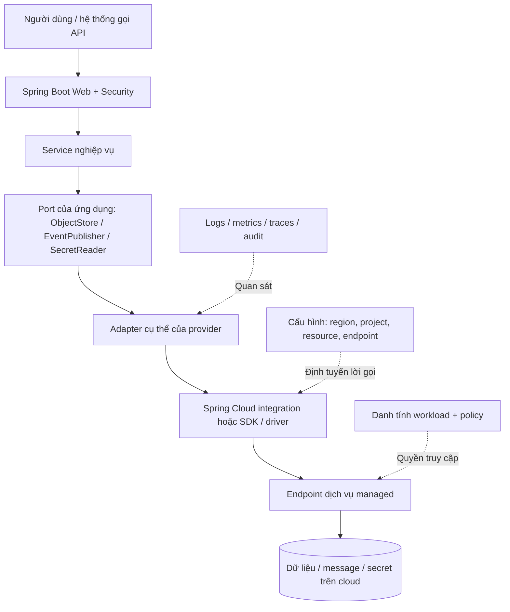
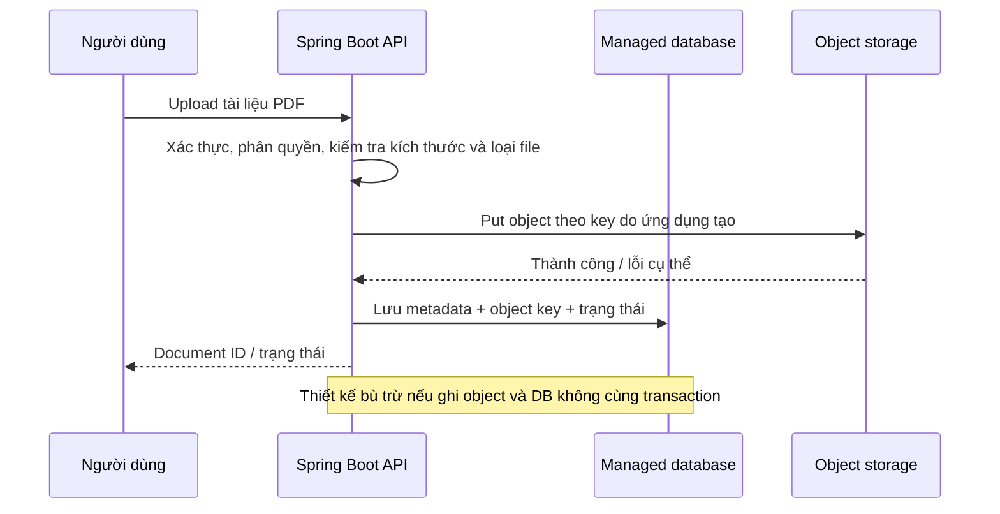
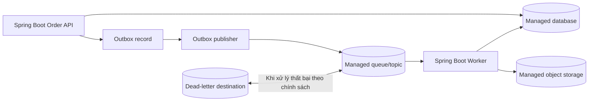

# Bản đồ AWS, Azure, Google Cloud, OCI và Alibaba Cloud

> **Chương:** Định hướng  
> **Module:** `SPRING_CLOUD_PROVIDER_INTEGRATION`  
> **Trọng tâm thực hành:** Tích hợp Spring Boot với các dịch vụ managed của AWS, Microsoft Azure và Google Cloud bằng Spring Cloud AWS, Spring Cloud Azure và Spring Cloud GCP. Oracle Cloud Infrastructure (OCI) và Alibaba Cloud được đưa vào bản đồ để mở rộng góc nhìn, đối chiếu khái niệm và hiểu giới hạn khi chuyển nhà cung cấp.

## 1. Mục tiêu: đọc được “bản đồ” thay vì học thuộc tên dịch vụ

Một yêu cầu nghiệp vụ như “lưu tài liệu PDF, phát sự kiện để xử lý nền và bảo vệ mật khẩu kết nối” có thể thực hiện trên nhiều nền tảng cloud. Tên sản phẩm, cách cấu hình, hệ danh tính và hành vi API lại khác nhau. Vì vậy, trước khi sử dụng starter hay SDK, người phát triển cần trả lời được:

1. **Provider nào** vận hành tài nguyên và **ranh giới quản trị** của tài nguyên ở đâu?
2. **Dịch vụ managed nào** đáp ứng đúng nhu cầu storage, messaging, dữ liệu hoặc secret?
3. **Spring Boot sẽ kết nối bằng gì**: thư viện Spring Cloud provider, SDK Java trực tiếp, driver chuẩn hay một integration adapter?
4. **Danh tính và quyền** nào được cấp cho ứng dụng khi chạy trên máy cá nhân, CI và cloud runtime?
5. **Những đặc tính nào cần kiểm chứng** trước khi thiết kế hệ thống: thứ tự message, retry, tính nhất quán, region, độ trễ, sao lưu, chi phí?

“Bản đồ” ở đây là **khung đối chiếu khả năng**, không phải bảng tuyên bố dịch vụ của năm provider hoàn toàn tương đương. Phần thực hành Spring Cloud của module ưu tiên **AWS, Azure, Google Cloud**; OCI và Alibaba Cloud giúp hiểu phần nào của kiến trúc có thể tái sử dụng và phần nào phải thay đổi khi làm việc với provider khác.

## 2. Nhìn tổng quan năm nhà cung cấp

| Nhà cung cấp | Tên đầy đủ | Đơn vị quản trị tài nguyên thường gặp | Phạm vi địa lý cần chú ý | Điểm bắt đầu cho ứng dụng Spring Boot |
| --- | --- | --- | --- | --- |
| **AWS** | Amazon Web Services | Account, tổ chức/account structure, IAM role/policy | Region, Availability Zone, đôi khi endpoint theo region | Spring Cloud AWS (AWSpring), AWS SDK for Java |
| **Azure** | Microsoft Azure | Microsoft Entra tenant, subscription, resource group, resource | Region, availability zone và phạm vi của từng dịch vụ | Spring Cloud Azure, Azure SDK for Java |
| **Google Cloud** | Google Cloud | Organization/folder, project, resource, IAM | Region/zone, multi-region hoặc location theo dịch vụ | Spring Cloud GCP, Google Cloud Java client libraries |
| **OCI** | Oracle Cloud Infrastructure | Tenancy, compartment, policy, tài nguyên | Region, availability domain/fault domain tùy region | OCI Java SDK và cấu hình client trong Spring Boot |
| **Alibaba Cloud** | Alibaba Cloud | Account, resource group, RAM identity/policy | Region và zone; endpoint của từng sản phẩm | Alibaba Cloud SDK cho dịch vụ tương ứng; các dự án Spring Cloud Alibaba khi đúng nhu cầu |

Không nên đánh đồng các cột:

- **AWS account** không có cùng mô hình tổ chức với **Azure subscription** hay **Google Cloud project**.
- **OCI compartment** là cấu trúc quan trọng để nhóm và cấp quyền tài nguyên trong tenancy; nó không chỉ là một thư mục hiển thị.
- **Alibaba Cloud RAM** quản lý định danh và quyền truy cập; **resource group** giúp tổ chức tài nguyên nhưng không thay thế hệ quyền.
- Mọi provider đều có khái niệm **vùng triển khai**, song API, khả năng sẵn có của sản phẩm, cách replication và giá phụ thuộc từng vùng.

### Hai quyết định dễ bị gộp nhầm

**Ứng dụng chạy ở đâu?** Ví dụ Spring Boot chạy trên máy cá nhân, máy ảo, Kubernetes hoặc dịch vụ container managed.

**Ứng dụng gọi dịch vụ của ai?** Ví dụ Spring Boot chạy trên Azure vẫn có thể dùng Amazon S3 nếu có mạng, identity và quyền phù hợp. Đây là lựa chọn tích hợp **cross-cloud**, thường kéo theo thêm yêu cầu về network, bảo mật, độ trễ, egress và vận hành.

Chọn nơi triển khai chưa mặc nhiên chọn nơi lưu dữ liệu hay hệ thống messaging. Mỗi quan hệ này phải được biểu diễn rõ trong kiến trúc.

## 3. Bản đồ theo các lớp: từ nghiệp vụ đến dịch vụ cloud



Trong sơ đồ:

- **Port** là interface do ứng dụng sở hữu, chẳng hạn `ObjectStore.put(...)`; nó diễn tả điều nghiệp vụ cần.
- **Adapter** là mã do ứng dụng viết để gọi dịch vụ bên ngoài; có thể sử dụng client đã được starter tạo hoặc khởi tạo SDK client một cách có kiểm soát.
- **Spring Cloud provider integration** thường hỗ trợ dependency, auto-configuration, bean, template hoặc listener khi dịch vụ/phiên bản có hỗ trợ.
- **SDK/driver** thực hiện giao tiếp theo API/giao thức của dịch vụ.
- **Managed service** xử lý lưu trữ hoặc messaging ở phía provider; **IAM/RBAC/policy** quyết định quyền của workload.

Lưu ý rằng Spring Cloud AWS, Spring Cloud Azure và Spring Cloud GCP là các họ tích hợp có phạm vi và chu kỳ phát hành riêng. Không có một starter Spring Cloud chung nào tự động ánh xạ đầy đủ mọi dịch vụ của **cả năm** provider.

## 4. Bản đồ object storage: nơi lưu file và object

Đối với ứng dụng Spring Boot cho phép tải ảnh, PDF hoặc file log đã xử lý, object storage thường phù hợp hơn lưu vĩnh viễn trên filesystem cục bộ của container.

| Provider | Dịch vụ | Đơn vị tài nguyên nổi bật | Tác vụ thường gặp |
| --- | --- | --- | --- |
| AWS | **Amazon S3** | Bucket, object key | Put/Get/Delete object; lifecycle, versioning, presigned URL |
| Azure | **Azure Blob Storage** | Storage account, container, blob | Upload/Download blob; lifecycle, SAS, versioning theo khả năng dịch vụ |
| Google Cloud | **Cloud Storage** | Bucket, object | Upload/Download object; signed URL, lifecycle, versioning |
| OCI | **Object Storage** | Namespace, bucket, object | Put/Get object; pre-authenticated request, lifecycle |
| Alibaba Cloud | **Object Storage Service (OSS)** | Bucket, object | Put/Get object; signed URL, lifecycle, versioning |

**Nhu cầu chung:** tệp vẫn tồn tại khi Spring Boot restart, scale từ một lên nhiều instance hoặc deploy container mới. Thông thường database ứng dụng lưu metadata như document ID, owner ID, object key, version/trạng thái và thời gian tạo; object storage chứa nội dung file.

**Không tương đương hoàn toàn:** signed URL/SAS/pre-authenticated request có cách ký, quyền hạn và vòng đời khác nhau; các tùy chọn khóa mã hóa, retention, replication, versioning, kiểm soát truy cập và giới hạn API cũng khác. Tên “bucket” ở S3, GCP, OCI và Alibaba Cloud không bảo đảm cùng API hoặc cùng mô hình IAM.

### Ví dụ luồng lưu tài liệu



Không thể coi việc ghi object và ghi database là một transaction ACID chung chỉ vì cả hai đều là dịch vụ managed. Cần xử lý trường hợp **đã upload file nhưng ghi metadata thất bại**, hoặc lưu metadata trước rồi upload thất bại. Lựa chọn thực tế gồm trạng thái trung gian, công việc dọn orphan object, outbox hoặc quy trình reconcile theo yêu cầu nghiệp vụ.

### SDK và integration tiếp cận storage như thế nào?

| Provider | Java client/SDK tiêu biểu | Kết nối với Spring Boot |
| --- | --- | --- |
| AWS | AWS SDK for Java v2 `S3Client` | Có thể dùng Spring Cloud AWS S3 starter cấu hình client |
| Azure | Azure Storage Blob SDK, ví dụ `BlobServiceClient`/`BlobContainerClient` | Có thể dùng Spring Cloud Azure Storage Blob starter |
| Google Cloud | Google Cloud Java client `Storage` | Có thể dùng Spring Cloud GCP Storage starter |
| OCI | OCI Java SDK cho Object Storage | Dùng SDK/client và Spring `@Configuration`/adapter theo dự án |
| Alibaba Cloud | OSS SDK/Alibaba Cloud SDK phù hợp với phiên bản dịch vụ | Dùng SDK/client và adapter; kiểm tra dự án tích hợp Spring cụ thể |

Đây là bản đồ ở mức **hướng tiếp cận**, không phải khẳng định mọi API, class, starter đều hỗ trợ cùng chức năng hoặc cùng phiên bản Java/Spring Boot. Khi làm bài thực hành, phải kiểm tra BOM và ma trận tương thích chính thức của thư viện được chọn.

## 5. Bản đồ messaging: queue, event và stream khác nhau ra sao?

Messaging là ví dụ điển hình cho việc **không nên đổi một tên dịch vụ này thành tên dịch vụ khác chỉ theo cột**.

| Nhu cầu | AWS | Azure | Google Cloud | OCI | Alibaba Cloud |
| --- | --- | --- | --- | --- | --- |
| **Hàng đợi tác vụ** | Amazon SQS | Azure Service Bus queues | Pub/Sub qua topic + subscription cho consumer xử lý bất đồng bộ | OCI Queue | Simple Message Queue (SMQ, từng được biết đến với tên MNS) |
| **Phân phối sự kiện / pub-sub** | Amazon SNS, EventBridge | Service Bus topics, Event Grid | Pub/Sub | OCI Notifications; OCI Events theo nhu cầu định tuyến | EventBridge, các sản phẩm ApsaraMQ theo mô hình cụ thể |
| **Luồng dữ liệu / streaming** | Amazon Kinesis Data Streams, Amazon MSK | Azure Event Hubs | Pub/Sub hoặc Managed Service for Apache Kafka tùy yêu cầu | OCI Streaming | ApsaraMQ for Kafka / RocketMQ tùy use case |

Danh mục và nhãn sản phẩm có thể được đổi tên hoặc mở rộng theo thời gian; khi triển khai hãy đối chiếu tài liệu hiện hành của từng provider. Những tên trong bảng nhằm **định hướng khả năng**, không hàm ý từng hàng dùng chung giao thức hay delivery semantics.

### Ba mô hình thường gặp

- **Queue xử lý việc:** worker nhận đơn vị công việc; thông điệp lỗi có thể được retry và chuyển sang dead-letter. Nhiều dịch vụ sử dụng ít nhất một lần giao nhận trong các trường hợp nhất định, nên worker cần idempotency.
- **Publish/subscribe:** publisher phát sự kiện; một hoặc nhiều consumer nhận qua subscription hoặc đích phân phối phù hợp. Số bản sao event và cách fan-out phụ thuộc sản phẩm/cấu hình.
- **Event stream:** sự kiện được ghi liên tục vào log/stream, có thể chú trọng partition, thứ tự theo phạm vi, offset và replay. Không tự coi nó giống queue truyền thống.

Ví dụ, Google Cloud Pub/Sub đưa thông điệp lên **topic** và consumer thường sử dụng **subscription**; Amazon SQS làm việc với **queue**. Không nên xây abstraction chung mà cam kết “exactly once” ở cấp nghiệp vụ nếu hệ thống chưa có cơ chế xử lý trùng và tính nhất quán riêng.

### Những câu hỏi cần đặt trước khi chọn messaging service

1. Một sự kiện cần **một worker** xử lý hay **nhiều nhóm consumer** độc lập?
2. Có cần thứ tự theo **toàn bộ hệ thống**, theo **partition key**, hoặc không yêu cầu thứ tự?
3. Khi consumer thất bại, broker **giao lại**, **khóa message**, **gia hạn acknowledgement** hay cho phép **replay** như thế nào?
4. Hệ thống cần dead-letter, backoff, giới hạn lần thử và chống message độc hại ra sao?
5. Có cần một giao dịch đảm bảo thay đổi database và phát sự kiện không? Nếu có, liệu **transactional outbox** có phù hợp?
6. Những API/message format nào có Spring Cloud integration hoặc SDK phù hợp với phiên bản Spring Boot hiện tại?

### Lược đồ minh họa một luồng bất đồng bộ



Đây là luồng mang tính ý tưởng; kiểu kết nối DLQ và cách chuyển message lỗi phụ thuộc provider. Outbox giúp đóng khoảng hở giữa **DB commit** và **publish event** bằng cách lưu sự kiện trong cùng transaction DB, rồi một publisher riêng gửi và đánh dấu trạng thái; consumer vẫn cần chịu được việc gửi lặp.

## 6. Bản đồ dữ liệu: relational, NoSQL và cache

“Managed database” mô tả **cách vận hành** chứ không mặc nhiên xác định mô hình dữ liệu. Spring Boot có thể truy cập database managed qua JDBC/JPA/R2DBC hoặc SDK riêng.

| Nhu cầu | AWS | Azure | Google Cloud | OCI | Alibaba Cloud |
| --- | --- | --- | --- | --- | --- |
| **Relational database managed** | Amazon RDS, Aurora | Azure Database for PostgreSQL, Azure SQL Database | Cloud SQL, AlloyDB | Autonomous Database; các dịch vụ database managed tương ứng | ApsaraDB RDS / PolarDB |
| **NoSQL hoặc document/key-value** | DynamoDB | Azure Cosmos DB | Firestore, Bigtable | OCI NoSQL Database | Tablestore / các sản phẩm dữ liệu phù hợp |
| **Cache managed** | ElastiCache | Azure Managed Redis offerings tùy thời điểm | Memorystore | OCI Cache | ApsaraDB for Redis |

Bảng này **không phải ma trận thay thế 1:1**. Chẳng hạn, DynamoDB, Cosmos DB, Firestore, OCI NoSQL và Tablestore có kiểu dữ liệu, cách partition, query và consistency khác nhau. Chọn công nghệ theo truy vấn và độ trễ mục tiêu, khả năng transaction, mô hình chi phí và kỹ năng vận hành, không chỉ theo nhãn “NoSQL”.

### Spring Data vẫn ở đúng vị trí của nó

Một ứng dụng dùng PostgreSQL managed có thể tiếp tục sử dụng `Spring Data JPA`/`JDBC` và PostgreSQL driver. Khi chuyển PostgreSQL từ môi trường tự vận hành sang một dịch vụ managed tương thích, repository nghiệp vụ có thể giữ nguyên đáng kể; các thay đổi thường nằm ở **network, endpoint, TLS, cấu hình kết nối, identity, backup và giới hạn connection**.

Nếu chuyển **mô hình dữ liệu** từ PostgreSQL sang document/key-value store, migration khó hơn nhiều: schema, join, transaction, query và các giả định nhất quán phải được thiết kế lại. Spring Cloud provider starter không tự chuyển dữ liệu hoặc bảo toàn semantics của ứng dụng.

## 7. Bản đồ danh tính và quyền: cùng mục đích, khác cơ chế

Một service Spring Boot gửi request tới cloud phải có **workload identity**; dịch vụ đích kiểm tra liệu identity đó được phép thực hiện hành động trên đúng tài nguyên hay không.

| Provider | Hệ danh tính / quyền | Cách tiếp cận workload thường dùng | Ranh giới quyền cần nhận biết |
| --- | --- | --- | --- |
| AWS | AWS IAM role, policy, resource policy | IAM role gắn workload; local profile/SSO hoặc nguồn credentials hợp lệ | Action trên ARN/resource và điều kiện policy |
| Azure | Microsoft Entra ID, Azure RBAC, Managed Identity | Managed Identity trên dịch vụ hỗ trợ; Azure Identity credential chain | Subscription/resource scope và data-plane role phù hợp |
| Google Cloud | Cloud IAM, service account, Workload Identity | Service account/workload identity; local Application Default Credentials | IAM roles trên project hoặc tài nguyên, theo dịch vụ |
| OCI | OCI IAM, policies, dynamic groups | Instance principal/resource principal/workload identity khi môi trường hỗ trợ | Policy theo tenancy/compartment/resource |
| Alibaba Cloud | Resource Access Management (RAM), roles/policies, STS | RAM role và temporary credential qua cơ chế runtime/federation được hỗ trợ | Action/resource và policy, phụ thuộc dịch vụ |

**Không đưa access key, client secret hoặc private key dài hạn trực tiếp vào repository.** Trên cloud runtime, ưu tiên credential ngắn hạn hoặc cơ chế danh tính của workload. Với local development, dùng phương thức đăng nhập của SDK/CLI theo hướng dẫn provider và danh tính chỉ có quyền hạn môi trường dev.

### Phân biệt hai lớp bảo mật

- **Người dùng → Spring Boot:** Spring Security xác thực người dùng và ứng dụng quyết định người dùng có được truy cập tài liệu nào.
- **Spring Boot → cloud resource:** cloud IAM/RBAC/policy quyết định danh tính ứng dụng có được ghi object, gửi message hoặc đọc secret.

Đội phát triển phải kiểm soát **cả hai lớp**. IAM đúng không tự ngăn người dùng A yêu cầu tải tài liệu của B nếu code API thiếu kiểm tra quyền nghiệp vụ; Spring Security đúng không làm IAM role thiếu quyền trở nên có quyền.

### Tình huống chẩn đoán

Một REST endpoint upload hoạt động, Spring Boot tạo được SDK client, nhưng lệnh lưu object bị từ chối:

1. Kiểm tra identity **thực tế** được SDK sử dụng; môi trường local và runtime có thể chọn nguồn credential khác nhau.
2. Kiểm tra đúng account/subscription/project/tenancy và region.
3. Kiểm tra policy cho hành động **ghi object** trên đúng bucket/container, không chỉ quyền xem tên resource.
4. Kiểm tra thêm các giới hạn network, encryption key hoặc policy tài nguyên nếu dịch vụ yêu cầu.
5. Đọc mã lỗi/request ID của SDK và audit log; không vội cấp quyền quản trị rộng để “thử cho chạy”.

## 8. Bản đồ secret, key và khả năng quan sát

### Kho bí mật

| Provider | Dịch vụ tham khảo | Mục đích tích hợp |
| --- | --- | --- |
| AWS | AWS Secrets Manager, Systems Manager Parameter Store | Lưu và truy xuất cấu hình nhạy cảm theo IAM |
| Azure | Azure Key Vault | Quản lý secret, key và certificate theo khả năng dịch vụ |
| Google Cloud | Secret Manager | Lưu phiên bản secret và kiểm soát truy cập |
| OCI | OCI Vault | Lưu secret, quản lý key theo chức năng dịch vụ |
| Alibaba Cloud | KMS / Secrets Manager | Quản lý key và secret theo sản phẩm/cấu hình |

Một service có thể dùng adapter đọc secret rồi cấu hình client tới hệ thống khác. Tuy nhiên, tích hợp secret manager **không tự bảo đảm rotation có hiệu lực tức thì**: ứng dụng cần biết khi nào nạp lại secret, khi nào tạo lại connection pool/client và cách xử lý thời gian token hoặc password cũ còn hiệu lực.

### Quan sát và vận hành

| Provider | Nhóm dịch vụ quan sát tiêu biểu |
| --- | --- |
| AWS | Amazon CloudWatch, CloudTrail |
| Azure | Azure Monitor, Application Insights, Activity Log |
| Google Cloud | Cloud Monitoring, Cloud Logging, Cloud Audit Logs |
| OCI | OCI Monitoring, Logging, Audit |
| Alibaba Cloud | CloudMonitor, Simple Log Service (SLS), ActionTrail |

Mỗi provider có công cụ riêng, nhưng ứng dụng Spring Boot vẫn nên xuất các tín hiệu chuẩn khi phù hợp: **latency**, **error rate**, **retry count**, **message backlog**, **request/correlation ID** và **trace**. Spring Boot Actuator cùng Micrometer/OpenTelemetry có thể là một phần của giải pháp. Tuyệt đối tránh đưa secret, token và nội dung tài liệu nhạy cảm vào log hoặc trace.

## 9. Bản đồ Spring Cloud: phần nào thuộc hệ tích hợp chính của module?

Trong module `SPRING_CLOUD_PROVIDER_INTEGRATION`, người học thực hành trọng tâm ba nhóm tích hợp Spring Boot sau:

| Provider | Họ công nghệ tích hợp | Điều có thể tận dụng | Lưu ý |
| --- | --- | --- | --- |
| AWS | **Spring Cloud AWS / AWSpring** | Starter, auto-configuration và API Spring cho các dịch vụ được hỗ trợ như S3, SQS | Kiểm tra compatibility Spring Boot/JDK và BOM AWSpring |
| Azure | **Spring Cloud Azure** | Starter và tích hợp Azure SDK cho Blob Storage, Service Bus, Key Vault và dịch vụ được hỗ trợ | Kiểm tra Azure Identity, quyền data plane và BOM |
| Google Cloud | **Spring Cloud GCP** | Starter, template/client và tích hợp cho Storage, Pub/Sub và dịch vụ được hỗ trợ | Kiểm tra project ID, Application Default Credentials và compatibility |
| OCI | **OCI Java SDK cùng Spring Boot** | Tạo client bằng configuration/bean, bọc SDK trong adapter; các integration chuyên biệt nếu phù hợp | Không giả định có starter Spring Cloud OCI đối xứng với ba nhóm trên |
| Alibaba Cloud | **Alibaba Cloud Java SDK; Spring Cloud Alibaba tùy bài toán** | SDK dịch vụ cloud; thành phần Spring Cloud Alibaba cho một số hệ thống như Nacos/Sentinel/RocketMQ tùy phiên bản | “Spring Cloud Alibaba” không có nghĩa mọi dịch vụ Alibaba Cloud có starter tương ứng |

**Phân biệt quan trọng:** `Spring Cloud Alibaba` là tên một hệ dự án tích hợp các thành phần hệ sinh thái như service discovery/configuration, resilience và messaging tùy phiên bản. Nó **không phải một adapter đa năng cho tất cả dịch vụ managed của Alibaba Cloud**. Tương tự, khi sử dụng OCI SDK trong Spring Boot, nên xét từng dịch vụ thực tế thay vì mặc định có cùng một bộ starter/configuration như AWS, Azure hoặc GCP.

### Ví dụ dependency khi thực hành ba provider chính

Tọa độ dưới đây minh họa **nhóm artifact**, không cố định phiên bản. Mỗi phương án phải đi kèm BOM/phiên bản tương thích Spring Boot theo tài liệu chính thức.

```xml
<!-- Phương án AWS: S3 -->
<dependency>
  <groupId>io.awspring.cloud</groupId>
  <artifactId>spring-cloud-aws-starter-s3</artifactId>
</dependency>

<!-- Phương án Azure: Blob Storage -->
<dependency>
  <groupId>com.azure.spring</groupId>
  <artifactId>spring-cloud-azure-starter-storage-blob</artifactId>
</dependency>

<!-- Phương án Google Cloud: Cloud Storage -->
<dependency>
  <groupId>com.google.cloud</groupId>
  <artifactId>spring-cloud-gcp-starter-storage</artifactId>
</dependency>
```

Các dependency được liệt kê **để đối chiếu**, không phải yêu cầu thêm đồng thời cả ba vào một dự án. API, property key và cơ chế bean do từng dự án quyết định. OCI hoặc Alibaba Cloud cũng có thể được tích hợp với Spring Boot thông qua SDK Java trực tiếp và các bean do ứng dụng tự cấu hình.

## 10. Một hợp đồng ứng dụng, năm adapter theo provider

Giả sử đội ngũ muốn tránh cho logic nghiệp vụ phụ thuộc trực tiếp vào SDK storage. Ta có thể đặt một interface tối thiểu ở lớp ứng dụng:

```java
public interface DocumentObjectStore {
    void put(String objectKey, byte[] content, String contentType);
}
```

Service nghiệp vụ chỉ quan tâm việc tạo key và lưu tài liệu:

```java
import java.util.UUID;
import org.springframework.stereotype.Service;

@Service
public class DocumentService {
    private final DocumentObjectStore store;

    public DocumentService(DocumentObjectStore store) {
        this.store = store;
    }

    public String uploadPdf(byte[] validatedPdf) {
        String key = "documents/" + UUID.randomUUID() + ".pdf";
        store.put(key, validatedPdf, "application/pdf");
        return key;
    }
}
```

Trong ví dụ, `validatedPdf` giả định đã được kiểm tra quyền upload, loại tệp và kích thước trước khi gọi. Ví dụ dùng `byte[]` để dễ đọc; file lớn nên dùng streaming/multipart hoặc cơ chế upload trực tiếp phù hợp.

Ứng dụng có thể có các adapter: `S3DocumentObjectStore`, `AzureBlobDocumentObjectStore`, `GcsDocumentObjectStore`, `OciDocumentObjectStore`, `OssDocumentObjectStore`. Mỗi adapter biết cách gọi client và resource của provider mình, còn `DocumentService` dùng cùng một port.

### Ví dụ adapter AWS với SDK client được Spring quản lý

```java
import org.springframework.beans.factory.annotation.Value;
import org.springframework.stereotype.Component;
import software.amazon.awssdk.core.sync.RequestBody;
import software.amazon.awssdk.services.s3.S3Client;
import software.amazon.awssdk.services.s3.model.PutObjectRequest;

@Component
public class S3DocumentObjectStore implements DocumentObjectStore {
    private final S3Client client;
    private final String bucket;

    public S3DocumentObjectStore(
            S3Client client,
            @Value("${app.storage.bucket}") String bucket) {
        this.client = client;
        this.bucket = bucket;
    }

    @Override
    public void put(String key, byte[] bytes, String contentType) {
        PutObjectRequest request = PutObjectRequest.builder()
                .bucket(bucket)
                .key(key)
                .contentType(contentType)
                .build();

        client.putObject(request, RequestBody.fromBytes(bytes));
    }
}
```

Giả định ở đây là bean `S3Client` đã được tạo bằng cách phù hợp, ví dụ thông qua Spring Cloud AWS S3 starter tương thích. Client cần region và workload credentials hợp lệ; tài nguyên đã tồn tại và được cấp quyền ghi. Không có thành phần nào trong đoạn code tự tạo bucket hoặc tự cấp IAM role.

### Cấu hình không nên giả định dùng chung cho mọi provider

```yaml
app:
  storage:
    provider: aws
    bucket: ${DOCUMENT_BUCKET}
```

`app.storage.*` là prefix **tự định nghĩa của ứng dụng**, để chọn adapter và tên resource. Nếu ứng dụng có nhiều bean implements `DocumentObjectStore`, phải có `@Qualifier` hoặc điều kiện cấu hình theo provider; chỉ thêm property `provider: aws` sẽ không tự động chọn đúng bean.

Khi chuyển provider, phải thay dependency/client, adapter, cách đọc resource, credentials, IAM/RBAC, endpoint và integration tests. Port có thể giữ nguyên **nếu hợp đồng chung thực sự đủ**. Nếu nghiệp vụ yêu cầu lock object, signed URL với semantics đặc thù hoặc guarantee khác nhau, có thể phải điều chỉnh hợp đồng và thiết kế lại một phần hành vi.

## 11. So sánh lựa chọn theo yêu cầu, không theo số lượng dịch vụ

Năm provider đều có các năng lực cloud phổ biến, nhưng quyết định chọn cần dựa trên yêu cầu thực tế.

| Tiêu chí | Cần xác minh thế nào? | Tác động đến Spring Boot |
| --- | --- | --- |
| **Dữ liệu và vị trí lưu trữ** | Region/language of residency, encryption, backup, lifecycle, replication | Chọn resource/region, cách xử lý secret và chính sách xóa |
| **Mô hình messaging** | Queue vs topic/subscription vs stream; retry, ordering, dead-letter | Chọn adapter, message schema, idempotency, outbox |
| **Quản trị danh tính** | Workload identity, quyền tối thiểu, federation, audit | Credential chain/client configuration và test quyền |
| **Phù hợp framework** | Java SDK hỗ trợ phiên bản JDK nào? Có starter phù hợp với Spring Boot không? | BOM, dependency và bean configuration |
| **Khả năng quan sát** | SDK có trace/metrics phù hợp? Cloud audit log bao phủ hành động nào? | Chẩn đoán lỗi, correlation ID, metric, alert |
| **Độ trễ, mạng và egress** | Ứng dụng và tài nguyên có cùng region/provider không? | Timeout, retry, kết nối riêng, chi phí transfer |
| **Chi phí** | Request, storage, data egress, message volume, retention, logs | Quota, lifecycle, batching và thiết kế backpressure |
| **Đội vận hành** | Năng lực IAM, database, incident response và hỗ trợ vendor | Khả năng bảo trì, quy trình khôi phục và triển khai |

### Một quyết định thường bị đánh giá thấp: nơi đặt dữ liệu

Nếu API chạy ở một provider còn object storage ở provider khác, mỗi upload/download có thể chịu thêm độ trễ và chi phí truyền dữ liệu, đồng thời tạo hai phạm vi quản trị danh tính và kiểm toán. Trong một số trường hợp đây là thiết kế hợp lý, nhưng cần được tính toán và kiểm thử thay vì giả định “đều là cloud nên như nhau”.

## 12. Đường học trong module và mức độ thực hành phù hợp

Vì mục tiêu module là **thực hành tích hợp Spring Boot với dịch vụ managed của AWS, Azure và Google Cloud qua thư viện Spring Cloud tương ứng**, có thể triển khai một tình huống nghiệp vụ xuyên suốt:

**Bài toán:** API nhận yêu cầu tạo hồ sơ, lưu PDF, phát sự kiện tạo bản xem trước, lưu metadata vào database và đọc một secret cần thiết cho xử lý.

| Bước thực hành | AWS | Azure | Google Cloud | OCI / Alibaba Cloud trong bài học |
| --- | --- | --- | --- | --- |
| Cấu hình danh tính | IAM role / credential chain | Managed Identity / Azure Identity | Service account / ADC | Nhận biết principals, policies, RAM/OCI IAM |
| Lưu tài liệu | Spring Cloud AWS + S3 | Spring Cloud Azure + Blob | Spring Cloud GCP + Storage | Đối chiếu Object Storage/OSS và SDK |
| Phát sự kiện | SQS/SNS theo luồng | Service Bus / Event Grid theo luồng | Pub/Sub | Phân biệt OCI Queue/Notifications, SMQ/ApsaraMQ |
| Dữ liệu | Managed relational DB + Spring Data | Managed relational DB + Spring Data | Managed relational DB + Spring Data | Nhận biết dịch vụ tương đương về nhu cầu, không mặc định tương đương API |
| Secret | Secrets Manager | Key Vault | Secret Manager | Đối chiếu OCI Vault/Alibaba KMS |
| Integration test | Local emulator khi hỗ trợ + test AWS | Emulator khi hỗ trợ + test Azure | Emulator khi hỗ trợ + test GCP | Đề xuất contract test + tài khoản cloud test riêng |

Như vậy, **AWS/Azure/GCP là ba cột thực hành sâu**, trong khi **OCI/Alibaba Cloud giúp mở rộng tư duy phân tích**. Cách học này tránh việc giới thiệu năm provider như năm API giống nhau và không ép người học cài đồng thời mọi SDK/starter trong một ứng dụng mẫu.

## 13. Chiến lược kiểm thử khi đối chiếu nhiều provider

Một ứng dụng có port `DocumentObjectStore` và `DocumentEventPublisher` có thể chia kiểm thử theo các lớp:

1. **Unit test nghiệp vụ:** sử dụng fake port, xác minh key, quyền và quy tắc xử lý. Không cần cloud account.
2. **Contract test cho adapter:** mọi implementation cần đáp ứng các hành vi chung, ví dụ lưu object và đọc lại chính xác nội dung; chú ý những semantics không thể chuẩn hóa.
3. **Integration test với emulator khi có:** LocalStack cho các API AWS được hỗ trợ; Azurite cho một số chức năng Azure Blob Storage; Pub/Sub emulator cho Google Cloud Pub/Sub. Không mặc nhiên mọi loại lỗi, IAM và tính năng đều được giả lập.
4. **Integration test trên tài nguyên cloud thật của môi trường test:** kiểm tra workload identity, policy, network, region, serialization và hành vi thực tế. Với OCI/Alibaba Cloud, dùng SDK mock/fake hoặc tài nguyên sandbox/test theo khả năng và công cụ được provider hỗ trợ.
5. **Failure test:** quyền không đủ, object không tồn tại, timeout, rate limit, message lặp, thứ tự thay đổi, dead-letter và phục hồi sau sự cố.

Một emulator hữu ích để phát hiện sai cấu hình client hoặc payload, nhưng **không phải bằng chứng đầy đủ** về IAM, region, giới hạn throughput và semantics thực tế của cloud. Khi bật retry, phải phân loại lỗi tạm thời và lỗi cấu hình/quyền; consumer xử lý message có thể bị giao lại cần có idempotency theo event ID hoặc khóa nghiệp vụ.

### Checklist xác minh tích hợp trên từng provider

| Câu hỏi | Mức kiểm tra |
| --- | --- |
| Client được cấu hình đúng endpoint/region/project/compartment? | Runtime + integration |
| Identity thực tế có quyền đúng resource, không quá rộng? | Cloud IAM + integration |
| Payload/metadata/tên object được encode đúng? | Contract + integration |
| Lỗi có được ánh xạ sang kết quả nghiệp vụ rõ ràng? | Adapter unit + failure |
| Có timeout, retry có điều kiện, idempotency? | Failure/integration |
| Có log/metric/trace đủ để tìm request lỗi? | Observability |
| Đã dọn tài nguyên test và khống chế chi phí? | Test environment |

## 14. Những hiểu nhầm phổ biến khi đọc bản đồ cloud

**“Năm provider có cùng bộ service nên chỉ cần đổi tên sản phẩm.”** Sai. Cùng là storage hoặc messaging nhưng khác mô hình dữ liệu, API, quyền và delivery semantics. Bảng so sánh chỉ giúp tìm **ứng viên chức năng** để đánh giá tiếp.

**“Có Spring Cloud AWS tức là AWS và các cloud khác đều chạy được.”** Sai. Mỗi họ tích hợp tập trung vào các dịch vụ mà dự án hỗ trợ. Với OCI/Alibaba Cloud, SDK và cấu hình Spring Boot cụ thể có thể là đường đi phù hợp hơn.

**“Spring Cloud Alibaba đồng nghĩa starter chung cho mọi dịch vụ Alibaba Cloud.”** Sai. Đây là hệ dự án có phạm vi riêng; cần kiểm tra thành phần cụ thể, mức duy trì và tương thích phiên bản.

**“Dùng managed database nghĩa là không cần Spring Data/driver.”** Sai. Với relational database, ứng dụng vẫn thường dùng driver, JDBC/JPA/R2DBC, migration, transaction và quản lý connection pool.

**“Dùng workload identity nghĩa là người dùng API được phân quyền tự động.”** Sai. Quyền workload đối với cloud và quyền của người dùng đối với tài liệu là hai ranh giới khác nhau.

**“Tích hợp starter xong là production-ready.”** Sai. Còn cần tài nguyên, IAM, cấu hình endpoint, validation, xử lý lỗi, kiểm thử tích hợp, giám sát và dự toán chi phí.

**“Multi-cloud luôn làm hệ thống an toàn hơn.”** Không mặc định. Nhiều provider đồng nghĩa nhiều policy, credentials, network, billing, SDK, sự cố và nhóm vận hành. Chỉ áp dụng khi có yêu cầu rõ về khả năng phục hồi, khách hàng, pháp lý hoặc chiến lược.

## 15. Bài tập định hướng: tự xây bản đồ cho một sản phẩm

**Tình huống:** Xây hệ thống quản lý đơn hàng và hồ sơ bằng Spring Boot. Hệ thống cần:

- REST API có đăng nhập và phân quyền truy cập hồ sơ.
- Lưu file PDF bền vững.
- Tạo sự kiện `DocumentUploaded` để worker xử lý ngoài luồng.
- Lưu metadata đơn hàng trong database quan hệ.
- Quản lý secret dùng để gọi một hệ thống ngoài.
- Theo dõi độ trễ, lỗi, số lần retry và backlog.

### Nhiệm vụ A: hoàn thiện bảng khả năng

Lập bảng năm hàng tương ứng **AWS, Azure, Google Cloud, OCI, Alibaba Cloud**. Với mỗi hàng, điền storage, messaging, relational database, secret manager, workload identity và công cụ quan sát phù hợp. Đánh dấu các ô cần **kiểm tra tài liệu/chính sách hiện hành**.

### Nhiệm vụ B: mô tả kiến trúc Spring Boot

Vẽ sơ đồ từ `UploadController` đến `DocumentService`, `DocumentObjectStore`, adapter, SDK và object storage. Vẽ tiếp luồng phát event tới managed messaging và worker. Đánh dấu chính xác ranh giới Spring Security, IAM, database transaction và secret manager.

### Nhiệm vụ C: chọn đường tích hợp

Đối với **AWS/Azure/GCP**, xác định starter/Spring Cloud project tương ứng hoặc SDK phù hợp. Với **OCI/Alibaba Cloud**, trình bày cách cấu hình SDK client thành Spring bean nếu không sử dụng starter phù hợp; giải thích vì sao không nên giả định mọi provider có cùng bộ API.

### Nhiệm vụ D: đề xuất kiểm thử

Thiết kế một unit test dùng fake storage, một adapter contract test, một integration test trên cloud test, và một failure test cho message được xử lý lặp. Mô tả vì sao test emulator không thể thay thế kiểm tra quyền thật.

### Nhiệm vụ E: ra quyết định có lý do

Giả sử doanh nghiệp đã vận hành hệ thống chính trên Azure nhưng đội phát triển muốn đưa PDF sang Object Storage của OCI. Liệt kê những điều cần điều tra trước khi chấp nhận: tính khả dụng của dịch vụ tại region, cách cấp quyền, kết nối mạng, chi phí egress, độ trễ, SDK, backup/retention và khả năng quan sát.

**Tiêu chí đạt:** học viên gọi đúng tên và vai trò của các provider, đối chiếu được khả năng dịch vụ theo nhu cầu, phân biệt nơi chạy ứng dụng với nơi đặt dữ liệu, biết chọn thư viện Spring/SDK phù hợp, và nêu được kiểm soát quan trọng về IAM, messaging và integration testing.

---

## Ghi nhớ

**Bản đồ năm cloud** giúp trả lời “nền tảng nào cung cấp năng lực gì”, nhưng không có nghĩa các dịch vụ mang tên tương tự sẽ có cùng API hoặc cùng bảo đảm kỹ thuật. AWS, Azure và Google Cloud là ba nền tảng trọng tâm để thực hành **Spring Cloud provider integration** trong module; OCI và Alibaba Cloud mở rộng góc nhìn về mô hình tài nguyên, danh tính và chiến lược kết nối Spring Boot.

Khi thiết kế ứng dụng, hãy bắt đầu bằng **nhu cầu nghiệp vụ → loại managed service → tài nguyên và quyền → SDK/starter → adapter → kiểm thử và vận hành**. Cách đối chiếu theo từng lớp giúp nhóm phát triển chọn cloud có căn cứ, giới hạn phụ thuộc vào provider và tránh những giả định sai khi chuyển đổi hoặc kết hợp nhiều nền tảng.
