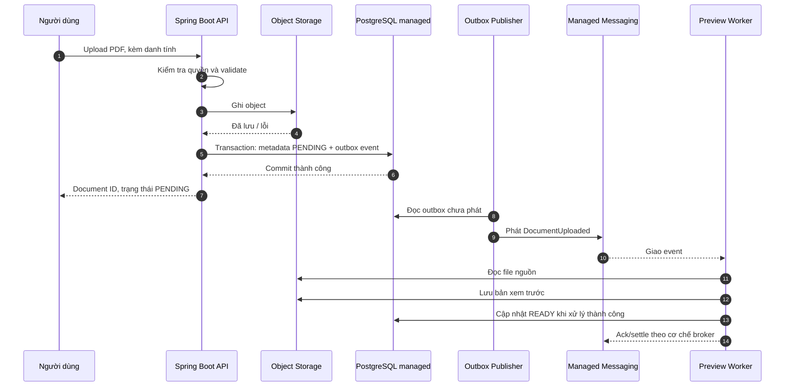
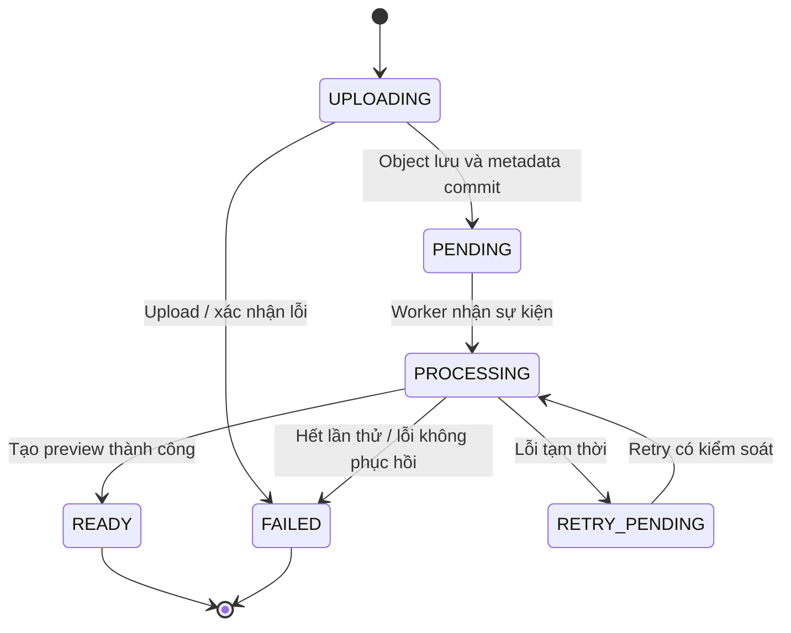
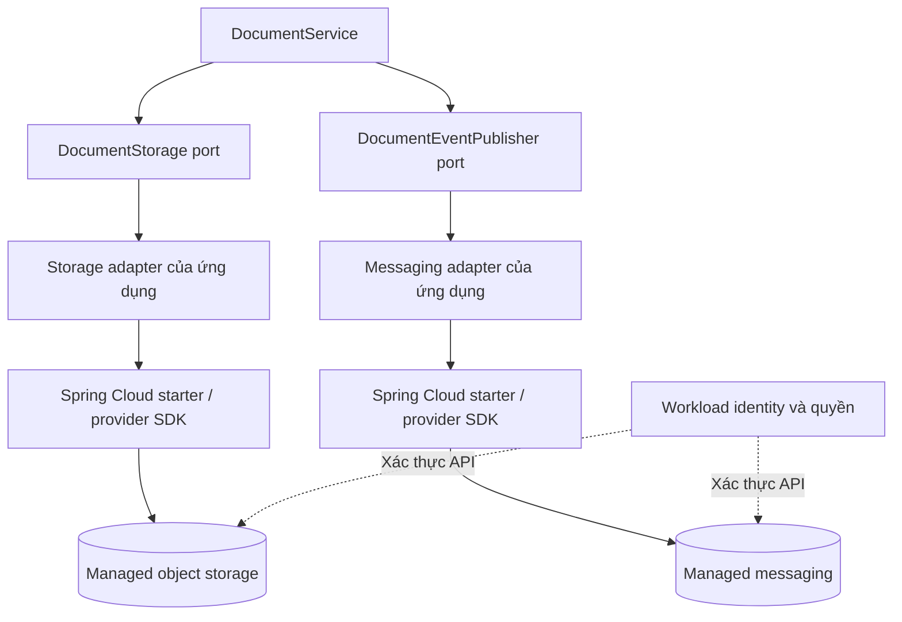

# Từ yêu cầu nghiệp vụ đến lựa chọn dịch vụ và cách tích hợp

> **Chương:** Định hướng  
> **Module:** `SPRING_CLOUD_PROVIDER_INTEGRATION`  
> **Phạm vi:** Phân tích yêu cầu để tích hợp Spring Boot với dịch vụ managed của AWS, Azure và Google Cloud thông qua Spring Cloud AWS, Spring Cloud Azure, Spring Cloud GCP hoặc SDK/driver thích hợp. Trọng tâm là quy trình ra quyết định về storage, messaging, dữ liệu, danh tính, quyền, secret, kiểm thử và vận hành.

## 1. Bài toán thực tế: yêu cầu nghiệp vụ không nói tên cloud service

Giả sử nhóm phát triển nhận được yêu cầu:

> “Khách hàng tải hợp đồng PDF lên hệ thống. Hệ thống phải lưu được tài liệu, cho phép chủ sở hữu xem lại, tạo bản xem trước trong nền và gửi thông báo khi hoàn tất. Dữ liệu riêng tư, không được mất sau khi triển khai lại ứng dụng. Khi có nhiều người dùng, tính năng tải lên vẫn phải ổn định.”

Trong yêu cầu trên, nghiệp vụ không đề cập tới Amazon S3, Azure Blob Storage, Google Cloud Storage, hàng đợi hoặc starter Spring Cloud. Đó là điều bình thường: **người yêu cầu mô tả kết quả cần đạt; nhóm kỹ thuật phải chuyển kết quả đó thành các năng lực, tiêu chí và phương án tích hợp**.

Có nhiều cách triển khai tưởng như hợp lý nhưng gây hậu quả khác nhau:

- Lưu PDF vào thư mục cục bộ của container: dễ thử nghiệm nhưng khó chia sẻ giữa nhiều instance và thiếu chiến lược duy trì dữ liệu.
- Lưu cả PDF dưới dạng BLOB trong database: có thể phù hợp trong một số trường hợp, song ảnh hưởng kích thước database, sao lưu và cách cấp quyền/truy xuất.
- Đẩy PDF lên object storage, metadata vào database: tách dữ liệu file khỏi vòng đời ứng dụng nhưng phải xử lý khả năng lỗi giữa các thao tác.
- Tạo bản xem trước ngay trong HTTP request: dễ hình dung nhưng tăng thời gian phản hồi và rủi ro timeout.
- Đưa yêu cầu tạo preview vào messaging: có thể tách tải giữa API và worker, song cần xử lý thông điệp trùng, retry, dead-letter và trạng thái tiến trình.

**Mục tiêu của bài** là thực hành một đường đi có thể giải thích và kiểm chứng:


Điểm xuất phát phải là **nhu cầu của sản phẩm và các giới hạn thực tế**, chứ không phải chọn trước một dịch vụ quen thuộc rồi ép nghiệp vụ theo cách dùng dịch vụ đó.

## 2. Chuyển lời mô tả thành yêu cầu có thể kiểm chứng

Một yêu cầu tốt phải đủ rõ để lựa chọn dịch vụ và xây được phép thử xác nhận. Với tình huống tài liệu, có thể phân loại như sau.

### 2.1. Yêu cầu chức năng và hợp đồng dữ liệu

| Lời mô tả của nghiệp vụ | Câu hỏi cần làm rõ | Yêu cầu kỹ thuật có thể ghi nhận |
| --- | --- | --- |
| “Cho khách hàng tải hợp đồng lên” | Loại file, kích thước, số lượng, quyền upload? | Chỉ nhận PDF sau bước validation; có giới hạn kích thước và kiểm tra quyền. |
| “Xem lại tài liệu của mình” | Ai được xem? Truy cập qua API hay URL tạm thời? | Mỗi document gắn `ownerId`; chỉ chủ sở hữu hoặc vai trò được cho phép mới đọc được. |
| “Không mất tài liệu khi triển khai lại” | Có cần phiên bản cũ, khôi phục sau xóa nhầm, thời gian lưu giữ? | File nằm trong storage độc lập với container; có chính sách retention/backup theo yêu cầu. |
| “Tạo bản xem trước” | Thời gian cần hoàn thành, có thể retry, khi lỗi hiển thị gì? | Tạo preview bất đồng bộ; tiến trình có trạng thái `PENDING/READY/FAILED`. |
| “Gửi thông báo” | Thông báo một lần hay chấp nhận nhận lặp? | Có mã sự kiện và cơ chế chống tác dụng phụ lặp. |
| “Bảo vệ dữ liệu riêng tư” | Loại dữ liệu nhạy cảm, yêu cầu mã hóa, audit, khu vực lưu dữ liệu? | Quyền truy cập tối thiểu, transport encryption, mã hóa lưu trữ và audit theo yêu cầu. |

Trong thực tế, phải làm rõ dữ liệu nào thuộc **nội dung file**, dữ liệu nào là **metadata**, sự kiện nào là **sự thật nghiệp vụ**, và các trạng thái được phép chuyển đổi. Nếu không xác định sớm, thiết kế storage/messaging có thể đúng về API nhưng sai về hành vi người dùng.

### 2.2. Yêu cầu phi chức năng: đặt mục tiêu, không đoán

Dưới đây là **số liệu giả định để luyện tập**, không phải mặc định của một cloud provider hay cam kết của dịch vụ:

| Nhóm | Mục tiêu ví dụ | Cần xác minh bằng gì? |
| --- | --- | --- |
| Kích thước file | PDF tối đa **20 MiB** | Validation ở API và thử upload giới hạn. |
| Lưu lượng | Đỉnh **100 lượt upload/phút** | Load test trên đường upload và tài nguyên phụ thuộc. |
| Độ trễ API | Phản hồi API metadata với p95 **dưới 500 ms**, không tính thời gian truyền toàn bộ file | APM/metrics, định nghĩa chính xác điểm bắt đầu và kết thúc phép đo. |
| Preview | **99%** bản xem trước thành công trong **2 phút** kể từ khi upload hoàn tất | Đo `uploadedAt` → `previewReadyAt`, giám sát backlog. |
| Tính sẵn sàng | Mục tiêu dịch vụ ứng dụng **99,9%** trong kỳ đánh giá | SLI/SLO, health và theo dõi sự cố ở nhiều lớp. |
| Dữ liệu | Tài liệu chỉ được lưu tại khu vực được tổ chức phê duyệt | Kiểm tra region/location, replication, chính sách và audit. |
| Quyền | Chỉ chủ sở hữu hoặc vai trò được phép đọc file | Test phân quyền API lẫn IAM của workload. |
| Chi phí | Theo hạn mức ngân sách của sản phẩm | Ước lượng request, lưu trữ, egress, message, log và cảnh báo. |

Đừng biến số liệu ví dụ thành quy tắc cứng. Một phương án chỉ được chấp nhận khi **mục tiêu phù hợp với nhu cầu thật** và nhóm có cách kiểm chứng. Chẳng hạn, chọn “p95 API dưới 500 ms” không có ý nghĩa nếu phép đo đang tính cả thời gian khách hàng upload một file 20 MiB qua mạng chậm.

### 2.3. Những yêu cầu cần đặt câu hỏi sớm

Trước khi chọn provider, làm rõ:

1. **Dữ liệu:** mức nhạy cảm, kích thước, nơi phải lưu, thời gian lưu giữ, xóa và khôi phục.
2. **Khối lượng:** tốc độ đọc/ghi, peak traffic, kích thước message, thời gian xử lý.
3. **Tính nhất quán:** nếu upload thành công nhưng metadata chưa ghi, hệ thống phải hiển thị gì?
4. **Khả năng phục hồi:** downtime chấp nhận được, RTO/RPO nếu có, yêu cầu replay.
5. **Bảo mật:** người dùng nào được xem tài liệu, workload nào được đọc/ghi storage hoặc secret.
6. **Vận hành:** ai chịu trách nhiệm triển khai, cấp quyền, giám sát, backup và xử lý sự cố?
7. **Chi phí và hợp đồng:** ngân sách, giới hạn provider, yêu cầu kỹ thuật/pháp lý của tổ chức.

Nếu một trong các câu trả lời còn thiếu, hãy **ghi thành giả định có thể kiểm chứng** trong quyết định kiến trúc. Tránh giấu sự không chắc chắn bằng cách chọn một dịch vụ có tên quen thuộc.

## 3. Từ yêu cầu đến năng lực kỹ thuật, rồi mới đến dịch vụ

Dịch vụ managed được chọn vì đáp ứng một **năng lực kỹ thuật**. Bảng dưới đây mô tả chuỗi suy luận:

| Yêu cầu đã làm rõ | Năng lực cần có | Lựa chọn thường phù hợp | Câu hỏi quyết định |
| --- | --- | --- | --- |
| File tồn tại độc lập với container | Object storage bền vững | S3 / Blob Storage / Cloud Storage | Cần versioning, lifecycle, signed URL hay download qua API? |
| Metadata có quan hệ và cần transaction | Relational database | RDS/PostgreSQL; Azure Database for PostgreSQL; Cloud SQL | Query/transaction, backup, migration, connection limit? |
| Preview mất thời gian, xử lý lại được | Messaging + worker | SQS; Service Bus queue; Pub/Sub topic/subscription | Có thể giao trùng? Timeout/ack/retry/dead-letter ra sao? |
| Nhiều hệ thống phản ứng với sự kiện | Event distribution | SNS/EventBridge; Service Bus topic/Event Grid; Pub/Sub | Fan-out, lọc sự kiện, schema và consumer độc lập? |
| Không để mật khẩu trong Git | Secret management | Secrets Manager; Key Vault; Secret Manager | Workload lấy secret và rotate thế nào? |
| Chỉ ứng dụng được gọi cloud API | Workload identity + IAM/RBAC | IAM role; Managed Identity; service account/Workload Identity | Ai được phép đọc/ghi đúng resource? |
| Theo dõi lỗi và độ trễ | Logging, metrics, tracing, audit | Spring Boot Actuator + công cụ giám sát provider | SLI, request ID, retry count, backlog nằm ở đâu? |

Một yêu cầu có thể cần **nhiều năng lực**. Ví dụ “gửi thông báo đúng một lần sau khi hợp đồng được xử lý” không được giải quyết chỉ bằng messaging: còn cần kiểm soát trạng thái nghiệp vụ, idempotency và có thể là outbox.

Ngược lại, không phải năng lực nào cũng cần một Spring Cloud starter. Với PostgreSQL managed, Spring Data JPA/JDBC và driver vẫn có thể là lớp truy cập chính; SDK của cloud thường tham gia cấu hình danh tính, network hoặc các tính năng bổ sung khi cần.

## 4. Quy trình lựa chọn có thể lặp lại

Có thể dùng bảy bước cho hầu hết yêu cầu tích hợp:

### Bước 1 — Viết kịch bản và định nghĩa thành công

Thay vì “cần S3”, viết “người dùng hợp lệ tải PDF, đọc lại được sau khi API restart; người khác không thể truy cập; hệ thống báo trạng thái preview”. Đính kèm luồng thành công, luồng bị từ chối và tình huống lỗi.

### Bước 2 — Tách các hợp đồng dữ liệu

Định nghĩa document metadata, object key, event ID, event schema và trạng thái xử lý. Xác định dữ liệu nào cần transaction và dữ liệu nào chỉ cần hoàn thành sau.

Ví dụ event nội bộ ở mức khái niệm:

```json
{
  "eventType": "DocumentUploaded",
  "eventVersion": 1,
  "eventId": "evt-901",
  "documentId": "doc-123",
  "objectKey": "documents/doc-123/source.pdf",
  "occurredAt": "2026-01-01T09:00:00Z"
}
```

Đây là **schema minh họa**. Không nên đẩy toàn bộ nội dung PDF hoặc secret vào message. Consumer cần xác minh phiên bản schema, xử lý event lặp và tránh tin hoàn toàn vào metadata không kiểm chứng.

### Bước 3 — Đặt tiêu chí và ưu tiên

Ghi các ràng buộc **bắt buộc**: vùng lưu dữ liệu, quyền truy cập, định dạng giao tiếp, thời gian xử lý, loại workload. Sau đó mới cân nhắc các tiêu chí có thể đánh đổi: chi phí, mức phụ thuộc provider, thời gian xây dựng, khả năng vận hành.

Nếu một phương án vi phạm tiêu chí bắt buộc, loại bỏ trước khi so sánh về giá.

### Bước 4 — Tạo các phương án, không chỉ một đáp án

Ví dụ với storage:

- **Database BLOB** có thể chấp nhận cho dữ liệu nhỏ, cần transaction chặt với bản ghi và phù hợp ngân sách/backup.
- **Object storage qua backend API** đơn giản hơn trong kiểm soát upload tập trung, nhưng ứng dụng chịu băng thông truyền file.
- **Direct-to-object-storage với URL/token có thời hạn** có thể giảm tải API cho file lớn, nhưng cần xác nhận upload thành công, giới hạn scope/quyền và quy trình dọn file bỏ dở.

Tương tự với preview: **xử lý đồng bộ**, **queue + worker**, **event bus/pub-sub** là các phương án có đánh đổi khác nhau. Không phải lúc nào queue cũng cần thiết nếu tác vụ ngắn và yêu cầu tức thời.

### Bước 5 — Lập bản đồ phương án sang provider

Kiểm tra sản phẩm cụ thể ở AWS/Azure/GCP theo nhu cầu đã ghi. Phải xác nhận region hỗ trợ, identity, quota, request size, retry semantics, retention và cách tính phí. Không coi “dịch vụ cùng dòng trong bảng” là tương đương API.

### Bước 6 — Chọn cách tích hợp Spring Boot

Kiểm tra việc dùng **Spring Cloud AWS/Azure/GCP starter**, **SDK Java trực tiếp**, **Spring Data/driver** hoặc **Spring Cloud Stream** nếu có binder phù hợp. Chốt dependency/BOM theo phiên bản Spring Boot/JDK hiện có; đặt code cloud trong adapter/service tích hợp để không rò rỉ SDK type vào nghiệp vụ.

### Bước 7 — Đặt kiểm thử nghiệm thu và tiêu chí vận hành

Tạo phép thử cho quyền, timeout, trùng event, cấu hình sai, network, latency và chi phí; xác định log/metric/tracing cần có. Chỉ kết luận một lựa chọn phù hợp sau khi kiểm chứng những rủi ro quyết định.

## 5. Bản đồ phương án AWS, Azure và Google Cloud cho ví dụ

| Năng lực | AWS | Microsoft Azure | Google Cloud |
| --- | --- | --- | --- |
| **Object storage** | Amazon S3 | Azure Blob Storage | Cloud Storage |
| **Messaging xử lý nền** | Amazon SQS | Azure Service Bus queues | Pub/Sub topic + subscription |
| **Event distribution** | SNS/EventBridge theo nhu cầu | Service Bus topics/Event Grid | Pub/Sub |
| **PostgreSQL managed** | Amazon RDS for PostgreSQL | Azure Database for PostgreSQL | Cloud SQL for PostgreSQL |
| **Secret store** | AWS Secrets Manager | Azure Key Vault | Secret Manager |
| **Workload identity** | IAM role gắn workload | Managed Identity / Microsoft Entra ID | Service account/Workload Identity |
| **Spring integration thường gặp** | Spring Cloud AWS | Spring Cloud Azure | Spring Cloud GCP |
| **Quan sát** | CloudWatch/CloudTrail | Azure Monitor/Activity Log | Cloud Monitoring/Logging/Audit Logs |

Bảng ánh xạ theo **khả năng**; sản phẩm có giao diện, bảo đảm delivery, giới hạn dịch vụ, IAM và cách tính phí khác nhau. Chẳng hạn:

- Với **SQS**, đơn vị chính là queue; với **Pub/Sub**, publisher gửi tới topic và consumer nhận thông qua subscription; **Service Bus** hỗ trợ queue và topic/subscription.
- Không nên hứa “message sẽ chỉ xử lý một lần” chỉ vì broker có một số chế độ delivery đặc biệt. **Tác dụng phụ nghiệp vụ** vẫn cần idempotency và mô hình transaction thích hợp.
- Bất kỳ dịch vụ database managed nào cũng có giới hạn kết nối, cách sao lưu, network và khả năng phục hồi riêng.
- Quản lý identity cho workload thay đổi theo nơi chạy ứng dụng và theo tài nguyên đích, ngay cả khi tên dịch vụ nghe giống nhau.

Với OCI hoặc Alibaba Cloud ngoài trọng tâm thực hành của module, vẫn có thể áp dụng **cùng quy trình yêu cầu → năng lực → dịch vụ → SDK/adapter → kiểm thử**; tuy nhiên không giả định có bộ Spring Cloud starter tương đương ba họ tích hợp chính.

## 6. Chọn kiến trúc giao tiếp: đồng bộ, queue hay sự kiện?

Một hành động nghiệp vụ có thể chia thành **phần cần ngay để trả lời người dùng** và **phần có thể xử lý sau**.

| Tác vụ | Đồng bộ trong API | Queue + worker | Pub/sub hoặc event distribution |
| --- | --- | --- | --- |
| Kiểm tra quyền/loại file | Phù hợp; thường bắt buộc | Không nên đẩy toàn bộ kiểm tra quyền sang worker | Không phù hợp để thay kiểm tra request |
| Ghi nhận metadata ban đầu | Phù hợp nếu cần phản hồi ngay | Chỉ phù hợp nếu sản phẩm chấp nhận eventual acknowledgement | Có thể phát sự kiện sau khi ghi nhận |
| Upload PDF | Phụ thuộc kích thước và phương án upload | Có thể phân đoạn xử lý nhưng cần nguồn file bền vững | Event thường báo “đã upload” hơn là chứa file |
| Tạo preview tốn CPU/thời gian | Có thể gây timeout nếu chạy lâu | Thường phù hợp | Phù hợp khi cần nhiều consumer xử lý các bước độc lập |
| Gửi thông báo | Có thể chậm nếu phụ thuộc bên ngoài | Phù hợp | Phù hợp nếu nhiều kênh thông báo cùng nghe sự kiện |

### Luồng được đề xuất cho tình huống ví dụ



Sơ đồ giả định API proxy nội dung file vào object storage để đơn giản. Nếu dùng **direct upload**, có thể tách tạo upload token, xác nhận file đã có, quét/kiểm tra nội dung phù hợp, rồi mới commit metadata và phát event. Trình tự và điểm tin cậy phải xác định lại.

### Vì sao có outbox?

Ghi một row vào PostgreSQL rồi gọi API messaging là **hai thao tác không có transaction chung theo mặc định**. Nếu database commit thành công nhưng publish gặp timeout, event có thể bị mất; nếu publish thành công nhưng client không nhận được kết quả, việc retry có thể tạo thông điệp lặp.

**Transactional outbox** lưu thay đổi metadata và sự kiện cần phát **trong cùng transaction database**. Một publisher riêng đọc outbox và phát đến broker, sau đó đánh dấu trạng thái phát theo cơ chế phù hợp. Mẫu này giảm nguy cơ mất sự kiện do lỗi giữa database và broker nhưng **không tự bảo đảm chỉ phát một lần**; publisher có thể phát lại sau crash. Consumer vì thế phải idempotent.

### Trạng thái nghiệp vụ và phục hồi

Ví dụ state machine:



Nếu object được lưu nhưng database commit thất bại, file có thể trở thành **orphan object**; cần chiến lược dọn dẹp theo key, trạng thái tạm thời hoặc job reconcile. Nếu worker chết sau khi ghi preview nhưng trước khi acknowledge message, lần xử lý sau phải phát hiện preview đã tồn tại hoặc ghi đè theo cách an toàn để tránh tác dụng phụ lặp.

## 7. Chọn mức phụ thuộc cloud trong code Spring Boot

Sau khi quyết định dịch vụ, mới chọn **cách nối** code nghiệp vụ với SDK/provider.



### 7.1. Port mô tả nhu cầu, adapter mô tả cách thực hiện

Port nên có hợp đồng nhỏ, dễ kiểm thử:

```java
public interface DocumentStorage {
    void put(String objectKey, byte[] content, String contentType);
}

public interface DocumentEventPublisher {
    void publish(DocumentUploaded event);
}

public record DocumentUploaded(
        String eventId,
        String documentId,
        String objectKey) {}
```

Đây là **hợp đồng của ứng dụng**, không import kiểu dữ liệu SDK. Để kiểm thử nghiệp vụ, có thể dùng fake implement hai port và kiểm tra việc chọn key, trạng thái hoặc nội dung sự kiện.

Khi chuyển từ S3 sang Blob Storage/Cloud Storage, nhóm có thể giữ port nếu các provider đều đáp ứng đúng **hành vi đã cam kết**. Những tính năng như signed URL, object lock, versioning hoặc chế độ delivery của message có thể đòi hỏi hợp đồng rõ hơn và adapter riêng.

### 7.2. Ví dụ adapter Spring Cloud AWS + SDK S3

Nếu quyết định dùng Amazon S3 và Spring Cloud AWS, dependency Maven minh họa:

```xml
<dependency>
    <groupId>io.awspring.cloud</groupId>
    <artifactId>spring-cloud-aws-starter-s3</artifactId>
</dependency>
```

Cần import BOM và chọn phiên bản starter **tương thích với Spring Boot/JDK của dự án** theo tài liệu chính thức. Không nên tự áp phiên bản bất kỳ hoặc giả định ba họ Spring Cloud provider dùng chung một BOM.

Cấu hình một phần:

```yaml
app:
  documents:
    bucket: ${DOCUMENTS_BUCKET}
spring:
  cloud:
    aws:
      region:
        static: ${AWS_REGION}
```

`app.documents.bucket` là property do ứng dụng định nghĩa; biến môi trường `DOCUMENTS_BUCKET` phải được cung cấp. Region và credential của SDK phải khớp môi trường thực tế. Không hardcode access key vào file này.

Adapter có thể dùng bean `S3Client` được Spring Cloud AWS tạo và quản lý:

```java
import org.springframework.beans.factory.annotation.Value;
import org.springframework.stereotype.Component;
import software.amazon.awssdk.core.sync.RequestBody;
import software.amazon.awssdk.services.s3.S3Client;
import software.amazon.awssdk.services.s3.model.PutObjectRequest;

@Component
public class S3DocumentStorage implements DocumentStorage {
    private final S3Client client;
    private final String bucket;

    public S3DocumentStorage(
            S3Client client,
            @Value("${app.documents.bucket}") String bucket) {
        this.client = client;
        this.bucket = bucket;
    }

    @Override
    public void put(String key, byte[] data, String contentType) {
        PutObjectRequest request = PutObjectRequest.builder()
                .bucket(bucket)
                .key(key)
                .contentType(contentType)
                .build();

        client.putObject(request, RequestBody.fromBytes(data));
    }
}
```

Phần này minh họa **đường đi của API**, không thay thế validation, scan nội dung, encryption policy, phân quyền người dùng hay giới hạn size. Với file lớn, dùng stream/multipart/direct upload phù hợp để tránh đưa toàn bộ file vào `byte[]`. Bucket phải tồn tại, có policy phù hợp, và role của ứng dụng cần quyền ghi object đúng phạm vi.

### 7.3. Đổi sang Azure hoặc GCP cần thay gì?

| Thành phần | AWS | Azure | Google Cloud |
| --- | --- | --- | --- |
| Storage service | Amazon S3 | Azure Blob Storage | Cloud Storage |
| Spring integration | Spring Cloud AWS S3 | Spring Cloud Azure Storage Blob | Spring Cloud GCP Storage |
| SDK client tiêu biểu | `S3Client` | `BlobServiceClient`/`BlobContainerClient` | `Storage` |
| Tài nguyên | Bucket + object key | Storage account, container + blob name | Bucket + object name |
| Danh tính | AWS IAM role/profile | Azure Managed Identity/credential chain | Service account/ADC |
| Mã thay đổi | `S3DocumentStorage` | `AzureBlobDocumentStorage` | `GcsDocumentStorage` |
| Mã có thể giữ | `DocumentService`, `DocumentStorage` | Tương tự nếu hợp đồng đủ chung | Tương tự nếu hợp đồng đủ chung |

Không áp cấu hình `spring.cloud.aws.*` cho Azure hay GCP; mỗi starter có namespace cấu hình và client riêng. Khi có nhiều implementation của `DocumentStorage` trên cùng classpath, phải chọn bean bằng cấu hình điều kiện, profile hoặc qualifier một cách chủ động.

### 7.4. Khi nào không cần Spring Cloud starter?

- **Database relational:** Spring Data JPA/JDBC/R2DBC cùng driver thường là lớp tích hợp chính.
- **API mới chưa được starter hỗ trợ:** gọi SDK Java trực tiếp trong một adapter có thể thích hợp.
- **Messaging abstraction:** Spring Cloud Stream có thể hữu ích nếu binder tương thích tồn tại và hợp đồng message phù hợp; không mặc định mọi provider có cùng binder.
- **Ứng dụng nhỏ với một call duy nhất:** client được cấu hình trong một bean Spring có thể đủ; không cần trừu tượng hóa quá nhiều.

Điều quan trọng là ranh giới trách nhiệm: **nghiệp vụ quyết định *khi nào* và *vì sao* gọi; adapter quyết định *gọi như thế nào*; SDK/starter hỗ trợ kết nối; dịch vụ managed thực hiện thao tác; IAM kiểm soát quyền**.

## 8. Quyết định danh tính, quyền và secret trước khi chạy code

Một ứng dụng chạy trên cloud có thể có bean SDK được tạo thành công nhưng vẫn không gọi được dịch vụ vì **thiếu danh tính, thiếu quyền hoặc sai resource**.

| Môi trường / provider | Hướng danh tính thường dùng | Kiểm tra quan trọng |
| --- | --- | --- |
| Local AWS | Developer profile/SSO theo credential chain được hỗ trợ | Role/profile đang dùng, quyền chỉ ở môi trường dev |
| Production AWS | IAM role gắn với workload trên nền tảng hỗ trợ | Quyền `s3:PutObject` trên prefix/bucket cần ghi; queue có quyền send/receive riêng |
| Local Azure | Azure Identity/CLI credential phù hợp | Tenant/subscription và data-plane role chính xác |
| Production Azure | Managed Identity | RBAC phù hợp với Blob Storage hoặc Service Bus resource |
| Local Google Cloud | Application Default Credentials của môi trường phát triển | Project và tài khoản dùng để gọi tài nguyên |
| Production Google Cloud | Service account/Workload Identity thích hợp | IAM role trên bucket/topic/subscription cần dùng |

Mỗi identity nên được cấp **least privilege**. Upload API có thể chỉ cần quyền ghi object vào vùng tài liệu; preview worker có thể cần đọc file nguồn và ghi file kết quả. API không vì vậy mà cần quyền xóa mọi bucket hoặc đọc toàn bộ secret.

**Phân biệt hai ranh giới bảo mật**:

- Spring Security và logic nghiệp vụ kiểm tra **người dùng có được thao tác với tài liệu hay không**.
- IAM/RBAC kiểm tra **workload Spring Boot có được gọi API cloud trên tài nguyên nào**.

Secret (database password, external API token...) nên được quản lý bằng dịch vụ như AWS Secrets Manager, Azure Key Vault hoặc Google Secret Manager khi phù hợp, với quyền đọc giới hạn. Cách ứng dụng nhận hoặc refresh secret phụ thuộc starter/SDK và runtime; cần xử lý rotation và tránh log giá trị bí mật.

### Kiểm tra ranh giới dữ liệu và network

Ngoài IAM, cần xác nhận:

- Dịch vụ ở đúng region/location và phù hợp yêu cầu lưu trú dữ liệu.
- Cloud runtime có thể kết nối endpoint, DNS, proxy/firewall/private endpoint nếu có.
- Mã hóa truyền tải và mã hóa dữ liệu lưu trữ theo yêu cầu sản phẩm.
- Key management, versioning, retention, backup và lifecycle phù hợp.
- Phạm vi secret, môi trường staging/production và audit tách biệt.

Các mục này là **tiêu chí chọn phương án**; chúng ảnh hưởng cả tính khả thi, chi phí và độ khó tích hợp, không chỉ việc “deploy cho chạy”.

## 9. Ma trận đánh đổi để lựa chọn có căn cứ

Khi có nhiều phương án, tạo một bảng quyết định thay vì chọn theo cảm tính. Ví dụ cho upload tài liệu:

| Phương án | Độ phức tạp triển khai | Áp lực lên API | Kiểm soát upload | Phù hợp khi |
| --- | --- | --- | --- | --- |
| Upload qua Spring Boot rồi lưu object | Thấp đến trung bình | Backend chuyển toàn bộ bytes | Kiểm tra trực tiếp trong request | Tệp nhỏ/vừa, lưu lượng kiểm soát, cần xử lý tập trung |
| Direct upload bằng URL/token giới hạn | Trung bình đến cao | Giảm băng thông truyền file qua API | Cần xác nhận/validate sau upload và policy chặt | File lớn, lưu lượng upload cao |
| Lưu file dạng BLOB trong database | Thấp ở thao tác ban đầu, vận hành có thể nặng | Tùy đường upload | Cùng lớp data access với metadata | File nhỏ, transaction và yêu cầu lưu trữ đặc biệt cho phép |

Ví dụ cho phát sự kiện:

| Phương án | Ưu điểm | Giới hạn | Khi nào cân nhắc |
| --- | --- | --- | --- |
| Gọi worker đồng bộ qua HTTP | Dễ theo dõi kết quả tức thì | Phụ thuộc độ trễ và uptime worker | Tác vụ ngắn, kết quả phải trả ngay |
| Queue + worker | Tách thời gian xử lý, hỗ trợ retry/backpressure | Cần theo dõi backlog, idempotency, DLQ | Preview/báo cáo/tác vụ nền |
| Pub/sub event | Nhiều subscriber độc lập | Khó kiểm soát toàn bộ luồng nếu thiếu governance | Nhiều tính năng phản ứng với cùng sự kiện |
| Managed stream | Có thể phù hợp luồng lớn, phân vùng/replay | Mô hình offset, partition và vận hành phức tạp hơn | Dữ liệu sự kiện liên tục, yêu cầu streaming |

Một phương án được chọn nên có **lý do rõ**: đáp ứng yêu cầu bắt buộc, rủi ro nào được giảm, rủi ro nào còn lại và ai chịu trách nhiệm kiểm soát. Tránh “điểm số tuyệt đối” cho provider khi chưa có dữ liệu dự án thực tế.

## 10. Viết Architecture Decision Record (ADR) ngắn gọn

Một quyết định kiến trúc hữu ích giúp người khác hiểu lý do lựa chọn khi điều kiện thay đổi.

### ADR mẫu: lưu PDF và xử lý preview bất đồng bộ

**Bối cảnh:** Hệ thống Spring Boot cần lưu PDF bền vững, nhiều instance API dùng chung dữ liệu, preview có thể hoàn tất sau upload. Dữ liệu chỉ được truy cập theo quyền chủ sở hữu.

**Yêu cầu bắt buộc:** storage độc lập với container; phân quyền người dùng và workload; vị trí lưu dữ liệu được phê duyệt; hiển thị trạng thái preview; có cách khôi phục khi worker lỗi.

**Phương án:** database BLOB hoặc object storage; preview trong HTTP request hoặc qua messaging.

**Quyết định cho bài luyện tập:** object storage cho PDF; PostgreSQL managed cho metadata; queue/pub-sub phù hợp với provider cho preview; outbox để kết nối sự kiện với commit database; port/adapter trong ứng dụng Spring Boot.

**Lý do:** tách khối lượng file khỏi database và vòng đời API; worker có thể mở rộng riêng; bộ kiểm thử nghiệp vụ không phụ thuộc SDK.

**Hệ quả phải quản lý:** orphan object, at-least-once delivery, idempotency, credential và IAM, chi phí storage/request/egress, backlog, outbox publisher và chính sách dọn tài nguyên.

**Tiêu chí xác nhận:** sau restart API vẫn đọc lại đúng file; người dùng khác bị từ chối; preview chuyển sang READY đúng SLO; message giao lặp không tạo kết quả trùng; lỗi quyền hoặc mất mạng được ghi nhận và xử lý.

**Điều kiện xem xét lại:** file cực lớn, tần suất upload tăng mạnh, yêu cầu giữ toàn bộ dữ liệu trong một transaction hoặc chuyển sang provider/region khác.

ADR này chỉ mô tả lựa chọn **cho tình huống giả định**; kiến trúc thực tế cần được điều chỉnh theo dữ liệu đo và ràng buộc tổ chức.

## 11. Kiểm thử sự lựa chọn: từ port đến cloud thật

| Tầng kiểm thử | Mục đích | Ví dụ trong hệ thống tài liệu |
| --- | --- | --- |
| **Unit test nghiệp vụ** | Kiểm chứng luật nghiệp vụ độc lập cloud | Fake `DocumentStorage` ghi nhận key; người không đủ quyền không được gọi `put` |
| **Adapter test** | Kiểm tra mapping request/response và exception | S3 adapter dùng đúng bucket, key, content type, phân loại lỗi |
| **Integration test với emulator** | Xác minh cấu hình và đường gọi cơ bản khi công cụ hỗ trợ | LocalStack cho một số API AWS; Azurite cho Blob Storage; Pub/Sub emulator cho GCP Pub/Sub |
| **Cloud integration test** | Kiểm tra danh tính, IAM, resource, network và hành vi thật | Upload/download ở bucket test bằng identity runtime giới hạn |
| **Failure/chaos test có kiểm soát** | Kiểm tra phục hồi và idempotency | Làm worker chết sau khi ghi preview nhưng trước ack, sau đó giao lại event |
| **Load/soak test** | Đo mục tiêu SLO, quota và chi phí | Peak upload, backlog, p95 API, tốc độ worker, error rate |

Emulator **không bảo đảm mô phỏng chính xác** mọi tính năng IAM, network, transaction, quota hoặc delivery semantics. Với cloud integration, kiểm thử trên tài nguyên test thật là cần thiết để xác minh các rủi ro phụ thuộc provider.

### Bộ acceptance test gắn yêu cầu

1. Upload file hợp lệ, restart API, vẫn tải về được file đúng nội dung.
2. User B không tải được tài liệu thuộc User A; workload không thể đọc/ghi ngoài phạm vi cấp quyền.
3. File sai loại hoặc quá cỡ bị từ chối trước khi lưu; log không lộ dữ liệu nhạy cảm.
4. Worker nhận cùng `eventId` hai lần: kết quả preview/notification không gây tác dụng phụ lặp.
5. Khi messaging tạm thời lỗi, outbox giữ sự kiện để phát lại; backlog và retry được ghi metric.
6. Khi object storage hoặc database lỗi, API trả trạng thái đúng và có cơ chế reconcile các bản ghi/file dang dở.
7. Với load giả định, đo được p95/SLO đã đặt và xác định giới hạn trước khi chạy production.
8. Không còn tài nguyên test, dữ liệu nhạy cảm hoặc secret dư thừa sau khi kết thúc kiểm thử.

### Các chỉ số cần quan sát

- **API:** request rate, error rate, p50/p95/p99 latency theo endpoint và loại thao tác.
- **Storage:** upload/download success, latency, request error, dung lượng và egress.
- **Messaging:** publish failures, queue/subscription backlog, message age, retry, DLQ.
- **Worker:** thời gian xử lý, số job hoàn thành/thất bại, duplicate suppression.
- **Database/outbox:** số event chưa phát, độ tuổi event lâu nhất, connection pool, slow query.
- **Security/operations:** access denied, audit event, thay đổi quyền và secret rotation.

Có thể dùng Spring Boot Actuator, Micrometer/OpenTelemetry cùng công cụ giám sát của AWS, Azure hoặc Google Cloud theo môi trường. Cần correlation ID từ upload request sang event và worker nhưng không đẩy token, private data hoặc secret vào trace.

## 12. Chi phí và khả năng vận hành là một phần của lựa chọn dịch vụ

Tổng chi phí không chỉ là giá lưu 1 GiB dữ liệu. Với luồng upload/preview, phải tính:

```text
Tổng chi phí tương đối
  = lưu trữ object + số request đọc/ghi
  + lưu lượng truyền dữ liệu (đặc biệt egress và cross-region)
  + message publish/receive/retention
  + compute của API và worker
  + database + backup
  + log/metric/tracing
  + chi phí vận hành, trực và bảo trì
```

Không chốt con số khi chưa biết region, số lượng file, dung lượng trung bình, tỷ lệ đọc lại, retention và mức phục hồi. Nên lập **ước lượng theo kịch bản**: bình thường, đỉnh tải, và sự cố dẫn tới retry nhiều. Áp dụng quota, lifecycle/retention, cảnh báo ngân sách và dọn môi trường test.

### Khi có yêu cầu đa cloud

Nếu phải hỗ trợ AWS, Azure và GCP, cần làm rõ **mục tiêu chuyển cloud**:

- Cần chạy production trên nhiều provider cùng lúc hay chỉ muốn dễ chuyển đổi sau này?
- Cần tính năng chung tối thiểu hay sử dụng tối đa ưu điểm riêng của từng provider?
- Ai sở hữu ba bộ credential, policy, quan sát, network và integration test?
- Dữ liệu có được phép chuyển region/provider không? Chi phí transfer và thời gian migration là bao nhiêu?

Port/adapter giúp giới hạn phần phụ thuộc provider trong code, **không loại bỏ** khác biệt về dữ liệu, quyền, SLA, API và chi phí. Đa cloud phải là yêu cầu được đánh đổi có chủ đích, không phải lý do tự động triển khai mọi starter.

## 13. Các lỗi tư duy thường gặp khi chọn cloud service

**“Đội đã quen S3 nên mọi file đều phải đưa vào S3.”** Cần xác định transaction, backup, kích thước, throughput, quyền và cách sử dụng file trước. Có trường hợp BLOB trong database hoặc một dạng lưu trữ khác phù hợp hơn.

**“Thêm Spring Cloud starter là xong tích hợp.”** Starter hỗ trợ thư viện và cấu hình; cloud resource, IAM, kết nối mạng, xử lý lỗi, idempotency và observability vẫn cần triển khai.

**“Đã dùng queue thì thông báo không thể bị mất hoặc bị lặp.”** Queue/broker có giới hạn và delivery semantics cụ thể; phải có retry, outbox khi cần và consumer idempotent.

**“S3, Blob Storage, Cloud Storage giống nhau vì đều lưu object.”** Các chi tiết về credential, policy, signed URL, metadata, versioning, API và chi phí khác nhau; cần adapter và test riêng.

**“Có Kubernetes/managed container là không cần quan tâm credentials.”** Runtime chỉ có quyền khi được cấu hình đúng danh tính và policy; cơ chế của từng provider khác nhau.

**“Chỉ cần test mock SDK là đảm bảo production.”** Mock không xác minh IAM, region, network hay behavior của dịch vụ thật.

**“Có chỉ số availability của provider là ứng dụng đạt SLO tương ứng.”** SLO sản phẩm phụ thuộc cả API, network, database, worker, dependency, triển khai và quy trình vận hành. Phải đo ở ranh giới người dùng.

## 14. Bài thực hành tổng hợp: thiết kế từ yêu cầu đến tích hợp

**Tình huống:** Ứng dụng Spring Boot của một nền tảng quản lý hợp đồng cần nhận PDF, chỉ cho chủ sở hữu xem lại, tạo preview trong nền, lưu lịch sử xử lý, phát thông báo và không lộ secret. Nhóm được phép chọn AWS, Azure hoặc Google Cloud.

### Phần A — Viết lại yêu cầu thành tiêu chí

Tạo bảng có các cột **yêu cầu**, **giới hạn**, **số liệu cần đo**, **kiểm thử nghiệm thu**, **điểm chưa rõ**. Đưa ít nhất một mục cho dữ liệu, quyền, upload, preview, availability và chi phí. Mọi số liệu chưa có xác nhận phải ghi rõ là giả định.

### Phần B — Chọn dịch vụ managed

Lập ba phương án theo provider với các cột: object storage, messaging, PostgreSQL managed, secret store, workload identity, logging/metrics. Đối với messaging, giải thích queue, topic/subscription, retry và DLQ của phương án được chọn.

### Phần C — Thiết kế hợp đồng Spring Boot

Định nghĩa interface `DocumentStorage` và `DocumentEventPublisher`. Vẽ sơ đồ nghiệp vụ → port → adapter → client/SDK → cloud resource. Đánh dấu vị trí tạo bean bởi Spring Cloud starter, vị trí kiểm tra quyền user và chỗ cloud IAM áp dụng.

### Phần D — Xử lý lỗi và nhất quán

Trình bày ít nhất ba tình huống: **upload object thành công nhưng metadata fail**, **DB commit thành công nhưng publish event fail**, **worker xử lý xong nhưng event được giao lại**. Với mỗi tình huống, đề xuất cơ chế hồi phục và cách kiểm thử.

### Phần E — Viết ADR và kết quả đo

Chọn một phương án được ưu tiên, viết ADR gồm bối cảnh, phương án, quyết định, hệ quả và điều kiện xem lại. Đề xuất metric đo API latency, backlog, preview delay, security failure và cost; mô tả điều kiện đủ để nghiệm thu.

**Tiêu chí hoàn thành:** người học có thể truy nguyên từng lựa chọn cloud về một yêu cầu nghiệp vụ cụ thể; không nhầm starter với dịch vụ managed hoặc IAM; nhận diện được rủi ro DB/messaging/storage; và chứng minh phương án bằng kiểm thử trên nhiều tầng.

---

## Ghi nhớ

Chọn dịch vụ cloud là một **quá trình ra quyết định kỹ thuật dựa trên yêu cầu có thể kiểm chứng**. Thứ tự hữu ích là:

**Kết quả nghiệp vụ → yêu cầu chức năng và phi chức năng → năng lực kỹ thuật → lựa chọn dịch vụ managed → danh tính, quyền và cấu hình → Spring Cloud/SDK/adapter → kiểm thử, giám sát và đánh giá lại.**

Trong module `SPRING_CLOUD_PROVIDER_INTEGRATION`, cách làm này áp dụng trực tiếp cho Spring Boot trên **AWS, Azure và Google Cloud**. Tên dịch vụ có thể thay đổi, nhưng trách nhiệm bảo vệ dữ liệu, xử lý lỗi, bảo đảm tính nhất quán, kiểm thử hành vi thật và cân đối chi phí vẫn thuộc về nhóm phát triển hệ thống.
