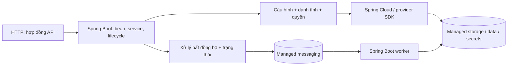
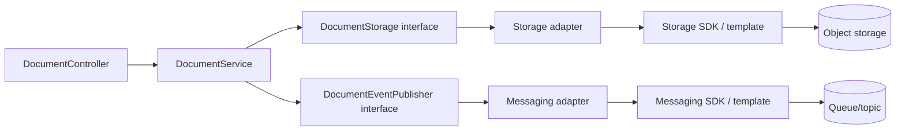
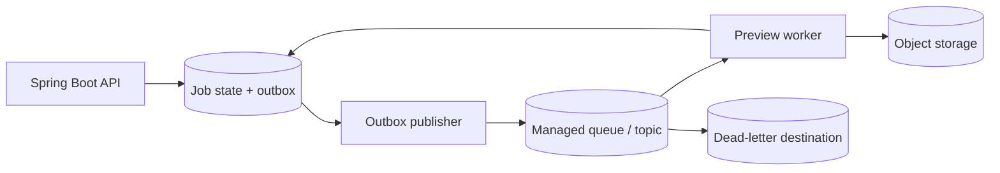
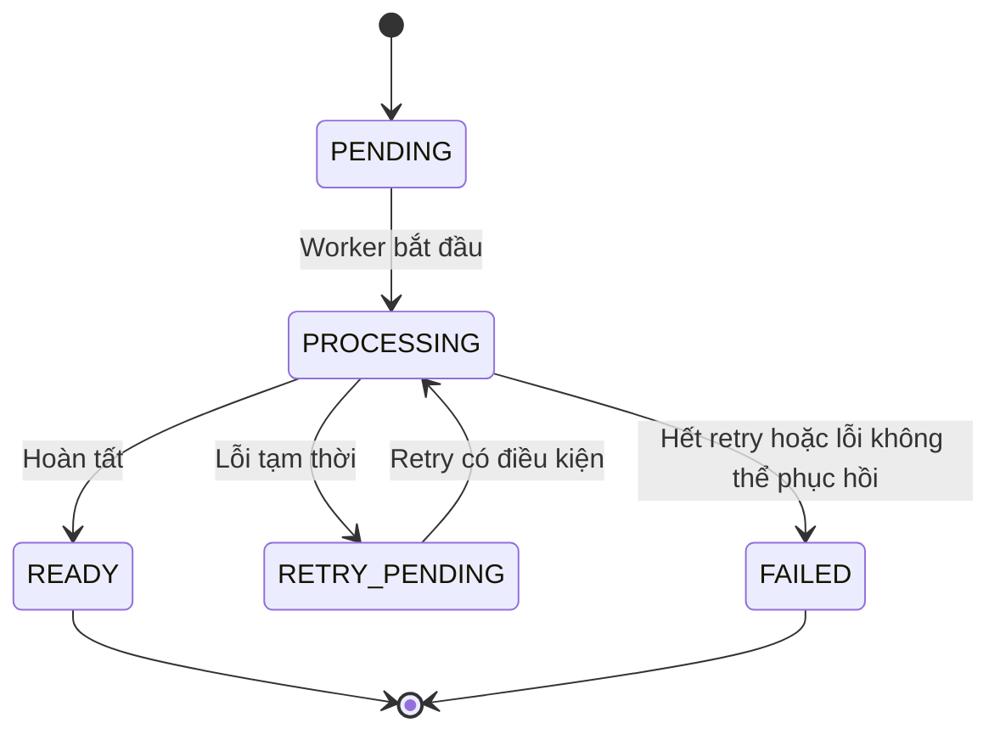

# Kiến thức cần có về Spring Boot, cấu hình, HTTP và xử lý bất đồng bộ

> **Chương:** Định hướng  
> **Module:** `SPRING_CLOUD_PROVIDER_INTEGRATION`  
> **Mục tiêu:** Chuẩn bị kiến thức để thực hành tích hợp Spring Boot với dịch vụ managed của **AWS, Azure và Google Cloud** thông qua các thư viện Spring Cloud tương ứng; hiểu cách cấu hình danh tính và quyền, gọi storage/messaging/dữ liệu, bảo vệ secret, kiểm thử tích hợp và nhận biết khác biệt giữa các provider.

## 1. Bài học này đặt nền cho việc gì?

Giả sử một API Spring Boot nhận yêu cầu tải hợp đồng PDF lên hệ thống, lưu tệp vào object storage, ghi metadata vào database và gửi sự kiện để worker tạo bản xem trước. Ta có thể chọn Amazon S3 và SQS, Azure Blob Storage và Service Bus, hoặc Google Cloud Storage và Pub/Sub. Tuy nhiên, nếu chưa vững Spring Boot, cấu hình, HTTP và xử lý bất đồng bộ, người phát triển rất dễ mắc lỗi ngay cả khi đã chọn đúng dịch vụ cloud.

Một số tình huống thường gặp:

- Thư viện SDK đã nằm trong `pom.xml` nhưng Spring Boot không tạo được bean client để inject.
- Ứng dụng local gọi được bucket, còn production báo `AccessDenied` vì workload sử dụng một danh tính khác.
- Tên bucket bị hardcode, khiến staging ghi nhầm vào tài nguyên production.
- HTTP API trả `200 OK` trước khi công việc nền thực sự hoàn tất, làm giao diện báo thành công sai.
- Dùng `@Async` để xử lý file rồi tin rằng job sẽ tồn tại sau khi container restart.
- Consumer nhận lại cùng một message và tạo hai bản ghi hóa đơn vì thiếu idempotency.
- Thêm retry vô hạn vào lỗi cấu hình/quyền, khiến hệ thống quá tải mà không giải quyết được nguyên nhân.

Những vấn đề này cho thấy bốn mảng kiến thức phải được nối với nhau:



**Nguyên tắc:** Spring Boot tổ chức ứng dụng và dependency; cấu hình quyết định ứng dụng đang kết nối tới đâu; HTTP biểu đạt yêu cầu và trạng thái; cơ chế bất đồng bộ quyết định công việc tồn tại, được giao lại và được theo dõi như thế nào. Các dịch vụ managed bổ sung hạ tầng, nhưng không tự giải quyết toàn bộ quy tắc nghiệp vụ.

## 2. Kiến thức Spring Boot tối thiểu: bean, DI và vòng đời

### 2.1. Tách controller, service và lớp tích hợp

Trong ứng dụng Spring Boot, ba trách nhiệm cơ bản thường là:

| Thành phần | Trách nhiệm | Ví dụ trong hệ thống tài liệu |
| --- | --- | --- |
| **Controller** | Định nghĩa endpoint, nhận/kiểm tra dữ liệu HTTP và trả response | `DocumentController` nhận yêu cầu tạo preview |
| **Service nghiệp vụ** | Định nghĩa khi nào một thao tác hợp lệ, trạng thái và quy tắc xử lý | `DocumentService` xác minh tài liệu thuộc đúng người dùng |
| **Adapter/integration service** | Gọi hệ thống bên ngoài theo hợp đồng của ứng dụng | `S3DocumentStorage` ghi object; `SqsDocumentEvents` phát message |

Không có quy tắc bắt buộc mọi ứng dụng phải đủ ba lớp riêng biệt, nhưng khi tích hợp nhiều cloud, tách **nghiệp vụ** khỏi **kiểu dữ liệu SDK** làm việc kiểm thử và thay đổi adapter rõ ràng hơn.



### 2.2. Bean và Dependency Injection

**Bean** là đối tượng được Spring container quản lý. Dependency Injection (DI) cho phép một component nhận dependency từ container thay vì tự khởi tạo SDK client hoặc repository ở nhiều nơi.

Ví dụ hợp đồng nghiệp vụ:

```java
public interface DocumentStorage {
    void put(String objectKey, byte[] contents, String contentType);
}
```

Service dùng constructor injection:

```java
import org.springframework.stereotype.Service;

@Service
public class DocumentService {
    private final DocumentStorage storage;

    public DocumentService(DocumentStorage storage) {
        this.storage = storage;
    }

    public void savePdf(String key, byte[] validatedPdf) {
        storage.put(key, validatedPdf, "application/pdf");
    }
}
```

Ở đây `DocumentService` không cần biết `DocumentStorage` được implement bởi S3, Azure Blob Storage hay Google Cloud Storage. Khi viết unit test, ta có thể truyền một implementation giả mà không cần cloud account.

**Điều cần nắm:**

- `@Component`, `@Service`, `@Repository` và `@Configuration` giúp khai báo thành phần cho Spring quản lý; `@Bean` có thể tạo bean từ factory method.
- Constructor injection giúp dependency được khai báo tường minh và đơn giản hóa unit test.
- Khi có **hai bean cùng implement** `DocumentStorage`, Spring có thể không biết chọn bean nào; dùng `@Qualifier`, `@Primary` hoặc điều kiện cấu hình phù hợp.
- Bean singleton trong Spring **không bảo đảm thread-safe** nếu bên trong lưu mutable state dùng chung. Không đặt biến “currentDocumentId” thay đổi theo request vào singleton service.
- Client SDK thường được tái sử dụng và đóng theo vòng đời ứng dụng; tránh tạo client mới cho từng HTTP request.

### 2.3. Starter và auto-configuration

**Spring Boot starter** thường gom dependency liên quan. **Auto-configuration** có thể tạo bean mặc định nếu các class và điều kiện cấu hình phù hợp. Spring Cloud AWS, Spring Cloud Azure và Spring Cloud GCP thường bổ sung các starter theo dịch vụ, chẳng hạn storage hoặc messaging.

Ví dụ một dependency Maven cho hướng tích hợp Amazon S3:

```xml
<dependency>
    <groupId>io.awspring.cloud</groupId>
    <artifactId>spring-cloud-aws-starter-s3</artifactId>
</dependency>
```

Ví dụ này giả định dự án đã chọn **BOM và phiên bản tương thích** giữa Spring Boot, JDK và Spring Cloud AWS. Đối với Azure hoặc GCP, phải dùng bộ dependency/phiên bản được dự án tương ứng hỗ trợ; tên property và lớp client không tự động giống AWS.

Khi thấy lỗi `NoSuchBeanDefinitionException` hoặc lỗi inject client, trình tự chẩn đoán hữu ích là: dependency đã có đúng phạm vi chưa, auto-configuration có phù hợp với version không, component scan có tìm thấy code tự viết không, cấu hình bắt buộc đã có chưa, có nhiều implementation gây ambiguity không. **Đây là vấn đề bean/lifecycle**, khác với lỗi dịch vụ cloud trả về do IAM.

### 2.4. Chạy ứng dụng và kiểm tra sức khỏe

Người học nên biết cách khởi chạy Spring Boot từ IDE hoặc build tool dự án, cung cấp environment variables, chọn profile và đọc log startup. Spring Boot Actuator có thể hỗ trợ health, info và metrics khi dependency/endpoint được cấu hình hợp lý.

Phân biệt:

- **Ứng dụng khởi động thành công**: bean và cấu hình đủ để tạo Spring context.
- **Ứng dụng sẵn sàng xử lý request**: phải đánh giá readiness theo dependency quan trọng và yêu cầu phục vụ traffic.
- **Tích hợp cloud hoạt động**: đã xác minh endpoint, danh tính, quyền, dữ liệu và hành vi thực tế.

Không nên đồng nhất ba trạng thái này. Việc tạo được bean SDK chưa chứng minh IAM cho phép đọc/ghi trên một bucket cụ thể.

## 3. Cấu hình Spring Boot: property, profile và nguồn bí mật

### 3.1. Externalized configuration là gì?

Cùng một bản ứng dụng nên chạy được ở local, test, staging và production mà không phải sửa mã nguồn để đổi bucket, queue, project, region hoặc endpoint. Spring Boot hỗ trợ nạp cấu hình từ nhiều nguồn như file `application.yml`, biến môi trường, tham số lúc chạy và những nguồn cấu hình tích hợp.

Ví dụ cấu hình **do ứng dụng tự định nghĩa**:

```yaml
app:
  documents:
    bucket: ${DOCUMENTS_BUCKET}
    max-upload-size: 20MB
    preview-timeout: 45s
  messaging:
    destination: ${PREVIEW_DESTINATION}
```

`DOCUMENTS_BUCKET` và `PREVIEW_DESTINATION` ở đây là **environment variables**, có thể được cung cấp bởi runtime. Nếu biến không tồn tại và không có giá trị mặc định phù hợp, Spring có thể không phân giải được placeholder khi thuộc tính được sử dụng. Trong môi trường production, thiếu một cấu hình quan trọng nên được phát hiện sớm thay vì âm thầm ghi sang nơi khác.

**Không trộn khái niệm:** `app.documents.bucket` là property của **ứng dụng**, không phải property mặc định chung của ba Spring Cloud provider. Mỗi dự án tích hợp có namespace cấu hình chính thức riêng; phải dùng tài liệu của version thực tế để cấu hình region, identity và client.

### 3.2. Đọc cấu hình có kiểu với `@ConfigurationProperties`

Khi có nhiều property cùng nhóm, `@ConfigurationProperties` giúp gom chúng thành một đối tượng có kiểu rõ ràng:

```java
import java.time.Duration;
import org.springframework.boot.context.properties.ConfigurationProperties;

@ConfigurationProperties(prefix = "app.documents")
public record DocumentProperties(
        String bucket,
        org.springframework.util.unit.DataSize maxUploadSize,
        Duration previewTimeout) {
}
```

Đăng ký quét properties trong lớp ứng dụng:

```java
import org.springframework.boot.SpringApplication;
import org.springframework.boot.autoconfigure.SpringBootApplication;
import org.springframework.boot.context.properties.ConfigurationPropertiesScan;

@SpringBootApplication
@ConfigurationPropertiesScan
public class DocumentApplication {
    public static void main(String[] args) {
        SpringApplication.run(DocumentApplication.class, args);
    }
}
```

Sau đó inject `DocumentProperties` vào service/adapter bằng constructor. `DataSize` giúp biểu đạt kích thước; `Duration` giúp tránh nhầm giây và mili giây. Khi triển khai thực tế, nên thêm Bean Validation (`@Validated` cùng ràng buộc phù hợp) để phát hiện bucket rỗng, timeout không hợp lệ hoặc giới hạn file sai ngay lúc khởi động.

Lưu ý về cấu trúc dự án: lớp properties phải nằm trong phạm vi package được quét hoặc được đăng ký tường minh; không giả định đặt class ở bất kỳ package nào cũng được Spring phát hiện.

### 3.3. Profile và thứ tự ưu tiên cấu hình

Profile giúp chọn các nhóm cấu hình theo môi trường:

```yaml
# application-dev.yml
app:
  documents:
    preview-timeout: 10s
```

Đối với production, cấu hình tương ứng nên được cung cấp ở môi trường chạy hoặc một nguồn cấu hình được quản lý. Spring Boot có cơ chế ưu tiên nhiều nguồn property; các giá trị từ môi trường hoặc command line thường có thể override cấu hình trong file theo quy tắc của version đang dùng.

Các tình huống cần tránh:

- Cài sẵn `spring.profiles.active=prod` trong mã nguồn và vô tình dùng resource production khi phát triển local.
- Hardcode tên bucket production hoặc database password vào `application.yml` được commit.
- Để profile test dùng lẫn account/project của production.
- Ghi log toàn bộ configuration map khi debug, làm lộ thông tin nhạy cảm.

**Profile không cấp quyền.** `spring.profiles.active=prod` không khiến workload tự nhận được IAM role/Managed Identity/service account. Quyền đến từ cấu hình hạ tầng và chính sách của provider.

### 3.4. Danh tính, credential và quyền truy cập cloud

| Provider | Danh tính workload thường dùng | Hướng local development | Ghi nhớ |
| --- | --- | --- | --- |
| **AWS** | IAM role gắn với workload trên nền tảng hỗ trợ | AWS profile/SSO hoặc nguồn credential hợp lệ của SDK | Cần quyền đúng action/resource, ví dụ ghi object lên bucket |
| **Azure** | Managed Identity qua Microsoft Entra ID khi môi trường hỗ trợ | Azure CLI/developer credential phù hợp | RBAC đúng scope và **data-plane role** của dịch vụ |
| **Google Cloud** | Service account/Workload Identity | Application Default Credentials trong môi trường phát triển | Phân biệt project ID, principal và quyền trên bucket/topic/subscription |

Client SDK có thể tìm credential theo **chuỗi nguồn** riêng của provider. Vì vậy một ứng dụng “chạy được trên laptop” chưa chứng minh sẽ dùng đúng identity ở production. Khi nhận lỗi 401/403 hoặc mã lỗi tương ứng, cần kiểm tra **principal thực tế**, quyền và resource; không vội tạo khóa có quyền admin để thử.

Secret như password kết nối hoặc token hệ thống bên ngoài có thể được lưu trong AWS Secrets Manager, Azure Key Vault hoặc Google Secret Manager. Cần cấp quyền đọc tối thiểu cho runtime, kiểm soát rotation/refresh và không đưa giá trị bí mật vào Git, exception message, request log hoặc trace.

## 4. HTTP cơ bản cần vững trước khi gọi cloud

Đa số ứng dụng Spring Boot cung cấp REST API, còn các provider SDK kết nối qua HTTP/gRPC hoặc giao thức phù hợp ở phía sau. Người học cần hiểu **HTTP ở ranh giới người dùng** trước khi thiết kế tính năng bất đồng bộ.

### 4.1. Method, status code và ý nghĩa hợp đồng

| HTTP | Khi nào dùng | Lưu ý thực tế |
| --- | --- | --- |
| `GET` | Truy xuất tài nguyên/trạng thái mà không chủ động làm thay đổi dữ liệu nghiệp vụ | Thiết kế không gây side effect ngoài những hệ quả phụ được phép như logging |
| `POST` | Tạo tài nguyên hoặc yêu cầu thao tác xử lý | Không mặc định idempotent; cần cơ chế chống duplicate khi client retry |
| `PUT` | Tạo/thay thế tại URI xác định theo semantics idempotent | Hợp đồng API phải đảm bảo lặp request không làm kết quả thay đổi thêm |
| `PATCH` | Cập nhật một phần tài nguyên | Semantics phụ thuộc kiểu patch và cách xử lý |
| `DELETE` | Yêu cầu xóa tài nguyên | Cần xác định xóa mềm/cứng, quyền và trạng thái khi gọi lại |

| Status | Ý nghĩa minh họa | Ứng dụng |
| --- | --- | --- |
| `200 OK` | Trả nội dung hoặc kết quả đã có | Đọc trạng thái job hoặc tải metadata |
| `201 Created` | Tài nguyên được tạo thành công | Upload/ghi nhận tài liệu hoàn tất theo hợp đồng |
| `202 Accepted` | Yêu cầu đã được chấp nhận để xử lý, **chưa cam kết xử lý xong** | Tạo preview job bất đồng bộ |
| `204 No Content` | Thành công và không có response body | Xóa hoặc cập nhật không cần nội dung |
| `400 Bad Request` | Request không hợp lệ theo contract | Sai JSON, dữ liệu thiếu, định dạng không đúng |
| `401 Unauthorized` | Chưa được xác thực hợp lệ ở ranh giới API | Thiếu token hoặc session hợp lệ |
| `403 Forbidden` | Đã xác định quyền nhưng không được phép | Người dùng không được đọc tài liệu |
| `404 Not Found` | Tài nguyên không tồn tại hoặc không được tiết lộ tùy policy | Không tìm thấy job/document |
| `409 Conflict` | Xung đột với trạng thái hiện tại | Trùng idempotency key với payload khác |
| `413 Content Too Large` | Payload vượt giới hạn | PDF vượt mức cho phép |
| `429 Too Many Requests` | Client bị giới hạn tốc độ | Có thể kèm hướng dẫn retry |
| `500 Internal Server Error` | Lỗi máy chủ chưa được phân loại rõ | Lỗi ứng dụng |
| `502/503/504` | Các tình huống upstream/gateway/service không sẵn sàng hoặc timeout tùy kiến trúc | Cần phản ánh đúng ranh giới và trạng thái thực tế |

Nếu `POST` đã lưu job thành công nhưng response bị mất do timeout phía client, client có thể gửi lại. **Status code không tự ngăn duplicate**: cần idempotency key, khóa nghiệp vụ hoặc quy trình tra cứu trạng thái request trước đó.

### 4.2. Thiết kế API cho một job xử lý nền

Ví dụ request tạo preview cho tài liệu đã upload:

```http
POST /preview-jobs HTTP/1.1
Content-Type: application/json
Authorization: Bearer <access-token>
Idempotency-Key: preview-doc-123-v1

{"documentId":"doc-123"}
```

Nếu hệ thống đã ghi nhận yêu cầu một cách bền vững, response hợp lý là:

```http
HTTP/1.1 202 Accepted
Location: /preview-jobs/job-456
Content-Type: application/json

{"jobId":"job-456","status":"PENDING"}
```

Sau đó:

```http
GET /preview-jobs/job-456 HTTP/1.1

HTTP/1.1 200 OK
Content-Type: application/json

{"jobId":"job-456","status":"READY","previewDocumentId":"preview-789"}
```

**Ý nghĩa của 202:** API đã **chấp nhận** công việc và có một phương án theo dõi tiến trình. Nó chưa khẳng định worker đã tạo xong preview. Chỉ nên trả 202 khi hệ thống đã ghi nhận ý định xử lý đủ bền vững theo hợp đồng (ví dụ database record/outbox commit), không chỉ khi một thread tạm thời vừa được khởi tạo.

### 4.3. Ví dụ controller Spring MVC

```java
import java.net.URI;
import org.springframework.http.ResponseEntity;
import org.springframework.web.bind.annotation.*;

record PreviewRequest(String documentId) {}
record AcceptedPreview(String jobId, String status) {}

@RestController
@RequestMapping("/preview-jobs")
public class PreviewJobController {
    private final PreviewJobService service;

    public PreviewJobController(PreviewJobService service) {
        this.service = service;
    }

    @PostMapping
    public ResponseEntity<AcceptedPreview> create(
            @RequestBody PreviewRequest request) {
        String jobId = service.accept(request.documentId());
        return ResponseEntity.accepted()
                .location(URI.create("/preview-jobs/" + jobId))
                .body(new AcceptedPreview(jobId, "PENDING"));
    }
}
```

`PreviewJobService` là hợp đồng/service giả định; method `accept(...)` phải thực hiện kiểm tra quyền, tính hợp lệ của tài liệu, idempotency và ghi nhận job một cách bền vững trước khi trả về nếu API hứa như trên. Trong dự án thực tế, hãy dùng `@Valid`, Bean Validation, xử lý exception qua `@RestControllerAdvice` và security filter thích hợp.

Một controller tự nó không nên tạo `Thread`, gọi SDK phức tạp hoặc chờ một worker chạy nhiều phút. Nó là ranh giới HTTP, nơi ánh xạ request sang một hành động nghiệp vụ và trả hợp đồng rõ ràng.

### 4.4. Upload file và giới hạn bộ nhớ

`MultipartFile` tiện lợi cho một endpoint upload file, nhưng gọi `getBytes()` đưa toàn bộ nội dung vào bộ nhớ heap. Với file lớn hoặc lưu lượng cao, cần thiết kế streaming, multipart upload hay cấp URL tải trực tiếp cho client theo cơ chế cloud hỗ trợ.

Những yếu tố phải cân nhắc:

- Giới hạn request/multipart size của server và reverse proxy.
- Giới hạn file theo nghiệp vụ, content validation và quyền upload.
- Object key do server kiểm soát; không dùng nguyên file name do client gửi làm đường dẫn tin cậy.
- Quét nội dung/tệp độc hại nếu chính sách tổ chức yêu cầu.
- Chiến lược xác nhận upload thành công, dọn file tạm và xử lý upload bỏ dở.
- Không tạo URL đọc file công khai vĩnh viễn chỉ để người dùng xem nhanh.

**Lưu ý:** HTTP request có thể thành công về giao thức nhưng thất bại về trạng thái nghiệp vụ nếu lưu object và metadata không nhất quán. API phải trình bày rõ lúc nào tài liệu có thể đọc và lúc nào preview sẵn sàng.

## 5. Gọi HTTP ra ngoài và gọi API cloud: giống và khác nhau

Khi Spring Boot gọi một API bên ngoài, có thể dùng `RestClient` trong mô hình Spring MVC hiện đại, `WebClient` cho mô hình reactive/nonblocking hoặc client chuyên biệt. Khi gọi S3/Blob Storage/Cloud Storage, lựa chọn thường là **SDK chính thức hoặc integration được Spring Cloud provider hỗ trợ** thay vì tự dựng request HTTP thô.

### Các câu hỏi kỹ thuật cho outbound request

| Mảng | Điều cần nắm | Rủi ro nếu bỏ qua |
| --- | --- | --- |
| **DNS/TLS/network** | Endpoint, proxy, certificate, private network | Kết nối thất bại ở production dù local chạy được |
| **Timeout** | Connect timeout, read/response timeout, request deadline | Thread bị giữ lâu, cạn connection |
| **Connection pool** | Tái sử dụng client/connection, giới hạn pool | Quá nhiều kết nối hoặc nghẽn tài nguyên |
| **Retry** | Chỉ retry lỗi tạm thời, backoff/jitter và số lần giới hạn | Duplicate side effect, tăng tải cho dịch vụ lỗi |
| **Rate limit/quota** | Throttling và backpressure | Lỗi 429/giới hạn của provider, queue backlog tăng |
| **Credential** | Identity/token phù hợp với runtime | 401/403 hoặc truy cập sai tài nguyên |
| **Observability** | Request/correlation ID, latency, error category | Khó truy nguyên lỗi xuyên nhiều dịch vụ |

Không nên giả định các SDK có cùng timeout mặc định, thứ tự tìm credential hoặc chính sách retry. Spring Cloud starter có thể cấu hình một phần, nhưng phải đọc tài liệu của **phiên bản đang dùng**.

### 5.1. Phân loại lỗi trước khi retry

Ví dụ khi upload object:

- **Sai tên bucket, project hoặc quyền IAM:** đây thường là lỗi cấu hình/quyền, retry lặp lại không giải quyết nguyên nhân.
- **Timeout hoặc lỗi dịch vụ tạm thời:** có thể retry có kiểm soát; phải xét một request trước đó đã được dịch vụ chấp nhận hay chưa.
- **Throttling:** giới hạn concurrency và backoff theo hướng dẫn của dịch vụ, theo dõi quota.
- **Input không hợp lệ:** cần sửa dữ liệu/request, không retry tự động.

Một lệnh tạo object dùng key cố định có thể dễ xử lý retry hơn một thao tác tạo tài nguyên/sự kiện không có khóa idempotency. **Tính idempotent phải đánh giá tại ranh giới nghiệp vụ**, không suy từ việc một method SDK có tên `send` hay `put`.

## 6. Kiến thức bất đồng bộ: đừng nhầm ba loại “async”

Từ “asynchronous” có thể nói về các cơ chế **rất khác nhau**:

1. **Bất đồng bộ trong tiến trình Spring Boot:** giao việc cho thread pool, ví dụ `@Async` hoặc `CompletableFuture`.
2. **I/O không chặn (nonblocking/reactive):** dùng sự kiện và pipeline như Reactor/WebFlux, giảm nhu cầu giữ một thread chờ I/O.
3. **Bất đồng bộ bền vững giữa các hệ thống:** ghi yêu cầu công việc vào database/queue/topic rồi worker riêng xử lý sau.

| Tiêu chí | `@Async` / thread pool | Reactor/WebFlux | Managed queue/topic + worker |
| --- | --- | --- | --- |
| Nơi công việc tồn tại | Bộ nhớ tiến trình | Pipeline runtime và nguồn tương ứng | Broker/subscription và trạng thái ứng dụng theo thiết kế |
| Sống sót sau restart mặc định? | **Không** | **Không**, trừ khi có lưu trữ bền vững bổ sung | **Có thể**, tùy cơ chế broker, retention và ack; còn phải quản lý state |
| Cần xử lý message giao lại? | Theo logic riêng | Theo nguồn dữ liệu và logic riêng | Thường cần idempotency rõ ràng |
| Mục tiêu chính | Chuyển việc khỏi request thread | Hiệu quả xử lý I/O ở mô hình reactive | Tách dịch vụ, đệm tải và phục hồi công việc |
| Độ phức tạp | Tương đối thấp | Yêu cầu hiểu reactive programming | Cần broker, consumer, retry, DLQ, quan sát và schema |

**Không có cơ chế nào tự tạo “exactly once business effect”.** Chọn cách xử lý theo mức quan trọng của công việc, khả năng mất việc khi restart, throughput, độ trễ và nhu cầu tách worker.

### 6.1. `@Async` dùng khi nào?

Spring hỗ trợ chạy method thông qua executor nếu kích hoạt `@EnableAsync` và dùng `@Async`. Ví dụ về thread pool có giới hạn:

```java
import java.util.concurrent.Executor;
import org.springframework.context.annotation.Bean;
import org.springframework.context.annotation.Configuration;
import org.springframework.scheduling.annotation.EnableAsync;
import org.springframework.scheduling.concurrent.ThreadPoolTaskExecutor;

@Configuration
@EnableAsync
public class AsyncConfiguration {
    @Bean("previewExecutor")
    public Executor previewExecutor() {
        ThreadPoolTaskExecutor executor = new ThreadPoolTaskExecutor();
        executor.setCorePoolSize(4);
        executor.setMaxPoolSize(8);
        executor.setQueueCapacity(100);
        executor.setThreadNamePrefix("preview-");
        return executor;
    }
}
```

Method bất đồng bộ minh họa:

```java
import java.util.concurrent.CompletableFuture;
import org.springframework.scheduling.annotation.Async;
import org.springframework.stereotype.Service;

interface PreviewGenerator {
    void generate(String documentId);
}

@Service
public class PreviewBackgroundTask {
    private final PreviewGenerator generator;

    public PreviewBackgroundTask(PreviewGenerator generator) {
        this.generator = generator;
    }

    @Async("previewExecutor")
    public CompletableFuture<Void> generate(String documentId) {
        generator.generate(documentId);
        return CompletableFuture.completedFuture(null);
    }
}
```

Đây là ví dụ **giao việc trong một tiến trình**. Nếu container chết sau khi nhận request, công việc đang nằm trong thread pool có thể mất. Vì vậy, chỉ dùng `@Async` cho tác vụ có thể mất/khôi phục theo thiết kế hoặc đã có một hệ lưu trạng thái/job bền vững ở ngoài. Không dùng nó như hàng đợi bền vững để phát hóa đơn, trừ tiền hay tạo tài liệu quan trọng.

**Những điều cần nhớ về `@Async`:**

- Trong cơ chế proxy mặc định, gọi method `@Async` từ **chính instance của nó** (self-invocation) có thể bỏ qua proxy, khiến method chạy đồng bộ.
- Executor cần được giới hạn và theo dõi queue/concurrency; một queue vô hạn có thể gây cạn bộ nhớ.
- Exception/return value phải được xử lý và quan sát; không nên khởi chạy rồi hoàn toàn bỏ mặc.
- Context như thông tin security, transaction và correlation/tracing không mặc nhiên được giữ đúng khi chuyển thread; cần giải pháp context propagation phù hợp.
- `@Transactional` trên thread gọi **không tự truyền transaction** sang thread async; xác định transaction boundary rõ ràng.

### 6.2. Reactive/nonblocking có thay cho message broker không?

Không. `WebFlux`, `Mono` và `Flux` hỗ trợ biểu diễn công việc bất đồng bộ và nonblocking, đặc biệt khi gọi nhiều API I/O. Nhưng pipeline reactive chưa được ghi bền vững thì **không tự tồn tại sau restart**.

Ngoài ra, một lời gọi SDK đồng bộ hoặc truy vấn JDBC blocking đặt trên event loop có thể làm tắc nghẽn hệ thống reactive. Nếu dùng reactive stack, phải biết thư viện client có nonblocking thật sự hay không, cách dùng scheduler đúng và cách giới hạn backpressure. Không nhất thiết chuyển mọi ứng dụng Spring MVC sang WebFlux để dùng S3/SQS/Pub/Sub.

### 6.3. Khi nào cần queue/topic?

Với tác vụ preview có thể mất hàng chục giây, cần được chạy lại sau restart và tách tải giữa API với worker, mô hình **messaging + worker** thường phù hợp hơn `@Async` đơn thuần:



Mũi tên DLQ biểu diễn **chính sách chuyển message lỗi**; cách thực hiện tùy broker. Ví dụ:

| Provider | Dịch vụ messaging thường dùng | Khái niệm cần hiểu |
| --- | --- | --- |
| **AWS** | Amazon SQS; SNS/EventBridge tùy mô hình | Queue, visibility timeout, receive/delete, retry, DLQ |
| **Azure** | Service Bus queues/topics | Peek-lock/settlement, delivery count, lock renewal, DLQ |
| **Google Cloud** | Pub/Sub | Topic/subscription, acknowledgement, ack deadline, redelivery, retry/DLQ policies |

Các dịch vụ có semantics khác nhau. Một phương án giả định queue trên AWS không thể bê nguyên logic acknowledgement sang GCP mà không kiểm thử lại.

## 7. Trạng thái job và idempotency: nền tảng cho xử lý async đáng tin cậy

### 7.1. Một state machine rõ ràng



Định nghĩa ý nghĩa trạng thái giúp API và worker đồng thuận. Ví dụ, chỉ khi file preview đã được lưu và metadata commit thành công mới chuyển sang `READY`. Nếu dùng queue có thể giao trùng, worker phải có cách kiểm tra rằng một job đã hoàn thành trước đó.

### 7.2. Tại sao worker cần idempotency?

Một message có thể được giao lại vì worker crash sau khi xử lý nhưng trước lúc ack, kết nối mất hoặc timeout. Với một số cấu hình môi trường, bản sao message có thể tới trước khi bản cũ hết hạn.

Một chiến lược ứng dụng:

- Mỗi event có `eventId` ổn định và `documentId` rõ ràng.
- Dùng khóa duy nhất trong database hoặc một cơ chế tương đương để xác định sự kiện đã được xử lý.
- Chuyển trạng thái bằng transaction/cập nhật có điều kiện, tránh hai worker cùng thực hiện tác dụng phụ.
- Ghi file kết quả với key xác định hoặc kiểm tra version trước khi ghi đè.
- Chỉ acknowledge message khi điều kiện nghiệp vụ phù hợp đã được thỏa mãn.
- Với notification/thanh toán, dùng idempotency key ở bên nhận hoặc lưu kết quả tác dụng phụ để tránh gửi/trừ tiền lặp.

**Một biến Boolean trong bộ nhớ worker không đủ** khi có nhiều replica hoặc worker restart. Idempotency cần trạng thái chia sẻ bền vững nếu tính đúng đắn phụ thuộc vào nó.

### 7.3. Giao dịch database và publish message không tự là một

Nếu trong một HTTP request ta ghi `documents` vào PostgreSQL rồi gọi `messagePublisher.publish(...)`, hai thao tác này có thể thành công/thất bại độc lập.

```text
DB commit thành công ──> publish thất bại ──> có document nhưng worker không nhận event
DB commit thành công ──> publish thành công ──> response bị mất ──> retry có thể phát trùng
```

**Transactional outbox** là một phương án: ghi bản ghi document và event cần phát trong **cùng transaction database**, sau đó một publisher riêng gửi outbox event đến broker và cập nhật trạng thái. Nó giải quyết khoảng hở nguy hiểm giữa DB và broker, nhưng **vẫn có khả năng gửi lặp**, nên worker cần idempotency.

### 7.4. Phân biệt đồng bộ và nhất quán dữ liệu

Một API có thể trả `202 Accepted` sau khi job đã được lưu vào DB, dù preview chưa hoàn thành. Khi đó hệ thống dùng **eventual consistency** cho kết quả preview. Điều này có thể hoàn toàn đúng nếu giao diện hiển thị trạng thái `PENDING` và người dùng có cách theo dõi lỗi/hoàn thành.

Thiết kế tốt cần xác định rõ: dữ liệu nào phải commit trước khi trả HTTP, dữ liệu nào được cập nhật sau, và điều gì xảy ra khi worker lặp hoặc mất kết nối.

## 8. Thread, transaction và kết nối database

Spring Boot thường dùng Spring Data JPA/JDBC, HikariCP hoặc những thành phần tương ứng để kết nối database managed như Amazon RDS, Azure Database for PostgreSQL hay Google Cloud SQL. Trước khi triển khai async, cần biết:

- **Connection pool có giới hạn.** Tăng số thread worker không đảm bảo throughput tăng nếu mọi tác vụ đều chờ vài connection DB.
- **Transaction có scope cụ thể.** `@Transactional` thường được áp dụng qua Spring proxy, không tự bao trùm cả thread khác hoặc lời gọi tới object storage và message broker.
- **Isolation/concurrency** ảnh hưởng đến việc hai worker cập nhật cùng một job; cần optimistic locking hoặc conditional update khi thích hợp.
- **Timeout** ở client, transaction, DB query và broker là những giới hạn riêng; một timeout ngắn/không phù hợp có thể làm lỗi toàn luồng.
- **Retry phải đúng lớp.** Retry một transaction DB đã commit nhưng response mất cần kiểm tra idempotency hoặc trạng thái thay vì phát sinh bản ghi mới.

Ví dụ với worker có hai replica, thao tác “đọc job PENDING rồi đổi PROCESSING” cần được thiết kế chống race condition. Một cách là cập nhật có điều kiện theo trạng thái, rồi kiểm tra số dòng cập nhật; một cách khác là dùng locking phù hợp với database và workload.

**Đừng giữ transaction DB đang mở khi chờ gọi cloud lâu** nếu không có lý do thật sự: điều này giữ connection/lock và làm tăng rủi ro nghẽn khi dịch vụ ngoài gặp sự cố. Thiết kế các trạng thái trung gian và quy trình bù trừ thường dễ vận hành hơn.

## 9. Liên hệ trực tiếp với tích hợp managed service ở AWS, Azure và GCP

Kiến thức ở trên xuất hiện ở các điểm cụ thể của một integration project:

| Kiến thức nền | Khi tích hợp S3 / Blob / Cloud Storage | Khi tích hợp SQS / Service Bus / Pub/Sub | Khi tích hợp database / secret |
| --- | --- | --- | --- |
| **DI và bean lifecycle** | Tạo/inject storage client một cách nhất quán | Cấu hình publisher, listener và worker | Cấu hình DataSource, SDK secret client |
| **Cấu hình có kiểu** | Bucket/container, region/project, timeout | Queue/topic/subscription, concurrency, retry | JDBC URL, pool, secret identifier |
| **HTTP** | Upload/download, status code, signed URL | API nhận job, trả 202 và endpoint trạng thái | Quản lý lỗi upstream và contract khi cần |
| **Async** | Upload multipart/streaming; xử lý sau upload | Publish/ack, redelivery, DLQ, idempotency | Đồng bộ state, outbox, lịch refresh secret |
| **Security** | Chủ sở hữu file, quyền workload ghi/đọc object | Quyền publish/subscribe của worker | Quyền truy cập DB/secret, không log bí mật |
| **Testing** | Fake port + emulator/test cloud | Test giao trùng, retry, DLQ | Test transaction, credential và rotation |

Đừng hiểu “dùng Spring Cloud” là toàn bộ kiến thức ở bảng được tự động triển khai. Spring Cloud provider có thể giúp tạo client và nối API tương ứng vào Spring; **thiết kế contract, quản lý trạng thái, quyền và vận hành** vẫn do ứng dụng quyết định.

### Một lựa chọn adapter đơn giản

```java
public interface DocumentEventPublisher {
    void publish(DocumentUploadedEvent event);
}

public record DocumentUploadedEvent(
        String eventId,
        String documentId,
        String objectKey) {
}
```

Ứng dụng có thể triển khai `SqsDocumentEventPublisher`, `ServiceBusDocumentEventPublisher` hoặc `PubSubDocumentEventPublisher`. Mỗi adapter sử dụng starter/SDK phù hợp, nhưng nghiệp vụ gọi qua cùng interface nếu hợp đồng sự kiện đủ rõ. Phần lớn khác biệt về credential, endpoint, ack, ordering, retry và message converter nằm ở adapter, cấu hình và hệ thống worker tương ứng.

## 10. Kiểm thử trước khi tích hợp cloud thật

Bộ kiểm thử nên tách các ranh giới:

### 10.1. Unit test service nghiệp vụ

Tạo fake `DocumentStorage` và `DocumentEventPublisher` để xác minh: đúng key, chỉ người có quyền được thao tác, event có ID ổn định, trạng thái được chuyển đúng. Không cần AWS/Azure/GCP account cho loại kiểm thử này.

### 10.2. Test HTTP controller

Dùng `MockMvc` / `@WebMvcTest` khi phù hợp để kiểm tra:

- `POST /preview-jobs` trả 202 và `Location` khi job được chấp nhận.
- Request thiếu dữ liệu hoặc sai format trả 400.
- Người dùng không được phép bị từ chối.
- `GET /preview-jobs/{id}` phân biệt `PENDING`, `READY`, `FAILED` đúng contract.
- Nếu dùng idempotency key, gửi lại cùng yêu cầu tạo ra một job logic thay vì hai job mới.

### 10.3. Test binding cấu hình

Kiểm tra `@ConfigurationProperties` được bind từ YAML/environment, phát hiện thuộc tính bắt buộc bị thiếu, timeout và kích thước file được parse đúng đơn vị. Đừng chỉ kiểm tra file YAML “có tồn tại”.

### 10.4. Integration test với giả lập và cloud thật

| Mục tiêu | Cách kiểm tra |
| --- | --- |
| API gọi storage đúng request/metadata | Mock SDK client hoặc test adapter |
| Client cấu hình endpoint/payload đúng | Emulator khi hỗ trợ, ví dụ LocalStack (một số API AWS), Azurite (Blob Storage), Pub/Sub emulator |
| Workload thật có đúng IAM/RBAC | Account/project/subscription test với quyền giới hạn |
| Mất kết nối/timeout có được xử lý | Failure injection trong môi trường kiểm soát |
| Worker có xử lý message trùng | Phát lại cùng event ID và kiểm tra kết quả |
| Không mất event giữa DB và broker | Làm lỗi publisher/outbox và xác minh khôi phục |
| Giới hạn tải và backlog | Load test theo mục tiêu SLO đã đặt |

Emulator **không chứng minh đầy đủ** cơ chế IAM, quota và mọi semantics của dịch vụ thật. Cần test trên tài nguyên cloud thử nghiệm, dọn tài nguyên sau test và tránh sử dụng dữ liệu nhạy cảm thực.

### 10.5. Kiểm thử bất đồng bộ mà không lệ thuộc vào `sleep`

Trong unit test, tốt nhất kiểm thử logic xử lý bằng lời gọi đồng bộ đến component thuần, fake dependencies và kiểm tra kết quả. Trong integration test, đợi trạng thái thực tế với **timeout hữu hạn**, thay vì `Thread.sleep(5000)` rồi giả định worker đã hoàn thành.

Ví dụ các điều kiện chờ: job chuyển `READY`, outbox được phát, queue backlog về ngưỡng mong đợi, hoặc một event ID được đánh dấu đã xử lý. Timeout phải khiến test thất bại rõ ràng nếu hệ thống không đạt trạng thái.

## 11. Quan sát lỗi và điều hành bất đồng bộ

Một request đi qua API, database, broker, worker và object storage không thể được debug chỉ bằng một dòng log `"preview failed"`.

Những tín hiệu cần có:

| Vị trí | Chỉ số / log gợi ý | Tác dụng |
| --- | --- | --- |
| HTTP API | Request ID, status, p50/p95 latency, số request lỗi | Tìm vấn đề người dùng gặp |
| Storage adapter | Put/Get latency, exception category, số retry | Xác định network, throttling hay permission |
| Publisher/outbox | Số event chưa phát, tuổi của event lâu nhất | Phát hiện event bị mắc kẹt |
| Broker | Backlog, age, dead-letter count, publish failure | Quan sát mức tải và lỗi delivery |
| Worker | Số job hoàn thành, failed, retry, duplicate suppressed | Đo khả năng xử lý và idempotency |
| Database | Pool usage, query duration, lock contention | Phát hiện nghẽn và race condition |
| Security | Access denied, thay đổi quyền, audit event | Tìm lỗi hoặc hành vi truy cập bất thường |

Có thể kết hợp **Spring Boot Actuator, Micrometer, OpenTelemetry** với CloudWatch/Azure Monitor/Cloud Monitoring tùy provider. Khi truyền trace context qua message, cần cấu hình propagation phù hợp; không mặc định MDC hay thread-local context tự đi qua mọi thread/broker.

**Không log secret, access token hoặc toàn bộ PDF** chỉ để dễ debug. Hãy dùng document ID, event ID, correlation ID và mã lỗi đã được xử lý an toàn.

## 12. Lộ trình tự học trước bài lab Spring Cloud provider

Một thứ tự học có thể giúp người mới tránh bối rối:

1. **Spring Boot cơ bản:** chạy ứng dụng, bean, constructor DI, controller/service và starter.
2. **Configuration:** `application.yml`, environment variables, profile, `@ConfigurationProperties` và lỗi cấu hình lúc startup.
3. **HTTP API:** REST method/status, JSON, validation, exception mapping, authentication/authorization, upload và idempotency.
4. **Outbound integration:** HTTP client hoặc SDK client, timeouts, TLS/network, retry/backoff và correlation ID.
5. **Concurrency/async:** thread pool, `@Async`, reactive I/O, giới hạn và context propagation.
6. **Durable messaging:** queue/topic/subscription, worker, acknowledgement, redelivery, dead-letter, idempotency.
7. **Consistency:** transaction database, outbox, eventual consistency và compensation.
8. **Testing/operations:** unit, web slice, emulator, cloud test, failure test, metrics và audit.

Không cần trở thành chuyên gia tất cả các chủ đề rồi mới làm lab; nhưng phải nhận diện **ranh giới chịu trách nhiệm** để biết lỗi thuộc HTTP, Spring bean, config, IAM, SDK hay broker.

### Câu hỏi tự kiểm tra nhanh

| Câu hỏi | Câu trả lời mong đợi |
| --- | --- |
| Tại sao controller không nên tự tạo S3 client mỗi request? | Client có cấu hình và vòng đời riêng; DI giúp tái sử dụng, kiểm thử và quản lý tài nguyên |
| `202 Accepted` có nghĩa preview đã tạo xong? | Không; nghĩa là hệ thống đã chấp nhận xử lý theo hợp đồng |
| `@Async` có giữ job khi container bị kill? | Không mặc định; cần nguồn trạng thái/job bền vững để phục hồi |
| Spring profile có cấp quyền cloud? | Không; identity và IAM/RBAC do runtime và provider quản lý |
| Consumer có thể nhận message lần hai không? | Có trong nhiều mô hình; phải hiểu delivery semantics và thiết kế idempotency |
| `@Transactional` của một method có bao trùm S3 + SQS không? | Không mặc định; các lời gọi ngoài database cần cơ chế nhất quán/khôi phục riêng |
| Một unit test mock SDK đã đủ xác minh IAM production? | Không; cần test có kiểm soát trên cloud thật |

## 13. Bài thực hành định hướng: từ endpoint đến worker

**Tình huống:** Spring Boot cung cấp API tạo bản xem trước cho tài liệu đã lưu trên object storage. Preview chạy ở worker riêng, metadata lưu trong PostgreSQL managed; môi trường cloud có thể là AWS, Azure hoặc Google Cloud.

### Phần A — Tổ chức Spring Boot

Tạo các interface `DocumentStorage` và `DocumentEventPublisher`. Tạo `PreviewJobService` chỉ phụ thuộc các interface hoặc repository phù hợp. Giải thích bean nào do Spring Boot quản lý, bean nào do Spring Cloud provider starter có thể cung cấp và vì sao không để logic nghiệp vụ phụ thuộc trực tiếp kiểu SDK.

### Phần B — Cấu hình

Định nghĩa `@ConfigurationProperties(prefix = "app.documents")` cho bucket, giới hạn file và timeout. Chạy hai cấu hình local/staging với giá trị tài nguyên khác nhau. Mô tả nguồn danh tính của runtime và phân quyền tối thiểu để API ghi object và worker đọc object.

### Phần C — HTTP contract

Thiết kế:

- `POST /preview-jobs` nhận document ID, tạo yêu cầu bền vững và trả `202 Accepted` cùng `Location`.
- `GET /preview-jobs/{id}` trả trạng thái `PENDING`, `PROCESSING`, `READY` hoặc `FAILED`.
- Hai request cùng `Idempotency-Key` và payload không tạo hai job logic.
- User B không được yêu cầu preview tài liệu của User A.

### Phần D — Xử lý bất đồng bộ

So sánh `@Async` với queue/topic + worker. Chọn phương án cho preview quan trọng cần phục hồi sau restart và giải thích lựa chọn. Vẽ luồng outbox, broker, consumer, acknowledgement, retry và dead-letter theo provider được chọn.

### Phần E — Kiểm thử

Viết kế hoạch tối thiểu gồm: unit test service với fake port; HTTP test status/authorization; test binding cấu hình; integration test trên emulator khi hỗ trợ; test IAM cloud thật; test duplicate message và test worker crash sau khi tạo preview nhưng trước khi ack.

### Phần F — Quan sát

Đề xuất metric p95 HTTP, thời gian hoàn tất preview, outbox age, message backlog, retry count, DLQ count và lỗi IAM; mô tả correlation ID được truyền qua API → event → worker.

**Tiêu chí hoàn thành:** người học giải thích được vai trò Spring Boot/DI/config, phân biệt HTTP accepted và hoàn thành, không nhầm `@Async` với queue bền vững, thiết kế được quyền và trạng thái hợp lý, đồng thời có cách kiểm chứng hành vi thực tế trên AWS/Azure/GCP.

---

## Ghi nhớ

Để thực hành tích hợp Spring Boot với managed service, cần vững **bốn nền tảng liên thông**:

- **Spring Boot:** bean, DI, auto-configuration, controller/service, lifecycle và khả năng kiểm thử.
- **Cấu hình và danh tính:** property có kiểu, profile, environment variables, secret management, IAM/RBAC và phân biệt quyền người dùng với quyền workload.
- **HTTP:** hợp đồng endpoint, validation, status code, upload, timeout, retry và idempotency.
- **Bất đồng bộ:** `@Async`, nonblocking I/O, queue/topic, trạng thái job, acknowledgement, retry, outbox và xử lý trùng.

Các starter Spring Cloud AWS, Spring Cloud Azure và Spring Cloud GCP giúp kết nối ứng dụng với API dịch vụ tương ứng. **Độ tin cậy của hệ thống vẫn phụ thuộc vào kiến trúc trạng thái, quyền, xử lý lỗi, kiểm thử và quan sát**, không chỉ vào việc gọi SDK thành công lần đầu.
