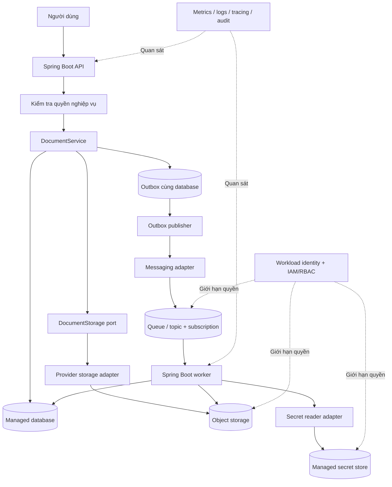
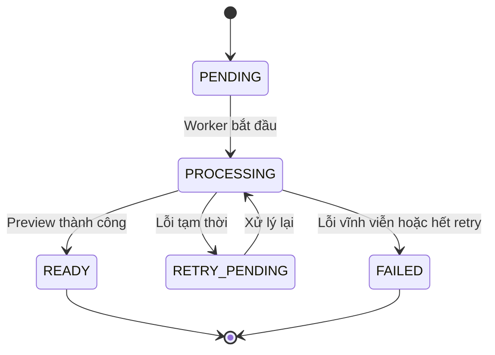
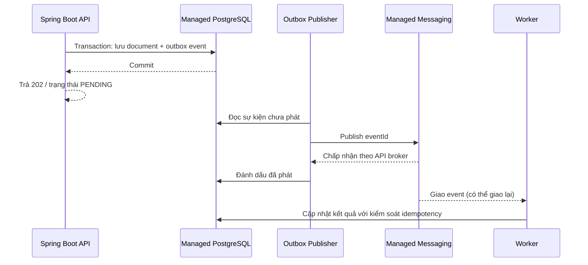

# Lộ trình học từ kết nối đầu tiên đến tích hợp có thể vận hành

> **Chương:** Định hướng  
> **Module:** `SPRING_CLOUD_PROVIDER_INTEGRATION`  
> **Phạm vi:** Thực hành tích hợp Spring Boot với dịch vụ managed của **AWS, Microsoft Azure và Google Cloud** qua Spring Cloud AWS, Spring Cloud Azure và Spring Cloud GCP khi phù hợp. Lộ trình nối các kỹ năng về danh tính, quyền, storage, messaging, dữ liệu, secret, kiểm thử tích hợp, khả năng chịu lỗi và đánh giá khác biệt giữa các cloud provider.

## 1. “Kết nối thành công” cách “vận hành được” bao xa?

Hãy hình dung ứng dụng Spring Boot đã có thể ghi một tệp vào Amazon S3 sau khi thêm starter và điền tên bucket. Đó là **kết quả đầu tiên có giá trị**, nhưng chưa thể kết luận hệ thống đã sẵn sàng cho người dùng thật.

Một hệ thống có thể chạy được bản demo nhưng thất bại khi:

- Container được restart, worker mất tác vụ đang chạy trong bộ nhớ.
- Ứng dụng local dùng quyền của developer, còn service production thiếu quyền đọc hoặc ghi object.
- Người dùng tải tệp quá lớn làm API dùng hết bộ nhớ.
- Cơ sở dữ liệu đã lưu metadata nhưng sự kiện phát qua messaging bị mất do lỗi mạng.
- Broker giao lại một thông điệp và worker thực hiện tác dụng phụ hai lần.
- Secret được rotate nhưng connection pool vẫn sử dụng credential cũ.
- Một region bị chậm, client retry đồng loạt và gây thêm tải.
- Chi phí request, data transfer, log và tài nguyên thử nghiệm vượt kỳ vọng.
- Mọi thứ “chạy được” nhưng không có metric, log hoặc hướng dẫn xử lý khi xảy ra sự cố.

Vì vậy, lộ trình cần phân biệt ba mức:

| Mức | Có thể chứng minh điều gì? | Chưa tự chứng minh điều gì? |
| --- | --- | --- |
| **Kết nối đầu tiên** | Spring Boot tạo được client, identity hợp lệ và thao tác một tài nguyên test thành công | An toàn, phục hồi, kiểm soát tải, chi phí |
| **Tích hợp đúng nghiệp vụ** | Ứng dụng có hợp đồng dữ liệu, phân quyền, trạng thái, xử lý lỗi và kiểm thử các luồng quan trọng | Chạy ổn định dưới tải thực tế hay khi sự cố kéo dài |
| **Tích hợp có thể vận hành** | Có cấu hình tách môi trường, kiểm soát IAM/secret, quan sát, quy trình khôi phục, kiểm thử sự cố, giới hạn tài nguyên và tài liệu vận hành | Không có nghĩa không bao giờ lỗi; phải đo và cải tiến liên tục |

**Mục tiêu học tập:** tự đi hết đường từ một thao tác cloud đơn giản đến một dịch vụ Spring Boot có thể triển khai, theo dõi, chẩn đoán và phục hồi có chủ đích.

## 2. Tình huống xuyên suốt: hệ thống tài liệu và tạo bản xem trước

Ta sử dụng một bài toán tương đối nhỏ nhưng chứa đủ các dạng tích hợp quan trọng:

1. Người dùng đăng nhập và tải tệp PDF lên Spring Boot API.
2. API kiểm tra quyền, kích thước và loại tệp; lưu PDF trong **managed object storage**.
3. Ứng dụng lưu metadata trong **managed relational database**.
4. Một sự kiện yêu cầu tạo bản xem trước được ghi nhận và chuyển tới **managed messaging**.
5. Spring Boot worker nhận sự kiện, đọc PDF, tạo bản xem trước và cập nhật trạng thái.
6. Ứng dụng đọc secret khi cần gọi một dịch vụ ngoài.
7. Người dùng gọi HTTP API để xem trạng thái `PENDING`, `READY` hoặc `FAILED`.

Bài toán này không bắt buộc sử dụng đúng từng sản phẩm trong mọi dự án. Đây là **đường thực hành chung** để so sánh cách tiếp cận ba provider.

### Kiến trúc mục tiêu



Ta sẽ **không xây tất cả ngay từ đầu**. Mỗi mốc chỉ thêm năng lực sau khi mốc trước có bằng chứng đã hoạt động.

## 3. Bản đồ lộ trình và điều kiện chuyển mốc

Lộ trình có tám mốc. Thời lượng mỗi mốc phụ thuộc kinh nghiệm người học, quyền truy cập cloud, tốc độ thực hành và phạm vi bài lab; **không gán số giờ cố định**.

| Mốc | Mục tiêu | Đầu ra cần giữ lại | Điều kiện chuyển mốc |
| --- | --- | --- | --- |
| **0. Chuẩn bị môi trường** | Hiểu Spring Boot, build, profile, SDK, giới hạn an toàn | Dự án chạy được; cấu hình tách dev/test; danh sách resource | Chạy app local và biết identity nào sẽ được dùng |
| **1. Kết nối đầu tiên** | Gọi thành công một managed service bằng identity phù hợp | Storage smoke test: ghi/đọc object | Ghi và đọc đúng nội dung; kiểm tra lỗi thiếu quyền |
| **2. Cô lập tích hợp** | Đưa client cloud sau port/adapter, quản lý cấu hình | `DocumentStorage` + adapter + unit test | Nghiệp vụ test được mà không cần cloud |
| **3. Messaging và trạng thái** | Đẩy công việc nền qua queue/topic, thiết kế delivery | Producer, worker, event ID, job state | Xử lý đúng cả message lặp và lỗi tạm thời |
| **4. Data và secret** | Kết nối database managed, bảo vệ secret, xử lý consistency | Metadata, outbox, secret access | Không mất event khi publish lỗi; hạn chế quyền đọc secret |
| **5. Kiểm thử tích hợp** | Kiểm chứng tại ranh giới SDK, emulator và cloud thật | Bộ test + kết quả test theo môi trường | Test thành công và thất bại có thể chạy lại |
| **6. Chịu lỗi và quan sát** | Timeout, retry, DLQ, metric, trace và runbook | Dashboard, alert, cách replay/phục hồi | Chẩn đoán được lỗi và khôi phục trong bài thử |
| **7. Triển khai và đánh giá** | Vận hành an toàn, quản lý chi phí và đối chiếu provider | Checklist release, ADR, bảng đánh đổi AWS/Azure/GCP | Có bằng chứng vận hành phù hợp với yêu cầu sản phẩm |

Đừng dùng “đã xem hết ví dụ” làm điều kiện hoàn thành. Mỗi mốc cần một **bằng chứng quan sát được**: kết quả test, API response, metric, log được lọc an toàn, sơ đồ hoặc tài liệu quyết định.

## 4. Mốc 0 — Chuẩn bị Spring Boot và môi trường có kiểm soát

### 4.1. Kiến thức đầu vào nên tự kiểm tra

Trước lần kết nối đầu tiên, người học nên:

- Chạy được một Spring Boot application từ IDE hoặc build tool.
- Hiểu `@SpringBootApplication`, bean, constructor injection, `@Configuration`, `@Bean` và auto-configuration.
- Tạo endpoint Spring MVC, phân biệt `GET`/`POST` và các status như `200`, `201`, `202`, `400`, `401`, `403`.
- Dùng `application.yml`, environment variables, profile và `@ConfigurationProperties`.
- Biết ý nghĩa timeout, exception, transaction database, retry và giới hạn kết nối.
- Hiểu `@Async` chạy trên thread pool trong một tiến trình; nó **không phải** hàng đợi bền vững.
- Biết một test unit có thể dùng fake hoặc mock adapter, trong khi test cloud cần resource và quyền thật.

Nếu một kỹ năng còn yếu, hãy thực hiện một bài tập ngắn ở local trước khi tiếp tục; ví dụ inject `DocumentStorage` giả vào `DocumentService` và kiểm tra một endpoint trả đúng HTTP status.

### 4.2. Tách môi trường và dự toán tài nguyên

Tạo hoặc được cấp quyền trong **môi trường thử nghiệm được phê duyệt** của tổ chức. Tài nguyên test nên nằm trong account/subscription/project chuyên biệt khi có thể; đặt tên có quy ước, tag/label người sở hữu và cách dọn dẹp.

Danh sách tài nguyên dự kiến ban đầu:

| Loại | Cần chuẩn bị | Vì sao? |
| --- | --- | --- |
| Cloud identity | Danh tính dev hoặc role/service account test, quyền tối thiểu | SDK phải biết ai đang gọi dịch vụ |
| Object storage | Bucket/container test, region/location cụ thể | Thử ghi/đọc mà không ảnh hưởng dữ liệu thật |
| Network | Endpoint, DNS, TLS và outbound access phù hợp | Tránh nhầm lỗi kết nối với lỗi SDK |
| Cấu hình | Region, resource name, profile và các biến môi trường | Một build chạy được qua nhiều môi trường |
| Chi phí | Hạn mức, cảnh báo và quy trình dọn tài nguyên | Tránh để tài nguyên test tồn tại ngoài ý muốn |

**Quy tắc an toàn:** không commit access key, service-account private key, client secret hoặc password vào Git. Ưu tiên cơ chế workload identity, federation hoặc credential ngắn hạn được SDK hỗ trợ. Local development có thể dùng công cụ đăng nhập chính thức của provider với quyền giới hạn.

### 4.3. Chọn phiên bản thư viện trước khi thêm starter

Ba họ Spring Cloud provider có vòng đời release riêng. Trước khi thêm dependency:

1. Xác định phiên bản **JDK** và **Spring Boot** đang dùng.
2. Chọn provider và dịch vụ thực tế, ví dụ AWS S3 hoặc Google Cloud Pub/Sub.
3. Đọc **ma trận tương thích** của dự án Spring Cloud AWS/Azure/GCP tương ứng.
4. Sử dụng BOM hoặc dependency management theo hướng dẫn của **chính họ thư viện đó**.
5. Khóa version đã xác minh trong build và cập nhật có kiểm thử.

Không giả định một phiên bản Spring Cloud AWS sẽ tương thích với tất cả phiên bản Spring Cloud Azure/GCP hoặc ngược lại. “Dependency tải về được” mới là kiểm tra build, **chưa là kiểm tra runtime**.

### Cổng nghiệm thu mốc 0

Ứng dụng khởi động được ở local với cấu hình test, có thể giải thích bean và profile đang dùng, biết cloud identity dự kiến của mình và không có secret hardcode trong mã hoặc cấu hình được commit.

## 5. Mốc 1 — Kết nối đầu tiên có thể lặp lại

Chọn **một** dịch vụ managed có thao tác đơn giản và kết quả dễ kiểm tra. Object storage là lựa chọn phù hợp: ghi một object nhỏ vào tài nguyên test rồi đọc lại đúng bytes.

### 5.1. Bản đồ ba phương án storage

| Provider | Managed service | Java client thường dùng | Spring integration khi phù hợp | Danh tính runtime |
| --- | --- | --- | --- | --- |
| AWS | Amazon S3 | AWS SDK for Java v2 `S3Client` | Spring Cloud AWS S3 starter | IAM role / credential provider chain |
| Azure | Azure Blob Storage | Azure Storage Blob Java SDK | Spring Cloud Azure Storage Blob starter | Managed Identity / Azure Identity |
| Google Cloud | Cloud Storage | Google Cloud Java client `Storage` | Spring Cloud GCP Storage starter | Service account / Application Default Credentials |

Tên client/starter thay đổi theo thư viện và phiên bản. Trên cả ba provider, việc tạo client thành công **không tự cấp quyền**. Thao tác ghi/đọc object phải được cloud IAM/RBAC và policy tài nguyên cho phép.

### 5.2. Ví dụ AWS: từ starter đến lần ghi/đọc đầu tiên

Giả sử đang dùng bộ Spring Boot và Spring Cloud AWS đã được xác nhận tương thích, có thể dùng dependency:

```xml
<dependency>
    <groupId>io.awspring.cloud</groupId>
    <artifactId>spring-cloud-aws-starter-s3</artifactId>
</dependency>
```

Một cấu hình minh họa:

```yaml
app:
  smoke:
    bucket: ${SMOKE_TEST_BUCKET}
spring:
  cloud:
    aws:
      region:
        static: ${AWS_REGION}
```

`app.smoke.bucket` là property **do ứng dụng tự định nghĩa**, còn nhóm `spring.cloud.aws.*` cần khớp với phiên bản Spring Cloud AWS đã chọn. Biến `SMOKE_TEST_BUCKET` và `AWS_REGION` do môi trường test cung cấp; không chứa access key/secret key trong file.

Ví dụ cấu hình một **smoke test chỉ chạy khi bật profile `smoke`**, sử dụng `S3Client` do Spring tạo:

```java
import java.nio.charset.StandardCharsets;
import java.util.Arrays;
import java.util.UUID;

import org.springframework.beans.factory.annotation.Value;
import org.springframework.boot.ApplicationRunner;
import org.springframework.context.annotation.Bean;
import org.springframework.context.annotation.Configuration;
import org.springframework.context.annotation.Profile;

import software.amazon.awssdk.core.sync.RequestBody;
import software.amazon.awssdk.services.s3.S3Client;
import software.amazon.awssdk.services.s3.model.GetObjectRequest;
import software.amazon.awssdk.services.s3.model.PutObjectRequest;

@Configuration
public class CloudSmokeConfiguration {

    @Bean
    @Profile("smoke")
    ApplicationRunner verifyS3ReadWrite(
            S3Client s3,
            @Value("${app.smoke.bucket}") String bucket) {

        return args -> {
            String key = "smoke/" + UUID.randomUUID() + ".txt";
            byte[] original = "spring-cloud-check"
                    .getBytes(StandardCharsets.UTF_8);

            s3.putObject(
                    PutObjectRequest.builder()
                            .bucket(bucket)
                            .key(key)
                            .contentType("text/plain")
                            .build(),
                    RequestBody.fromBytes(original));

            byte[] downloaded = s3.getObjectAsBytes(
                    GetObjectRequest.builder()
                            .bucket(bucket)
                            .key(key)
                            .build())
                    .asByteArray();

            if (!Arrays.equals(original, downloaded)) {
                throw new IllegalStateException("Object bytes mismatch");
            }

            System.out.println("S3 read/write PASS. Object key: " + key);
        };
    }
}
```

**Giả định để chạy ví dụ:**

- Bucket test đã tồn tại trong region phù hợp.
- Workload có quyền `s3:PutObject` và `s3:GetObject` cho prefix `smoke/` của bucket test, cùng các quyền bổ sung nếu chính sách mã hóa hoặc tài nguyên yêu cầu.
- Credential được SDK tìm qua cơ chế phù hợp; ví dụ local profile hoặc IAM role của môi trường chạy.
- Profile `smoke` được bật **một cách chủ động** chỉ ở môi trường test; nếu không có profile này, runner không được khởi chạy.
- Mỗi lần chạy tạo một object mới. Phải có quy trình dọn các object thuộc prefix `smoke/` hoặc lifecycle rule trên tài nguyên test; ví dụ không tự xóa vì để tránh phải cấp quyền xóa cho workload đang kiểm chứng quyền ghi/đọc.

Đây là smoke test minh họa, **không phải endpoint upload production**. Không ghi nội dung file, credential hoặc thông tin nhạy cảm vào log. Có thể thay `println` bằng logger ở mức phù hợp và đính correlation ID khi ứng dụng lớn hơn.

### 5.3. Cách làm tương đương với Azure và Google Cloud

Giữ cùng tiêu chí nghiệm thu: **ghi object nhỏ → đọc lại bytes → so sánh nội dung → kiểm tra đường lỗi quyền**.

**Azure Blob Storage:** tạo container trong storage account test; ứng dụng dùng Azure SDK/ Spring Cloud Azure starter phù hợp. Identity cần quyền data-plane cho hoạt động đọc và ghi blob, ở scope đủ hẹp. Không nhầm quyền quản lý resource trên portal với quyền truy cập dữ liệu blob.

**Google Cloud Storage:** tạo bucket thuộc project test; xác định location; ứng dụng dùng Google Cloud Java client hoặc Spring Cloud GCP Storage starter phù hợp. Danh tính local có thể dùng ADC, production dùng service account/Workload Identity. Cần role/permission cụ thể để tạo và đọc object theo policy.

Khi đổi provider, **giữ bài kiểm tra** chứ không sao chép nguyên class SDK: loại client, resource model, cấu hình identity và exception đều có thể thay đổi.

### 5.4. Kiểm tra đường thất bại có kiểm soát

Một kết nối đầu tiên chỉ đáng tin khi giải thích được lỗi. Trong môi trường test, có thể kiểm tra danh tính bị thiếu quyền `GetObject` hoặc quyền tương ứng của provider. Kết quả mong đợi là **request bị từ chối rõ ràng**, không phải hệ thống tự fallback sang một credential có quyền admin.

Phân loại lỗi:

| Biểu hiện | Hướng kiểm tra |
| --- | --- |
| Không có bean client | Starter/dependency, auto-configuration, component scan, cấu hình |
| Không tìm được credential | Nguồn danh tính của SDK và môi trường chạy |
| Authentication/authorization error | Principal thực tế, IAM/RBAC, policy và resource scope |
| Resource not found | Bucket/container, project/account, region, endpoint |
| Timeout/network error | DNS, proxy, firewall, TLS, mạng cloud |
| Quota/throttling | Giới hạn dịch vụ, concurrency, backoff và số lần retry |

### Cổng nghiệm thu mốc 1

Có bằng chứng cho **đường thành công và đường bị từ chối do thiếu quyền** trong môi trường test. Có thể nêu chính xác ứng dụng dùng identity nào và object được đặt ở đâu; không phải thêm credential vào source code để cho ví dụ hoạt động.

## 6. Mốc 2 — Từ thử nghiệm SDK đến cấu trúc Spring Boot có thể bảo trì

Khi đã gọi dịch vụ thành công, bước tiếp theo là đưa lời gọi vào **ranh giới tích hợp** của ứng dụng thay vì để client SDK xuất hiện khắp controller và service nghiệp vụ.

### 6.1. Định nghĩa port theo khả năng nghiệp vụ

```java
public interface DocumentStorage {
    void put(String objectKey, byte[] content, String contentType);
    byte[] get(String objectKey);
}
```

`DocumentStorage` chỉ mô tả khả năng ứng dụng cần. Nó không nhắc tới `S3Client`, `BlobContainerClient` hay `Storage`. Trong dự án thật, với file lớn nên thiết kế API streaming/chunked phù hợp thay vì dùng `byte[]` cho mọi trường hợp.

Adapter AWS, Azure hoặc GCP triển khai interface này bằng client/template tương ứng. Một số cách làm cụ thể:

- **AWS:** adapter inject `S3Client` hoặc template do Spring Cloud AWS hỗ trợ theo phiên bản.
- **Azure:** adapter dùng Azure Blob SDK/bean được Spring Cloud Azure cấu hình.
- **GCP:** adapter dùng `Storage` hoặc API Spring Cloud GCP Storage phù hợp.

### 6.2. Để service nghiệp vụ sử dụng hợp đồng đó

```java
import org.springframework.stereotype.Service;

@Service
public class DocumentService {
    private final DocumentStorage storage;

    public DocumentService(DocumentStorage storage) {
        this.storage = storage;
    }

    public void saveValidatedPdf(String key, byte[] pdfBytes) {
        storage.put(key, pdfBytes, "application/pdf");
    }
}
```

Method có tên `saveValidatedPdf` để nhấn mạnh điều kiện: quyền người dùng, kích thước và loại tệp đã được kiểm tra trước khi lưu. Trong thực tế, phải bảo đảm điều kiện ấy ở ranh giới phù hợp; tên method không thay thế validation.

### 6.3. Kiểm thử không cần cloud

Fake đơn giản dùng trong unit test:

```java
import java.util.HashMap;
import java.util.Map;

public final class InMemoryDocumentStorage implements DocumentStorage {
    private final Map<String, byte[]> objects = new HashMap<>();

    @Override
    public void put(String key, byte[] bytes, String contentType) {
        objects.put(key, bytes.clone());
    }

    @Override
    public byte[] get(String key) {
        byte[] content = objects.get(key);
        if (content == null) {
            throw new IllegalArgumentException("Object not found: " + key);
        }
        return content.clone();
    }
}
```

Ví dụ fake được dùng **trong test**, không thay storage production; nó không mô phỏng IAM, độ trễ, versioning hoặc lỗi network. Khi có nhiều adapter trên classpath, cấu hình injection phải chọn đúng bean bằng profile, qualifier hoặc điều kiện rõ ràng.

### 6.4. Đặc tả hợp đồng không được mơ hồ

Port cần nói rõ:

- `put` tạo mới hay được phép ghi đè?
- Nếu object không tồn tại, `get` trả lỗi nào ở cấp ứng dụng?
- Có cần checksum, version/ETag hoặc metadata không?
- Adapter retry điều gì và có thể làm lặp tác dụng phụ không?
- Ai đặt tên object key? Ai kiểm tra người dùng có quyền sở hữu nó?
- Lỗi permission, timeout, throttling được ánh xạ thành lỗi nghiệp vụ/ứng dụng thế nào?

Chỉ trừu tượng phần **hành vi chung thật sự cần**. Một port hỗ trợ presigned URL, retention và object lock có thể phải định nghĩa thêm các capability vì dịch vụ cloud không giống nhau hoàn toàn.

### Cổng nghiệm thu mốc 2

`DocumentService` chạy unit test bằng fake storage; adapter được test riêng; tên bucket/container và endpoint không hardcode trong service nghiệp vụ. Việc chuyển một adapter khác không làm các test nghiệp vụ đổi theo SDK.

## 7. Mốc 3 — Messaging, worker và xử lý bất đồng bộ bền vững

Sau khi lưu tài liệu, ứng dụng cần tạo preview trong nền. Một lệnh `@Async` có thể phù hợp cho thao tác ít quan trọng trong cùng tiến trình, nhưng không mặc nhiên giữ công việc nếu container chết. Với yêu cầu **có thể phục hồi**, cần ghi nhận ý định xử lý bền vững và dùng messaging/worker thích hợp.

### 7.1. Mapping dịch vụ messaging

| Nhu cầu | AWS | Azure | Google Cloud |
| --- | --- | --- | --- |
| Producer gửi công việc | Amazon SQS | Azure Service Bus queue | Pub/Sub topic |
| Consumer nhận công việc | Poll/receive SQS queue | Service Bus receiver/listener | Pub/Sub subscription consumer |
| Xử lý lại khi lỗi | Visibility timeout, redelivery, DLQ theo cấu hình | Lock/settlement, retry, DLQ | Ack deadline, redelivery, retry/DLQ theo cấu hình |
| Thư viện Spring thường xem xét | Spring Cloud AWS SQS | Spring Cloud Azure Service Bus | Spring Cloud GCP Pub/Sub |

Không coi ba cơ chế này là cùng một API. Ví dụ, **SQS queue** và **Pub/Sub topic + subscription** khác cách quản lý consumer và acknowledgement. Thực hành một provider trước; chuyển sang provider khác bằng cách xây adapter và kiểm thử lại semantics.

### 7.2. Định nghĩa sự kiện có danh tính ổn định

```java
public record DocumentUploaded(
        String eventId,
        String documentId,
        String objectKey,
        int schemaVersion) {
}

public interface DocumentEventPublisher {
    void publish(DocumentUploaded event);
}
```

`eventId` phải ổn định khi gửi lại cùng một sự kiện logic; `schemaVersion` giúp consumer xử lý thay đổi contract có kiểm soát. Message chỉ nên chứa metadata cần thiết, **không chứa bytes PDF hay secret**.

### 7.3. Hợp đồng HTTP cho công việc nền

Một API có thể trả:

```http
POST /documents/doc-123/preview-jobs HTTP/1.1
Idempotency-Key: doc-123-preview-v1
Authorization: Bearer <access-token>

HTTP/1.1 202 Accepted
Location: /preview-jobs/job-456
Content-Type: application/json

{"jobId":"job-456","status":"PENDING"}
```

`202 Accepted` nghĩa là yêu cầu đã được chấp nhận, **không có nghĩa preview đã xong**. Trước khi trả 202, hệ thống nên ghi nhận job một cách bền vững theo hợp đồng. Endpoint `GET /preview-jobs/job-456` trả trạng thái hiện tại và không tiết lộ job của người dùng khác.

### 7.4. Trạng thái và nguyên tắc xử lý trùng



Consumer cần chịu được **at-least-once delivery hoặc khả năng nhận lại** nếu cơ chế provider/configuration cho phép. Một thiết kế phổ biến:

1. Nhận message có `eventId` và `documentId`.
2. Kiểm tra job đã `READY` hoặc event đã xử lý chưa bằng **trạng thái bền vững**.
3. Chuyển `PENDING → PROCESSING` bằng thao tác có điều kiện/transaction để hạn chế hai worker xử lý cùng job.
4. Tạo preview với object key ổn định; lưu kết quả và cập nhật trạng thái.
5. Chỉ acknowledge/settle theo ngữ nghĩa broker sau khi đạt điểm an toàn đã xác định.
6. Nếu lỗi tạm thời, retry có giới hạn và backoff; nếu không thể xử lý, đưa đến dead-letter theo cơ chế của dịch vụ để kiểm tra/replay có kiểm soát.

Một biến `boolean processed` trong bộ nhớ **không bảo vệ được** khi worker restart hoặc nhiều replica cùng chạy.

### Cổng nghiệm thu mốc 3

Một event hợp lệ được xử lý thành công; gửi lại cùng `eventId` không tạo preview/hành động nghiệp vụ trùng. Làm worker dừng giữa chừng và chứng minh job có thể được xử lý tiếp hoặc chuyển sang trạng thái lỗi có thể truy vết.

## 8. Mốc 4 — Database managed, secret và tính nhất quán

### 8.1. Database managed vẫn cần data access và transaction

Ứng dụng có thể dùng PostgreSQL managed:

| Provider | Ví dụ dịch vụ | Lớp truy cập thường dùng trong Spring Boot |
| --- | --- | --- |
| AWS | Amazon RDS for PostgreSQL | PostgreSQL JDBC driver + Spring JDBC/JPA/R2DBC |
| Azure | Azure Database for PostgreSQL | PostgreSQL JDBC driver + Spring JDBC/JPA/R2DBC |
| Google Cloud | Cloud SQL for PostgreSQL | PostgreSQL JDBC driver + Spring JDBC/JPA/R2DBC |

Không nhất thiết phải dùng starter provider để thực hiện mọi câu SQL. Spring Data/JDBC/JPA chịu trách nhiệm ở lớp mô hình dữ liệu; cloud lo một phần vận hành hạ tầng database. Ứng dụng vẫn cần migration schema, transaction, chỉ mục, timeout, pool kết nối và phân quyền dữ liệu.

### 8.2. Cơ chế outbox cho lời gọi giữa DB và broker

Một lỗi rất quan trọng xảy ra khi:

```text
Transaction lưu metadata commit thành công
    ↓
Ứng dụng gửi message đến broker
    ↓
Mất mạng hoặc ứng dụng crash
    ↓
Database có document nhưng worker không nhận thông báo
```

**Transactional outbox** giải quyết khoảng hở bằng cách ghi **document metadata và event cần phát trong cùng một database transaction**. Một publisher riêng đọc outbox, gửi message rồi cập nhật trạng thái đã gửi. Nếu publisher crash sau lúc gửi nhưng trước lúc cập nhật outbox, message có thể được gửi lại; do đó **consumer vẫn phải idempotent**.



Lưu ý: **upload object và commit database** vẫn không cùng một transaction ACID mặc định. Nếu upload file thành công rồi DB commit lỗi, cần chiến lược dọn orphan object, trạng thái upload tạm hoặc reconcile. Outbox dành riêng cho khoảng hở **DB ↔ publish message**.

### 8.3. Secret manager: đọc đúng bí mật bằng đúng danh tính

| Provider | Ví dụ secret store | Workload identity phù hợp |
| --- | --- | --- |
| AWS | AWS Secrets Manager | IAM role/credentials được cấp quyền đọc secret cụ thể |
| Azure | Azure Key Vault | Managed Identity/Entra identity với quyền phù hợp |
| Google Cloud | Secret Manager | Service account/Workload Identity với quyền secret version access phù hợp |

Đừng đưa mật khẩu DB hoặc token gọi dịch vụ ngoài vào source code. Tùy môi trường, secret có thể được inject vào cấu hình runtime hoặc đọc qua SDK/ Spring Cloud integration được hỗ trợ.

**Kiểm thử bắt buộc**: ứng dụng đọc được **đúng secret** cần thiết; workload khác không đọc được; khi secret thay đổi, ứng dụng có quy trình refresh/reconnect rõ ràng. Secret manager không tự đảm bảo mọi connection đã sử dụng giá trị mới nếu code chưa hỗ trợ rotation.

### Cổng nghiệm thu mốc 4

Có database migration và connection pool được cấu hình; metadata và outbox commit cùng transaction; thực nghiệm được tình huống publisher lỗi rồi khôi phục; secret không nằm trong repository hoặc log và quyền đọc secret được giới hạn.

## 9. Mốc 5 — Kiểm thử tích hợp theo đúng ranh giới

Đến mốc này, “unit test đều xanh” là cần nhưng chưa đủ. Tích hợp cloud phải được kiểm tra theo các câu hỏi khác nhau ở mỗi tầng.

| Tầng | Mục tiêu | Ví dụ |
| --- | --- | --- |
| **Unit test nghiệp vụ** | Xác minh quy tắc mà không cần cloud | Fake `DocumentStorage` và `DocumentEventPublisher` |
| **Adapter test** | Mapping request, object key, metadata, exception | Mock SDK client hoặc test tập trung adapter |
| **HTTP test** | Status, validation, authentication/authorization | `MockMvc` hoặc công cụ phù hợp |
| **Emulator-based integration** | Đường gọi API, serialization và cấu hình cơ bản | LocalStack cho một số AWS APIs; Azurite cho Azure Blob; Pub/Sub emulator của GCP |
| **Cloud integration test** | IAM, resource, region, network và hành vi dịch vụ thật | Bucket/queue/secret thuộc môi trường test |
| **Failure test** | Timeout, throttling, duplicate, DLQ, mất kết nối | Fault injection có kiểm soát và kiểm tra trạng thái |
| **Load test** | Latency, throughput, backlog và tài nguyên | Đo theo SLO của sản phẩm, tránh dùng thông số giả định như cam kết cloud |

Emulator có thể không hỗ trợ đầy đủ IAM, quota, độ trễ hay delivery semantics của dịch vụ thật; vì vậy không dùng nó làm bằng chứng duy nhất cho một đặc tính bảo mật hoặc độ tin cậy.

### 9.1. Bộ tiêu chí kiểm chứng theo hành vi

Đối với hệ thống tài liệu, tối thiểu cần kiểm tra:

- Upload xong, restart API, vẫn đọc đúng bytes và metadata của tài liệu.
- User B không đọc được tài liệu của User A; test ở **HTTP/API** và kiểm tra quyền workload ở **cloud IAM**.
- Tệp quá cỡ bị từ chối mà không giữ quá nhiều dữ liệu trong bộ nhớ.
- Object storage timeout được xử lý có giới hạn, không che giấu trạng thái chưa rõ.
- Event được phát lại với cùng `eventId` nhưng preview/notification không bị tác dụng phụ lặp.
- Publisher lỗi sau DB commit: outbox vẫn lưu sự kiện và có thể phát tiếp.
- Worker lỗi liên tục: retry hữu hạn, message lỗi đi vào DLQ hoặc trạng thái cần xử lý theo policy.
- Khi secret bị thu hồi hoặc rotate, lỗi được phát hiện và vận hành có quy trình khôi phục.
- Resource và dữ liệu test có chính sách dọn dẹp và không phụ thuộc tài khoản production.

### 9.2. Kiểm thử bất đồng bộ theo trạng thái

Không nên viết test “`sleep(5 giây)` rồi chắc rằng worker đã chạy xong”. Thay vào đó, dùng polling có **timeout hữu hạn** đến khi trạng thái mong đợi xuất hiện, hoặc một cơ chế đồng bộ test thích hợp.

Ví dụ contract:

```text
Given: một document hợp lệ và eventId = evt-101
When: gửi DocumentUploaded(evt-101) hai lần
Then: job chuyển READY không quá một lần về mặt tác dụng phụ
And: chỉ một preview kết quả thuộc khóa nghiệp vụ
And: hệ thống không mất dữ liệu khi consumer được khởi động lại
```

Test cụ thể phải dựa vào trạng thái bền vững, không dựa vào một biến tạm trong worker.

### 9.3. Test danh tính phải là test thật

Một client được inject thành công chỉ chứng minh quá trình cấu hình Spring tương ứng. Kiểm thử danh tính cần xác nhận chính identity đang chạy có quyền chính xác lên tài nguyên test và bị từ chối ngoài phạm vi. Đây là lý do cần ít nhất một integration test chạy **với cơ chế credential tương tự production**.

### Cổng nghiệm thu mốc 5

Có một bộ test có thể chạy lại và mô tả rõ loại bằng chứng của từng tầng. Kết quả bao gồm ít nhất một trường hợp thất bại có kiểm soát và một integration test cloud thật, thay vì chỉ có mock SDK.

## 10. Mốc 6 — Từ hoạt động được đến chịu lỗi và quan sát được

Mốc này biến phần tích hợp thành một thành phần có thể theo dõi, chẩn đoán và vận hành.

### 10.1. Timeout, retry và giới hạn tải

| Trường hợp lỗi | Cách phản ứng gợi ý | Vì sao? |
| --- | --- | --- |
| Thiếu quyền hoặc cấu hình sai | Fail nhanh, ghi mã lỗi đủ để chẩn đoán, sửa cấu hình/IAM | Retry không tạo ra quyền |
| Timeout mạng hoặc lỗi dịch vụ tạm thời | Retry có giới hạn, exponential backoff/jitter khi phù hợp | Tránh retry đồng loạt làm sự cố nặng thêm |
| Throttling/rate limit | Giảm concurrency, backoff theo chính sách dịch vụ | Giới hạn tải lên provider |
| Payload không hợp lệ | Đưa vào luồng lỗi/diagnostic, không retry vô hạn | Cùng dữ liệu sai sẽ lặp lại thất bại |
| Message xử lý trùng | Kiểm soát event ID/business key và trạng thái | Hạn chế side effect lặp |
| Worker bị lỗi kéo dài | Giới hạn retry, DLQ và quy trình replay | Giữ luồng message chính có thể tiến tiếp |

Retry **không** làm cho một thao tác bất kỳ trở thành an toàn. Với một side effect không có idempotency key, client timeout có thể xảy ra sau khi dịch vụ đã thực hiện thành công. Trước khi retry phải hiểu ngữ nghĩa của thao tác và thiết kế cách phát hiện yêu cầu đã được xử lý.

### 10.2. Observability: tối thiểu cần những gì?

| Thành phần | Metric/log/trace cần có | Câu hỏi vận hành trả lời được |
| --- | --- | --- |
| HTTP API | Request rate, p95 latency, error rate, request ID | Người dùng có gọi được API không? |
| Storage adapter | Số thao tác ghi/đọc, độ trễ, lỗi theo loại, retry count | Storage chậm, hết quota hay thiếu quyền? |
| Database | Pool saturation, query time, transaction failure | Có nghẽn DB hoặc giữ kết nối quá lâu không? |
| Outbox publisher | Event tồn, tuổi event lâu nhất, publish error | Có job nào chưa tới được broker? |
| Messaging | Backlog, age of message, redelivery, DLQ depth | Worker có đang theo kịp tải không? |
| Worker | Throughput, success/failure, duration, duplicate suppressed | Preview có hoàn tất trong mục tiêu đặt ra không? |
| Secret/IAM | Access denied, sự kiện audit, rotation status | Identity và secret còn hoạt động đúng không? |

Spring Boot Actuator cùng Micrometer/OpenTelemetry có thể đóng góp metrics/traces, kết hợp với CloudWatch (AWS), Azure Monitor hoặc Cloud Monitoring/Logging (GCP) theo môi trường. Không nên đưa secret, token hoặc nội dung PDF vào log; dùng document ID, event ID và correlation ID.

### 10.3. Mục tiêu đo lường: ví dụ để luyện tập

Đây là **mục tiêu giả định của bài lab**, cần thay bằng yêu cầu thực của sản phẩm:

| SLI/SLO bài lab | Mục tiêu giả định | Cách quan sát |
| --- | --- | --- |
| API tạo job | p95 dưới **500 ms** sau khi yêu cầu hợp lệ được nhận (không bao gồm tải lên file lớn) | HTTP latency |
| Preview | 99% job `READY` trong **2 phút** | `createdAt` đến `readyAt` |
| Tác vụ mắc kẹt | Không có outbox event chưa phát quá **5 phút** trong điều kiện bình thường | Oldest outbox age |
| Lỗi worker | Có cảnh báo khi DLQ tăng trong khoảng quan sát | DLQ count + alert |
| Truy cập không hợp lệ | Bị từ chối và có audit phù hợp | HTTP authorization + cloud audit |

Nếu một tiêu chí không đo được, nó chưa đủ rõ để làm cổng nghiệm thu. Ví dụ, “preview nhanh” cần được diễn giải bằng mốc bắt đầu/kết thúc và percentile hoặc tỷ lệ hoàn tất.

### 10.4. Runbook: người trực hệ thống sẽ làm gì?

Một runbook tối thiểu nên bao gồm:

- **Triệu chứng:** ví dụ backlog tăng, p95 xấu hoặc lượng `AccessDenied` tăng.
- **Cách xác nhận:** dashboard, log/query, correlation ID và các tài nguyên liên quan.
- **Phân loại:** IAM/config, mạng, throttling, DB, poison message hoặc lỗi nghiệp vụ.
- **Biện pháp khôi phục:** rollback config, sửa quyền có kiểm soát, tăng khả năng xử lý trong giới hạn, replay message từ DLQ khi đã xử lý nguyên nhân.
- **Điều kiện an toàn:** không replay bừa bãi khi idempotency chưa được xác minh; không mở quyền admin cho toàn bộ workload để giải quyết một lỗi.
- **Đánh giá sau sự cố:** nguyên nhân, phạm vi ảnh hưởng, mất dữ liệu/tác dụng phụ lặp, chỉ số cần thêm.

### Cổng nghiệm thu mốc 6

Trong một bài thực nghiệm, cố tình cấu hình sai quyền hoặc gây lỗi tạm thời và **dùng metric/log/runbook để tìm nguyên nhân**. Với DLQ, trình bày được cách kiểm tra và replay có kiểm soát mà không tạo lại tác dụng phụ nghiệp vụ.

## 11. Mốc 7 — Triển khai an toàn, chi phí và so sánh provider

### 11.1. Release checklist

Trước khi cho người dùng thật sử dụng một tích hợp cloud, cần xác nhận các nhóm sau:

| Nhóm | Câu hỏi trước release |
| --- | --- |
| **Dependency** | Spring Boot/JDK và Spring Cloud provider starter/SDK đã được xác minh tương thích? |
| **Cấu hình** | Tài nguyên, region, project/subscription/account và endpoint đúng môi trường? |
| **IAM** | Identity runtime được cấp đúng quyền cần thiết và không cấp quyền rộng? |
| **Secret** | Không có secret trong Git/log, rotation/reconnect được kiểm tra? |
| **Dữ liệu** | Retention, lifecycle, backup/restore, migration và chính sách xóa được xác định? |
| **Messaging** | Retry, ack/settlement, ordering, idempotency, outbox và DLQ đã được kiểm thử? |
| **Sự cố** | Timeout, quota, backpressure và các lỗi provider được phân loại? |
| **Quan sát** | Có dashboard, alert, correlation ID và runbook? |
| **Triển khai** | Có rollback, health/readiness, cấu hình môi trường và phương án khôi phục? |
| **Chi phí** | Có ngân sách, tag/label, dự toán request/egress, cảnh báo và dọn tài nguyên test? |

**Sẵn sàng vận hành** không có nghĩa mọi rủi ro biến mất. Nó nghĩa là nhóm đã nhận diện các rủi ro liên quan, kiểm soát chúng theo mức chấp nhận của sản phẩm và có cách phát hiện/phục hồi khi hệ thống sai lệch.

### 11.2. Chi phí cần nhìn theo luồng xử lý

Trong ví dụ tài liệu, chi phí gồm nhiều thành phần:

```text
Tổng chi phí ước tính
  = lưu trữ object + số request lưu/đọc
  + data transfer và egress (nhất là cross-region/cross-cloud)
  + message publish/receive/retention
  + compute của API và worker
  + managed database + backup
  + secret access, log/metric/tracing
  + chi phí vận hành, support và xử lý sự cố
```

Không tự kết luận provider nào rẻ hơn khi chưa có region, traffic, cỡ file, retention và mô hình đọc/ghi thực tế. Một hệ thống retry quá nhiều còn có thể làm tăng cả độ trễ lẫn chi phí. Dùng ước lượng theo **tải bình thường**, **đỉnh tải** và **tình huống lỗi lặp**.

### 11.3. Bảng so sánh sau khi đã thực hành cùng một use case

| Tiêu chí so sánh | AWS | Azure | Google Cloud | Bằng chứng cần thu thập |
| --- | --- | --- | --- | --- |
| Object storage | S3 | Blob Storage | Cloud Storage | Test put/get, metadata, signed access nếu cần |
| Messaging | SQS | Service Bus | Pub/Sub | Test retry, redelivery, ordering, DLQ |
| Relational data | RDS PostgreSQL | Azure Database for PostgreSQL | Cloud SQL PostgreSQL | Migration, transaction, pool/latency |
| Secret | Secrets Manager | Key Vault | Secret Manager | Test quyền đọc, rotate/reconnect |
| Workload identity | IAM role và credential chain | Managed Identity / Entra ID | Service account / Workload Identity | Principal thực tế, quyền tối thiểu |
| Spring integration | Spring Cloud AWS | Spring Cloud Azure | Spring Cloud GCP | Compatibility, client lifecycle, API hỗ trợ |
| Vận hành | CloudWatch/CloudTrail | Azure Monitor/Activity Log | Cloud Monitoring/Logging/Audit | Metric, audit, alert, chi phí thực nghiệm |

Các dịch vụ nằm cùng hàng **không hẳn tương đương API hoặc semantics**. Việc chuyển cloud có thể giữ nguyên interface nghiệp vụ, nhưng phải thay adapter, identity/policy, endpoint, resource model và bộ integration test theo provider.

### 11.4. ADR: ghi quyết định kỹ thuật

Một bản **Architecture Decision Record (ADR)** đủ dùng cho bài lab nên có:

1. **Bối cảnh**: yêu cầu nghiệp vụ và giới hạn thực tế.
2. **Phương án**: các dịch vụ/thiết kế từng được xem xét.
3. **Quyết định**: provider, service, kiểu SDK/starter/adapter và luồng dữ liệu.
4. **Lý do**: vì sao đáp ứng các tiêu chí quan trọng.
5. **Hệ quả**: lock-in, chi phí, quyền, rủi ro xử lý lỗi, yêu cầu vận hành.
6. **Bằng chứng**: kết quả test và metric có nguồn gốc rõ.
7. **Điều kiện xem lại**: thay đổi traffic, retention, region, chi phí hoặc nhu cầu đa cloud.

Không cần ép mọi dự án phải hỗ trợ cả ba provider ngay. Học ba cách tích hợp nhằm **hiểu lựa chọn và đánh đổi**; kiến trúc production chỉ nên gánh độ phức tạp đa cloud khi có yêu cầu thực sự.

### Cổng nghiệm thu mốc 7

Ứng dụng có thể triển khai ở một môi trường kiểm soát với identity runtime phù hợp, dashboard và runbook; có kế hoạch rollback/cleanup, ADR và so sánh ít nhất một khác biệt quan trọng giữa các provider dựa trên kết quả test.

## 12. Đường học theo vai trò: frontend, backend và vận hành

Cùng một lộ trình nhưng mỗi vai trò cần chú ý khác nhau.

| Vai trò | Điều cần nắm chắc | Tình huống phải xử lý được |
| --- | --- | --- |
| **Backend Spring Boot** | HTTP contract, DI, adapter, dữ liệu, idempotency, outbox, worker | API trả đúng trạng thái và phục hồi khi dependency lỗi |
| **Cloud/Platform engineer** | IAM/RBAC, identity runtime, network, secrets, resource provisioning, chi phí | Cấp quyền tối thiểu và giải quyết sự cố kết nối |
| **QA / Test engineer** | Unit/contract/integration/failure test, test data, emulator limitations | Chứng minh luồng đúng khi message lặp, lỗi quyền hoặc timeout |
| **SRE / Operations** | SLI/SLO, metric, trace, alert, DLQ, rollback và runbook | Phát hiện backlog tăng và phục hồi an toàn |
| **Tech lead / Architect** | Trade-off provider, consistency, portability, ADR, ngân sách | Chọn giải pháp dựa trên nhu cầu chứ không chỉ công nghệ quen thuộc |

Nếu học một mình, hãy lần lượt đóng các vai trò này ở quy mô nhỏ. Mục tiêu không phải trở thành chuyên gia của mọi dịch vụ cloud, mà là **biết câu hỏi nào phải được trả lời và ai chịu trách nhiệm**.

## 13. Capstone: hoàn thành một tích hợp có thể trình diễn và đánh giá

**Đề bài:** Xây tính năng upload PDF, tạo preview bất đồng bộ và đọc lại kết quả trên **một provider chính**. Sau đó, chọn một luồng nhỏ, ví dụ storage, để so sánh với **hai provider còn lại** ở mức adapter và integration test phù hợp.

### Bộ đầu ra cần bàn giao

1. **Sơ đồ kiến trúc**: API, database, object storage, outbox, publisher, broker, worker, secret store, workload identity.
2. **HTTP contract**: endpoint upload, endpoint tạo/đọc trạng thái job, validation, authorization, idempotency key nếu cần.
3. **Mã nguồn có ranh giới**: `DocumentStorage`, `DocumentEventPublisher` và adapter của provider; nghiệp vụ không import kiểu SDK.
4. **Cấu hình môi trường**: tên resource, region/project, profile, cách cấp workload identity và quyền tối thiểu; không chứa secret trong source code.
5. **Chứng cứ kiểm thử**: unit, adapter/contract, emulator nếu phù hợp, cloud integration, duplicate message, lỗi publish và lỗi IAM.
6. **Chứng cứ vận hành**: metric/API latency, backlog, DLQ, trace/correlation ID, runbook và chính sách cleanup test resources.
7. **ADR và bảng so sánh**: lý do chọn provider, trade-off giữa AWS/Azure/GCP và rủi ro còn lại.

### Bảng chấm tự đánh giá

| Nhóm năng lực | Chưa đạt | Đạt | Tốt |
| --- | --- | --- | --- |
| **Kết nối** | Chỉ chạy bằng credential cá nhân có quyền rộng | Ghi/đọc được resource test với identity và quyền phù hợp | Lặp lại được trên local và runtime với quyền giới hạn |
| **Kiến trúc** | SDK trộn trong controller/domain | Có adapter/port và cấu hình theo môi trường | Contract rõ, unit/adapter test độc lập, thay implementation dễ |
| **Messaging** | Fire-and-forget, không trạng thái | Có job state, retry và idempotency cơ bản | Có outbox, DLQ, test crash/replay và quan sát backlog |
| **Data/secret** | Credential hardcode, DB và publish có khoảng hở không xử lý | Có managed DB, secret access và quy trình xử lý lỗi | Kiểm thử consistency, rotation/reconnect và quyền tối thiểu |
| **Kiểm thử** | Chỉ kiểm thử đường thành công bằng tay | Có unit, integration và kiểm tra thiếu quyền | Có failure/load test gắn SLO và tái lập được |
| **Vận hành** | Không biết khi job mắc kẹt | Có log/metric, một alert và hướng dẫn xử lý | Có runbook, rollback, cost controls và ADR dựa trên bằng chứng |

### Bài thử nghiệm cuối

Thực hiện trong môi trường test có kiểm soát:

**Kịch bản A — sai quyền.** Chạy workload không có quyền đọc object kết quả. Dự kiến hệ thống từ chối đúng, có log lỗi an toàn và dashboard thể hiện lỗi; không tự cấp quyền admin.

**Kịch bản B — publisher gặp lỗi.** Cho publisher dừng sau khi metadata đã commit. Dự kiến event nằm trong outbox, có thể phát tiếp khi publisher phục hồi và không làm mất document.

**Kịch bản C — worker xử lý lặp.** Gửi cùng `eventId` hai lần hoặc làm worker crash sau lúc ghi preview nhưng trước ack. Dự kiến kết quả nghiệp vụ không nhân đôi và trạng thái cuối vẫn nhất quán.

**Kịch bản D — tải tăng.** Tăng số job trong giới hạn môi trường test. Đo queue/subscription backlog, độ tuổi job, concurrency và độ trễ; xác định khi nào cần scale worker hoặc giới hạn tốc độ đầu vào.

**Kịch bản E — thay đổi cấu hình.** Đổi resource test bằng cấu hình, không sửa `DocumentService`. Xác minh adapter và quyền mới hoạt động đúng; nếu chuyển provider, chạy lại integration test đặc thù thay vì coi cùng port là đủ.

## 14. Những đường tắt dễ khiến lộ trình dừng ở bản demo

| Đường tắt | Hệ quả có thể xảy ra | Thói quen nên xây |
| --- | --- | --- |
| Copy access key vào `application.yml` | Rò rỉ secret, khó rotate, quyền khó kiểm soát | Workload identity và secret manager |
| Dùng một bucket cho dev và production | Ghi nhầm hoặc xóa nhầm dữ liệu | Tách tài nguyên và quyền theo môi trường |
| Xem bean SDK tạo được là tích hợp xong | Bỏ sót IAM, endpoint, quota, network | Smoke test gọi API thật và test quyền |
| Trả `200` hoặc `201` khi job mới được xếp hàng | Giao diện hiểu sai trạng thái | Contract `202 Accepted` và endpoint theo dõi |
| Dùng `@Async` như hàng đợi bền vững | Mất công việc khi restart | Ghi nhận job và dùng messaging khi cần phục hồi |
| Retry mọi exception | Lỗi IAM không hết, side effect lặp, tăng tải | Phân loại lỗi, backoff, giới hạn retry, idempotency |
| Ghi DB rồi publish mà không có chiến lược lỗi | Mất event sau commit | Outbox hoặc cơ chế nhất quán phù hợp |
| Chỉ dùng unit test với mock SDK | Bỏ sót IAM/resource/semantics | Integration test trên cloud test |
| Không theo dõi DLQ và outbox age | Job mắc kẹt khó phát hiện | Metric, alert, runbook và replay có kiểm soát |
| Coi AWS, Azure và GCP giống nhau | Sai ack, signed access, quyền hoặc cấu hình | Test contract chung kèm test đặc thù provider |

## 15. Câu hỏi tự kiểm tra trước khi học sâu các dịch vụ cụ thể

Hãy thử tự trả lời mà không cần mở tutorial:

1. **Kết nối đầu tiên thành công** chứng minh được điều gì, và chưa chứng minh được điều gì về IAM, tải và phục hồi?
2. Làm sao phân biệt lỗi `NoSuchBeanDefinitionException` với lỗi `AccessDenied` của cloud resource?
3. Tại sao `@Async` không đủ để bảo đảm preview được xử lý sau khi container bị restart?
4. Khi DB đã commit nhưng publish lên queue bị timeout, cần cơ chế gì để không mất event?
5. Vì sao ngay cả khi dùng outbox, consumer vẫn phải idempotent?
6. Một port `DocumentStorage` có giúp chuyển S3 sang Blob Storage mà không cần integration test không? Vì sao?
7. Vì sao người dùng không được phép đọc tài liệu A vẫn có thể bị lộ dữ liệu nếu API thiếu authorization, dù IAM của ứng dụng hoàn toàn hợp lệ?
8. Metric nào cho biết job đang chờ trong queue lâu bất thường và ai sẽ xử lý DLQ?
9. Làm thế nào để kiểm chứng secret rotation mà không log hoặc đưa secret vào Git?
10. Nếu một cloud provider có giá lưu trữ thấp hơn nhưng egress cao, cần thu thập dữ liệu nào trước khi chọn?

Người học sẵn sàng bước vào các lab chuyên sâu khi trả lời được **ranh giới trách nhiệm**, **cách đo/kiểm chứng** và **cách xử lý thất bại**, thay vì chỉ nhớ tên starter hoặc tên dịch vụ.

---

## Ghi nhớ

Lộ trình từ **kết nối đầu tiên** tới **tích hợp có thể vận hành** là chuỗi năng lực tăng dần:

**Spring Boot và cấu hình → danh tính/quyền → thao tác managed service đầu tiên → port/adapter → messaging và trạng thái → database/secret/consistency → integration testing → retry/quan sát/khôi phục → triển khai, chi phí và quyết định provider.**

Đối với `SPRING_CLOUD_PROVIDER_INTEGRATION`, hãy giữ **AWS, Azure và Google Cloud** làm ba phương án thực hành và đối chiếu, nhưng chọn một provider chính cho lab xuyên suốt trước khi mở rộng. Mỗi cột mốc phải có **bằng chứng đúng hành vi** và phương án khi mọi thứ không diễn ra như mong đợi. Đó là khác biệt giữa một ví dụ gọi SDK chạy được và một thành phần Spring Boot mà nhóm có thể vận hành có trách nhiệm.
