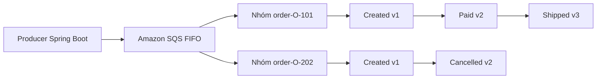

# Standard queue, FIFO queue và phạm vi bảo đảm thứ tự

Khi tích hợp một ứng dụng **Spring Boot** với **Amazon Simple Queue Service (Amazon SQS)** qua **Spring Cloud AWS**, lựa chọn loại hàng đợi quyết định cách hệ thống chịu tải, nhận thông điệp trùng lặp và bảo toàn thứ tự các sự kiện. Điểm quan trọng nhất là: **Standard queue không cam kết thứ tự; FIFO queue cam kết thứ tự trong cùng một `MessageGroupId`, không cam kết thứ tự toàn cục giữa mọi nhóm**.

Bài này tập trung vào ý nghĩa thực tế của các bảo đảm đó, cách chọn loại queue, cách gắn nhóm thông điệp khi gửi bằng `SqsTemplate`, cách xử lý bằng `@SqsListener` và những giới hạn cần thiết kế ở tầng nghiệp vụ. Các chủ đề quyền IAM, bảo mật và kiểm thử tích hợp được nhắc đến ở mức cần thiết cho ví dụ.

## 1. Mục tiêu học tập

Sau bài học, bạn có thể:

- Phân biệt **at-least-once delivery**, **best-effort ordering**, **FIFO ordering** và **deduplication** mà không nhầm chúng với giao dịch nghiệp vụ *exactly once*.
- Giải thích chính xác thứ tự nào được bảo đảm đối với các message **cùng nhóm**, **khác nhóm** và **được gửi bởi nhiều producer**.
- Chọn `MessageGroupId`, `MessageDeduplicationId` theo ranh giới nghiệp vụ và hiểu tác động của chúng tới khả năng xử lý song song.
- Tích hợp FIFO queue trong Spring Cloud AWS 3.x, xử lý lỗi, retry, visibility timeout và idempotency.
- Đề xuất một thí nghiệm chứng minh giới hạn thứ tự, thay vì suy luận từ một lần chạy may mắn.

## 2. Bài toán: sự kiện đơn hàng có cần đúng thứ tự không?

Giả sử dịch vụ `order-service` phát các sự kiện sau và `order-projection-service` cập nhật trạng thái đơn hàng từ SQS:

| Thời điểm nghiệp vụ | Đơn hàng | Sự kiện | Phiên bản |
|---|---|---|---|
| 09:00 | `O-101` | `OrderCreated` | 1 |
| 09:01 | `O-202` | `OrderCreated` | 1 |
| 09:02 | `O-101` | `OrderPaid` | 2 |
| 09:03 | `O-202` | `OrderCancelled` | 2 |
| 09:04 | `O-101` | `OrderShipped` | 3 |

Đối với `O-101`, việc cập nhật `Shipped` trước `Paid` có thể tạo trạng thái sai. Nhưng `O-101` và `O-202` là hai chuỗi công việc độc lập, hoàn toàn có thể xử lý song song. Điều đó dẫn đến yêu cầu: **giữ thứ tự trong từng đơn hàng, nhưng không cần một hàng đợi tuần tự cho tất cả đơn hàng**.

Ngược lại, một hệ thống tạo thumbnail ảnh, phân tích log hoặc gửi yêu cầu làm giàu dữ liệu có thể chấp nhận xử lý tác vụ nào xong trước cũng được. Khi đó, việc ép tuần tự thường không mang lại lợi ích.

## 3. So sánh Standard queue và FIFO queue

| Tiêu chí | Standard queue | FIFO queue |
|---|---|---|
| Mục tiêu chính | Thông lượng lớn, phân phối công việc linh hoạt | Bảo đảm thứ tự trong từng nhóm thông điệp |
| Thứ tự nhận | **Best effort**; thông điệp có thể được nhận không theo thứ tự gửi | **FIFO theo `MessageGroupId`**; không có thứ tự toàn cục giữa các nhóm |
| Giao thông điệp | **At least once**; có thể giao trùng | Có cơ chế chống gửi trùng bằng deduplication trong một cửa sổ thời gian; consumer vẫn phải chịu được retry và xử lý lại |
| `MessageGroupId` | Có thể dùng cho **fair queues** để phân phối công bằng giữa các tenant; **không tạo bảo đảm thứ tự** | Cần có khi gửi; xác định phạm vi bảo đảm thứ tự và đơn vị xử lý tuần tự |
| `MessageDeduplicationId` | Không dùng để chống trùng ở cấp FIFO | ID chống gửi trùng trong cửa sổ **5 phút**, hoặc dùng content-based deduplication |
| Xử lý đồng thời | Linh hoạt, không bị ràng buộc bởi thứ tự nhóm | Các nhóm khác nhau có thể xử lý song song; cùng nhóm cần xử lý theo chuỗi |
| Tên queue | Ví dụ: `image-jobs` | Phải có hậu tố `.fifo`, ví dụ: `order-events.fifo` |
| Trường hợp phù hợp | Xử lý ảnh, log, tác vụ độc lập, email notification có thể retry | Vòng đời đơn hàng, cập nhật giá theo mã sản phẩm, lệnh liên tiếp trên cùng tài khoản |

**Standard không đồng nghĩa với thứ tự ngẫu nhiên.** SQS cố gắng trả thông điệp gần theo thứ tự gửi, nên nhiều lần thử có thể cho kết quả `A → B → C`. Tuy nhiên, đó **không phải hợp đồng** mà ứng dụng được phép dựa vào. Việc phân tán dữ liệu, nhiều consumer, retry và sự cố mạng đều có thể làm trình tự quan sát được thay đổi.

Về thông lượng, Standard thường phù hợp khi cần khả năng mở rộng rất cao. FIFO cũng hỗ trợ **high-throughput FIFO**, batch và nhiều message group; giới hạn thực tế phụ thuộc Region, quota, cấu hình queue, kích thước batch và phân bố group. Không nên dựa vào một con số TPS cố định trong thiết kế mà chưa đối chiếu quota hiện hành.

> **Lưu ý về Standard fair queues:** AWS cho phép gửi `MessageGroupId` tới Standard queue để giúp phân phối thời gian chờ công bằng giữa các nhóm tenant khi có một nhóm tạo tải lớn. Tính năng này **không biến Standard thành FIFO** và không cấm hai message cùng nhóm được xử lý song song.

## 4. Chính xác FIFO bảo đảm thứ tự ở phạm vi nào?

### 4.1. Thứ tự trong cùng một message group

Với FIFO queue `order-events.fifo`, dùng ID nhóm dựa trên thực thể cần giữ thứ tự:

```text
MessageGroupId = order-O-101
    OrderCreated(v1) → OrderPaid(v2) → OrderShipped(v3)

MessageGroupId = order-O-202
    OrderCreated(v1) → OrderCancelled(v2)
```

Nếu các message trong nhóm `order-O-101` được SQS chấp nhận theo trình tự v1, v2, v3, queue duy trì thứ tự **gửi/nhận** đó trong nhóm. Trong khi xử lý một message của nhóm, hệ thống không cấp các message tiếp theo của nhóm ấy cho một consumer khác theo cách phá vỡ thứ tự; một lần nhận batch có thể chứa nhiều message cùng nhóm theo đúng trình tự. Các message thuộc `order-O-202` có thể được xử lý đồng thời với `order-O-101`.



Sơ đồ minh họa **hai chuỗi độc lập**: chỉ các mũi tên trong cùng một nhóm biểu thị quan hệ thứ tự bắt buộc. Không có yêu cầu `Paid(O-101)` phải chạy trước hay sau `Cancelled(O-202)`.

### 4.2. Không bảo đảm thứ tự giữa các nhóm

SQS có thể phân phối `O-202/v2` trước `O-101/v2` mặc dù hai sự kiện có mốc thời gian nghiệp vụ ngược lại. Điều này không vi phạm FIFO vì chúng thuộc **hai `MessageGroupId` khác nhau**.

Nếu tất cả message đều dùng **một** `MessageGroupId`, bạn sẽ thu được một chuỗi tuần tự chung, nhưng dễ tạo nút thắt cổ chai. Ngược lại, nếu mỗi message được cấp **một group ID ngẫu nhiên**, các message của cùng đơn hàng có thể chạy song song và mất ý nghĩa bảo đảm thứ tự cần có. Quy tắc chọn group là:

> **Cùng đối tượng cần thứ tự → cùng `MessageGroupId`; đối tượng độc lập → khác `MessageGroupId`.**

Ví dụ tốt: `order-<orderId>`, `account-<accountId>` hoặc `product-<productId>`, miễn là cùng một thực thể luôn ánh xạ về cùng một giá trị và ID hợp lệ theo quy định của SQS.

### 4.3. FIFO không tự sửa thứ tự phát sự kiện từ producer

Giả sử hai luồng của producer cùng gửi sự kiện của `O-101`:

1. Luồng A tạo `OrderPaid(v2)` nhưng bị chậm trước lệnh gửi.
2. Luồng B gửi `OrderShipped(v3)` và được SQS nhận trước.
3. Luồng A mới gửi `OrderPaid(v2)`.

FIFO sẽ giữ thứ tự **v3 → v2 theo thời điểm SQS nhận chúng**, dù sai thứ tự nghiệp vụ. `MessageGroupId` không phải bộ sắp xếp theo `eventTime`, `version` hay ID tự tăng. Nếu nhiều producer phát sự kiện cho cùng một thực thể, cần phối hợp thứ tự phát (chẳng hạn transactional outbox với một luồng xuất bản có thứ tự cho mỗi aggregate) và kiểm tra `version` khi tiêu thụ.

**Phân biệt ba lớp thứ tự:**

| Lớp | Ai chịu trách nhiệm? | Câu hỏi cần trả lời |
|---|---|---|
| Thứ tự thay đổi nghiệp vụ | Transaction/cơ sở dữ liệu và logic producer | `Paid(v2)` có được ghi nhận trước `Shipped(v3)` không? |
| Thứ tự message được SQS chấp nhận | Producer và việc gửi tới FIFO queue | SQS đã nhận v2 trước v3 trong cùng group chưa? |
| Thứ tự thực thi tác dụng phụ | Consumer, transaction, retry và acknowledgment | Đã commit v2 trước khi commit v3 chưa? |

Chỉ chọn FIFO là chưa đủ để đảm bảo cả ba lớp.

## 5. Chống trùng (deduplication) và ranh giới của “exactly once”

FIFO hỗ trợ hai cách xác định một lần gửi trùng:

- **Explicit deduplication:** producer truyền `MessageDeduplicationId` ổn định cho cùng một sự kiện, ví dụ `event-6e89...`.
- **Content-based deduplication:** khi bật, SQS tạo ID từ hàm băm SHA-256 của **message body**, không tính message attributes. Hai message có body giống nhau trong cùng cửa sổ có thể bị xem là trùng, dù bạn định dùng chúng cho hai hành động khác nhau.

Khi một message được gửi thành công, những lần gửi lại với cùng deduplication ID **trong cửa sổ 5 phút** được SQS chấp nhận nhưng không tạo thêm bản sao cần giao. Hết cửa sổ đó, SQS không còn bảo đảm nhận ra lần gửi trùng. Với FIFO high-throughput, phạm vi deduplication còn phụ thuộc thiết lập `DeduplicationScope` của queue; các sự kiện nghiệp vụ vẫn nên có `eventId` ổn định, không tái sử dụng cho hai sự kiện độc lập.

Ví dụ:

```text
09:00  Gửi eventId=evt-100, group=order-O-101  → thêm message
09:01  Retry eventId=evt-100, cùng group        → chống trùng khi gửi
09:07  Retry eventId=evt-100, cùng group        → ngoài cửa sổ 5 phút;
                                                  không thể dựa vào dedup của SQS
```

AWS mô tả FIFO bằng cụm “exactly-once processing” trong tài liệu tính năng. Khi thiết kế ứng dụng, cần hiểu **deduplication ở phía queue không phải một giao dịch đúng-một-lần cho database, email hay API bên ngoài**. Kịch bản phản ví dụ:

1. Consumer nhận `OrderPaid(v2)`.
2. Consumer **commit** cập nhật database thành công.
3. Tiến trình bị dừng **trước khi SQS nhận thao tác xóa message**.
4. Hết `visibility timeout`, message có thể được giao lại.

Nếu listener chỉ dựa vào FIFO mà chạy lại `chargeCard()` hay cập nhật số dư, tác dụng phụ có thể bị nhân đôi. Vì vậy, **consumer phải idempotent**, ví dụ có khóa duy nhất `eventId` trong bảng inbox/processed-events, thực hiện đánh dấu đã xử lý và thay đổi database **trong cùng một transaction**. Với API thanh toán bên ngoài, cần thêm idempotency key của chính API đó.

## 6. Visibility timeout, acknowledgment và ảnh hưởng tới thứ tự

Vòng đời xử lý một message SQS thường là:

```text
Available → ReceiveMessage → In flight / Invisible
                                   |
               +-------------------+------------------+
               |                                      |
       Xử lý thành công                         Lỗi hoặc mất kết nối
               |                                      |
       DeleteMessage (ack)                   Hết visibility timeout
               |                                      |
          Đã hoàn tất                         Có thể nhận lại để retry
```

`visibility timeout` **ẩn tạm thời** message khi consumer đang xử lý; nó không xóa message và không phải transaction lock của database. Với FIFO, message chưa được xử lý xong trong một group có thể làm các message tiếp theo của chính group đó phải chờ. Các group khác vẫn có thể tiếp tục tiến lên.

Khi dùng Spring Cloud AWS `@SqsListener`, cấu hình acknowledgment mặc định thường xóa message sau khi listener hoàn thành thành công; nếu listener ném lỗi, message không được acknowledge và có thể quay lại sau visibility timeout. Hành vi cụ thể phụ thuộc phiên bản và cấu hình `acknowledgementMode`, batch, `messageVisibilitySeconds` và listener container. Không nên bắt exception rồi chỉ ghi log nếu mong SQS retry, vì listener có thể kết thúc như thể xử lý thành công.

Các nguyên tắc vận hành:

1. Đặt visibility timeout đủ dài cho thời gian xử lý thực tế, hoặc chủ động gia hạn bằng `ChangeMessageVisibility` khi công việc lâu; nếu quá ngắn, retry có thể chồng lên một tác vụ chưa kết thúc.
2. Chỉ xác nhận thành công **sau khi** các thay đổi nghiệp vụ cần thiết đã bền vững. Nếu chuyển tác vụ sang thread khác rồi listener return ngay, acknowledgment có thể đến trước khi tác vụ thật sự hoàn thành.
3. Đặt retry có giới hạn, đo số lần nhận (`ApproximateReceiveCount`) và cấu hình **dead-letter queue (DLQ)** phù hợp. Đưa một message bị lỗi sang DLQ có thể cho phép các message phía sau tiếp tục, nhưng **phá vỡ chuỗi xử lý nghiệp vụ nguyên vẹn** nếu sự kiện thất bại là bước bắt buộc.
4. Nếu phải giữ thứ tự nghiêm ngặt cho toàn bộ vòng đời, cần chính sách xử lý message lỗi: tạm dừng, sửa dữ liệu, replay có kiểm soát hoặc hòa giải trạng thái, thay vì mặc định bỏ qua thông điệp lỗi.

## 7. Ví dụ Spring Boot + Spring Cloud AWS: giữ thứ tự theo đơn hàng

Ví dụ sau dùng API của **Spring Cloud AWS 3.x**. Ứng dụng giả định đã có queue `order-events.fifo` trên AWS, kết nối AWS SDK v2 và quyền IAM phù hợp. Mã chỉ minh họa luồng gửi/nhận; phương thức xử lý dữ liệu nghiệp vụ cần được hiện thực theo hệ quản trị dữ liệu thực tế.

### 7.1. Phụ thuộc và cấu hình

Với dự án Gradle đã dùng bộ quản lý phiên bản (BOM) Spring Cloud AWS **tương thích với phiên bản Spring Boot**, thêm starter:

```gradle
dependencies {
    implementation("io.awspring.cloud:spring-cloud-aws-starter-sqs")
}
```

Không gắn một phiên bản ngẫu nhiên vào starter nếu BOM đang quản lý phụ thuộc. Chọn Region ứng với queue của bạn:

```yaml
# application.yml
spring:
  cloud:
    aws:
      region:
        static: ap-southeast-1

app:
  sqs:
    order-events-queue: order-events.fifo
```

`ap-southeast-1` chỉ là ví dụ; queue phải tồn tại tại Region và tài khoản đang được cấu hình. Trong môi trường chạy thực tế, nên dùng **IAM role/identity và chuỗi tìm credentials mặc định của AWS SDK**, không ghi access key/secret key vào mã nguồn hay `application.yml`. Quyền cơ bản của producer bao gồm `sqs:SendMessage`; consumer thường cần `sqs:ReceiveMessage`, `sqs:DeleteMessage`, `sqs:GetQueueUrl`, `sqs:GetQueueAttributes` và `sqs:ChangeMessageVisibility` khi gia hạn thời gian ẩn. Cấp theo ARN queue cụ thể và theo những API thực sự được dùng.

### 7.2. Tạo bản ghi sự kiện có identity rõ ràng

```java
public record OrderEvent(
    String eventId,
    String orderId,
    long version,
    String eventType
) {}
```

Ở đây, `eventId` là ID duy nhất cho **một thay đổi nghiệp vụ** (không thay đổi khi retry); `orderId` là khóa để phân nhóm; `version` phản ánh thứ tự thay đổi trong nguồn dữ liệu nghiệp vụ.

### 7.3. Gửi FIFO message bằng `SqsTemplate`

```java
import io.awspring.cloud.sqs.operations.SqsTemplate;
import org.springframework.beans.factory.annotation.Value;
import org.springframework.stereotype.Service;

@Service
public class OrderEventPublisher {
    private final SqsTemplate sqsTemplate;
    private final String queueName;

    public OrderEventPublisher(
            SqsTemplate sqsTemplate,
            @Value("${app.sqs.order-events-queue}") String queueName) {
        this.sqsTemplate = sqsTemplate;
        this.queueName = queueName;
    }

    public void publish(OrderEvent event) {
        sqsTemplate.send(to -> to
            .queue(queueName)
            .payload(event)
            .messageGroupId("order-" + event.orderId())
            .messageDeduplicationId(event.eventId()));
    }
}
```

Điểm quyết định không nằm ở việc gọi `send()`, mà ở hai ID:

- `messageGroupId("order-" + event.orderId())` bảo toàn trình tự **cho từng đơn hàng**, cho phép các đơn hàng khác tiến hành độc lập.
- `messageDeduplicationId(event.eventId())` giúp retry gửi **cùng sự kiện** không tạo thêm message trong cửa sổ deduplication. Hai sự kiện nghiệp vụ khác nhau phải có ID khác nhau, kể cả body giống hệt nhau.

Spring Cloud AWS có thể tự phát sinh giá trị ngẫu nhiên cho các thuộc tính FIFO còn thiếu trong một số tình huống. **Không để framework tự sinh `MessageGroupId` cho yêu cầu thứ tự nghiệp vụ**: group ngẫu nhiên trên từng message làm mất ranh giới tuần tự theo `orderId`.

### 7.4. Nhận message bằng `@SqsListener`

```java
import io.awspring.cloud.sqs.annotation.SqsListener;
import org.springframework.stereotype.Component;

@Component
public class OrderEventConsumer {
    private final OrderProjectionService projectionService;

    public OrderEventConsumer(OrderProjectionService projectionService) {
        this.projectionService = projectionService;
    }

    @SqsListener("${app.sqs.order-events-queue}")
    public void onOrderEvent(OrderEvent event) {
        // Chỉ return thành công sau khi cập nhật đã commit.
        projectionService.applyIdempotently(event);
    }
}
```

`OrderProjectionService` là lớp nghiệp vụ của ví dụ, cần bạn hiện thực. Spring Cloud AWS 3.x nhận diện queue có hậu tố `.fifo`, tổ chức xử lý theo `MessageGroupId`, giữ thứ tự trong cùng nhóm và cho phép các nhóm khác xử lý song song. Khi xử lý một message lỗi, framework bảo vệ thứ tự các message phía sau trong cùng nhóm theo cơ chế retry/visibility của FIFO. Đừng tự chuyển mỗi sự kiện sang `@Async`, executor hoặc message broker khác rồi cho listener hoàn tất ngay nếu chưa có cơ chế duy trì thứ tự và xác nhận hoàn thành tương ứng.

Một hướng triển khai `applyIdempotently(event)` với PostgreSQL:

```sql
-- Pseudocode cho một transaction nghiệp vụ, không phải script SQL chạy độc lập.
BEGIN;

-- event_id có UNIQUE/PRIMARY KEY; nếu đã tồn tại thì bỏ qua toàn bộ tác vụ.
INSERT INTO processed_event(event_id)
VALUES (:event_id)
ON CONFLICT (event_id) DO NOTHING;

-- Nếu INSERT không thêm dòng: COMMIT và return (message đã xử lý).
-- Nếu INSERT thành công: khóa bản ghi projection của order_id.
SELECT version
FROM order_projection
WHERE order_id = :order_id
FOR UPDATE;

-- Chỉ tiếp tục khi incoming_version = current_version + 1.
-- Nếu có khoảng trống phiên bản: ROLLBACK, điều tra/retry/hòa giải.
UPDATE order_projection
SET version = :incoming_version, status = :new_status
WHERE order_id = :order_id;

COMMIT;
```

Trường hợp `OrderCreated` đầu tiên phải được thiết kế thêm thao tác khởi tạo bản ghi projection trong cùng transaction. Điểm cốt lõi là **ghi nhận event đã xử lý và cập nhật projection phải cùng thành công hoặc cùng rollback**. Nếu side effect nằm ngoài database, cần giao thức idempotency riêng của hệ thống đích; transaction của database không tự bao trùm HTTP API khác.

### 7.5. Những cấu hình Spring Cloud AWS cần để ý

| Thành phần | Ý nghĩa khi dùng FIFO |
|---|---|
| `@SqsListener` | Tạo listener container để nhận và xử lý message. Cùng một container không nên trộn Standard và FIFO queue. |
| `maxConcurrentMessages` | Giới hạn số message đang xử lý, nhưng không vượt qua ràng buộc tuần tự của **một group**. |
| `messageVisibilitySeconds` / `SqsContainerOptions` | Kiểm soát khoảng ẩn message; ảnh hưởng retry và thời gian một group phải chờ khi lỗi. |
| `acknowledgementMode` | Chi phối lúc nào SQS được báo xử lý thành công. Thường chọn xác nhận sau xử lý thành công. |
| `fifoBatchGroupingStrategy` | Điều khiển cách nhóm các message FIFO trong listener dạng batch; batch có nhiều nhóm vẫn phải tôn trọng thứ tự từng nhóm. |

## 8. Chọn queue theo yêu cầu thực tế

| Bài toán | Gợi ý | Lý do / điều kiện |
|---|---|---|
| Resize ảnh người dùng tải lên | Standard | Công việc độc lập, ưu tiên thông lượng; consumer idempotent theo image/job ID. |
| Cập nhật tiến trình một đơn hàng | FIFO, group theo `orderId` | Giữ thứ tự các bước của **một** đơn hàng và song song giữa nhiều đơn. |
| Phát event thay đổi giá sản phẩm | FIFO, group theo `productId` | Thứ tự cập nhật của cùng sản phẩm có ý nghĩa. |
| Chạy lệnh tuần tự cho một tài khoản | FIFO, group theo `accountId` | Một chuỗi lệnh trong tài khoản cần nhất quán; các tài khoản khác độc lập. |
| Hệ thống phân phối việc của nhiều tenant | Standard + cân nhắc fair queues | Hỗ trợ cân bằng thời gian chờ giữa tenant khi không cần giữ thứ tự. |
| Bắt buộc mọi sự kiện của mọi thực thể có một thứ tự toàn cục | Cân nhắc lại kiến trúc; một group FIFO sẽ tuần tự hóa | Chi phí thông lượng/độ trễ cao; nên xem có thực sự cần global order hay có thể phân chia theo aggregate. |

Nếu một sự kiện tác động **đồng thời nhiều thực thể** (ví dụ chuyển tiền giữa hai tài khoản), việc chọn group theo một tài khoản không tạo ra transaction phân tán cho cả hai. Cần thêm cơ chế nhất quán nghiệp vụ như giao dịch ở hệ thống nguồn, saga, khóa/điều phối hoặc kiểm tra phiên bản.

## 9. Thực hành kiểm chứng thứ tự

Chuẩn bị một Standard queue (`order-events-standard`) và một FIFO queue (`order-events.fifo`) trong môi trường học tập, cấu hình ứng dụng Spring Boot có IAM quyền tối thiểu. Với FIFO, cấu hình deduplication nhất quán với cách gửi `MessageDeduplicationId` ở ví dụ trên. Dùng `eventId`, `orderId`, `version`, thời điểm gửi, thời điểm bắt đầu/kết thúc xử lý và `ApproximateReceiveCount` trong log để quan sát.

**Thí nghiệm A — Standard:** Gửi nhiều message cho cùng đơn hàng; chạy nhiều consumer, cố ý tạo thời gian xử lý khác nhau và retry. Quan sát thứ tự **bắt đầu** và **hoàn thành**. Bạn có thể thấy trùng hoặc lệch thứ tự; nếu một lần chạy vẫn theo thứ tự thì điều đó **không chứng minh** Standard có bảo đảm thứ tự.

**Thí nghiệm B — FIFO với hai nhóm:** Gửi xen kẽ `O-101/v1`, `O-202/v1`, `O-101/v2`, `O-202/v2`, `O-101/v3` bằng đúng group ID và dedup ID. Quan sát `O-101` giữ trình tự v1→v2→v3, `O-202` giữ v1→v2; hai nhóm có thể xử lý chồng thời gian. Lặp lại với chỉ **một** group ID để thấy khả năng song song giảm.

**Thí nghiệm C — Lỗi giữa chuỗi:** Cố ý làm listener ném exception khi nhận `O-101/v2`. Theo dõi `O-101/v3` phải chờ đường xử lý/retry của v2, còn `O-202` vẫn tiến lên. Sau đó kiểm tra tác động của visibility timeout và chính sách DLQ; chỉ replay khi đã kiểm tra tính hợp lệ của trạng thái đích.

**Thí nghiệm D — Retry gửi:** Gửi cùng `eventId` hai lần trong vòng 5 phút và so sánh với hai sự kiện có `eventId` khác nhau. Xác minh cơ chế chống trùng của FIFO, rồi mô phỏng consumer commit thành công nhưng không ack để kiểm chứng **idempotency ở tầng ứng dụng**.

Kết quả mong đợi cần so sánh cả **thứ tự message được nhận**, **thứ tự commit tác dụng phụ** và **số lần listener được gọi**. Đây là ba đại lượng khác nhau.

## 10. Lỗi thiết kế thường gặp và cách nhận diện

1. **Dùng FIFO nhưng phát sự kiện sai thứ tự:** kiểm tra luồng tạo event, outbox, nhiều producer và `version`; FIFO chỉ xếp theo trình tự tới SQS.
2. **Chọn `MessageGroupId` quá rộng:** một ID cho toàn ứng dụng tạo hàng đợi tuần tự và tăng độ trễ; chia theo thực thể độc lập.
3. **Chọn `MessageGroupId` quá hẹp hoặc ngẫu nhiên:** cùng đơn hàng bị chia nhiều group, mất bảo đảm thứ tự cần thiết.
4. **Tái sử dụng `MessageDeduplicationId` cho hai sự kiện khác nhau:** một sự kiện có thể bị loại như bản gửi trùng trong cửa sổ deduplication.
5. **Cho rằng FIFO loại bỏ mọi tác dụng phụ trùng:** vẫn cần transaction, unique key, idempotency key và quản lý acknowledgment.
6. **Ack trước khi tác vụ nền hoàn thành:** message tiếp theo của group có thể được xử lý trong khi side effect trước chưa commit.
7. **Visibility timeout quá ngắn:** message có thể xuất hiện lại trong khi xử lý còn dang dở; quan sát duration và retry.
8. **Bỏ qua message lỗi qua DLQ mà không hòa giải trạng thái:** thông điệp phía sau có thể không còn nền tảng dữ liệu hợp lệ; cần quy trình xử lý/replay có kiểm soát.
9. **Dùng `MessageGroupId` trên Standard rồi kỳ vọng FIFO:** với Standard, đây là công cụ phân phối công bằng, không phải bảo đảm thứ tự.

## 11. Câu hỏi tự kiểm tra

1. Hai message của `O-101` có cùng `MessageGroupId`, còn một message của `O-202` có group khác. SQS có bắt buộc xử lý hết `O-101` trước `O-202` không? **Không; chỉ có thứ tự trong mỗi nhóm.**
2. Vì sao retry `SendMessage` trong 5 phút với cùng deduplication ID không đủ để nói consumer chạy đúng một lần? **Vì consumer có thể commit side effect rồi lỗi trước khi xóa message; dedup phía gửi không thay thế idempotency phía nhận.**
3. Nếu `v3` được producer gửi tới FIFO trước `v2`, SQS có tự phát hiện và sắp xếp theo `version` không? **Không; producer phải bảo đảm thứ tự phát hoặc consumer kiểm tra phiên bản.**
4. Một nhóm FIFO có đang nghẽn vì message lỗi thì các nhóm khác có nhất thiết dừng không? **Không; mỗi nhóm có thể được xử lý độc lập, trong giới hạn tài nguyên và cấu hình consumer.**
5. Khi nào chọn Standard? **Khi tác vụ có thể xử lý độc lập hoặc ứng dụng tự xử lý được lệch thứ tự/trùng lặp và ưu tiên thông lượng.**

## 12. Tài liệu đối chiếu

- [AWS — Amazon SQS queue types](https://docs.aws.amazon.com/AWSSimpleQueueService/latest/SQSDeveloperGuide/sqs-queue-types.html): so sánh Standard và FIFO, bảo đảm phân phối, thứ tự và thông lượng.
- [AWS — FIFO queue delivery logic](https://docs.aws.amazon.com/AWSSimpleQueueService/latest/SQSDeveloperGuide/FIFO-queues-understanding-logic.html): thứ tự trong message group, batch, nhiều producer và retry.
- [AWS — Exactly-once processing](https://docs.aws.amazon.com/AWSSimpleQueueService/latest/SQSDeveloperGuide/FIFO-queues-exactly-once-processing.html): giới hạn và cấu hình deduplication.
- [AWS API — SendMessage](https://docs.aws.amazon.com/AWSSimpleQueueService/latest/APIReference/API_SendMessage.html): `MessageGroupId`, `MessageDeduplicationId`, cửa sổ 5 phút và fair queues.
- [Spring Cloud AWS — SQS reference](https://docs.awspring.io/spring-cloud-aws/docs/3.4.1/reference/html/index.html): `SqsTemplate`, `@SqsListener`, listener container và hỗ trợ FIFO.

**Ghi nhớ:** Standard ưu tiên xử lý linh hoạt và chấp nhận khả năng trùng/lệch thứ tự. FIFO chỉ bảo đảm thứ tự **theo group được xác định đúng**, trong khi tính đúng đắn của sự kiện, commit và xử lý lại vẫn thuộc trách nhiệm thiết kế của ứng dụng Spring Boot.
