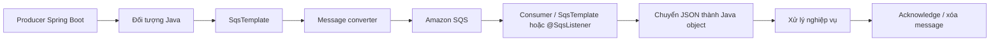

# Gửi và nhận thông điệp bằng SqsTemplate

Trong một ứng dụng Spring Boot tích hợp với các dịch vụ managed của AWS, Amazon Simple Queue Service (Amazon SQS) đảm nhiệm việc truyền thông điệp giữa các thành phần mà không buộc producer và consumer phải hoạt động cùng thời điểm. **Spring Cloud AWS cung cấp `SqsTemplate` để gửi và nhận message bằng các API quen thuộc của Spring**, đồng thời tự cấu hình AWS SDK client, chuyển đổi payload và ánh xạ metadata.

Bài học này đi theo một luồng hoàn chỉnh: cấu hình starter và danh tính AWS, định nghĩa hợp đồng message, gửi message đồng bộ hoặc bất đồng bộ, gửi theo batch, nhận message theo kiểu polling, xác nhận message sau xử lý và lựa chọn listener chạy nền. Các ví dụ dùng API của **Spring Cloud AWS 3.4.1**; nếu dự án dùng phiên bản khác, cần đối chiếu tài liệu đúng phiên bản trước khi sao chép cấu hình.

## 1. Mục tiêu học tập

Sau bài học, bạn có thể:

- Cấu hình starter SQS và inject `SqsTemplate` trong Spring Boot.
- Phân biệt `SqsOperations` (đồng bộ) và `SqsAsyncOperations` (bất đồng bộ).
- Gửi POJO, message attributes, message FIFO và batch message.
- Nhận một message hoặc một batch bằng `receive()` và `receiveMany()`.
- Giải thích thời điểm acknowledge của `SqsTemplate`, cấu hình manual acknowledgment và tránh mất message khi xử lý lỗi.
- Chọn giữa polling bằng `SqsTemplate` và consumer chạy liên tục bằng `@SqsListener`.
- Thiết kế retry, idempotency, IAM policy và kiểm thử tích hợp phù hợp.

## 2. SqsTemplate nằm ở đâu trong luồng xử lý?

Một message thường đi qua các bước sau:



SQS chỉ lưu và vận chuyển nội dung message. Ứng dụng vẫn chịu trách nhiệm định nghĩa cấu trúc dữ liệu, kiểm tra dữ liệu đầu vào, xử lý tác dụng phụ và quyết định lúc nào message đã hoàn tất.

`SqsTemplate` được xây dựng trên `SqsAsyncClient` của AWS SDK for Java 2.x. Trong Spring Boot có auto-configuration, framework tự tạo `SqsTemplate` nếu context chưa có template khác; bean này dùng `SqsAsyncClient` đã được cấu hình và có thể dùng chung giữa các luồng vì template bất biến, thread-safe.

Hai giao diện thao tác chính:

| Giao diện | Đặc điểm | Phương thức tiêu biểu |
|---|---|---|
| `SqsOperations` | API đồng bộ; lời gọi chờ kết quả | `send()`, `sendMany()`, `receive()`, `receiveMany()` |
| `SqsAsyncOperations` | API bất đồng bộ; trả về `CompletableFuture` | `sendAsync()`, `sendManyAsync()`, `receiveAsync()`, `receiveManyAsync()` |

Lớp `SqsTemplate` triển khai cả hai giao diện. Khi một thành phần chỉ cần một kiểu API, có thể inject giao diện tương ứng để giới hạn bề mặt sử dụng.

## 3. Chuẩn bị dự án Spring Boot

### 3.1. Thêm dependency

Sử dụng Spring Cloud AWS BOM để các module cùng một release dùng bộ phiên bản phụ thuộc tương thích. Ví dụ Gradle:

```groovy
ext {
    springCloudAwsVersion = "3.4.1"
}

dependencies {
    implementation platform(
        "io.awspring.cloud:spring-cloud-aws-dependencies:${springCloudAwsVersion}"
    )
    implementation "io.awspring.cloud:spring-cloud-aws-starter-sqs"
}
```

Nếu dự án đã import BOM Spring Cloud AWS ở cấp root, chỉ cần thêm starter SQS và không import BOM lần thứ hai. Cần chọn release tương thích với phiên bản Spring Boot đang dùng.

### 3.2. Khai báo Region và tên queue

```yaml
# application.yml
spring:
  cloud:
    aws:
      region:
        static: ap-southeast-1

app:
  sqs:
    inventory-queue: inventory-events
    order-queue: order-events.fifo
```

`ap-southeast-1` chỉ là ví dụ. Queue phải tồn tại trong đúng AWS account và Region mà ứng dụng truy cập. Có thể dùng queue name hoặc queue URL trong các thao tác của template.

Khi chạy local với LocalStack, có thể cấu hình endpoint tương ứng:

```yaml
spring:
  cloud:
    aws:
      endpoint: http://localhost:4566
      region:
        static: ap-southeast-1
```

Chỉ bật endpoint local trong profile dành cho phát triển hoặc kiểm thử; môi trường AWS thật nên dùng endpoint mặc định theo Region.

### 3.3. Danh tính và quyền IAM

Starter sử dụng AWS SDK credentials provider chain để tìm thông tin xác thực. Trong môi trường triển khai, ưu tiên IAM role gắn với workload, chẳng hạn instance profile, ECS task role hoặc IAM role for service account trên EKS. Không commit access key/secret key vào Git hoặc đặt secret lâu dài trong file cấu hình ứng dụng.

Các quyền cơ bản cần cân nhắc:

| Thao tác | IAM action thường cần |
|---|---|
| Gửi message | `sqs:SendMessage` |
| Tìm queue URL khi dùng queue name | `sqs:GetQueueUrl` |
| Poll/nhận message | `sqs:ReceiveMessage` |
| Xác nhận/xóa message | `sqs:DeleteMessage` |
| Đọc thuộc tính queue khi khởi tạo listener | `sqs:GetQueueAttributes` |
| Đổi visibility timeout | `sqs:ChangeMessageVisibility` |

Hãy giới hạn `Resource` về ARN của các queue mà dịch vụ thực sự sử dụng. Nếu ứng dụng được phép tự tạo queue khi không tìm thấy, quyền và hành vi khởi tạo sẽ rộng hơn; trong môi trường production, nên quản lý queue bằng hạ tầng và kiểm tra rõ chiến lược khi queue không tồn tại.

## 4. Định nghĩa hợp đồng message

Ví dụ dịch vụ quản lý tồn kho phát sự kiện khi số lượng một mặt hàng thay đổi:

```java
import java.time.Instant;

public record InventoryAdjusted(
    String eventId,
    String sku,
    int quantityDelta,
    Instant occurredAt
) {}
```

Các trường có vai trò riêng:

- `eventId`: ID duy nhất của một sự kiện nghiệp vụ, được giữ nguyên khi producer retry gửi.
- `sku`: định danh mặt hàng; có thể dùng làm `MessageGroupId` nếu cần tuần tự hóa sự kiện theo mặt hàng.
- `quantityDelta`: phần thay đổi tồn kho, không nhất thiết là số lượng tồn kho cuối cùng.
- `occurredAt`: thời điểm sự kiện được tạo ở hệ thống nguồn; không nên coi đây là bằng chứng duy nhất về thứ tự xử lý.

Một hợp đồng message tốt có schema ổn định, trường định danh rõ ràng và quy tắc tương thích khi producer/consumer được triển khai lệch phiên bản. Tránh gửi trực tiếp entity JPA có quan hệ lazy, dữ liệu nhạy cảm hoặc toàn bộ object graph của một request HTTP.

## 5. Gửi một message bằng SqsTemplate

### 5.1. Inject template tự động

Khi đã có `spring-cloud-aws-starter-sqs`, Spring Boot auto-configure `SqsTemplate` nếu ứng dụng chưa khai báo bean khác.

```java
import io.awspring.cloud.sqs.operations.SendResult;
import io.awspring.cloud.sqs.operations.SqsTemplate;
import org.springframework.beans.factory.annotation.Value;
import org.springframework.stereotype.Service;

@Service
public class InventoryEventPublisher {
    private final SqsTemplate sqsTemplate;
    private final String queueName;

    public InventoryEventPublisher(
            SqsTemplate sqsTemplate,
            @Value("${app.sqs.inventory-queue}") String queueName) {
        this.sqsTemplate = sqsTemplate;
        this.queueName = queueName;
    }

    public SendResult<InventoryAdjusted> publish(InventoryAdjusted event) {
        return sqsTemplate.send(to -> to
            .queue(queueName)
            .payload(event));
    }
}
```

`send()` nhận một callback cấu hình `SqsSendOptions`: `queue()` chỉ định queue, `payload()` đặt nội dung. Với một object Java, converter mặc định sẽ chuyển payload thành JSON trước khi gửi lên SQS.

Nếu muốn dùng queue URL, truyền URL vào `queue()` thay cho tên queue. Không cần tự gọi `GetQueueUrl` trước mỗi lần gửi khi dùng template; framework thực hiện việc phân giải endpoint theo cấu hình của nó.

### 5.2. Đọc kết quả gửi

`send()` trả về `SendResult<T>` khi gửi thành công. Kết quả cung cấp:

- `messageId()`: ID do SQS trả về.
- `endpoint()`: endpoint/queue đã nhận message.
- `message()`: Spring `Message` được gửi, gồm payload và header sau chuyển đổi.
- `additionalInformation()`: metadata bổ sung; với FIFO có thể chứa `sequenceNumber`.

Ví dụ ghi log ID do SQS cấp:

```java
SendResult<InventoryAdjusted> result = publisher.publish(event);
log.info("SQS accepted eventId={}, messageId={}",
    event.eventId(), result.messageId());
```

`messageId` của SQS không thay thế `eventId` của nghiệp vụ. Khi theo dõi retry, đối soát hoặc chống xử lý trùng, hãy lưu ID nghiệp vụ ổn định bên cạnh ID message của SQS.

Nếu thao tác gửi một message thất bại, template ném `MessagingOperationFailedException`. Hãy để lỗi được truyền lên lớp gọi hoặc xử lý bằng chính sách retry có giới hạn; không ghi log rồi tiếp tục như thể message đã được gửi thành công.

### 5.3. Thêm message attributes và metadata

Có thể gắn metadata bằng `header()` hoặc `headers()`. Các header này được converter ánh xạ thành SQS message attributes:

```java
SendResult<InventoryAdjusted> result = sqsTemplate.send(to -> to
    .queue(queueName)
    .payload(event)
    .header("correlationId", event.eventId())
    .header("producer", "inventory-service")
    .headers(Map.of(
        "tenantId", "tenant-42",
        "schemaVersion", "1"
    ))
);
```

Message attributes thích hợp cho thông tin định tuyến, tracing, tenant hoặc phiên bản schema. Nội dung nghiệp vụ cần thiết để consumer xử lý nên nằm trong payload. Không đặt password, token, secret hoặc dữ liệu lớn vào attributes.

SQS có giới hạn kích thước message; tài liệu Spring Cloud AWS 3.4.1 nêu mức tối đa 1 MiB cho một message. Nếu payload vượt giới hạn hoặc chứa file lớn, lưu nội dung vào S3 rồi gửi object key/URL có kiểm soát quyền truy cập qua SQS.

## 6. Gửi message đến FIFO queue

Với queue FIFO, producer cần xác định nhóm message và ID chống gửi trùng. Ví dụ:

```java
public SendResult<OrderEvent> publish(OrderEvent event) {
    return sqsTemplate.send(to -> to
        .queue("order-events.fifo")
        .payload(event)
        .messageGroupId("order-" + event.orderId())
        .messageDeduplicationId(event.eventId())
    );
}
```

`messageGroupId` chọn chuỗi sự kiện cần giữ thứ tự, ví dụ một đơn hàng. `messageDeduplicationId` dùng ID sự kiện ổn định để SQS nhận diện lần gửi lặp trong cửa sổ deduplication. Các quy tắc về thứ tự giữa các group, cửa sổ deduplication và exactly-once ở tầng queue được trình bày chi tiết trong bài `Standard queue, FIFO queue và phạm vi bảo đảm thứ tự`.

Spring Cloud AWS có thể tự sinh UUID nếu thiếu group ID hoặc deduplication ID trong một số cấu hình. Giá trị ngẫu nhiên đó có thể giúp request hợp lệ, nhưng không thể thay thế ID có ý nghĩa nghiệp vụ. Nếu cần giữ thứ tự theo `orderId`, producer phải truyền cùng một group ID cho mọi sự kiện của đơn hàng đó.

## 7. Gửi nhiều message theo batch

Khi cần gửi nhiều message độc lập, `sendMany()` có thể giảm số request mạng bằng API `SendMessageBatch` của SQS.

```java
import org.springframework.messaging.Message;
import org.springframework.messaging.support.MessageBuilder;
import io.awspring.cloud.sqs.operations.SendResult;
import java.util.List;

public SendResult.Batch<InventoryAdjusted> publishBatch(
        List<InventoryAdjusted> events) {

    List<Message<InventoryAdjusted>> messages = events.stream()
        .map(event -> MessageBuilder.withPayload(event)
            .setHeader("correlationId", event.eventId())
            .build())
        .toList();

    return sqsTemplate.sendMany(queueName, messages);
}
```

Một request `SendMessageBatch` chỉ nhận tối đa **10 entries**. Spring Cloud AWS không tự chia collection lớn thành các batch nhỏ; caller phải chia trước khi gọi `sendMany()`.

Kết quả batch có hai tập:

- `successful()`: các message được gửi thành công.
- `failed()`: các message gửi thất bại, kèm thông tin lỗi và message tương ứng.

Mặc định, nếu có ít nhất một entry thất bại, template ném `SendBatchOperationFailedException`; exception chứa `SendResult.Batch` để ứng dụng kiểm tra cả phần thành công và thất bại. Không retry toàn bộ batch một cách mù quáng, vì các entry thành công đã được SQS nhận. Hãy retry có chọn lọc các entry thất bại bằng ID sự kiện ổn định.

Batch là cách gom nhiều message vào một request, không phải một transaction nguyên tử. Một batch có thể thành công một phần.

## 8. Gửi bất đồng bộ

Nếu không muốn luồng gọi phải chờ kết quả gửi, sử dụng `SqsAsyncOperations`. `SqsTemplate` cũng triển khai giao diện này; có thể inject giao diện trực tiếp:

```java
import io.awspring.cloud.sqs.operations.SendResult;
import io.awspring.cloud.sqs.operations.SqsAsyncOperations;
import java.util.UUID;
import java.util.concurrent.CompletableFuture;

@Service
public class AsyncInventoryPublisher {
    private final SqsAsyncOperations sqs;

    public AsyncInventoryPublisher(SqsAsyncOperations sqs) {
        this.sqs = sqs;
    }

    public CompletableFuture<UUID> publish(
            String queueName, InventoryAdjusted event) {
        return sqs.sendAsync(to -> to
            .queue(queueName)
            .payload(event)
        ).thenApply(SendResult::messageId);
    }
}
```

`sendAsync()` trả về `CompletableFuture<SendResult<T>>`. Có thể kết hợp `thenApply`, `thenCompose` hoặc `whenComplete` để nối các bước bất đồng bộ. Lỗi gửi được thể hiện qua trạng thái exceptional của future; nếu bỏ qua future hoặc không quan sát lỗi, hệ thống có thể mất khả năng phát hiện message chưa được gửi.

Không gọi `.join()` hoặc `.get()` ngay sau mọi `sendAsync()` nếu mục tiêu là giữ luồng không blocking. Nếu nghiệp vụ cần biết message đã được SQS chấp nhận trước khi trả kết quả HTTP, hãy chờ future ở đúng ranh giới đó và ánh xạ lỗi thành kết quả phù hợp.

## 9. Nhận message bằng SqsTemplate

### 9.1. Nhận một message

`receive()` thực hiện một lần poll và trả về `Optional<Message<T>>`. Nếu queue chưa có message trong khoảng poll, kết quả là `Optional.empty()`.

```java
import org.springframework.messaging.Message;
import java.time.Duration;
import java.util.Optional;

Optional<Message<InventoryAdjusted>> received = sqsTemplate.receive(
    from -> from
        .queue(queueName)
        .pollTimeout(Duration.ofSeconds(5))
        .visibilityTimeout(Duration.ofSeconds(45)),
    InventoryAdjusted.class
);

received.ifPresent(message ->
    log.info("Received event {}", message.getPayload().eventId())
);
```

`pollTimeout` quy định thời gian chờ tối đa cho lần nhận (long polling). Mặc định của template là 10 giây; SQS hỗ trợ thời gian long polling tối đa 20 giây. `visibilityTimeout` làm message tạm thời không hiển thị cho consumer khác trong khoảng thời gian đã chọn.

Truyền `InventoryAdjusted.class` giúp converter biết kiểu payload cần tạo. Nếu message được gửi bằng `SqsTemplate` và còn type header mặc định, framework có thể dùng thông tin đó; với message từ producer bên ngoài hoặc không có type header, nên chỉ định class rõ ràng.

### 9.2. Nhận một batch

`receiveMany()` trả về một collection, phù hợp khi ứng dụng muốn tự điều phối xử lý theo batch:

```java
Collection<Message<InventoryAdjusted>> messages = sqsTemplate.receiveMany(
    from -> from
        .queue(queueName)
        .maxNumberOfMessages(10)
        .pollTimeout(Duration.ofSeconds(10))
        .visibilityTimeout(Duration.ofSeconds(60)),
    InventoryAdjusted.class
);

for (Message<InventoryAdjusted> message : messages) {
    inventoryService.applyIdempotently(message.getPayload());
}
```

SQS trả tối đa 10 message trong một lần `ReceiveMessage`. Số message thực tế có thể ít hơn giá trị yêu cầu, kể cả khi queue vẫn còn message. Không giả định một lần gọi `receiveMany()` luôn trả đủ số lượng đã cấu hình.

### 9.3. Cảnh báo quan trọng: acknowledgment mặc định của template

Trong `SqsTemplate`, chế độ mặc định là **acknowledge khi nhận** (`ACKNOWLEDGE_ON_RECEIVE`). Khi `receive()` hoặc `receiveMany()` trả về message, template đã xác nhận message với SQS. Vì vậy, nếu ứng dụng nhận message rồi mới xử lý nghiệp vụ và tiến trình bị dừng giữa chừng, message có thể đã bị xóa khỏi queue dù tác vụ chưa hoàn tất.

Với kiểu xử lý polling thủ công, hãy cấu hình manual acknowledgment nếu cần xác nhận sau khi nghiệp vụ commit:

```java
import io.awspring.cloud.sqs.operations.SqsTemplate;
import io.awspring.cloud.sqs.operations.TemplateAcknowledgementMode;
import software.amazon.awssdk.services.sqs.SqsAsyncClient;
import org.springframework.context.annotation.Bean;
import org.springframework.context.annotation.Configuration;

@Configuration
public class SqsTemplateConfiguration {
    @Bean
    SqsTemplate manualAckSqsTemplate(SqsAsyncClient sqsAsyncClient) {
        return SqsTemplate.builder()
            .sqsAsyncClient(sqsAsyncClient)
            .configure(options -> options
                .acknowledgementMode(TemplateAcknowledgementMode.MANUAL)
            )
            .build();
    }
}
```

Khi manual acknowledgment được bật, xử lý message xong mới gọi `Acknowledgement.acknowledge(message)`:

```java
import io.awspring.cloud.sqs.listener.acknowledgement.Acknowledgement;
import org.springframework.messaging.Message;

public void pollAndProcessOnce() {
    Optional<Message<InventoryAdjusted>> received = manualAckSqsTemplate.receive(
        from -> from
            .queue(queueName)
            .pollTimeout(Duration.ofSeconds(5))
            .visibilityTimeout(Duration.ofSeconds(60)),
        InventoryAdjusted.class
    );

    received.ifPresent(message -> {
        inventoryService.applyIdempotently(message.getPayload());
        // Chỉ xóa message sau khi xử lý nghiệp vụ thành công.
        Acknowledgement.acknowledge(message);
    });
}
```

Nếu `applyIdempotently()` ném exception, dòng acknowledge không được chạy. Message vẫn ở trạng thái in-flight cho đến khi visibility timeout hết hạn và có thể được nhận lại. Nếu acknowledge gặp lỗi sau khi database đã commit, message có thể được giao lại; consumer vẫn phải idempotent.

Với batch manual acknowledgment, chỉ xác nhận những message đã xử lý thành công. Có thể gọi `Acknowledgement.acknowledge(message)` cho từng message hoặc `Acknowledgement.acknowledge(messages)` sau khi toàn bộ batch đã hoàn tất. Không acknowledge cả batch nếu còn entry thất bại.

## 10. Khi nào dùng SqsTemplate và khi nào dùng @SqsListener?

`SqsTemplate.receive()` là API polling chủ động: code gọi hàm thì thực hiện một lần nhận. Ứng dụng phải tự quyết định lịch poll, vòng lặp, backoff, dừng khi shutdown và giới hạn số lần xử lý. Điều này hữu ích cho tác vụ chủ động đọc một lượng message nhỏ hoặc tích hợp vào một workflow có sẵn.

Đối với service luôn chạy để tiêu thụ queue, `@SqsListener` thường phù hợp hơn. Spring Cloud AWS tạo `MessageListenerContainer` để poll, gọi handler và quản lý acknowledgment.

```java
import io.awspring.cloud.sqs.annotation.SqsListener;
import org.springframework.stereotype.Component;

@Component
public class InventoryEventListener {
    private final InventoryService inventoryService;

    public InventoryEventListener(InventoryService inventoryService) {
        this.inventoryService = inventoryService;
    }

    @SqsListener("${app.sqs.inventory-queue}")
    public void handle(InventoryAdjusted event) {
        inventoryService.applyIdempotently(event);
    }
}
```

Trong listener container, chế độ mặc định là `ON_SUCCESS`: message được acknowledge sau khi listener xử lý thành công. Nếu listener ném lỗi, message không được acknowledge và có thể được nhận lại sau visibility timeout. Đây là hành vi khác với `SqsTemplate.receive()` mặc định acknowledge ngay khi nhận.

Listener có thể nhận `Message<InventoryAdjusted>` thay vì chỉ payload để truy cập header:

```java
@SqsListener("${app.sqs.inventory-queue}")
public void handle(Message<InventoryAdjusted> message) {
    String correlationId = message.getHeaders().get(
        "correlationId", String.class
    );
    inventoryService.applyIdempotently(message.getPayload());
}
```

Nếu dùng batch listener, tham số `List<InventoryAdjusted>` hoặc `List<Message<InventoryAdjusted>>` sẽ bật batch mode. Hãy thiết kế transaction và acknowledgment theo từng phần tử; không mặc định rằng một batch được xử lý nguyên tử.

## 11. Chuyển đổi payload và quản lý schema

Mặc định, `SqsMessagingMessageConverter` sử dụng `StringMessageConverter` và `MappingJackson2MessageConverter` để chuyển payload giữa Java object và JSON. Header mapper ánh xạ message headers với SQS message attributes.

Khi gửi qua `SqsTemplate`, framework mặc định thêm header `JavaType` chứa tên đầy đủ của class payload. Khi nhận, template/listener dùng header này để xác định kiểu cần deserialize. Nếu không có type information, có thể chỉ định kiểu ở thao tác `receive(queue, PayloadClass.class)` hoặc qua `defaultPayloadClass` trong template options.

Với hệ thống có nhiều ngôn ngữ hoặc producer/consumer độc lập, nên thống nhất schema message và không phụ thuộc vào tên class Java cụ thể. Có thể cấu hình converter để đổi tên type header hoặc bỏ type header, sau đó chỉ định payload class ở consumer. Tránh để dữ liệu không đáng tin cậy quyết định tùy ý kiểu Java được deserialize.

Ví dụ cấu hình converter tùy chỉnh khi cần dùng `ObjectMapper` chung của ứng dụng:

```java
SqsOperations template = SqsTemplate.builder()
    .sqsAsyncClient(sqsAsyncClient)
    .configureDefaultConverter(converter -> {
        converter.setObjectMapper(objectMapper);
        converter.setPayloadTypeHeader("eventType");
    })
    .buildSyncTemplate();
```

Chỉ thay đổi type header khi cả producer và consumer được cấu hình tương thích. Nếu đổi tên header ở một phía, phía còn lại có thể không tìm được kiểu payload.

## 12. Xử lý lỗi, retry và tính idempotent

SQS và mạng có thể tạo ra các tình huống không xác định được kết quả ngay tại thời điểm gọi. Ví dụ producer gửi request, SQS nhận message nhưng kết nối bị ngắt trước khi producer nhận response. Producer có thể retry và tạo thêm một lần gửi. Consumer cũng có thể commit database xong nhưng lỗi trước acknowledgment, khiến message được giao lại.

Các nguyên tắc cần giữ:

1. Tạo `eventId` ổn định ở nguồn nghiệp vụ và dùng lại ID đó khi retry gửi.
2. Consumer lưu `eventId` đã xử lý với unique constraint hoặc inbox table; đánh dấu event và cập nhật dữ liệu nghiệp vụ trong cùng transaction.
3. Chỉ acknowledge sau khi thay đổi cần thiết đã commit. Không chuyển việc sang thread nền rồi return thành công trước khi công việc hoàn tất.
4. Thiết lập visibility timeout đủ cho thời gian xử lý thông thường. Với tác vụ lâu, cần cơ chế gia hạn visibility và theo dõi thời gian in-flight.
5. Đặt retry có giới hạn và dead-letter queue (DLQ) để cô lập message lỗi kéo dài. Có quy trình điều tra, sửa dữ liệu và replay.
6. Theo dõi `ApproximateReceiveCount`, tuổi message, số message đang chờ và số message trong DLQ.

Ví dụ idempotency ở tầng database có thể dùng bảng `processed_event` với `event_id` là khóa duy nhất:

```sql
BEGIN;

INSERT INTO processed_event(event_id)
VALUES (:event_id)
ON CONFLICT (event_id) DO NOTHING;

-- Nếu INSERT không tạo dòng mới, event đã được xử lý: kết thúc an toàn.
-- Nếu INSERT tạo dòng mới, cập nhật trạng thái nghiệp vụ trong cùng transaction.
UPDATE inventory
SET quantity = quantity + :quantity_delta
WHERE sku = :sku;

COMMIT;
```

Đây là pseudocode minh họa transaction, cần điều chỉnh để kiểm tra SKU tồn tại, quy tắc không âm tồn kho và điều kiện cập nhật theo nghiệp vụ. Nếu side effect gọi sang API bên ngoài, cần idempotency key của API đó hoặc một quy trình outbox/saga; transaction database không bao trùm HTTP request khác.

## 13. Cấu hình template và listener cần quan sát

| Tùy chọn | Ý nghĩa | Khi nào xem xét |
|---|---|---|
| `defaultEndpointName` | Queue mặc định nếu thao tác không chỉ định queue | Ứng dụng chỉ dùng một endpoint trong một template |
| `defaultPollTimeout` | Thời gian chờ mặc định khi nhận | Cân bằng long polling và độ trễ phản hồi |
| `defaultMaxNumberOfMessages` | Số message mặc định khi nhận batch | Tối ưu lượng message mỗi lần poll; tối đa 10 theo API nhận SQS |
| `defaultPayloadClass` | Kiểu payload mặc định khi deserialize | Consumer nhận schema đã biết và không dùng type header |
| `acknowledgementMode` | Cách xác nhận message khi dùng `SqsTemplate.receive()` | Dùng `MANUAL` khi phải xử lý trước khi xóa message |
| `queueNotFoundStrategy` | Tạo queue hoặc báo lỗi khi không tìm thấy | Ưu tiên `FAIL` nếu hạ tầng queue được quản lý riêng |
| `messageAttributeNames` | Các message attributes được đọc về | Lọc metadata cần thiết cho consumer |

Với listener container, các tùy chọn như `maxConcurrentMessages`, `maxMessagesPerPoll`, `pollTimeoutSeconds`, `messageVisibilitySeconds` và `acknowledgementMode` quyết định thông lượng và vòng đời xử lý. Điều chỉnh dựa trên thời gian xử lý, độ lớn message, số group FIFO và khả năng của downstream service.

## 14. Kiểm thử tích hợp

Không nên chỉ mock `SqsTemplate` rồi kết luận tích hợp SQS hoạt động. Mock hữu ích để kiểm tra service có gọi đúng queue và payload, nhưng không xác minh được IAM, queue URL, JSON conversion, message attributes hay hành vi acknowledgment thật.

Một quy trình kiểm thử hợp lý gồm:

| Lớp kiểm thử | Nội dung xác minh | Công cụ/gợi ý |
|---|---|---|
| Unit test producer | Payload, queue, event ID và header được tạo đúng | Mock `SqsOperations` hoặc `SqsTemplate` |
| Unit test consumer | Idempotency, xử lý trùng và xử lý lỗi | Test service với repository giả hoặc database test |
| Integration test | Gửi rồi nhận message, JSON conversion và attributes | LocalStack hoặc AWS test account riêng |
| Failure test | Lỗi xử lý không bị acknowledge sớm khi dùng manual mode | Tạo listener/poller cố ý ném exception, kiểm tra nhận lại |
| Batch test | Một entry lỗi không làm ứng dụng bỏ qua các entry thành công | Gửi batch có dữ liệu hợp lệ và không hợp lệ |
| IAM test | Role chỉ có quyền trên queue cần thiết | Policy riêng cho producer và consumer |

Khi kiểm thử manual acknowledgment, cần xác minh cả hai nhánh: xử lý thành công thì message biến mất khỏi queue; xử lý thất bại trước acknowledgment thì message có thể xuất hiện lại sau visibility timeout. Không dùng thời gian chờ quá ngắn khiến test phụ thuộc vào lịch chạy của máy.

## 15. Sự cố thường gặp

| Triệu chứng | Nguyên nhân cần kiểm tra | Hướng xử lý |
|---|---|---|
| `QueueDoesNotExist` hoặc không phân giải được queue | Sai Region, account, tên queue hoặc URL | Kiểm tra Region, account credentials và queue name/URL |
| `AccessDenied` | IAM role thiếu action hoặc Resource ARN sai | Kiểm tra policy producer/consumer và quyền KMS nếu queue mã hóa bằng CMK |
| Producer nhận exception khi gửi | Queue không tồn tại, payload quá lớn, policy hoặc lỗi mạng | Ghi log `eventId`, exception gốc và kiểm tra trạng thái gửi trước retry |
| Consumer không nhận message | Queue rỗng, sai endpoint, poll timeout hoặc message đang invisible | Kiểm tra queue URL, Region, visibility và số message in-flight |
| Message bị mất sau khi poll | `SqsTemplate` dùng acknowledgment mặc định ngay khi nhận | Dùng `TemplateAcknowledgementMode.MANUAL` và ack sau commit |
| Consumer deserialize thất bại | JSON/schema/type header không tương thích | Chỉ định payload class, chuẩn hóa schema và converter |
| Một batch có message lỗi | Batch send có thể thành công một phần | Đọc `successful()` và `failed()`; retry đúng phần lỗi |
| Message được xử lý nhiều lần | Retry, visibility timeout hoặc ack thất bại | Dùng event ID ổn định và idempotent consumer |

## 16. Bài tập thực hành

**Bài 1 — Gửi một sự kiện tồn kho:** Tạo queue Standard `inventory-events`, khai báo record `InventoryAdjusted`, inject `SqsTemplate` và gửi một sự kiện. Ghi log `eventId` và `messageId` để phân biệt ID nghiệp vụ với ID SQS.

**Bài 2 — Gửi metadata:** Thêm `correlationId`, `tenantId` và `schemaVersion` bằng `header()`/`headers()`. Nhận message bằng `Message<InventoryAdjusted>` và kiểm tra header ở consumer.

**Bài 3 — Gửi batch:** Tạo 25 sự kiện và chia thành các batch không quá 10 entries trước khi gọi `sendMany()`. Mô phỏng một entry lỗi, kiểm tra phần thành công và thất bại.

**Bài 4 — Polling và acknowledgment:** Nhận message bằng `SqsTemplate` ở chế độ mặc định, quan sát message đã được acknowledge khi nhận. Chuyển sang manual acknowledgment, cố ý làm processor ném exception trước khi ack và xác minh message có thể được nhận lại.

**Bài 5 — Listener liên tục:** Thay polling chủ động bằng `@SqsListener`. Cho listener ném lỗi có kiểm soát, quan sát retry sau visibility timeout và kiểm tra consumer không tạo tác dụng phụ trùng.

**Bài 6 — FIFO:** Gửi hai sự kiện của cùng `sku` vào `inventory-events.fifo` với cùng `MessageGroupId`, `eventId` riêng biệt làm `MessageDeduplicationId`. Quan sát thứ tự xử lý trong nhóm và khả năng xử lý song song của nhóm khác.

## 17. Câu hỏi tự kiểm tra

1. `SqsTemplate` được Spring Boot auto-configure dựa trên thành phần nào? **Starter SQS và `SqsAsyncClient` được auto-configure; template được tạo nếu context chưa có template khác.**
2. `SqsOperations` khác `SqsAsyncOperations` ở đâu? **Một bên cung cấp lời gọi blocking, bên kia trả `CompletableFuture`.**
3. Vì sao cần `InventoryAdjusted.class` khi nhận message? **Để converter biết kiểu Java cần tạo khi không có type mapping phù hợp trong message.**
4. `sendMany()` có tự chia 25 message thành ba batch không? **Không; caller phải chia thành các batch tối đa 10 entries.**
5. Vì sao `receive()` mặc định có thể làm mất message khi tiến trình bị dừng? **Template acknowledge ngay khi nhận, trước khi nghiệp vụ hoàn tất.**
6. Khi nào dùng `@SqsListener`? **Khi ứng dụng cần một consumer chạy liên tục và muốn framework quản lý polling, listener invocation và acknowledgment.**
7. Tại sao consumer vẫn cần idempotency? **Message có thể được giao lại khi xử lý hoặc acknowledgment thất bại; tác dụng phụ cần an toàn khi lặp.**

## 18. Tài liệu tham khảo

- [Spring Cloud AWS 3.4.1 — SQS Integration Reference](https://docs.awspring.io/spring-cloud-aws/docs/3.4.1/reference/html/index.html): starter, `SqsTemplate`, send/receive, message conversion, listener, acknowledgment và IAM.
- [Spring Cloud AWS 3.4.1 — SqsSendOptions API](https://docs.awspring.io/spring-cloud-aws/docs/3.4.1/apidocs/io/awspring/cloud/sqs/operations/SqsSendOptions.html): queue, payload, header, delay, `messageGroupId` và `messageDeduplicationId`.
- [Spring Cloud AWS 3.4.1 — SqsAsyncOperations API](https://docs.awspring.io/spring-cloud-aws/docs/3.4.1/apidocs/io/awspring/cloud/sqs/operations/SqsAsyncOperations.html): các thao tác bất đồng bộ và kiểu `CompletableFuture`.
- [Spring Cloud AWS 3.4.1 — Acknowledgement API](https://docs.awspring.io/spring-cloud-aws/docs/3.4.1/apidocs/io/awspring/cloud/sqs/listener/acknowledgement/Acknowledgement.html): xác nhận một message hoặc collection message.
- [Spring Cloud AWS 3.4.1 — SqsListener API](https://docs.awspring.io/spring-cloud-aws/docs/3.4.1/apidocs/io/awspring/cloud/sqs/annotation/SqsListener.html): chữ ký listener và cấu hình container.
- [Amazon SQS API — SendMessageBatch](https://docs.aws.amazon.com/AWSSimpleQueueService/latest/APIReference/API_SendMessageBatch.html): giới hạn và kết quả gửi batch.

**Ghi nhớ:** `SqsTemplate` giúp gửi và nhận SQS bằng API Spring, nhưng thời điểm acknowledge là một phần của tính đúng đắn nghiệp vụ. Khi polling thủ công, phải chủ động chọn manual acknowledgment nếu cần xử lý trước khi xóa message; với consumer chạy liên tục, `@SqsListener` thường giúp quản lý vòng đời message rõ ràng hơn.
