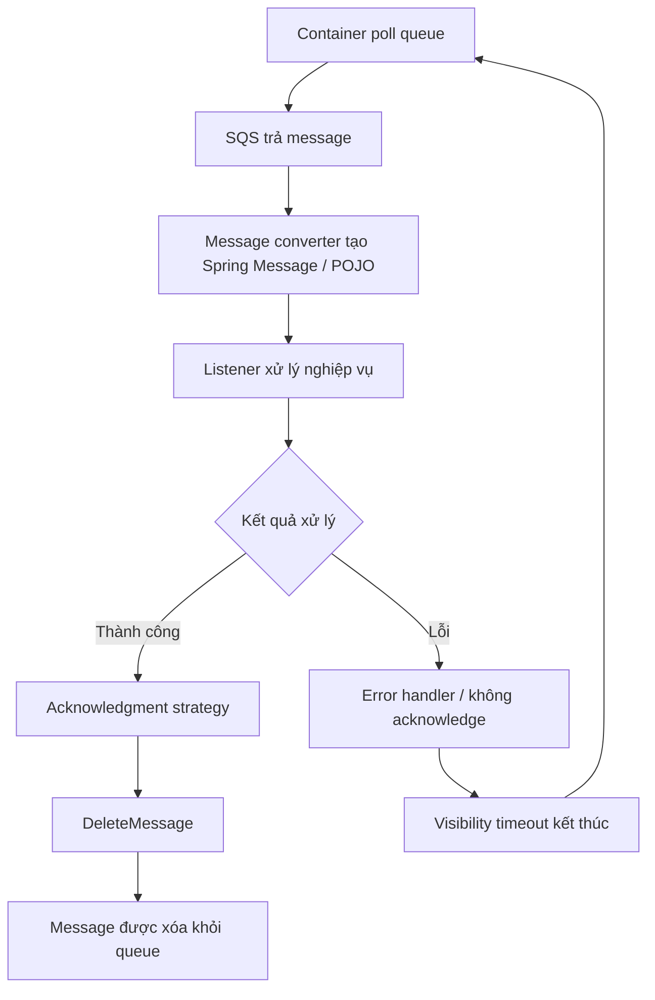
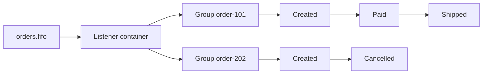

# Xử lý thông điệp bằng SqsListener và listener container

Trong ứng dụng Spring Boot tích hợp Amazon Simple Queue Service (Amazon SQS), consumer cần một cơ chế liên tục nhận message, gọi logic nghiệp vụ, xử lý lỗi và xác nhận message sau khi hoàn tất. **Spring Cloud AWS cung cấp `@SqsListener` và `SqsMessageListenerContainer` để quản lý toàn bộ vòng đời này**: polling queue, chuyển đổi payload, điều phối xử lý, retry và acknowledgment.

Bài học tập trung vào phía nhận message. Bạn sẽ tạo listener, đọc metadata, cấu hình container factory, điều chỉnh concurrency và long polling, xử lý message theo batch, kiểm soát acknowledgment, vận hành FIFO queue, thiết kế retry/DLQ và kiểm thử tích hợp. Các ví dụ sử dụng API **Spring Cloud AWS 3.4.1**; hãy dùng tài liệu đúng phiên bản đang cài trong dự án vì package và API có thể khác giữa các major release.

## 1. Mục tiêu học tập

Sau bài học, bạn có thể:

- Giải thích vai trò của `@SqsListener`, `SqsMessageListenerContainer` và `SqsMessageListenerContainerFactory`.
- Viết listener nhận POJO, `Message<T>`, header và message attributes.
- Cấu hình listener theo queue, factory, concurrency, poll timeout và visibility timeout.
- Chọn `ON_SUCCESS`, `ALWAYS` hoặc `MANUAL` acknowledgment đúng với nghiệp vụ.
- Xử lý batch và xác nhận một phần batch bằng `BatchAcknowledgement`.
- Hiểu retry, error handler, backoff, dead-letter queue và giới hạn của FIFO.
- Theo dõi vòng đời container, quan sát metrics/traces và kiểm thử lỗi thực tế.

## 2. Vòng đời một message trong listener container

Một listener container không chỉ gọi một phương thức Java. Nó quản lý chu trình từ lúc poll SQS đến lúc xóa message khỏi queue:



`SqsMessageListenerContainer` chịu trách nhiệm polling, xử lý và acknowledgment. Với `@SqsListener`, Spring Cloud AWS tạo container và adapter để gọi method đã đánh dấu. Ứng dụng tập trung vào xử lý payload, còn các chính sách vận hành được đặt ở annotation hoặc container factory.

Phân biệt ba khái niệm:

- **Receive/poll:** SQS trả message và đặt nó ở trạng thái *in flight* trong khoảng visibility timeout.
- **Processing:** listener thực hiện logic nghiệp vụ. Message vẫn tồn tại trong queue trong giai đoạn này.
- **Acknowledgment:** Spring Cloud AWS gọi thao tác xóa message (`DeleteMessage`) theo chiến lược đã cấu hình. Chỉ khi được xóa thành công, message mới không còn được giao lại.

Visibility timeout không phải transaction lock của database. Nếu consumer xử lý lâu hơn thời gian ẩn, message có thể xuất hiện lại trong khi lần xử lý cũ vẫn chạy. Do đó, cần chọn timeout phù hợp và thiết kế consumer idempotent.

## 3. Chuẩn bị Spring Boot và SQS

### 3.1. Thêm starter

Sử dụng Spring Cloud AWS BOM để đồng bộ phiên bản các module:

```groovy
ext {
    springCloudAwsVersion = "3.4.1"
}

dependencies {
    implementation platform(
        "io.awspring.cloud:spring-cloud-aws-dependencies:${springCloudAwsVersion}"
    )
    implementation "io.awspring.cloud:spring-cloud-aws-starter-sqs"
}
```

Nếu dự án đã import BOM ở cấp root, không cần khai báo lại. Hãy chọn phiên bản Spring Cloud AWS tương thích với phiên bản Spring Boot của ứng dụng.

### 3.2. Cấu hình Region và queue

```yaml
# application.yml
spring:
  cloud:
    aws:
      region:
        static: ap-southeast-1

app:
  sqs:
    inventory-queue: inventory-events
    order-queue: order-events.fifo
```

Region chỉ là ví dụ. Queue phải tồn tại trong AWS account và Region mà ứng dụng đang sử dụng. Với môi trường local chạy LocalStack, có thể đặt `spring.cloud.aws.endpoint` trong profile kiểm thử; không bật endpoint local trong môi trường AWS thật.

Starter tự cấu hình `SqsAsyncClient`, Region provider và credentials provider khi chưa có bean tùy chỉnh. Trên môi trường triển khai, ưu tiên IAM role gắn với workload (EC2 instance profile, ECS task role hoặc IAM role for service account trên EKS). Không commit access key/secret key vào Git.

### 3.3. Hợp đồng sự kiện dùng trong ví dụ

Các ví dụ dưới đây dùng DTO nhỏ để minh họa payload. Trong dự án thật, hãy đặt chúng ở package hợp đồng sự kiện dùng chung hoặc version hóa schema độc lập với entity database.

```java
import java.time.Instant;

// InventoryAdjusted.java
public record InventoryAdjusted(
    String eventId,
    String sku,
    int quantityDelta,
    Instant occurredAt
) {}

// OrderEvent.java
public record OrderEvent(
    String eventId,
    String orderId,
    long version,
    String eventType
) {}
```

`eventId` là ID ổn định cho một sự kiện nghiệp vụ; producer phải giữ nguyên ID này khi retry. `sku` và `orderId` là khóa thực thể để cập nhật dữ liệu hoặc xác định message group. Các service `InventoryService` và `OrderService` trong ví dụ đại diện cho logic nghiệp vụ của ứng dụng.

### 3.4. Quyền IAM của consumer

Một consumer chỉ nhận và xóa message thường cần các quyền sau trên ARN queue cụ thể:

| IAM action | Mục đích |
|---|---|
| `sqs:ReceiveMessage` | Poll và nhận message |
| `sqs:DeleteMessage` | Acknowledge message sau khi xử lý |
| `sqs:GetQueueUrl` | Phân giải queue name thành URL |
| `sqs:GetQueueAttributes` | Đọc thuộc tính queue khi container khởi tạo hoặc được cấu hình lấy attributes |
| `sqs:ChangeMessageVisibility` | Thay đổi visibility khi ứng dụng cần gia hạn hoặc trì hoãn retry |

Producer có thể cần thêm `sqs:SendMessage`. Không cấp quyền gửi cho consumer nếu không có nhu cầu. Nếu queue dùng KMS customer managed key, cần kiểm tra thêm quyền KMS tương ứng và key policy.

**Lưu ý:** Khi container nhận queue name, nó cần phân giải queue URL lúc khởi động. `queueNotFoundStrategy` mặc định có thể tạo queue nếu không tìm thấy; với queue được quản lý bằng IaC trong production, nên cân nhắc đặt chiến lược `FAIL` để phát hiện sai tên hoặc thiếu hạ tầng ngay khi ứng dụng khởi động.

## 4. Tạo listener đầu tiên với @SqsListener

Khi dùng Spring Boot auto-configuration, bạn không cần tự tạo container factory cho trường hợp cơ bản. Chỉ cần đánh dấu một method trong bean Spring:

```java
import io.awspring.cloud.sqs.annotation.SqsListener;
import org.springframework.stereotype.Component;

@Component
public class InventoryEventListener {
    private final InventoryService inventoryService;

    public InventoryEventListener(InventoryService inventoryService) {
        this.inventoryService = inventoryService;
    }

    @SqsListener("${app.sqs.inventory-queue}")
    public void handle(InventoryAdjusted event) {
        inventoryService.applyIdempotently(event);
    }
}
```

Khi ứng dụng khởi động, Spring Cloud AWS tạo một `MessageListenerContainer` cho method này. Container poll queue `inventory-events`, chuyển payload thành `InventoryAdjusted` rồi gọi `handle()`. Khi method kết thúc thành công, acknowledgment mặc định `ON_SUCCESS` sẽ xác nhận message.

Giá trị trong `@SqsListener` có thể là queue name hoặc queue URL. Annotation hỗ trợ property placeholder và SpEL. Dùng property giúp đổi queue theo môi trường mà không sửa mã nguồn.

Mỗi method `@SqsListener` có container riêng. Nếu một annotation khai báo nhiều queue, các queue đó chia sẻ container nhưng vẫn có kiểm soát throughput và acknowledgment theo từng queue. Không gộp các queue Standard và FIFO vào cùng một container.

## 5. Các kiểu tham số listener

Spring Cloud AWS hỗ trợ nhiều chữ ký method, tùy dữ liệu listener cần đọc:

| Tham số | Ý nghĩa |
|---|---|
| `InventoryAdjusted` | Nhận payload POJO đã deserialize từ JSON |
| `Message<InventoryAdjusted>` | Nhận payload cùng `MessageHeaders` |
| `@Header("headerName") String value` | Lấy một header cụ thể |
| `@Headers MessageHeaders headers` | Đọc tập header của message |
| `Acknowledgement` | Xác nhận thủ công cho listener một message; cần `MANUAL` |
| `List<InventoryAdjusted>` | Bật batch mode và nhận danh sách payload |
| `List<Message<InventoryAdjusted>>` | Bật batch mode và nhận danh sách message có header |
| `BatchAcknowledgement<InventoryAdjusted>` | Xác nhận toàn bộ hoặc một phần batch; cần `MANUAL` |
| `Visibility` / `BatchVisibility` | Thay đổi visibility cho một message hoặc batch |
| `QueueAttributes` | Đọc thuộc tính queue đã yêu cầu container tải |

### 5.1. Đọc metadata bằng Message<T>

Các ví dụ ghi log giả định lớp có logger, chẳng hạn Lombok `@Slf4j` hoặc một `Logger` được khai báo.

```java
import org.springframework.messaging.Message;

@SqsListener("${app.sqs.inventory-queue}")
public void handle(Message<InventoryAdjusted> message) {
    InventoryAdjusted event = message.getPayload();
    String eventId = event.eventId();
    Object correlationId = message.getHeaders().get("Sqs_MA_correlationId");

    log.info("Receive eventId={}, correlationId={}", eventId, correlationId);
    inventoryService.applyIdempotently(event);
}
```

Spring Cloud AWS ánh xạ SQS message attributes thành message headers có prefix `Sqs_MA_`; system attributes có prefix `Sqs_MSA_`. Vì vậy, attribute `correlationId` có thể được đọc qua header `Sqs_MA_correlationId`.

Chỉ những attributes được container yêu cầu mới được lấy từ SQS. Mặc định, message attributes và system attributes được lấy; queue attributes không tự động được tải. Khi cần queue attributes, cấu hình `queueAttributeNames` trong container options.

### 5.2. Lấy một header cụ thể

```java
import org.springframework.messaging.handler.annotation.Header;

@SqsListener("${app.sqs.inventory-queue}")
public void handle(
        InventoryAdjusted event,
        @Header("Sqs_MA_correlationId") String correlationId) {

    log.info("Receive eventId={}, correlationId={}", event.eventId(), correlationId);
    inventoryService.applyIdempotently(event);
}
```

Nếu header có thể không tồn tại, hãy dùng kiểu nullable/`Optional` hoặc đặt giá trị mặc định phù hợp. Không để một header tùy chọn làm toàn bộ listener thất bại ngoài ý muốn.

## 6. Tùy chỉnh SqsMessageListenerContainerFactory

Khi cần thiết lập concurrency, polling, visibility hoặc acknowledgment dùng chung, khai báo factory:

```java
import io.awspring.cloud.sqs.config.SqsMessageListenerContainerFactory;
import io.awspring.cloud.sqs.listener.acknowledgement.handler.AcknowledgementMode;
import org.springframework.context.annotation.Bean;
import org.springframework.context.annotation.Configuration;
import software.amazon.awssdk.services.sqs.SqsAsyncClient;

import java.time.Duration;

@Configuration
public class SqsListenerConfiguration {
    @Bean
    SqsMessageListenerContainerFactory<Object> defaultSqsListenerContainerFactory(
            SqsAsyncClient sqsAsyncClient) {
        return SqsMessageListenerContainerFactory.builder()
            .sqsAsyncClient(sqsAsyncClient)
            .configure(options -> options
                .maxConcurrentMessages(16)
                .messagesPerPoll(10)
                .pollTimeout(Duration.ofSeconds(10))
                .messageVisibility(Duration.ofSeconds(60))
                .acknowledgementMode(AcknowledgementMode.ON_SUCCESS)
            )
            .build();
    }
}
```

Factory có tên `defaultSqsListenerContainerFactory` sẽ được dùng cho `@SqsListener` nếu annotation không chỉ định `factory`. Khi ứng dụng khai báo factory tùy chỉnh, hãy kiểm tra bean name và cấu hình vì factory tự định nghĩa có thể thay thế factory auto-configured.

Các tùy chọn trong ví dụ là giá trị minh họa, không phải con số tối ưu cho mọi hệ thống. Cần đo thời gian xử lý, tốc độ message đến, năng lực database và downstream service trước khi tăng concurrency.

### 6.1. Cấu hình riêng cho một listener

Các thuộc tính trong annotation ghi đè giá trị tương ứng của factory:

```java
@SqsListener(
    value = "${app.sqs.inventory-queue}",
    id = "inventory-event-consumer",
    maxConcurrentMessages = "8",
    pollTimeoutSeconds = "10",
    messageVisibilitySeconds = "90"
)
public void handle(InventoryAdjusted event) {
    inventoryService.applyIdempotently(event);
}
```

`id` giúp định danh container trong log và registry. `maxConcurrentMessages` giới hạn message đang xử lý đồng thời cho queue. `pollTimeoutSeconds` là thời gian tối đa của một lần poll. `messageVisibilitySeconds` thiết lập visibility cho message nhận được.

Nếu cùng một option được khai báo ở annotation và factory, giá trị annotation được ưu tiên cho container của method đó. Hạn chế cấu hình rải rác; nên đặt mặc định ở factory và chỉ override khi một listener thực sự có yêu cầu khác.

## 7. Acknowledgment: ON_SUCCESS, ALWAYS và MANUAL

Trong SQS, acknowledge có nghĩa là xóa message khỏi queue. Spring Cloud AWS có ba chế độ:

| Chế độ | Hành vi | Trường hợp sử dụng |
|---|---|---|
| `ON_SUCCESS` | Xác nhận sau khi listener xử lý thành công; lỗi thì không xác nhận | Lựa chọn mặc định phù hợp với phần lớn consumer |
| `ALWAYS` | Xác nhận sau khi listener kết thúc, dù thành công hay lỗi | Chỉ dùng khi đã chủ động xử lý lỗi và muốn bỏ message sau lần thử này |
| `MANUAL` | Framework không tự xác nhận; listener tự gọi acknowledgment | Khi cần quyết định xác nhận sau một bước nghiệp vụ hoặc một phần batch |

**Không chọn `ALWAYS` chỉ để tránh message retry.** Nếu listener ném exception do database tạm thời không sẵn sàng, `ALWAYS` có thể xóa message và làm mất cơ hội xử lý lại.

Mặc định acknowledgment còn khác nhau giữa queue Standard và FIFO: Standard bật batching với interval 1 giây và threshold 10 message; FIFO mặc định xác nhận ngay sau xử lý. Nếu bật acknowledgment batching cho FIFO, cần chọn thứ tự xác nhận phù hợp (`ORDERED` hoặc `ORDERED_BY_GROUP`) để không phá vỡ thứ tự giữa các message trong group.

### 7.1. Xác nhận thủ công cho một message

Có thể cấu hình ngay trong annotation:

```java
import io.awspring.cloud.sqs.annotation.SqsListener;
import io.awspring.cloud.sqs.listener.acknowledgement.Acknowledgement;

@SqsListener(
    value = "${app.sqs.inventory-queue}",
    acknowledgementMode = "MANUAL"
)
public void handle(InventoryAdjusted event, Acknowledgement acknowledgement) {
    inventoryService.applyIdempotently(event);
    acknowledgement.acknowledge();
}
```

Nếu `applyIdempotently()` ném exception, dòng `acknowledge()` không chạy. Container sẽ không tự xác nhận trong chế độ `MANUAL`; message có thể được nhận lại sau khi visibility timeout kết thúc. Chỉ gọi `acknowledge()` sau khi các thay đổi cần thiết đã commit.

`Acknowledgement` còn cung cấp `acknowledgeAsync()` nếu muốn nhận `CompletableFuture<Void>` cho thao tác xác nhận bất đồng bộ. Nếu việc xác nhận thất bại, cần quan sát lỗi; không được coi message đã bị xóa chỉ vì listener đã gọi method này.

### 7.2. Xác nhận một phần batch

Với batch listener, có thể xác nhận riêng những message đã xử lý thành công:

```java
import io.awspring.cloud.sqs.listener.acknowledgement.BatchAcknowledgement;
import org.springframework.messaging.Message;

@SqsListener(
    value = "${app.sqs.inventory-queue}",
    acknowledgementMode = "MANUAL"
)
public void handleBatch(
        List<Message<InventoryAdjusted>> messages,
        BatchAcknowledgement<InventoryAdjusted> acknowledgement) {

    List<Message<InventoryAdjusted>> succeeded = new ArrayList<>();

    for (Message<InventoryAdjusted> message : messages) {
        try {
            inventoryService.applyIdempotently(message.getPayload());
            succeeded.add(message);
        } catch (RuntimeException ex) {
            log.error("Cannot process eventId={}",
                message.getPayload().eventId(), ex);
        }
    }

    if (!succeeded.isEmpty()) {
        acknowledgement.acknowledge(succeeded);
    }
}
```

`BatchAcknowledgement` hỗ trợ xác nhận toàn bộ batch hoặc collection message đã hoàn tất. Những message không được xác nhận có thể xuất hiện lại sau visibility timeout. Trong production, cần có chiến lược ghi nhận lỗi và cảnh báo; chỉ ghi log mà không theo dõi retry có thể khiến message lặp vô hạn.

Đoạn code trên minh họa partial acknowledgment cho Standard queue. Với FIFO, không được xác nhận một message phía sau khi message đứng trước trong cùng `MessageGroupId` chưa được xử lý thành công. Hãy giữ nguyên thứ tự trong từng group và kiểm thử chiến lược batch/ack với FIFO trước khi triển khai.

## 8. Batch listener

Khi một method có tham số `List<T>` hoặc `List<Message<T>>`, Spring Cloud AWS tự bật batch mode cho container đó:

```java
@SqsListener("${app.sqs.inventory-queue}")
public void handleBatch(List<InventoryAdjusted> events) {
    inventoryService.applyBatchIdempotently(events);
}
```

Nếu cần metadata cho từng message:

```java
@SqsListener("${app.sqs.inventory-queue}")
public void handleBatch(List<Message<InventoryAdjusted>> messages) {
    for (Message<InventoryAdjusted> message : messages) {
        log.info("eventId={}", message.getPayload().eventId());
    }
}
```

Batch mode giúp giảm overhead gọi listener và cho phép xử lý nhiều message trong một lượt. Tuy nhiên:

- Một lần gọi SQS `ReceiveMessage` trả tối đa 10 message. `maxMessagesPerPoll` lớn hơn 10 có thể ghép kết quả từ nhiều lần poll thành một batch cho listener.
- Batch không phải transaction nguyên tử. Một phần tử có thể xử lý thành công trong khi phần tử khác thất bại.
- Nếu listener xử lý cả batch rồi ném exception, hành vi retry/ack áp dụng theo cấu hình container; không mặc định rằng chỉ message lỗi được giao lại.
- Khi cần partial acknowledgment, dùng `BatchAcknowledgement` ở chế độ `MANUAL` và chỉ xác nhận các phần tử đã xử lý bền vững.

## 9. Retry và error handling

Mặc định, khi listener ném exception, message không được acknowledge và có thể được poll lại sau khi visibility timeout hết hạn. Đây là cơ chế retry cơ bản của SQS.

### 9.1. Không nuốt exception

```java
@SqsListener("${app.sqs.inventory-queue}")
public void handle(InventoryAdjusted event) {
    inventoryService.applyIdempotently(event);
}
```

Nếu service ném exception, lỗi được chuyển về container. Tránh mẫu code sau:

```java
@SqsListener("${app.sqs.inventory-queue}")
public void handle(InventoryAdjusted event) {
    try {
        inventoryService.applyIdempotently(event);
    } catch (Exception ex) {
        log.error("Processing failed", ex);
        // Listener return bình thường: ON_SUCCESS có thể xem là thành công.
    }
}
```

Nếu đã bắt exception, hãy phân loại lỗi và quyết định rõ: retry, chuyển sang quy trình khôi phục, hoặc xác nhận sau khi nghiệp vụ đã ghi nhận lỗi. Không return bình thường chỉ vì đã ghi log.

### 9.2. ErrorHandler và AsyncErrorHandler

Spring Cloud AWS cung cấp `ErrorHandler<T>` và `AsyncErrorHandler<T>` để xử lý lỗi sau khi listener thất bại. Khi dùng factory auto-configured, có thể khai báo một bean `ErrorHandler`:

```java
import io.awspring.cloud.sqs.listener.errorhandler.ErrorHandler;
import org.springframework.context.annotation.Bean;
import org.springframework.messaging.Message;

@Bean
ErrorHandler<Object> sqsErrorHandler() {
    return new ErrorHandler<>() {
        @Override
        public void handle(Message<Object> message, Throwable error) {
            log.error("SQS listener failed, messageId={}",
                message.getHeaders().getId(), error);
            // Nếu message phải được retry, tiếp tục propagate lỗi.
            throw new IllegalStateException("Message processing failed", error);
        }
    };
}
```

**Lưu ý:** ví dụ khai báo bean `ErrorHandler` áp dụng trực tiếp khi dùng factory auto-configured. Nếu đã tự tạo factory như mục 6, hãy gắn handler vào chính factory bằng `.errorHandler(sqsErrorHandler)` hoặc cấu hình tương ứng. Nếu `ErrorHandler` hoàn tất bình thường, framework coi message đã được phục hồi và tiếp tục acknowledgment theo cấu hình. Nếu message không được xác nhận trong `ON_SUCCESS`, hãy để lỗi tiếp tục được truyền ra. Nếu chỉ cần quan sát lỗi mà không thay đổi quyết định acknowledgment, cân nhắc `MessageInterceptor.afterProcessing()`.

### 9.3. Backoff thay vì retry liên tục

Retry ngay lập tức có thể làm tăng tải khi database, API đích hoặc dependency đang gặp sự cố. Spring Cloud AWS 3.4.1 cung cấp các error handler có backoff, bao gồm exponential backoff dựa trên `ApproximateReceiveCount` và visibility timeout.

Ví dụ về chiến lược tăng thời gian chờ:

```text
Lần nhận 1: visibility 2 giây
Lần nhận 2: visibility 4 giây
Lần nhận 3: visibility 8 giây
Lần nhận 4: visibility 16 giây
             ... giới hạn ở maxVisibilityTimeoutSeconds
```

Các con số chỉ minh họa. Cần đặt giới hạn phù hợp với SLA, thời gian phục hồi của dependency và thời hạn nghiệp vụ. Spring Cloud AWS có các error handler retry tức thì, exponential và linear; lựa chọn chiến lược phải dựa trên loại lỗi và tải của hệ thống.

### 9.4. Dead-letter queue

DLQ được cấu hình bằng redrive policy của queue nguồn. Khi message bị nhận lại vượt quá `maxReceiveCount`, SQS chuyển message sang DLQ theo chính sách đã thiết lập.

DLQ giúp tách message độc hại hoặc lỗi kéo dài khỏi luồng xử lý chính. Cần xây dựng quy trình vận hành:

1. Cảnh báo khi số message trong DLQ lớn hơn 0 hoặc vượt ngưỡng.
2. Thu thập `messageId`, `eventId`, `ApproximateReceiveCount`, lỗi và thời điểm xảy ra.
3. Phân loại lỗi dữ liệu, lỗi mã nguồn, lỗi quyền và lỗi dependency.
4. Sửa nguyên nhân trước khi replay.
5. Kiểm tra idempotency để replay không tạo tác dụng phụ trùng.

Với FIFO, message lỗi có thể chặn tiến trình của các message phía sau trong cùng group. Đưa message lỗi sang DLQ giúp group tiếp tục sau khi redrive policy được kích hoạt, nhưng có thể tạo khoảng trống trong chuỗi nghiệp vụ. Cần hòa giải hoặc replay message bị lỗi theo đúng thứ tự.

## 10. Điều chỉnh concurrency và polling

Container quản lý số message đang xử lý và số lần poll. Những tùy chọn thường dùng:

| Tùy chọn | Ý nghĩa | Giá trị mặc định trong 3.4.1 |
|---|---|---|
| `maxConcurrentMessages` | Số message tối đa được xử lý đồng thời trên mỗi queue | 10 |
| `maxMessagesPerPoll` | Số message tối đa từ một lần poll; một request SQS không trả quá 10 | 10 |
| `pollTimeout` | Thời gian tối đa chờ trong một lần long poll | 10 giây |
| `maxDelayBetweenPolls` | Thời gian chờ permit trước khi thử poll một batch nhỏ hơn | 10 giây |
| `messageVisibility` | Visibility timeout áp dụng cho message nhận được | Dùng cấu hình queue nếu không override |
| `backPressureMode` | Chiến lược điều tiết poll theo năng lực xử lý | `AUTO` |

Ví dụ annotation có thể đặt `maxConcurrentMessages = "16"`, nhưng điều đó không có nghĩa hệ thống chắc chắn đạt 16 message/giây. Đây là giới hạn message đang in-flight; thông lượng còn phụ thuộc thời gian xử lý, latency của database, số poll, số group FIFO và quota SQS.

Một lần poll có thể trả ít message hơn số yêu cầu, ngay cả khi queue vẫn còn message. Không viết logic phụ thuộc batch luôn đủ 10 phần tử.

`maxMessagesPerPoll` phải phù hợp với `maxConcurrentMessages`. Một request `ReceiveMessage` không trả quá 10 message; nếu batch listener cần số lượng lớn hơn, container có thể kết hợp kết quả từ nhiều lần poll thành một batch.

### 10.1. Tăng concurrency có kiểm soát

Giả sử mỗi message mất trung bình 200 ms và consumer có thể xử lý 10 message song song. Tăng concurrency có thể nâng throughput, nhưng cũng tăng số request đồng thời đến database/API đích. Nếu downstream chỉ chịu được 5 request song song, tăng listener concurrency lên 100 có thể làm hệ thống đích nghẽn và tạo thêm retry.

Điều chỉnh theo các bước:

1. Đo thời gian xử lý p50/p95/p99 và số message đang chờ.
2. Đo năng lực thực tế của database và downstream service.
3. Tăng `maxConcurrentMessages` từng bước, quan sát lỗi và latency.
4. Điều chỉnh `maxMessagesPerPoll` để cân bằng số request SQS và kích thước batch.
5. Dùng backpressure khi downstream không theo kịp tốc độ message đến.

Với FIFO, concurrency hiệu quả còn bị giới hạn bởi số `MessageGroupId` có message sẵn sàng. Một group chỉ tiến hành theo chuỗi; nhiều group độc lập mới tạo cơ hội xử lý song song.

### 10.2. Long polling và chi phí

Long polling giảm số lần nhận rỗng khi queue chưa có message. Trong Spring Cloud AWS 3.4.1, `pollTimeout` của container có phạm vi 1–10 giây và mặc định 10 giây. Chọn thời gian chờ dài thường phù hợp với worker chạy liên tục; workload yêu cầu phản hồi nhanh có thể cần cân nhắc độ trễ và số lần poll.

## 11. FIFO queue trong listener container

Spring Cloud AWS nhận diện FIFO queue dựa trên hậu tố `.fifo`. Khi nhận batch, container chia message theo `MessageGroupId`, xử lý tuần tự các message trong cùng group và có thể xử lý nhiều group song song.



Khi một message của group bị lỗi, các message tiếp theo của cùng group được loại khỏi lượt xử lý hiện tại và sẽ được phục vụ lại sau khi visibility timeout hết hạn. Các message đã xử lý và acknowledge thành công không bị giao lại chỉ vì một message phía sau gặp lỗi. Các group khác vẫn có thể tiến hành độc lập.

### 11.1. Listener FIFO

```java
@SqsListener("${app.sqs.order-queue}")
public void handle(OrderEvent event) {
    orderService.applyInOrder(event);
}
```

Producer phải gán `MessageGroupId` theo aggregate cần giữ thứ tự, ví dụ `order-<orderId>`. Listener container giữ thứ tự nhận trong group; nó không tự sắp xếp lại theo `eventTime` hay `version` nếu producer gửi sai thứ tự.

### 11.2. FIFO batch grouping strategy

Với batch listener, `fifoBatchGroupingStrategy` điều khiển cách nhóm message:

- `PROCESS_MESSAGE_GROUPS_IN_PARALLEL_BATCHES` (mặc định): các group được tách thành batch riêng và xử lý song song, giữ thứ tự trong từng group.
- `PROCESS_MULTIPLE_GROUPS_IN_SAME_BATCH`: cho phép đưa message từ nhiều group vào cùng một batch.

Chọn strategy phù hợp với logic batch và cách xác nhận. Không dùng xử lý batch song song tùy ý cho các message thuộc cùng group nếu nó có thể làm thay đổi thứ tự tác dụng phụ.

Một container chỉ được cấu hình queue Standard hoặc queue FIFO, không trộn hai loại trong cùng container. Nếu cần cả hai loại, khai báo listener/factory riêng.

## 12. Vòng đời container và quản lý nhiều listener

Container tạo bởi `@SqsListener` được đăng ký trong `MessageListenerContainerRegistry`. Registry quản lý việc start khi Spring application context khởi động và stop khi ứng dụng tắt. Các container này không phải bean Spring độc lập; registry quản lý vòng đời của chúng.

Có thể đặt ID cho listener và lấy container từ registry khi cần điều khiển:

```java
@SqsListener(
    value = "${app.sqs.inventory-queue}",
    id = "inventory-listener"
)
public void handle(InventoryAdjusted event) {
    inventoryService.applyIdempotently(event);
}
```

```java
import io.awspring.cloud.sqs.listener.MessageListenerContainer;
import io.awspring.cloud.sqs.listener.MessageListenerContainerRegistry;

@Service
public class ListenerControlService {
    private final MessageListenerContainerRegistry registry;

    public ListenerControlService(MessageListenerContainerRegistry registry) {
        this.registry = registry;
    }

    public void pauseInventoryListener() {
        MessageListenerContainer<?> container =
            registry.getContainerById("inventory-listener");
        if (container != null) {
            container.stop();
        }
    }

    public void resumeInventoryListener() {
        MessageListenerContainer<?> container =
            registry.getContainerById("inventory-listener");
        if (container != null) {
            container.start();
        }
    }
}
```

Đây là ví dụ điều khiển nội bộ; nếu cung cấp endpoint quản trị để dừng consumer, cần giới hạn quyền truy cập và ghi audit. Khi shutdown, container chờ polling, xử lý và acknowledgment hoàn tất trong khoảng timeout cấu hình; sau đó có thể hủy tác vụ còn lại. Vì vậy, listener nên xử lý có giới hạn thời gian và không để công việc nền vô chủ.

## 13. Message conversion và schema

Listener có thể nhận POJO vì Spring Cloud AWS tự chuyển đổi JSON thành Java object. Khi producer và consumer đều là ứng dụng Java, type header có thể giúp framework xác định kiểu payload. Khi message đến từ hệ thống khác, không nên phụ thuộc vào tên class Java của producer.

Các nguyên tắc:

- Dùng DTO/record riêng cho hợp đồng message, tránh serialize trực tiếp entity persistence.
- Có `eventId`, `eventType` và `schemaVersion` nếu hệ thống cần định danh và tiến hóa schema.
- Đặt chính sách tương thích khi thêm field, đổi tên field hoặc thay kiểu dữ liệu.
- Dùng `Message<T>` khi cần metadata; chỉ dùng POJO khi payload là đủ.
- Nếu deserialize thất bại, xác định đó là lỗi dữ liệu hay lỗi phiên bản trước khi retry vô hạn.

Với message được SNS publish tới SQS, Spring Cloud AWS 3.4.1 có thể đọc wrapper `SnsNotification<T>` để lấy payload và metadata như `messageId`, `topicArn`, subject, timestamp và message attributes. Điều này hữu ích khi queue là subscriber của SNS topic.

## 14. Observability: log, metrics và tracing

Đừng chỉ ghi log “đã nhận message”. Một consumer production cần theo dõi ít nhất:

| Tín hiệu | Điều cần phát hiện |
|---|---|
| Số message đang chờ (visible) | Producer tạo tải nhanh hơn consumer xử lý |
| Số message in-flight | Consumer đang xử lý hoặc message đang chờ acknowledgment |
| Tuổi message cũ nhất | Độ trễ end-to-end tăng |
| ApproximateReceiveCount | Message retry nhiều lần hoặc có poison message |
| Số message trong DLQ | Lỗi không tự phục hồi hoặc dữ liệu không hợp lệ |
| Thời gian xử lý listener p95/p99 | Database/API đích chậm hoặc code bị nghẽn |
| Acknowledgment failure | Message có thể được giao lại dù nghiệp vụ đã commit |

Spring Cloud AWS hỗ trợ Micrometer Observation cho SQS. Có thể bật bằng cấu hình:

```yaml
spring:
  cloud:
    aws:
      sqs:
        observation-enabled: true
```

Ứng dụng cần có `ObservationRegistry` trong context để ghi observations. Framework cung cấp observation `spring.aws.sqs.listener` cho quá trình xử lý message trong listener container. Dùng correlation ID/event ID để nối log giữa producer, queue và consumer; tránh đưa dữ liệu nhạy cảm vào metric tags.

## 15. Kiểm thử listener

Một bộ kiểm thử tốt nên xác minh cả luồng thành công và lỗi acknowledgment.

| Loại kiểm thử | Nội dung |
|---|---|
| Unit test nghiệp vụ | Service xử lý đúng payload, version, event ID và idempotency |
| Context test | Spring tạo được listener container và resolve đúng queue property |
| Integration test | Gửi message thật qua SQS-compatible service và kiểm tra listener nhận được |
| Ack test | Thành công thì message được xóa; lỗi trước ack thì message được giao lại |
| Batch test | Batch có message hợp lệ và lỗi; xác minh partial acknowledgment |
| FIFO test | Cùng group giữ thứ tự, group khác xử lý song song, lỗi chặn đúng chuỗi |
| Shutdown test | Container dừng có kiểm soát, không mất công việc đã nhận nhưng chưa commit |

LocalStack có thể dùng để kiểm thử tích hợp trong CI hoặc trên máy phát triển. Tuy nhiên, một số hành vi quota, IAM, KMS, visibility và redrive policy nên được xác minh thêm trên AWS test account riêng trước khi phát hành.

Ví dụ kiểm thử service nghiệp vụ nên độc lập với SQS:

```java
@Test
void appliesInventoryEventIdempotently() {
    InventoryAdjusted event = new InventoryAdjusted(
        "evt-100", "SKU-42", 5, Instant.parse("2026-01-01T10:00:00Z")
    );

    inventoryService.applyIdempotently(event);
    inventoryService.applyIdempotently(event);

    assertThat(inventoryRepository.findQuantity("SKU-42")).isEqualTo(15);
}
```

Ví dụ giả định tồn kho ban đầu là 10 và service có transaction/unique constraint để cùng `eventId` chỉ áp dụng một lần. Integration test cần gửi message vào queue và chờ listener hoàn tất bằng cơ chế đồng bộ trong test, không dùng `Thread.sleep()` cố định nếu có thể dùng polling assertion với timeout.

## 16. Lỗi thường gặp và cách xử lý

| Triệu chứng | Nguyên nhân có thể | Cách kiểm tra |
|---|---|---|
| Listener không khởi động | Sai queue name/URL, Region, credentials hoặc queue chưa tồn tại | Kiểm tra startup log, queue URL, `queueNotFoundStrategy` và IAM |
| `AccessDenied` khi khởi động | Thiếu `sqs:GetQueueUrl` hoặc `sqs:GetQueueAttributes` | Kiểm tra policy gắn với workload role |
| Listener nhận message nhưng không xóa | Exception bị ném ra, MANUAL chưa acknowledge hoặc DeleteMessage thất bại | Kiểm tra ack mode, log exception và quyền `sqs:DeleteMessage` |
| Message lặp lại | Visibility timeout hết hạn, ack thất bại hoặc xử lý chưa idempotent | Kiểm tra receive count, duration và transaction nghiệp vụ |
| Queue backlog tăng | Consumer chậm, concurrency thấp hoặc downstream nghẽn | Đo thời gian xử lý, visible/in-flight và lỗi downstream |
| Một FIFO group bị dừng | Message phía trước trong group đang retry hoặc chưa được ack | Kiểm tra event ID, receive count, visibility và DLQ |
| Deserialize lỗi | Schema không tương thích, type header sai hoặc payload không phải JSON mong đợi | Kiểm tra payload thô, converter và schema version |
| Batch không nhận đủ số lượng | SQS trả ít hơn số yêu cầu hoặc queue chưa có đủ message | Không giả định batch luôn đầy; kiểm tra polling và backlog |
| Shutdown làm message được nhận lại | Ứng dụng dừng khi message chưa được acknowledge | Tăng shutdown timeout hợp lý, giới hạn thời gian xử lý và idempotency |

## 17. Bài tập thực hành

**Bài 1 — Listener cơ bản:** Tạo queue `inventory-events`, DTO `InventoryAdjusted` và method `@SqsListener`. Gửi một message bằng `SqsTemplate`, xác minh listener nhận đúng payload.

**Bài 2 — Đọc metadata:** Gửi thêm `correlationId` và `schemaVersion` dưới dạng message attributes. Nhận bằng `Message<InventoryAdjusted>` và ghi log correlation ID.

**Bài 3 — Manual acknowledgment:** Chuyển listener sang `MANUAL`. Cố ý làm service ném exception trước khi acknowledge; xác minh message được nhận lại sau visibility timeout. Sau đó xử lý thành công và xác nhận message.

**Bài 4 — Batch:** Đổi method nhận `List<Message<InventoryAdjusted>>`. Tạo một message có payload lỗi, dùng `BatchAcknowledgement` xác nhận các message đã xử lý thành công và quan sát message lỗi được nhận lại.

**Bài 5 — Concurrency:** Chạy listener với `maxConcurrentMessages` lần lượt là 1, 5 và 10. Ghi thời gian xử lý và backlog, so sánh throughput với tải database.

**Bài 6 — FIFO:** Tạo `order-events.fifo`, gửi nhiều sự kiện cho hai `MessageGroupId`. Cho một sự kiện của group thứ nhất lỗi và xác minh các sự kiện sau trong cùng group phải chờ, trong khi group còn lại vẫn tiến hành.

**Bài 7 — DLQ và replay:** Cấu hình redrive policy, tạo message lỗi lặp lại, xác minh message sang DLQ sau số lần nhận quy định. Sửa nguyên nhân và replay có kiểm soát.

## 18. Câu hỏi tự kiểm tra

1. `@SqsListener` làm nhiệm vụ gì? **Đăng ký method làm message handler và tạo listener container để poll, chuyển đổi, xử lý và acknowledge message.**
2. `ON_SUCCESS` khác `ALWAYS` ở đâu? **`ON_SUCCESS` chỉ acknowledge sau xử lý thành công; `ALWAYS` acknowledge cả khi xử lý lỗi.**
3. Khi nào method listener cần tham số `Acknowledgement`? **Khi container dùng `AcknowledgementMode.MANUAL`.**
4. Làm thế nào để bật batch mode qua annotation? **Dùng tham số `List<Payload>` hoặc `List<Message<Payload>>`.**
5. `maxConcurrentMessages` là throughput mỗi giây phải không? **Không; đây là giới hạn message đang được xử lý đồng thời trên mỗi queue.**
6. Nếu message FIFO của một group bị lỗi, chuyện gì xảy ra với message sau trong group? **Các message sau bị loại khỏi lượt xử lý hiện tại và được phục vụ lại sau visibility timeout.**
7. Vì sao không nên bắt exception rồi return bình thường trong listener? **Vì container có thể xem listener thành công và acknowledge message theo `ON_SUCCESS`.**
8. Khi nào cần DLQ? **Khi message đã retry quá số lần cho phép và cần tách khỏi luồng chính để điều tra hoặc replay.**

## 19. Tài liệu tham khảo

- [Spring Cloud AWS 3.4.1 — SQS Integration Reference](https://docs.awspring.io/spring-cloud-aws/docs/3.4.1/reference/html/index.html): listener, container factory, batch, FIFO, acknowledgment, retry, throughput và observability.
- [Spring Cloud AWS 3.4.1 — SqsListener API](https://docs.awspring.io/spring-cloud-aws/docs/3.4.1/apidocs/io/awspring/cloud/sqs/annotation/SqsListener.html): thuộc tính annotation và chữ ký listener.
- [Spring Cloud AWS 3.4.1 — Acknowledgement API](https://docs.awspring.io/spring-cloud-aws/docs/3.4.1/apidocs/io/awspring/cloud/sqs/listener/acknowledgement/Acknowledgement.html): xác nhận thủ công cho listener một message.
- [Spring Cloud AWS 3.4.1 — BatchAcknowledgement API](https://docs.awspring.io/spring-cloud-aws/docs/3.4.1/apidocs/io/awspring/cloud/sqs/listener/acknowledgement/BatchAcknowledgement.html): xác nhận toàn bộ hoặc một phần batch.
- [Amazon SQS — Visibility timeout](https://docs.aws.amazon.com/AWSSimpleQueueService/latest/SQSDeveloperGuide/sqs-visibility-timeout.html): vòng đời message in-flight và khả năng giao lại.
- [Amazon SQS — Dead-letter queues](https://docs.aws.amazon.com/AWSSimpleQueueService/latest/SQSDeveloperGuide/sqs-dead-letter-queues.html): redrive policy và cách cô lập message lỗi.

**Ghi nhớ:** `@SqsListener` giúp Spring Boot vận hành consumer SQS theo vòng đời rõ ràng. Chọn acknowledgment theo trạng thái commit nghiệp vụ, điều chỉnh concurrency theo năng lực downstream và giữ consumer idempotent để hệ thống an toàn trước retry, giao trùng và sự cố mạng.
