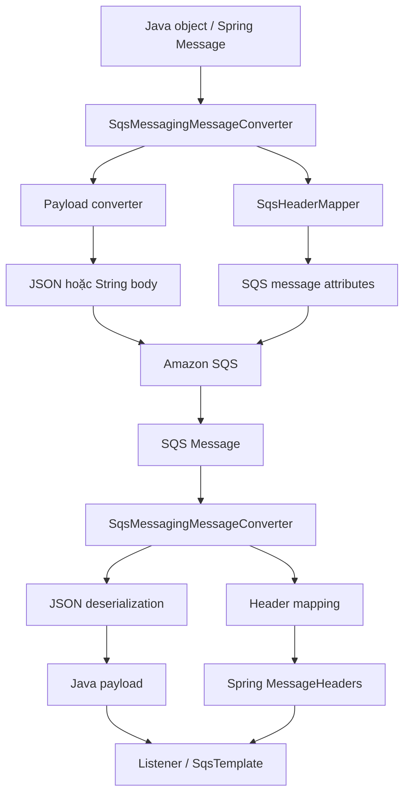

# Ánh xạ payload, header và chuyển đổi JSON

Khi tích hợp Spring Boot với Amazon Simple Queue Service (Amazon SQS), message không chỉ là một chuỗi JSON. Một message có **body** chứa dữ liệu nghiệp vụ, **message attributes** chứa metadata do ứng dụng định nghĩa và **system attributes** do SQS/AWS sử dụng. Ứng dụng Spring cần chuyển các phần đó thành đối tượng Java và Spring `Message` để producer, consumer có thể giao tiếp ổn định.

Spring Cloud AWS cung cấp `SqsMessagingMessageConverter` để thực hiện việc này. Converter mặc định kết hợp `SqsHeaderMapper` để ánh xạ header với message attributes và các converter payload như `StringMessageConverter`, `MappingJackson2MessageConverter` để chuyển dữ liệu qua JSON. **Hiểu rõ ranh giới giữa payload, header và type information giúp tránh lỗi deserialize, phụ thuộc vào tên class Java và làm mất metadata khi tích hợp với producer bên ngoài.**

Bài học sử dụng API Spring Cloud AWS **3.4.1** và tập trung vào cấu trúc message, JSON mapping, `ObjectMapper`, type header, custom header mapper, xử lý nhiều loại sự kiện, tương thích schema và kiểm thử chuyển đổi.

## 1. Mục tiêu học tập

Sau bài học, bạn có thể:

- Phân biệt message body, message attributes, message system attributes và queue attributes.
- Giải thích vai trò của `SqsMessagingMessageConverter`, `SqsHeaderMapper` và `MappingJackson2MessageConverter`.
- Gửi một Java record dưới dạng JSON bằng `SqsTemplate` và nhận nó qua `@SqsListener`.
- Đọc message attributes qua `@Header`, `Message<T>` và các header prefix của Spring Cloud AWS.
- Hiểu `JavaType` header mặc định, khi nào cần chỉ định payload class và khi nào cần type mapper.
- Cấu hình `ObjectMapper`, custom converter, custom header mapper và allowlist cho nhiều loại event.
- Thiết kế schema versioning, kiểm tra dữ liệu đầu vào và kiểm thử payload không hợp lệ.

## 2. Cấu trúc một message SQS

Một message SQS có các phần độc lập:

| Thành phần | Ai định nghĩa? | Mục đích | Ví dụ |
|---|---|---|---|
| **Body** | Producer | Nội dung nghiệp vụ mà consumer cần xử lý | `InventoryAdjusted`, `OrderPaid` |
| **Message attributes** | Ứng dụng | Metadata có cấu trúc để định tuyến, tracing, phân loại hoặc kiểm tra mà không cần parse body | `eventType`, `correlationId`, `schemaVersion` |
| **Message system attributes** | AWS/SQS và tích hợp AWS | Metadata phục vụ dịch vụ AWS, ví dụ trace header | `AWSTraceHeader` |
| **Queue attributes** | Cấu hình queue | Thuộc tính của queue, không phải metadata riêng của một message | `VisibilityTimeout`, `FifoQueue` |

Ví dụ body JSON:

```json
{
  "eventId": "evt-8f31",
  "sku": "SKU-42",
  "quantityDelta": 5,
  "occurredAt": "2026-11-24T09:30:00Z"
}
```

Message attributes có thể đi kèm:

```text
eventType     = inventory.adjusted.v1
correlationId = req-123
tenantId      = tenant-42
schemaVersion = 1
```

Consumer có thể đọc `eventType` hoặc `tenantId` để quyết định cách xử lý trước khi chuyển đổi toàn bộ body. Tuy nhiên, các trường bắt buộc để thực hiện nghiệp vụ vẫn nên nằm trong body. Không đặt toàn bộ event trong message attributes.

### 2.1. Giới hạn của message attributes

Amazon SQS cho phép tối đa **10 message attributes trên mỗi message**. Các kiểu dữ liệu logic gồm `String`, `Number` và `Binary`; có thể gắn nhãn kiểu tùy chỉnh như `Number.int`. Tên attribute phân biệt chữ hoa/chữ thường, tối đa 256 ký tự và không được bắt đầu bằng `AWS.` hoặc `Amazon.`.

Kích thước body và các thành phần attribute cùng tính vào giới hạn kích thước message SQS (1 MiB). Vì vậy, attributes phù hợp với metadata ngắn như ID, loại sự kiện, phiên bản schema hoặc correlation ID; không phù hợp để truyền file, JSON lớn hay token bí mật.

**Không nhầm message attributes với message system attributes.** Message attributes là metadata ứng dụng tự đặt; system attributes do SQS/AWS quản lý. Ví dụ gồm `AWSTraceHeader` cho tracing và các metadata khi nhận message như `ApproximateReceiveCount`, `SentTimestamp`, `MessageGroupId` hoặc `SequenceNumber` khi có trong loại queue tương ứng. Queue attributes là một nhóm khác, mô tả cấu hình của queue.

## 3. Mô hình chuyển đổi trong Spring Cloud AWS

Trong Spring Cloud AWS 3.4.1, converter mặc định là `SqsMessagingMessageConverter`:



Converter gồm hai phần chính:

- **Payload converter:** `CompositeMessageConverter` kết hợp `StringMessageConverter` và `MappingJackson2MessageConverter` để chuyển payload Java sang body và ngược lại.
- **Header mapper:** `SqsHeaderMapper` ánh xạ Spring `MessageHeaders` với SQS message attributes và các header đặc biệt của SQS.

Do đó, JSON body và message attributes có thể được chuyển đổi độc lập. Một message có body JSON nhưng không có attributes vẫn deserialize được nếu listener biết kiểu payload. Ngược lại, một message có attributes nhưng body sai schema vẫn có thể thất bại khi deserialize.

### 3.1. Cấu hình mặc định và các luồng API

Spring Cloud AWS sử dụng converter trong cả `SqsTemplate` và listener container, nhưng hai luồng cấu hình có thể được tùy chỉnh riêng:

| Luồng | Thành phần chuyển đổi | Nơi cấu hình |
|---|---|---|
| Gửi/nhận bằng `SqsTemplate` | `SqsMessagingMessageConverter` của template | `SqsTemplate.builder()` và `configureDefaultConverter()` |
| Nhận bằng `@SqsListener` | Converter của listener container / message handler | `SqsContainerOptions.messageConverter()` hoặc `SqsListenerConfigurer` |
| Listener tự tạo (`MessageListener`) | Converter của container | `SqsMessageListenerContainerFactory` hoặc container options |

Đừng giả định thay đổi converter của một `SqsTemplate` tự động thay đổi converter của mọi `@SqsListener`. Nếu producer và consumer cần cùng một quy tắc đặc biệt, cấu hình cả hai luồng hoặc dùng auto-configuration chung phù hợp.

## 4. Định nghĩa payload Java và JSON

Ví dụ sự kiện thay đổi tồn kho:

```java
import java.time.Instant;

public record InventoryAdjusted(
    String eventId,
    String sku,
    int quantityDelta,
    Instant occurredAt
) {}
```

Record này mô tả dữ liệu nghiệp vụ; nó không chứa `MessageHeaders`, receipt handle hay queue URL. Những metadata thuộc tầng vận chuyển nên được truyền bằng message attributes hoặc Spring headers.

Khi serialize record, Jackson tạo JSON body. Với `Instant`, ứng dụng nên sử dụng `ObjectMapper` có module Java Time và quy ước thời gian rõ ràng, thường là ISO-8601 UTC. Spring Boot auto-configured `ObjectMapper` thường đã đăng ký module phù hợp nếu dependency Jackson Java Time có mặt.

JSON minh họa:

```json
{
  "eventId": "evt-8f31",
  "sku": "SKU-42",
  "quantityDelta": 5,
  "occurredAt": "2026-11-24T09:30:00Z"
}
```

Body JSON là hợp đồng giữa producer và consumer. Nếu consumer cần thêm trường `warehouseId`, hãy thiết kế thay đổi schema có tính tương thích; không yêu cầu consumer phải biết package hoặc tên class Java của producer.

## 5. Gửi payload và message headers bằng SqsTemplate

Khi gửi một object, `SqsTemplate` chuyển payload thành JSON và gửi header được ánh xạ thành message attributes:

```java
import io.awspring.cloud.sqs.operations.SqsTemplate;
import org.springframework.beans.factory.annotation.Value;
import org.springframework.stereotype.Service;

@Service
public class InventoryPublisher {
    private final SqsTemplate sqsTemplate;
    private final String queueName;

    public InventoryPublisher(
            SqsTemplate sqsTemplate,
            @Value("${app.sqs.inventory-queue}") String queueName) {
        this.sqsTemplate = sqsTemplate;
        this.queueName = queueName;
    }

    public void publish(InventoryAdjusted event, String correlationId) {
        sqsTemplate.send(to -> to
            .queue(queueName)
            .payload(event)
            .header("eventType", "inventory.adjusted.v1")
            .header("correlationId", correlationId)
            .header("schemaVersion", "1")
        );
    }
}
```

Trong ví dụ:

- `payload(event)` là dữ liệu nghiệp vụ được serialize thành body JSON.
- `header("eventType", ...)` là metadata ứng dụng; `SqsHeaderMapper` ánh xạ nó thành SQS message attribute.
- `correlationId` giúp nối log/trace giữa request và consumer.
- `schemaVersion` hỗ trợ consumer chọn quy tắc tương thích hoặc xử lý phiên bản.

Không đưa password, access key, token hoặc dữ liệu cá nhân nhạy cảm vào message attributes. Attributes không phải kho secret và vẫn là một phần của message được truyền, lưu trữ và ghi log nếu ứng dụng log chúng.

### 5.1. Dùng Spring Message khi cần quản lý nhiều header

Nếu payload và header đã được chuẩn bị ở tầng khác, có thể tạo `Message<T>`:

```java
import org.springframework.messaging.Message;
import org.springframework.messaging.support.MessageBuilder;

Message<InventoryAdjusted> message = MessageBuilder
    .withPayload(event)
    .setHeader("eventType", "inventory.adjusted.v1")
    .setHeader("correlationId", correlationId)
    .setHeader("schemaVersion", "1")
    .build();

sqsTemplate.send(to -> to
    .queue(queueName)
    .payload(message)
);
```

`MessageBuilder` giúp tách bước tạo message khỏi bước gửi. Khi sử dụng header, cần kiểm tra header nào được `SqsHeaderMapper` hỗ trợ và header nào chỉ có ý nghĩa trong nội bộ Spring. Không giả định tất cả `MessageHeaders` đều trở thành SQS attributes.

## 6. Đọc payload và attributes trong @SqsListener

### 6.1. Chỉ nhận payload

Nếu chỉ cần dữ liệu nghiệp vụ, method có thể nhận trực tiếp POJO:

```java
import io.awspring.cloud.sqs.annotation.SqsListener;
import org.springframework.stereotype.Component;

@Component
public class InventoryListener {
    private final InventoryService inventoryService;

    public InventoryListener(InventoryService inventoryService) {
        this.inventoryService = inventoryService;
    }

    @SqsListener("${app.sqs.inventory-queue}")
    public void handle(InventoryAdjusted event) {
        inventoryService.applyIdempotently(event);
    }
}
```

Với method `@SqsListener`, nếu không có type information trong header, framework có thể dùng kiểu tham số method để xác định target class trước khi gọi listener. Đây là cách phù hợp khi một queue chỉ chứa một loại payload đã biết.

### 6.2. Nhận cả payload và message attributes

```java
import org.springframework.messaging.handler.annotation.Header;
import org.springframework.messaging.Message;

@SqsListener("${app.sqs.inventory-queue}")
public void handle(
        InventoryAdjusted event,
        @Header("Sqs_MA_correlationId") String correlationId,
        @Header(name = "Sqs_MA_eventType", required = false) String eventType) {

    log.info("eventId={}, correlationId={}, eventType={}",
        event.eventId(), correlationId, eventType);
    inventoryService.applyIdempotently(event);
}
```

Spring Cloud AWS thêm prefix vào header được ánh xạ từ SQS:

| Nguồn | Header trong Spring Message | Ví dụ |
|---|---|---|
| Message attribute | `Sqs_MA_` | `Sqs_MA_correlationId` |
| Message system attribute | `Sqs_MSA_` | `Sqs_MSA_ApproximateReceiveCount` |
| Queue attributes | `Sqs_QueueAttributes` | Đối tượng `QueueAttributes` khi được yêu cầu tải |
| Queue URL | `Sqs_QueueUrl` | URL của queue nhận message |
| Queue name | `Sqs_QueueName` | Tên queue nhận message |

`Sqs_MA_` là viết tắt của message attribute; `Sqs_MSA_` là message system attribute. Không bỏ prefix khi dùng `@Header` hoặc `message.getHeaders().get(...)`.

### 6.3. Đọc metadata qua Message<T>

Khi cần nhiều header hoặc muốn chuyển `Message<T>` qua các lớp xử lý, dùng:

```java
import org.springframework.messaging.Message;

@SqsListener("${app.sqs.inventory-queue}")
public void handle(Message<InventoryAdjusted> message) {
    InventoryAdjusted event = message.getPayload();
    String correlationId = message.getHeaders()
        .get("Sqs_MA_correlationId", String.class);
    String eventType = message.getHeaders()
        .get("Sqs_MA_eventType", String.class);

    log.info("Received {} ({})", event.eventId(), eventType);
    inventoryService.applyIdempotently(event);
}
```

Nếu metadata có thể thiếu, không ép kiểu trực tiếp khi chưa kiểm tra. Dùng `get(key, String.class)` và kiểm tra `null`, hoặc đánh dấu `required = false` cho tham số `@Header` tùy chữ ký method.

### 6.4. Attributes được lấy từ SQS như thế nào?

Trong Spring Cloud AWS 3.4.1, listener container mặc định lấy tất cả message attributes và message system attributes, nhưng không lấy queue attributes. Có thể tùy chỉnh `messageAttributeNames`, `messageSystemAttributeNames` và `queueAttributeNames` trong `SqsContainerOptions`.

Ví dụ chỉ lấy các metadata ứng dụng cần dùng:

```java
@Bean
SqsMessageListenerContainerFactory<Object> inventoryListenerFactory(
        SqsAsyncClient sqsAsyncClient) {
    return SqsMessageListenerContainerFactory.builder()
        .sqsAsyncClient(sqsAsyncClient)
        .configure(options -> options
            .messageAttributeNames(List.of("eventType", "correlationId", "schemaVersion"))
        )
        .build();
}
```

Khi giảm số attributes được lấy, listener không thể đọc những attribute đã bị loại khỏi receive request. Nếu dùng factory riêng, chỉ định factory trong `@SqsListener` hoặc đặt tên factory mặc định theo cấu hình dự án. Hãy tránh tạo nhiều factory có tên trùng nhau.

## 7. Type header JavaType và xác định kiểu payload

Để chuyển JSON thành Java object, converter cần biết target class. Spring Cloud AWS có cơ chế type header mặc định.

### 7.1. JavaType header mặc định

Khi `SqsTemplate` gửi một payload Java, mặc định nó thêm header `JavaType` có giá trị là fully qualified class name (FQCN), ví dụ:

```text
JavaType = com.example.inventory.InventoryAdjusted
```

Header này được gửi như message attribute. Khi nhận, `SqsHeaderMapper` ánh xạ attribute đó thành Spring header:

```text
Sqs_MA_JavaType = com.example.inventory.InventoryAdjusted
```

`SqsTemplate`, `SqsMessageListenerContainer` và `@SqsListener` có thể dùng type information này để chọn class deserialize. Với `SqsTemplate.receive()` khi không có type header, có thể chỉ định payload class rõ ràng:

```java
Optional<Message<InventoryAdjusted>> message = sqsTemplate.receive(
    from -> from.queue(queueName),
    InventoryAdjusted.class
);
```

Nếu message đến từ producer không phải Spring Cloud AWS và không có `JavaType`, `@SqsListener` có thể dựa vào kiểu tham số method. Với `SqsTemplate.receive()`, nên truyền `InventoryAdjusted.class` hoặc cấu hình `defaultPayloadClass` nếu đã biết kiểu dữ liệu.

### 7.2. Vì sao không nên coi FQCN là hợp đồng liên dịch vụ?

FQCN phụ thuộc vào package và cấu trúc mã Java. Nếu producer đổi package, consumer có thể không còn resolve được type header. Một producer viết bằng .NET, Go hoặc Python cũng không có class Java để gửi.

Vì vậy:

- Với hệ thống nội bộ Java có kiểm soát phiên bản đồng bộ, `JavaType` có thể tiện lợi.
- Với tích hợp đa ngôn ngữ hoặc nhiều team phát hành độc lập, nên dùng `eventType` ổn định như `inventory.adjusted.v1` và ánh xạ sang class bằng allowlist.
- Nếu chỉ một loại message trong queue, dùng kiểu tham số listener hoặc `payloadClass` tường minh giúp hợp đồng đơn giản hơn.
- Không cho phép một header không đáng tin cậy chọn tùy ý bất kỳ class nào trong classpath để deserialize.

## 8. Xử lý nhiều loại event bằng type mapper

Giả sử queue `domain-events` nhận hai loại sự kiện:

```java
interface InventoryEvent {
    String eventId();
}

record InventoryAdjusted(
    String eventId,
    String sku,
    int quantityDelta
) implements InventoryEvent {}

record InventoryRecounted(
    String eventId,
    String sku,
    int countedQuantity
) implements InventoryEvent {}
```

Producer gửi message attribute `eventType` có giá trị thuộc tập đã thống nhất:

```text
inventory.adjusted.v1
inventory.recounted.v1
```

Consumer cấu hình `setPayloadTypeMapper()` để ánh xạ các giá trị này sang class:

```java
import io.awspring.cloud.sqs.support.converter.SqsMessagingMessageConverter;

SqsMessagingMessageConverter converter = new SqsMessagingMessageConverter();
converter.setPayloadTypeMapper(message -> {
    String eventType = message.getHeaders()
        .get("Sqs_MA_eventType", String.class);

    if ("inventory.adjusted.v1".equals(eventType)) {
        return InventoryAdjusted.class;
    }
    if ("inventory.recounted.v1".equals(eventType)) {
        return InventoryRecounted.class;
    }

    throw new IllegalArgumentException("Unsupported eventType: " + eventType);
});
```

Listener có thể nhận interface:

```java
@SqsListener("domain-events")
public void handle(InventoryEvent event) {
    if (event instanceof InventoryAdjusted adjusted) {
        inventoryService.adjust(adjusted);
    } else if (event instanceof InventoryRecounted recounted) {
        inventoryService.recount(recounted);
    } else {
        throw new IllegalArgumentException("Unsupported event class: " + event.getClass());
    }
}
```

Các kiểu trong ví dụ là package-private để minh họa nhiều kiểu trong cùng một đoạn mã. Trong dự án thật, đặt mỗi public type vào file riêng.

`setPayloadTypeMapper()` thay thế cơ chế ánh xạ mặc định dựa trên type header. Vì vậy, nếu dùng mapper theo `eventType`, phải đảm bảo message attributes đó có mặt và được lấy về. Giá trị không nhận diện phải tạo lỗi rõ ràng để đưa message vào quy trình xử lý lỗi/DLQ, không mặc định ánh xạ sang một class không liên quan.

## 9. Tùy chỉnh SqsMessagingMessageConverter

Có thể cấu hình converter mặc định hoặc thay thế hoàn toàn converter.

### 9.1. Cấu hình converter của SqsTemplate

```java
import io.awspring.cloud.sqs.operations.SqsOperations;
import io.awspring.cloud.sqs.operations.SqsTemplate;
import software.amazon.awssdk.services.sqs.SqsAsyncClient;
import com.fasterxml.jackson.databind.ObjectMapper;

@Bean
SqsOperations sqsOperations(
        SqsAsyncClient sqsAsyncClient,
        ObjectMapper objectMapper) {

    return SqsTemplate.builder()
        .sqsAsyncClient(sqsAsyncClient)
        .configureDefaultConverter(converter -> {
            converter.setObjectMapper(objectMapper);
            converter.setPayloadTypeHeader("JavaType");
        })
        .buildSyncTemplate();
}
```

`configureDefaultConverter()` cho phép giữ converter mặc định nhưng thay `ObjectMapper`, `HeaderMapper` hoặc tên type header. Nếu cần thay hoàn toàn payload conversion, tạo `SqsMessagingMessageConverter` riêng và truyền qua `.messageConverter(converter)`.

### 9.2. Dùng ObjectMapper của Spring Boot cho @SqsListener

Khi dùng Spring Boot auto-configuration và chỉ có một `ObjectMapper` trong context, Spring Cloud AWS sử dụng mapper đó để deserialize payload của `@SqsListener`. Nếu muốn chỉ định mapper rõ ràng cho listener, có thể dùng `SqsListenerConfigurer`:

```java
import com.fasterxml.jackson.databind.ObjectMapper;
import io.awspring.cloud.sqs.annotation.SqsListenerConfigurer;

@Bean
SqsListenerConfigurer sqsListenerConfigurer(ObjectMapper objectMapper) {
    return registrar -> registrar.setObjectMapper(objectMapper);
}
```

Nếu ứng dụng có nhiều `ObjectMapper` cho REST API, persistence hoặc event schema, cần xác định rõ mapper nào dùng cho SQS. Không thay đổi toàn bộ mapper chỉ để xử lý một queue nếu các API khác phụ thuộc vào cấu hình cũ.

### 9.3. Cấu hình converter cho listener container

Nếu cần type mapper hoặc header mapper riêng cho listener, cấu hình `SqsMessagingMessageConverter` vào `SqsContainerOptions`:

```java
SqsMessagingMessageConverter messageConverter = new SqsMessagingMessageConverter();
messageConverter.setObjectMapper(objectMapper);
messageConverter.setPayloadTypeMapper(message -> {
    String eventType = message.getHeaders()
        .get("Sqs_MA_eventType", String.class);
    if (eventType == null) {
        throw new IllegalArgumentException("Missing eventType attribute");
    }
    return switch (eventType) {
        case "inventory.adjusted.v1" -> InventoryAdjusted.class;
        case "inventory.recounted.v1" -> InventoryRecounted.class;
        default -> throw new IllegalArgumentException("Unsupported eventType: " + eventType);
    };
});

factory.configure(options -> options.messageConverter(messageConverter));
```

Đoạn code trên minh họa phần cấu hình converter; `factory` là `SqsMessageListenerContainerFactory` được tạo trong cấu hình Spring. Nếu dùng type mapper tùy chỉnh, cần kiểm thử cả trường hợp thiếu attribute và event type không hợp lệ.

## 10. Custom HeaderMapper và header bổ sung

`SqsHeaderMapper` là lớp ánh xạ Spring message headers với các message attributes của SQS. Nếu cần thêm một header được tính từ raw SQS message, có thể sử dụng `setAdditionalHeadersFunction()`:

```java
import io.awspring.cloud.sqs.support.converter.SqsHeaderMapper;
import io.awspring.cloud.sqs.support.converter.SqsMessagingMessageConverter;

SqsHeaderMapper headerMapper = new SqsHeaderMapper();
headerMapper.setAdditionalHeadersFunction((sqsMessage, accessor) -> {
    accessor.setHeader("sourceSystem", "amazon-sqs");
    accessor.setHeader("rawMessageId", sqsMessage.messageId());
    return accessor.toMessageHeaders();
});

SqsMessagingMessageConverter converter = new SqsMessagingMessageConverter();
converter.setHeaderMapper(headerMapper);
```

Đây là ví dụ bổ sung header khi chuyển raw SQS message thành Spring `Message`. Header `rawMessageId` được lấy từ message metadata do AWS SDK trả về; nó không phải `eventId` nghiệp vụ. Không sử dụng header mapper để thay đổi payload JSON hoặc ghi đè metadata hệ thống theo cách làm sai receipt handle, queue URL hay message ID.

Sau khi cấu hình header mapper, cài converter vào container factory bằng `factory.configure(options -> options.messageConverter(converter))`. Nếu muốn dùng cho `SqsTemplate`, truyền converter qua `.messageConverter(converter)` khi tạo template. Việc cài converter ở một nơi không tự động áp dụng cho nơi còn lại.

Nếu cần một quy tắc ánh xạ hoàn toàn khác, có thể triển khai `HeaderMapper` riêng và truyền qua `setHeaderMapper()`. Giữ các header nội bộ của Spring và SQS tách biệt với message attributes do ứng dụng định nghĩa.

## 11. Tương thích schema và tiến hóa event

Message có thể nằm trong queue lâu hơn một lần deploy. Producer phiên bản mới có thể gửi message mà consumer phiên bản cũ vẫn đang xử lý. Vì vậy, event schema cần hỗ trợ nhiều phiên bản cùng tồn tại.

| Thay đổi | Mức tương thích thường gặp | Cách xử lý |
|---|---|---|
| Thêm field tùy chọn | Thường tương thích ngược nếu consumer bỏ qua field lạ | Đặt default/nullable, kiểm thử consumer cũ |
| Thêm field bắt buộc | Có thể làm consumer cũ hoặc message cũ lỗi | Dùng giá trị mặc định hoặc phát event version mới |
| Đổi tên field | Có thể làm deserialize sai hoặc thiếu dữ liệu | Dùng `@JsonAlias` trong giai đoạn chuyển tiếp |
| Đổi kiểu dữ liệu | Có nguy cơ lỗi deserialize hoặc sai ngữ nghĩa | Tạo field mới hoặc version mới |
| Xóa field | Có thể làm consumer cũ thiếu thông tin | Duy trì trong giai đoạn deprecation |
| Đổi tên Java package | Có thể phá `JavaType` FQCN | Dùng event type ổn định thay cho class name |

Ví dụ hỗ trợ tên field cũ:

```java
import com.fasterxml.jackson.annotation.JsonAlias;

public record InventoryAdjusted(
    String eventId,
    @JsonAlias("productCode") String sku,
    int quantityDelta
) {}
```

Nếu producer cũ gửi `productCode`, Jackson vẫn có thể ánh xạ vào `sku`. Khi phát hành schema mới, cần có thời gian chuyển tiếp và telemetry để biết producer cũ đã ngừng gửi field cũ chưa.

Một event có thể mang `schemaVersion` trong body hoặc message attribute. Nếu version ảnh hưởng cách deserialize, dùng `eventType`/`schemaVersion` để chọn một class hoặc một converter cụ thể. Không dùng một class Java mutable để diễn giải mọi phiên bản nếu ý nghĩa field đã thay đổi.

### 11.1. Bỏ qua field JSON không nhận diện

Trong một số hệ thống, consumer cần bỏ qua field mới để tương thích ngược:

```java
import com.fasterxml.jackson.annotation.JsonIgnoreProperties;

@JsonIgnoreProperties(ignoreUnknown = true)
public record InventoryAdjusted(
    String eventId,
    String sku,
    int quantityDelta
) {}
```

Chỉ bật `ignoreUnknown` khi các field bổ sung thực sự không ảnh hưởng logic hiện tại. Nếu field lạ thể hiện một loại event hoặc thay đổi nghiệp vụ quan trọng, bỏ qua âm thầm có thể làm mất dữ liệu. Với message contract quan trọng, cân nhắc schema validation và versioning rõ ràng.

## 12. Producer ngoài Spring Cloud AWS

Không phải producer nào cũng gửi `JavaType`. Ví dụ một Lambda viết bằng Python có thể gửi body JSON:

```json
{
  "eventId": "evt-200",
  "sku": "SKU-99",
  "quantityDelta": -2,
  "occurredAt": "2026-11-24T10:15:00Z"
}
```

Kèm message attributes:

```text
eventType     = inventory.adjusted.v1
schemaVersion = 1
correlationId = req-987
```

Consumer Spring có thể nhận payload theo kiểu method và đọc attribute:

```java
@SqsListener("${app.sqs.inventory-queue}")
public void handle(
        InventoryAdjusted event,
        @Header("Sqs_MA_correlationId") String correlationId) {
    inventoryService.applyIdempotently(event);
}
```

Producer ngoài Spring không cần biết Java package, `JavaType` hay Spring `MessageHeaders`. Hai phía chỉ cần thống nhất JSON schema và tên/type của message attributes. Đây là cách tích hợp phù hợp khi AWS Lambda, .NET, Python và Spring Boot cùng tham gia một luồng sự kiện.

## 13. Xử lý lỗi chuyển đổi và dữ liệu không hợp lệ

Lỗi chuyển đổi xảy ra trước hoặc trong lúc gọi listener, ví dụ:

- JSON sai cú pháp hoặc body rỗng.
- Kiểu field không khớp (chuỗi thay cho số nguyên).
- `Instant` có định dạng không hợp lệ.
- Type header trỏ đến class không có trong ứng dụng.
- `eventType` thiếu hoặc nằm ngoài allowlist.
- Schema version không được consumer hỗ trợ.

Nếu converter thất bại trước khi method listener được gọi, code bên trong listener không thể bắt exception đó. Hãy xử lý ở lớp error handler/interceptor của listener container và cấu hình retry/DLQ. Không retry vô hạn một message có JSON sai cú pháp; sau số lần nhận phù hợp, message nên được chuyển sang DLQ để điều tra.

Đối với lỗi nghiệp vụ tạm thời (database timeout, downstream 503), retry có thể hữu ích. Đối với lỗi schema hoặc dữ liệu không hợp lệ, retry cùng một payload thường không tự sửa được lỗi. Phân loại lỗi giúp giảm chi phí và tránh queue bị chặn bởi poison message.

Không log toàn bộ body khi message có thể chứa thông tin nhạy cảm. Ưu tiên `eventId`, `messageId`, `correlationId`, `eventType`, schema version và mã lỗi đã được làm sạch.

## 14. Kiểm thử payload, headers và JSON conversion

### 14.1. Unit test ObjectMapper

Kiểm tra serialize/deserialize độc lập với SQS:

```java
@Test
void inventoryEventRoundTripsAsJson() throws Exception {
    InventoryAdjusted event = new InventoryAdjusted(
        "evt-8f31",
        "SKU-42",
        5,
        Instant.parse("2026-11-24T09:30:00Z")
    );

    String json = objectMapper.writeValueAsString(event);
    InventoryAdjusted restored = objectMapper.readValue(
        json, InventoryAdjusted.class
    );

    assertThat(restored).isEqualTo(event);
}
```

Kiểm thử này xác minh Jackson mapping, nhưng không chứng minh `SqsHeaderMapper` đã ánh xạ attributes đúng.

### 14.2. Integration test với LocalStack

Tạo queue kiểm thử, gửi message bằng `SqsTemplate` với `eventType`, `correlationId`, sau đó để `@SqsListener` nhận message. Xác minh:

1. Body JSON được deserialize thành đúng record.
2. Header `Sqs_MA_correlationId` có đúng giá trị đã gửi.
3. Header `Sqs_MA_eventType` có đúng loại event.
4. `JavaType` được ánh xạ đúng khi producer dùng Spring Cloud AWS.
5. Message từ producer ngoài Spring không có type header vẫn được deserialize theo tham số listener.
6. Message sai JSON đi vào error handler và retry/DLQ theo cấu hình.

LocalStack hữu ích cho CI và phát triển local. Những hành vi liên quan IAM, KMS, quota, policy và redrive vẫn nên có kiểm thử bổ sung trên AWS test account.

### 14.3. Ma trận kiểm thử chuyển đổi

| Payload | Type header | Attributes | Kết quả mong đợi |
|---|---|---|---|
| JSON hợp lệ của `InventoryAdjusted` | Có `JavaType` hợp lệ | Có correlation ID | Deserialize và đọc header thành công |
| JSON hợp lệ | Không có | Có `eventType` được allowlist | Type mapper chọn class đúng |
| JSON hợp lệ | Không có | Không có | `@SqsListener` dùng kiểu tham số method nếu queue có một kiểu payload |
| JSON hợp lệ | Không có | Không có | `SqsTemplate.receive(queue, InventoryAdjusted.class)` deserialize theo class được chỉ định |
| JSON hợp lệ nhưng type header sai | FQCN không hợp lệ | Bất kỳ | Lỗi type mapping; không tin class tùy ý từ producer |
| JSON sai cú pháp | Có hoặc không | Có hoặc không | Conversion failure, error handler và DLQ xử lý |
| JSON có field mới | Không có | `schemaVersion` mới | Xử lý theo chính sách schema compatibility |

## 15. Lỗi thường gặp và cách khắc phục

| Triệu chứng | Nguyên nhân | Cách xử lý |
|---|---|---|
| Listener không deserialize được JSON | Payload không đúng schema hoặc Jackson không có module cần thiết | Kiểm tra body thô, `ObjectMapper`, kiểu record và định dạng ngày giờ |
| `JavaType` không resolve được class | Producer gửi FQCN không có trong consumer | Dùng event type ổn định và type mapper allowlist |
| `@Header` trả `null` | Attribute không được gửi, sai tên hoặc bị loại khỏi receive request | Kiểm tra tên attribute và `messageAttributeNames` |
| Không đọc được queue attributes | Container không yêu cầu `queueAttributeNames` | Cấu hình thuộc tính queue cần tải |
| Attribute bị mất khi gửi | Header không được mapper hỗ trợ hoặc dùng header Spring nội bộ | Kiểm tra `SqsHeaderMapper`, dùng header tên hợp lệ và integration test |
| Consumer nhận JSON nhưng thiếu field | Producer/consumer khác schema hoặc field bị đổi tên | Dùng `@JsonAlias`, default và versioning |
| Deserialize interface thất bại | Không có type mapper hoặc mapper không nhận diện event type | Cấu hình `setPayloadTypeMapper()` với allowlist |
| JSON lỗi lặp lại trong queue | Poison message bị retry mà không thay đổi | Phân loại lỗi, đặt redrive policy và xử lý DLQ |
| Message attribute vượt giới hạn | Quá 10 attributes hoặc metadata quá lớn | Giữ attributes ngắn, chuyển dữ liệu nghiệp vụ vào body |

## 16. Bài tập thực hành

**Bài 1 — Chuyển record thành JSON:** Tạo `InventoryAdjusted`, gửi bằng `SqsTemplate`, quan sát body JSON và kiểm tra listener nhận lại đúng giá trị.

**Bài 2 — Gửi message attributes:** Thêm `eventType`, `correlationId` và `schemaVersion`. Đọc chúng qua `@Header` với prefix `Sqs_MA_`.

**Bài 3 — Producer không phải Spring:** Dùng AWS CLI hoặc một script Python gửi JSON body và attributes nhưng không có `JavaType`. Xác minh `@SqsListener` dùng kiểu tham số method để deserialize.

**Bài 4 — Type mapper:** Tạo hai record triển khai `InventoryEvent`, cấu hình `setPayloadTypeMapper()` dựa trên `eventType`. Gửi một event hợp lệ và một event type không hỗ trợ, quan sát kết quả.

**Bài 5 — Custom ObjectMapper:** Cấu hình mapper có quy tắc ngày giờ và kiểm tra cả `SqsTemplate` lẫn `@SqsListener` dùng đúng converter.

**Bài 6 — Schema evolution:** Thêm field tùy chọn vào event v2, kiểm thử consumer v1; sau đó đổi tên field và dùng `@JsonAlias` trong giai đoạn chuyển tiếp.

**Bài 7 — Poison message:** Gửi JSON sai cú pháp, xác minh listener method không được gọi và error handler/DLQ xử lý message.

## 17. Câu hỏi tự kiểm tra

1. Body khác message attributes như thế nào? **Body chứa dữ liệu nghiệp vụ; attributes chứa metadata ứng dụng có cấu trúc.**
2. `SqsMessagingMessageConverter` gồm những thành phần chính nào? **`SqsHeaderMapper` và payload converter dựa trên String/Jackson.**
3. Header nào được thêm cho message gửi bằng `SqsTemplate` theo mặc định? **`JavaType` chứa FQCN của payload class.**
4. Vì sao listener đọc `Sqs_MA_correlationId` thay vì `correlationId`? **Spring Cloud AWS thêm prefix `Sqs_MA_` khi ánh xạ SQS message attributes thành Spring headers.**
5. Khi producer là Python, có cần gửi `JavaType` không? **Không; producer và consumer có thể thống nhất JSON schema và dùng kiểu tham số listener hoặc type mapper.**
6. `setPayloadTypeMapper()` dùng để làm gì? **Ánh xạ metadata của message sang class Java cần deserialize, thay cho mapping mặc định dựa trên type header.**
7. Vì sao không nên tin FQCN tùy ý trong type header? **Vì producer có thể không đáng tin cậy và tên class Java không phải hợp đồng liên dịch vụ ổn định.**
8. Amazon SQS hỗ trợ tối đa bao nhiêu message attributes? **10 attributes trên mỗi message.**

## 18. Tài liệu tham khảo

- [Spring Cloud AWS 3.4.1 — Template Message Conversion](https://docs.awspring.io/spring-cloud-aws/docs/3.4.1/reference/html/index.html#template-message-conversion): converter mặc định, `SqsHeaderMapper`, JSON converter và `JavaType` header.
- [Spring Cloud AWS 3.4.1 — Message Conversion and Payload Deserialization](https://docs.awspring.io/spring-cloud-aws/docs/3.4.1/reference/html/index.html#message-conversion-and-payload-deserialization): type mapping, converter tùy chỉnh và deserialize payload cho listener.
- [Spring Cloud AWS 3.4.1 — SqsMessagingMessageConverter API](https://docs.awspring.io/spring-cloud-aws/docs/3.4.1/apidocs/io/awspring/cloud/sqs/support/converter/SqsMessagingMessageConverter.html): converter cho message SQS.
- [Spring Cloud AWS 3.4.1 — AbstractMessagingMessageConverter API](https://docs.awspring.io/spring-cloud-aws/docs/3.4.1/apidocs/io/awspring/cloud/sqs/support/converter/AbstractMessagingMessageConverter.html): `setObjectMapper`, `setPayloadTypeMapper`, `setPayloadTypeHeader`, `setHeaderMapper`.
- [Spring Cloud AWS 3.4.1 — SqsContainerOptionsBuilder API](https://docs.awspring.io/spring-cloud-aws/docs/3.4.1/apidocs/io/awspring/cloud/sqs/listener/SqsContainerOptionsBuilder.html): cấu hình message attributes, system attributes và queue attributes.
- [Amazon SQS — Message metadata](https://docs.aws.amazon.com/AWSSimpleQueueService/latest/SQSDeveloperGuide/sqs-message-metadata.html): message attributes, system attributes và kiểu dữ liệu.
- [Amazon SQS — Message quotas](https://docs.aws.amazon.com/AWSSimpleQueueService/latest/SQSDeveloperGuide/quotas-messages.html): giới hạn số message attributes và kích thước message.

**Ghi nhớ:** Body JSON là hợp đồng dữ liệu nghiệp vụ; message attributes là metadata; `SqsMessagingMessageConverter` chuyển đổi payload còn `SqsHeaderMapper` ánh xạ metadata. Dùng type header mặc định khi hai phía kiểm soát cùng hệ sinh thái Java; dùng event type ổn định và mapper allowlist khi tích hợp nhiều producer hoặc nhiều ngôn ngữ.
