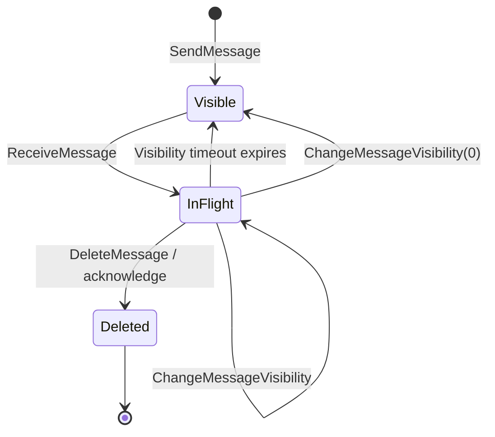
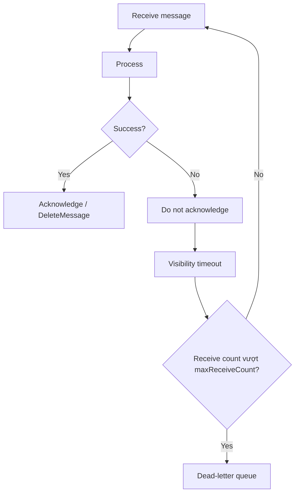

# Visibility timeout, long polling và gia hạn thời gian xử lý

Khi một consumer nhận message từ Amazon Simple Queue Service (Amazon SQS), message vẫn được lưu trong queue nhưng tạm thời không hiển thị với consumer khác. Khoảng thời gian ẩn này gọi là **visibility timeout**. Nếu consumer xử lý xong và xác nhận message trước khi timeout hết, SQS xóa message. Nếu message chưa được xác nhận khi timeout kết thúc, nó có thể xuất hiện lại để được xử lý lần nữa.

Ở chiều nhận message, **long polling** giúp consumer chờ message đến thay vì liên tục gọi SQS và nhận response rỗng. Hai cơ chế giải quyết hai vấn đề khác nhau: long polling tối ưu cách chờ message; visibility timeout kiểm soát khoảng thời gian một message đã nhận không hiển thị cho consumer khác.

Với Spring Cloud AWS, listener container có thể cấu hình poll timeout và message visibility ngay trong `@SqsListener` hoặc `SqsContainerOptions`. Với tác vụ có thời gian xử lý biến động, listener còn có thể dùng `Visibility` để thay đổi visibility của message đang xử lý. Bài học dùng API **Spring Cloud AWS 3.4.1** và minh họa cách chọn timeout, gia hạn an toàn, xử lý lỗi và quan sát queue.

## 1. Mục tiêu học tập

Sau bài học, bạn có thể:

- Giải thích trạng thái visible, in-flight và deleted của message SQS.
- Phân biệt queue visibility timeout, visibility timeout của một lần nhận và `ChangeMessageVisibility` cho message cụ thể.
- Chọn visibility timeout theo thời gian xử lý, độ trễ retry và mức độ biến động của workload.
- Phân biệt short polling với long polling, cấu hình `WaitTimeSeconds` và tránh HTTP timeout khi poll.
- Cấu hình `pollTimeout` và `messageVisibility` trong Spring Cloud AWS 3.4.1.
- Gia hạn message đang xử lý bằng `Visibility` hoặc AWS SDK, hiểu giới hạn tối đa 12 giờ.
- Phân tích tác động tới FIFO message group, in-flight quota, retry, DLQ và idempotency.
- Dùng CloudWatch metrics và thí nghiệm để chẩn đoán message bị ẩn quá lâu hoặc xuất hiện lại quá sớm.

## 2. Vòng đời message và visibility timeout

Một message SQS có ba trạng thái khái quát:

1. **Stored/visible:** message đã được gửi vào queue và sẵn sàng để consumer nhận.
2. **In-flight/invisible:** một consumer đã nhận message; message vẫn tồn tại nhưng tạm thời không được trả cho các lần receive thông thường khác.
3. **Deleted:** consumer xác nhận thành công bằng thao tác xóa; message được loại khỏi queue.



Visibility timeout bắt đầu khi SQS trả message cho consumer. Trong khoảng này, consumer được kỳ vọng xử lý và xóa message. Nếu timeout hết trước khi message được xóa hoặc gia hạn, message có thể trở lại trạng thái visible và được cùng consumer hoặc consumer khác nhận lại.

**Visibility timeout không xóa message và không phải transaction lock của database.** Nó chỉ điều khiển khả năng message xuất hiện trong kết quả receive. Ứng dụng vẫn phải xử lý trường hợp giao trùng và bảo đảm tác dụng phụ nghiệp vụ idempotent.

### 2.1. Ví dụ timeline

Giả sử queue có visibility timeout 60 giây:

```text
10:00:00  Consumer A nhận message M; visibility bắt đầu 60 giây
10:00:10  A bắt đầu gọi dịch vụ xử lý
10:00:60  Timeout hết nếu A chưa xóa hoặc gia hạn M
10:01:01  Consumer B có thể nhận lại M
10:01:05  A và B có nguy cơ cùng thực hiện tác dụng phụ
```

Nếu A hoàn tất và xóa message lúc 10:00:35, message không còn xuất hiện trong queue. Nếu A bị dừng lúc 10:00:20, message sẽ trở lại sau khi timeout hết, thay vì bị mất chỉ vì một lần xử lý thất bại.

Với Standard queue, SQS dùng mô hình at-least-once delivery. Vì vậy, visibility timeout giúp giảm khả năng hai consumer cùng xử lý một message, nhưng không tạo ra cam kết tuyệt đối rằng message không thể được giao trùng ngay trong thời gian ẩn. Consumer phải an toàn khi nhận cùng `eventId` nhiều lần.

## 3. Queue visibility timeout và timeout theo từng lần nhận

SQS có nhiều điểm cấu hình visibility. Cần hiểu phạm vi của từng điểm để không vô tình đặt timeout quá dài hoặc quá ngắn.

| Cách cấu hình | Phạm vi | Khi nào có hiệu lực |
|---|---|---|
| Queue attribute `VisibilityTimeout` | Giá trị mặc định của queue | Áp dụng cho message được nhận nếu request không override |
| `VisibilityTimeout` trong `ReceiveMessage` | Các message được trả trong lần receive đó | Có hiệu lực ngay khi SQS trả message |
| `ChangeMessageVisibility` | Một message đang in-flight, được xác định bằng receipt handle | Đổi timeout ngay tại thời điểm gọi API |
| Spring `messageVisibility` / `messageVisibilitySeconds` | Message được listener container nhận | Framework gửi giá trị visibility khi poll và quản lý theo queue type |
| Spring `Visibility.changeTo()` | Message đang được xử lý bởi listener hiện tại | Thay đổi timeout cho message đó tại thời điểm gọi |

Giá trị visibility mặc định của một queue mới là **30 giây**. Có thể thay đổi queue attribute trong AWS Console, IaC hoặc AWS CLI. Ví dụ cập nhật queue để dùng 120 giây và bật long polling mặc định 20 giây:

```bash
aws sqs set-queue-attributes \
  --queue-url "https://sqs.ap-southeast-1.amazonaws.com/123456789012/inventory-events" \
  --attributes '{"VisibilityTimeout":"120","ReceiveMessageWaitTimeSeconds":"20"}'
```

Queue URL và account trong ví dụ chỉ mang tính minh họa. Trong production, nên quản lý thuộc tính queue bằng CloudFormation, CDK, Terraform hoặc công cụ IaC của tổ chức để cấu hình có thể review và tái tạo.

Consumer role cần `sqs:ReceiveMessage` để nhận message và `sqs:DeleteMessage` để acknowledge. Nếu ứng dụng chủ động gia hạn hoặc rút ngắn visibility, cấp thêm `sqs:ChangeMessageVisibility` trên đúng queue ARN. Quyền `sqs:SetQueueAttributes` chỉ cần cho thành phần quản lý cấu hình queue, không cần cấp cho consumer chỉ đọc và xử lý message.

### 3.1. Phạm vi của ChangeMessageVisibility

`ChangeMessageVisibility` cần `QueueUrl`, `ReceiptHandle` và giá trị `VisibilityTimeout` mới. **Giá trị truyền vào là thời lượng visibility tính từ lúc gọi API**, không phải số giây cộng thêm vào timeout còn lại.

Ví dụ: timeout hiện tại còn 20 giây. Gọi `ChangeMessageVisibility` với `VisibilityTimeout = 120` sẽ đặt lại khoảng ẩn thành 120 giây tính từ lúc gọi, không phải 140 giây.

Giá trị này chỉ áp dụng cho lần nhận hiện tại. Nếu message hết hạn visibility, được nhận lại và chưa được xóa, lần nhận mới sẽ dùng timeout của queue hoặc giá trị được truyền trong request receive mới. Giá trị đã thay đổi cho lần nhận trước không được lưu làm mặc định vĩnh viễn của message.

Visibility timeout cũng khác **message retention period**. Retention quyết định SQS giữ message tối đa bao lâu tính từ lúc gửi; visibility chỉ tạm ẩn message sau khi nhận. Gia hạn visibility không kéo dài retention và không ngăn message hết hạn theo retention policy.

Để làm message xuất hiện lại ngay, có thể đặt `VisibilityTimeout = 0`. Chỉ làm vậy khi consumer quyết định nhường message cho consumer khác; nếu consumer vẫn đang xử lý, hành động này có thể khiến tác vụ chạy song song.

## 4. Chọn visibility timeout phù hợp

Timeout cần cân bằng hai rủi ro:

- **Quá ngắn:** message xuất hiện lại khi consumer cũ chưa hoàn tất, gây xử lý trùng, tranh chấp dữ liệu và lỗi khi xác nhận.
- **Quá dài:** nếu consumer chết ngay sau khi nhận message, hệ thống phải chờ lâu mới có thể retry; backlog và thời gian khôi phục tăng.

AWS khuyến nghị đặt visibility timeout theo thời gian cần để xử lý và xóa message. Có thể bắt đầu bằng thời gian xử lý lớn nhất quan sát được trong điều kiện bình thường, cộng khoảng đệm cho biến động mạng, scheduling và acknowledgment.

Ví dụ minh họa:

| Loại công việc | Thời gian xử lý thường gặp | Timeout khởi đầu để thử nghiệm |
|---|---:|---:|
| Ghi một bản ghi projection | 1–3 giây | 30 giây |
| Gọi nhiều dịch vụ và cập nhật đơn hàng | 10–20 giây | 60 giây |
| Tạo báo cáo hoặc xử lý file vừa | 1–2 phút | 3–5 phút |
| Tác vụ kéo dài, thời gian không ổn định | Không dự đoán chắc chắn | Timeout ban đầu ngắn hơn và heartbeat gia hạn |

Các giá trị trong bảng chỉ là điểm bắt đầu, không phải cấu hình phổ quát. Đo p95/p99 thời gian xử lý và thời gian xác nhận thực tế trước khi chốt.

### 4.1. Timeout phải bao phủ cả xử lý và xác nhận

Không chỉ đo thời gian chạy method nghiệp vụ. Khoảng thời gian message cần được ẩn phải bao phủ:

```text
ReceiveMessage
    ↓
Deserialize payload
    ↓
Business processing / database transaction
    ↓
Commit transaction
    ↓
Acknowledgement / DeleteMessage
```

Nếu listener commit database ở giây thứ 25 nhưng acknowledgement chỉ hoàn tất ở giây thứ 35, timeout 30 giây vẫn có thể khiến message xuất hiện lại trước khi bị xóa. Khi dùng acknowledgment batching, message có thể tiếp tục ở trạng thái in-flight cho đến khi batch acknowledgment được gửi; hãy tính cả khoảng chờ đó.

### 4.2. Không dùng timeout dài để che lỗi consumer

Nếu consumer thường xuyên mất vài phút mới xử lý xong công việc vốn chỉ cần vài giây, hãy tìm nguyên nhân ở database, network, connection pool, lock hoặc downstream API. Tăng timeout quá cao có thể làm giảm biểu hiện duplicate trong ngắn hạn nhưng kéo dài thời gian retry và giữ nhiều message in-flight.

## 5. Giới hạn visibility timeout tối đa 12 giờ

SQS cho phép visibility timeout từ **0 đến 43.200 giây (12 giờ)**. Giới hạn 12 giờ được tính từ lúc SQS nhận request `ReceiveMessage` ban đầu. Mỗi lần gia hạn không đặt lại đồng hồ 12 giờ này.

Ví dụ:

```text
12:00  Nhận message, bắt đầu giới hạn 12 giờ
12:05  Gia hạn visibility lên 10 phút
12:14  Gia hạn visibility lên 10 phút
...
23:59  Đã gần chạm giới hạn tối đa tính từ lần receive đầu tiên
24:00  Không thể kéo dài vượt mốc 12 giờ của lần nhận ban đầu
```

Do thời gian request và độ trễ mạng, yêu cầu đặt đúng 43.200 giây ngay sau khi nhận có thể bị từ chối vì thời gian còn lại thực tế đã nhỏ hơn 12 giờ. Không giả định rằng có thể giữ một message in-flight vô thời hạn bằng cách gia hạn liên tục.

Nếu một quy trình cần chạy lâu hơn 12 giờ, hãy chia thành các bước có checkpoint và gửi message tiếp theo, hoặc dùng dịch vụ điều phối workflow như AWS Step Functions. SQS phù hợp với đơn vị công việc có thời gian xử lý hữu hạn và cơ chế phục hồi rõ ràng.

## 6. Long polling và short polling

`ReceiveMessage` hỗ trợ hai cách chờ message:

| Cơ chế | Cách hoạt động | Tác động |
|---|---|---|
| Short polling | `WaitTimeSeconds = 0`; truy vấn một tập máy chủ được chọn ngẫu nhiên có trọng số và trả lời ngay | Có thể trả response rỗng dù message đang tồn tại ở máy chủ khác; nhiều empty receive |
| Long polling | `WaitTimeSeconds > 0`; SQS truy vấn tất cả máy chủ và chờ message đến hoặc hết thời gian | Giảm empty response và false empty response, thường giảm số lần gọi receive |

Long polling trả kết quả sớm nếu có message phù hợp; nếu không có message, SQS chờ đến khi hết thời gian yêu cầu rồi trả danh sách rỗng. Thời gian long polling tối đa của SQS là **20 giây**.

Long polling không giữ message đã nhận lâu hơn và cũng không kéo dài thời gian xử lý. Nó chỉ quyết định một request receive chờ bao lâu để tìm message.

### 6.1. Cấu hình long polling ở cấp queue

Queue attribute `ReceiveMessageWaitTimeSeconds` đặt thời gian chờ mặc định cho mọi request receive không override. Giá trị hợp lệ từ 0 đến 20 giây; mặc định là 0 (short polling).

Đặt giá trị lớn hơn 0 sẽ bật long polling mặc định cho queue. Nếu mỗi consumer có yêu cầu khác nhau, có thể đặt `WaitTimeSeconds` trong từng request `ReceiveMessage` thay vì thay đổi queue attribute.

### 6.2. Cấu hình ở từng request

Với AWS SDK for Java 2.x, request trực tiếp có thể chỉ định:

```java
ReceiveMessageRequest request = ReceiveMessageRequest.builder()
    .queueUrl(queueUrl)
    .waitTimeSeconds(20)
    .maxNumberOfMessages(10)
    .build();

ReceiveMessageResponse response = sqsClient.receiveMessage(request);
```

SQS trả tối đa 10 message cho một request; có thể trả ít hơn nếu queue chưa có đủ message. Long polling 20 giây không đồng nghĩa mỗi request luôn mất 20 giây: nếu có message sẵn sàng, SQS có thể trả về sớm.

### 6.3. HTTP response timeout phải dài hơn long poll

Nếu HTTP client đóng kết nối trước khi `WaitTimeSeconds` hết, consumer có thể nhận timeout dù SQS vẫn đang chờ message. AWS yêu cầu HTTP response timeout của `ReceiveMessage` phải **dài hơn** `WaitTimeSeconds`.

Ví dụ, nếu `WaitTimeSeconds = 20`, response/read timeout của HTTP client cần lớn hơn 20 giây và có thêm khoảng đệm hợp lý. Cũng cần kiểm tra timeout ở proxy, load balancer, service mesh và gateway nếu request đi qua các lớp này.

### 6.4. Khi poll nhiều queue

Nếu tự viết poller cho nhiều queue, tránh dùng một thread tuần tự chờ từng queue trong 20 giây. Queue đầu tiên không có message có thể khiến consumer bỏ lỡ cơ hội nhận message sẵn sàng ở queue thứ hai. AWS khuyến nghị dùng một thread cho mỗi queue khi triển khai long polling thủ công. Spring listener container quản lý polling theo container và queue; không nên tự xây một vòng poll tuần tự chồng lên cơ chế này.

## 7. Long polling trong Spring Cloud AWS 3.4.1

Spring Cloud AWS dùng `pollTimeout` trong `SqsContainerOptions` để điều khiển thời gian chờ của một lần poll. Với listener container trong phiên bản **3.4.1**, phạm vi cấu hình là **1–10 giây**, mặc định 10 giây. Đây là giới hạn cấu hình của container trong phiên bản này; SQS API bản thân hỗ trợ long polling đến 20 giây.

Ví dụ cấu hình factory:

```java
import io.awspring.cloud.sqs.config.SqsMessageListenerContainerFactory;
import org.springframework.context.annotation.Bean;
import org.springframework.context.annotation.Configuration;
import software.amazon.awssdk.services.sqs.SqsAsyncClient;

import java.time.Duration;

@Configuration
public class SqsListenerConfiguration {
    @Bean
    SqsMessageListenerContainerFactory<Object> defaultSqsListenerContainerFactory(
            SqsAsyncClient sqsAsyncClient) {
        return SqsMessageListenerContainerFactory.builder()
            .sqsAsyncClient(sqsAsyncClient)
            .configure(options -> options
                .pollTimeout(Duration.ofSeconds(10))
                .messageVisibility(Duration.ofSeconds(90))
            )
            .build();
    }
}
```

Trong ví dụ, container chờ tối đa 10 giây cho mỗi lần poll và yêu cầu visibility 90 giây cho message nhận được. Hai giá trị phục vụ hai mục đích khác nhau: `pollTimeout` là thời gian chờ message đến; `messageVisibility` là thời gian ẩn message sau khi nhận.

Có thể override theo từng listener:

```java
@SqsListener(
    value = "${app.sqs.inventory-queue}",
    pollTimeoutSeconds = "10",
    messageVisibilitySeconds = "90"
)
public void handle(InventoryAdjusted event) {
    inventoryService.applyIdempotently(event);
}
```

Thuộc tính trong annotation ghi đè giá trị tương ứng của factory. `messageVisibilitySeconds` đặt visibility cho message nhận được trong poll. Nếu không cấu hình, queue visibility timeout được sử dụng.

### 7.1. Long polling mặc định qua application.yml

Spring Boot starter cho phép cấu hình poll timeout mặc định:

```yaml
spring:
  cloud:
    aws:
      sqs:
        listener:
          poll-timeout: 10s
          max-inflight-messages-per-queue: 10
          max-messages-per-poll: 10
```

`poll-timeout` của listener container trong Spring Cloud AWS 3.4.1 có phạm vi tối đa 10 giây. Nếu cần dùng 20 giây trực tiếp ở mức SQS API, phải kiểm tra giới hạn của API đang gọi và HTTP client timeout; không suy ra rằng container của phiên bản này chấp nhận 20 giây chỉ vì SQS API hỗ trợ giá trị đó.

## 8. Gia hạn visibility trong listener bằng Visibility

Với công việc có thời gian xử lý biến động, một timeout cố định có thể không đủ. Spring Cloud AWS cho phép inject `Visibility` vào listener method. Interface này cung cấp `changeTo(seconds)` để thay đổi visibility của message hiện tại.

```java
import io.awspring.cloud.sqs.annotation.SqsListener;
import io.awspring.cloud.sqs.listener.Visibility;
import org.springframework.stereotype.Component;

@Component
public class ReportListener {
    private final ReportService reportService;

    public ReportListener(ReportService reportService) {
        this.reportService = reportService;
    }

    @SqsListener("${app.sqs.report-queue}")
    public void handle(GenerateReport command, Visibility visibility) {
        // Đặt lại visibility thành 180 giây tính từ thời điểm gọi.
        visibility.changeTo(180);

        reportService.generate(command);
    }
}
```

`changeTo(180)` có nghĩa là message sẽ tiếp tục bị ẩn trong 180 giây kể từ lúc API thay đổi visibility được thực hiện. Đây không phải lệnh cộng thêm 180 giây vào thời gian còn lại. Chỉ gọi gia hạn khi listener vẫn thực sự sở hữu và đang xử lý công việc.

### 8.1. Gia hạn theo heartbeat

Nếu thời gian xử lý không dự đoán được, có thể dùng heartbeat: đặt timeout ban đầu vừa phải, sau đó định kỳ đặt lại visibility trước khi nó hết hạn.

Ví dụ logic theo từng checkpoint:

```java
@SqsListener("${app.sqs.report-queue}")
public void handle(GenerateReport command, Visibility visibility) {
    reportService.loadInput(command);

    // Mỗi checkpoint hoàn tất trước khi timeout hiện tại hết.
    visibility.changeTo(180);
    reportService.buildReportSections(command);

    visibility.changeTo(180);
    reportService.uploadArtifacts(command);

    visibility.changeTo(180);
    reportService.publishCompletion(command);
}
```

Đây là ví dụ minh họa khi từng bước có thời gian hữu hạn. Nếu một bước có thể block lâu hơn timeout, gọi `changeTo()` sau khi bước đó kết thúc là quá muộn. Khi đó cần heartbeat chạy độc lập, gia hạn định kỳ và dừng heartbeat khi xử lý hoàn tất. Heartbeat phải được hủy trong `finally` để không tiếp tục đổi visibility sau khi listener đã kết thúc hoặc message đã được acknowledge.

### 8.2. Gia hạn bất đồng bộ

`Visibility` cũng cung cấp `changeToAsync(int seconds)` và trả về `CompletableFuture<Void>`. Dùng API bất đồng bộ khi không muốn chặn thread listener trong lúc gửi request thay đổi visibility:

```java
visibility.changeToAsync(180)
    .thenRun(() -> log.debug("Visibility updated"))
    .exceptionally(error -> {
        log.error("Could not extend message visibility", error);
        return null;
    });
```

Nếu luồng nghiệp vụ phụ thuộc vào việc gia hạn thành công, cần chờ hoặc phối hợp kết quả future trước khi tiếp tục phần công việc có nguy cơ vượt timeout. Không bỏ qua lỗi gia hạn rồi tiếp tục một tác vụ dài như thể message chắc chắn vẫn đang ẩn.

### 8.3. Gia hạn message theo batch

Batch listener có thể nhận `BatchVisibility` để thay đổi visibility cho toàn bộ batch hoặc một tập con message. Chỉ gia hạn các message vẫn đang được xử lý. Nếu các phần tử trong batch có thời gian xử lý rất khác nhau, cân nhắc batch nhỏ hơn hoặc xử lý riêng từng message để tránh giữ message đã hoàn tất ở trạng thái in-flight quá lâu.

## 9. Gia hạn trực tiếp bằng AWS SDK for Java 2.x

Nếu consumer không dùng `@SqsListener`, có thể gọi `ChangeMessageVisibility` qua `SqsAsyncClient`:

```java
import software.amazon.awssdk.services.sqs.SqsAsyncClient;
import software.amazon.awssdk.services.sqs.model.ChangeMessageVisibilityRequest;

public CompletableFuture<Void> extendVisibility(
        SqsAsyncClient sqsClient,
        String queueUrl,
        String receiptHandle,
        int visibilitySeconds) {

    ChangeMessageVisibilityRequest request = ChangeMessageVisibilityRequest.builder()
        .queueUrl(queueUrl)
        .receiptHandle(receiptHandle)
        .visibilityTimeout(visibilitySeconds)
        .build();

    return sqsClient.changeMessageVisibility(request).thenApply(response -> null);
}
```

`receiptHandle` phải là receipt handle của **lần nhận gần nhất**. Không dùng `messageId` thay cho receipt handle. Mỗi lần receive cùng một message có thể tạo receipt handle mới; dùng handle cũ có thể khiến thao tác xóa hoặc thay đổi visibility không có hiệu lực như mong muốn.

Trong `@SqsListener`, ưu tiên `Visibility` abstraction vì framework đã gắn nó với message đang xử lý. Chỉ tự gọi AWS SDK khi consumer quản lý receipt handle và queue URL trực tiếp, hoặc có yêu cầu tích hợp mà abstraction của listener không đáp ứng.

## 10. Visibility timeout và FIFO message group

Với FIFO queue, SQS duy trì thứ tự trong từng `MessageGroupId`. Khi một message thuộc group đang in-flight, các message tiếp theo trong cùng group không được cấp cho consumer khác cho đến khi message đó bị xóa hoặc visibility timeout hết hạn.

```text
MessageGroupId = order-101

OrderCreated(v1)  [in-flight, visibility còn 60s]
OrderPaid(v2)     [chờ message trước]
OrderShipped(v3)  [chờ message trước]

MessageGroupId = order-202

OrderCreated(v1)  [có thể xử lý độc lập]
OrderCancelled(v2)
```

Nếu consumer của `order-101` bị treo, group đó có thể bị chặn đến khi message được xóa hoặc visibility hết hạn. Gia hạn visibility sẽ kéo dài thời gian group phải chờ; đặt timeout quá dài có thể làm tăng độ trễ của toàn bộ chuỗi sự kiện trong group.

Spring Cloud AWS 3.4.1 có xử lý visibility riêng cho FIFO: khi đặt `messageVisibility` trong container hoặc `messageVisibilitySeconds` trong annotation, visibility được gia hạn cho các message còn lại trong group trước khi từng message được chuyển đến listener method. Vì vậy, với FIFO single-message listener, không nên hiểu đơn giản rằng timeout chỉ được đặt một lần cho toàn bộ batch rồi không thay đổi.

## 11. Visibility timeout, retry và DLQ

Khi listener ném exception và không acknowledge message, message vẫn in-flight cho đến khi visibility timeout hết. Sau đó SQS có thể giao lại message. Đây là retry cơ bản dựa trên visibility.



Visibility timeout cũng có thể được dùng làm thời gian chờ retry. Nếu lỗi có thể phục hồi sau một khoảng thời gian (ví dụ downstream đang quá tải), tăng visibility cho lần nhận tiếp theo giúp tránh retry liên tục.

Spring Cloud AWS 3.4.1 cung cấp `ExponentialBackoffErrorHandler`, dùng `ApproximateReceiveCount` để tính visibility tăng dần. Ví dụ cấu hình:

```java
import io.awspring.cloud.sqs.config.SqsMessageListenerContainerFactory;
import io.awspring.cloud.sqs.listener.errorhandler.ExponentialBackoffErrorHandler;
import org.springframework.context.annotation.Bean;

@Bean
ExponentialBackoffErrorHandler<Object> sqsBackoffErrorHandler() {
    return ExponentialBackoffErrorHandler.builder()
        .initialVisibilityTimeoutSeconds(5)
        .multiplier(2.0)
        .maxVisibilityTimeoutSeconds(300)
        .build();
}
```

Khi dùng auto-configured factory, có thể khai báo error handler bean theo cơ chế của Spring Cloud AWS. Nếu tự tạo factory, gắn handler đó vào factory bằng `.errorHandler(sqsBackoffErrorHandler)`. Giá trị trong ví dụ tạo chuỗi chờ xấp xỉ 5, 10, 20, 40 giây và giới hạn ở 300 giây; đây là chiến lược retry, không phải thời gian xử lý tối đa.

Đối với message không thể xử lý vì payload sai hoặc thiếu dữ liệu, tăng visibility không làm message hợp lệ trở lại. Cần cấu hình redrive policy và DLQ để cô lập poison message sau số lần nhận cho phép. Sau khi sửa nguyên nhân, replay theo quy trình có kiểm soát và bảo đảm consumer idempotent.

## 12. In-flight quota và tác động tới throughput

Message in-flight là message đã được nhận nhưng chưa bị xóa. Nếu consumer nhận nhiều message và giữ chúng lâu trong trạng thái in-flight, số message không hiển thị tăng lên và có thể chạm quota.

Đối với Standard queue, giới hạn mặc định thường vào khoảng **120.000 message in-flight**, tùy traffic và backlog. Khi chạm giới hạn:

- Short polling có thể trả lỗi `OverLimit`.
- Long polling có thể không trả thêm message cho đến khi số in-flight giảm xuống, thay vì trả lỗi rõ ràng.

Đối với FIFO, khả năng nhận message còn phụ thuộc số message group đang hoạt động và quota áp dụng. Không nên chỉ tăng `maxConcurrentMessages` mà không quan sát số message đang in-flight.

Các biện pháp:

1. Xóa message ngay sau khi xử lý và commit thành công.
2. Không giữ message trong listener trong khi chờ một công việc không liên quan.
3. Chọn visibility vừa đủ và gia hạn có điều kiện.
4. Điều chỉnh concurrency theo năng lực database/downstream.
5. Theo dõi số message visible và not visible; cảnh báo khi in-flight tăng bất thường.

## 13. Theo dõi và chẩn đoán bằng CloudWatch

Một số metric hữu ích:

| Metric | Ý nghĩa | Dấu hiệu cần chú ý |
|---|---|---|
| `ApproximateNumberOfMessagesVisible` | Message đang sẵn sàng nhận | Tăng liên tục: consumer xử lý chậm hoặc không poll được |
| `ApproximateNumberOfMessagesNotVisible` | Message in-flight | Tăng cao: consumer giữ message lâu, concurrency cao hoặc ack chậm |
| `ApproximateNumberOfMessagesDelayed` | Message đang bị delay | Có thể nhầm với message invisible do đang xử lý |
| `ApproximateAgeOfOldestMessage` | Tuổi message cũ nhất | Tăng: backlog hoặc retry kéo dài |
| `NumberOfMessagesReceived` | Số message được nhận | So sánh với số message đã xóa để nhận diện retry |
| `NumberOfMessagesDeleted` | Số message bị xóa | Thấp hơn nhiều so với receive có thể chỉ ra xử lý/ack thất bại |
| `NumberOfEmptyReceives` | Số lần receive không có message | Cao: short polling, queue rỗng hoặc cấu hình poll không phù hợp |

Các metric SQS phần lớn là approximate và được tổng hợp theo khoảng thời gian. Dùng chúng để nhận diện xu hướng, không dùng làm số đếm giao dịch chính xác cho từng message.

Trong log ứng dụng, ghi `eventId`, `messageId`, `ApproximateReceiveCount`, thời gian bắt đầu/kết thúc xử lý và kết quả acknowledgment. Không ghi receipt handle hoặc dữ liệu nhạy cảm vào log thông thường.

## 14. Các tình huống lỗi thường gặp

| Triệu chứng | Nguyên nhân có thể | Cách kiểm tra và xử lý |
|---|---|---|
| Message được xử lý hai lần | Visibility quá ngắn, listener treo hoặc Standard giao trùng | So sánh processing duration với timeout; kiểm tra idempotency và receive count |
| Message biến mất lâu sau khi consumer lỗi | Visibility timeout quá dài | Giảm timeout theo thời gian xử lý thực tế; cân nhắc backoff có giới hạn |
| Consumer không nhận được message dù queue có backlog | Message đang in-flight, delay hoặc FIFO group bị chặn | Kiểm tra visible/not visible/delayed và group ID |
| Long poll thường xuyên trả rỗng | Queue thực sự rỗng, timeout thấp, message đang invisible hoặc request bị cấu hình short poll | Kiểm tra `WaitTimeSeconds`, `pollTimeout` và CloudWatch metrics |
| HTTP timeout khi poll | HTTP response timeout nhỏ hơn `WaitTimeSeconds` | Tăng response/read timeout lớn hơn thời gian long poll |
| Queue Standard đạt in-flight quota | Consumer nhận nhiều nhưng không xóa kịp | Giảm số message giữ đồng thời, tăng năng lực xử lý, kiểm tra acknowledgment |
| FIFO group không tiến lên | Message đầu group chưa xóa hoặc đang được gia hạn visibility | Kiểm tra consumer, timeout, lỗi xử lý và DLQ |
| Gia hạn visibility thất bại | Receipt handle cũ, message không còn in-flight, quá giới hạn 12 giờ hoặc IAM thiếu quyền | Dùng handle của lần nhận gần nhất; kiểm tra `sqs:ChangeMessageVisibility` và thời gian còn lại |
| Message bị giao lại sau khi app restart | Listener shutdown trước khi ack hoặc tác vụ vượt timeout | Thiết kế shutdown grace period, timeout và idempotency phù hợp |

## 15. Thực hành kiểm chứng

Tạo queue Standard `long-poll-lab` và một Spring Boot consumer dùng `@SqsListener`. Ghi log thời điểm nhận, bắt đầu xử lý, hoàn tất và acknowledgment.

**Thí nghiệm A — Short polling và long polling:** Đặt `ReceiveMessageWaitTimeSeconds = 0`, gọi receive liên tục khi queue rỗng và ghi số empty receive. Sau đó đổi thành 10 hoặc 20 giây, lặp lại trong cùng khoảng thời gian. So sánh số lần gọi và độ trễ khi gửi message.

**Thí nghiệm B — Visibility quá ngắn:** Đặt queue visibility 5 giây. Tạo listener cố ý xử lý 12 giây. Chạy ít nhất hai consumer và quan sát cùng message có thể được nhận lại trước khi consumer đầu tiên hoàn tất. Xác minh consumer cần idempotency.

**Thí nghiệm C — Visibility phù hợp:** Đặt timeout 30 giây cho cùng tác vụ 12 giây. Xác minh message được xóa sau xử lý thành công và không xuất hiện lại do timeout quá ngắn.

**Thí nghiệm D — Gia hạn:** Đặt timeout ban đầu 10 giây. Dùng `Visibility.changeTo(30)` trong listener trước khi xử lý tác vụ kéo dài 20 giây. Quan sát message không xuất hiện lại ở consumer khác trong thời gian gia hạn.

**Thí nghiệm E — Thất bại và retry:** Cố ý ném exception trước acknowledgment. Quan sát message xuất hiện lại sau visibility timeout. Thử tăng timeout để thấy thời gian retry dài hơn, sau đó cấu hình backoff và DLQ.

**Thí nghiệm F — FIFO:** Gửi ba message cùng `MessageGroupId`; làm message đầu tiên xử lý lâu hơn visibility. Quan sát các message sau trong group phải chờ. Lặp lại với một group khác để xác minh group độc lập vẫn có thể tiến hành.

Khi chạy test, không dùng `Thread.sleep()` cố định làm bằng chứng duy nhất. Dùng polling assertion có timeout, CloudWatch metrics và timestamp của từng lần nhận để kết quả ít phụ thuộc lịch chạy máy.

## 16. Bài tập thiết kế

1. Một listener xử lý ảnh mất từ 5 đến 90 giây. Chọn visibility ban đầu và giải thích cách gia hạn khi thời gian xử lý vượt dự kiến.
2. Một consumer nhận message nhưng phải gọi API bên ngoài có thể mất 4 phút. Thiết kế heartbeat và cách dừng heartbeat khi listener hoàn tất.
3. Một queue có backlog tăng, `ApproximateNumberOfMessagesNotVisible` cao và `NumberOfEmptyReceives` tăng. Nêu các giả thuyết và thứ tự kiểm tra.
4. Một FIFO queue có một group bị chặn vì message lỗi. Đề xuất cách retry, DLQ và replay mà không phá vỡ thứ tự nghiệp vụ.
5. Một tác vụ dự kiến chạy 15 giờ. Giải thích vì sao không thể giữ message in-flight bằng visibility extension và đề xuất cách chia workflow.

## 17. Câu hỏi tự kiểm tra

1. Visibility timeout bắt đầu khi nào? **Khi SQS trả message cho consumer trong lần receive.**
2. Nếu message không được xóa trước khi timeout hết thì sao? **Message có thể trở lại trạng thái visible và được nhận lại.**
3. Visibility timeout mặc định của queue mới là bao lâu? **30 giây.**
4. Long polling tối đa bao nhiêu giây ở SQS API? **20 giây.**
5. `pollTimeout` tối đa trong listener container Spring Cloud AWS 3.4.1 là bao nhiêu? **10 giây.**
6. Vì sao HTTP response timeout phải lớn hơn `WaitTimeSeconds`? **Nếu HTTP client đóng kết nối sớm, request long poll có thể thất bại trước khi SQS trả kết quả.**
7. `Visibility.changeTo(180)` cộng thêm 180 giây hay đặt lại timeout? **Đặt lại visibility thành 180 giây tính từ lúc gọi.**
8. Giới hạn visibility tối đa là bao lâu? **12 giờ tính từ request ReceiveMessage ban đầu; gia hạn không reset giới hạn này.**
9. Visibility timeout có bảo đảm Standard queue không giao trùng không? **Không; Standard dùng at-least-once delivery nên consumer vẫn cần idempotent.**
10. Điều gì xảy ra với các message sau trong cùng FIFO group khi message trước còn in-flight? **Chúng chờ đến khi message trước bị xóa hoặc visibility hết hạn.**

## 18. Tài liệu tham khảo

- [AWS — Amazon SQS visibility timeout](https://docs.aws.amazon.com/AWSSimpleQueueService/latest/SQSDeveloperGuide/sqs-visibility-timeout.html): trạng thái in-flight, timeout, retry, FIFO và giới hạn 12 giờ.
- [AWS — Setting up long polling](https://docs.aws.amazon.com/AWSSimpleQueueService/latest/SQSDeveloperGuide/best-practices-setting-up-long-polling.html): thời gian chờ tối đa 20 giây, giảm empty receive và HTTP response timeout.
- [AWS API — ReceiveMessage](https://docs.aws.amazon.com/AWSSimpleQueueService/latest/APIReference/API_ReceiveMessage.html): `WaitTimeSeconds`, `VisibilityTimeout`, receipt handle và giới hạn batch.
- [AWS API — ChangeMessageVisibility](https://docs.aws.amazon.com/AWSSimpleQueueService/latest/APIReference/API_ChangeMessageVisibility.html): thay đổi visibility cho message đang in-flight.
- [AWS — Processing messages in a timely manner](https://docs.aws.amazon.com/AWSSimpleQueueService/latest/SQSDeveloperGuide/best-practices-processing-messages-timely-manner.html): chọn timeout theo thời gian xử lý và heartbeat.
- [Spring Cloud AWS 3.4.1 — SQS Integration Reference](https://docs.awspring.io/spring-cloud-aws/docs/3.4.1/reference/html/index.html): `pollTimeout`, `messageVisibility`, `@SqsListener`, `Visibility`, FIFO và retry handlers.
- [Spring Cloud AWS 3.4.1 — SqsListener API](https://docs.awspring.io/spring-cloud-aws/docs/3.4.1/apidocs/io/awspring/cloud/sqs/annotation/SqsListener.html): `pollTimeoutSeconds` và `messageVisibilitySeconds`.
- [Spring Cloud AWS 3.4.1 — SqsContainerOptionsBuilder API](https://docs.awspring.io/spring-cloud-aws/docs/3.4.1/apidocs/io/awspring/cloud/sqs/listener/SqsContainerOptionsBuilder.html): cấu hình poll và message visibility cho listener container.

**Ghi nhớ:** Long polling quyết định consumer chờ bao lâu để nhận message; visibility timeout quyết định message đã nhận bị ẩn bao lâu. Chọn timeout theo thời gian xử lý và acknowledgment, gia hạn trước khi hết hạn nếu công việc kéo dài, đồng thời luôn giới hạn trong 12 giờ và thiết kế consumer idempotent để chịu được retry/giao trùng.
