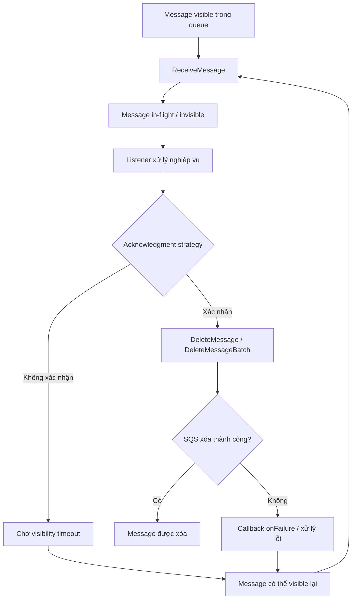

# Chế độ xác nhận và thời điểm xóa thông điệp

Trong Amazon Simple Queue Service (Amazon SQS), **acknowledgment một message có nghĩa là xóa message đó khỏi queue bằng thao tác `DeleteMessage`**. Khi consumer nhận message, SQS chỉ ẩn message trong khoảng `visibility timeout`; message vẫn tồn tại. Chỉ sau khi thao tác xóa thành công, message mới được loại khỏi luồng xử lý thông thường.

Spring Cloud AWS cung cấp ba chế độ acknowledgment cho listener container: `ON_SUCCESS`, `ALWAYS` và `MANUAL`. Framework còn hỗ trợ gom nhiều acknowledgment thành một batch, xác nhận một phần batch và điều khiển thứ tự xóa message. Vì vậy, thời điểm method listener kết thúc và thời điểm message thật sự bị xóa có thể khác nhau.

Bài học này sử dụng **Spring Cloud AWS 3.4.1**, tập trung vào vòng đời message, receipt handle, ba chế độ xác nhận, acknowledgment batching, manual acknowledgment, FIFO ordering, xử lý lỗi xóa message và cách phối hợp acknowledgment với transaction nghiệp vụ.

## 1. Mục tiêu học tập

Sau bài học, bạn có thể:

- Giải thích acknowledgment trong SQS tương ứng với `DeleteMessage` và thời điểm message bị xóa.
- Phân biệt `MessageId` với `ReceiptHandle`, hiểu vì sao phải dùng receipt handle mới nhất.
- Chọn `ON_SUCCESS`, `ALWAYS` hoặc `MANUAL` theo yêu cầu xử lý nghiệp vụ.
- Cấu hình `acknowledgementInterval`, `acknowledgementThreshold` và `acknowledgementOrdering`.
- Giải thích khác biệt mặc định giữa Standard queue và FIFO queue.
- Xác nhận một message hoặc một phần batch bằng `Acknowledgement` và `BatchAcknowledgement`.
- Theo dõi kết quả xóa message bằng `AcknowledgementResultCallback`.
- Tránh mất message khi xác nhận quá sớm và tránh tác dụng phụ trùng khi xác nhận thất bại.
- Thiết kế kiểm thử cho success, exception, partial batch, FIFO và lỗi `DeleteMessage`.

## 2. Acknowledgment thực sự làm gì?

Một consumer nhận message qua `ReceiveMessage`. SQS trả payload, attributes, `MessageId` và `ReceiptHandle`, đồng thời đặt message vào trạng thái *in-flight* trong thời gian visibility timeout. Khi listener hoàn tất, Spring Cloud AWS quyết định có xác nhận hay không theo acknowledgment mode và chiến lược batching.



**Xử lý thành công trong Java và xóa message khỏi SQS là hai việc riêng.** Listener có thể đã commit database nhưng lệnh xóa message bị lỗi. Ngược lại, nếu message bị xóa trước khi dữ liệu nghiệp vụ commit, ứng dụng có thể mất cơ hội xử lý lại khi transaction thất bại.

Với listener container, acknowledgment mode quyết định framework sẽ gửi lệnh xóa message trong trường hợp nào. Với chế độ batching, message còn ở trạng thái in-flight cho đến khi batch acknowledgment được thực thi thành công.

## 3. MessageId và ReceiptHandle

Hai định danh này phục vụ hai mục đích khác nhau:

| Giá trị | Ý nghĩa | Dùng để |
|---|---|---|
| `MessageId` | Định danh message do SQS tạo khi producer gửi message | Log, tracing, đối chiếu message |
| `ReceiptHandle` | Token đại diện cho một lần nhận cụ thể của message | `DeleteMessage`, `ChangeMessageVisibility` |
| `eventId` | Định danh nghiệp vụ do producer tạo | Idempotency, chống xử lý tác dụng phụ trùng |

Mỗi lần nhận lại cùng một message, SQS cấp một `ReceiptHandle` mới. Khi xóa message, phải dùng receipt handle của **lần nhận gần nhất**. Nếu dùng handle cũ, request có thể trả thành công nhưng message có thể không bị xóa.

Ví dụ:

```text
Lần nhận 1: MessageId=msg-123, ReceiptHandle=RH-A
Visibility timeout hết, message trở lại queue
Lần nhận 2: MessageId=msg-123, ReceiptHandle=RH-B

DeleteMessage(RH-A)  -> không bảo đảm xóa message
DeleteMessage(RH-B)  -> dùng receipt handle mới nhất
```

Không dùng `MessageId` làm tham số của `DeleteMessage`. Spring Cloud AWS quản lý receipt handle bên trong message source và acknowledgment object; listener thông thường không cần tự lưu hoặc thao tác trực tiếp với handle này.

### 3.1. Vì sao vẫn có thể nhận lại message sau khi DeleteMessage thành công?

Standard queue dùng mô hình at-least-once delivery. Trong trường hợp hiếm, một bản sao message ở một máy chủ lưu trữ không sẵn sàng tại thời điểm xóa; bản sao đó có thể được trả lại ở lần receive sau. Do đó, ngay cả khi đã gọi `DeleteMessage` thành công, ứng dụng vẫn phải an toàn khi nhận lại cùng một sự kiện.

Đây là lý do `eventId` nghiệp vụ và cơ chế idempotency vẫn cần thiết. `MessageId` và acknowledgment không tạo ra transaction exactly-once cho database hoặc API bên ngoài.

## 4. Ba acknowledgment mode trong Spring Cloud AWS

Spring Cloud AWS 3.4.1 định nghĩa ba mode:

| Mode | Thời điểm framework xác nhận | Khi listener ném exception | Khi phù hợp |
|---|---|---|---|
| `ON_SUCCESS` | Sau khi xử lý message hoặc batch thành công | Không tự xác nhận; message có thể được giao lại sau visibility timeout | Mặc định nên dùng cho consumer nghiệp vụ |
| `ALWAYS` | Sau khi xử lý kết thúc, dù thành công hay lỗi | Vẫn xác nhận message | Chỉ dùng khi muốn bỏ message lỗi sau khi đã ghi nhận/giải quyết lỗi theo quy trình riêng |
| `MANUAL` | Chỉ khi listener gọi acknowledgment | Không tự xác nhận nếu listener không gọi ack | Khi cần quyết định thời điểm xóa theo logic nghiệp vụ hoặc xác nhận một phần batch |

Mode có thể cấu hình trong `SqsContainerOptions` của factory hoặc trực tiếp trong `@SqsListener`. Nếu annotation không chỉ định, listener dùng mode của factory.

### 4.1. ON_SUCCESS

`ON_SUCCESS` là mode mặc định. Khi method listener hoàn tất thành công, framework đưa message vào luồng acknowledgment. Nếu method ném exception, message không được tự động xác nhận và có thể được nhận lại sau visibility timeout.

```java
@SqsListener("${app.sqs.order-events-queue}")
public void handle(OrderEvent event) {
    orderService.applyIdempotently(event);
}
```

Đây là lựa chọn phù hợp khi exception biểu thị công việc chưa hoàn tất, chẳng hạn database timeout hoặc downstream service tạm thời không sẵn sàng. Tuy nhiên, nếu code bắt exception rồi return bình thường, container có thể xem listener đã thành công và xác nhận message. Vì vậy, chỉ bắt exception khi có quyết định xử lý lỗi rõ ràng.

### 4.2. ALWAYS

`ALWAYS` xác nhận message sau khi listener kết thúc, bất kể listener trả về bình thường hay ném lỗi. Mode này có thể hữu ích khi message lỗi đã được ghi vào một kho quarantine hoặc đã được xử lý bằng một quy trình bù trừ độc lập.

```java
@SqsListener(
    value = "${app.sqs.audit-events-queue}",
    acknowledgementMode = "ALWAYS"
)
public void handle(AuditEvent event) {
    auditService.record(event);
}
```

**Không dùng `ALWAYS` để che lỗi.** Nếu database tạm thời không khả dụng và listener ném exception, message vẫn có thể bị xóa. Nó sẽ không được retry qua SQS và cũng không tự động chuyển sang DLQ chỉ vì listener đã lỗi. Nếu cần retry/DLQ, hãy dùng `ON_SUCCESS` hoặc `MANUAL` và để message không được xác nhận khi xử lý chưa hoàn tất.

### 4.3. MANUAL

`MANUAL` tắt tự động acknowledgment. Listener nhận `Acknowledgement` (single message) hoặc `BatchAcknowledgement` (batch) và tự quyết định message nào được xác nhận.

```java
import io.awspring.cloud.sqs.listener.acknowledgement.Acknowledgement;

@SqsListener(
    value = "${app.sqs.order-events-queue}",
    acknowledgementMode = "MANUAL"
)
public void handle(OrderEvent event, Acknowledgement acknowledgement) {
    orderService.applyIdempotently(event);
    acknowledgement.acknowledge();
}
```

Nếu `applyIdempotently()` ném exception trước dòng `acknowledge()`, message không được xác nhận và có thể được giao lại. Nếu listener return mà không gọi acknowledgment, message cũng không tự động bị xóa; nó vẫn có thể xuất hiện lại sau visibility timeout.

Manual không đồng nghĩa với immediate. Nếu container đang bật acknowledgment batching, lệnh `acknowledge()` chỉ đưa message vào hàng đợi acknowledgment; thao tác xóa thật sự vẫn chờ interval hoặc threshold. Phần batching được trình bày ở mục 8.

## 5. Cấu hình acknowledgment trong container factory

Ví dụ cấu hình factory dùng `ON_SUCCESS`, gom acknowledgment theo interval hoặc threshold:

```java
import io.awspring.cloud.sqs.config.SqsMessageListenerContainerFactory;
import io.awspring.cloud.sqs.listener.acknowledgement.AcknowledgementOrdering;
import io.awspring.cloud.sqs.listener.acknowledgement.handler.AcknowledgementMode;
import org.springframework.context.annotation.Bean;
import org.springframework.context.annotation.Configuration;
import software.amazon.awssdk.services.sqs.SqsAsyncClient;

import java.time.Duration;

@Configuration
public class SqsAcknowledgementConfiguration {
    @Bean
    SqsMessageListenerContainerFactory<Object> defaultSqsListenerContainerFactory(
            SqsAsyncClient sqsAsyncClient) {
        return SqsMessageListenerContainerFactory.builder()
            .sqsAsyncClient(sqsAsyncClient)
            .configure(options -> options
                .acknowledgementMode(AcknowledgementMode.ON_SUCCESS)
                .acknowledgementInterval(Duration.ofSeconds(2))
                .acknowledgementThreshold(20)
                .acknowledgementOrdering(AcknowledgementOrdering.PARALLEL)
            )
            .build();
    }
}
```

Trong ví dụ, framework gửi acknowledgment khi đạt **một trong hai điều kiện**: đã chờ 2 giây hoặc đã tích lũy 20 message cần xác nhận. Giá trị là ví dụ cho Standard queue có lưu lượng ổn định; không phải cấu hình phù hợp cho mọi queue.

Nếu cấu hình cùng thuộc tính ở factory và `@SqsListener`, giá trị annotation được ưu tiên cho listener đó.

## 6. Chọn mode theo kết quả nghiệp vụ

Một quy tắc thực tế là chỉ xác nhận message sau khi ứng dụng đã quyết định kết quả nghiệp vụ cuối cùng:

| Tình huống | Mode/điều chỉnh phù hợp | Lý do |
|---|---|---|
| Ghi database thành công rồi kết thúc listener | `ON_SUCCESS` | Framework xác nhận sau khi listener thành công |
| Database lỗi tạm thời | `ON_SUCCESS` | Exception khiến message được retry |
| Message sai schema, cần đưa vào kho quarantine trước khi bỏ | `MANUAL` hoặc quy trình error handler có kiểm soát | Chỉ ack sau khi ghi nhận quarantine thành công |
| Batch có một số message hợp lệ và một số message lỗi | `MANUAL` + `BatchAcknowledgement` | Xác nhận các message đã xử lý, giữ lại phần lỗi |
| Log/telemetry có thể bỏ khi lỗi và không cần retry | Có thể cân nhắc `ALWAYS` | Chấp nhận xóa cả message xử lý lỗi |
| Cần xóa message ngay sau từng listener invocation | Immediate acknowledgment | Giảm thời gian chờ batching, tăng số lần gọi xóa |
| Queue Standard có throughput lớn | Acknowledgment batching | Giảm số request delete khi nhiều message được xử lý |
| FIFO cần giữ thứ tự xác nhận | Immediate hoặc `ORDERED`/`ORDERED_BY_GROUP` | Không để ack của message sau vượt ack trước trong cùng group |

Không có mode nào tạo transaction phân tán giữa SQS và database. Dù chọn mode nào, ứng dụng vẫn cần idempotency và thứ tự commit hợp lý.

## 7. Xác nhận thủ công cho một message

### 7.1. Gọi acknowledge sau khi commit

```java
import io.awspring.cloud.sqs.listener.acknowledgement.Acknowledgement;
import org.springframework.stereotype.Component;

@Component
public class PaymentListener {
    private final PaymentService paymentService;

    public PaymentListener(PaymentService paymentService) {
        this.paymentService = paymentService;
    }

    @SqsListener(
        value = "${app.sqs.payment-events-queue}",
        acknowledgementMode = "MANUAL"
    )
    public void handle(PaymentCaptured event, Acknowledgement acknowledgement) {
        paymentService.applyCapturedEventIdempotently(event);
        acknowledgement.acknowledge();
    }
}
```

`applyCapturedEventIdempotently()` cần hoàn tất transaction database trước khi trả về. Chỉ sau đó listener mới gọi `acknowledge()`. Nếu database commit thành công nhưng SQS delete thất bại, message có thể được giao lại; service phải nhận diện `eventId` đã xử lý để không ghi nhận thanh toán lần thứ hai.

### 7.2. Acknowledge bất đồng bộ

`Acknowledgement` cung cấp `acknowledgeAsync()` trả về `CompletableFuture<Void>`:

```java
public CompletableFuture<Void> handle(
        PaymentCaptured event,
        Acknowledgement acknowledgement) {

    paymentService.applyCapturedEventIdempotently(event);
    return acknowledgement.acknowledgeAsync();
}
```

Listener method có thể trả `CompletableFuture<Void>`. Khi dùng kiểu bất đồng bộ, hãy trả future đại diện cho toàn bộ công việc mà listener phụ thuộc, không fire-and-forget rồi kết thúc method trước khi xử lý hoặc xác nhận hoàn tất. Điều đó giúp container theo dõi kết quả thực tế.

## 8. Acknowledgment batching

Spring Cloud AWS có thể gom nhiều message cần xác nhận và gửi các thao tác xóa theo batch. Hai option điều khiển batching:

- `acknowledgementInterval`: khoảng thời gian tối đa chờ trước khi gửi batch acknowledgment.
- `acknowledgementThreshold`: số message tối thiểu trong hàng đợi acknowledgment để kích hoạt batch.

Batch được gửi khi **interval hoặc threshold đạt trước**.

| Cấu hình | Hành vi |
|---|---|
| Interval = 1 giây, threshold = 10 | Gửi batch khi đã chờ 1 giây hoặc đủ 10 message |
| Interval = `Duration.ZERO`, threshold = 10 | Tắt trigger theo thời gian; chờ đủ 10 message |
| Interval = 1 giây, threshold = 0 | Tắt trigger theo số lượng; gửi theo chu kỳ 1 giây |
| Interval = `Duration.ZERO`, threshold = 0 | Immediate acknowledgment; xác nhận tuần tự ngay sau khi xử lý |

### 8.1. Giá trị mặc định theo queue type

Spring Cloud AWS 3.4.1 dùng giá trị mặc định khác nhau:

| Thuộc tính | Standard queue | FIFO queue |
|---|---:|---:|
| `acknowledgementInterval` | 1 giây | 0 (immediate) |
| `acknowledgementThreshold` | 10 message | 0 (immediate) |
| `acknowledgementOrdering` | `PARALLEL` | `PARALLEL` khi immediate; `ORDERED` khi bật batching |

Điều này có nghĩa listener Standard có thể hoàn tất xử lý nhưng message vẫn còn in-flight cho đến khi batch delete được gửi. FIFO mặc định dùng immediate acknowledgment để xử lý message theo chuỗi.

### 8.2. Cấu hình batching có chủ đích

```java
@Bean
SqsMessageListenerContainerFactory<Object> standardQueueFactory(
        SqsAsyncClient sqsAsyncClient) {
    return SqsMessageListenerContainerFactory.builder()
        .sqsAsyncClient(sqsAsyncClient)
        .configure(options -> options
            .acknowledgementMode(AcknowledgementMode.ON_SUCCESS)
            .acknowledgementInterval(Duration.ofMillis(500))
            .acknowledgementThreshold(10)
            .acknowledgementOrdering(AcknowledgementOrdering.PARALLEL)
        )
        .build();
}
```

Với lưu lượng cao, batching giảm số lần gọi API delete. Đổi lại, message phải chờ trong hàng đợi acknowledgment và có thể ở trạng thái in-flight lâu hơn. Khi cấu hình, cần tính cả thời gian xử lý listener, thời gian chờ batch và thời gian request xóa.

### 8.3. Immediate acknowledgment

Để xác nhận ngay sau từng lần xử lý, đặt cả hai giá trị về zero:

```java
.configure(options -> options
    .acknowledgementMode(AcknowledgementMode.ON_SUCCESS)
    .acknowledgementInterval(Duration.ZERO)
    .acknowledgementThreshold(0)
)
```

Trong chế độ này, message chỉ được coi là xử lý xong sau khi acknowledgment thành công. Nếu thao tác xóa thất bại, xử lý message được coi là thất bại và message có thể được retry sau visibility timeout. Cơ chế này hữu ích khi cần biết chính xác kết quả xóa trước khi tiến hành message tiếp theo, đổi lại tăng số request SQS.

## 9. Xác nhận một phần batch bằng BatchAcknowledgement

Batch listener nhận nhiều message trong một lần gọi. Nếu tất cả đều thành công, có thể xác nhận toàn bộ batch. Nếu một số message lỗi, `BatchAcknowledgement` cho phép xác nhận đúng tập message đã xử lý thành công.

```java
import io.awspring.cloud.sqs.listener.acknowledgement.BatchAcknowledgement;
import org.springframework.messaging.Message;

@SqsListener(
    value = "${app.sqs.order-events-queue}",
    acknowledgementMode = "MANUAL"
)
public void handleBatch(
        List<Message<OrderEvent>> messages,
        BatchAcknowledgement<OrderEvent> acknowledgement) {

    List<Message<OrderEvent>> succeeded = new ArrayList<>();

    for (Message<OrderEvent> message : messages) {
        try {
            orderService.applyIdempotently(message.getPayload());
            succeeded.add(message);
        } catch (RecoverableProcessingException ex) {
            log.warn("Will retry eventId={}", message.getPayload().eventId(), ex);
        }
    }

    if (!succeeded.isEmpty()) {
        acknowledgement.acknowledge(succeeded);
    }
}
```

Trong ví dụ, message lỗi không được đưa vào tập `succeeded`, do đó không được xác nhận. Khi visibility timeout hết, SQS có thể giao lại message đó. Phần code thực tế cần phân loại lỗi rõ ràng; lỗi không thể phục hồi nên được ghi nhận và chuyển vào quy trình quarantine/DLQ thay vì retry vô hạn.

`BatchAcknowledgement` hỗ trợ:

- `acknowledge()` để xác nhận toàn bộ batch.
- `acknowledge(Collection<Message<T>>)` để xác nhận một phần batch.
- `acknowledgeAsync()` và `acknowledgeAsync(collection)` cho thao tác bất đồng bộ.

**Batch listener và acknowledgment batching là hai khái niệm khác nhau.** Batch listener gom nhiều payload vào một lần gọi method. Acknowledgment batching gom các yêu cầu xóa đã được chấp nhận để gửi về SQS theo interval/threshold. Có thể dùng một cơ chế mà không nhất thiết phải bật cơ chế còn lại.

## 10. Giới hạn và lỗi của DeleteMessageBatch

AWS SQS API `DeleteMessageBatch` nhận tối đa **10 entries** trong một request. Mỗi entry được báo kết quả riêng trong hai danh sách `Successful` và `Failed`.

Một request batch có thể trả HTTP 200 nhưng một hoặc nhiều entry vẫn thất bại. Vì vậy, không được chỉ kiểm tra HTTP status hoặc coi cả batch thành công khi request không ném exception. Cần xem kết quả từng entry.

| Trạng thái | Hành động |
|---|---|
| Entry trong `Successful` | SQS đã xác nhận xóa entry đó |
| Entry trong `Failed` | Kiểm tra mã lỗi và receipt handle; xử lý/retry có kiểm soát |
| Request lỗi toàn bộ | Kiểm tra quyền, queue URL, throttling và kết nối |

Spring Cloud AWS quản lý batch acknowledgment ở listener container, nhưng ứng dụng vẫn cần quan sát kết quả acknowledgment nếu muốn đo lường lỗi xóa hoặc thực hiện quy trình phục hồi. Không retry mù toàn bộ batch khi một số message đã xóa thành công.

## 11. Thứ tự acknowledgment với FIFO

FIFO queue bảo đảm thứ tự trong cùng `MessageGroupId`. Thứ tự xử lý phải được phản ánh ở thứ tự acknowledgment để message sau không được xem là hoàn tất trước message đứng trước trong cùng group.

Spring Cloud AWS 3.4.1 có ba `AcknowledgementOrdering`:

| Ordering | Hành vi | Phạm vi |
|---|---|---|
| `PARALLEL` | Nhiều batch acknowledgment có thể chạy song song | Standard; FIFO immediate mặc định |
| `ORDERED` | Một batch ack chỉ chạy sau khi batch trước hoàn tất | Giữ thứ tự ack toàn cục |
| `ORDERED_BY_GROUP` | Ack tuần tự trong cùng group, song song giữa các group | Chỉ dùng cho FIFO |

Với FIFO immediate acknowledgment, `PARALLEL` vẫn an toàn theo cơ chế container: message tiếp theo của cùng group không được poll cho đến khi message trước đã được acknowledge. Khi bật batching, mặc định ordering chuyển sang `ORDERED` để bảo toàn thứ tự. Nếu muốn giữ thứ tự trong từng group nhưng cho group khác chạy song song, có thể chọn `ORDERED_BY_GROUP`.

```java
@Bean
SqsMessageListenerContainerFactory<Object> fifoQueueFactory(
        SqsAsyncClient sqsAsyncClient) {
    return SqsMessageListenerContainerFactory.builder()
        .sqsAsyncClient(sqsAsyncClient)
        .configure(options -> options
            .acknowledgementMode(AcknowledgementMode.ON_SUCCESS)
            .acknowledgementInterval(Duration.ofSeconds(1))
            .acknowledgementThreshold(10)
            .acknowledgementOrdering(AcknowledgementOrdering.ORDERED_BY_GROUP)
        )
        .build();
}
```

Đây là ví dụ khi chủ động bật acknowledgment batching cho FIFO. Hãy kiểm thử cùng batch listener, `MessageGroupId` và chiến lược xử lý lỗi; không giả định `ORDERED_BY_GROUP` có thể thay thế việc thiết kế group ID đúng.

## 12. Theo dõi kết quả acknowledgment

Spring Cloud AWS cung cấp `AcknowledgementResultCallback<T>` và `AsyncAcknowledgementResultCallback<T>` để nhận thông báo khi thao tác acknowledgment thành công hoặc thất bại.

```java
import io.awspring.cloud.sqs.listener.acknowledgement.AcknowledgementResultCallback;
import org.springframework.context.annotation.Bean;
import org.springframework.messaging.Message;

@Bean
AcknowledgementResultCallback<Object> acknowledgementResultCallback() {
    return new AcknowledgementResultCallback<>() {
        @Override
        public void onSuccess(Collection<Message<Object>> messages) {
            log.debug("Acknowledged {} SQS messages", messages.size());
        }

        @Override
        public void onFailure(
                Collection<Message<Object>> messages, Throwable error) {
            log.error("Failed to acknowledge {} SQS messages", messages.size(), error);
        }
    };
}
```

Với factory auto-configured, khai báo callback bean theo cơ chế auto-configuration. Nếu tự tạo factory, gắn callback trực tiếp:

```java
SqsMessageListenerContainerFactory<Object> factory(
        SqsAsyncClient sqsAsyncClient,
        AcknowledgementResultCallback<Object> acknowledgementResultCallback) {
    return SqsMessageListenerContainerFactory.builder()
        .sqsAsyncClient(sqsAsyncClient)
        .acknowledgementResultCallback(acknowledgementResultCallback)
        .build();
}
```

Callback có thể dùng để ghi metric, log lỗi, cảnh báo hoặc kích hoạt quy trình xử lý acknowledgment failure. Không coi callback là nơi thay thế logic nghiệp vụ hoặc transaction. `onFailure` không có nghĩa message đã mất; message chưa được xác nhận có thể xuất hiện lại sau visibility timeout.

Với FIFO immediate acknowledgment, callback được thực thi trước khi xử lý message tiếp theo trong batch; message kế tiếp chờ callback hoàn tất. Điều này có thể dùng để quan sát hoặc xử lý lỗi xóa trước khi group tiếp tục. Với Standard queue và batch processing song song, callback có thể được thực thi bất đồng bộ.

## 13. Acknowledgment và transaction nghiệp vụ

SQS và database không tham gia cùng một distributed transaction. Vì vậy, không thể tạo một thao tác nguyên tử vừa commit database vừa xóa message khỏi SQS chỉ bằng acknowledgment mode.

Thứ tự an toàn thường là:

```text
Receive message
    ↓
Kiểm tra eventId đã xử lý chưa
    ↓
BEGIN database transaction
    ↓
Ghi processed_event + cập nhật dữ liệu nghiệp vụ
    ↓
COMMIT
    ↓
Acknowledgement / DeleteMessage
```

Nếu database commit thành công nhưng DeleteMessage thất bại, message có thể được giao lại. Khi đó, unique key trên `eventId` giúp consumer nhận ra sự kiện đã được áp dụng và có thể xác nhận lại mà không lặp tác dụng phụ.

Ví dụ pseudocode SQL:

```sql
BEGIN;

WITH new_event AS (
    INSERT INTO processed_event(event_id)
    VALUES (:event_id)
    ON CONFLICT (event_id) DO NOTHING
    RETURNING event_id
), updated AS (
    UPDATE inventory
    SET quantity = quantity + :quantity_delta
    WHERE sku = :sku
      AND EXISTS (SELECT 1 FROM new_event)
    RETURNING sku
)
SELECT
    (SELECT count(*) FROM new_event) AS inserted_events,
    (SELECT count(*) FROM updated) AS updated_rows;

COMMIT;
```

Đây là pseudocode SQL theo PostgreSQL. Nếu `inserted_events = 0`, event đã được xử lý trước đó và có thể kết thúc an toàn. Nếu `inserted_events = 1` nhưng `updated_rows = 0`, rollback transaction để không đánh dấu một event chưa áp dụng là đã xử lý. Điểm quan trọng là bản ghi chống trùng và thay đổi nghiệp vụ phải commit trong cùng transaction.

Không acknowledge trước khi commit chỉ để giảm message in-flight. Nếu ứng dụng xóa message rồi transaction rollback, SQS không còn cơ hội giao lại message đó. Với side effect ở API bên ngoài, cần idempotency key của API đích hoặc dùng outbox/saga; transaction database không bao trùm HTTP request.

## 14. Phân biệt acknowledgment của SqsTemplate và listener container

Spring Cloud AWS có hai luồng nhận message:

| API | Cách xác nhận mặc định |
|---|---|
| `SqsTemplate.receive()` / `receiveMany()` | Template mặc định acknowledge khi nhận (`ACKNOWLEDGE_ON_RECEIVE`) |
| `@SqsListener` / `SqsMessageListenerContainer` | Listener container mặc định `ON_SUCCESS` |

Với `SqsTemplate.receive()`, nếu ứng dụng muốn xử lý xong mới xóa message, cần cấu hình template ở `TemplateAcknowledgementMode.MANUAL` và gọi acknowledgment tương ứng. Không áp dụng máy móc các mặc định của listener container cho `SqsTemplate`.

Bài này tập trung vào acknowledgment của listener container. Nếu ứng dụng dùng cả polling thủ công và `@SqsListener`, hãy cấu hình và kiểm thử hai luồng riêng.

## 15. Retry, visibility timeout và DLQ

Nếu `ON_SUCCESS` không xác nhận message do listener lỗi, message vẫn in-flight cho đến khi visibility timeout hết. Sau đó SQS có thể giao lại message. Nếu lỗi lặp lại, `ApproximateReceiveCount` tăng và redrive policy có thể chuyển message sang DLQ khi vượt `maxReceiveCount`.

Các điểm cần kiểm soát:

1. Visibility timeout phải đủ cho thời gian xử lý và acknowledgment batching.
2. Không bắt exception rồi return bình thường nếu muốn SQS retry.
3. Không dùng `ALWAYS` cho lỗi cần retry hoặc cần đi qua DLQ.
4. Với manual ack, không gọi ack khi transaction chưa commit hoặc khi chưa ghi nhận lỗi theo quy trình.
5. Đặt redrive policy và theo dõi DLQ; có quy trình điều tra, sửa dữ liệu và replay.
6. Giữ consumer idempotent để retry hoặc acknowledgment failure không tạo tác dụng phụ trùng.

Với FIFO, message đầu group chưa được xác nhận có thể chặn message sau trong cùng group. Đưa message lỗi sang DLQ giúp queue tiến lên sau khi redrive policy kích hoạt, nhưng có thể tạo khoảng trống trong chuỗi nghiệp vụ. Cần hòa giải trạng thái và replay theo thứ tự phù hợp.

## 16. Lỗi thường gặp và cách chẩn đoán

| Triệu chứng | Nguyên nhân có thể | Cách xử lý |
|---|---|---|
| Listener return thành công nhưng message vẫn xuất hiện lại | Ack batching chưa đạt interval/threshold hoặc delete thất bại | Kiểm tra batching, visibility và callback `onFailure` |
| Message bị xóa dù nghiệp vụ lỗi | Dùng `ALWAYS`, hoặc code bắt exception rồi return bình thường với `ON_SUCCESS` | Chuyển sang `ON_SUCCESS`/`MANUAL`, propagate lỗi đúng cách |
| Message bị xử lý hai lần | DeleteMessage lỗi, visibility hết hạn, Standard duplicate hoặc DB commit trước ack | Dùng `eventId` và idempotent transaction |
| DeleteMessage trả thành công nhưng message vẫn còn | Dùng receipt handle cũ hoặc message được giao lại theo at-least-once | Dùng receipt handle của lần nhận mới nhất; kiểm tra receive history |
| Một phần batch không bị xóa | DeleteMessageBatch có entry thất bại dù HTTP 200 | Kiểm tra danh sách `Failed`, không retry mù cả batch |
| FIFO group bị chặn | Message trước chưa được xác nhận hoặc ack batch chưa hoàn tất | Kiểm tra group ID, ordering, visibility và lỗi xóa |
| Manual ack không xóa message | Listener không gọi `acknowledge()` hoặc chỉ enqueue ack trong batching | Kiểm tra mode, code path và interval/threshold |
| `ALWAYS` làm mất message lỗi | Mode xác nhận cả khi listener ném exception | Dùng `ON_SUCCESS` hoặc ghi quarantine trước khi ack thủ công |
| DLQ không nhận message lỗi | Message đang được xác nhận bằng `ALWAYS` hoặc exception bị nuốt | Kiểm tra mode, error handling và redrive policy |

Các metric/log nên theo dõi gồm số message received/deleted, visible/not visible, approximate receive count, tuổi message cũ nhất, số message trong DLQ và số acknowledgment failure. Khi điều tra, ghi `eventId`, `MessageId`, queue, listener ID và lỗi; không log receipt handle hoặc payload nhạy cảm.

## 17. Bài tập thực hành

**Bài 1 — ON_SUCCESS:** Tạo listener cập nhật đơn hàng trong database. Cho listener ném exception có kiểm soát và xác minh message không bị xóa, sau đó được nhận lại khi visibility timeout hết.

**Bài 2 — ALWAYS:** Chuyển listener sang `ALWAYS`, cố ý ném exception và quan sát message vẫn được xác nhận. Giải thích vì sao mode này không phù hợp nếu cần retry/DLQ.

**Bài 3 — MANUAL:** Chuyển listener sang `MANUAL`. Xác nhận chỉ sau khi database transaction commit. Thử bỏ qua `acknowledge()` và quan sát message được giao lại.

**Bài 4 — Acknowledgment batching:** Với Standard queue, đặt interval 2 giây và threshold 5. Gửi 3 message rồi quan sát trigger theo thời gian; gửi 5 message nhanh để quan sát trigger theo threshold.

**Bài 5 — Partial batch:** Dùng batch listener với `BatchAcknowledgement`. Làm một phần tử lỗi, xác nhận các phần tử thành công và kiểm tra message lỗi được retry.

**Bài 6 — FIFO ordering:** Bật batching cho FIFO và so sánh `ORDERED` với `ORDERED_BY_GROUP`. Dùng hai group để quan sát thứ tự trong group và khả năng song song giữa các group.

**Bài 7 — Delete failure:** Dùng IAM policy test để tạm thời từ chối `sqs:DeleteMessage`, quan sát `AcknowledgementResultCallback.onFailure`, sau đó cấp lại quyền và xác minh message có thể được xử lý lại.

**Bài 8 — Idempotency:** Cho database commit thành công nhưng giả lập acknowledgment thất bại. Xác minh lần nhận tiếp theo không áp dụng lại tác dụng phụ nhờ `eventId` và unique constraint.

## 18. Câu hỏi tự kiểm tra

1. Acknowledgment trong SQS có nghĩa là gì? **Xóa message khỏi queue bằng `DeleteMessage`.**
2. Vì sao phải dùng `ReceiptHandle` thay cho `MessageId`? **DeleteMessage định danh lần nhận bằng receipt handle, và phải dùng handle mới nhất.**
3. `ON_SUCCESS` xử lý exception như thế nào? **Không tự xác nhận message khi listener xử lý thất bại.**
4. `ALWAYS` khác `ON_SUCCESS` ở đâu? **ALWAYS xác nhận cả khi listener kết thúc với lỗi.**
5. `MANUAL` có tự động xóa message khi listener return không? **Không; listener phải gọi acknowledgment.**
6. Acknowledgment batching được kích hoạt khi nào? **Khi interval hoặc threshold đạt trước.**
7. Giá trị batching mặc định của Standard queue trong Spring Cloud AWS 3.4.1 là gì? **Interval 1 giây, threshold 10, ordering PARALLEL.**
8. FIFO mặc định dùng acknowledgment như thế nào? **Immediate với interval và threshold bằng zero.**
9. `BatchAcknowledgement` có thể xác nhận một phần batch không? **Có, bằng `acknowledge(Collection<Message<T>>)`.**
10. Vì sao database commit và DeleteMessage vẫn có thể tạo duplicate? **Hai thao tác không nằm trong cùng transaction; database có thể commit trong khi xóa thất bại.**

## 19. Tài liệu tham khảo

- [Spring Cloud AWS 3.4.1 — Acknowledging Messages](https://docs.awspring.io/spring-cloud-aws/docs/3.4.1/reference/html/index.html#acknowledging-messages): mode, batching, manual acknowledgment, ordering, defaults và callback.
- [Spring Cloud AWS 3.4.1 — Acknowledgement API](https://docs.awspring.io/spring-cloud-aws/docs/3.4.1/apidocs/io/awspring/cloud/sqs/listener/acknowledgement/Acknowledgement.html): xác nhận một message và API bất đồng bộ.
- [Spring Cloud AWS 3.4.1 — BatchAcknowledgement API](https://docs.awspring.io/spring-cloud-aws/docs/3.4.1/apidocs/io/awspring/cloud/sqs/listener/acknowledgement/BatchAcknowledgement.html): xác nhận toàn bộ hoặc một phần batch.
- [Spring Cloud AWS 3.4.1 — AcknowledgementMode API](https://docs.awspring.io/spring-cloud-aws/docs/3.4.1/apidocs/io/awspring/cloud/sqs/listener/acknowledgement/handler/AcknowledgementMode.html): định nghĩa `ON_SUCCESS`, `ALWAYS` và `MANUAL`.
- [Spring Cloud AWS 3.4.1 — AcknowledgementOrdering API](https://docs.awspring.io/spring-cloud-aws/docs/3.4.1/apidocs/io/awspring/cloud/sqs/listener/acknowledgement/AcknowledgementOrdering.html): `PARALLEL`, `ORDERED`, `ORDERED_BY_GROUP`.
- [AWS — DeleteMessage API](https://docs.aws.amazon.com/AWSSimpleQueueService/latest/APIReference/API_DeleteMessage.html): xóa message bằng receipt handle và các giới hạn liên quan.
- [AWS — DeleteMessageBatch API](https://docs.aws.amazon.com/AWSSimpleQueueService/latest/APIReference/API_DeleteMessageBatch.html): giới hạn 10 entries và kết quả từng entry.

**Ghi nhớ:** `ON_SUCCESS` xác nhận sau xử lý thành công, `ALWAYS` xác nhận cả khi lỗi, còn `MANUAL` trao quyền quyết định cho listener. Acknowledgment batching có thể trì hoãn thao tác xóa; vì vậy phải tính visibility timeout, quan sát kết quả DeleteMessage và thiết kế idempotency để ứng dụng không mất dữ liệu hoặc lặp tác dụng phụ.
