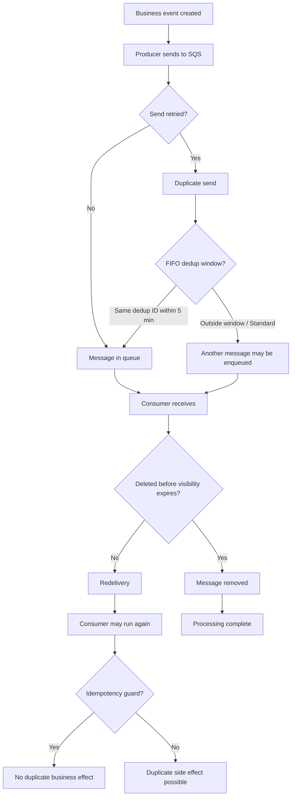
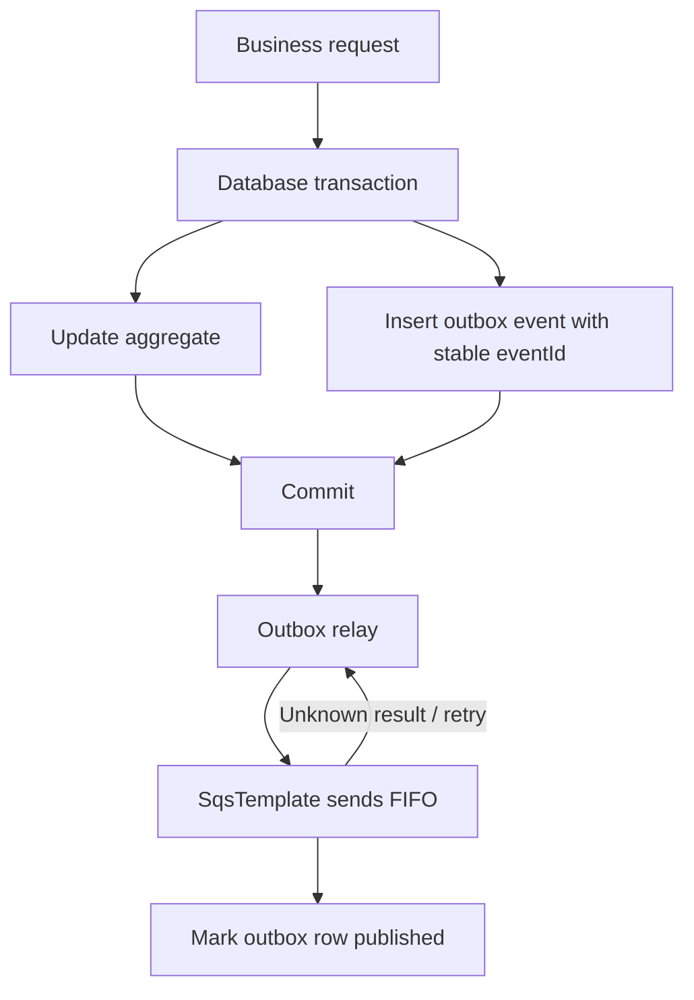

# Xử lý trùng lặp, message group và deduplication

Trong hệ thống xử lý sự kiện, cùng một nghiệp vụ có thể được gửi nhiều lần hoặc được consumer nhận lại sau một lần xử lý chưa hoàn tất. Amazon Simple Queue Service (Amazon SQS) cung cấp các cơ chế khác nhau để giảm trùng lặp ở phía gửi, giữ thứ tự theo nhóm và phân phối công việc song song. Tuy nhiên, **deduplication của queue không thay thế idempotency của consumer**.

Với Standard queue, ứng dụng cần chấp nhận khả năng giao trùng và thứ tự best-effort. Với FIFO queue, producer có thể dùng `MessageDeduplicationId` để SQS loại lần gửi trùng trong cửa sổ 5 phút; `MessageGroupId` xác định chuỗi message cần giữ thứ tự. Các message thuộc group khác nhau có thể được xử lý độc lập.

Bài học này dùng Spring Boot và Spring Cloud AWS **3.4.1**, tập trung vào nguyên nhân phát sinh duplicate, cách chọn message group, explicit/content-based deduplication, high-throughput FIFO, transactional outbox và inbox, cùng cách kiểm thử để bảo đảm tác dụng phụ nghiệp vụ không bị lặp.

## 1. Mục tiêu học tập

Sau bài học, bạn có thể:

- Phân biệt gửi trùng (duplicate send), giao lại (redelivery) và xử lý trùng (duplicate side effect).
- Giải thích sự khác nhau giữa Standard và FIFO queue về duplicate và ordering.
- Chọn `MessageGroupId` theo aggregate hoặc thực thể cần giữ thứ tự.
- Dùng `MessageDeduplicationId` ổn định và hiểu cửa sổ deduplication 5 phút.
- So sánh explicit deduplication với content-based deduplication.
- Cấu hình `DeduplicationScope` và `FifoThroughputLimit` cho high-throughput FIFO.
- Tạo producer dùng `SqsTemplate` và consumer idempotent.
- Kết hợp transactional outbox/inbox để xử lý retry giữa database và SQS.
- Kiểm thử duplicate send, redelivery, thứ tự trong group và khả năng chạy song song giữa các group.

## 2. Ba loại trùng lặp cần phân biệt

Trong một luồng SQS, từ “duplicate” có thể chỉ những sự kiện khác nhau:

| Loại | Xảy ra khi nào? | Cơ chế liên quan |
|---|---|---|
| **Duplicate send** | Producer gửi cùng một sự kiện nhiều lần, ví dụ retry sau khi mất response | FIFO `MessageDeduplicationId` hoặc content-based deduplication |
| **Redelivery** | Consumer nhận message, không xóa trước khi visibility timeout hết hoặc acknowledgment thất bại | Visibility timeout, retry, at-least-once delivery |
| **Duplicate side effect** | Consumer chạy cùng một tác vụ nghiệp vụ nhiều lần, ví dụ cộng tồn kho hai lần | Idempotency key, unique constraint, inbox/transaction |



Một message được gửi một lần vẫn có thể được giao lại. Ngược lại, một producer có thể gửi cùng một event nhiều lần nhưng FIFO loại những lần gửi trùng trong cửa sổ deduplication. Vì vậy, thiết kế producer và consumer phải giải quyết hai ranh giới khác nhau.

## 3. Standard queue và FIFO queue xử lý duplicate như thế nào?

| Đặc điểm | Standard queue | FIFO queue |
|---|---|---|
| Duplicate khi gửi | Có thể tồn tại; không có cơ chế FIFO deduplication | Có deduplication ID hoặc content-based deduplication trong 5 phút |
| Redelivery | Có thể xảy ra; delivery at-least-once | Có thể xảy ra nếu message chưa được xóa và visibility timeout hết |
| Ordering | Best-effort, không được dựa vào thứ tự gửi | Giữ thứ tự trong từng `MessageGroupId` |
| Message group | Có thể dùng cho fair queues, không tạo thứ tự FIFO | Là ranh giới thứ tự và song song |
| Idempotent consumer | Bắt buộc nếu tác dụng phụ không được phép lặp | Vẫn cần vì redelivery và lỗi giữa commit/ack |
| Throughput | Mở rộng linh hoạt | Phụ thuộc số group và cấu hình throughput; hỗ trợ high-throughput FIFO |

AWS mô tả FIFO bằng khả năng exactly-once processing ở cấp queue nhờ deduplication. Cần hiểu đúng phạm vi: SQS nhận diện lần gửi trùng trong cửa sổ 5 phút, nhưng không tham gia transaction của database, payment gateway hoặc API nghiệp vụ. Nếu consumer commit dữ liệu rồi lỗi trước khi xóa message, tác dụng phụ vẫn có thể được gọi lại.

**Không suy ra rằng FIFO làm consumer chỉ chạy đúng một lần.** Mục tiêu thiết kế thực tế là: queue giảm duplicate send, consumer idempotent bảo vệ side effect, và message group giữ thứ tự cho chuỗi sự kiện có quan hệ.

## 4. MessageGroupId: xác định ranh giới thứ tự

`MessageGroupId` là khóa xác định một nhóm message trong FIFO queue. SQS bảo toàn thứ tự message trong cùng một group theo thứ tự chúng được SQS chấp nhận. Các group khác nhau có thể được xử lý song song.

Ví dụ hệ thống đơn hàng:

```text
MessageGroupId = order-O-101
    OrderCreated(v1) → OrderPaid(v2) → OrderShipped(v3)

MessageGroupId = order-O-202
    OrderCreated(v1) → OrderCancelled(v2)
```

Các sự kiện của `O-101` phải theo đúng trình tự để trạng thái đơn hàng hợp lệ. `O-202` là đơn hàng khác nên có thể được xử lý đồng thời.

### 4.1. Chọn group ID theo aggregate

Quy tắc thực tế:

> Cùng một aggregate cần giữ thứ tự → dùng cùng `MessageGroupId`; aggregate độc lập → dùng group ID khác.

| Loại sự kiện | Group ID gợi ý | Lý do |
|---|---|---|
| Vòng đời đơn hàng | `order-<orderId>` | Các thay đổi trạng thái của một đơn hàng có thứ tự |
| Số dư tài khoản | `account-<accountId>` | Lệnh trên cùng tài khoản cần được tuần tự hóa |
| Cập nhật sản phẩm | `product-<productId>` | Cập nhật cùng sản phẩm theo version |
| Trạng thái thiết bị IoT | `device-<deviceId>` | Dữ liệu theo thiết bị có trình tự riêng |
| Công việc độc lập | Group ID theo job hoặc tenant tùy yêu cầu | Không cần một chuỗi toàn cục |

Không dùng một group ID duy nhất cho toàn bộ queue nếu các aggregate độc lập có thể xử lý song song. Một group duy nhất tạo nút thắt cổ chai vì SQS phải giữ một chuỗi tuần tự.

Ngược lại, không tạo group ID ngẫu nhiên cho mỗi message nếu cần giữ thứ tự theo aggregate. Khi cùng một đơn hàng bị chia thành nhiều group, SQS không biết chúng thuộc cùng chuỗi nghiệp vụ.

### 4.2. Thứ tự SQS chấp nhận không phải thứ tự nghiệp vụ

FIFO giữ thứ tự message được SQS nhận trong cùng group. Nó không sắp xếp theo `occurredAt`, `version` hoặc ID tăng dần.

Ví dụ hai thread producer cùng phát sự kiện cho `order-O-101`:

1. Thread A tạo `OrderPaid(v2)` nhưng chậm trước khi gọi SQS.
2. Thread B gửi `OrderShipped(v3)` và SQS nhận trước.
3. Thread A gửi `OrderPaid(v2)` sau đó.

FIFO sẽ giữ thứ tự SQS nhận là v3 rồi v2. `MessageGroupId` không tự phát hiện đây là thứ tự nghiệp vụ sai. Nếu có nhiều producer hoặc nhiều relay, cần serialize việc publish theo aggregate, thường bằng transactional outbox và partition/lock theo aggregate ID.

### 4.3. Khác group không có thứ tự toàn cục

Nếu `order-O-101` và `order-O-202` khác group, SQS có thể phân phối hoặc xử lý một group trước group kia. Không dùng FIFO để suy luận quan hệ thời gian giữa hai aggregate. Nếu nghiệp vụ thực sự cần thứ tự toàn cục, cần một cơ chế điều phối riêng; gom mọi message vào một group chỉ phù hợp khi chấp nhận xử lý tuần tự toàn queue.

## 5. Gửi FIFO message bằng Spring Cloud AWS

Queue FIFO có hậu tố `.fifo`. Khi gửi, producer truyền `MessageGroupId` và `MessageDeduplicationId`:

```java
import io.awspring.cloud.sqs.operations.SqsTemplate;
import org.springframework.beans.factory.annotation.Value;
import org.springframework.stereotype.Service;

@Service
public class OrderEventPublisher {
    private final SqsTemplate sqsTemplate;
    private final String queueName;

    public OrderEventPublisher(
            SqsTemplate sqsTemplate,
            @Value("${app.sqs.order-queue}") String queueName) {
        this.sqsTemplate = sqsTemplate;
        this.queueName = queueName;
    }

    public void publish(OrderEvent event) {
        sqsTemplate.send(to -> to
            .queue(queueName)
            .payload(event)
            .messageGroupId("order-" + event.orderId())
            .messageDeduplicationId(event.eventId())
        );
    }
}
```

Hai giá trị có ý nghĩa khác nhau:

- `messageGroupId`: chọn chuỗi thứ tự và phạm vi tuần tự hóa.
- `messageDeduplicationId`: nhận diện cùng một lần gửi logic để SQS loại retry trùng trong cửa sổ deduplication.

`eventId` phải được tạo khi nghiệp vụ phát sinh và giữ nguyên khi retry. Không tạo UUID mới ngay trong mỗi lần gọi `publish()`, vì mỗi lần retry sẽ trở thành một deduplication ID khác nhau và SQS không nhận ra chúng là cùng một event.

### 5.1. Gửi batch FIFO

SQS hỗ trợ gửi tối đa 10 entries trong một `SendMessageBatch` request. Mỗi entry FIFO cần group ID và deduplication ID (hoặc content-based deduplication được bật). Batch không phải transaction nguyên tử; một số entry có thể thành công trong khi entry khác thất bại.

Khi gửi nhiều message cùng group trong một batch, thứ tự entry trong batch được dùng để xác định thứ tự nhận của các message cùng group. Nếu retry batch, giữ nguyên event ID và group ID cho từng entry, đồng thời chỉ retry entry thất bại sau khi đã kiểm tra kết quả từng phần.

### 5.2. Quan sát kết quả gửi

`SendResult` của Spring Cloud AWS có thể cung cấp `messageId` và thông tin bổ sung, trong đó FIFO có thể trả `sequenceNumber`. `messageId` là ID do SQS cấp; `sequenceNumber` thể hiện vị trí message trong chuỗi FIFO của group và là số lớn, tăng theo thứ tự nhưng không nên giả định liên tiếp.

Ghi log cả `eventId`, `orderId`, `messageId` và `sequenceNumber` khi cần điều tra thứ tự. Không dùng `sequenceNumber` thay cho version nghiệp vụ vì nó chỉ mô tả thứ tự SQS đã nhận.

## 6. Explicit deduplication bằng MessageDeduplicationId

`MessageDeduplicationId` là định danh do producer cung cấp cho một message FIFO. Nếu SQS nhận lại cùng ID trong vòng **5 phút** kể từ lần gửi đầu, lần gửi lặp được chấp nhận nhưng không tạo thêm message cần giao.

Ví dụ:

```text
09:00:00  Send eventId=evt-100, group=order-O-101 → SQS nhận message
09:00:03  Retry eventId=evt-100, cùng group       → SQS loại lần gửi trùng
09:04:59  Retry eventId=evt-100, cùng group       → vẫn trong cửa sổ dedup
09:05:10  Retry eventId=evt-100, cùng group       → ngoài cửa sổ; có thể thành message mới
```

Điều quan trọng:

1. Cửa sổ deduplication là 5 phút; không dùng nó làm kho lưu trữ event ID vĩnh viễn.
2. ID phải giống nhau cho mọi retry của cùng một sự kiện.
3. Hai sự kiện nghiệp vụ khác nhau phải có ID khác nhau, kể cả payload giống nhau.
4. Khi cửa sổ kết thúc, SQS không còn bảo đảm nhận ra lần gửi trùng.
5. Deduplication phía gửi không ngăn redelivery do visibility timeout hoặc acknowledgment thất bại.

### 6.1. Chọn ID ổn định

Ví dụ `OrderPaid` có event ID `evt-7f21`:

```java
public record OrderEvent(
    String eventId,
    String orderId,
    long version,
    String eventType
) {}
```

Khi publisher retry, dùng lại `event.eventId()`:

```java
.messageDeduplicationId(event.eventId())
```

Không dùng timestamp hiện tại hoặc UUID mới được tạo trong mỗi lần gửi. Nếu cần phân biệt hai lần thanh toán thật sự khác nhau cho cùng một đơn hàng, mỗi lần phải có event ID riêng.

### 6.2. Deduplication ID không phải MessageId

`MessageDeduplicationId` do producer cung cấp trước khi gửi; `MessageId` do SQS trả về sau khi chấp nhận message. Vì vậy, không thể dùng `MessageId` để nhận diện lần gửi trước khi gọi `SendMessage`. Dùng ID nghiệp vụ hoặc ID outbox đã được persist làm deduplication ID.

## 7. Content-based deduplication

Nếu bật thuộc tính `ContentBasedDeduplication` trên FIFO queue, SQS tự tạo `MessageDeduplicationId` bằng cách tính SHA-256 trên **message body**. Producer không cần truyền deduplication ID trong mỗi request.

Ví dụ bật qua AWS CLI:

```bash
aws sqs set-queue-attributes \
  --queue-url "https://sqs.ap-southeast-1.amazonaws.com/123456789012/order-events.fifo" \
  --attributes '{"ContentBasedDeduplication":"true"}'
```

Khi bật content-based deduplication:

- SQS tính hash từ body, không tính message attributes.
- Hai message có body giống nhau trong cửa sổ 5 phút có thể bị xem là cùng một lần gửi, dù attributes khác nhau.
- Nếu request có explicit `MessageDeduplicationId`, giá trị explicit được ưu tiên.
- Thay đổi khoảng trắng hoặc serialization của JSON có thể làm body khác và tạo hash khác, dù dữ liệu nghiệp vụ tương đương.

### 7.1. Rủi ro khi chỉ dựa vào body

Giả sử hai lệnh khác nhau có cùng payload:

```json
{
  "orderId": "O-101",
  "command": "refresh"
}
```

Message A có attribute `tenantId=tenant-A`; message B có `tenantId=tenant-B`. Vì content-based deduplication chỉ hash body, SQS không tính hai attributes khác nhau khi tạo deduplication ID. Nếu hai message nằm trong cùng phạm vi deduplication và cùng cửa sổ 5 phút, một lần gửi có thể bị loại như duplicate.

Với event nghiệp vụ, explicit ID ổn định thường an toàn hơn vì nó phản ánh identity của sự kiện, không phụ thuộc cách serialize JSON. Content-based dedup phù hợp khi hai body giống nhau thực sự đồng nghĩa với cùng một message.

## 8. DeduplicationScope và high-throughput FIFO

FIFO queue có hai thuộc tính liên quan tới phạm vi deduplication và thông lượng:

- `DeduplicationScope`: `queue` hoặc `messageGroup`.
- `FifoThroughputLimit`: `perQueue` hoặc `perMessageGroupId`.

| Cấu hình | Phạm vi deduplication | Ý nghĩa throughput |
|---|---|---|
| `DeduplicationScope=queue`, `FifoThroughputLimit=perQueue` | Dedup ID được so sánh ở phạm vi toàn queue | Throughput FIFO theo quota per queue |
| `DeduplicationScope=messageGroup`, `FifoThroughputLimit=perMessageGroupId` | Dedup ID được so sánh trong từng group | Bật high-throughput FIFO theo message group |

Để bật high-throughput FIFO, hai thuộc tính cần được cấu hình tương ứng. Chỉ đặt `FifoThroughputLimit=perMessageGroupId` mà vẫn để scope queue có thể không đáp ứng yêu cầu cấu hình high-throughput.

Ví dụ:

```bash
aws sqs set-queue-attributes \
  --queue-url "https://sqs.ap-southeast-1.amazonaws.com/123456789012/order-events.fifo" \
  --attributes '{"DeduplicationScope":"messageGroup","FifoThroughputLimit":"perMessageGroupId"}'
```

Quota thực tế phụ thuộc Region và quota tài khoản. High-throughput FIFO tăng khả năng xử lý giữa các group; nó không làm các message trong cùng group chạy song song và không loại bỏ giới hạn thứ tự của group.

### 8.1. Cùng deduplication ID ở các group khác nhau

Với scope `queue`, cùng một deduplication ID có thể bị xem là trùng ở phạm vi queue ngay cả khi group ID khác nhau. Với scope `messageGroup`, deduplication được giới hạn trong từng group; cùng ID ở hai group khác nhau không nhất thiết bị loại lẫn nhau.

Do đó, nếu bật high-throughput FIFO, hãy đảm bảo event ID có phạm vi rõ ràng và không tái sử dụng nhầm cho hai sự kiện khác nhau trong cùng group. Có thể dùng ID toàn cục như UUID hoặc ID được tạo từ aggregate ID và sequence/event ID.

## 9. Standard fair queues và MessageGroupId

Standard queue cũng hỗ trợ `MessageGroupId` trong ngữ cảnh **fair queues**. Tính năng này giúp SQS phân phối thời gian chờ công bằng hơn giữa các tenant khi một tenant tạo lượng message lớn.

Tuy nhiên, `MessageGroupId` trên Standard queue **không tạo bảo đảm FIFO ordering và không bật deduplication**. Không được tái sử dụng giả định từ FIFO cho Standard chỉ vì cả hai API đều có trường `MessageGroupId`.

## 10. Idempotent consumer: lớp bảo vệ cuối cùng

Một consumer idempotent có thể nhận cùng một sự kiện nhiều lần nhưng chỉ tạo một tác dụng phụ nghiệp vụ. Cách phổ biến là dùng `eventId` làm khóa duy nhất trong bảng `processed_event` hoặc inbox.

Ví dụ schema PostgreSQL:

```sql
CREATE TABLE processed_event (
    event_id       varchar(128) PRIMARY KEY,
    processed_at   timestamptz NOT NULL DEFAULT now()
);
```

Trong service, ghi nhận event và cập nhật dữ liệu nghiệp vụ trong cùng transaction:

```sql
BEGIN;

WITH new_event AS (
    INSERT INTO processed_event(event_id)
    VALUES (:event_id)
    ON CONFLICT (event_id) DO NOTHING
    RETURNING event_id
), updated AS (
    UPDATE inventory
    SET quantity = quantity + :quantity_delta
    WHERE sku = :sku
      AND EXISTS (SELECT 1 FROM new_event)
    RETURNING sku
)
SELECT
    (SELECT count(*) FROM new_event) AS inserted_events,
    (SELECT count(*) FROM updated) AS updated_rows;

COMMIT;
```

Đây là pseudocode theo PostgreSQL. Nếu `inserted_events = 0`, event đã được xử lý và consumer có thể kết thúc an toàn. Nếu event mới được chèn nhưng `updated_rows = 0`, rollback transaction để không đánh dấu event chưa áp dụng là đã xử lý. Ứng dụng cần kiểm tra kết quả trước khi commit.

Sau khi transaction commit, listener mới acknowledge message. Nếu DeleteMessage thất bại và message được giao lại, unique constraint khiến lần xử lý sau nhận ra event đã tồn tại và không cộng tồn kho lần thứ hai.

### 10.1. Idempotency key phải đại diện cho một hành động nghiệp vụ

Chọn key quá rộng hoặc quá hẹp đều có thể gây lỗi:

- Dùng `orderId` làm key cho mọi event của đơn hàng: `OrderPaid` và `OrderShipped` có cùng key, khiến một event bị bỏ qua.
- Dùng `eventId` mới mỗi lần retry: consumer không nhận ra cùng event, tác dụng phụ có thể lặp.
- Dùng `eventId` duy nhất cho từng sự kiện nghiệp vụ: phù hợp để chống lặp khi gửi lại cùng event.

Với API thanh toán, gửi `eventId` làm idempotency key của payment provider nếu API đích hỗ trợ. Unique constraint trong database không bảo vệ được một API bên ngoài đã bị gọi hai lần.

## 11. Transactional outbox ở producer

Một vấn đề thường gặp là producer cập nhật database thành công nhưng gửi SQS thất bại, hoặc SQS nhận message nhưng producer mất response. Nếu ứng dụng tạo event mới ở mỗi lần retry, FIFO deduplication không nhận ra đó là cùng một sự kiện.

Transactional outbox giải quyết ranh giới giữa database nghiệp vụ và việc phát event:



Trong một transaction database, ứng dụng cập nhật aggregate và thêm một outbox row có `eventId` ổn định. Relay đọc outbox, gửi event lên FIFO queue với `MessageDeduplicationId = eventId`, rồi đánh dấu đã publish.

Nếu relay gửi thành công nhưng mất response trước khi đánh dấu outbox, lần chạy sau sẽ gửi lại cùng event ID. FIFO có thể loại duplicate send trong 5 phút. Nếu lần retry xảy ra sau cửa sổ 5 phút, SQS có thể nhận thêm message; inbox/idempotency ở consumer vẫn bảo vệ side effect.

### 11.1. Giữ thứ tự outbox theo aggregate

Để giữ thứ tự trong FIFO group, relay cần phát event theo thứ tự sequence của aggregate. Có thể partition worker theo aggregate ID, khóa dòng outbox/aggregate khi lấy event hoặc dùng cơ chế claim bảo đảm chỉ một publisher xử lý một aggregate tại một thời điểm.

Không để hai relay worker lấy `OrderPaid(v2)` và `OrderShipped(v3)` rồi gửi đồng thời mà không có điều phối. FIFO chỉ giữ thứ tự SQS nhận, không sửa thứ tự do relay làm đảo.

## 12. Consumer concurrency và message group

FIFO chỉ có thể khai thác song song giữa các group đang có message. Nếu queue có 1.000 message nhưng tất cả đều dùng cùng `MessageGroupId`, consumer vẫn bị giới hạn bởi một chuỗi tuần tự.

| Thiết kế group | Hệ quả |
|---|---|
| Một group cho toàn queue | Dễ giữ thứ tự toàn cục nhưng throughput bị tuần tự hóa |
| Một group theo aggregate | Giữ thứ tự cần thiết và cho aggregate khác chạy song song |
| Một group ngẫu nhiên mỗi message | Có thể song song cao nhưng mất thứ tự theo aggregate |
| Một group theo tenant | Giữ thứ tự tenant-wide nhưng một tenant tải lớn có thể thành hot group |

Với Spring Cloud AWS `@SqsListener`, container quản lý việc phân phối group. Không chuyển message sang `@Async` rồi return khỏi listener trước khi xử lý hoàn tất, vì điều đó có thể làm acknowledgment xảy ra trước side effect và phá vỡ chuỗi xử lý thực tế.

Nếu cần xử lý song song nhiều event trong một group, hãy xem lại yêu cầu thứ tự. Có thể tách event độc lập thành group khác hoặc dùng version check ở database, nhưng không được giả định FIFO vẫn bảo đảm thứ tự side effect khi ứng dụng tự chạy các handler song song.

## 13. Kiểm thử deduplication và ordering

Một bộ kiểm thử cần tách producer deduplication khỏi consumer idempotency:

| Thí nghiệm | Cách làm | Kết quả mong đợi |
|---|---|---|
| Duplicate send FIFO | Gửi cùng body và cùng explicit dedup ID hai lần trong 5 phút | Chỉ một message cần giao |
| Dedup hết cửa sổ | Gửi lại cùng ID sau 5 phút | SQS không còn bảo đảm loại lần gửi trùng |
| Khác event ID | Gửi hai event khác ID trong cùng group | Cả hai được xếp theo thứ tự SQS nhận |
| Content-based dedup | Bật content-based, gửi body giống nhau nhưng attributes khác | Có thể bị xem là duplicate vì attributes không nằm trong hash |
| Group ordering | Gửi v1, v2, v3 cùng group | Consumer quan sát đúng thứ tự trong group |
| Group parallelism | Gửi xen kẽ hai group | Hai group có thể được xử lý độc lập |
| Redelivery | Consumer nhận nhưng không xóa, để visibility hết | Message có thể được giao lại |
| Inbox idempotency | Gửi cùng event ID hai lần | Side effect database chỉ áp dụng một lần |
| Outbox retry | Relay gửi thành công nhưng không đánh dấu published, sau đó retry cùng ID | Duplicate send được giảm trong cửa sổ dedup; consumer vẫn an toàn ngoài cửa sổ |

Không dùng một lần chạy thành công để kết luận ordering hoặc deduplication đã được bảo đảm. Ghi lại `eventId`, `MessageGroupId`, `MessageDeduplicationId`, `MessageId`, `SequenceNumber`, receive count và thời gian xử lý.

## 14. Lỗi thiết kế thường gặp

1. **Tạo dedup ID mới ở mỗi lần retry:** SQS coi đó là event mới; hãy persist ID trước khi gửi.
2. **Dùng body làm identity nghiệp vụ:** content-based dedup không tính attributes và phụ thuộc serialization; ưu tiên explicit event ID.
3. **Dùng một group cho mọi message:** queue bị tuần tự hóa và tạo hot group.
4. **Dùng group ngẫu nhiên:** sự kiện của cùng aggregate có thể chạy song song, mất thứ tự.
5. **Cho rằng FIFO không redeliver:** message chưa xóa có thể xuất hiện lại sau visibility timeout.
6. **Cho rằng dedup 5 phút là kho chống trùng vĩnh viễn:** retry ngoài cửa sổ có thể tạo message mới.
7. **Cho rằng group ID sắp xếp theo version:** SQS giữ thứ tự chấp nhận, producer phải bảo đảm thứ tự publish.
8. **Commit database rồi không có idempotency:** DeleteMessage lỗi có thể làm side effect chạy lại.
9. **Bật high-throughput FIFO nhưng cấu hình scope sai:** kiểm tra cặp `DeduplicationScope` và `FifoThroughputLimit`.
10. **Dùng MessageGroupId trên Standard và mong FIFO:** fair queues không tạo ordering guarantee.

## 15. Bài tập thực hành

**Bài 1 — Explicit deduplication:** Tạo FIFO queue `order-events.fifo`, gửi cùng một event ID hai lần trong 5 phút bằng `SqsTemplate`. Quan sát số message và ghi lại `MessageId`.

**Bài 2 — Message group:** Gửi ba event của `O-101` và hai event của `O-202` theo thứ tự xen kẽ. Chạy nhiều consumer và xác minh thứ tự trong mỗi group, đồng thời quan sát hai group có thể xử lý song song.

**Bài 3 — Content-based dedup:** Bật `ContentBasedDeduplication`. Gửi hai body giống nhau nhưng attributes khác nhau. Giải thích vì sao SQS có thể loại một lần gửi.

**Bài 4 — Idempotent consumer:** Tạo bảng `processed_event` có unique key `eventId`. Gửi lại cùng message sau khi đã commit database nhưng giả lập lỗi acknowledgment. Xác minh side effect không lặp.

**Bài 5 — Outbox relay:** Trong cùng transaction, cập nhật đơn hàng và thêm outbox row. Viết relay gửi FIFO với group ID theo order và dedup ID theo event ID. Giả lập relay crash sau khi gửi nhưng trước khi đánh dấu published.

**Bài 6 — High-throughput FIFO:** Thử cấu hình `DeduplicationScope=messageGroup` và `FifoThroughputLimit=perMessageGroupId`. So sánh throughput với cấu hình per queue trong cùng tải và cùng số group.

## 16. Câu hỏi tự kiểm tra

1. Duplicate send khác redelivery như thế nào? **Duplicate send do producer gửi lặp; redelivery do message chưa được xóa và được giao lại.**
2. FIFO deduplication giữ ID trong bao lâu? **5 phút.**
3. `MessageGroupId` quyết định điều gì? **Phạm vi thứ tự; các message cùng group được giữ thứ tự, group khác có thể xử lý song song.**
4. Content-based deduplication hash phần nào? **Message body; không bao gồm message attributes.**
5. Khi nào explicit `MessageDeduplicationId` được ưu tiên? **Khi request có explicit ID, nó được dùng thay cho ID tự sinh từ content-based deduplication.**
6. FIFO có bảo đảm consumer không bao giờ nhận lại message không? **Không; redelivery vẫn có thể xảy ra nếu message chưa được xóa trước khi visibility timeout hết.**
7. High-throughput FIFO cần cấu hình cặp thuộc tính nào? **`DeduplicationScope=messageGroup` và `FifoThroughputLimit=perMessageGroupId`.**
8. Vì sao outbox relay phải giữ event ID ổn định? **Để retry biểu diễn cùng một event và cho phép FIFO deduplication nhận diện lần gửi trùng.**
9. Vì sao consumer vẫn cần inbox/idempotency? **Vì duplicate ngoài cửa sổ 5 phút và redelivery vẫn có thể xảy ra; queue không transaction với database.**
10. FIFO giữ thứ tự theo thời gian nghiệp vụ hay thời điểm SQS chấp nhận? **Theo thứ tự SQS chấp nhận trong cùng group.**

## 17. Tài liệu tham khảo

- [AWS — Exactly-once processing in FIFO queues](https://docs.aws.amazon.com/AWSSimpleQueueService/latest/SQSDeveloperGuide/FIFO-queues-exactly-once-processing.html): explicit/content-based deduplication và cửa sổ 5 phút.
- [AWS — FIFO queue message grouping](https://docs.aws.amazon.com/AWSSimpleQueueService/latest/SQSDeveloperGuide/FIFO-queues-understanding-logic.html): thứ tự trong message group, nhiều group và xử lý đồng thời.
- [AWS — High throughput for FIFO queues](https://docs.aws.amazon.com/AWSSimpleQueueService/latest/SQSDeveloperGuide/high-throughput-fifo.html): `DeduplicationScope`, `FifoThroughputLimit` và high-throughput FIFO.
- [AWS API — SendMessage](https://docs.aws.amazon.com/AWSSimpleQueueService/latest/APIReference/API_SendMessage.html): `MessageGroupId`, `MessageDeduplicationId` và content-based deduplication.
- [AWS API — SetQueueAttributes](https://docs.aws.amazon.com/AWSSimpleQueueService/latest/APIReference/API_SetQueueAttributes.html): cấu hình FIFO và deduplication scope.
- [Spring Cloud AWS 3.4.1 — SQS Integration Reference](https://docs.awspring.io/spring-cloud-aws/docs/3.4.1/reference/html/index.html): `SqsTemplate`, FIFO send options và listener grouping.
- [AWS Prescriptive Guidance — Transactional outbox pattern](https://docs.aws.amazon.com/prescriptive-guidance/latest/cloud-design-patterns/transactional-outbox.html): lưu event cùng transaction nghiệp vụ và relay event tin cậy.

**Ghi nhớ:** `MessageGroupId` bảo vệ thứ tự trong một chuỗi, `MessageDeduplicationId` giảm duplicate send trong 5 phút, còn inbox/idempotency bảo vệ tác dụng phụ ở consumer. Kết hợp cả ba với transactional outbox giúp hệ thống Spring Boot xử lý retry và phát sự kiện đáng tin cậy hơn.
