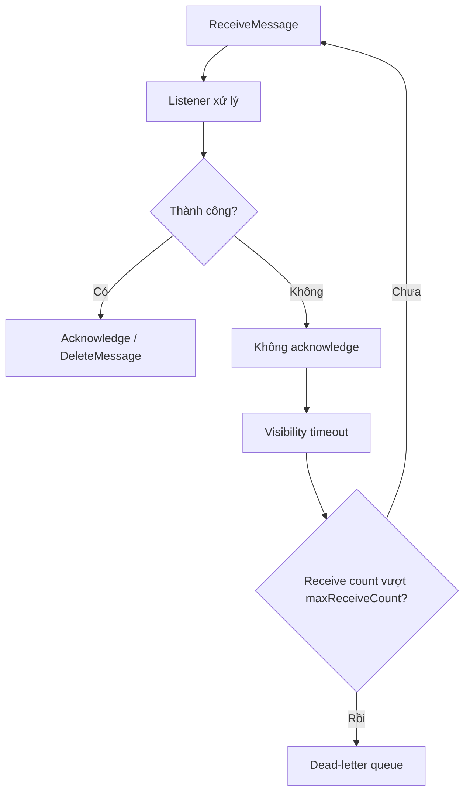

# Retry, dead-letter queue và phát lại thông điệp lỗi

Trong một hệ thống Spring Boot dùng Amazon Simple Queue Service (Amazon SQS), một message có thể thất bại vì dependency tạm thời không sẵn sàng, dữ liệu không hợp lệ, lỗi cấu hình hoặc lỗi trong code consumer. Nếu cứ nhận lại message ngay lập tức, hệ thống có thể tạo vòng lặp retry và làm tăng tải khi dependency đang gặp sự cố. Nếu bỏ message ngay sau lần lỗi đầu tiên, ứng dụng có thể mất cơ hội phục hồi một lỗi tạm thời.

SQS kết hợp **visibility timeout**, **redrive policy** và **dead-letter queue (DLQ)** để quản lý message không xử lý thành công. Spring Cloud AWS bổ sung error handler và backoff để điều khiển thời gian retry trong listener container. Sau khi sửa nguyên nhân, message trong DLQ có thể được phát lại về source queue hoặc một queue đích khác.

Bài học sử dụng **Spring Cloud AWS 3.4.1**, tập trung vào phân loại lỗi, retry theo visibility timeout, exponential/linear backoff, cấu hình DLQ và `maxReceiveCount`, theo dõi message lỗi, redrive bằng SQS API và phát lại thủ công có kiểm soát.

## 1. Mục tiêu học tập

Sau bài học, bạn có thể:

- Phân biệt lỗi tạm thời, lỗi dữ liệu và lỗi cấu hình để chọn chính sách retry phù hợp.
- Giải thích retry mặc định của SQS khi listener không acknowledge message.
- Cấu hình `ImmediateRetryAsyncErrorHandler`, `ExponentialBackoffErrorHandler` và `LinearBackoffErrorHandler`.
- Hiểu vai trò của `ApproximateReceiveCount`, `maxReceiveCount`, `RedrivePolicy` và `RedriveAllowPolicy`.
- Tạo source queue và DLQ đúng loại, cùng account và Region.
- Thiết kế cảnh báo, điều tra và xử lý message trong DLQ.
- Phân biệt redrive tự động của SQS với replay thủ công có biến đổi dữ liệu.
- Sử dụng `StartMessageMoveTask`, theo dõi và hủy redrive task.
- Bảo đảm idempotency, giữ thứ tự FIFO và kiểm thử failure/recovery.

## 2. Phân loại lỗi trước khi chọn retry

Không phải mọi lỗi đều nên retry theo cùng một cách. Hãy xác định nguyên nhân và khả năng tự phục hồi:

| Loại lỗi | Ví dụ | Chính sách phù hợp |
|---|---|---|
| Tạm thời (transient) | Database timeout, HTTP 503, throttling, mất kết nối ngắn hạn | Retry có backoff; giới hạn số lần nhận bằng redrive policy |
| Phụ thuộc đang quá tải | API downstream bị rate limit, connection pool cạn | Exponential backoff, có thể thêm jitter để phân tán lần retry |
| Dữ liệu không hợp lệ | JSON sai schema, thiếu trường bắt buộc, event version không hỗ trợ | Không retry vô hạn; đưa vào DLQ/quarantine để điều tra |
| Lỗi nghiệp vụ cần can thiệp | Đơn hàng ở trạng thái không cho phép chuyển bước, tài khoản bị khóa | Ghi nhận kết quả nghiệp vụ và xử lý theo quy trình; không retry mù |
| Lỗi cấu hình/hạ tầng | IAM AccessDenied, sai queue URL, sai Region | Sửa cấu hình/quyền; retry chỉ hữu ích sau khi nguyên nhân được khắc phục |
| Lỗi code có thể tái hiện | Null pointer, mapping bug | Giới hạn retry, cảnh báo và chuyển DLQ để tránh làm nghẽn queue |

Một quy tắc thực tế: **retry khi có lý do tin rằng lần thử sau có thể thành công**. Nếu cùng payload và cùng code chắc chắn tạo ra cùng lỗi, tăng số lần retry chỉ làm chậm quá trình phát hiện lỗi.

## 3. Retry mặc định của SQS và listener container

Khi consumer nhận message, SQS đặt message ở trạng thái *in-flight* trong khoảng visibility timeout. Nếu listener hoàn tất thành công và message được acknowledge, SQS xóa message. Nếu listener ném exception và message không được acknowledge, message có thể được nhận lại sau khi visibility timeout hết.



Với Spring Cloud AWS 3.4.1, message gây lỗi trong listener mặc định không được acknowledge và có thể được poll lại sau visibility timeout. Vì vậy, retry mặc định không nhất thiết diễn ra ngay lập tức.

**Không bắt exception rồi return bình thường nếu muốn SQS retry.** Với acknowledgment mode `ON_SUCCESS`, listener kết thúc bình thường có thể khiến message được xác nhận. Nếu bắt lỗi để ghi log hoặc thêm metric, hãy ném lại exception hoặc dùng interceptor phù hợp để quan sát lỗi mà không thay đổi quyết định acknowledgment.

### 3.1. `maxReceiveCount` đếm điều gì?

`maxReceiveCount` là ngưỡng số lần message được consumer nhận từ source queue. Khi receive count vượt ngưỡng đã cấu hình, SQS chuyển message sang DLQ theo redrive policy. Đây là số lần nhận (receive count), không phải số dòng log, số lần gọi một method bên trong listener hay số lần producer gửi message.

Một lần nhận có thể dẫn tới listener lỗi, timeout, process bị dừng hoặc acknowledgment thất bại. Các tình huống đó đều có thể khiến message được nhận lại và receive count tăng. Khi thiết kế retry, cần xem `ApproximateReceiveCount` cùng log xử lý thực tế.

## 4. ErrorHandler trong Spring Cloud AWS 3.4.1

Spring Cloud AWS cung cấp hai interface để xử lý lỗi sau khi listener thất bại:

- `ErrorHandler<T>`: xử lý đồng bộ.
- `AsyncErrorHandler<T>`: trả về `CompletableFuture<Void>` để xử lý bất đồng bộ.

Ví dụ một error handler dùng để ghi log và tiếp tục truyền lỗi:

```java
import io.awspring.cloud.sqs.listener.errorhandler.ErrorHandler;
import org.springframework.context.annotation.Bean;
import org.springframework.messaging.Message;

@Bean
ErrorHandler<Object> sqsErrorHandler() {
    return new ErrorHandler<>() {
        @Override
        public void handle(Message<Object> message, Throwable error) {
            log.error("SQS listener processing failed", error);

            // Propagate lỗi để message không được xem là recovered.
            throw new IllegalStateException("Retry SQS message", error);
        }
    };
}
```

Đoạn code giả định logger đã được khai báo. Khi dùng factory auto-configured, có thể khai báo error handler bean để Spring Cloud AWS tự gắn vào factory. Nếu tự tạo `SqsMessageListenerContainerFactory`, truyền handler qua `.errorHandler(sqsErrorHandler)`.

**Điểm rất quan trọng:** nếu `ErrorHandler` hoàn tất bình thường, Spring Cloud AWS xem message đã được phục hồi và acknowledge theo cấu hình hiện tại. Nếu muốn message tiếp tục retry trong mode `ON_SUCCESS`, error handler phải propagate lỗi. Nếu chỉ muốn quan sát lỗi mà không đổi acknowledgment, dùng `MessageInterceptor.afterProcessing()` và kiểm tra throwable.

## 5. Retry ngay lập tức

Từ Spring Cloud AWS 3.4, `ImmediateRetryAsyncErrorHandler` đặt visibility timeout của message lỗi về 0 để message có thể được nhận lại ngay:

```java
import io.awspring.cloud.sqs.listener.errorhandler.AsyncErrorHandler;
import io.awspring.cloud.sqs.listener.errorhandler.ImmediateRetryAsyncErrorHandler;

@Bean
AsyncErrorHandler<Object> asyncErrorHandler() {
    return new ImmediateRetryAsyncErrorHandler<>();
}
```

Khi dùng factory tùy chỉnh:

```java
@Bean
SqsMessageListenerContainerFactory<Object> defaultSqsListenerContainerFactory(
        SqsAsyncClient sqsAsyncClient) {
    return SqsMessageListenerContainerFactory.builder()
        .sqsAsyncClient(sqsAsyncClient)
        .errorHandler(new ImmediateRetryAsyncErrorHandler<>())
        .build();
}
```

Retry ngay có thể hữu ích khi lỗi chỉ là một gián đoạn rất ngắn và message cần được thử lại sớm. Tuy nhiên, nếu database hoặc API đích đang ngừng hoạt động, consumer có thể nhận và thất bại liên tục, tiêu tốn CPU, request SQS và log. Không dùng immediate retry như chính sách mặc định cho mọi loại lỗi; backoff thường an toàn hơn khi dependency đang quá tải.

## 6. Exponential backoff

Exponential backoff tăng thời gian chờ sau mỗi lần xử lý thất bại. Spring Cloud AWS 3.4.1 cung cấp `ExponentialBackoffErrorHandler`, tính timeout dựa trên `ApproximateReceiveCount`:

\[
T_n = \min(T_{initial} \times m^{(n-1)}, T_{max})
\]

Trong đó:

- `T_initial`: thời gian chờ ban đầu.
- `m`: hệ số nhân.
- `n`: receive count được dùng để tính lần retry.
- `T_max`: giới hạn visibility timeout tối đa.

Ví dụ cấu hình:

```java
import io.awspring.cloud.sqs.listener.errorhandler.ExponentialBackoffErrorHandler;
import io.awspring.cloud.sqs.listener.errorhandler.Jitter;

@Bean
ExponentialBackoffErrorHandler<Object> asyncErrorHandler() {
    return ExponentialBackoffErrorHandler.builder()
        .initialVisibilityTimeoutSeconds(5)
        .multiplier(2.0)
        .maxVisibilityTimeoutSeconds(300)
        .jitter(Jitter.FULL)
        .build();
}
```

Với initial = 5 giây và multiplier = 2, thời gian cơ sở tăng xấp xỉ 5, 10, 20, 40, 80 giây rồi dừng ở giới hạn 300 giây. Ví dụ dùng `Jitter.FULL`, nên thời gian cuối được chọn ngẫu nhiên từ mức tối thiểu hợp lệ đến giá trị backoff đã tính.

### 6.1. Jitter để tránh retry đồng loạt

Nếu nhiều message cùng thất bại vì một dependency, chúng có thể được retry cùng thời điểm. Khi dependency phục hồi, một lượng lớn request cùng đến có thể tạo đợt quá tải mới (*thundering herd*).

Spring Cloud AWS 3.4.1 hỗ trợ:

| Jitter | Cách chọn thời gian cuối | Đặc điểm |
|---|---|---|
| `Jitter.NONE` | Dùng đúng thời gian backoff | Không ngẫu nhiên; mặc định |
| `Jitter.FULL` | Chọn đều từ mức tối thiểu hợp lệ đến `timeout` | Phân tán mạnh các lần retry |
| `Jitter.HALF` | Chọn trong `[ceil(timeout/2), timeout]` | Giữ thời gian chờ tối thiểu bằng một nửa backoff |

Jitter giúp giảm đồng bộ retry giữa nhiều message. Khi chọn `FULL`, một lần retry có thể xảy ra sớm hơn đáng kể so với timeout cơ sở; nếu cần một khoảng chờ tối thiểu, cân nhắc `HALF` hoặc một chiến lược riêng.

## 7. Linear backoff

Nếu muốn tăng thời gian chờ theo một lượng cố định sau mỗi lần thất bại, dùng `LinearBackoffErrorHandler`:

```java
import io.awspring.cloud.sqs.listener.errorhandler.LinearBackoffErrorHandler;

@Bean
LinearBackoffErrorHandler<Object> asyncErrorHandler() {
    return LinearBackoffErrorHandler.builder()
        .initialVisibilityTimeoutSeconds(10)
        .increment(15)
        .maxVisibilityTimeoutSeconds(120)
        .build();
}
```

Với cấu hình này, thời gian chờ tăng theo bước 10, 25, 40, 55 giây... và không vượt 120 giây. Linear backoff dễ dự đoán khi muốn tăng thời gian chờ đều, còn exponential backoff tăng nhanh hơn khi lỗi kéo dài.

## 8. Chọn chiến lược retry

| Chiến lược | Ưu điểm | Rủi ro/giới hạn | Phù hợp |
|---|---|---|---|
| Visibility timeout mặc định | Đơn giản, ít cấu hình | Thời gian chờ cố định; nhiều message có thể retry cùng nhịp | Workload đơn giản, lỗi ngắn |
| Immediate retry | Phục hồi nhanh nếu lỗi thoáng qua | Có thể tạo vòng lặp nóng và tăng tải | Lỗi rất ngắn, có kiểm soát |
| Exponential backoff | Tăng thời gian chờ nhanh khi lỗi kéo dài | Có thể làm thời gian xử lý message tăng đáng kể | API/database không ổn định, throttling |
| Exponential + jitter | Giảm retry đồng bộ | Thời gian retry không cố định | Nhiều consumer/message cùng chịu một lỗi |
| Linear backoff | Dễ dự đoán và điều chỉnh | Tăng chậm hơn khi lỗi kéo dài | Workload có thời gian phục hồi tương đối đều |

Backoff chỉ điều khiển thời điểm message được nhận lại. Nó không thay thế redrive policy và không giới hạn vô hạn số lần thử. Dùng `maxReceiveCount` và DLQ để chặn message không thể xử lý kéo dài.

## 9. Dead-letter queue là gì?

Dead-letter queue (DLQ) là một queue riêng để giữ message đã vượt ngưỡng nhận được cấu hình trong redrive policy của source queue. DLQ giúp cô lập message lỗi để điều tra mà không tiếp tục chiếm luồng xử lý chính.

Một DLQ thường được dùng để:

- Kiểm tra payload và attributes của message lỗi.
- Đối chiếu `eventId`, `MessageId`, `ApproximateReceiveCount` và log exception.
- Xác định lỗi do dữ liệu, code, quyền IAM hay dependency.
- Lưu message chờ sửa lỗi và phát lại sau khi consumer đã được khắc phục.
- Cảnh báo khi có message mới vào DLQ hoặc tuổi message tăng.

DLQ phải được tạo trước khi cấu hình source queue trỏ đến nó. Source queue và DLQ phải cùng AWS account và Region; nếu source là FIFO thì DLQ cũng phải là FIFO, và ngược lại. DLQ được cấu hình ở tầng Amazon SQS bằng redrive policy của source queue; `@SqsListener` và error handler điều khiển xử lý/retry, còn SQS thực hiện việc chuyển message sang DLQ khi receive count vượt ngưỡng.

## 10. RedrivePolicy và maxReceiveCount

`RedrivePolicy` được đặt trên source queue, gồm:

- `deadLetterTargetArn`: ARN của DLQ nhận message lỗi.
- `maxReceiveCount`: ngưỡng số lần message được nhận từ source queue; SQS chuyển message sang DLQ khi receive count vượt ngưỡng.

Ví dụ cấu hình source queue chuyển message sang DLQ khi receive count vượt ngưỡng 5:

```bash
aws sqs set-queue-attributes \
  --queue-url "https://sqs.ap-southeast-1.amazonaws.com/123456789012/orders" \
  --attributes '{"RedrivePolicy":"{\"deadLetterTargetArn\":\"arn:aws:sqs:ap-southeast-1:123456789012:orders-dlq\",\"maxReceiveCount\":\"5\"}"}'
```

Queue URL, account ID và ARN chỉ là ví dụ. Hãy thay bằng tài nguyên của môi trường thực tế. Có thể cấu hình redrive policy bằng AWS Console, CloudFormation, CDK hoặc Terraform.

`maxReceiveCount` quá thấp có thể đưa message sang DLQ trước khi lỗi tạm thời kịp phục hồi. Quá cao có thể làm poison message retry nhiều lần, tăng chi phí và kéo dài backlog. Chọn ngưỡng dựa trên số lần retry mong muốn, backoff, SLA và thời gian phục hồi dependency. Khi kiểm thử, hãy quan sát `ApproximateReceiveCount` để xác nhận số lần nhận thực tế trước khi message được chuyển.

### 10.1. RedriveAllowPolicy

`RedriveAllowPolicy` được đặt trên DLQ để kiểm soát source queue nào được phép dùng queue đó làm DLQ. Các giá trị thường dùng:

| `redrivePermission` | Ý nghĩa |
|---|---|
| `allowAll` | Cho phép các source queue trong cùng account và Region |
| `byQueue` | Chỉ cho phép các ARN source queue được liệt kê; tối đa 10 ARN |
| `denyAll` | Không cho source queue nào dùng queue này làm DLQ |

Ví dụ chỉ cho phép một source queue:

```bash
aws sqs set-queue-attributes \
  --queue-url "https://sqs.ap-southeast-1.amazonaws.com/123456789012/orders-dlq" \
  --attributes '{"RedriveAllowPolicy":"{\"redrivePermission\":\"byQueue\",\"sourceQueueArns\":[\"arn:aws:sqs:ap-southeast-1:123456789012:orders\"]}"}'
```

Đặt policy theo nguyên tắc quyền tối thiểu để tránh queue dùng chung trở thành DLQ ngoài dự kiến.

## 11. Retention period của DLQ

Retention period là thời gian tối đa SQS giữ message trước khi tự xóa. Message được chuyển sang DLQ vẫn chịu retention của queue đích, nhưng cách tính tuổi khác nhau theo queue type:

| Loại queue | Khi message được chuyển sang DLQ | Khuyến nghị |
|---|---|---|
| Standard | Enqueue timestamp ban đầu được giữ nguyên; tuổi retention tiếp tục tính từ lúc gửi vào source queue | Đặt retention DLQ dài hơn retention source queue |
| FIFO | Enqueue timestamp được reset khi chuyển sang DLQ | Theo dõi tuổi message từ thời điểm chuyển DLQ |

Ví dụ Standard: message đã ở source queue 1 ngày rồi mới vào DLQ có retention 4 ngày. Message chỉ còn khoảng 3 ngày trước khi hết hạn. Vì vậy, không đặt retention DLQ ngắn hơn source queue nếu cần đủ thời gian điều tra. Với Standard DLQ, `ApproximateAgeOfOldestMessage` phản ánh thời gian message ở DLQ kể từ lúc chuyển vào đó, không phải toàn bộ tuổi tính từ lần gửi ban đầu.

## 12. FIFO và ảnh hưởng của DLQ

Với FIFO queue, message lỗi ở đầu một `MessageGroupId` có thể chặn các message phía sau trong cùng group. Khi message đó được chuyển sang DLQ, chuỗi trong source queue có thể tiếp tục, nhưng **thứ tự nghiệp vụ có thể bị phá vỡ** vì message trước đã bị tách khỏi luồng.

AWS khuyến nghị không dùng DLQ cho FIFO nếu việc chuyển một message lỗi sang nơi khác sẽ làm sai thứ tự của các thao tác phía sau. Hãy đánh giá yêu cầu nghiệp vụ:

- Nếu từng event độc lập sau khi có checkpoint/version, DLQ có thể chấp nhận được kèm quy trình hòa giải.
- Nếu mọi event phải áp dụng đúng thứ tự tuyệt đối, cần giữ group bị chặn, sửa nguyên nhân và replay message lỗi trước khi cho các event sau tiến lên.
- Không tự động xóa hoặc bỏ qua message lỗi trong FIFO chỉ để giảm backlog.

## 13. Theo dõi và cảnh báo DLQ

Nên tạo CloudWatch alarm khi DLQ có message visible hoặc tuổi message cũ nhất vượt ngưỡng. Các metric hữu ích:

| Metric | Queue | Ý nghĩa |
|---|---|---|
| `ApproximateNumberOfMessagesVisible` | DLQ | Số message đang chờ điều tra/replay |
| `ApproximateAgeOfOldestMessage` | DLQ | Tuổi message cũ nhất trong DLQ theo semantics queue type |
| `NumberOfMessagesSent` | DLQ | Số message được đưa vào DLQ trong khoảng thời gian |
| `ApproximateNumberOfMessagesVisible` | Source | Backlog đang chờ consumer |
| `ApproximateNumberOfMessagesNotVisible` | Source | Message in-flight, đang xử lý hoặc chờ acknowledgment |

Trong log ứng dụng, ghi `eventId`, SQS `MessageId`, queue, listener ID, receive count và exception type. Không log receipt handle hoặc payload có dữ liệu nhạy cảm.

**Lưu ý khi kiểm tra bằng SQS Console:** việc xem/nhận message trong console có thể làm tăng receive count và khiến message đạt `maxReceiveCount`, sau đó bị chuyển sang DLQ. Khi điều tra, kiểm tra redrive policy trước và tránh nhận message quá số lần cho phép.

## 14. Phát lại message từ DLQ (redrive)

Sau khi sửa nguyên nhân, có thể chuyển message từ DLQ trở lại source queue hoặc sang một queue đích khác. SQS cung cấp redrive task bất đồng bộ:

| API | Chức năng |
|---|---|
| `StartMessageMoveTask` | Bắt đầu di chuyển message từ DLQ sang source queue hoặc destination queue |
| `ListMessageMoveTasks` | Xem trạng thái các redrive task gần đây |
| `CancelMessageMoveTask` | Hủy task đang chạy |

Ví dụ AWS CLI:

```bash
aws sqs start-message-move-task \
  --source-arn "arn:aws:sqs:ap-southeast-1:123456789012:orders-dlq" \
  --destination-arn "arn:aws:sqs:ap-southeast-1:123456789012:orders" \
  --max-number-of-messages-per-second 50
```

Theo dõi task:

```bash
aws sqs list-message-move-tasks \
  --source-arn "arn:aws:sqs:ap-southeast-1:123456789012:orders-dlq" \
  --max-results 10
```

SQS mặc định redrive về source queue. Nếu chọn destination khác, hai queue phải cùng loại (Standard → Standard hoặc FIFO → FIFO). Có thể đặt tốc độ redrive để tránh làm source queue và downstream quá tải. Tốc độ tùy chỉnh tối đa là 500 message/giây; nên bắt đầu ở mức thấp và tăng dần khi đã quan sát tải.

### 14.1. Giới hạn của managed redrive

Managed redrive có một số hành vi cần biết:

- SQS di chuyển message từ DLQ theo thứ tự nhận cũ trước; destination tiếp nhận chúng xen kẽ với message mới theo thứ tự đến thực tế.
- SQS không hỗ trợ lọc hoặc sửa payload/attributes trong lúc redrive.
- Message redrive được xem là message mới ở destination: `messageId` và enqueue time được cấp lại, retention period được reset.
- Một redrive task có thể chạy tối đa 36 giờ; mỗi account có tối đa 100 task đang hoạt động.
- Với FIFO, deduplication ID gốc được thay bằng message ID gốc khi message được chuyển vào FIFO DLQ để tránh việc deduplication loại nhầm các message độc lập.

Vì redrive không chỉnh sửa message, hãy sửa consumer hoặc dữ liệu phụ thuộc trước khi phát lại. Nếu payload cần biến đổi, dùng quy trình replay riêng có kiểm soát thay vì managed redrive.

### 14.2. IAM permissions cho redrive

Role thực hiện redrive cần quyền trên DLQ và destination queue. Với thao tác bắt đầu redrive, các quyền cơ bản gồm:

| Resource | IAM action |
|---|---|
| DLQ | `sqs:StartMessageMoveTask`, `sqs:ReceiveMessage`, `sqs:DeleteMessage`, `sqs:GetQueueAttributes` |
| Destination queue | `sqs:SendMessage` |
| KMS key khi queue mã hóa | `kms:Decrypt`; destination key có thể cần `kms:GenerateDataKey` và `kms:Decrypt` |

Để xem trạng thái, cần `sqs:ListMessageMoveTasks` và `sqs:GetQueueAttributes`. Để hủy task, cần `sqs:CancelMessageMoveTask` cùng các quyền liên quan trên DLQ. Giới hạn Resource về ARN cụ thể; không cấp quyền quản trị toàn bộ SQS chỉ để replay một DLQ.

## 15. Replay thủ công khi cần sửa message

Managed redrive chỉ di chuyển message nguyên trạng. Nếu cần biến đổi schema, thêm metadata replay hoặc gửi sang một luồng quarantine khác, có thể triển khai công cụ replay riêng.

Quy trình an toàn:

1. Nhận message từ DLQ và lưu bản ghi kiểm toán gồm DLQ `MessageId`, `eventId`, thời điểm, nguyên nhân và người/tiến trình replay.
2. Kiểm tra payload, schema version và dữ liệu phụ thuộc; chỉ biến đổi theo quy tắc có version.
3. Gửi message đã sửa tới destination queue với `eventId` nghiệp vụ ổn định, đồng thời thêm metadata như `replayAttempt`, `replayedAt` hoặc `replaySource` nếu cần.
4. Chỉ xóa message gốc khỏi DLQ sau khi xác nhận destination đã chấp nhận message.
5. Nếu kết quả gửi không xác định (timeout sau khi SQS có thể đã nhận), retry bằng cùng event ID và bảo đảm consumer idempotent.
6. Theo dõi số message đã replay, thành công, thất bại và còn tồn đọng.

Không sửa trực tiếp message trong DLQ rồi xóa bản gốc trước khi gửi lại. Nếu thao tác gửi thất bại, bạn sẽ mất message duy nhất còn lưu trữ.

## 16. Retry, DLQ và idempotency

Retry và redrive có thể làm cùng một event được consumer chạy nhiều lần. Hãy sử dụng `eventId` ổn định và bảng inbox/processed event có unique constraint:

```sql
CREATE TABLE processed_event (
    event_id      varchar(128) PRIMARY KEY,
    processed_at  timestamptz NOT NULL DEFAULT now()
);
```

Trong một transaction, chèn `eventId` và cập nhật dữ liệu nghiệp vụ. Nếu ID đã tồn tại, không lặp tác dụng phụ; listener có thể kết thúc thành công và acknowledge message. Nếu cập nhật nghiệp vụ thất bại, rollback cả việc chèn ID để lần retry có thể xử lý lại.

Với side effect ở API bên ngoài, dùng idempotency key của API đó nếu được hỗ trợ. Database transaction không bao trùm request HTTP khác.

## 17. Kiểm thử retry, DLQ và redrive

Một bộ kiểm thử nên bao gồm:

| Thí nghiệm | Cách làm | Kết quả mong đợi |
|---|---|---|
| Retry mặc định | Listener ném exception, không ack | Message xuất hiện lại sau visibility timeout |
| Immediate retry | Cấu hình `ImmediateRetryAsyncErrorHandler` | Visibility về 0 và message có thể được nhận lại ngay |
| Exponential backoff | Cấu hình initial 2s, multiplier 2, max 30s | Thời gian chờ tăng theo receive count và không vượt cap |
| DLQ threshold | Đặt `maxReceiveCount` nhỏ trong môi trường test, liên tục làm listener lỗi | Message chuyển sang DLQ sau ngưỡng nhận |
| Recovery | Sửa nguyên nhân và redrive DLQ | Message quay lại source/destination và được xử lý |
| Partial failure | Gửi batch có message hợp lệ và message lỗi | Message lỗi có thể tiếp tục retry; message thành công được ack |
| Idempotency | Cho database commit nhưng giả lập ack failure, sau đó nhận lại | Side effect chỉ được áp dụng một lần |
| FIFO ordering | Làm message đầu group lỗi và chuyển DLQ | Xác minh ảnh hưởng đến chuỗi nghiệp vụ và chính sách replay |

LocalStack phù hợp để kiểm thử luồng cơ bản trong CI. Các hành vi redrive, IAM, KMS, quota và tốc độ move task nên được xác minh thêm trên AWS test account vì không phải mọi chi tiết dịch vụ managed đều được mô phỏng giống hệt.

## 18. Lỗi thường gặp và cách khắc phục

| Triệu chứng | Nguyên nhân có thể | Cách xử lý |
|---|---|---|
| Message retry liên tục, không vào DLQ | Chưa cấu hình `RedrivePolicy`, sai DLQ ARN hoặc receive count chưa đạt ngưỡng | Kiểm tra queue attributes và `ApproximateReceiveCount` |
| Message vào DLQ quá sớm | `maxReceiveCount` quá thấp hoặc thao tác xem message làm tăng receive count | Điều chỉnh ngưỡng, kiểm tra visibility và cách điều tra |
| ErrorHandler log lỗi nhưng message bị xóa | Handler hoàn tất bình thường nên framework coi là recovered | Propagate lỗi khi muốn retry; dùng interceptor nếu chỉ quan sát |
| Retry gây tải tăng đột biến | Immediate retry hoặc nhiều message cùng backoff | Dùng exponential backoff và jitter |
| Redrive trả AccessDenied | Thiếu quyền trên DLQ, destination hoặc KMS key | Cấp các action tối thiểu theo từng ARN |
| Redrive task không chạy | Destination khác loại queue, sai ARN hoặc đã có task hoạt động | Kiểm tra queue type, trạng thái task và Region/account |
| Message bị xóa khỏi DLQ nhưng không xuất hiện ở source | Replay thủ công xóa trước khi gửi thành công hoặc task bị hủy sau khi di chuyển một phần | Chỉ xóa sau khi destination nhận; kiểm tra trạng thái move task |
| FIFO replay làm sai thứ tự | DLQ tách message khỏi group; redrive interleave với traffic mới | Tạm kiểm soát producer, replay theo version/group và hòa giải trạng thái |
| Message hết hạn trong DLQ | Retention DLQ quá ngắn, đặc biệt Standard giữ timestamp ban đầu | Đặt retention DLQ dài hơn source và cảnh báo tuổi message |

## 19. Bài tập thực hành

**Bài 1 — Retry mặc định:** Tạo source queue `orders` và listener `@SqsListener`. Cố ý ném exception, quan sát message được giao lại sau visibility timeout.

**Bài 2 — Exponential backoff:** Cấu hình `ExponentialBackoffErrorHandler` với initial 2 giây, multiplier 2, max 60 giây và `Jitter.HALF`. Ghi lại thời gian giữa các lần nhận.

**Bài 3 — DLQ:** Tạo `orders-dlq`, cấu hình redrive policy với `maxReceiveCount = 4`. Làm listener lỗi liên tục và xác minh message chuyển sang DLQ.

**Bài 4 — Redrive allow policy:** Chỉ cho queue `orders` dùng `orders-dlq` bằng `byQueue`. Thử cấu hình một queue khác làm source và quan sát lỗi policy.

**Bài 5 — Replay:** Sửa lỗi consumer, dùng `StartMessageMoveTask` để redrive một lượng message nhỏ về source queue. Theo dõi task và backlog.

**Bài 6 — Manual replay:** Tạo công cụ đọc DLQ, thêm metadata replay và gửi sang queue test. Chỉ xóa message gốc sau khi gửi thành công.

**Bài 7 — FIFO:** Tạo FIFO source và FIFO DLQ. Làm một message của group lỗi, quan sát tác động đến các message sau và thiết kế quy trình replay giữ đúng version.

**Bài 8 — Idempotency:** Giả lập consumer commit database nhưng acknowledgment thất bại; xác minh lần redelivery không tạo side effect lần thứ hai.

## 20. Câu hỏi tự kiểm tra

1. Khi listener lỗi và không acknowledge, SQS làm gì? **Message vẫn in-flight đến khi visibility timeout hết rồi có thể được nhận lại.**
2. `maxReceiveCount` là số lần nào? **Số lần consumer nhận message từ source queue trước khi SQS chuyển nó sang DLQ.**
3. `RedrivePolicy` nằm trên queue nào? **Source queue.**
4. `RedriveAllowPolicy` nằm trên queue nào? **DLQ, để giới hạn source queue nào được dùng nó.**
5. Vì sao ErrorHandler không nên nuốt exception nếu muốn retry ở `ON_SUCCESS`? **Handler hoàn tất bình thường được coi là recovered và message có thể được acknowledge.**
6. Exponential backoff tính theo dữ liệu nào? **`ApproximateReceiveCount`, initial timeout, multiplier và max timeout.**
7. DLQ có thể phá FIFO ordering không? **Có; message lỗi bị tách khỏi chuỗi group và redrive có thể xen kẽ với traffic mới.**
8. Managed redrive có thể sửa payload không? **Không; SQS không hỗ trợ lọc hoặc biến đổi message trong lúc redrive.**
9. Standard message retention trong DLQ được tính từ thời điểm nào? **Enqueue timestamp ban đầu của message, không reset khi chuyển sang DLQ.**
10. Vì sao consumer vẫn cần idempotency sau redrive? **Message có thể được xử lý lại và SQS không transaction với database hoặc API nghiệp vụ.**

## 21. Tài liệu tham khảo

- [AWS — Using dead-letter queues in Amazon SQS](https://docs.aws.amazon.com/AWSSimpleQueueService/latest/SQSDeveloperGuide/sqs-dead-letter-queues.html): redrive policy, `maxReceiveCount`, redrive allow policy, retention và FIFO caveat.
- [AWS — Configure a dead-letter queue redrive](https://docs.aws.amazon.com/AWSSimpleQueueService/latest/SQSDeveloperGuide/sqs-configure-dead-letter-queue-redrive.html): `StartMessageMoveTask`, velocity, giới hạn task và IAM permissions.
- [AWS API — SetQueueAttributes](https://docs.aws.amazon.com/AWSSimpleQueueService/latest/APIReference/API_SetQueueAttributes.html): `RedrivePolicy` và `RedriveAllowPolicy`.
- [AWS API — StartMessageMoveTask](https://docs.aws.amazon.com/AWSSimpleQueueService/latest/APIReference/API_StartMessageMoveTask.html): khởi chạy redrive task.
- [AWS — Troubleshoot DLQ and redrive](https://docs.aws.amazon.com/AWSSimpleQueueService/latest/SQSDeveloperGuide/troubleshooting-dlq-redrive.html): lỗi quyền và sự cố redrive thường gặp.
- [Spring Cloud AWS 3.4.1 — SQS Integration Reference](https://docs.awspring.io/spring-cloud-aws/docs/3.4.1/reference/html/index.html): mục Error Handling mô tả retry mặc định, ErrorHandler, immediate retry và backoff handlers.
- [Spring Cloud AWS 3.4.1 — Error Handler API package](https://docs.awspring.io/spring-cloud-aws/docs/3.4.1/apidocs/io/awspring/cloud/sqs/listener/errorhandler/package-summary.html): `ErrorHandler`, `AsyncErrorHandler`, immediate retry, exponential backoff, linear backoff và jitter.
- [Spring Cloud AWS 3.4.1 — ExponentialBackoffErrorHandler API](https://docs.awspring.io/spring-cloud-aws/docs/3.4.1/apidocs/io/awspring/cloud/sqs/listener/errorhandler/ExponentialBackoffErrorHandler.html): cấu hình exponential backoff và jitter.
- [Spring Cloud AWS 3.4.1 — LinearBackoffErrorHandler API](https://docs.awspring.io/spring-cloud-aws/docs/3.4.1/apidocs/io/awspring/cloud/sqs/listener/errorhandler/LinearBackoffErrorHandler.html): cấu hình linear backoff.

**Ghi nhớ:** Retry giúp message có cơ hội phục hồi; backoff điều khiển nhịp thử lại; redrive policy giới hạn số lần nhận; DLQ cô lập message lỗi; redrive đưa message trở lại luồng xử lý. Hãy kết hợp các cơ chế này với idempotency, giám sát và quy trình replay có kiểm soát để tránh mất dữ liệu, retry vô hạn hoặc phá vỡ thứ tự FIFO.
