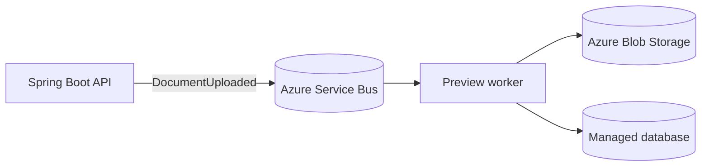
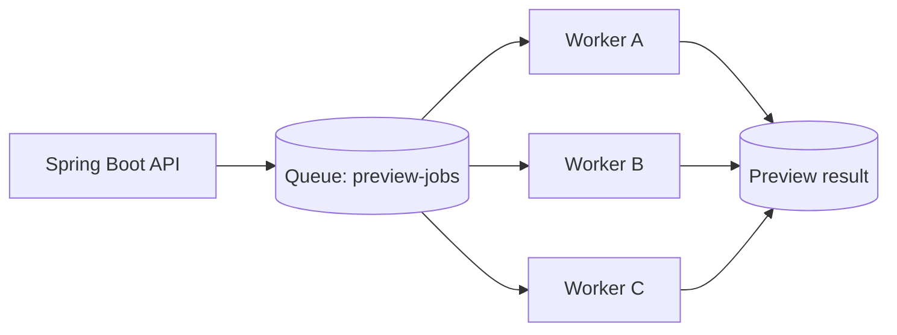
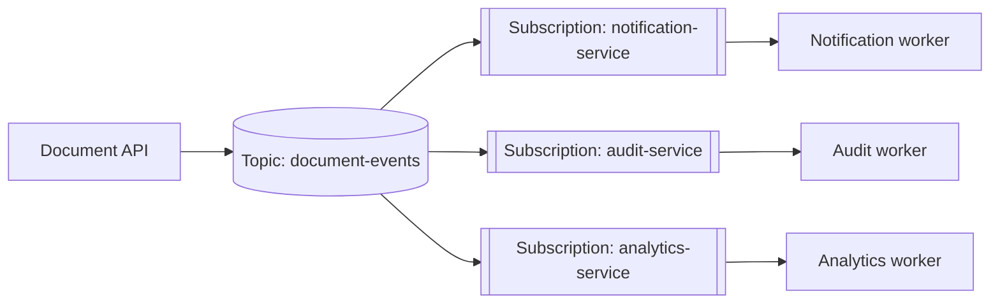
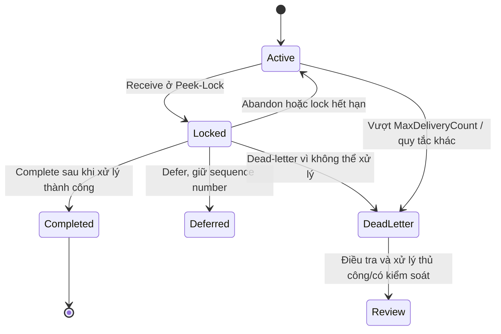
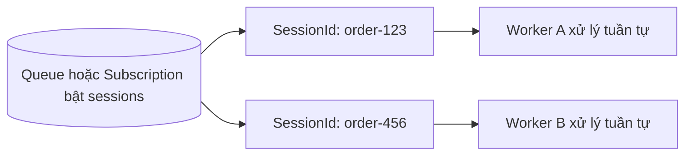
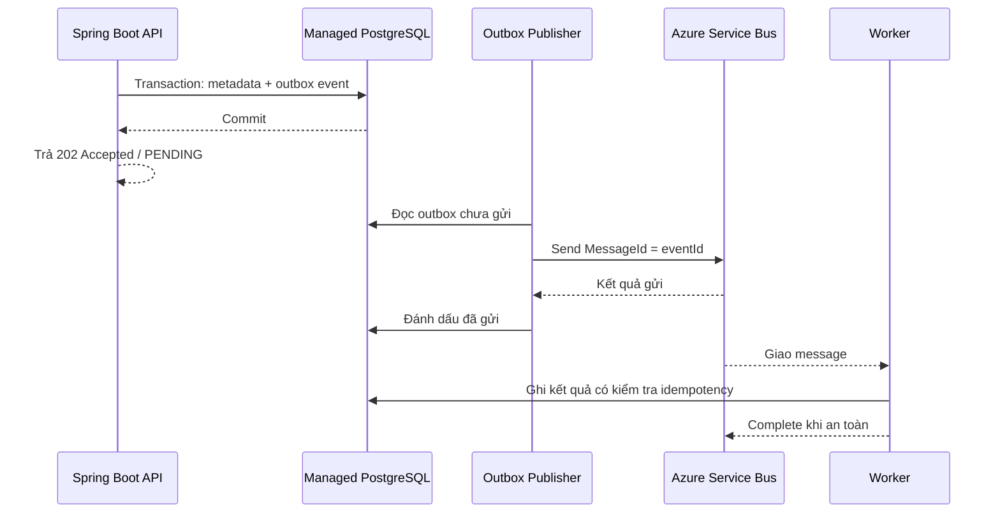

# Queue, topic, subscription và mô hình xử lý thông điệp

> **Chương:** Azure Service Bus  
> **Module:** `SPRING_CLOUD_PROVIDER_INTEGRATION`  
> **Bối cảnh:** Thực hành Spring Boot tích hợp dịch vụ managed của Azure thông qua Spring Cloud Azure và Azure SDK, đồng thời hiểu điểm tương đồng và khác biệt so với AWS và Google Cloud.

## 1. Tại sao cần Azure Service Bus?

Giả sử một ứng dụng Spring Boot nhận hợp đồng PDF, lưu vào Azure Blob Storage và phải thực hiện thêm ba công việc: tạo bản xem trước, gửi email thông báo, ghi nhật ký nghiệp vụ. Nếu mọi công việc diễn ra trong HTTP request, thời gian phản hồi bị kéo dài, kết nối với dịch vụ ngoài có thể lỗi và API phải xử lý nhiều trách nhiệm cùng lúc.

**Azure Service Bus** là dịch vụ nhắn tin managed phục vụ trao đổi thông điệp đáng tin cậy giữa các ứng dụng hoặc thành phần xử lý. Producer gửi thông điệp tới broker; consumer nhận và thực hiện công việc sau. Producer và consumer có thể chạy ở thời điểm khác nhau, được scale riêng và không phải cùng một tiến trình.



Tuy nhiên, thêm một broker không tự bảo đảm tác vụ “xảy ra đúng một lần”. Ứng dụng vẫn phải xử lý quyền truy cập, định dạng message, trạng thái công việc, retry, thông điệp trùng, transaction và giám sát.

**Mục tiêu bài học:** phân biệt chính xác **queue**, **topic**, **subscription** và cách chúng quyết định **ai nhận được thông điệp, nhận bao nhiêu lần, khi nào thông điệp được xem là xử lý xong**.

## 2. Bốn đối tượng quan trọng: namespace, queue, topic, subscription

Service Bus tổ chức các messaging entity trong một **namespace**. Namespace có địa chỉ đầy đủ thường ở dạng `<namespace>.servicebus.windows.net`, nằm trong Azure subscription, resource group và region đã chọn.

| Khái niệm | Vai trò | Producer gửi tới | Consumer nhận từ |
| --- | --- | --- | --- |
| **Namespace** | Ranh giới quản trị kết nối, bảo mật và các messaging entity | Không gửi trực tiếp “vào namespace” | Không đọc trực tiếp “từ namespace” |
| **Queue** | Lưu một luồng công việc để nhiều consumer có thể cạnh tranh xử lý | Queue | Chính queue đó |
| **Topic** | Điểm publish sự kiện, phân phối message đến những subscription phù hợp | Topic | Không nhận trực tiếp từ topic |
| **Subscription** | Luồng nhận độc lập của một nhóm subscriber đối với một topic; có thể có filter | Không dùng làm đích gửi trực tiếp của publisher | Subscription thuộc topic |

Điểm dễ nhầm nhất: **subscription không phải là Azure subscription dùng để thanh toán/quản lý tài nguyên**. “Azure subscription” là ranh giới tài khoản/tính phí. “Service Bus topic subscription” là một messaging entity để nhận thông điệp được topic phân phối.

### Ví dụ đặt tên

```text
Azure subscription (quản lý tài nguyên)
└── Resource group: rg-documents-dev
    └── Service Bus namespace: sb-documents-dev
        ├── Queue: preview-jobs
        └── Topic: document-events
            ├── Subscription: notification-service
            ├── Subscription: audit-service
            └── Subscription: analytics-service
```

Đây là sơ đồ minh họa, không phải lệnh tạo tài nguyên. Queue và subscription có thể có **dead-letter subqueue** riêng; topic không có DLQ theo kiểu một subscription tiêu thụ trực tiếp.

## 3. Queue: một công việc, một consumer cạnh tranh tại mỗi lần giao

Queue là lựa chọn thường phù hợp khi mục tiêu là **phân phối công việc để một worker trong nhóm xử lý**. Nhiều worker có thể đồng thời nhận từ cùng queue: mỗi bản giao message ở một thời điểm thuộc một receiver, trong phạm vi lock và cơ chế nhận. Nếu consumer xử lý thất bại, message có thể được giao lại.



**Sơ đồ không có nghĩa cùng một bản giao message được đồng thời phát cho cả ba worker.** Các worker là **competing consumers**, cùng lấy công việc từ queue. Khi có nhiều message, broker có thể phân phối chúng tới các worker khác nhau; khi một message được giao lại sau lỗi/lock timeout, worker khác có thể nhận chính message ấy ở lần sau.

### Ví dụ nghiệp vụ

Một sự kiện tạo preview có `documentId = doc-123`. API gửi vào queue `preview-jobs`; một worker nhận, đọc file, tạo preview, ghi trạng thái hoàn thành. Nếu worker sập trước khi xác nhận xử lý, message có thể quay lại queue. Hệ thống phải nhận biết kết quả preview đã tồn tại để tránh tạo nhiều bản hoặc gửi thông báo lặp.

Queue mang lại:

- **Temporal decoupling:** API không cần đợi worker online.
- **Load leveling:** broker đệm công việc khi lượng request tăng nhanh.
- **Scale độc lập:** số worker có thể điều chỉnh theo backlog.
- **Failure isolation tương đối:** lỗi tạo preview không nhất thiết làm HTTP upload thất bại.

Queue **không bảo đảm** mỗi nghiệp vụ chỉ có tác dụng một lần, cũng không tự bảo đảm thứ tự **hoàn thành xử lý** khi chạy nhiều worker.

### Tránh một hiểu nhầm về “FIFO”

Service Bus có thông tin thứ tự enqueue và thứ tự nhận, nhưng khi nhiều consumer xử lý song song, **thứ tự hoàn tất** có thể khác thứ tự gửi. Nếu nghiệp vụ yêu cầu các sự kiện của **cùng một đơn hàng** phải xử lý lần lượt, hãy nghiên cứu **sessions** thay vì suy rằng queue mặc định cho kết quả FIFO trong mọi trường hợp.

## 4. Topic và subscription: phát sự kiện đến nhiều nhóm xử lý

Khi một sự kiện cần được xử lý bởi nhiều nghiệp vụ độc lập, dùng **topic + các subscription**.



Một message publish lên topic có thể được **sao chép logic** vào nhiều subscription phù hợp. Mỗi subscription có backlog, consumer và trạng thái xử lý riêng. Notification worker hoàn tất message tại subscription của nó **không đồng nghĩa** audit worker đã hoàn tất ở subscription khác.

### Hai cấp độ fan-out dễ nhầm

1. **Giữa các subscription:** cùng một message có thể tới cả `notification-service` và `audit-service`. Hai hệ thống xử lý độc lập.
2. **Giữa các instance trong một subscription:** nếu ba instance của notification worker cùng đọc `notification-service`, chúng **cạnh tranh** nhận message. Không phải mỗi instance đều nhận một bản.

Ví dụ `DocumentUploaded` được gửi lên topic. Notification subscription nhận để gửi email; audit subscription nhận để ghi lịch sử. Hai nhóm có thể triển khai, scale, gặp lỗi và phục hồi độc lập.

### Topic không có consumer trực tiếp

Để nhận một message đã publish lên topic, ứng dụng phải có **subscription** được tạo và được cấu hình đúng. Nếu không có subscription nào phù hợp hoặc filter loại sự kiện, không có nhóm consumer nào nhận được message ấy. Đừng tạo topic rồi chờ receiver đọc trực tiếp từ topic.

## 5. Queue hay topic/subscription? Chọn theo nghiệp vụ

| Câu hỏi | Queue | Topic + subscription |
| --- | --- | --- |
| Có bao nhiêu nhóm nghiệp vụ cần phản ứng? | Thường một nhóm xử lý công việc | Một hoặc nhiều nhóm độc lập |
| Có nhiều worker cùng xử lý backlog được không? | Có, bằng competing consumers | Có, **trong từng subscription** |
| Mỗi nhóm có trạng thái xử lý riêng không? | Không có nhiều nhánh nhóm ở một queue duy nhất | Có, từng subscription độc lập |
| Có lọc thông điệp trước khi giao đến nhóm nhận không? | Cần áp dụng logic riêng hoặc định tuyến từ phía gửi | Có **subscription rules/filters** |
| Khi thêm nhóm tiêu thụ mới? | Cần thiết kế luồng khác nếu nhóm phải nhận mọi sự kiện | Tạo subscription mới theo nhu cầu |
| Ví dụ | Tạo thumbnail, tạo báo cáo, xử lý job | Đơn hàng phát sự kiện cho billing, email, audit |

**Quy tắc chọn nhanh:** nếu đó là **lệnh yêu cầu một công việc được hoàn tất bởi một trong nhiều worker**, ưu tiên xem xét queue. Nếu đó là **sự kiện nhiều nhóm cần biết**, ưu tiên topic/subscription.

Không tuyệt đối hóa quy tắc: một hệ thống có thể kết hợp topic và queue, hoặc để mỗi subscription tự kích hoạt worker riêng. Mục tiêu là diễn đạt đúng **số nhóm nhận** và **trách nhiệm xử lý**.

## 6. Subscription rules và filters: chọn sự kiện cần nhận

Không phải subscription nào cũng phải nhận tất cả message từ một topic. Service Bus cho phép tạo **rule** để lọc message trước khi phân phối đến subscription.

Các rule có thể sử dụng **SQL filter** hoặc **correlation filter** tùy yêu cầu và tính năng của tier. Bộ lọc thường dựa trên **system properties** hoặc **application properties** của message, **không tự phân tích JSON body** để truy vấn tùy ý.

Giả sử topic `document-events` nhận hai loại:

```json
{
  "eventType": "DocumentUploaded",
  "documentId": "doc-123"
}
```

và

```json
{
  "eventType": "DocumentDeleted",
  "documentId": "doc-123"
}
```

Publisher có thể đặt `eventType` thành một **application property**:

```java
ServiceBusMessage message = new ServiceBusMessage(jsonBody);
message.setMessageId(eventId);
message.getApplicationProperties()
       .put("eventType", "DocumentUploaded");
sender.sendMessage(message);
```

Sau đó subscription chỉ nhận sự kiện upload có thể dùng một rule SQL minh họa:

```sql
eventType = 'DocumentUploaded'
```

**Quan trọng về rule mặc định:** subscription mới thường có rule `$Default` với filter đúng cho mọi message. Khi muốn lọc, phải xem lại và gỡ/thay rule mặc định nếu cần. Nếu giữ rule nhận tất cả, thêm một rule `eventType = ...` sẽ **không** làm subscription chỉ nhận loại mong muốn.

Một subscription có thể có nhiều rule; nếu nhiều rule cùng khớp, hành vi sao chép/biến đổi message cần được kiểm tra. Khi thiết kế event schema, hãy đặt thông tin phục vụ routing trong property ổn định, có version và không chứa secret.

### Ví dụ phân phối theo yêu cầu

| Subscription | Rule khái niệm | Nhóm xử lý |
| --- | --- | --- |
| `preview-service` | `eventType = 'DocumentUploaded'` | Tạo bản xem trước |
| `audit-service` | Nhận mọi sự kiện phù hợp chính sách | Ghi lịch sử |
| `cleanup-service` | `eventType = 'DocumentDeleted'` | Dọn tài nguyên theo retention |

Nếu một subscription không nhận được sự kiện, hãy kiểm tra **đã tồn tại subscription trước lúc publish chưa**, rule có khớp application properties không và rule `$Default` còn hay không.

## 7. Message gồm những gì?

Một Service Bus message có **body** và **metadata**. Ứng dụng cần thiết kế cả hai.

| Thuộc tính | Ý nghĩa thường gặp | Cách sử dụng |
| --- | --- | --- |
| **Body** | Payload, ví dụ JSON đại diện một sự kiện | Chứa ID và dữ liệu nghiệp vụ cần thiết |
| **MessageId** | ID do producer gán | Hỗ trợ truy vết, duplicate detection ở phía broker khi bật và ứng dụng idempotency |
| **CorrelationId** | ID để liên hệ message với một request/luồng công việc | Truy vết HTTP → publisher → consumer |
| **Subject** | Nhãn chủ đề message | Phân loại/quan sát theo mục đích |
| **Application properties** | Cặp key-value do ứng dụng định nghĩa | `eventType`, `eventVersion`, `tenantId` khi phù hợp |
| **SessionId** | Nhóm message thuộc một session | Sắp xếp/xử lý tuần tự theo khóa khi queue/subscription bật sessions |
| **TimeToLive (TTL)** | Thời gian message còn hợp lệ | Hạn chế xử lý những công việc đã quá hạn |
| **Scheduled enqueue time** | Thời điểm lên lịch để message có thể được xử lý về sau | Job trì hoãn theo use case |

Ví dụ sự kiện đáng tin cậy hơn thông điệp chỉ chứa chuỗi `"start"`:

```json
{
  "eventId": "evt-842",
  "eventVersion": 1,
  "eventType": "DocumentUploaded",
  "documentId": "doc-123",
  "objectKey": "documents/doc-123/source.pdf",
  "occurredAt": "2026-01-01T09:00:00Z"
}
```

Đây là **payload minh họa**; thời điểm và ID là dữ liệu giả. Producer cần đặt `MessageId = eventId` ổn định khi retry. Trong body chỉ nên truyền tham chiếu tới file; **không đưa toàn bộ PDF hoặc secret vào broker** chỉ vì làm vậy tiện ở bản demo.

### Contract của consumer

Consumer phải biết:

- Phiên bản schema nào được hỗ trợ.
- Trường nào bắt buộc và kiểu dữ liệu hợp lệ.
- Nếu event lặp, phải xử lý thế nào.
- Nếu tham chiếu tới object không tồn tại, lỗi là tạm thời hay vĩnh viễn.
- Nếu payload chứa dữ liệu nhạy cảm, retention, logging và quyền truy cập có phù hợp không.

**Broker không thay thế validation**. Consumer vẫn phải parse và kiểm tra nội dung trước khi gây tác dụng phụ nghiệp vụ.

## 8. Hai chế độ nhận: Receive-and-Delete và Peek-Lock

Azure Service Bus hỗ trợ hai mô hình nhận cơ bản.

### 8.1. Receive-and-Delete

Trong `RECEIVE_AND_DELETE`, broker coi message đã được tiêu thụ khi chuyển tới receiver. Nếu ứng dụng crash ngay sau khi nhận nhưng trước khi xử lý, message có thể **bị mất về mặt công việc**.

Ưu điểm là đường nhận đơn giản hơn. Nhược điểm rất lớn với các tác vụ nghiệp vụ quan trọng là không có điểm xác nhận hoàn tất riêng ở phía consumer.

**Phù hợp hạn chế:** thông tin có giá trị thấp hoặc công việc chấp nhận mất một vài message. Không chọn cho thanh toán, xuất chứng từ hay trạng thái giao dịch quan trọng chỉ vì muốn tiết kiệm một bước settlement.

### 8.2. Peek-Lock

Trong `PEEK_LOCK`, broker giao message và tạm **khóa** để một receiver xử lý. Sau khi công việc đạt trạng thái an toàn, consumer phải **settle** message. Nếu worker mất kết nối, crash hoặc lock hết hạn trước settlement, message có thể được giao lại.



Đây là sơ đồ khái niệm; các ràng buộc TTL, session, delivery count và tính hợp lệ của lock phụ thuộc cấu hình Service Bus.

### 8.3. Các thao tác settlement quan trọng

| Thao tác | Kết quả | Khi nào dùng |
| --- | --- | --- |
| **Complete** | Đánh dấu message đã xử lý, loại khỏi luồng nhận bình thường | Khi trạng thái nghiệp vụ đã ghi nhận thành công |
| **Abandon** | Trả message về để có thể nhận lại | Lỗi tạm thời, muốn broker xử lý redelivery |
| **Dead-letter** | Chuyển message vào DLQ của queue/subscription | Payload không hợp lệ, lỗi không thể phục hồi hoặc cần điều tra riêng |
| **Defer** | Giữ message nhưng tạm bỏ khỏi luồng receive thông thường | Cần xử lý sau theo thứ tự nghiệp vụ; phải lưu **sequence number** để lấy lại |

**Defer không phải một cơ chế retry thay thế đơn giản.** Một deferred message không tự quay lại luồng receive bình thường như message bị `abandon`; ứng dụng phải biết sequence number và nhận lại theo API tương ứng.

### 8.4. Vì sao vẫn có duplicate?

Giả sử worker ghi xong file preview vào Blob Storage, nhưng crash trước `complete()`. Sau khi lock hết hạn, một worker khác có thể nhận lại message và chạy xử lý lần nữa.

Đó là lý do **Peek-Lock giúp tránh mất việc nhưng cần thiết kế chịu trùng**. Cần phân biệt:

- **Message được broker giao lại**: cùng `MessageId` có thể xuất hiện nhiều lần ở consumer.
- **Producer gửi lại message**: ứng dụng retry gửi vì không chắc lần trước đã được broker nhận.
- **Tác dụng phụ nghiệp vụ lặp**: gửi email hai lần, ghi hai hóa đơn, trừ tiền hai lần.

Cơ chế duplicate detection của broker giúp trường hợp thứ hai trong giới hạn cấu hình; **idempotency của consumer** giải quyết trường hợp thứ nhất và tác dụng phụ nghiệp vụ ở trường hợp thứ ba.

## 9. Lock duration, renewal, delivery count và DLQ

### 9.1. Lock và thời gian xử lý

Nếu worker xử lý lâu hơn thời gian khóa, lock có thể hết hạn trước `complete`. Khi đó việc settlement có thể thất bại và message được giao lại. Một số SDK hỗ trợ **tự gia hạn lock** trong giới hạn được cấu hình.

Trước khi tăng lock duration hoặc max auto-renew, nên xem liệu công việc có thể được tách thành bước ngắn hơn không. Prefetch quá nhiều message trong khi xử lý chậm cũng dễ khiến lock hết hạn trước khi message được thực hiện.

Lock còn có thể bị mất vì kết nối/AMQP link gián đoạn hoặc thay đổi dịch vụ. Không suy rằng “đã đặt khóa 5 phút thì chắc chắn còn khóa đủ 5 phút”.

### 9.2. Delivery count và Dead-Letter Queue

Mỗi **queue** và **topic subscription** có **DLQ** phụ thuộc entity chính, không cần tạo một queue DLQ độc lập chỉ để sử dụng khả năng mặc định. Khi số lần giao vượt **MaxDeliveryCount**, Service Bus chuyển message vào DLQ. Giá trị mặc định thường là **10**, nhưng nên kiểm tra cấu hình thực tế của entity.

Các nguyên nhân khác có thể gồm:

- Ứng dụng gọi dead-letter cho lỗi vĩnh viễn.
- Message hết TTL và entity được bật **dead-letter on expiration**.
- Một số trường hợp lỗi filter hoặc chuyển tiếp theo cấu hình dịch vụ.

Message trong DLQ cần được **kiểm tra và xử lý lại có chủ đích**; nó không tự được xử lý lại chỉ vì lỗi bên ngoài đã hết. DLQ cũng không áp dụng TTL để tự xóa message theo cách tương tự hàng đợi chính, vì vậy cần giám sát dung lượng và quy trình dọn/replay.

### 9.3. Cách xử lý một poison message

Ví dụ một message chứa JSON sai schema làm worker luôn thất bại:

1. Consumer xác định đây là lỗi không thể tự phục hồi (ví dụ trường `documentId` bắt buộc bị thiếu).
2. Consumer có thể chuyển message sang DLQ với lý do được phân loại; nếu chọn abandon, broker có thể giao lại nhiều lần rồi DLQ khi vượt giới hạn.
3. Nhóm vận hành kiểm tra message (tránh lộ dữ liệu nhạy cảm), phân biệt lỗi dữ liệu và lỗi phần mềm.
4. Sửa nguyên nhân, rồi tạo **một message mới có chủ đích** hoặc replay theo quy trình có kiểm tra duplicate.
5. Theo dõi số message trong DLQ và thời gian chúng bị mắc kẹt.

Không nên retry vô hạn chỉ để làm DLQ luôn bằng 0. DLQ là một tín hiệu hữu ích cho việc điều tra và cải thiện tính đúng đắn của consumer.

## 10. Sessions: khi cần xử lý theo thứ tự của từng nhóm

Ví dụ hệ thống xử lý sự kiện của một đơn hàng:

```text
OrderPlaced(order-123)
PaymentConfirmed(order-123)
OrderShipped(order-123)
```

Nếu nhiều worker xử lý song song, `OrderShipped` có thể hoàn tất trước `PaymentConfirmed` dù được nhận sau. **Sessions** cho phép gom các message liên quan theo `SessionId`, để một receiver giữ khóa độc quyền trên session đang xử lý.



Một số điều kiện quan trọng:

- Queue hoặc subscription phải **bật sessions từ lúc tạo**; không thể đơn giản bật/tắt trên entity đã tồn tại.
- Producer gán `SessionId` nhất quán, ví dụ `orderId`.
- Consumer sử dụng **session-aware receiver/processor**; không dùng processor thường cho entity yêu cầu sessions.
- Một session được receiver giữ độc quyền trong thời gian khóa còn hợp lệ; **những session khác có thể xử lý song song**.
- Bảo đảm thứ tự nằm trong **phạm vi session**, không phải thứ tự hoàn thành toàn hệ thống.
- Sessions không loại bỏ nhu cầu idempotency, xử lý lock loss hay kiểm soát trạng thái.

Ví dụ SDK tạo message cho entity có sessions:

```java
ServiceBusMessage message = new ServiceBusMessage(payload)
    .setMessageId(eventId)
    .setSessionId(orderId);

sender.sendMessage(message);
```

Khi dùng Service Bus Java SDK, processor nhận message cần được tạo qua `sessionProcessor()` nếu queue/subscription có sessions. Việc chọn concurrency phải cân nhắc **maxConcurrentSessions**, xử lý trong từng session và thời gian giữ lock.

## 11. Duplicate detection: công cụ phía gửi, không phải transaction nghiệp vụ

Azure Service Bus hỗ trợ **duplicate detection** trên queue/topic khi được bật và tier hỗ trợ. Khi một message được gửi lại với **MessageId** đã được ghi nhận trong **cửa sổ duplicate detection**, broker có thể chấp nhận thao tác send nhưng bỏ qua bản trùng theo chính sách.

Tình huống điển hình:

```text
Publisher gửi eventId=evt-100 → broker đã nhận
             ↓
Mạng đứt trước khi publisher nhận acknowledgement
             ↓
Publisher retry với cùng MessageId=evt-100
             ↓
Duplicate detection có thể loại bản gửi lại trong cửa sổ đã cấu hình
```

Các giới hạn cần hiểu:

- Tính năng này phải được cấu hình trên entity theo khả năng tier; **Basic không hỗ trợ**, Standard/Premium hỗ trợ.
- Việc bật/tắt duplicate detection cần được quyết định **lúc tạo** queue/topic.
- Kết quả chỉ áp dụng trong **khoảng thời gian lưu lịch sử duplicate** đã cấu hình.
- Nếu producer dùng một `MessageId` mới cho mỗi lần retry, broker không coi đó là cùng một message theo khóa phát hiện trùng.
- Nó không ngăn consumer gây tác dụng phụ lặp khi broker giao lại message đã được nhận đúng một lần.

**Kết luận kỹ thuật:** dùng `MessageId` ổn định, duplicate detection khi phù hợp và **consumer idempotency**. Với nghiệp vụ có rủi ro cao, lưu ID sự kiện đã xử lý hoặc thực hiện cập nhật điều kiện bằng transaction ở database.

## 12. Bảo đảm nhất quán giữa database và message

Trong hệ thống có Spring Data/JPA hoặc JDBC, một flow phổ biến là:

```text
1. Lưu trạng thái Document vào PostgreSQL
2. Gửi DocumentUploaded lên Service Bus
```

Hai bước này **không mặc nhiên thuộc một transaction ACID chung**. Nếu database commit thành công rồi publisher gặp lỗi, worker có thể không bao giờ biết cần xử lý tài liệu. Nếu publisher gửi thành công nhưng response mất, retry có thể phát trùng.

Giải pháp thường gặp là **transactional outbox**:



Bản ghi document và outbox được ghi trong **cùng database transaction**. Một publisher riêng gửi message lên Service Bus. Nếu publisher chết sau `send` nhưng trước khi đánh dấu outbox, event sẽ được gửi lại khi phục hồi; `MessageId` ổn định và consumer idempotent giúp kiểm soát lặp.

**Service Bus có tính năng transaction trong phạm vi messaging được hỗ trợ**, nhưng không nên hiểu là nó tự cung cấp distributed transaction bao trùm PostgreSQL, Blob Storage và Service Bus. Thiết kế tính nhất quán end-to-end vẫn thuộc trách nhiệm ứng dụng.

## 13. Tier và khả năng dịch vụ: kiểm tra trước khi tạo tài nguyên

Azure Service Bus có các tier với phạm vi tính năng khác nhau. Việc chọn sai tier có thể khiến không thể tạo topic/subscription hoặc không dùng được sessions, dù code Java hoàn toàn hợp lệ.

| Khả năng phổ biến | Basic | Standard | Premium |
| --- | --- | --- | --- |
| Queue | Có | Có | Có |
| Topic và subscription | **Không** | Có | Có |
| Sessions | **Không** | Có | Có |
| Duplicate detection | **Không** | Có | Có |
| Messaging transactions | **Không** | Có | Có |
| Tài nguyên compute chuyên biệt / cách ly | Không | Không theo mô hình dedicated Premium | Có |
| Kịch bản thường phù hợp | Queue đơn giản, nhu cầu nhỏ | Queue/topic với tính năng thông dụng | Khả năng cách ly tài nguyên và nhu cầu vận hành cao hơn |

Bảng mô tả định hướng về tính năng, **không phải bảng giá hoặc SLA**. Những giới hạn quota, message size, private networking và số lượng entity có thể thay đổi theo tier/cấu hình. Hãy kiểm tra chính sách và tài liệu hiện hành trước khi lập ngân sách hoặc xây môi trường production.

Nếu bài tập cần **topic + nhiều subscription** hoặc **sessions**, không chọn Basic.

## 14. Tích hợp Spring Boot: Spring Cloud Azure và Azure SDK

Có nhiều cấp độ tích hợp. Dù chọn cấp nào, code nghiệp vụ nên chỉ biết **hợp đồng message** chứ không rải thông tin namespace/queue/topic và kiểu SDK ở mọi service.

| Cách tiếp cận | Khi phù hợp | Điều phải kiểm soát |
| --- | --- | --- |
| **Azure SDK for Java trực tiếp** | Cần API/settlement/filter/session cụ thể hoặc muốn quản lý rõ client | Bean lifecycle, credential, timeout, serialization |
| **Spring Cloud Azure Service Bus starter** | Dùng Spring Boot và muốn tận dụng cơ chế cấu hình/starter phù hợp | Ma trận tương thích Spring Boot/JDK/BOM và autoconfiguration |
| **Spring Messaging / Spring Integration** | Muốn listener/template hoặc tổ chức integration flow theo mô hình Spring | Converter, acknowledgement và property mapping |
| **Spring Cloud Stream binder** | Xây producer/consumer theo functional binding khi có binder hỗ trợ | Ngữ nghĩa của binder không loại bỏ sự khác biệt ở broker |

Một dependency Maven tiêu biểu:

```xml
<dependency>
    <groupId>com.azure.spring</groupId>
    <artifactId>spring-cloud-azure-starter-servicebus</artifactId>
</dependency>
```

Cần chọn **Spring Cloud Azure BOM** tương thích với phiên bản Spring Boot/JDK đang dùng. Bản ví dụ bên dưới minh họa **Azure SDK cho Service Bus** (API `com.azure.messaging.servicebus`) đặt trong Spring `@Configuration` để người học thấy rõ cấu trúc. Một dự án dùng starter có thể nhận bean hoặc property đã được cấu hình theo convention riêng; hãy tránh tạo trùng bean và xác nhận API theo version thực tế.

### 14.1. Cấu hình theo môi trường

Ví dụ `application.yml`:

```yaml
app:
  servicebus:
    fully-qualified-namespace: ${SERVICEBUS_FQDN}
    queue: ${SERVICEBUS_QUEUE}
    topic: ${SERVICEBUS_TOPIC}
    subscription: ${SERVICEBUS_SUBSCRIPTION}
```

`app.servicebus.*` là **cấu hình do ứng dụng tự định nghĩa**, không tự động là key chính thức của Spring Cloud Azure. `SERVICEBUS_FQDN` thường có dạng `my-namespace.servicebus.windows.net`. Có thể cấu hình các property chính thức của starter (như namespace) theo tài liệu phiên bản tương ứng nếu muốn tận dụng auto-configuration.

Không ghi connection string chứa shared access key vào mã nguồn. Với Microsoft Entra ID và credential phù hợp, ứng dụng có thể đăng nhập local bằng công cụ phát triển được hỗ trợ; trên runtime Azure, ưu tiên **Managed Identity**.

### 14.2. Tạo sender client làm Spring bean

```java
import com.azure.identity.DefaultAzureCredentialBuilder;
import com.azure.messaging.servicebus.ServiceBusClientBuilder;
import com.azure.messaging.servicebus.ServiceBusSenderClient;
import org.springframework.beans.factory.annotation.Value;
import org.springframework.context.annotation.Bean;
import org.springframework.context.annotation.Configuration;

@Configuration
public class ServiceBusQueueConfiguration {

    @Bean(destroyMethod = "close")
    ServiceBusSenderClient previewQueueSender(
            @Value("${app.servicebus.fully-qualified-namespace}") String fqdn,
            @Value("${app.servicebus.queue}") String queueName) {

        return new ServiceBusClientBuilder()
                .credential(fqdn, new DefaultAzureCredentialBuilder().build())
                .sender()
                .queueName(queueName)
                .buildClient();
    }
}
```

Code sử dụng **Azure Identity** để lấy token của workload. Identity thực tế phải được cấp **Azure Service Bus Data Sender** hoặc quyền gửi phù hợp trên đúng scope/entity; có token hợp lệ vẫn chưa đủ nếu RBAC thiếu quyền.

### 14.3. Service publish message với ID ổn định

```java
import com.azure.messaging.servicebus.ServiceBusMessage;
import com.azure.messaging.servicebus.ServiceBusSenderClient;
import org.springframework.stereotype.Service;

@Service
public class PreviewEventPublisher {
    private final ServiceBusSenderClient sender;

    public PreviewEventPublisher(ServiceBusSenderClient sender) {
        this.sender = sender;
    }

    public void publish(String eventId, String documentId) {
        // Đơn giản hóa payload; thực tế nên serialize DTO có schemaVersion.
        ServiceBusMessage message = new ServiceBusMessage(documentId)
                .setMessageId(eventId)
                .setSubject("DocumentUploaded")
                .setCorrelationId(documentId);
        message.getApplicationProperties()
                .put("eventType", "DocumentUploaded");

        sender.sendMessage(message);
    }
}
```

Đây là **producer tối giản cho queue**. Khi publish vào **topic**, thay phần xây sender từ `.queueName(queueName)` thành `.topicName(topicName)` và sử dụng một bean phù hợp. Không gửi cùng sự kiện vào cả queue và topic nếu kiến trúc không có chủ đích xử lý hai đường độc lập.

**Giới hạn:** gửi thành công chỉ có nghĩa Service Bus chấp nhận theo API; preview vẫn chưa được tạo. Khi timeout sau lệnh gửi, cần xử lý kết quả không chắc chắn và retry với **cùng eventId**. Để bảo đảm event được phát sau commit database, cần outbox hoặc thiết kế tương đương.

### 14.4. Receiver/processor dùng Peek-Lock và settlement tường minh

Với tác vụ quan trọng, nên chủ động xác định thời điểm `complete`. Ví dụ handler nghiệp vụ:

```java
public interface PreviewMessageHandler {
    void process(String eventId, String documentId);
}
```

Processor do Spring quản lý có thể được khai báo:

```java
import com.azure.identity.DefaultAzureCredentialBuilder;
import com.azure.messaging.servicebus.ServiceBusClientBuilder;
import com.azure.messaging.servicebus.ServiceBusProcessorClient;
import com.azure.messaging.servicebus.models.ServiceBusReceiveMode;
import org.slf4j.Logger;
import org.slf4j.LoggerFactory;
import org.springframework.beans.factory.annotation.Value;
import org.springframework.context.annotation.Bean;
import org.springframework.context.annotation.Configuration;

@Configuration
public class ServiceBusConsumerConfiguration {
    private static final Logger log =
            LoggerFactory.getLogger(ServiceBusConsumerConfiguration.class);

    @Bean(initMethod = "start", destroyMethod = "close")
    ServiceBusProcessorClient previewProcessor(
            @Value("${app.servicebus.fully-qualified-namespace}") String fqdn,
            @Value("${app.servicebus.queue}") String queueName,
            PreviewMessageHandler handler) {

        return new ServiceBusClientBuilder()
                .credential(fqdn, new DefaultAzureCredentialBuilder().build())
                .processor()
                .queueName(queueName)
                .receiveMode(ServiceBusReceiveMode.PEEK_LOCK)
                .disableAutoComplete()
                .processMessage(context -> {
                    var message = context.getMessage();
                    try {
                        handler.process(
                                message.getMessageId(),
                                message.getBody().toString());
                        context.complete();
                    } catch (Exception exception) {
                        log.error("Preview message processing failed. messageId={}",
                                message.getMessageId(), exception);
                        context.abandon();
                    }
                })
                .processError(context ->
                        log.error("Service Bus processor error",
                                context.getException()))
                .buildProcessorClient();
    }
}
```

**Để ví dụ hoạt động**, dự án cần một bean implement `PreviewMessageHandler`. Phần `process` ở đây nhận `documentId` dạng chuỗi; trong hệ thống thật nên parse, validate payload và xử lý theo schema. Handler phải **idempotent**: nếu `eventId` đã hoàn tất, nó trả kết quả “đã xử lý” một cách an toàn thay vì tạo tác dụng phụ mới.

Ví dụ trên cố ý cho mọi exception đi qua `abandon` để minh họa **giao lại**. Production cần **phân loại lỗi**: payload sai không thể khắc phục nên cân nhắc `deadLetter`; lỗi mạng tạm thời có thể `abandon`/retry theo chính sách. Cần giới hạn concurrency, lock renewal và ghi metric; tránh log dữ liệu nhạy cảm.

Nếu queue/subscription yêu cầu **sessions**, phải dùng `sessionProcessor()` và cấu hình session/concurrency tương ứng. Processor thông thường trong ví dụ không phù hợp cho entity bắt buộc session.

### 14.5. Khi chuyển sang topic subscription

Điểm thay đổi chính trong SDK builder:

```java
// Producer: gửi lên topic.
ServiceBusSenderClient topicSender = new ServiceBusClientBuilder()
        .credential(fqdn, credential)
        .sender()
        .topicName(topicName)
        .buildClient();

// Consumer: nhận từ một subscription thuộc topic.
ServiceBusProcessorClient subscriber = new ServiceBusClientBuilder()
        .credential(fqdn, credential)
        .processor()
        .topicName(topicName)
        .subscriptionName(subscriptionName)
        .disableAutoComplete()
        .processMessage(onMessage)
        .processError(onError)
        .buildProcessorClient();
```

Đây là **đoạn minh họa builder**, giả sử `fqdn`, `credential`, `topicName`, `subscriptionName` và callback `onMessage`/`onError` đã được định nghĩa; không phải một file Java tự chạy độc lập. Cần đóng client khi ứng dụng dừng. Producer không chọn subscription nhận; **subscription rules** và topology do quản trị Service Bus quyết định.

## 15. Danh tính và quyền truy cập khi dùng Service Bus

Ứng dụng thường có hai loại quyền khác nhau:

1. **Quyền của người dùng đối với HTTP API**: Spring Security/logic nghiệp vụ quyết định ai được upload file, tạo job hoặc xem kết quả.
2. **Quyền workload đối với Service Bus**: Azure RBAC/Microsoft Entra ID quyết định ứng dụng có được publish, receive hoặc quản lý tài nguyên.

| Workload | Vai trò dữ liệu thường cần | Không nên cấp mặc định |
| --- | --- | --- |
| API hoặc outbox publisher | **Azure Service Bus Data Sender** trên phạm vi thích hợp | Data Owner/admin của toàn namespace nếu chỉ gửi |
| Preview worker | **Azure Service Bus Data Receiver** trên queue/subscription cần nhận | Data Sender hoặc role quản trị không liên quan |
| Công cụ quản trị entity | Vai trò quản lý tài nguyên/Service Bus phù hợp theo nhiệm vụ | Quyền rộng cho tất cả ứng dụng runtime |

Local developer có thể dùng `az login`/công cụ Azure Identity phù hợp; khi chạy trên Azure, Managed Identity thường giảm nhu cầu quản lý khóa lâu dài. Cần kiểm tra **credential nào thực tế được DefaultAzureCredential chọn** và role RBAC đã được cấp trên đúng tài nguyên; việc gán role có thể cần thời gian để có hiệu lực.

Khi bảo mật yêu cầu, cân nhắc giới hạn network/private endpoint, vô hiệu hóa local authentication/shared keys nếu đã chuyển hoàn toàn sang Microsoft Entra ID, phân tách namespace dev/test/prod và giám sát audit. Kết nối vẫn có thể thất bại do DNS, TLS, firewall hoặc AMQP transport dù RBAC đúng.

## 16. Kiểm thử mô hình queue và subscription

Một bài tích hợp thực tế nên kiểm tra **cả đường thành công lẫn đường thất bại**, vì một message có thể được broker nhận nhưng consumer chưa xử lý thành công.

| Tầng | Cần chứng minh | Phương án |
| --- | --- | --- |
| **Unit test nghiệp vụ** | Handler cập nhật đúng trạng thái, không xử lý trùng `eventId` | Fake repository, fake publisher; không cần Azure |
| **Adapter test** | Producer gán đúng `MessageId`, body, subject và application properties | Mock client hoặc kiểm thử builder/adapter phù hợp |
| **Local integration** | Gửi/nhận queue/topic, settlement và một số rule | Azure Service Bus emulator theo khả năng được hỗ trợ |
| **Cloud integration** | Entra ID/RBAC, namespace, queue/topic/subscription, filter và DLQ thật | Namespace riêng trên Azure, quyền giới hạn |
| **Failure test** | Consumer crash/lock hết hạn, redelivery và idempotency | Cố ý dừng worker hoặc chặn xử lý trong môi trường test |
| **Load/operations test** | Backlog, message age, throughput, lock loss, DLQ | Metrics/logs trên Azure Monitor và ứng dụng |

**Azure Service Bus emulator** là công cụ chạy trong container, hữu ích cho vòng phát triển local. Nó **không mô phỏng đầy đủ** Microsoft Entra ID, VNet, geo-recovery, metrics portal hay một số tính năng khác; dữ liệu emulator không bền vững sau container restart theo tài liệu hiện hành. Vì vậy không dùng kết quả emulator thay cho test RBAC và hành vi thật trên Azure.

### 16.1. Các phép thử tối thiểu cho queue

1. Gửi `evt-1` vào `preview-jobs`, một trong hai worker xử lý và gọi `complete`.
2. Gửi `evt-2`, làm worker crash trước settlement. Sau thời gian/điều kiện thích hợp, message được nhận lại; idempotency giữ kết quả không nhân đôi.
3. Gửi payload không hợp lệ, quan sát hành vi dead-letter theo chính sách.
4. Chạy đồng thời nhiều worker, đo message backlog và thời gian xử lý; kiểm tra thứ tự hoàn tất **không** bị giả định sai.

### 16.2. Các phép thử tối thiểu cho topic/subscription

1. Tạo topic `document-events` và hai subscription độc lập, gửi `DocumentUploaded`; cả hai subscription phù hợp đều nhận được.
2. Cho một consumer của subscription A dừng, xác nhận subscription B vẫn xử lý riêng.
3. Cấu hình filter cho `DocumentDeleted`; gửi hai loại sự kiện và xác minh đúng nhóm nhận.
4. Thử rule mặc định `$Default`: nếu chưa gỡ, subscription có thể tiếp tục nhận mọi sự kiện; sau khi thay rule, kiểm tra lại kết quả.

### 16.3. Các phép thử reliability và order

- Gửi lại cùng `MessageId` trong duplicate detection window (khi được bật/tier hỗ trợ); xác minh tác động phía broker.
- Gửi một message đã hoàn tất, mô phỏng mất kết nối trước settlement rồi xử lý lại; xác minh consumer không làm lặp side effect.
- Tạo queue/subscription có sessions rồi gửi nhiều message cùng `SessionId`; kiểm tra thứ tự **xử lý trong session** và tính song song giữa các session.
- Gây lỗi quyền bằng identity chỉ có `Data Sender` nhưng cố receive; phải thấy lỗi xác thực/phân quyền được ghi nhận, không tự nâng quyền.

## 17. Vận hành: metric, log, DLQ và runbook

Khi đã có Service Bus giữa API và worker, chỉ dựa vào log ứng dụng không đủ. Phải quan sát broker và tiến trình nghiệp vụ.

| Tín hiệu | Ý nghĩa | Hành động khi bất thường |
| --- | --- | --- |
| **Active messages** | Số message đang chờ trong queue/subscription | Kiểm tra worker, concurrency, timeout và upstream load |
| **Dead-lettered messages** | Message cần điều tra hoặc replay có kiểm soát | Phân loại nguyên nhân, sửa schema/code/config |
| **Incoming/outgoing messages** | Tốc độ message vào/ra entity | So sánh producer và consumer throughput |
| **Message age / độ trễ job** | Job cũ nhất đã chờ bao lâu | Xem backlog, lock, retry và SLO |
| **Abandon/lock-lost/error count** | Tín hiệu xử lý thất bại hoặc quá thời gian | Điều chỉnh handler, lock renewal, prefetch/concurrency |
| **End-to-end success rate** | Tỷ lệ sự kiện dẫn tới trạng thái nghiệp vụ đúng | Liên kết `eventId` và trạng thái database |

Các chỉ số cụ thể, khả năng xuất và tên metric phụ thuộc Azure Monitor/SDK và cách ứng dụng instrument. Nhóm nên đưa `MessageId`/`CorrelationId` vào log có cấu trúc, trace hoặc bảng trạng thái, nhưng tránh ghi body chứa dữ liệu nhạy cảm.

### Runbook ví dụ: queue đang tăng backlog

1. **Xác nhận:** queue `preview-jobs` còn active messages, tuổi job tăng; worker có chạy và nhận message không?
2. **Phân loại:** lỗi IAM, thiếu connection, xử lý chậm, lock hết hạn, poison message hay producer tăng đột biến?
3. **Cách xử lý:** sửa quyền/cấu hình, tăng worker trong giới hạn, giảm tốc độ đầu vào hoặc đưa message lỗi đến DLQ theo chính sách.
4. **Phục hồi:** replay những message đã điều tra khi có idempotency; theo dõi trạng thái job và số duplicate.
5. **Phòng ngừa:** cập nhật alert, timeout, concurrency, dead-letter policy, schema và test hồi quy.

Một lỗi permission không nên được “giải quyết” bằng retry vô hạn hay cấp quyền Data Owner cho mọi ứng dụng.

## 18. So sánh ngắn với AWS và Google Cloud

Module thực hành qua các thư viện Spring Cloud cho **AWS, Azure và Google Cloud**, nên cần phân biệt những điểm tương đồng theo **nhu cầu** với khác biệt ở **mô hình API**.

| Nhu cầu | Azure Service Bus | AWS thường dùng | Google Cloud thường dùng |
| --- | --- | --- | --- |
| Xử lý công việc bởi một trong nhiều worker | Queue + competing consumers | SQS queue | Pub/Sub topic/subscription với một nhóm consumer |
| Nhiều nhóm xử lý cùng sự kiện | Topic + nhiều subscription | SNS + các subscription/queue phù hợp | Pub/Sub topic + nhiều subscriptions |
| Thứ tự theo nhóm | Service Bus sessions | SQS FIFO/message group khi phù hợp | Pub/Sub ordering keys khi được bật và có điều kiện phù hợp |
| Xác nhận xử lý | Complete/Abandon/Dead-letter trong Peek-Lock | Delete message, visibility timeout và DLQ | Ack/nack, ack deadline và dead-letter policy |
| Workload identity | Entra ID + Managed Identity / RBAC | IAM role/policy | Service account / Workload Identity / IAM |

Đừng sao chép thuật ngữ **complete** sang SQS hoặc giả định Pub/Sub có service bus session. Nếu dùng một `EventPublisher` port chung, mỗi adapter cần kiểm thử delivery semantics, retry, ordering và các ràng buộc riêng.

## 19. Bài thực hành: thiết kế queue và topic cho hệ thống tài liệu

**Tình huống:** Một Spring Boot API lưu tài liệu vào Azure Blob Storage, ghi metadata trong PostgreSQL managed và cần ba công việc: tạo preview, gửi email khi hoàn tất và ghi audit log.

### Phần A — Chọn topology

Thiết kế hai phương án:

- **Phương án 1:** Queue `preview-jobs` cho preview; topic `document-events` cho notification/audit.
- **Phương án 2:** Topic `document-events` với ba subscription dành cho ba nhóm xử lý.

Giải thích phương án nào có lợi khi preview là **command/work item**, phương án nào phù hợp khi mọi nhóm cùng phản ứng với một **domain event**. Tránh mặc định cả hai phương án đều đúng như nhau về trạng thái và fan-out.

### Phần B — Định nghĩa message contract

Tạo JSON gồm `eventId`, `eventType`, `eventVersion`, `documentId`, `objectKey` và thời điểm. Xác định field nào đặt vào application property để filter. Producer phải dùng `MessageId` ổn định khi retry.

### Phần C — Thực hành Service Bus

Tạo namespace phù hợp tier, queue hoặc topic/subscription test. Dùng Azure SDK/Spring Cloud Azure để gửi/nhận một message. Quan sát:

- Message đến đúng queue/subscription.
- Khi handler thành công, `complete` làm message rời luồng nhận bình thường.
- Khi `abandon` hoặc mất lock, message có thể giao lại.
- Khi cố ý dead-letter, message nằm trong DLQ và phải được điều tra.

### Phần D — Thực hành filter và sessions

Tạo hai subscription cho `DocumentUploaded` và `DocumentDeleted`; thiết kế rule, kiểm tra rule mặc định. Nếu bài toán cần thứ tự theo `documentId`, thử sessions trên entity mới, so sánh xử lý của hai document ID khác nhau.

### Phần E — Kiểm thử độ tin cậy

Chứng minh cùng một `eventId` không tạo hai bản xem trước, kể cả khi message được xử lý lần nữa. Giả lập DB commit thành công nhưng publisher Service Bus lỗi và trình bày cách outbox giúp phục hồi.

### Phần F — Vận hành

Thiết lập metric hoặc bảng theo dõi active messages, DLQ, độ trễ job và lỗi handler. Viết một runbook ngắn cho tình huống poison message và cho tình huống role của worker thiếu `Data Receiver`.

**Tiêu chí đạt:** phân biệt queue và topic/subscription; giải thích competing consumers vs fan-out; nắm các thao tác settlement, DLQ, filter và sessions; có ví dụ Spring Boot dùng identity phù hợp và có kiểm thử khi message bị giao lại.

---

## 20. Ghi nhớ

- **Queue** phù hợp khi nhiều worker **cạnh tranh nhận một luồng công việc**; một message có thể được giao lại nếu xử lý chưa được xác nhận an toàn.
- **Topic** là điểm publish; mỗi **subscription** tương ứng một nhóm nhận độc lập, có thể được lọc bằng rule; nhiều worker trong **cùng subscription** vẫn cạnh tranh xử lý.
- **Peek-Lock** yêu cầu consumer settlement: `complete`, `abandon`, `deadLetter` hoặc `defer`. Đừng nhầm việc “đã nhận” với việc “đã hoàn tất nghiệp vụ”.
- **Sessions** giúp xử lý theo thứ tự trong **từng nhóm message**, không bảo đảm thứ tự hoàn tất toàn hệ thống.
- **Duplicate detection** bảo vệ phần nào trước producer gửi lại trong một cửa sổ cấu hình; consumer vẫn phải **idempotent**.
- **DLQ, outbox, IAM, test và observability** là những thành phần cần có khi đưa một luồng messaging từ demo sang vận hành.

Với Spring Boot, hãy giữ service nghiệp vụ phụ thuộc vào hợp đồng như `DocumentEventPublisher` hoặc `PreviewMessageHandler`, và đặt chi tiết `ServiceBusSenderClient`, `ServiceBusProcessorClient`, queue/topic/subscription, credential, timeout và settlement tại lớp tích hợp. Cách tổ chức này giúp hệ thống rõ trách nhiệm và dễ kiểm thử khi so sánh với AWS hoặc Google Cloud.

### Tài liệu chính thức để đối chiếu khi thực hành

- [Azure Service Bus — queues, topics và subscriptions](https://learn.microsoft.com/en-us/azure/service-bus-messaging/service-bus-queues-topics-subscriptions)
- [Message transfers, locks và settlement](https://learn.microsoft.com/en-us/azure/service-bus-messaging/message-transfers-locks-settlement)
- [Dead-letter queues](https://learn.microsoft.com/en-us/azure/service-bus-messaging/service-bus-dead-letter-queues)
- [Message sessions](https://learn.microsoft.com/en-us/azure/service-bus-messaging/message-sessions)
- [Duplicate detection](https://learn.microsoft.com/en-us/azure/service-bus-messaging/duplicate-detection)
- [Azure Service Bus Java SDK](https://learn.microsoft.com/en-us/java/api/overview/azure/messaging-servicebus-readme)
- [Spring Boot sample với Service Bus queue](https://learn.microsoft.com/en-us/samples/azure-samples/azure-spring-boot-samples/sending-and-receiving-message-by-azure-service-bus-queue-in-spring-boot-application/)
- [Azure Service Bus emulator và giới hạn](https://learn.microsoft.com/en-us/azure/service-bus-messaging/overview-emulator)

Khi cài đặt hoặc nâng cấp, hãy xác minh **phiên bản Spring Boot/JDK, Spring Cloud Azure, Azure SDK, tier và quota thực tế**. Tính năng hỗ trợ và tên thuộc tính cấu hình có thể thay đổi theo phiên bản.
