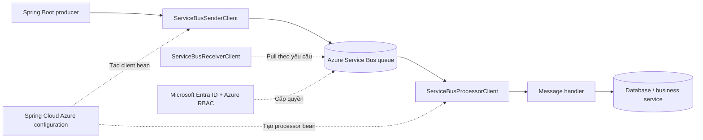

# Tạo sender, receiver và processor qua Spring Cloud Azure

> **Chương:** Azure Service Bus  
> **Module:** `SPRING_CLOUD_PROVIDER_INTEGRATION`  
> **Mục tiêu:** Tạo và sử dụng các client gửi/nhận thông điệp trong Spring Boot bằng Spring Cloud Azure; hiểu vai trò của `ServiceBusSenderClient`, `ServiceBusReceiverClient`, `ServiceBusProcessorClient`, cấu hình theo môi trường, danh tính Microsoft Entra ID, vòng đời bean và cách kiểm thử.

## 1. Từ Service Bus SDK đến Spring Boot

Azure Service Bus cung cấp queue và topic/subscription để các ứng dụng trao đổi thông điệp. Azure SDK for Java có các client gửi và nhận ở mức thấp. Khi ứng dụng dùng Spring Boot, nhóm phát triển có thể tự tạo client bằng builder, hoặc dùng **Spring Cloud Azure Service Bus starter** để đưa cấu hình và client vào Spring Application Context.

Starter giúp Spring Boot:

- Nạp cấu hình namespace, entity, credential và các tùy chọn phù hợp.
- Tạo client hoặc client builder được hỗ trợ dưới dạng bean.
- Cho phép inject client vào service bằng constructor.
- Quản lý vòng đời của một số bean như processor khi Application Context khởi động và dừng.
- Kết hợp với các tiện ích Spring như cấu hình ngoài mã nguồn, logging và health indicator khi module hỗ trợ.

Starter **không tự tạo queue/topic**, không tự cấp quyền cho workload, không quyết định payload nghiệp vụ và không bảo đảm consumer xử lý message đúng một lần.

### Sơ đồ luồng cơ bản



Trong sơ đồ:

- **Sender** gửi message vào queue hoặc topic.
- **Receiver** cho phép ứng dụng chủ động lấy một lô message theo kiểu pull.
- **Processor** chạy liên tục, nhận message và gọi callback khi có message hoặc lỗi.
- **Handler** chứa xử lý nghiệp vụ; không nên đặt toàn bộ quy tắc sản phẩm vào controller hay callback SDK.
- **Spring Cloud Azure** cung cấp auto-configuration và kết nối client với Spring context.

Với ứng dụng xử lý liên tục, `ServiceBusProcessorClient` thường là lựa chọn nhận message phù hợp hơn. `ServiceBusReceiverClient` hữu ích khi cần pull theo lịch, lấy một lô có giới hạn hoặc điều khiển việc nhận theo quy trình riêng.

## 2. Phân biệt sender, receiver và processor

| Thành phần | Mô hình | Việc ứng dụng thực hiện | Trường hợp phù hợp |
| --- | --- | --- | --- |
| `ServiceBusSenderClient` | Gửi đồng bộ | Gọi `sendMessage` hoặc `sendMessages` | Producer gửi command/event tới queue hoặc topic |
| `ServiceBusSenderAsyncClient` | Gửi bất đồng bộ | Gọi API trả về reactive type và kết hợp pipeline | Luồng gửi non-blocking, cần phối hợp Reactor |
| `ServiceBusReceiverClient` | Pull đồng bộ | Gọi `receiveMessages`, sau đó complete/abandon/dead-letter theo chế độ | Job nhận theo lô hoặc cần kiểm soát thời điểm pull |
| `ServiceBusReceiverAsyncClient` | Pull bất đồng bộ | Nhận qua API reactive | Ứng dụng reactive cần kiểm soát luồng nhận |
| `ServiceBusProcessorClient` | Push/continuous receive | Đăng ký callback xử lý message và callback lỗi | Worker chạy nền, xử lý liên tục và cần khả năng phục hồi của processor |

**Receiver và processor không phải hai tên gọi cho cùng một client.** Receiver cho phép code chủ động gọi thao tác nhận. Processor tổ chức vòng lặp nhận liên tục và quản lý callback, concurrency cùng các tình huống lỗi nhận ở mức client.

Tài liệu Azure khuyến nghị `ServiceBusProcessorClient` cho phần lớn tình huống nhận liên tục. Receiver mức thấp phù hợp hơn với trường hợp cần pull semantics hoặc muốn tự kiểm soát cách nhận. Với ứng dụng reactive nâng cao, `ServiceBusReceiverAsyncClient` đòi hỏi code quản lý recovery, backpressure và threading cẩn thận hơn. Tham khảo [Azure Service Bus Java client library](https://learn.microsoft.com/en-us/java/api/overview/azure/messaging-servicebus-readme?view=azure-java-stable).

### Một luồng minh họa

Giả sử API nhận yêu cầu tạo bản xem trước cho tài liệu:

1. API tạo một event có `eventId` ổn định.
2. Sender gửi event vào queue `preview-jobs`.
3. Processor nhận event và chuyển cho handler.
4. Handler đọc tài liệu, tạo preview và cập nhật trạng thái trong database.
5. Khi xử lý đạt trạng thái an toàn, message được settle theo chế độ nhận.
6. Nếu worker gặp lỗi, message có thể được giao lại; handler phải chịu được xử lý lặp.

## 3. Chuẩn bị dependency và phiên bản

### 3.1. Chọn đúng starter

Đối với cách tích hợp sử dụng trực tiếp các client Azure SDK trong Spring Boot, dùng:

```xml
<dependencyManagement>
    <dependencies>
        <dependency>
            <groupId>com.azure.spring</groupId>
            <artifactId>spring-cloud-azure-dependencies</artifactId>
            <version>${spring-cloud-azure.version}</version>
            <type>pom</type>
            <scope>import</scope>
        </dependency>
    </dependencies>
</dependencyManagement>

<dependencies>
    <dependency>
        <groupId>com.azure.spring</groupId>
        <artifactId>spring-cloud-azure-starter-servicebus</artifactId>
    </dependency>
</dependencies>
```

`spring-cloud-azure.version` là placeholder trong ví dụ; thay bằng BOM tương thích với Spring Boot và JDK của dự án. BOM giúp đồng bộ phiên bản các thành phần Spring Cloud Azure và Azure SDK liên quan.

Không chọn version chỉ dựa trên một bài blog cũ. Tài liệu Spring Cloud Azure hiện công bố các nhánh BOM tương ứng với các dòng Spring Boot khác nhau; ví dụ tài liệu hiện hành liệt kê BOM 7.4.0 cho Spring Boot 4.0.x và 6.5.0 cho Spring Boot 3.5.x. Hãy kiểm tra ma trận tương thích trước khi áp dụng vào dự án. Xem [Spring Cloud Azure developer guide](https://learn.microsoft.com/en-us/azure/developer/java/spring-framework/developer-guide-overview).

### 3.2. Không nhầm các mô-đun tích hợp

Spring Cloud Azure có nhiều cách đưa Service Bus vào ứng dụng. Chúng giải quyết các mức abstraction khác nhau:

| Cách tích hợp | Dependency tiêu biểu | API phía ứng dụng |
| --- | --- | --- |
| Service Bus starter + Azure SDK | `spring-cloud-azure-starter-servicebus` | `ServiceBusSenderClient`, `ServiceBusReceiverClient`, `ServiceBusProcessorClient` |
| Spring Messaging | `spring-cloud-azure-starter` + `spring-messaging-azure-servicebus` | `ServiceBusTemplate`, `@ServiceBusListener` |
| Spring JMS | `spring-cloud-azure-starter-servicebus-jms` | `JmsTemplate`, `@JmsListener` |
| Spring Integration | `spring-cloud-azure-starter-integration-servicebus` | Message channel, inbound/outbound adapter |
| Spring Cloud Stream | `spring-cloud-azure-stream-binder-servicebus` | Function/binding/binder |

Bài này tập trung vào **Service Bus starter và Azure SDK clients**. Phần Spring Messaging được giới thiệu ở cuối để người học biết một lựa chọn Spring abstraction khác. Không cần đưa tất cả dependency vào cùng một ứng dụng; chỉ chọn mô-đun đáp ứng kiến trúc đã quyết định.

## 4. Tạo tài nguyên và chuẩn bị danh tính

Trước khi chạy ứng dụng, cần có:

- Một Azure subscription và resource group phù hợp.
- Một Service Bus namespace trong region được chọn.
- Một queue hoặc topic/subscription đã được tạo.
- Danh tính phát triển local hoặc workload identity trên môi trường chạy.
- Role data-plane phù hợp với hành động gửi/nhận.

Ví dụ tên tài nguyên dùng trong bài:

| Thành phần | Giá trị minh họa |
| --- | --- |
| Namespace | `sb-documents-dev` |
| Queue | `preview-jobs` |
| Topic | `document-events` |
| Subscription | `preview-worker` |
| Resource group | `rg-documents-dev` |

Các tên này chỉ là ví dụ. Namespace là tài nguyên quản lý Service Bus; queue/topic/subscription là messaging entity bên trong namespace.

### 4.1. Cấp quyền theo nhiệm vụ

| Workload | Vai trò Azure RBAC thường dùng | Mục đích |
| --- | --- | --- |
| API/publisher | **Azure Service Bus Data Sender** | Gửi message |
| Worker/processor | **Azure Service Bus Data Receiver** | Nhận và xử lý message |
| Công cụ quản trị | Vai trò quản trị Service Bus phù hợp | Tạo/sửa entity, policy và cấu hình |

Nếu một service vừa gửi vừa nhận thì có thể cần cả hai role, nhưng nên tách workload theo nhiệm vụ khi kiến trúc cho phép. Tránh cấp quyền quản trị dữ liệu rộng cho ứng dụng runtime chỉ để khắc phục một lỗi permission.

### 4.2. Xác thực bằng Microsoft Entra ID

Trong local development, `DefaultAzureCredential` có thể tìm credential từ các nguồn phát triển được Azure Identity hỗ trợ, chẳng hạn Azure CLI hoặc môi trường IDE. Khi chạy trên Azure, ưu tiên Managed Identity nếu dịch vụ triển khai hỗ trợ.

Với Spring Cloud Azure starter, cấu hình namespace và credential theo tài liệu tương ứng. Không commit connection string có shared access key hoặc client secret vào Git. Nếu môi trường buộc phải dùng connection string, lấy từ secret store hoặc cơ chế cấp phát được tổ chức phê duyệt.

## 5. Cấu hình Service Bus trong Spring Boot

### 5.1. Cấu hình queue

Ví dụ `application.yml`:

```yaml
spring:
  cloud:
    azure:
      servicebus:
        namespace: ${AZURE_SERVICEBUS_NAMESPACE}
        entity-name: ${AZURE_SERVICEBUS_QUEUE}
        entity-type: queue
        processor:
          auto-startup: true
```

- `namespace` là tên namespace Service Bus, không phải tên queue.
- `entity-name` là tên queue dùng trong ví dụ.
- `entity-type` là `queue` khi dùng point-to-point.
- `processor.auto-startup` cho biết processor có tự khởi động cùng Spring Application Context hay không; mặc định trong cấu hình starter thường là tự khởi động.

`AZURE_SERVICEBUS_NAMESPACE` và `AZURE_SERVICEBUS_QUEUE` là environment variables do môi trường chạy cung cấp. Không ghi giá trị production cố định trong source code.

### 5.2. Cấu hình topic/subscription

Khi processor đọc từ subscription của topic, cấu hình entity type thành `topic` và chỉ rõ subscription:

```yaml
spring:
  cloud:
    azure:
      servicebus:
        namespace: ${AZURE_SERVICEBUS_NAMESPACE}
        entity-name: ${AZURE_SERVICEBUS_TOPIC}
        entity-type: topic
        processor:
          subscription-name: ${AZURE_SERVICEBUS_SUBSCRIPTION}
```

Publisher gửi tới topic; processor nhận từ một subscription. Nếu subscription chưa tồn tại hoặc filter không phù hợp, việc gửi thành công không đồng nghĩa consumer sẽ nhận được message.

### 5.3. Cấu hình identity bằng Managed Identity

Trong một số môi trường, cần chỉ định Managed Identity cụ thể, ví dụ user-assigned identity. Các property chính xác phụ thuộc dòng Spring Cloud Azure; ví dụ cấu hình khái niệm:

```yaml
spring:
  cloud:
    azure:
      credential:
        managed-identity-enabled: true
        client-id: ${AZURE_CLIENT_ID}
      profile:
        tenant-id: ${AZURE_TENANT_ID}
      servicebus:
        namespace: ${AZURE_SERVICEBUS_NAMESPACE}
        entity-name: ${AZURE_SERVICEBUS_QUEUE}
        entity-type: queue
```

Không sao chép cấu hình identity từ một version khác mà không kiểm tra property reference của BOM đang dùng. Nếu dùng system-assigned Managed Identity, không cần cung cấp client ID của user-assigned identity. Điều kiện quan trọng vẫn là principal được cấp role phù hợp trên đúng namespace/entity.

## 6. Tạo sender bằng Service Bus starter

Khi starter được cấu hình, Spring Boot có thể cung cấp `ServiceBusSenderClient` dưới dạng bean. Service chỉ cần inject qua constructor.

```java
import com.azure.messaging.servicebus.ServiceBusMessage;
import com.azure.messaging.servicebus.ServiceBusSenderClient;
import org.springframework.stereotype.Service;

@Service
public class PreviewJobPublisher {
    private final ServiceBusSenderClient sender;

    public PreviewJobPublisher(ServiceBusSenderClient sender) {
        this.sender = sender;
    }

    public void publish(String eventId, String documentId) {
        String payload = """
                {
                  "eventId": "%s",
                  "documentId": "%s",
                  "eventType": "PreviewRequested",
                  "schemaVersion": 1
                }
                """.formatted(eventId, documentId);

        ServiceBusMessage message = new ServiceBusMessage(payload)
                .setMessageId(eventId)
                .setSubject("PreviewRequested")
                .setCorrelationId(documentId);

        message.getApplicationProperties()
                .put("eventType", "PreviewRequested");

        sender.sendMessage(message);
    }
}
```

Trong ví dụ:

- `ServiceBusSenderClient` là Azure SDK client được inject.
- `MessageId` được gán bằng `eventId` ổn định để hỗ trợ truy vết và duplicate detection nếu entity bật tính năng đó.
- `Subject` mô tả loại message.
- `CorrelationId` liên kết message với tài liệu hoặc luồng nghiệp vụ.
- `ApplicationProperties` có thể dùng làm metadata/filter theo thiết kế.

Đoạn JSON dùng để minh họa. Trong ứng dụng thật, nên serialize một DTO bằng Jackson thay vì tự ghép chuỗi; cần validate dữ liệu và xử lý ký tự đặc biệt. Không đưa bytes của file hoặc secret vào message khi chỉ cần truyền object key và document ID.

### 6.1. Gửi message theo lô

Nếu cần gửi nhiều message, SDK hỗ trợ tạo batch để kiểm tra giới hạn kích thước trước khi gửi:

```java
import com.azure.messaging.servicebus.ServiceBusMessage;
import com.azure.messaging.servicebus.ServiceBusMessageBatch;
import com.azure.messaging.servicebus.ServiceBusSenderClient;

public class BatchPublisher {
    private final ServiceBusSenderClient sender;

    public BatchPublisher(ServiceBusSenderClient sender) {
        this.sender = sender;
    }

    public void sendBatch(Iterable<ServiceBusMessage> messages) {
        ServiceBusMessageBatch batch = sender.createMessageBatch();

        for (ServiceBusMessage message : messages) {
            if (!batch.tryAddMessage(message)) {
                if (batch.getCount() == 0) {
                    throw new IllegalArgumentException(
                            "Một message vượt giới hạn batch của Service Bus");
                }

                sender.sendMessages(batch);
                batch = sender.createMessageBatch();

                if (!batch.tryAddMessage(message)) {
                    throw new IllegalArgumentException(
                            "Message không vừa batch mới");
                }
            }
        }

        if (batch.getCount() > 0) {
            sender.sendMessages(batch);
        }
    }
}
```

Kích thước batch phụ thuộc giới hạn dịch vụ và encoding của message. Không tự đặt một số byte cố định mà không kiểm tra; dùng `tryAddMessage` để biết message có vừa batch hay không.

### 6.2. Xử lý lỗi phía sender

Các lỗi có thể xuất hiện:

- Credential không hợp lệ hoặc thiếu quyền gửi.
- Namespace/entity sai hoặc không truy cập được.
- DNS, TLS, firewall hoặc network lỗi.
- Throttling/quota.
- Timeout khiến producer không chắc broker đã nhận message hay chưa.

Không retry vô hạn mọi exception. Phân loại lỗi tạm thời và lỗi cấu hình; khi kết quả gửi không rõ, retry với **cùng MessageId/eventId** nếu duplicate detection được cấu hình, đồng thời thiết kế consumer idempotent.

## 7. Tạo processor và handler nhận message

### 7.1. Processor được Spring quản lý

Spring Cloud Azure starter hỗ trợ cấu hình processor và đăng ký handler thông qua các bean listener. Ví dụ theo mô hình auto-configuration:

```java
import com.azure.messaging.servicebus.ServiceBusReceivedMessage;
import com.azure.spring.cloud.service.servicebus.consumer.ServiceBusErrorHandler;
import com.azure.spring.cloud.service.servicebus.consumer.ServiceBusRecordMessageListener;
import org.springframework.context.annotation.Bean;
import org.springframework.context.annotation.Configuration;

@Configuration(proxyBeanMethods = false)
public class PreviewProcessorConfiguration {

    @Bean
    ServiceBusRecordMessageListener processPreviewMessage(
            PreviewMessageHandler handler) {

        return context -> {
            ServiceBusReceivedMessage message = context.getMessage();

            String messageId = message.getMessageId();
            String payload = new String(
                    message.getBody().toBytes(),
                    java.nio.charset.StandardCharsets.UTF_8);

            handler.handle(messageId, payload);
        };
    }

    @Bean
    ServiceBusErrorHandler processPreviewError() {
        return errorContext -> {
            // Chỉ log thông tin chẩn đoán; không ghi token hoặc payload nhạy cảm.
            System.err.printf(
                    "Service Bus receive error. namespace=%s, entity=%s, error=%s%n",
                    errorContext.getFullyQualifiedNamespace(),
                    errorContext.getEntityPath(),
                    errorContext.getException().getMessage());
        };
    }
}
```

`ServiceBusRecordMessageListener` và `ServiceBusErrorHandler` là các callback type do Spring Cloud Azure Service Bus integration cung cấp. Chúng được starter sử dụng để cấu hình processor. Import cụ thể có thể được IDE gợi ý theo BOM/version đang dùng.

Handler nghiệp vụ:

```java
public interface PreviewMessageHandler {
    void handle(String messageId, String payload);
}
```

Một implementation của `PreviewMessageHandler` nên parse DTO, kiểm tra schema, kiểm tra trạng thái job và gọi service nghiệp vụ. Không đặt toàn bộ xử lý PDF, truy vấn database và logic retry trong callback cấu hình.

### 7.2. Vòng đời processor

Với auto-configuration của starter, `ServiceBusProcessorClient` được Spring quản lý và thường tự khởi động khi Application Context khởi động, dừng khi context đóng. Có thể tắt auto-startup bằng property:

```yaml
spring:
  cloud:
    azure:
      servicebus:
        processor:
          auto-startup: false
```

Dùng cấu hình này khi muốn tự kiểm soát thời điểm bắt đầu/dừng processor. Đừng gọi `close()` trên bean client do Spring quản lý trong mỗi lần xử lý message; việc đóng bean sẽ ảnh hưởng các request/consumer khác. Để Spring quản lý lifecycle.

### 7.3. Error handler khác với lỗi nghiệp vụ

`ServiceBusErrorHandler` dùng để xử lý lỗi của processor/receiver trong quá trình nhận. Nó hữu ích để log nguyên nhân, namespace, entity và phân loại lỗi vận chuyển.

Nó **không thay thế** logic xử lý lỗi bên trong `PreviewMessageHandler`. Ví dụ:

- Payload sai schema: lỗi dữ liệu nghiệp vụ, có thể cần dead-letter.
- Database tạm thời không truy cập được: lỗi tạm thời, có thể retry.
- Identity bị thu hồi quyền: lỗi cấu hình/quyền, cần xử lý vận hành thay vì retry liên tục.

Hãy quyết định cách settlement dựa trên loại lỗi và trạng thái nghiệp vụ.

## 8. Dùng receiver khi cần pull message có kiểm soát

### 8.1. Khi nào dùng receiver?

`ServiceBusReceiverClient` phù hợp khi ứng dụng cần chủ động gọi nhận một số message, ví dụ một job chạy theo lịch, công cụ quản trị hoặc một quy trình chỉ lấy message khi có capacity. Đối với worker nhận liên tục, `ServiceBusProcessorClient` thường phù hợp hơn vì có callback, khả năng phục hồi và cấu hình concurrency.

Tài liệu Spring Cloud Azure xác nhận starter cung cấp auto-configuration cho các Service Bus client/client builder. Cách cấu hình producer, receiver và processor có thể khác nhau theo dòng version. Khi cần một receiver pull riêng hoặc entity khác với processor, hãy khai báo bean rõ ràng thay vì giả định tất cả client sẽ dùng chung một entity.

### 8.2. Tạo receiver bean riêng bằng Azure SDK

Ví dụ dưới đây minh họa receiver đồng bộ được đăng ký trong Spring Context. Nó dùng `DefaultAzureCredential` và một FQDN rõ ràng:

```java
import com.azure.identity.DefaultAzureCredentialBuilder;
import com.azure.messaging.servicebus.ServiceBusClientBuilder;
import com.azure.messaging.servicebus.ServiceBusReceiverClient;
import com.azure.messaging.servicebus.models.ServiceBusReceiveMode;
import org.springframework.beans.factory.annotation.Value;
import org.springframework.context.annotation.Bean;
import org.springframework.context.annotation.Configuration;

@Configuration(proxyBeanMethods = false)
public class ManualReceiverConfiguration {

    @Bean(destroyMethod = "close")
    ServiceBusReceiverClient previewQueueReceiver(
            @Value("${app.servicebus.fqdn}") String fullyQualifiedNamespace,
            @Value("${app.servicebus.queue}") String queueName) {

        return new ServiceBusClientBuilder()
                .credential(
                        fullyQualifiedNamespace,
                        new DefaultAzureCredentialBuilder().build())
                .receiver()
                .queueName(queueName)
                .receiveMode(ServiceBusReceiveMode.PEEK_LOCK)
                .buildClient();
    }
}
```

Cấu hình ứng dụng:

```yaml
app:
  servicebus:
    fqdn: ${AZURE_SERVICEBUS_FQDN}
    queue: ${AZURE_SERVICEBUS_QUEUE}
```

`AZURE_SERVICEBUS_FQDN` thường có dạng `<namespace>.servicebus.windows.net` đối với Azure public cloud. Với sovereign cloud hoặc endpoint tùy chỉnh, hãy dùng FQDN/endpoint tương ứng thay vì tự ghép hậu tố mặc định.

Đây là **bean tùy chỉnh dùng Azure SDK**. Starter vẫn cung cấp dependency management và tích hợp Spring, nhưng code tự tạo receiver client vì muốn chỉ định rõ pull entity/lifecycle. Bean có `destroyMethod = "close"` để đóng kết nối khi Spring context dừng.

### 8.3. Nhận và settle theo từng message

```java
import com.azure.messaging.servicebus.ServiceBusReceivedMessage;
import com.azure.messaging.servicebus.ServiceBusReceiverClient;
import org.springframework.stereotype.Service;

@Service
public class PreviewQueuePoller {
    private final ServiceBusReceiverClient receiver;
    private final PreviewMessageHandler handler;

    public PreviewQueuePoller(
            ServiceBusReceiverClient receiver,
            PreviewMessageHandler handler) {
        this.receiver = receiver;
        this.handler = handler;
    }

    public void pollOnce() {
        for (ServiceBusReceivedMessage message : receiver.receiveMessages(10)) {
            try {
                handler.handle(
                        message.getMessageId(),
                        message.getBody().toString());

                receiver.complete(message);
            } catch (Exception exception) {
                // Ví dụ minh họa lỗi tạm thời.
                receiver.abandon(message);
            }
        }
    }
}
```

Đoạn code minh họa cách pull tối đa 10 message và settlement tường minh. Production cần bổ sung:

- Phân loại lỗi tạm thời/vĩnh viễn; không abandon payload sai schema mãi mãi.
- Dead-letter message không thể xử lý và lưu reason/description phù hợp.
- Timeout và thời gian lock; nếu xử lý lâu hơn lock, cần thiết kế gia hạn lock hoặc dùng processor với cơ chế renewal phù hợp.
- Giới hạn số message nhận và concurrency để không giữ lock trong lúc chưa có capacity.
- Idempotency nếu message được giao lại sau crash hoặc mất lock.

**Receiver không tự tạo một worker liên tục**; method `pollOnce` cần được gọi từ scheduler/job hoặc luồng điều khiển phù hợp. Nếu muốn nhận liên tục, ưu tiên processor.

## 9. Topic/subscription và cách cấu hình destination

Với queue, producer gửi đến queue và processor nhận từ queue. Với topic, producer gửi đến topic, consumer nhận qua subscription.

Cấu hình processor cho topic/subscription:

```yaml
spring:
  cloud:
    azure:
      servicebus:
        namespace: ${AZURE_SERVICEBUS_NAMESPACE}
        entity-name: ${AZURE_SERVICEBUS_TOPIC}
        entity-type: topic
        processor:
          subscription-name: ${AZURE_SERVICEBUS_SUBSCRIPTION}
```

Với sender, entity type phải phù hợp với destination là topic. Với processor, cần chỉ rõ subscription. Một subscription là một luồng nhận độc lập; nhiều instance processor cùng đọc một subscription thường cạnh tranh nhận message, còn các subscription khác có bản sao message riêng theo quy tắc topic.

Nếu publisher và processor dùng **hai namespace khác nhau** hoặc cần nhiều entity trong cùng một ứng dụng, cấu hình mặc định cho một client có thể không đủ. Khi đó hãy tạo client bean riêng với builder/factory phù hợp và đặt tên bean/qualifier rõ ràng.

## 10. Một lựa chọn Spring abstraction khác: ServiceBusTemplate và @ServiceBusListener

Nếu không cần thao tác trực tiếp với SDK client, Spring Cloud Azure còn có mô-đun **Spring Messaging Azure Service Bus**. Nó cung cấp:

- `ServiceBusTemplate` để gửi message theo Spring Messaging.
- `@ServiceBusListener` để đánh dấu method nhận message.
- Listener container được cấu hình bởi integration.

Dependency cho hướng Spring Messaging:

```xml
<dependency>
    <groupId>com.azure.spring</groupId>
    <artifactId>spring-cloud-azure-starter</artifactId>
</dependency>
<dependency>
    <groupId>com.azure.spring</groupId>
    <artifactId>spring-messaging-azure-servicebus</artifactId>
</dependency>
```

Đây là **phương án tích hợp khác** với `spring-cloud-azure-starter-servicebus`. Không cần thêm cả hai nếu ứng dụng chỉ dùng một abstraction.

### 10.1. Gửi với ServiceBusTemplate

```java
import com.azure.spring.messaging.servicebus.core.ServiceBusTemplate;
import org.springframework.messaging.support.MessageBuilder;
import org.springframework.stereotype.Service;
import reactor.core.publisher.Mono;

@Service
public class SpringMessagingPublisher {
    private final ServiceBusTemplate template;

    public SpringMessagingPublisher(ServiceBusTemplate template) {
        this.template = template;
    }

    public Mono<Void> send(String queueName, String payload) {
        return template.sendAsync(
                queueName,
                MessageBuilder.withPayload(payload).build());
    }
}
```

Method trả về `Mono<Void>` để bên gọi quyết định cách kết hợp và xử lý lỗi. Tránh gọi `subscribe()` rồi bỏ qua kết quả trong service nghiệp vụ nếu cần biết send thành công hay thất bại. Hãy gắn callback/compose pipeline ở nơi phù hợp và quan sát lỗi.

### 10.2. Nhận với @ServiceBusListener

```java
import com.azure.spring.messaging.servicebus.annotation.ServiceBusListener;
import org.springframework.stereotype.Service;

@Service
public class SpringMessagingConsumer {

    @ServiceBusListener(destination = "preview-jobs")
    public void receive(String payload) {
        // Parse, validate và gọi handler nghiệp vụ.
    }
}
```

Trong tài liệu Spring Cloud Azure, `@EnableAzureMessaging` được dùng để kích hoạt việc tìm listener method. Từ một số phiên bản auto-configuration, annotation này được bật tự động; hãy kiểm tra version đang sử dụng. Có thể khai báo tường minh nếu version yêu cầu.

Với topic/subscription, `destination` là tên topic và `group` là tên subscription:

```java
@Service
public class DocumentEventConsumer {

    @ServiceBusListener(
            destination = "document-events",
            group = "preview-worker")
    public void receive(String payload) {
        // Xử lý event từ subscription preview-worker.
    }
}
```

Spring Messaging phù hợp khi muốn làm việc ở mức abstraction của Spring. Nếu cần API settlement đặc thù, session, batch hoặc quyền kiểm soát SDK sâu hơn, hãy đánh giá trực tiếp Service Bus SDK và processor.

## 11. Vòng đời, concurrency và tài nguyên

### 11.1. Client nên sống lâu

Sender, receiver và processor cần kết nối tới namespace; tạo client cho mỗi request là không phù hợp. Với bean do starter quản lý, inject và tái sử dụng. Với bean tự tạo, khai báo lifecycle rõ bằng `destroyMethod` hoặc cơ chế đóng phù hợp.

Không đóng sender ngay sau một lần gửi nếu bean được chia sẻ bởi nhiều service. Không tạo một processor cho mỗi HTTP request.

### 11.2. Concurrency phải gắn với năng lực xử lý

Processor có thể xử lý nhiều message đồng thời. Tăng concurrency không luôn làm throughput tốt hơn:

- Nếu handler phụ thuộc database có connection pool nhỏ, tăng worker có thể gây nghẽn DB.
- Nếu handler gọi API ngoài bị rate limit, concurrency cao có thể tạo throttling.
- Nếu mỗi message cần nhiều CPU/memory, worker có thể cạn tài nguyên.
- Nếu message dùng session, thứ tự trong từng session và số session đồng thời là những yếu tố riêng.

Đo throughput, message age, latency, lock lost, database pool và lỗi trước khi tăng concurrency. Các property cụ thể để cấu hình processor/lock renewal có thể thay đổi theo version; dùng configuration reference và builder customizer được thư viện hỗ trợ.

### 11.3. Đóng ứng dụng có trật tự

Khi Spring Application Context dừng:

1. Ngừng nhận request mới hoặc dừng phát job mới.
2. Processor dừng nhận theo lifecycle của bean.
3. Chờ xử lý đang chạy trong giới hạn shutdown phù hợp.
4. Đóng client tùy chỉnh do ứng dụng tạo.
5. Đảm bảo message chưa được settle có thể được giao lại an toàn.

Một lần shutdown không nên làm mất tác dụng nghiệp vụ; consumer phải idempotent và có trạng thái job bền vững.

## 12. Serialization, metadata và hợp đồng message

Đừng gửi các object Java tùy ý rồi giả định mọi consumer hiểu được. Nên định nghĩa contract rõ ràng:

```java
public record PreviewRequested(
        String eventId,
        int schemaVersion,
        String documentId,
        String objectKey) {
}
```

Khi gửi JSON, sử dụng Jackson hoặc message converter phù hợp. Nếu message có metadata như `MessageId`, `CorrelationId`, `Subject` và application properties, cần quyết định rõ trường nào nằm trong body, trường nào ở header/property.

Một số nguyên tắc:

- Giữ `eventId` ổn định khi retry cùng một sự kiện.
- Có `schemaVersion` để consumer nhận biết phiên bản payload.
- Không gửi file lớn qua broker nếu chỉ cần truyền object key.
- Không đưa access token, secret hoặc dữ liệu nhạy cảm vào body/application properties nếu không có nhu cầu và kiểm soát bảo mật phù hợp.
- Validate payload ở consumer; message broker không thay validation nghiệp vụ.
- Thay đổi schema cần có chiến lược tương thích ngược hoặc versioning.

### Message converter

Spring Messaging có thể dùng converter để chuyển đổi giữa payload Spring Message và Service Bus message. Nếu DTO có kiểu ngày giờ hoặc cấu trúc JSON đặc biệt, cấu hình ObjectMapper/module phù hợp và kiểm tra serialization/deserialization hai chiều. Tài liệu Spring Messaging Azure Service Bus có property `spring.cloud.azure.message-converter.isolated-object-mapper` và cho phép khai báo converter tùy chỉnh.

## 13. Settlement, retry và idempotency

Trong chế độ Peek-Lock, message được khóa tạm thời khi consumer nhận. Khi xử lý xong, message cần được settle. Với processor, hành vi auto-complete và callback phải được hiểu theo cấu hình cụ thể. Với receiver pull, ứng dụng thường gọi settlement rõ ràng.

| Kết quả xử lý | Hướng phản ứng |
| --- | --- |
| Nghiệp vụ đã ghi nhận thành công | Complete message |
| Lỗi tạm thời như database/network ngắt ngắn hạn | Abandon hoặc để lock hết hạn theo chiến lược đã thiết kế |
| Payload không hợp lệ vĩnh viễn | Dead-letter với reason có thể chẩn đoán |
| Cần trì hoãn xử lý theo trình tự riêng | Cân nhắc defer và lưu sequence number |
| Lock mất trước settlement | Message có thể được giao lại; kiểm tra idempotency |

**Không retry vô hạn mọi exception.** Lỗi permission hoặc schema sai sẽ không tự hết khi retry. Cần giới hạn retry, backoff, dead-letter và quy trình điều tra.

### Idempotency của consumer

Ví dụ một worker nhận `eventId = evt-100` hai lần. Nếu chỉ kiểm tra một biến trong bộ nhớ, khi worker restart hoặc có hai replica, tác dụng phụ vẫn có thể lặp.

Một cách làm:

1. Lưu event ID đã xử lý trong database với unique constraint.
2. Dùng transaction hoặc cập nhật có điều kiện để giành quyền xử lý job.
3. Ghi kết quả theo key ổn định, tránh tạo object preview khác nhau mỗi lần retry.
4. Chỉ đánh dấu hoàn tất sau khi trạng thái nghiệp vụ đã được ghi nhận.
5. Xác nhận message theo semantics của receiver/processor sau điểm an toàn đã chọn.

Duplicate detection phía broker, nếu được bật và tier hỗ trợ, có thể giảm message producer gửi lặp trong một cửa sổ cấu hình. Nó **không thay thế** idempotency ở consumer.

## 14. Kiểm thử sender, receiver và processor

### 14.1. Unit test nghiệp vụ

Không cần kết nối Azure để kiểm tra handler:

- Event có document ID hợp lệ mới được xử lý.
- Event lặp không tạo hai preview.
- Payload sai schema được phân loại.
- Trạng thái job chuyển đúng theo kết quả handler.

Mock/fake handler hoặc repository; tránh để test unit phụ thuộc queue thật.

### 14.2. Test adapter và cấu hình

Kiểm tra:

- Sender gán đúng message ID, subject, correlation ID và payload.
- Entity type và entity name được bind từ environment variables.
- Queue và topic/subscription được chọn đúng.
- Credential local/runtime được lấy theo nguồn dự kiến.
- Error handler ghi đủ thông tin chẩn đoán nhưng không lộ body nhạy cảm.

### 14.3. Integration test với emulator và Azure thật

Azure Service Bus emulator có thể hỗ trợ vòng phát triển local cho một số thao tác queue/message. Tuy nhiên, emulator không thay thế việc kiểm thử Microsoft Entra ID, RBAC, private network, quota, tier và mọi semantics trên dịch vụ thật.

Nên có ít nhất một cloud integration test trên namespace test với identity giới hạn:

| Test | Kết quả mong đợi |
| --- | --- |
| Sender gửi message hợp lệ | Message xuất hiện ở queue/subscription mong muốn |
| Processor nhận và handler thành công | Job được cập nhật trạng thái, message được settle theo cấu hình |
| Receiver pull message | Chỉ nhận số lượng theo yêu cầu và xử lý settlement đúng |
| Worker lỗi trước khi complete | Message có thể được giao lại |
| Identity thiếu Data Sender | Gửi bị từ chối và lỗi được ghi nhận |
| Identity thiếu Data Receiver | Processor/receiver không nhận được message |
| Message sai schema | Được phân loại và chuyển DLQ theo policy |
| Topic/subscription | Message đến đúng subscription và rule/filter |

### 14.4. Kiểm thử shutdown và concurrency

Chạy nhiều instance processor với cùng subscription, gửi một lượng message test và quan sát:

- Throughput và message age.
- Message redelivery/lock lost.
- Kết quả nghiệp vụ không bị nhân đôi.
- Database pool không bị cạn.
- Khi một instance dừng, message chưa hoàn tất có thể được instance khác nhận lại.

Không chỉ kiểm tra log “Received message”; phải xác minh **trạng thái cuối của nghiệp vụ**.

## 15. Giám sát và xử lý sự cố

| Triệu chứng | Nơi cần kiểm tra |
| --- | --- |
| Không inject được `ServiceBusSenderClient` | Starter, BOM, auto-configuration, cấu hình producer/entity |
| Processor không nhận message | Entity name/type, subscription, processor auto-startup, role Data Receiver |
| Gửi bị từ chối | Namespace, identity thực tế, role Data Sender, network |
| Message đến queue nhưng không vào subscription | Topic/subscription, filter rule, thời điểm tạo subscription |
| Message lặp | Peek-Lock, lock expiry, retry, consumer idempotency |
| Message vào DLQ | Delivery count, lỗi handler, TTL, reason/description |
| Ứng dụng shutdown không dừng | Processor/client tự tạo chưa đóng hoặc tác vụ xử lý chưa kết thúc |
| Timeout/throttling | Network, quota, concurrency, prefetch, retry/backoff |

Nên theo dõi:

- Incoming/outgoing message count.
- Active message count và message age.
- Dead-letter message count.
- Processing duration, success/failure và retry.
- Error theo loại (authentication, authorization, network, throttling).
- Correlation ID xuyên HTTP → sender → Service Bus → processor.

Kết hợp log/metric của ứng dụng với Azure Monitor. Không ghi access token, connection string, secret hoặc payload tài liệu nhạy cảm.

### Runbook ngắn: processor không nhận message

1. Xác nhận processor bean có được tạo và auto-startup có bật.
2. Kiểm tra namespace, entity type/name và subscription.
3. Kiểm tra workload identity thực tế và role Data Receiver.
4. Kiểm tra network/DNS/TLS và lỗi trong Service Bus error handler.
5. Xem active message count, subscription filter và DLQ.
6. Sau khi sửa nguyên nhân, xác minh message được xử lý và trạng thái nghiệp vụ hoàn tất; tránh replay hàng loạt khi consumer chưa idempotent.

## 16. Bài thực hành tổng hợp

**Tình huống:** Một Spring Boot API gửi sự kiện `PreviewRequested` vào Azure Service Bus queue `preview-jobs`. Worker dùng processor để nhận, đọc tài liệu từ Blob Storage, tạo preview và ghi trạng thái vào database.

### Phần A — Cấu hình dự án

- Thêm `spring-cloud-azure-starter-servicebus` và BOM tương thích.
- Cấu hình namespace, queue, entity type và identity bằng environment variables.
- Cấp Data Sender cho API và Data Receiver cho worker.

### Phần B — Tạo sender

- Inject `ServiceBusSenderClient` vào `PreviewJobPublisher`.
- Tạo payload có `eventId`, `documentId` và `schemaVersion`.
- Đặt `MessageId` ổn định.
- Gửi message và xử lý lỗi gửi.

### Phần C — Tạo processor

- Khai báo `ServiceBusRecordMessageListener` và `ServiceBusErrorHandler`.
- Inject handler nghiệp vụ riêng.
- Xác minh processor tự khởi động/dừng theo Spring Context.
- Chạy worker và xác minh message tới đúng handler.

### Phần D — Thử receiver pull

- Tạo bean `ServiceBusReceiverClient` riêng cho một queue test.
- Nhận tối đa một số message hữu hạn.
- Complete message thành công, abandon message khi lỗi tạm thời.
- Thử một payload lỗi và đưa vào DLQ theo chính sách.

### Phần E — So sánh với Spring Messaging

- Thêm `spring-messaging-azure-servicebus` trong một nhánh thử nghiệm riêng.
- Gửi qua `ServiceBusTemplate` và nhận bằng `@ServiceBusListener`.
- So sánh code nghiệp vụ, kiểm soát settlement và khả năng tùy chỉnh client với SDK trực tiếp.

### Phần F — Kiểm thử lỗi

- Chạy sender bằng identity thiếu Data Sender.
- Chạy processor bằng identity thiếu Data Receiver.
- Làm handler lỗi trước khi xử lý xong, quan sát redelivery.
- Gửi cùng event ID hai lần và xác minh preview không bị tạo lặp.
- Dừng ứng dụng khi đang nhận message và kiểm tra lifecycle.

**Tiêu chí đạt:** người học giải thích được khác biệt sender/receiver/processor, inject được sender và processor từ Spring Context, tạo được receiver pull khi cần, cấu hình namespace/entity/identity theo môi trường, xử lý được redelivery và kiểm thử trên tài nguyên Azure test.

---

## 17. Tóm tắt lựa chọn

| Nhu cầu | Thành phần nên cân nhắc |
| --- | --- |
| Gửi message đồng bộ | `ServiceBusSenderClient` |
| Gửi message bất đồng bộ/reactive | `ServiceBusSenderAsyncClient` |
| Pull một lô theo yêu cầu | `ServiceBusReceiverClient` |
| Pull reactive và tự quản lý pipeline | `ServiceBusReceiverAsyncClient` |
| Nhận liên tục, xử lý callback và recovery | `ServiceBusProcessorClient` |
| Dùng abstraction Spring Messaging | `ServiceBusTemplate` + `@ServiceBusListener` |

Trong ứng dụng Spring Boot, ưu tiên **Spring Cloud Azure starter auto-configuration** để cấu hình client và vòng đời theo Spring Context. Tạo client bằng builder riêng khi cần nhiều namespace/entity, custom options hoặc pull semantics đặc biệt; khi đó phải quản lý credential, bean name và close lifecycle rõ ràng.

### Tài liệu chính thức

- [Spring Cloud Azure — Use Azure Service Bus in Spring applications](https://learn.microsoft.com/en-us/azure/developer/java/spring-framework/using-service-bus-in-spring-applications)
- [Spring Cloud Azure — Spring Messaging Azure Service Bus](https://learn.microsoft.com/en-us/azure/developer/java/spring-framework/spring-messaging-service-bus-support)
- [Azure Service Bus Java client library](https://learn.microsoft.com/en-us/java/api/overview/azure/messaging-servicebus-readme?view=azure-java-stable)
- [Spring Cloud Azure developer guide and version mapping](https://learn.microsoft.com/en-us/azure/developer/java/spring-framework/developer-guide-overview)
- [Spring Boot sample: Service Bus queue with sender and processor](https://learn.microsoft.com/en-us/samples/azure-samples/azure-spring-boot-samples/sending-and-receiving-message-by-azure-service-bus-queue-in-spring-boot-application/)
- [Spring Boot sample: Spring Messaging Service Bus queue](https://learn.microsoft.com/en-us/samples/azure-samples/azure-spring-boot-samples/sending-and-receiving-message-by-spring-messaging-azure-service-bus-queue-in-spring-boot-application/)

Trước khi triển khai, xác minh version BOM, Spring Boot/JDK, property names, role và tier thực tế của namespace. API và property configuration có thể thay đổi giữa các dòng Spring Cloud Azure.
