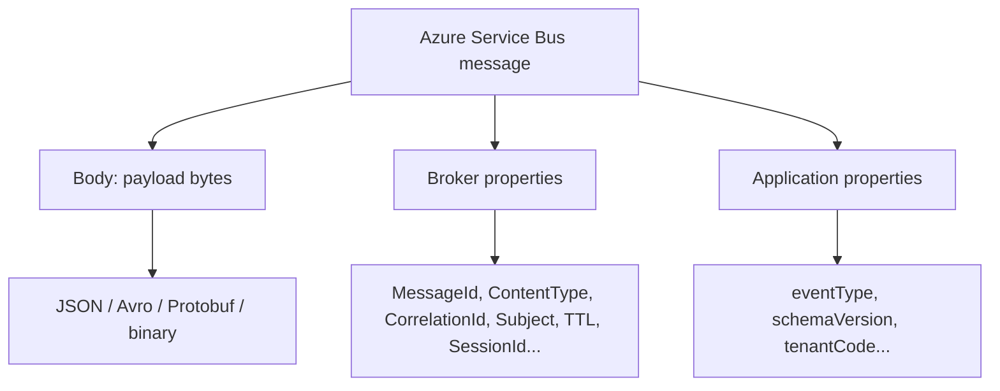

# Chuyển đổi payload và truyền thuộc tính thông điệp

> **Chương:** Azure Service Bus  
> **Module:** `SPRING_CLOUD_PROVIDER_INTEGRATION`  
> **Mục tiêu:** Thiết kế payload và metadata cho message; serialize/deserialize dữ liệu bằng Azure SDK và Spring Messaging; ánh xạ Spring Message headers sang thuộc tính Service Bus; giữ hợp đồng tương thích giữa producer/consumer Java và các nền tảng khác.

## 1. Vì sao cần tách payload và thuộc tính thông điệp?

Giả sử một ứng dụng Spring Boot nhận hợp đồng PDF, lưu file vào Azure Blob Storage rồi phát sự kiện `DocumentUploaded` để worker tạo bản xem trước. Consumer phải biết payload được mã hóa theo định dạng nào, message thuộc loại sự kiện nào, phiên bản schema nào, và đâu là metadata dùng để định tuyến hoặc truy vết.

Nếu producer gửi một chuỗi không có contract, consumer có thể hiểu khác nhau. Nếu nhét toàn bộ metadata vào body, broker không thể dùng các thuộc tính đó cho filter. Nếu cố đặt cả object Java vào application properties, dữ liệu có thể không tương thích với AMQP hoặc consumer viết bằng ngôn ngữ khác.

Một message Service Bus có hai nhóm thông tin chính:

- **Payload (body):** dữ liệu nghiệp vụ đã được serialize thành bytes.
- **Message properties (metadata):** thông tin định danh, tương quan, định dạng, thời hạn, session và thuộc tính riêng của ứng dụng.

Service Bus lưu payload dưới dạng khối nhị phân và không tự hiểu cấu trúc JSON hoặc Java bên trong. Producer phải serialize; consumer phải deserialize theo cùng contract. Thuộc tính `ContentType` chỉ mô tả định dạng, không tự động chuyển object thành JSON. Xem [Messages, payloads, and serialization](https://learn.microsoft.com/en-us/azure/service-bus-messaging/service-bus-messages-payloads).

## 2. Cấu trúc message của Azure Service Bus



| Thành phần | Ai định nghĩa? | Dùng để làm gì? | Ví dụ |
| --- | --- | --- | --- |
| **Body** | Producer và contract của ứng dụng | Chứa dữ liệu nghiệp vụ đã serialize | JSON của `DocumentUploadedEvent` |
| **Broker properties** | Service Bus định nghĩa tên và semantics; ứng dụng có thể đặt một số giá trị | Định danh, correlation, thời hạn, session và routing | `MessageId`, `ContentType`, `CorrelationId` |
| **Application properties** | Ứng dụng định nghĩa key/value | Metadata riêng, phân loại và filter | `eventType=DocumentUploaded`, `schemaVersion=1` |

Một số trường như `DeliveryCount`, `EnqueuedTime`, `SequenceNumber` và `LockedUntil` do broker quản lý, chỉ đọc sau khi nhận message. Chúng không phải nơi để producer tự ghi trạng thái nghiệp vụ.

**Đừng nhầm application properties với JSON body.** Application properties là map key/value riêng. Nếu cần truyền object lồng nhau, danh sách hoặc dữ liệu có cấu trúc, hãy serialize trong body. Application properties phù hợp với metadata ngắn, đơn giản và tương thích kiểu AMQP.

## 3. Chọn định dạng payload

Azure Service Bus không bắt buộc body phải là JSON. Ứng dụng có thể gửi bytes, chuỗi UTF-8 hoặc dữ liệu theo định dạng đã thống nhất.

| Định dạng | Đặc điểm | Khi nên cân nhắc | Điểm cần kiểm soát |
| --- | --- | --- | --- |
| **JSON** | Dễ đọc, hỗ trợ tốt trên nhiều ngôn ngữ | Event nghiệp vụ và tích hợp đa nền tảng | Schema evolution, ngày giờ, số thập phân, field tùy chọn |
| **Avro** | Binary, có schema | Lưu lượng lớn hoặc cần quản trị schema | Schema registry và compatibility |
| **Protocol Buffers** | Binary, schema rõ, có code generation | Payload nhỏ và contract chặt | Field number, reserved field, version |
| **Binary tùy chỉnh** | Kiểm soát layout bytes | Giao thức chuyên biệt | Tài liệu hóa encoding, byte order và khả năng debug |

Với bài thực hành Spring Boot, JSON UTF-8 là điểm khởi đầu phù hợp. Khi yêu cầu hiệu năng hoặc quản trị schema thay đổi, nhóm có thể đánh giá Avro/Protobuf.

### 3.1. ContentType mô tả format

`ContentType` là broker property theo định dạng MIME. Ví dụ:

| Payload | Content type gợi ý |
| --- | --- |
| JSON UTF-8 | `application/json; charset=utf-8` |
| XML UTF-8 | `application/xml; charset=utf-8` |
| Plain text UTF-8 | `text/plain; charset=utf-8` |
| Protobuf | `application/x-protobuf` |
| PDF | `application/pdf` |

Service Bus giữ body như dữ liệu nhị phân; consumer dựa vào `ContentType` và contract để chọn decoder. Đặt `ContentType` thành `application/json` **không biến object Java thành JSON**. Producer vẫn phải serialize trước khi gửi.

### 3.2. Không dùng broker làm kho chứa file lớn

Nếu cần xử lý PDF hoặc ảnh, thường nên lưu nội dung trong Blob Storage rồi gửi object key và metadata qua Service Bus:

```json
{
  "eventId": "evt-901",
  "schemaVersion": 1,
  "documentId": "doc-123",
  "objectKey": "documents/doc-123/source.pdf"
}
```

Cách này giảm kích thước message và cho phép áp dụng quyền lưu trữ riêng. Kiểm tra giới hạn message theo tier/cấu hình thực tế; không giả định mọi kích thước đều được chấp nhận.

## 4. Thiết kế event contract

Một message tốt mô tả sự kiện nghiệp vụ, không chỉ là chuỗi để worker biết gọi hàm nào.

```java
import java.time.Instant;

public record DocumentUploadedEvent(
        String eventId,
        int schemaVersion,
        String documentId,
        String objectKey,
        Instant occurredAt,
        String correlationId) {
}
```

Ý nghĩa:

- `eventId` định danh duy nhất một sự kiện logic; giữ nguyên khi retry cùng sự kiện.
- `schemaVersion` xác định phiên bản payload.
- `documentId` là định danh nghiệp vụ.
- `objectKey` là tham chiếu tới file trong storage.
- `occurredAt` là thời điểm nghiệp vụ phát sinh, không nhất thiết là lúc broker nhận message.
- `correlationId` nối sự kiện với request/workflow lớn hơn.

JSON tương ứng:

```json
{
  "eventId": "evt-901",
  "schemaVersion": 1,
  "documentId": "doc-123",
  "objectKey": "documents/doc-123/source.pdf",
  "occurredAt": "2026-11-24T09:30:00Z",
  "correlationId": "req-456"
}
```

Trong ví dụ, `eventId` có thể được phản ánh thành broker property `MessageId`; `correlationId` có thể được đặt ở `CorrelationId`. Nếu cùng thông tin xuất hiện trong body và property, contract phải xác định giá trị nào là nguồn chuẩn và cách xử lý khi chúng không khớp.

### 4.1. Phân biệt các ID

| ID | Mục đích | Quy tắc |
| --- | --- | --- |
| **eventId** | Định danh sự kiện nghiệp vụ | Ổn định qua retry; dùng cho idempotency |
| **MessageId** | Định danh message ở Service Bus | Thường đặt bằng eventId khi một event tương ứng một message |
| **CorrelationId** | Nối các thao tác trong workflow | Giữ cùng giá trị qua API → publisher → consumer |
| **documentId** | Định danh tài nguyên nghiệp vụ | Không thay eventId nếu tài liệu có nhiều sự kiện |
| **traceId** | Định danh trace kỹ thuật | Theo chuẩn tracing; không dùng thay business ID |

Nếu một event được gửi lại với `MessageId` mới, duplicate detection phía broker không nhận diện đó là cùng message. Nếu một event tạo nhiều message cho nhiều bước xử lý, cần xác định MessageId riêng cho từng message logic và giữ eventId gốc.

### 4.2. Không đưa mọi thứ vào body

Không nên gửi access token, connection string, password hoặc secret; không gửi toàn bộ file nếu consumer có thể đọc từ storage; không gửi dữ liệu cá nhân không cần thiết. Broker properties và application properties cũng có thể xuất hiện trong công cụ vận hành, log hoặc filter, vì vậy không coi chúng là nơi bí mật.

## 5. Serialize object Java thành JSON bằng Jackson

Spring Boot thường cung cấp `ObjectMapper` qua auto-configuration khi dependency Jackson phù hợp đã có. Với kiểu Java Time như `Instant`, cần thống nhất quy tắc serialization.

```java
import com.fasterxml.jackson.databind.ObjectMapper;
import com.fasterxml.jackson.databind.SerializationFeature;
import com.fasterxml.jackson.datatype.jsr310.JavaTimeModule;
import org.springframework.context.annotation.Bean;
import org.springframework.context.annotation.Configuration;

@Configuration
public class EventJsonConfiguration {

    @Bean
    ObjectMapper eventObjectMapper() {
        return new ObjectMapper()
                .registerModule(new JavaTimeModule())
                .disable(SerializationFeature.WRITE_DATES_AS_TIMESTAMPS);
    }
}
```

Cấu hình này biểu diễn thời gian dưới dạng chuỗi ISO-8601 thay vì timestamp số. Nếu dự án đã có ObjectMapper chuẩn của Spring Boot, cân nhắc tái sử dụng để tránh nhiều serializer có hành vi khác nhau.

### 5.1. Gửi message bằng Azure SDK

Ví dụ adapter gửi event:

```java
import com.azure.messaging.servicebus.ServiceBusMessage;
import com.azure.messaging.servicebus.ServiceBusSenderClient;
import com.fasterxml.jackson.core.JsonProcessingException;
import com.fasterxml.jackson.databind.ObjectMapper;
import org.springframework.stereotype.Component;

@Component
public class ServiceBusDocumentEventPublisher {

    private final ServiceBusSenderClient sender;
    private final ObjectMapper objectMapper;

    public ServiceBusDocumentEventPublisher(
            ServiceBusSenderClient sender,
            ObjectMapper objectMapper) {
        this.sender = sender;
        this.objectMapper = objectMapper;
    }

    public void publish(DocumentUploadedEvent event) {
        try {
            byte[] body = objectMapper.writeValueAsBytes(event);

            ServiceBusMessage message = new ServiceBusMessage(body)
                    .setContentType("application/json; charset=utf-8")
                    .setMessageId(event.eventId())
                    .setSubject("DocumentUploaded")
                    .setCorrelationId(event.correlationId());

            message.getApplicationProperties().put("eventType", "DocumentUploaded");
            message.getApplicationProperties().put("schemaVersion", event.schemaVersion());

            sender.sendMessage(message);
        } catch (JsonProcessingException exception) {
            throw new IllegalArgumentException(
                    "Không thể serialize DocumentUploadedEvent", exception);
        }
    }
}
```

Các điểm quan trọng:

1. `writeValueAsBytes` tạo payload bytes theo cấu hình Jackson.
2. `ContentType` mô tả bytes là JSON UTF-8.
3. `MessageId` được đặt bằng `eventId` ổn định.
4. `Subject` mô tả mục đích message.
5. `CorrelationId` hỗ trợ truy vết workflow.
6. `ApplicationProperties` chứa metadata đơn giản cho filter/consumer.

Đoạn code giả định `ServiceBusSenderClient` đã được Spring Cloud Azure hoặc cấu hình SDK phù hợp tạo và quản lý. Tái sử dụng client; không tạo sender mới cho từng request.

Nếu lệnh gửi timeout, kết quả có thể chưa rõ broker đã nhận message hay chưa. Giữ ID ổn định khi retry, dùng duplicate detection khi phù hợp và thiết kế consumer idempotent.

## 6. Deserialize message thành DTO

Consumer cần xác định format trước khi parse. Ví dụ decoder đọc `ServiceBusReceivedMessage`:

```java
import com.azure.messaging.servicebus.ServiceBusReceivedMessage;
import com.fasterxml.jackson.databind.ObjectMapper;
import java.io.IOException;
import java.util.Locale;
import org.springframework.stereotype.Component;

@Component
public class DocumentEventDecoder {

    private final ObjectMapper objectMapper;

    public DocumentEventDecoder(ObjectMapper objectMapper) {
        this.objectMapper = objectMapper;
    }

    public DocumentUploadedEvent decode(ServiceBusReceivedMessage message) {
        String contentType = message.getContentType();

        if (contentType == null
                || !contentType.toLowerCase(Locale.ROOT)
                        .startsWith("application/json")) {
            throw new IllegalArgumentException(
                    "ContentType không được hỗ trợ: " + contentType);
        }

        Object eventType = message.getApplicationProperties().get("eventType");
        if (!"DocumentUploaded".equals(eventType)) {
            throw new IllegalArgumentException("eventType không hợp lệ");
        }

        byte[] body = message.getBody().toBytes();

        try {
            DocumentUploadedEvent event =
                    objectMapper.readValue(body, DocumentUploadedEvent.class);

            if (event.schemaVersion() != 1) {
                throw new IllegalArgumentException(
                        "Không hỗ trợ schemaVersion: " + event.schemaVersion());
            }

            if (!message.getMessageId().equals(event.eventId())) {
                throw new IllegalArgumentException(
                        "MessageId không khớp eventId trong payload");
            }

            return event;
        } catch (IOException exception) {
            throw new IllegalArgumentException(
                    "Payload JSON không hợp lệ", exception);
        }
    }
}
```

Trong hệ thống thực tế, cần kiểm tra field bắt buộc, schema version, tenant/resource và quyền nghiệp vụ. Không log toàn bộ body nếu có dữ liệu cá nhân hoặc hợp đồng.

`ServiceBusReceivedMessage.getBody()` trả về `BinaryData`. Dùng `toBytes()` rồi giải mã bằng serializer đã chọn; không gọi `toString()` trên object nhị phân rồi giả định đó là JSON UTF-8.

### 6.1. Vì sao phải kiểm tra ContentType?

Nếu producer A gửi JSON và producer B gửi Protobuf vào cùng entity, consumer không thể đoán format chỉ bằng cách thử parse. `ContentType` hoặc metadata format rõ ràng giúp chọn decoder đúng.

Nếu không thống nhất ContentType, JSON có thể bị đọc như plain text; consumer mới có thể không đọc được message cũ; lỗi schema có thể bị nhầm thành lỗi network và retry mãi.

## 7. Broker properties và application properties

### 7.1. Broker properties thường dùng

| Property | Ai đặt giá trị? | Ý nghĩa |
| --- | --- | --- |
| `MessageId` | Producer | ID message do ứng dụng định nghĩa; có thể tham gia duplicate detection |
| `CorrelationId` | Producer | Liên kết message với request/workflow |
| `ContentType` | Producer | Mô tả format payload |
| `Subject` | Producer | Mục đích/nhãn message |
| `SessionId` | Producer | Nhóm message liên quan trên entity bật sessions |
| `PartitionKey` | Producer | Định hướng partition khi entity hỗ trợ |
| `TimeToLive` | Producer/entity | Thời gian message còn hợp lệ |
| `ScheduledEnqueueTime` | Producer | Thời điểm message được phép xuất hiện để nhận |
| `ReplyTo` | Producer | Địa chỉ logic cho response |
| `DeliveryCount` | Broker | Số lần broker đã giao message |
| `EnqueuedTime` | Broker | Thời điểm broker nhận message |
| `SequenceNumber` | Broker | Số thứ tự do broker cấp |
| `LockedUntil` | Broker | Thời điểm lock hiện tại hết hạn |

Không phải mọi property đều được ứng dụng ghi. Một số trường chỉ đọc do broker quản lý. Khi dùng SDK, hãy dùng setter/getter chuyên biệt như `setMessageId`, `setContentType`, `setCorrelationId` và `setSessionId` thay vì tự tạo key trong application properties để mô phỏng chúng.

### 7.2. Application properties

Application properties là map key/value để producer truyền metadata riêng:

```java
message.getApplicationProperties().put("eventType", "DocumentUploaded");
message.getApplicationProperties().put("schemaVersion", 1);
message.getApplicationProperties().put("tenantCode", "tenant-a");
message.getApplicationProperties().put("priority", "normal");
```

Các key này do ứng dụng định nghĩa; Service Bus không tự hiểu ý nghĩa nghiệp vụ. Nên dùng giá trị scalar tương thích AMQP/SDK. Không đưa object Java tùy ý, danh sách, map lồng nhau hoặc byte array lớn vào application properties; serialize cấu trúc phức tạp trong body.

### 7.3. Dùng application properties cho filter

Topic subscription có thể dùng SQL filter hoặc correlation filter dựa trên system properties và application properties. Ví dụ:

```sql
eventType = 'DocumentUploaded'
```

Broker có thể dùng metadata này để chọn subscription. Nó không cần parse JSON body để tìm chuỗi `"eventType"` bên trong payload.

Nếu body cũng chứa eventType, hãy xác định giá trị nào là chuẩn. Khi body và property không khớp, consumer nên phân loại message là không hợp lệ thay vì tự chọn giá trị thuận tiện.

## 8. Ánh xạ Spring Message headers sang Service Bus properties

Spring Messaging biểu diễn message bằng payload và headers. Spring Cloud Azure có thể ánh xạ headers sang Service Bus properties qua `ServiceBusMessageConverter`.

| Service Bus property | Spring header | Kiểu thường gặp | Công dụng |
| --- | --- | --- | --- |
| Content type | `MessageHeaders.CONTENT_TYPE` | String | Mô tả payload |
| Message ID | `ServiceBusMessageHeaders.MESSAGE_ID` | String | Định danh message |
| Correlation ID | `ServiceBusMessageHeaders.CORRELATION_ID` | String | Truy vết workflow |
| Subject | `ServiceBusMessageHeaders.SUBJECT` | String | Mục đích message |
| Session ID | `ServiceBusMessageHeaders.SESSION_ID` | String | Gom message theo session |
| Partition key | `ServiceBusMessageHeaders.PARTITION_KEY` | String | Chọn partition khi phù hợp |
| Time to live | `ServiceBusMessageHeaders.TIME_TO_LIVE` | Duration | Thời hạn message |
| Scheduled enqueue time | `ServiceBusMessageHeaders.SCHEDULED_ENQUEUE_TIME` | OffsetDateTime | Lên lịch message |
| Delivery count | `ServiceBusMessageHeaders.DELIVERY_COUNT` | long | Thông tin broker trả về |
| Enqueued time | `ServiceBusMessageHeaders.ENQUEUED_TIME` | OffsetDateTime | Thời điểm broker nhận |

Các header broker chỉ đọc như `DeliveryCount` hoặc `EnqueuedTime` không nên được đặt như header gửi đi. Kiểm tra reference của phiên bản Spring Cloud Azure đang dùng để biết kiểu và mức hỗ trợ chính xác.

### 8.1. Gửi DTO bằng ServiceBusTemplate

Nếu dùng Spring Messaging integration, ứng dụng có thể gửi DTO thay vì tự serialize bytes:

```java
import com.azure.spring.messaging.servicebus.core.ServiceBusTemplate;
import com.azure.spring.messaging.servicebus.support.ServiceBusMessageHeaders;
import org.springframework.messaging.Message;
import org.springframework.messaging.MessageHeaders;
import org.springframework.messaging.support.MessageBuilder;
import org.springframework.stereotype.Service;
import reactor.core.publisher.Mono;

@Service
public class SpringDocumentEventPublisher {

    private final ServiceBusTemplate template;

    public SpringDocumentEventPublisher(ServiceBusTemplate template) {
        this.template = template;
    }

    public Mono<Void> publish(DocumentUploadedEvent event) {
        Message<DocumentUploadedEvent> message =
                MessageBuilder.withPayload(event)
                        .setHeader(MessageHeaders.CONTENT_TYPE,
                                "application/json; charset=utf-8")
                        .setHeader(ServiceBusMessageHeaders.MESSAGE_ID,
                                event.eventId())
                        .setHeader(ServiceBusMessageHeaders.CORRELATION_ID,
                                event.correlationId())
                        .setHeader(ServiceBusMessageHeaders.SUBJECT,
                                "DocumentUploaded")
                        .setHeader("eventType", "DocumentUploaded")
                        .setHeader("schemaVersion", event.schemaVersion())
                        .build();

        return template.sendAsync("document-events", message);
    }
}
```

`ServiceBusTemplate` và converter xử lý chuyển đổi Spring Message sang Service Bus message theo cấu hình. Header chuẩn được ánh xạ sang broker properties; header tùy chỉnh được chuyển thành application properties theo cơ chế converter.

Method trả về `Mono<Void>` để caller compose hoặc xử lý lỗi. Không nên gọi `subscribe()` trong service rồi bỏ kết quả nếu nghiệp vụ cần biết publish thành công hay thất bại. Hãy để lớp điều phối quyết định cách subscribe/block phù hợp với mô hình ứng dụng.

### 8.2. Nhận DTO bằng @ServiceBusListener

Khi converter được cấu hình đúng, listener có thể nhận payload theo kiểu DTO:

```java
import com.azure.spring.messaging.servicebus.annotation.ServiceBusListener;
import com.azure.spring.messaging.servicebus.support.ServiceBusMessageHeaders;
import org.springframework.messaging.Message;
import org.springframework.stereotype.Component;

@Component
public class DocumentEventListener {

    @ServiceBusListener(destination = "document-events")
    public void onDocumentUploaded(Message<DocumentUploadedEvent> message) {
        DocumentUploadedEvent event = message.getPayload();

        String messageId = message.getHeaders().get(
                ServiceBusMessageHeaders.MESSAGE_ID, String.class);

        String eventType = message.getHeaders().get("eventType", String.class);

        if (!"DocumentUploaded".equals(eventType)
                || !event.eventId().equals(messageId)) {
            throw new IllegalArgumentException("Message contract không hợp lệ");
        }

        // Chuyển sang handler nghiệp vụ có kiểm soát idempotency.
    }
}
```

Ví dụ giả định listener container và converter đã được kích hoạt theo cấu hình Spring Cloud Azure tương ứng. Tùy version, `@EnableAzureMessaging` có thể cần khai báo tường minh hoặc đã được auto-configuration kích hoạt. Nếu cần đọc toàn bộ Service Bus message hoặc kiểm soát settlement đặc thù, dùng API listener/SDK phù hợp với version thay vì giả định mọi signature đều giống nhau.

### 8.3. Tùy chỉnh ObjectMapper của converter

Spring Cloud Azure hỗ trợ converter dùng ObjectMapper riêng hoặc ObjectMapper do Spring Boot quản lý. Ví dụ dùng mapper của ứng dụng:

```yaml
spring:
  cloud:
    azure:
      message-converter:
        isolated-object-mapper: false
```

Hoặc đăng ký converter tùy chỉnh:

```java
@Bean
AzureMessageConverter<ServiceBusReceivedMessage, ServiceBusMessage>
serviceBusMessageConverter() {
    JsonMapper jsonMapper = JsonMapper.builder()
            .addModule(new JavaTimeModule())
            .build();

    return new ServiceBusMessageConverter(jsonMapper);
}
```

`isolated-object-mapper` mặc định được bật trong tài liệu hiện hành. Khi đặt `false`, converter có thể sử dụng ObjectMapper bean của ứng dụng; điều này giúp thống nhất quy tắc serialize nhưng cũng khiến thay đổi mapper toàn cục ảnh hưởng message contract. Chỉ chia sẻ mapper khi đã kiểm soát naming strategy, date/time và custom serializer.

## 9. Schema evolution và tương thích producer/consumer

Producer và consumer có thể không được nâng cấp cùng lúc. Message cũ có thể nằm trong queue nhiều giờ trong khi producer mới đã gửi schema mới.

| Thay đổi | Rủi ro | Cách xử lý gợi ý |
| --- | --- | --- |
| Thêm field tùy chọn | Consumer cũ có thể bỏ qua nếu parser cho phép | Thêm field có default/nullable và test consumer cũ |
| Thêm field bắt buộc | Consumer cũ có thể thiếu dữ liệu | Rollout consumer hỗ trợ trước producer |
| Đổi tên field | Consumer cũ không tìm thấy field | Alias/dual-read hoặc schema version mới |
| Đổi kiểu field | Parse thất bại hoặc sai nghĩa | Dùng field mới hoặc version mới |
| Xóa field | Consumer cũ có thể vẫn phụ thuộc | Deprecate, quan sát mức dùng rồi mới loại bỏ |
| Đổi ý nghĩa field nhưng giữ tên | Parse vẫn thành công nhưng nghiệp vụ sai | Không tái sử dụng field cho ý nghĩa khác |

Một chiến lược thực tế là additive change trước, breaking change sau. Consumer mới có thể đọc schema cũ và mới; producer chỉ phát field mới sau khi các consumer cần nó đã sẵn sàng. Với thay đổi lớn, dùng event type/version mới.

Ví dụ decoder theo version:

```java
public DocumentEvent decode(byte[] body, int schemaVersion)
        throws IOException {
    return switch (schemaVersion) {
        case 1 -> objectMapper.readValue(body, DocumentUploadedV1.class);
        case 2 -> objectMapper.readValue(body, DocumentUploadedV2.class);
        default -> throw new UnsupportedOperationException(
                "Không hỗ trợ schemaVersion: " + schemaVersion);
    };
}
```

Nếu không hỗ trợ version, không deserialize bằng cách đoán. Phân loại message là không hỗ trợ/vĩnh viễn và xử lý theo DLQ hoặc luồng tương thích có kiểm soát.

Nếu nhiều team hoặc ngôn ngữ cùng trao đổi event, cân nhắc schema registry hoặc repository schema được version hóa. Nên có schema review, compatibility check tự động, contract test và payload mẫu cho mỗi version.

## 10. Tương thích đa ngôn ngữ và AMQP

Azure Service Bus hỗ trợ AMQP 1.0 qua các client chính thức. Java, .NET, JavaScript, Python hoặc ứng dụng AMQP khác có thể trao đổi message nếu thống nhất payload format và properties.

Để tăng khả năng tương tác:

1. Serialize payload theo định dạng có đặc tả công khai như JSON, Avro hoặc Protobuf.
2. Đặt `ContentType` phù hợp.
3. Dùng tên field ổn định và kiểu dữ liệu nhất quán.
4. Tránh phụ thuộc Java class name, package name hoặc Java native serialization.
5. Dùng application properties với giá trị scalar tương thích AMQP/SDK.
6. Định nghĩa timezone rõ; với thời điểm tuyệt đối ưu tiên ISO-8601 UTC.
7. Có consumer test viết bằng ngôn ngữ khác nếu interoperability là yêu cầu sản phẩm.

Không dùng `ObjectOutputStream`/`ObjectInputStream` làm contract liên hệ thống. Cách này gắn payload với class layout và runtime Java; consumer .NET/Node/Python không tự hiểu và có rủi ro khi deserialize dữ liệu không tin cậy.

## 11. Kích thước, hiệu năng và bảo mật payload

### 11.1. Kích thước message

Giới hạn message phụ thuộc tier và cấu hình entity; kiểm tra quota hiện hành trước khi thiết kế. Payload lớn làm tăng chi phí truyền, thời gian serialize, memory pressure và độ trễ consumer.

- Chỉ truyền dữ liệu cần thiết.
- Dùng object storage cho file lớn và gửi object key.
- Tránh lặp metadata lớn trong application properties.
- Dùng batch khi phù hợp và kiểm tra tổng kích thước bằng API batch của SDK.
- Đo kích thước bytes thực tế và theo dõi lỗi message size.

### 11.2. Dữ liệu nhạy cảm

Message có thể được lưu giữ, dead-letter, replay hoặc quan sát qua công cụ vận hành. Vì vậy:

- Không gửi access token, connection string, password hoặc secret.
- Không gửi toàn bộ dữ liệu cá nhân nếu consumer chỉ cần một ID.
- Giới hạn quyền đọc queue/subscription theo workload.
- Không log toàn bộ body trong producer, processor hoặc DLQ handler.
- Nếu mã hóa payload ở cấp ứng dụng, xác định rõ key management, version, rotation và quyền giải mã.

Application properties cũng là metadata có thể quan sát; không đưa dữ liệu bí mật vào property chỉ vì body đã mã hóa.

### 11.3. Phân loại lỗi payload

| Tình huống | Cách xử lý |
| --- | --- |
| JSON sai cú pháp | Phân loại lỗi payload; dead-letter theo policy |
| ContentType không hỗ trợ | Không thử decoder tùy tiện; xử lý luồng tương thích hoặc DLQ |
| Schema version không hỗ trợ | Ghi reason và xử lý theo chính sách version |
| Thiếu field bắt buộc | Xác định lỗi producer/contract; không retry mù quáng |
| Database tạm thời lỗi | Có thể retry/abandon theo giới hạn và backoff |
| Object key không tồn tại | Phân biệt upload chưa hoàn tất, cấu hình sai hoặc dữ liệu sai |
| Workload thiếu quyền | Sửa IAM/RBAC; retry không tự cấp quyền |

Khi dead-letter, chỉ ghi metadata chẩn đoán cần thiết như reason, event ID, schema version và correlation ID; tránh đưa nguyên payload nhạy cảm vào mô tả lỗi.

## 12. Kiểm thử serialization và message properties

Một bài test chỉ kiểm tra sender không ném exception là chưa đủ. Cần chứng minh producer và consumer hiểu cùng contract.

### 12.1. Unit test serialize/deserialize

```java
import static org.junit.jupiter.api.Assertions.assertEquals;

import com.fasterxml.jackson.databind.ObjectMapper;
import com.fasterxml.jackson.datatype.jsr310.JavaTimeModule;
import org.junit.jupiter.api.Test;

class DocumentEventSerializationTest {

    private final ObjectMapper objectMapper = new ObjectMapper()
            .registerModule(new JavaTimeModule());

    @Test
    void shouldRoundTripDocumentUploadedEvent() throws Exception {
        DocumentUploadedEvent original = new DocumentUploadedEvent(
                "evt-901",
                1,
                "doc-123",
                "documents/doc-123/source.pdf",
                java.time.Instant.parse("2026-11-24T09:30:00Z"),
                "req-456");

        byte[] body = objectMapper.writeValueAsBytes(original);

        DocumentUploadedEvent decoded =
                objectMapper.readValue(body, DocumentUploadedEvent.class);

        assertEquals(original, decoded);
    }
}
```

Test này kiểm tra Jackson và DTO trong cùng codebase. Nó **không** chứng minh Service Bus đã giữ đúng ContentType, broker properties hoặc application properties.

### 12.2. Test adapter tạo ServiceBusMessage

Tách factory giúp kiểm tra mapping độc lập với network:

```java
public ServiceBusMessage toServiceBusMessage(
        DocumentUploadedEvent event) throws JsonProcessingException {

    byte[] body = objectMapper.writeValueAsBytes(event);

    ServiceBusMessage message = new ServiceBusMessage(body)
            .setContentType("application/json; charset=utf-8")
            .setMessageId(event.eventId())
            .setCorrelationId(event.correlationId())
            .setSubject("DocumentUploaded");

    message.getApplicationProperties().put("eventType", "DocumentUploaded");
    message.getApplicationProperties().put("schemaVersion", event.schemaVersion());

    return message;
}
```

Test adapter nên xác minh body có thể deserialize, ContentType đúng, MessageId/CorrelationId/Subject đúng, application properties có eventType/schemaVersion đúng kiểu và không có secret.

### 12.3. Integration test trên Service Bus test namespace

Một integration test nên:

1. Gửi message JSON có event ID duy nhất.
2. Nhận message bằng SDK hoặc Spring listener.
3. Xác minh body bytes, content type, message ID, correlation ID, subject và application properties.
4. Deserialize payload thành DTO và so sánh field.
5. Complete message chỉ sau khi test xác nhận thành công; nếu lỗi, cleanup theo test policy.

Emulator có thể hữu ích cho vòng phát triển local nếu hỗ trợ tính năng cần test, nhưng không thay thế cloud test cho IAM, tier, quota, subscription filter và semantics thực tế.

### 12.4. Test tương thích schema và filter

Tạo payload mẫu cho mỗi version được hỗ trợ: producer v1 → consumer v1; producer v1 → consumer v2; producer v2 → consumer v1 nếu rollout yêu cầu; payload thiếu field, thêm field lạ, sai kiểu hoặc version không hỗ trợ.

Nếu subscription dùng SQL filter `eventType = 'DocumentUploaded'`, gửi hai message có cùng body format nhưng khác application property. Xác minh broker phân phối đúng subscription. Đừng chỉ kiểm thử Java code tự if theo eventType sau khi nhận, vì đó là logic consumer chứ không chứng minh broker filter.

## 13. Bài thực hành: chuẩn hóa event DocumentUploaded

**Tình huống:** Spring Boot API lưu file vào Azure Blob Storage. Khi upload thành công, ứng dụng gửi `DocumentUploadedEvent` lên Service Bus để preview worker xử lý. Một service audit cũng nhận event qua subscription riêng.

### Phần A — Định nghĩa schema

Tạo record gồm `eventId`, `schemaVersion`, `documentId`, `objectKey`, `occurredAt` và `correlationId`. Xác định field bắt buộc, field tùy chọn, format thời gian và quy tắc khi thiếu dữ liệu.

### Phần B — Serialize và gửi

- Cấu hình ObjectMapper hỗ trợ Java Time.
- Serialize DTO thành JSON UTF-8 bytes.
- Đặt `ContentType`, `MessageId`, `CorrelationId` và `Subject`.
- Đặt `eventType` và `schemaVersion` vào application properties.
- Gửi qua `ServiceBusSenderClient` hoặc `ServiceBusTemplate`.

### Phần C — Deserialize và validate

- Kiểm tra ContentType.
- Kiểm tra application property `eventType`.
- Parse JSON theo schema version.
- Đối chiếu `MessageId` với `eventId` theo contract.
- Từ chối payload thiếu field hoặc version không hỗ trợ.

### Phần D — Dùng Spring Message headers

Tạo message bằng `MessageBuilder`, đặt `MessageHeaders.CONTENT_TYPE`, `ServiceBusMessageHeaders.MESSAGE_ID`, `CORRELATION_ID`, `SUBJECT` và application properties tùy chỉnh. Gửi bằng `ServiceBusTemplate` và nhận bằng `@ServiceBusListener`.

So sánh cách làm này với SDK trực tiếp: phần nào converter tự động, phần nào ứng dụng phải kiểm soát?

### Phần E — Thay đổi schema

Phát hành `schemaVersion=2` với một field tùy chọn mới. Xác minh consumer v1 và v2 theo chiến lược tương thích đã định nghĩa. Thử một message có version không hỗ trợ và xác định cách dead-letter.

### Phần F — Kiểm thử và quan sát

- Round-trip serialization test.
- Adapter mapping test.
- Integration test với queue/topic test.
- Filter test dựa trên application properties.
- Kiểm tra duplicate event không tạo tác dụng phụ lặp.
- Log event ID/correlation ID, không log payload nhạy cảm.

**Tiêu chí đạt:** phân biệt body/broker properties/application properties; serialize/deserialize đúng format; đặt content type và message ID ổn định; ánh xạ Spring headers đúng; chứng minh consumer xử lý được schema version và message không hợp lệ.

---

## 14. Checklist trước khi đưa contract message vào sử dụng

| Nhóm | Câu hỏi |
| --- | --- |
| Payload | Body dùng format gì? Có schema/version và encoding rõ không? |
| ContentType | MIME có đúng với bytes thực tế không? |
| Message ID | Có ổn định khi retry và phù hợp idempotency không? |
| Correlation | Có truy vết được API → publisher → consumer không? |
| Application properties | Chỉ chứa metadata ngắn, đơn giản và không nhạy cảm? |
| Filter | Subscription filter dùng đúng property và rule mặc định? |
| Spring converter | ObjectMapper, Java Time và custom serializer thống nhất? |
| Schema evolution | Consumer cũ có đọc được message mới trong giai đoạn rollout? |
| Security | Payload/metadata có lộ secret hoặc dữ liệu cá nhân không cần thiết? |
| Size | Message nằm trong giới hạn tier và phù hợp throughput? |
| Failure | Payload sai, content type sai và schema lạ được phân loại thế nào? |
| Testing | Có round-trip, adapter, integration, filter và compatibility test? |

## Ghi nhớ

- **Body** là payload bytes; Service Bus không tự hiểu JSON hoặc object Java.
- **ContentType** mô tả format; producer phải serialize và consumer phải deserialize.
- **Broker properties** như `MessageId`, `CorrelationId`, `Subject`, `SessionId`, `TimeToLive` phục vụ semantics của broker và ứng dụng.
- **Application properties** là metadata key/value do ứng dụng định nghĩa, hữu ích cho routing/filter; không dùng thay body cho object phức tạp.
- **Spring MessageConverter** chuyển đổi payload và headers giữa Spring Messaging với Service Bus; cấu hình ObjectMapper phải nhất quán.
- **Schema version, idempotency, compatibility test và kiểm soát dữ liệu nhạy cảm** quyết định message contract có bền vững qua nhiều phiên bản ứng dụng hay không.

Khi tích hợp Spring Boot với Azure Service Bus, hãy xác định contract trước, chọn serialization format, đặt metadata đúng vị trí và kiểm thử cả chiều gửi/nhận. Đây là nền tảng để producer/consumer Java, .NET hoặc ngôn ngữ khác trao đổi thông điệp nhất quán.

### Tài liệu chính thức

- [Azure Service Bus — Messages, payloads, and serialization](https://learn.microsoft.com/en-us/azure/service-bus-messaging/service-bus-messages-payloads)
- [Azure Service Bus Java SDK — ServiceBusMessage](https://learn.microsoft.com/en-us/java/api/com.azure.messaging.servicebus.servicebusmessage?view=azure-java-stable)
- [Azure Service Bus Java SDK — ServiceBusReceivedMessage](https://learn.microsoft.com/en-us/java/api/com.azure.messaging.servicebus.servicebusreceivedmessage?view=azure-java-stable)
- [Spring Cloud Azure — Spring Messaging Azure Service Bus](https://learn.microsoft.com/en-us/azure/developer/java/spring-framework/spring-messaging-service-bus-support)
- [Spring Cloud Azure — Reference Documentation](https://microsoft.github.io/spring-cloud-azure/current/reference/html/index.html)
- [Azure Service Bus — AMQP 1.0 overview](https://learn.microsoft.com/en-us/azure/service-bus-messaging/service-bus-amqp-overview)

Phiên bản SDK, Spring Cloud Azure và cấu hình converter cần được xác minh theo BOM Spring Boot/JDK thực tế. Không giả định một đoạn code hoặc header mapping từ version cũ vẫn đúng nguyên trạng ở version mới.
