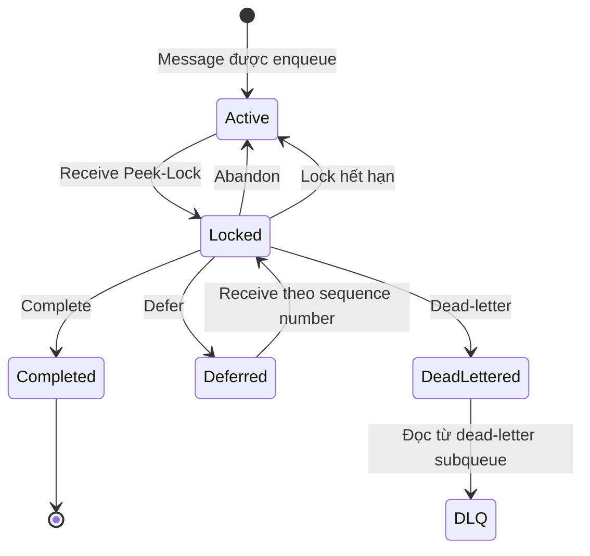
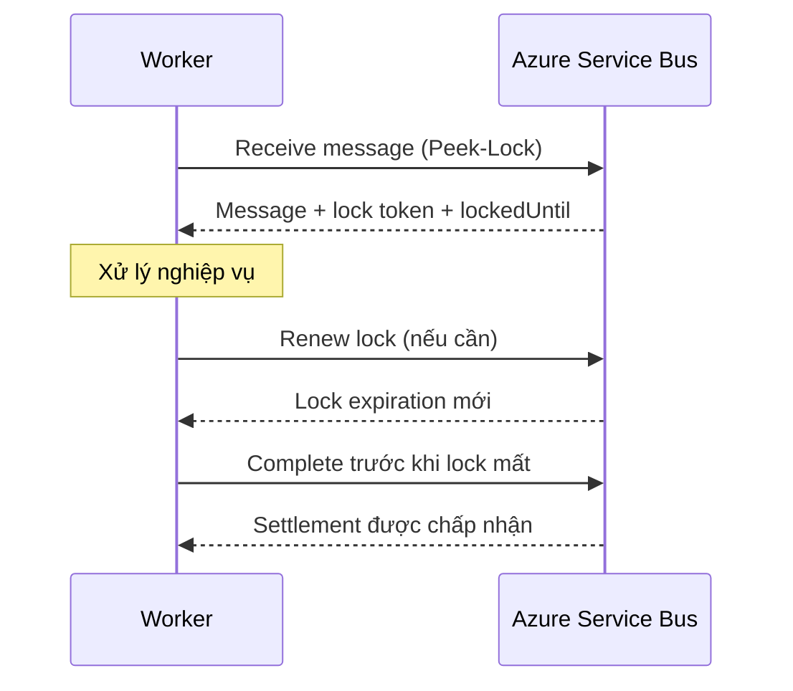
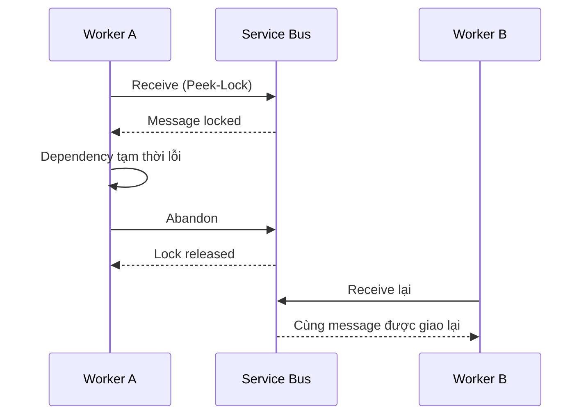
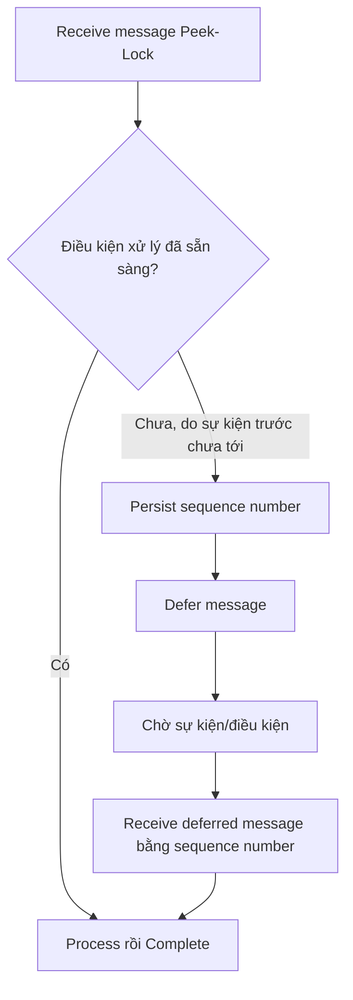
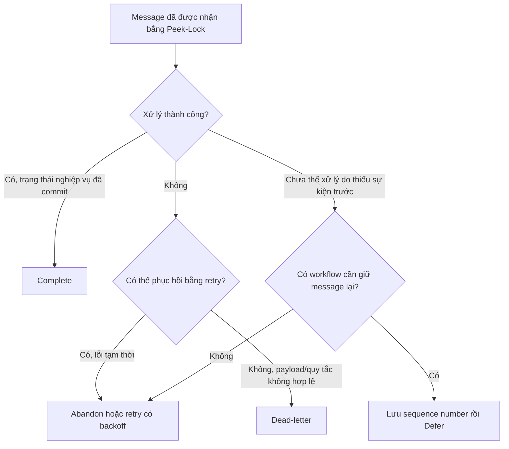

# Peek-lock, complete, abandon, defer và dead-letter

> **Chương:** Azure Service Bus  
> **Module:** `SPRING_CLOUD_PROVIDER_INTEGRATION`  
> **Mục tiêu:** Hiểu vòng đời nhận message trong Azure Service Bus; chọn đúng thao tác settlement trong Spring Boot/Azure SDK; thiết kế consumer chịu được redelivery, lock loss và lỗi nghiệp vụ.

## 1. Nhận message chưa có nghĩa là xử lý xong

Giả sử một worker Spring Boot nhận sự kiện `DocumentUploaded` từ queue `preview-jobs`. Worker cần đọc file từ Azure Blob Storage, tạo ảnh xem trước, ghi metadata vào database và cập nhật trạng thái tài liệu.

Nếu broker xóa message ngay khi giao cho worker, điều gì xảy ra khi JVM bị kill sau lúc nhận nhưng trước khi lưu preview? Công việc có thể biến mất dù nghiệp vụ chưa hoàn tất. Nếu broker giữ message vô thời hạn, những message đã xử lý xong lại có thể được giao mãi.

Azure Service Bus giải quyết bài toán này bằng **Peek-Lock** và các thao tác **settlement**. Broker tạm khóa message khi giao cho consumer. Consumer thực hiện công việc rồi xác nhận kết quả:

- **Complete:** nghiệp vụ đã hoàn tất; broker có thể xóa message.
- **Abandon:** chưa xử lý được nhưng muốn message được giao lại.
- **Defer:** giữ message ở trạng thái trì hoãn và lấy lại sau bằng sequence number.
- **Dead-letter:** message không thể hoặc không nên xử lý tiếp trong luồng bình thường; chuyển nó sang dead-letter queue (DLQ).

Đây là các quyết định về trạng thái công việc. Chọn sai có thể làm mất message, xử lý trùng hoặc tạo backlog khó phục hồi.



Message bị abandon hoặc lock hết hạn quay lại luồng nhận thông thường. Message được defer không tự xuất hiện trong lần receive bình thường tiếp theo. Message dead-letter nằm ở DLQ riêng.

## 2. Peek-Lock và Receive-and-Delete

Azure Service Bus hỗ trợ hai receive mode:

| Chế độ | Khi broker giao message | Consumer phải làm gì tiếp? | Rủi ro chính |
| --- | --- | --- | --- |
| **Peek-Lock** | Message được khóa tạm thời cho receiver | Settlement bằng complete, abandon, defer hoặc dead-letter | Có thể redelivery nếu lock mất; cần idempotency |
| **Receive-and-Delete** | Broker coi message đã được tiêu thụ ngay khi giao | Không có settlement riêng | Message có thể mất nếu ứng dụng lỗi trước khi xử lý xong |

**Peek-Lock là lựa chọn mặc định** cho workload cần tránh mất công việc. Receive-and-Delete chỉ phù hợp khi dữ liệu có giá trị thấp, việc mất một số message có thể chấp nhận và throughput đơn giản quan trọng hơn khả năng phục hồi.

### 2.1. Một vòng đời Peek-Lock

1. Consumer nhận message từ queue hoặc subscription.
2. Service Bus cấp lock và trả dữ liệu cùng metadata.
3. Consumer xử lý trong thời gian lock còn hiệu lực.
4. Consumer gửi settlement operation khi vẫn còn lock và receiver/connection còn hoạt động.
5. Broker xác nhận settlement; message được xóa, mở khóa, defer hoặc chuyển DLQ theo thao tác đã chọn.

Khi message đang bị khóa, consumer khác nhận từ cùng queue/subscription không nhận được bản giao đang bị khóa đó; họ có thể nhận các message khác chưa bị khóa. Nếu lock bị release hoặc hết hạn, message có thể được giao lại.

### 2.2. Vì sao Receive-and-Delete không phù hợp cho công việc quan trọng?

Giả sử worker nhận `DocumentUploaded` ở Receive-and-Delete rồi JVM bị kill ngay sau đó. Broker đã coi message được tiêu thụ và không chờ ứng dụng báo kết quả. Nếu không có nguồn công việc bền vững khác, hệ thống không còn message để thử lại.

Với preview, email quan trọng, xử lý đơn hàng hoặc cập nhật trạng thái tài chính, hãy bắt đầu bằng Peek-Lock và thiết kế idempotency.

## 3. Lock là gì và sống trong bao lâu?

Khi nhận theo Peek-Lock, broker cấp một **message lock** có thời hạn. Trong thời gian này, receiver sở hữu lock có quyền settlement message.

- Lock duration được cấu hình ở queue hoặc topic subscription.
- Giá trị mặc định thường là **1 phút**.
- Lock duration tối đa có thể cấu hình là **5 phút**.
- Nếu tác vụ dài hơn, client cần renew lock hoặc chia công việc thành các bước ngắn có checkpoint.
- Lock là **volatile**: có thể mất khi mạng/AMQP connection bị đứt, receiver bị đóng, dịch vụ cập nhật hoặc lock hết hạn.
- Lock gắn với receiver và connection; không thể giả định một connection mới sẽ tiếp tục giữ lock cũ.



### 3.1. Auto-lock renewal trong Java SDK

`ServiceBusProcessorClient` của Azure SDK for Java có khả năng tự gia hạn lock. Theo API reference hiện hành:

- Auto lock renewal mặc định chạy tối đa **5 phút**.
- Có thể cấu hình bằng `maxAutoLockRenewDuration(Duration)` trên processor builder.
- Giá trị `Duration.ZERO` hoặc `null` tắt auto-renewal.
- Việc gia hạn vẫn có thể thất bại do network, throttling, CPU thiếu hoặc connection bị detach.

Ví dụ cấu hình processor cho một tác vụ dự kiến chạy lâu hơn lock ban đầu:

```java
import java.time.Duration;

import com.azure.identity.DefaultAzureCredentialBuilder;
import com.azure.messaging.servicebus.ServiceBusClientBuilder;
import com.azure.messaging.servicebus.ServiceBusProcessorClient;
import com.azure.messaging.servicebus.models.ServiceBusReceiveMode;

ServiceBusProcessorClient processor =
        new ServiceBusClientBuilder()
                .credential(
                        fullyQualifiedNamespace,
                        new DefaultAzureCredentialBuilder().build())
                .processor()
                .queueName("preview-jobs")
                .receiveMode(ServiceBusReceiveMode.PEEK_LOCK)
                .disableAutoComplete()
                .maxAutoLockRenewDuration(Duration.ofMinutes(8))
                .maxConcurrentCalls(4)
                .processMessage(this::handleMessage)
                .processError(this::handleError)
                .buildProcessorClient();

processor.start();
```

Ví dụ dùng Azure SDK trực tiếp; `fullyQualifiedNamespace` là namespace FQDN và identity phải có quyền nhận message. Con số 8 phút chỉ minh họa cấu hình client, không phải khuyến nghị cho mọi workload. `maxConcurrentCalls` phải phù hợp với CPU, database pool và thời gian xử lý.

**Gia hạn lock không biến một tác vụ dài thành giao dịch bền vững.** Nếu preview mất 30 phút, hãy cân nhắc chia thành bước, ghi checkpoint hoặc đưa các bước nhỏ vào workflow. Không nên giữ lock hàng chục phút chỉ để che giấu một handler làm quá nhiều việc.

### 3.2. Prefetch và concurrency ảnh hưởng lock

Nếu client prefetch nhiều message hơn số worker có thể xử lý, một số message có thể bị khóa trong buffer trước khi handler bắt đầu. Khi chờ đến lượt, lock đã tiêu tốn một phần thời gian.

Tăng `maxConcurrentCalls` cũng có thể làm database pool cạn hoặc khiến API downstream bị throttling. Hãy đo thời gian từ enqueue đến lúc bắt đầu xử lý, thời gian handler giữ lock, tỷ lệ lock lost/redelivery, CPU, database connection pool và số request downstream.

Đừng tăng prefetch/concurrency theo cảm tính. Lock renewal cũng tạo network operations; quá nhiều lần gia hạn có thể làm tăng tải namespace.

## 4. Complete: xác nhận xử lý thành công

**Complete** là positive settlement: consumer thông báo với broker rằng message đã được xử lý và có thể bị loại khỏi queue/subscription.

Chỉ complete khi **trạng thái nghiệp vụ đã đạt điểm an toàn**. Với ví dụ tạo preview, điểm an toàn có thể là:

1. Đã đọc file nguồn thành công.
2. Đã ghi preview vào object storage.
3. Đã cập nhật metadata/trạng thái `READY` vào database.
4. Đã ghi nhận event ID hoặc idempotency key để lần giao lại không tạo tác dụng phụ mới.

Không complete ngay sau khi parse message nếu công việc thực sự vẫn chưa được thực hiện.

### 4.1. Ví dụ processor với manual settlement

Processor mặc định có auto-completion. Nếu muốn tự quyết định settlement, cần gọi `disableAutoComplete()`:

```java
import com.azure.messaging.servicebus.ServiceBusReceivedMessage;
import com.azure.messaging.servicebus.ServiceBusReceivedMessageContext;

private void handleMessage(ServiceBusReceivedMessageContext context) {
    ServiceBusReceivedMessage message = context.getMessage();

    try {
        previewService.createPreviewIdempotently(
                message.getMessageId(),
                message.getBody());

        // Chỉ complete sau khi nghiệp vụ đã ghi nhận thành công.
        context.complete();

    } catch (TransientDependencyException exception) {
        // Lỗi có thể phục hồi: trả message để được giao lại.
        context.abandon();

    } catch (InvalidMessageException exception) {
        // Payload không thể xử lý theo contract hiện tại.
        context.deadLetter();
    }
}
```

Đây là ví dụ minh họa luồng quyết định. Trong ứng dụng thực tế, body phải được deserialize và validate theo schema; không nên dùng `toString()` như cách giải mã payload nhị phân nếu contract là JSON bytes. Không đưa nội dung nhạy cảm vào log hoặc dead-letter description.

Nếu dùng processor builder như ví dụ ở trên, `disableAutoComplete()` tắt auto-complete và auto-abandon để ứng dụng chủ động settle. Nếu không tắt, processor có thể tự complete khi callback kết thúc bình thường và abandon khi callback lỗi; hãy hiểu chính xác hành vi này trước khi trộn settlement thủ công với auto settlement.

### 4.2. Complete có thể thất bại dù nghiệp vụ đã thành công

Một trường hợp quan trọng:

- Worker ghi preview và commit database thành công.
- Worker gọi `context.complete()`.
- Kết nối bị ngắt hoặc lock đã mất trước khi broker xác nhận settlement.
- Worker không biết chắc broker đã complete hay chưa; message có thể được giao lại.

Đây là tình huống **business effect thành công nhưng acknowledgement không chắc chắn**. Consumer cần lưu trạng thái hoàn tất bền vững theo `MessageId` hoặc `eventId`. Khi nhận lại, nó phát hiện công việc đã hoàn tất và complete message mà không tạo preview hay gửi thông báo lần nữa.

Không được suy luận rằng complete ném exception thì chắc chắn broker chưa xóa message. Kết quả settlement có thể không rõ khi mạng bị lỗi.

## 5. Abandon: mở khóa để message được giao lại

**Abandon** yêu cầu broker thả lock hiện tại, khiến message có thể được receiver khác nhận. Đây là lựa chọn khi database tạm thời không truy cập được, API downstream bị lỗi tạm thời, worker chưa có capacity hoặc lỗi có thể được xử lý sau khi retry.

Abandon thường làm **DeliveryCount tăng**. Khi message liên tục bị abandon hoặc lock hết hạn, DeliveryCount tăng đến ngưỡng cấu hình; sau đó message có thể bị chuyển sang DLQ.



### 5.1. Abandon không phải retry có delay

Abandon mở khóa để broker có thể giao lại; nó **không tự đặt khoảng chờ backoff tùy ý**. Nếu dependency lỗi kéo dài và hàng nghìn worker cùng abandon, hệ thống có thể tạo vòng retry nóng.

Với lỗi tạm thời, hãy xem xét retry policy của SDK, backoff có giới hạn ở tầng nghiệp vụ, giảm concurrency hoặc tạm dừng receiver khi dependency chung đang down, scheduled message hoặc retry queue riêng nếu cần trì hoãn có chủ đích.

Không phải lúc nào cũng nên abandon. Nếu mọi message đều phụ thuộc một database đang ngừng hoạt động, có thể **dừng/pause nhận message** cho tới khi dependency hồi phục thay vì nhận rồi abandon toàn bộ backlog.

### 5.2. Abandon và lock expiry khác nhau ở thời điểm

| Tình huống | Điều xảy ra |
| --- | --- |
| Consumer gọi `abandon()` | Lock được thả ngay để message có thể được nhận lại |
| Consumer không settle và lock hết hạn | Broker thả message sau khi lock hết hạn |
| Consumer đóng receiver trước settlement | Settlement không tới broker; lock còn hiệu lực đến khi hết hạn rồi message có thể redeliver |
| Consumer gọi `complete()` thành công | Message bị loại khỏi luồng nhận bình thường |

Cả abandon và lock expiry đều có thể làm tăng DeliveryCount. Không settle trước khi đóng receiver là lỗi vận hành phổ biến; khi đóng receiver, hãy chờ handler đang chạy hoàn tất trong giới hạn shutdown hợp lý.

## 6. Defer: trì hoãn có chủ đích và phải giữ sequence number

**Defer** dùng khi message hợp lệ nhưng **chưa thể xử lý vì một điều kiện nghiệp vụ cụ thể chưa xảy ra**. Message được đặt vào trạng thái deferred trong cùng queue hoặc subscription.

Ví dụ:

- Hệ thống nhận `PaymentConfirmed` nhưng `OrderPlaced` của đơn hàng tương ứng chưa tới.
- Một workflow phải đợi kết quả từ hệ thống khác rồi mới xử lý bước tiếp theo.
- Message cần được giữ lại để xử lý sau khi một sự kiện khác hoàn tất.

Defer khác abandon:

- Abandon đưa message trở lại luồng receive thông thường để broker giao lại.
- Defer đưa message ra khỏi luồng receive thông thường; ứng dụng phải **lưu sequence number** và gọi API nhận deferred message theo sequence number khi đã sẵn sàng.



**Deferred message không phải DLQ.** Nó vẫn thuộc queue/subscription chính, nhưng không được nhận qua các thao tác receive thông thường. Message không tự xuất hiện trở lại trong queue chỉ vì thời gian đã trôi qua.

### 6.1. Sequence number là khóa để lấy lại message

Khi nhận message, Service Bus gán `SequenceNumber` duy nhất. Trước khi defer, lấy giá trị này từ `message.getSequenceNumber()` và lưu vào một kho bền vững cùng thông tin nghiệp vụ cần thiết.

```java
long sequenceNumber = message.getSequenceNumber();
String messageId = message.getMessageId();

// Repository của ứng dụng lưu eventId, sequenceNumber,
// entity và trạng thái workflow vào database.
deferredMessageStore.recordPending(
        messageId,
        sequenceNumber,
        "WAITING_FOR_ORDER");

context.defer();
```

Đây là ví dụ ở mức service vì `deferredMessageStore` là repository của ứng dụng. Trong hệ thống thực tế, cần quản lý trạng thái bản ghi như `DEFER_INTENT` và `DEFERRED` để reconcile nếu ứng dụng crash giữa thao tác database và Service Bus.

**Không lưu sequence number chỉ trong bộ nhớ.** Khi worker restart, ứng dụng sẽ không biết message nào đã defer và không thể gọi API nhận theo sequence number.

### 6.2. Nhận lại deferred message

Java SDK có `ServiceBusReceiverClient.receiveDeferredMessage(long sequenceNumber)`:

```java
import com.azure.messaging.servicebus.ServiceBusReceivedMessage;
import com.azure.messaging.servicebus.ServiceBusReceiverClient;

public void resumeDeferredMessage(
        ServiceBusReceiverClient receiver,
        long sequenceNumber) {

    ServiceBusReceivedMessage deferred =
            receiver.receiveDeferredMessage(sequenceNumber);

    if (deferred == null) {
        // Đối chiếu trạng thái workflow nếu sequence không còn khả dụng.
        return;
    }

    try {
        previewService.processIdempotently(
                deferred.getMessageId(),
                deferred.getBody());

        receiver.complete(deferred);
    } catch (TransientDependencyException exception) {
        receiver.abandon(deferred);
    }
}
```

Ví dụ tập trung vào API; cần xử lý exception thực tế của SDK, deserialize body đúng contract và giữ receiver mở trong lúc settlement. Nếu sequence number không còn trỏ tới message deferred, hãy đối chiếu trạng thái workflow trong database trước khi quyết định tạo message mới hoặc đánh dấu hoàn tất.

### 6.3. Khoảng hở giữa lưu sequence number và defer

Database và Service Bus không mặc nhiên cùng một transaction. Có hai cửa sổ lỗi:

1. Lưu sequence number vào DB thành công nhưng `defer()` thất bại: DB có bản ghi `DEFER_INTENT` nhưng message có thể vẫn active.
2. `defer()` thành công nhưng ứng dụng crash trước khi cập nhật DB thành `DEFERRED`: message đã ra khỏi receive bình thường, DB chỉ có ý định defer.

Nên thiết kế quy trình reconciliation:

- Lưu sequence number và trạng thái intent trước khi defer.
- Thực hiện defer khi lock còn hiệu lực.
- Ghi trạng thái deferred sau khi broker xác nhận.
- Job reconcile kiểm tra các intent chưa hoàn tất và xác định message đang active, deferred, đã complete hay đã chuyển DLQ.
- Dùng `MessageId` và business event ID để không tạo công việc trùng khi khôi phục.

Deferral không phải lựa chọn thay thế retry/backoff cho mọi lỗi tạm thời. Nếu mọi xử lý phụ thuộc một database đang down, pause consumer thường đơn giản và an toàn hơn defer từng message.

### 6.4. Deferred message và TTL

Deferred message không được xử lý như active message bình thường khi TTL hết. Theo tài liệu Service Bus, message deferred không tự bị purge/chuyển DLQ chỉ vì hết hạn; việc kiểm tra expiration xảy ra khi client cố nhận lại message bằng sequence number. Nếu message đã hết hạn, nó có thể được chuyển DLQ khi dead-letter-on-expiration được bật.

Workflow có deferral cần cơ chế dọn dẹp/đánh giá các sequence number tồn đọng và trạng thái nghiệp vụ đã quá hạn.

## 7. Dead-letter: đưa message ra khỏi luồng xử lý bình thường

**Dead-letter** là negative settlement có chủ đích. Message được chuyển tới **Dead-Letter Queue (DLQ)** gắn với queue hoặc topic subscription.

Dùng dead-letter khi payload sai schema, event version không được hỗ trợ, dữ liệu nghiệp vụ không hợp lệ, message đã vượt số lần giao tối đa hoặc message hết TTL khi entity được cấu hình dead-letter-on-expiration.

Dead-letter **không có nghĩa xóa vĩnh viễn**. Nó đưa message sang luồng lưu giữ để nhóm vận hành điều tra, sửa dữ liệu/code và replay có kiểm soát.

### 7.1. Dead-letter do ứng dụng quyết định

Với processor callback, Java SDK cung cấp `context.deadLetter()`:

```java
import com.azure.messaging.servicebus.ServiceBusReceivedMessageContext;

private void rejectInvalidMessage(
        ServiceBusReceivedMessageContext context) {
    // Payload không thể xử lý theo contract hiện tại.
    context.deadLetter();
}
```

Trong ứng dụng thực tế, có thể dùng overload `deadLetter(DeadLetterOptions)` để gắn reason/description phù hợp với version SDK. Ví dụ reason có thể là `InvalidPayload` hoặc `UnsupportedSchemaVersion`. Không ghi toàn bộ payload, access token hoặc dữ liệu cá nhân vào mô tả lỗi.

### 7.2. Tự động chuyển DLQ do MaxDeliveryCount

Queue/subscription có thuộc tính `MaxDeliveryCount`. Giá trị mặc định thường là **10**, nhưng phải kiểm tra cấu hình entity thực tế. Khi message bị abandon hoặc lock hết hạn lặp lại và DeliveryCount vượt giới hạn, Service Bus tự chuyển message vào DLQ với reason thường là `MaxDeliveryCountExceeded`.

DeliveryCount tăng khi consumer gọi abandon hoặc lock hết hạn trước settlement. Không nên tăng MaxDeliveryCount thật cao chỉ để DLQ trống. Nếu message luôn lỗi do payload hoặc code, retry thêm nhiều lần chỉ tiêu tốn tài nguyên và làm backlog chậm hơn.

### 7.3. Dead-letter do hết TTL

Nếu queue/subscription bật `deadLetteringOnMessageExpiration`, message hết TTL có thể được chuyển DLQ với reason `TTLExpiredException`. Đây là cấu hình riêng với việc ứng dụng chủ động gọi `deadLetter()`.

Cần phân biệt:

- **TTL** xác định message còn hữu ích trong bao lâu.
- **Dead-letter-on-expiration** quyết định message hết hạn có được chuyển vào DLQ hay không.
- **MaxDeliveryCount** giới hạn số lần giao lại do abandon/lock expiry.

### 7.4. Nhận message từ DLQ

DLQ có endpoint riêng và có thể tạo receiver bằng `SubQueue.DEAD_LETTER_QUEUE`:

```java
import com.azure.identity.DefaultAzureCredentialBuilder;
import com.azure.messaging.servicebus.ServiceBusClientBuilder;
import com.azure.messaging.servicebus.ServiceBusReceiverClient;
import com.azure.messaging.servicebus.models.SubQueue;

ServiceBusReceiverClient deadLetterReceiver =
        new ServiceBusClientBuilder()
                .credential(
                        fullyQualifiedNamespace,
                        new DefaultAzureCredentialBuilder().build())
                .receiver()
                .queueName("preview-jobs")
                .subQueue(SubQueue.DEAD_LETTER_QUEUE)
                .buildClient();

try {
    deadLetterReceiver.receiveMessages(10).forEach(message -> {
        System.out.printf(
                "DLQ messageId=%s, reason=%s%n",
                message.getMessageId(),
                message.getDeadLetterReason());

        // Sau khi điều tra và quyết định xử lý, settle message trong DLQ.
    });
} finally {
    deadLetterReceiver.close();
}
```

Ví dụ nhận từ DLQ của queue. Với topic, receiver cần chỉ rõ `topicName` và `subscriptionName` trước khi chọn `SubQueue.DEAD_LETTER_QUEUE`. Khi nhận message từ DLQ bằng Peek-Lock, vẫn phải settle; complete sẽ loại message khỏi DLQ.

Không tự động replay toàn bộ DLQ mà chưa sửa nguyên nhân. Nếu payload vẫn sai, message sẽ quay lại DLQ hoặc gây tác dụng phụ không mong muốn.

## 8. So sánh bốn thao tác settlement

| Thao tác | Message đi đâu? | DeliveryCount | Khi nào chọn? | Cần lưu thêm gì? |
| --- | --- | --- | --- | --- |
| **Complete** | Bị loại khỏi queue/subscription | Không tăng do thao tác này | Nghiệp vụ đã hoàn tất | Trạng thái/idempotency nếu settlement không chắc chắn |
| **Abandon** | Trở lại luồng nhận bình thường | Tăng | Lỗi tạm thời, có thể retry | Lý do retry và giới hạn/backoff nếu cần |
| **Defer** | Vẫn ở entity chính, nhưng không nhận bằng receive thường | Không nên xem như retry count | Chờ một sự kiện/điều kiện workflow cụ thể | Sequence number và trạng thái deferred bền vững |
| **Dead-letter** | Chuyển vào DLQ | Không phải retry thông thường nữa | Message không thể xử lý hoặc đã hết lần giao | Reason, correlation ID và quy trình điều tra/replay |

### 8.1. Chọn thao tác bằng câu hỏi nghiệp vụ



Không nên dùng defer chỉ vì muốn thử lại sau. Nếu lỗi tạm thời, abandon hoặc cơ chế retry có delay phù hợp thường rõ ràng hơn. Defer dành cho trường hợp ứng dụng biết **điều kiện nào** sẽ cho phép lấy lại message.

## 9. Idempotency: vì sao Peek-Lock vẫn có thể xử lý trùng?

Peek-Lock giảm nguy cơ mất message, nhưng không bảo đảm mỗi message chỉ có một lần thực hiện tác dụng phụ.

Một tình huống:

1. Worker nhận message `evt-100`.
2. Worker tạo preview và commit database.
3. Worker gọi complete nhưng mất connection trước khi biết kết quả.
4. Message có thể được giao lại.
5. Worker khác nhận `evt-100` và chạy lại.

Consumer cần **idempotent**: cùng một message được xử lý nhiều lần nhưng kết quả nghiệp vụ chỉ xuất hiện một lần.

### 9.1. Một mẫu idempotency

Lưu event ID hoặc message ID trong database với unique constraint:

```sql
CREATE TABLE processed_messages (
    message_id VARCHAR(200) PRIMARY KEY,
    processed_at TIMESTAMP NOT NULL
);
```

Pseudo-flow:

```text
BEGIN TRANSACTION
  1. Insert messageId vào processed_messages
  2. Nếu unique conflict: sự kiện đã được xử lý, không lặp side effect
  3. Nếu insert mới: cập nhật document/job state
  4. Commit transaction
END
Sau khi transaction thành công:
  Complete message ở Service Bus
```

Trong code thực tế, insert idempotency record và cập nhật trạng thái nghiệp vụ phải nằm trong cùng transaction DB nếu chúng cần được commit nguyên tử. Complete message vẫn là thao tác riêng với broker; nếu complete thất bại, lần giao lại sẽ đọc được idempotency record và bỏ qua tác dụng phụ.

### 9.2. Outbox và message settlement

Nếu producer ghi metadata vào database rồi publish event, hãy cân nhắc transactional outbox để tránh mất event giữa DB commit và broker send. Outbox giải quyết khoảng hở phía producer; idempotency và settlement giải quyết phía consumer.

Không có thao tác settlement nào tự tạo transaction ACID xuyên database, Blob Storage và Service Bus. Cần xác định rõ checkpoint, retry và hành vi khi kết quả của một bước không chắc chắn.

## 10. Vòng đời settlement trong Java SDK

### 10.1. Processor và manual settlement

`ServiceBusProcessorClient` được thiết kế cho nhận liên tục. Mặc định processor hỗ trợ auto-complete và auto-lock renewal. Khi muốn tự quyết định thao tác, dùng `disableAutoComplete()`:

```java
import java.time.Duration;

import com.azure.identity.DefaultAzureCredentialBuilder;
import com.azure.messaging.servicebus.ServiceBusClientBuilder;
import com.azure.messaging.servicebus.ServiceBusProcessorClient;
import com.azure.messaging.servicebus.ServiceBusReceivedMessageContext;
import com.azure.messaging.servicebus.models.ServiceBusReceiveMode;

ServiceBusProcessorClient processor =
        new ServiceBusClientBuilder()
                .credential(
                        fullyQualifiedNamespace,
                        new DefaultAzureCredentialBuilder().build())
                .processor()
                .queueName("preview-jobs")
                .receiveMode(ServiceBusReceiveMode.PEEK_LOCK)
                .disableAutoComplete()
                .maxAutoLockRenewDuration(Duration.ofMinutes(5))
                .maxConcurrentCalls(2)
                .processMessage(this::process)
                .processError(this::onProcessorError)
                .buildProcessorClient();

processor.start();
```

Handler minh họa:

```java
private void process(ServiceBusReceivedMessageContext context) {
    var message = context.getMessage();

    try {
        previewService.processIdempotently(
                message.getMessageId(),
                message.getBody());

        context.complete();

    } catch (TemporaryDependencyException exception) {
        context.abandon();

    } catch (InvalidEventSchemaException exception) {
        context.deadLetter();
    }
}
```

`previewService` là service của ứng dụng. Trong production, cần phân loại exception kỹ hơn và ghi metric cho từng settlement. Nếu complete/abandon/dead-letter thất bại do lock lost hoặc network, đừng giả định thao tác đã được broker áp dụng hay chưa; consumer idempotent sẽ xử lý lần giao lại.

### 10.2. Dừng processor có trật tự

Khi ứng dụng shutdown:

1. Ngừng nhận công việc mới nếu hệ thống đang draining.
2. Cho handler đang chạy hoàn tất trong giới hạn thời gian.
3. Settlement message khi receiver/connection vẫn mở.
4. Dừng và đóng processor/client.
5. Nếu message chưa được settle, chấp nhận rằng lock có thể hết hạn và message sẽ được giao lại.

Java SDK có `drainTimeout(Duration)` trên processor builder để giới hạn thời gian chờ handler đang chạy khi đóng processor. Giá trị mặc định hiện hành là 30 giây. Điều chỉnh theo thời gian shutdown của container và thời gian xử lý bình thường; không kéo dài vô hạn.

### 10.3. Pull receiver và settlement thủ công

Với `ServiceBusReceiverClient`, code nhận message và gọi settlement trực tiếp:

```java
import java.time.Duration;
import com.azure.messaging.servicebus.ServiceBusReceiverClient;
import com.azure.messaging.servicebus.ServiceBusReceivedMessage;

public void poll(ServiceBusReceiverClient receiver) {
    for (ServiceBusReceivedMessage message :
            receiver.receiveMessages(10, Duration.ofSeconds(20))) {
        try {
            previewService.processIdempotently(
                    message.getMessageId(),
                    message.getBody());

            receiver.complete(message);
        } catch (TemporaryDependencyException exception) {
            receiver.abandon(message);
        }
    }
}
```

Receiver phù hợp khi muốn pull theo yêu cầu hoặc xử lý theo batch có kiểm soát. Với worker nhận liên tục và cần recovery/concurrency, processor thường là lựa chọn đơn giản hơn.

## 11. Dead-letter và quy trình vận hành

DLQ là nơi lưu message cần điều tra, không phải thùng rác để quên đi. Mỗi queue và topic subscription có DLQ liên quan.

Các thông tin thường cần xem: `MessageId`, `CorrelationId`, `DeadLetterReason`, `DeadLetterErrorDescription`, `DeliveryCount`, `EnqueuedTime`, `ExpiresAt` và `SequenceNumber`.

### 11.1. Các reason thường gặp

| Reason | Nguyên nhân thường thấy | Hướng xử lý |
| --- | --- | --- |
| `MaxDeliveryCountExceeded` | Abandon hoặc lock expiry vượt ngưỡng giao | Kiểm tra handler, lock, timeout và dependency |
| `TTLExpiredException` | Message hết TTL và entity bật dead-letter-on-expiration | Xác định message quá hạn vì backlog hay TTL quá ngắn |
| `HeaderSizeExceeded` | Header/message vượt quota | Giảm metadata hoặc kích thước message |
| `Session ID is null` | Gửi message thiếu SessionId vào entity yêu cầu session | Sửa producer và kiểm tra contract |
| `MaxTransferHopCountExceeded` | Auto-forward qua quá nhiều hop | Rút ngắn chuỗi chuyển tiếp |
| Custom reason | Ứng dụng chủ động dead-letter | Xem mã lỗi nghiệp vụ và version/schema |

Tên reason và điều kiện có thể khác theo loại lỗi/tính năng; xem tài liệu hiện hành khi xây dashboard và runbook.

### 11.2. Quy trình replay DLQ an toàn

1. **Quan sát:** số message DLQ, message age, reason và entity nguồn.
2. **Phân loại:** lỗi dữ liệu, lỗi schema, thiếu quyền, lỗi dependency hay bug trong worker.
3. **Sửa nguyên nhân:** sửa producer/consumer/config hoặc cập nhật dữ liệu theo quy trình có audit.
4. **Chọn message:** replay một nhóm nhỏ có kiểm soát, không gửi lại toàn bộ DLQ theo mặc định.
5. **Giữ ID:** nếu cùng một sự kiện logic được replay, giữ event/business ID để idempotency phát hiện tác dụng phụ lặp.
6. **Theo dõi:** kiểm tra kết quả nghiệp vụ, số message quay lại DLQ và backlog.
7. **Dọn dẹp:** complete các message trong DLQ sau khi đã xử lý hoặc có quyết định lưu giữ/xóa theo chính sách.

Không đưa payload nhạy cảm hoặc stack trace đầy đủ vào reason/description nếu chúng có thể xuất hiện trong portal/log. Lưu correlation ID và mã lỗi đủ để truy ra log an toàn.

## 12. Phân biệt lỗi tạm thời, lỗi vĩnh viễn và lock lost

| Loại lỗi | Ví dụ | Settlement/điều chỉnh phù hợp |
| --- | --- | --- |
| **Tạm thời** | Database timeout ngắn, throttling có thể phục hồi | Abandon hoặc retry có backoff; tránh retry nóng |
| **Vĩnh viễn theo payload** | JSON sai, thiếu document ID, schema không hỗ trợ | Dead-letter và điều tra |
| **Vĩnh viễn theo cấu hình/quyền** | Thiếu RBAC, namespace/queue sai | Sửa cấu hình/identity; không abandon vô hạn |
| **Lock lost** | Handler quá lâu, connection bị detach, processor bị đóng | Không settle lại bằng lock cũ; message có thể redeliver; xử lý idempotently |
| **Kết quả settlement không chắc chắn** | DB commit xong nhưng settlement timeout | Kiểm tra idempotency record khi message được giao lại |
| **Workflow chưa đủ điều kiện** | Payment đến trước order | Defer nếu sequence number và cơ chế resume được quản lý bền vững |

### 12.1. Lock lost không đồng nghĩa business operation thất bại

Nếu worker ghi kết quả thành công nhưng lock bị mất trước complete, broker có thể giao lại message. Hãy xem trạng thái DB/object storage để xác định tác dụng phụ đã hoàn tất chưa. Không lặp lại side effect chỉ vì settlement exception.

### 12.2. Đừng dùng Defer để xử lý mọi dependency outage

Deferral dành cho workflow cần chờ một sự kiện hoặc điều kiện cụ thể. Nếu mọi message đều phụ thuộc một database đang không hoạt động, việc defer hàng loạt sẽ làm phát sinh kho sequence number khó theo dõi. Pause consumer, áp dụng circuit breaker hoặc giảm nhận message thường là lựa chọn rõ ràng hơn.

## 13. Kiểm thử bốn thao tác settlement

Bộ test nên xác minh **trạng thái cuối của message và nghiệp vụ**, không chỉ xác nhận callback đã chạy.

| Test | Thực hiện | Kết quả mong đợi |
| --- | --- | --- |
| Complete | Handler thành công và complete | Message không còn trong luồng nhận chính |
| Abandon | Handler ném lỗi tạm thời rồi abandon | Message có thể được nhận lại, DeliveryCount tăng |
| Defer | Lưu sequence number rồi defer | Receive bình thường không lấy message; receive theo sequence number lấy lại được |
| Dead-letter | Handler phát hiện payload không hợp lệ và dead-letter | Message xuất hiện trong DLQ với reason phù hợp |
| Lock expiry | Dừng worker trước settlement | Message được giao lại sau khi lock hết hạn |
| Lock renewal | Tác vụ lâu hơn lock ban đầu | Theo dõi lock renew; test trường hợp renew thất bại |
| Complete uncertainty | DB commit xong nhưng settlement lỗi | Redelivery không tạo side effect lặp |
| Shutdown | Dừng processor khi handler đang chạy | Handler được drain trong giới hạn hoặc message được giao lại an toàn |

### 13.1. Test bằng emulator và cloud thật

Emulator hữu ích cho vòng phát triển local nếu hỗ trợ entity và thao tác cần kiểm thử. Tuy nhiên, không nên mặc định emulator mô phỏng đầy đủ lock renewal, identity, RBAC, network, quota hoặc hành vi vận hành của namespace thật.

Cần có integration test trên namespace test với danh tính tương tự runtime production để xác minh Peek-Lock, settlement, redelivery, deferred-message receive, DLQ, quyền Data Receiver/Data Sender và processor shutdown.

### 13.2. Không kiểm thử bất đồng bộ bằng sleep cố định

Không viết test chỉ `Thread.sleep(5000)` rồi giả định message đã được redeliver. Hãy đợi trạng thái có timeout hữu hạn, ví dụ job chuyển `READY`/`FAILED`, message ID xuất hiện trong bảng processed messages, DeliveryCount tăng hoặc DLQ count thay đổi.

## 14. Observability: theo dõi settlement và backlog

| Metric/log | Ý nghĩa | Dấu hiệu cần điều tra |
| --- | --- | --- |
| Active message count | Số message đang chờ xử lý | Tăng liên tục dù worker còn chạy |
| Dead-letter message count | Số message trong DLQ | Tăng đột biến hoặc không giảm sau replay |
| DeliveryCount distribution | Mức độ message bị giao lại | Nhiều message có count gần ngưỡng |
| Message age | Tuổi message chờ lâu nhất | Vượt SLO xử lý |
| Complete/abandon/defer/dead-letter count | Tần suất từng settlement | Abandon hoặc dead-letter tăng bất thường |
| Lock lost count | Settlement thất bại do mất lock | Handler dài, CPU/network hoặc connection có vấn đề |
| Handler duration | Thời gian xử lý message | Vượt lock renewal budget |
| Idempotency hit | Số message đã xử lý được nhận lại | Có redelivery hoặc producer retry |

Dùng `MessageId`, `CorrelationId` và business ID để nối log API → publisher → Service Bus → worker. Không ghi body hoặc token nhạy cảm vào log.

### Runbook: DLQ tăng nhanh

1. Xác định queue/subscription và thời điểm bắt đầu tăng.
2. Phân nhóm `DeadLetterReason` và DeliveryCount.
3. Kiểm tra lỗi handler, lock lost, schema, TTL và quyền.
4. Tạm dừng replay nếu nguyên nhân chưa được sửa.
5. Sửa producer/consumer/configuration.
6. Replay một nhóm nhỏ với idempotency đã xác minh.
7. Theo dõi backlog chính, DLQ count và trạng thái nghiệp vụ sau replay.

### Runbook: lock lost tăng

1. Đo handler duration so với LockDuration và auto-renew duration.
2. Kiểm tra `maxConcurrentCalls`, prefetch, CPU, memory và database pool.
3. Kiểm tra network/AMQP connection và processor shutdown.
4. Giảm concurrency/prefetch nếu receiver bị quá tải.
5. Chia công việc dài thành bước/checkpoint.
6. Xác minh consumer idempotent khi message được giao lại.

## 15. Bài thực hành tổng hợp: xử lý preview có thể phục hồi

**Tình huống:** Spring Boot worker nhận `DocumentUploaded` từ Azure Service Bus queue `preview-jobs`. Worker đọc file từ Azure Blob Storage, tạo thumbnail và cập nhật PostgreSQL. Một số file cần đợi sự kiện `VirusScanCompleted` trước khi xử lý.

### Phần A — Complete và Abandon

- Tạo processor ở Peek-Lock, tắt auto-complete.
- Khi preview và trạng thái DB đã commit, gọi complete.
- Khi Blob Storage tạm thời timeout, gọi abandon.
- Gửi lại cùng event ID và xác minh không tạo thumbnail hoặc notification trùng.

### Phần B — Defer

- Gửi `DocumentUploaded` trước khi `VirusScanCompleted` tới.
- Lưu sequence number và event ID vào database.
- Defer message.
- Khi scan hoàn tất, tìm sequence number tương ứng và nhận lại deferred message.
- Xác minh không nhận được message đó bằng receive thông thường trong thời gian deferred.

### Phần C — Dead-letter

- Gửi payload thiếu `documentId` hoặc schema version không hỗ trợ.
- Dead-letter message với lý do phù hợp.
- Dùng receiver của DLQ để đọc reason và correlation ID.
- Sửa producer/consumer rồi replay có kiểm soát.

### Phần D — Lock renewal và crash

- Đặt tác vụ xử lý dài hơn LockDuration.
- Cấu hình auto-lock renewal phù hợp và quan sát `LockedUntil`.
- Dừng worker trước settlement để tạo redelivery.
- Xác minh tác dụng phụ chỉ xuất hiện một lần ở database/object storage.

### Phần E — Shutdown và runbook

- Dừng Spring Boot trong lúc processor có message đang xử lý.
- Xác minh processor drain theo giới hạn; message chưa settle có thể redeliver.
- Tạo dashboard settlement, DLQ và message age.
- Viết runbook cho lock lost và poison message.

**Tiêu chí đạt:** người học chọn đúng settlement theo loại kết quả; giải thích được lock/renewal/DeliveryCount; lưu và lấy lại deferred message bằng sequence number; xử lý DLQ có kiểm soát; chứng minh worker chịu được redelivery mà không tạo side effect trùng.

---

## 16. Checklist trước khi đưa consumer vào vận hành

| Nhóm | Câu hỏi |
| --- | --- |
| Receive mode | Vì sao chọn Peek-Lock hay Receive-and-Delete? |
| Complete | Đã xác định điểm nghiệp vụ an toàn trước khi complete chưa? |
| Abandon | Lỗi nào được retry, retry có giới hạn/backoff không? |
| Defer | Có use case workflow cụ thể và nơi lưu sequence number bền vững không? |
| Dead-letter | Có reason, DLQ monitoring, replay policy và retention không? |
| Lock | Handler duration, LockDuration, auto-renew duration có phù hợp không? |
| Concurrency | Prefetch và maxConcurrentCalls có phù hợp DB/network/CPU không? |
| Idempotency | Redelivery hoặc complete timeout có gây side effect lặp không? |
| Shutdown | Processor có drain và đóng receiver đúng thứ tự không? |
| Testing | Có test lock expiry, defer, DLQ và cloud identity thật không? |
| Observability | Có metric settlement, message age, DeliveryCount, DLQ và lock lost không? |

## Ghi nhớ

- **Peek-Lock** giữ message trong broker cho tới khi consumer settlement; lock có thời hạn và có thể mất do timeout, connection hoặc shutdown.
- **Complete** chỉ nên gọi sau khi trạng thái nghiệp vụ đã được ghi nhận an toàn.
- **Abandon** mở khóa để message được giao lại; không tự cung cấp delay/backoff.
- **Defer** đưa message ra khỏi luồng receive thông thường; phải lưu **sequence number** bền vững và nhận lại bằng API deferred-message.
- **Dead-letter** chuyển message sang DLQ để điều tra/replay; không tự sửa payload hay xử lý lại.
- **Idempotency** là điều kiện cần vì Peek-Lock có thể redeliver và settlement có thể có kết quả không chắc chắn.
- **Lock renewal, concurrency, prefetch, shutdown và observability** phải được thiết kế cùng nhau.

Khi tích hợp Spring Boot với Azure Service Bus, hãy coi settlement là một phần của **state machine nghiệp vụ**. Chọn đúng thao tác theo loại lỗi, lưu checkpoint bền vững, bảo vệ side effect bằng idempotency và kiểm thử lock loss/redelivery trên môi trường test. Đó là cách biến một consumer nhận message thành một worker có thể phục hồi và vận hành có trách nhiệm.

### Tài liệu chính thức

- [Message transfers, locks, and settlement](https://learn.microsoft.com/en-us/azure/service-bus-messaging/message-transfers-locks-settlement)
- [Message deferral overview](https://learn.microsoft.com/en-us/azure/service-bus-messaging/message-deferral)
- [Dead-letter queues](https://learn.microsoft.com/en-us/azure/service-bus-messaging/service-bus-dead-letter-queues)
- [Prevent message loss and duplicate processing](https://learn.microsoft.com/en-us/azure/service-bus-messaging/service-bus-message-loss-and-duplicates)
- [Azure Service Bus Java client library](https://learn.microsoft.com/en-us/java/api/overview/azure/messaging-servicebus-readme?view=azure-java-stable)
- [ServiceBusReceivedMessageContext Java API](https://learn.microsoft.com/en-us/java/api/com.azure.messaging.servicebus.servicebusreceivedmessagecontext?view=azure-java-stable)
- [ServiceBusProcessorClient builder Java API](https://learn.microsoft.com/en-us/java/api/com.azure.messaging.servicebus.servicebusclientbuilder.servicebusprocessorclientbuilder?view=azure-java-stable)

Kiểm tra version Azure SDK, BOM, Spring Boot/JDK và cấu hình queue/subscription trước khi áp dụng. Lock duration, MaxDeliveryCount, dead-letter-on-expiration và auto-lock-renewal có thể có giá trị khác nhau theo tài nguyên và client version.
