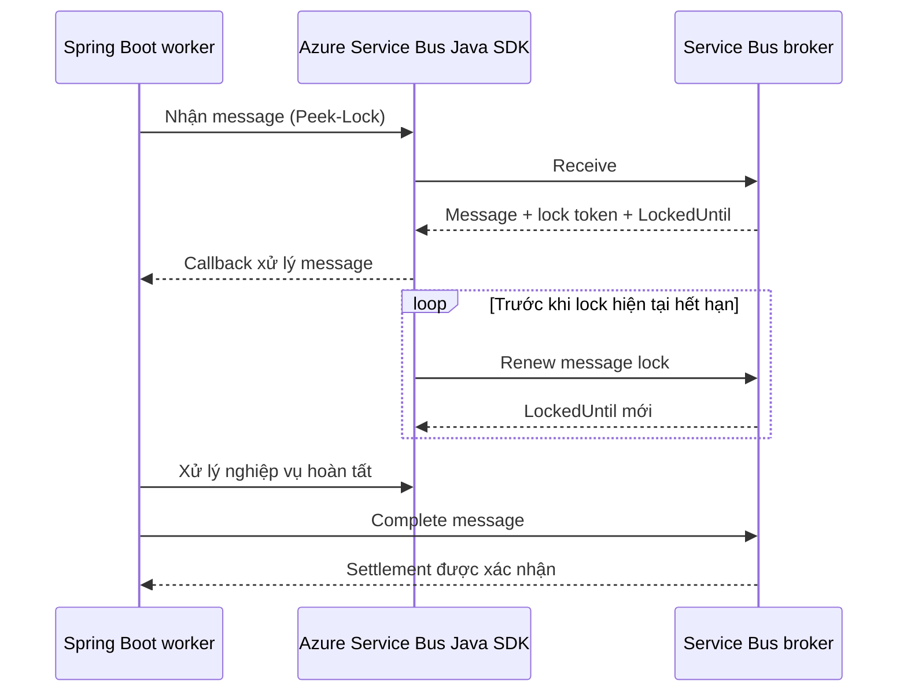
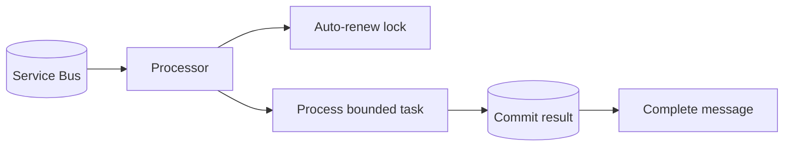
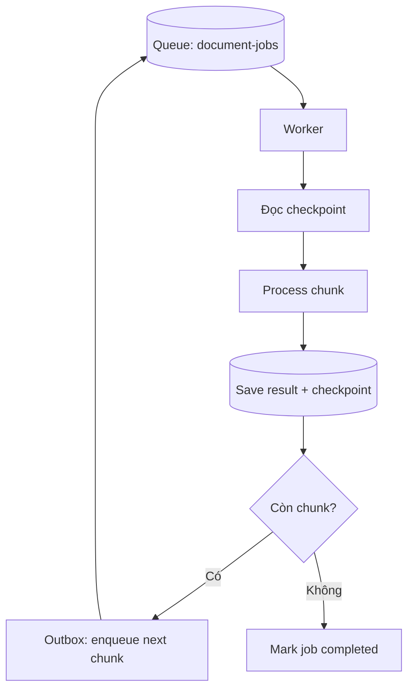
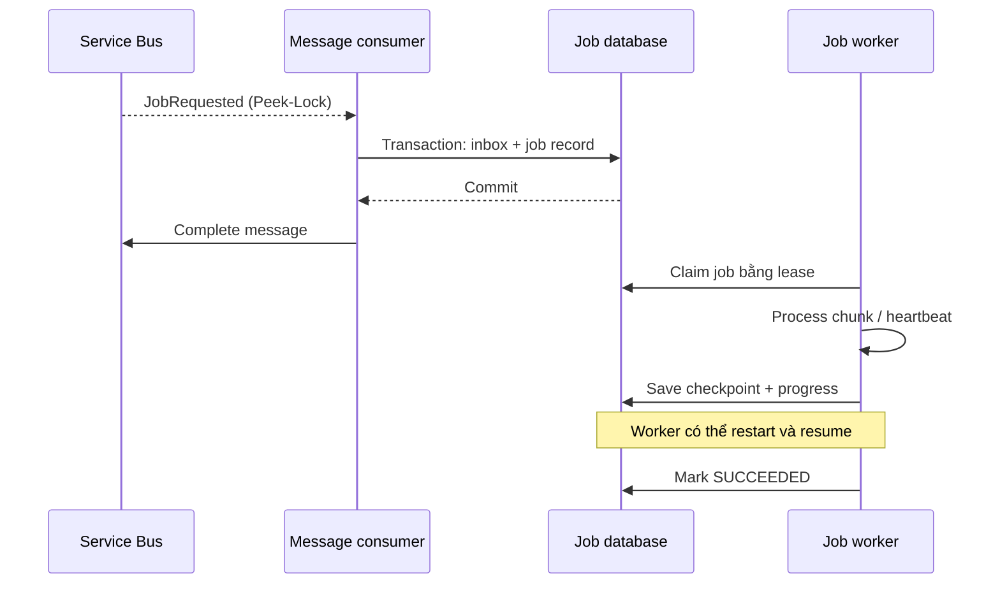
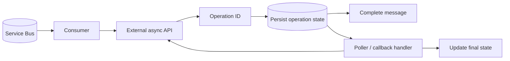

# Gia hạn khóa và xử lý tác vụ kéo dài

> **Chương:** Azure Service Bus  
> **Module:** `SPRING_CLOUD_PROVIDER_INTEGRATION`  
> **Mục tiêu:** Hiểu thời hạn khóa của message, phân biệt LockDuration với cửa sổ auto-renew của Java SDK, cấu hình gia hạn bằng Spring Boot/Azure SDK, xử lý lock loss và thiết kế công việc kéo dài bằng checkpoint hoặc job bền vững.

## 1. Vấn đề: công việc lâu hơn thời gian khóa

Một worker Spring Boot nhận message `GeneratePreview` từ Azure Service Bus. Worker phải tải PDF từ Azure Blob Storage, quét nội dung, tạo nhiều ảnh xem trước, lưu kết quả và cập nhật database. Công việc thường mất 20 giây, nhưng đôi lúc mất 3 phút vì file lớn hoặc dịch vụ phụ thuộc chậm.

Nếu queue chỉ khóa message trong 1 phút và worker không gia hạn, message có thể trở lại trạng thái sẵn sàng khi worker vẫn đang xử lý. Worker thứ hai nhận cùng message, cả hai cùng tạo preview hoặc cập nhật dữ liệu. Khi worker đầu gọi `complete`, broker có thể từ chối vì lock đã hết hạn.

Một hướng khác là cấu hình gia hạn liên tục trong nhiều giờ. Cách này cũng có rủi ro: kết nối mạng có thể gián đoạn, tiến trình có thể thiếu CPU, client có thể bị throttling, hoặc host bị restart. Microsoft khuyến nghị không thiết kế hệ thống dựa trên giả định rằng lock sẽ luôn được gia hạn thành công trong thời gian rất dài. Với công việc kéo dài, nên chia thành các bước nhỏ hoặc dùng checkpoint idempotent.

Bài này giải quyết ba câu hỏi:

1. **Message đang bị khóa bao lâu?**
2. **Client sẽ gia hạn trong bao lâu và gia hạn bằng cách nào?**
3. **Nếu công việc lâu hơn khả năng gia hạn hoặc lock bị mất thì hệ thống vẫn hoàn tất đúng ra sao?**

## 2. Phân biệt LockDuration và auto-lock-renew duration

Hai khái niệm này thường bị nhầm lẫn.

| Thuộc tính | Được cấu hình ở đâu? | Ý nghĩa | Giá trị thường gặp |
| --- | --- | --- | --- |
| **LockDuration** | Queue hoặc topic subscription trên Azure Service Bus | Thời hạn của mỗi lần broker cấp lock cho message | Mặc định 1 phút, tối đa 5 phút |
| **maxAutoLockRenewDuration** | Client Java SDK khi tạo receiver/processor | Khoảng thời gian tối đa client tiếp tục chạy tác vụ gia hạn nền | Mặc định 5 phút |
| **LockedUntil** | Broker trả về trên message đã nhận | Thời điểm lock hiện tại dự kiến hết hạn | Thay đổi sau mỗi lần renew |
| **Processing deadline** | Ứng dụng tự quy định | Giới hạn thời gian nghiệp vụ cho phép xử lý một job | Theo SLO/use case |

Ví dụ:

- Queue có `LockDuration = 1 phút`.
- Processor được cấu hình `maxAutoLockRenewDuration = 10 phút`.
- Khi nhận message, broker cấp lock ban đầu trong 1 phút.
- SDK tự gia hạn trước khi lock hết hạn; mỗi lần renew, broker cấp thêm một khoảng bằng LockDuration của entity.
- SDK tiếp tục thực hiện việc gia hạn nền trong cửa sổ tối đa đã cấu hình.
- Khi cửa sổ auto-renew kết thúc, lần lock cuối cùng vẫn còn hiệu lực tới thời điểm `LockedUntil` tương ứng. Nếu message chưa được settle và lock hết hạn, message có thể được giao lại.

**maxAutoLockRenewDuration không thay đổi LockDuration của queue.** Nó cũng không phải cam kết rằng message sẽ bị khóa chắc chắn trong toàn bộ khoảng thời gian đó. Mỗi lần renew là một thao tác mạng và có thể thất bại.

### 2.1. Tại sao không đặt LockDuration thật dài?

LockDuration tối đa là 5 phút. Ngay cả khi có thể chọn giá trị dài hơn, lock quá dài cũng có hệ quả: nếu worker chết, message phải đợi lock hết hạn mới có thể được giao lại. Đối với công việc thường chỉ mất vài giây, một lock dài không cần thiết làm chậm phục hồi khi consumer gặp sự cố.

Nên chọn LockDuration cao hơn thời gian xử lý bình thường, nhưng vẫn đủ ngắn để message sớm được giao lại khi worker mất khả năng xử lý. Dùng auto-renew cho phần đuôi của tác vụ có thời gian biến động.

## 3. Vòng đời gia hạn khóa



Lock được gia hạn cho **message đang được receiver sở hữu**. Việc gia hạn không biến message thành một công việc độc quyền bền vững: lock vẫn có thể mất khi kết nối bị ngắt, service cập nhật, receiver bị đóng, thời gian gia hạn nền kết thúc hoặc host không có đủ tài nguyên để gửi renew đúng lúc.

Nếu broker không nhận được renew trước khi lock hết hạn, message có thể được giao lại. Khi đó worker cũ không được tiếp tục xem lock cũ là hợp lệ.

## 4. Khi nào cần gia hạn?

Hãy đo thời gian xử lý trước khi thay đổi cấu hình. Một phân loại đơn giản:

| Thời gian xử lý thực tế | Hướng xử lý |
| --- | --- |
| Ngắn hơn LockDuration trong phần lớn trường hợp | Chọn LockDuration phù hợp và xử lý/complete trong lần khóa ban đầu |
| Thỉnh thoảng vượt LockDuration, nhưng vẫn có giới hạn rõ | Dùng auto-lock renewal của processor hoặc receiver |
| Cần kiểm soát thời điểm renew từng message | Dùng receiver và gọi API renew thủ công |
| Kéo dài nhiều chục phút hoặc nhiều giờ | Cân nhắc chia bước, checkpoint hoặc chuyển thành job bền vững |
| Thời gian không xác định, phụ thuộc hệ thống ngoài | Ghi nhận job/operation ID, theo dõi trạng thái riêng; không giữ message lock để chờ vô hạn |

Ví dụ nếu p95 xử lý là 25 giây và p99 là 50 giây, LockDuration 1 phút có thể đủ cho phần lớn message. Nếu có một số file mất 3 phút, cửa sổ auto-renew 5 phút có thể là điểm bắt đầu để thử nghiệm. Cần thêm biên thời gian cho việc gọi dịch vụ ngoài và settlement, rồi xác minh bằng metric.

Không chọn con số chỉ dựa vào một lần chạy thành công. Hãy đo p95/p99, độ trễ dependency, số lần renew, lock loss và message redelivery ở tải thực nghiệm.

## 5. Auto-lock renewal với ServiceBusProcessorClient

Với worker nhận liên tục, `ServiceBusProcessorClient` thường là lựa chọn phù hợp. Processor quản lý vòng nhận message và callback; SDK hỗ trợ auto-lock renewal mặc định.

Có thể cấu hình thời gian auto-renew trên processor builder bằng `maxAutoLockRenewDuration(Duration)`.

### 5.1. Ví dụ cấu hình processor trong Spring Boot

Ví dụ sau tạo processor thành Spring bean. Ứng dụng dùng Azure Identity để lấy credential; workload production cần được cấp quyền nhận message trên đúng queue/subscription.

```java
import java.time.Duration;

import com.azure.identity.DefaultAzureCredentialBuilder;
import com.azure.messaging.servicebus.ServiceBusClientBuilder;
import com.azure.messaging.servicebus.ServiceBusProcessorClient;
import com.azure.messaging.servicebus.models.ServiceBusReceiveMode;

import org.springframework.beans.factory.annotation.Value;
import org.springframework.context.annotation.Bean;
import org.springframework.context.annotation.Configuration;

@Configuration(proxyBeanMethods = false)
public class PreviewProcessorConfiguration {

    @Bean(initMethod = "start", destroyMethod = "close")
    ServiceBusProcessorClient previewProcessor(
            @Value("${app.servicebus.fqdn}") String namespace,
            @Value("${app.servicebus.queue}") String queueName,
            PreviewMessageHandler handler) {

        return new ServiceBusClientBuilder()
                .credential(
                        namespace,
                        new DefaultAzureCredentialBuilder().build())
                .processor()
                .queueName(queueName)
                .receiveMode(ServiceBusReceiveMode.PEEK_LOCK)
                .maxAutoLockRenewDuration(Duration.ofMinutes(10))
                .maxConcurrentCalls(2)
                .prefetchCount(0)
                .disableAutoComplete()
                .drainTimeout(Duration.ofSeconds(45))
                .processMessage(handler::handle)
                .processError(handler::onError)
                .buildProcessorClient();
    }
}
```

Cấu hình minh họa:

```yaml
app:
  servicebus:
    fqdn: ${AZURE_SERVICEBUS_FQDN}
    queue: ${AZURE_SERVICEBUS_QUEUE}
```

Giải thích:

- `maxAutoLockRenewDuration(Duration.ofMinutes(10))` cho SDK cửa sổ gia hạn nền tối đa 10 phút.
- `maxConcurrentCalls(2)` giới hạn số handler được xử lý đồng thời trong processor này.
- `prefetchCount(0)` tắt prefetch trong ví dụ để tránh message bị khóa trong buffer quá lâu trước khi handler bắt đầu.
- `disableAutoComplete()` tắt auto-complete và auto-abandon, để handler tự chọn settlement. Tùy chọn này **không đồng nghĩa tắt auto-lock renewal**.
- `drainTimeout(Duration.ofSeconds(45))` cho processor thời gian chờ handler đang chạy khi đóng; giá trị mặc định của SDK là 30 giây.
- `initMethod` và `destroyMethod` để Spring khởi động processor khi tạo context và đóng client khi context dừng.

`PreviewMessageHandler` là component của ứng dụng, không phải class của SDK. Nếu dự án đã bật auto-configuration tạo processor cho cùng entity, không tạo thêm một processor thứ hai vô tình đọc cùng queue. Chọn một cách quản lý lifecycle và kiểm tra cấu hình Spring Cloud Azure theo BOM đang dùng.

### 5.2. Handler xử lý và settlement

```java
import com.azure.messaging.servicebus.ServiceBusReceivedMessageContext;
import org.springframework.stereotype.Component;

@Component
public class PreviewMessageHandler {

    private final PreviewService previewService;

    public PreviewMessageHandler(PreviewService previewService) {
        this.previewService = previewService;
    }

    public void handle(ServiceBusReceivedMessageContext context) {
        var message = context.getMessage();

        try {
            previewService.createPreviewIdempotently(
                    message.getMessageId(),
                    message.getBody());

            // Chỉ complete sau khi trạng thái nghiệp vụ đã được ghi nhận.
            context.complete();

        } catch (TemporaryDependencyException exception) {
            context.abandon();

        } catch (InvalidPreviewRequestException exception) {
            context.deadLetter();
        }
    }

    public void onError(
            com.azure.messaging.servicebus.ServiceBusErrorContext context) {
        // Ghi log lỗi nhận/transport với entity và mã lỗi phù hợp.
    }
}
```

Đây là ví dụ luồng xử lý. Trong ứng dụng thật cần deserialize body đúng contract, phân loại lỗi tạm thời/vĩnh viễn và tránh log dữ liệu nhạy cảm. `createPreviewIdempotently` phải có khả năng xử lý lại cùng message ID mà không tạo tác dụng phụ trùng.

Nếu callback chạy trong vài phút, auto-renew có thể giúp duy trì lock trong cửa sổ cấu hình. Khi callback kết thúc, handler phải settle message theo chính sách. Không khởi chạy một thread nền kiểu fire-and-forget rồi để callback trả về ngay; với auto-complete, processor có thể complete message khi callback kết thúc dù công việc nền chưa hoàn thành.

### 5.3. Chọn cửa sổ auto-renew có căn cứ

Ví dụ `10 phút` ở trên chỉ là giá trị minh họa. Nên chọn cửa sổ dựa trên:

1. Thời gian xử lý dự kiến ở percentile cao.
2. Thời gian dự phòng cho retry nội bộ và settlement.
3. Giới hạn deadline của nghiệp vụ.
4. Khả năng tài nguyên host và mạng duy trì renew.
5. Số message đồng thời cần gia hạn.

Nếu công việc có thể kéo dài hơn cửa sổ này, hãy cân nhắc chia nhỏ hoặc dùng job bền vững. Đừng liên tục tăng cửa sổ chỉ để che giấu một công việc không có giới hạn.

## 6. Gia hạn thủ công với ServiceBusReceiverClient

`ServiceBusReceiverClient` phù hợp khi ứng dụng cần pull message theo yêu cầu và tự kiểm soát việc nhận. Client có API `renewMessageLock(ServiceBusReceivedMessage)` trả về `OffsetDateTime` thể hiện thời điểm hết hạn mới.

### 6.1. Tạo receiver và tắt auto-renew

```java
import java.time.Duration;

import com.azure.identity.DefaultAzureCredentialBuilder;
import com.azure.messaging.servicebus.ServiceBusClientBuilder;
import com.azure.messaging.servicebus.ServiceBusReceiverClient;
import com.azure.messaging.servicebus.models.ServiceBusReceiveMode;

ServiceBusReceiverClient receiver =
        new ServiceBusClientBuilder()
                .credential(
                        fullyQualifiedNamespace,
                        new DefaultAzureCredentialBuilder().build())
                .receiver()
                .queueName("preview-jobs")
                .receiveMode(ServiceBusReceiveMode.PEEK_LOCK)
                .maxAutoLockRenewDuration(Duration.ZERO)
                .buildClient();
```

`Duration.ZERO` tắt tác vụ auto-renew nền. Chỉ chọn cách này khi ứng dụng thực sự muốn tự điều khiển việc gia hạn và có cơ chế gọi renew trước khi lock hiện tại hết hạn.

### 6.2. Gọi renewMessageLock

```java
import java.time.OffsetDateTime;

import com.azure.messaging.servicebus.ServiceBusReceivedMessage;
import com.azure.messaging.servicebus.ServiceBusReceiverClient;

public OffsetDateTime renewIfStillProcessing(
        ServiceBusReceiverClient receiver,
        ServiceBusReceivedMessage message) {

    // Chỉ renew khi message vẫn thuộc lock của receiver này.
    return receiver.renewMessageLock(message);
}
```

Mỗi lần gọi thành công, broker cấp lại lock theo `LockDuration` của queue/subscription. Ứng dụng có thể dùng thời điểm trả về để lập lịch lần kiểm tra tiếp theo. Không chờ đến sát thời điểm hết hạn mới gọi renew; cần có biên cho network latency và retry.

Nếu renew thất bại do lock đã mất hoặc connection bị gián đoạn, không tiếp tục giả định receiver vẫn sở hữu message. Dừng xử lý theo lock cũ, kiểm tra trạng thái nghiệp vụ và để message được giao lại theo semantics của broker.

### 6.3. Vì sao không tự viết scheduler gia hạn quá phức tạp?

Một scheduler tự quản lý nhiều message phải lưu thời điểm hết hạn, theo dõi receiver lifecycle, xử lý race condition giữa renew và complete, hủy lịch khi message được settle, và phân loại lỗi renew. Với worker thông thường, auto-renew của processor ít phức tạp hơn.

Chỉ dùng renew thủ công khi cần kiểm soát rõ ràng, ví dụ một receiver pull xử lý theo batch hoặc ứng dụng có quy trình điều phối riêng. Không tạo một scheduled task mới cho từng message mà không giới hạn số lượng và không hủy sau settlement.

## 7. Những nguyên nhân phổ biến làm mất lock

Gia hạn tự động không bảo đảm thành công. Các nguyên nhân thường gặp:

| Nguyên nhân | Vì sao lock có thể mất? | Hướng kiểm tra |
| --- | --- | --- |
| Cửa sổ auto-renew quá ngắn | Tác vụ vẫn chạy sau khi SDK dừng gia hạn | So sánh handler duration với cấu hình renew budget |
| Prefetch quá cao | Message bị khóa trong buffer trước khi handler bắt đầu; SDK không gia hạn lock cho message còn nằm trong prefetch buffer | Giảm prefetch hoặc tắt trong bài toán xử lý lâu |
| CPU thiếu hoặc thread pool nghẽn | Tác vụ renew nền không chạy đúng lúc | CPU, boundedElastic pool, thread starvation |
| Quá nhiều message đồng thời | Nhiều renew network call làm tăng tải client/namespace | maxConcurrentCalls, maxMessages, số receiver |
| Shared connection quá tải | I/O thread xử lý nhiều operation và làm renew chậm | Queue của I/O thread, timeout, số client dùng chung builder |
| Network/AMQP gián đoạn | Client không gửi renew tới broker đúng lúc | Network, DNS, firewall, TLS, reconnect |
| Host clock lệch | Lịch renew có thể bị chậm hoặc tính sai thời điểm | Đồng bộ giờ của host/container |
| Session lock mất | Session bị hết hạn hoặc mất lock trong quá trình xử lý | SessionIdleTimeout, session renewal, receiver lifecycle |

Microsoft lưu ý rằng số tác vụ renew nền có liên hệ với `maxConcurrentCalls` của processor hoặc `maxMessages` trong lệnh nhận của receiver. Mỗi lần renew là một network call; số lượng lớn có thể gây throttling ở namespace. Vì vậy, tăng concurrency để xử lý nhiều message hơn có thể làm tình trạng lock loss nặng thêm nếu CPU hoặc kết nối không theo kịp.

### 7.1. Prefetch là một điểm dễ bỏ sót

Prefetch giúp client lấy trước message vào bộ đệm cục bộ. Nhưng message đã bị broker khóa trong lúc chờ trong buffer; SDK không gia hạn lock cho message khi nó vẫn đang nằm ở prefetch buffer. Nếu worker bận xử lý các message trước, message phía sau có thể hết lock trước khi handler nhận được chúng.

Với tác vụ kéo dài, hãy bắt đầu bằng `prefetchCount(0)` hoặc giá trị nhỏ, sau đó tăng dần khi đã đo được năng lực xử lý và thời gian chờ trong buffer.

### 7.2. Concurrency và tài nguyên host

`ServiceBusProcessorClient` dùng thread từ Reactor boundedElastic để gọi handler. Nếu đặt `maxConcurrentCalls` cao hơn khả năng thread pool/CPU, handler có thể bị chậm và tác vụ renew cũng bị ảnh hưởng.

Theo dõi đồng thời:

- CPU và memory của container.
- Số handler đang chạy và thời gian chờ bắt đầu xử lý.
- Database connection pool và thời gian query.
- Request latency tới Blob Storage hoặc API ngoài.
- Số lần renew thành công/thất bại và lock-lost exceptions.

Không có một con số concurrency đúng cho mọi ứng dụng. Hãy thử nghiệm với tải thực tế và giới hạn theo bottleneck nhỏ nhất của luồng xử lý.

## 8. Xử lý tác vụ kéo dài: ba chiến lược

Gia hạn lock là công cụ bảo vệ một lần giao message trong thời gian xử lý. Nó không thay thế thiết kế workflow.

### Chiến lược A — Xử lý trong một lần nhận, có auto-renew giới hạn

Phù hợp khi:

- Tác vụ có thời gian tối đa tương đối rõ.
- Công việc chỉ kéo dài vài phút.
- Nếu lock mất, việc chạy lại có thể được bảo vệ bằng idempotency.
- Hệ thống chấp nhận một lần redelivery trong tình huống hiếm.

Luồng:



Ưu điểm là đơn giản và dễ theo dõi. Giới hạn là công việc vẫn phụ thuộc vào một lần nhận, một cửa sổ lock và sức khỏe của host.

### Chiến lược B — Chia công việc thành các chunk có checkpoint

Phù hợp khi tác vụ dài nhưng có thể chia thành bước nhỏ, ví dụ xử lý 500 trang PDF, chuyển đổi nhiều file hoặc nhập một tập dữ liệu lớn.

Mỗi message chỉ đại diện một bước có giới hạn:



Nguyên tắc:

1. Mỗi chunk có `jobId` và `chunkNumber` ổn định.
2. Worker kiểm tra checkpoint trước khi thực hiện.
3. Kết quả chunk và checkpoint được commit nguyên tử trong database nếu có thể.
4. Nếu còn chunk, tạo message tiếp theo qua outbox để không mất bước tiếp theo giữa DB commit và publish.
5. Khi cùng chunk được giao lại, worker nhận ra đã hoàn tất và không tạo tác dụng phụ trùng.

Mỗi lần nhận message chỉ cần giữ lock đủ lâu cho một chunk, thay vì cả tác vụ nhiều giờ.

### Chiến lược C — Chuyển message thành job bền vững

Phù hợp khi công việc kéo dài không xác định, gọi dịch vụ ngoài bất đồng bộ, hoặc cần tiến trình có thể theo dõi qua nhiều lần worker restart.

Luồng:



Consumer chỉ complete message sau khi **job đã được ghi bền vững** vào database. Nếu worker chết sau commit nhưng trước complete, message có thể được giao lại; unique constraint trên message/event ID giúp nhận diện job đã tạo và không tạo job thứ hai.

Một bảng job có thể gồm:

```sql
CREATE TABLE processing_jobs (
    job_id          VARCHAR(100) PRIMARY KEY,
    message_id      VARCHAR(200) NOT NULL UNIQUE,
    status          VARCHAR(30) NOT NULL,
    checkpoint      VARCHAR(500),
    progress        INTEGER NOT NULL DEFAULT 0,
    attempt         INTEGER NOT NULL DEFAULT 0,
    lease_owner     VARCHAR(100),
    lease_until     TIMESTAMP,
    updated_at      TIMESTAMP NOT NULL
);
```

Các trường có ý nghĩa:

- `message_id` có unique constraint để việc nhận lại cùng message không tạo job trùng.
- `status` biểu diễn PENDING, RUNNING, RETRY_WAIT, SUCCEEDED hoặc FAILED.
- `checkpoint` lưu bước đã hoàn tất.
- `lease_owner` và `lease_until` giúp một worker claim job trong thời hạn; lease hết hạn cho phép worker khác tiếp tục.
- `progress` và `updated_at` hỗ trợ theo dõi và phát hiện job bị mắc kẹt.

### 8.1. Consumer tạo job rồi complete

Pseudo-code ở mức service:

```java
@Transactional
public ProcessingJob acceptMessage(
        String messageId,
        GeneratePreviewCommand command) {

    return jobRepository.findByMessageId(messageId)
            .orElseGet(() -> jobRepository.save(
                    ProcessingJob.pending(
                            UUID.randomUUID().toString(),
                            messageId,
                            command.documentId())));
}
```

Sau khi transaction commit thành công, handler mới gọi `context.complete()`. Nếu transaction thất bại, handler abandon hoặc để retry theo policy. Nếu complete thất bại nhưng message được giao lại, `findByMessageId` trả về job đã có và consumer có thể complete mà không tạo job mới.

Pseudo-code chỉ minh họa ý tưởng; trong code thực tế, unique constraint là lớp bảo vệ cuối cùng cho trường hợp hai consumer cùng nhận/insert do race condition. Cần bắt unique conflict và đọc lại bản ghi đã tồn tại trong transaction phù hợp.

### 8.2. Worker claim job bằng lease

Một worker chỉ bắt đầu job khi claim được lease. Ví dụ SQL khái niệm trên PostgreSQL:

```sql
UPDATE processing_jobs
SET status = 'RUNNING',
    lease_owner = :worker_id,
    lease_until = NOW() + INTERVAL '2 minutes',
    attempt = attempt + 1,
    updated_at = NOW()
WHERE job_id = :job_id
  AND status IN ('PENDING', 'RETRY_WAIT', 'RUNNING')
  AND (lease_until IS NULL OR lease_until < NOW())
RETURNING *;
```

Nếu không có dòng nào được trả về, worker không sở hữu lease hoặc job đã được xử lý. Worker cần heartbeat gia hạn lease khi vẫn chạy, lưu checkpoint định kỳ và chỉ cập nhật khi `lease_owner` còn là chính nó.

Lease database không phải Service Bus message lock. Hai cơ chế có mục tiêu khác nhau:

- **Message lock** bảo vệ quyền xử lý một lần giao message ở broker.
- **Job lease** điều phối worker nào được quyền tiến hành một job bền vững trong database.

### 8.3. Vì sao cần outbox?

Nếu worker lưu checkpoint vào database rồi gửi message tiếp theo, hai thao tác có thể thành công/thất bại độc lập. Ghi checkpoint thành công nhưng publish thất bại sẽ làm workflow dừng; publish thành công nhưng kết quả bị timeout có thể tạo message trùng.

Transactional outbox lưu checkpoint và event tiếp theo trong cùng database transaction. Publisher đọc outbox rồi gửi tới Service Bus. Consumer tiếp theo vẫn phải idempotent.

## 9. So sánh các chiến lược

| Tiêu chí | Một lần nhận + auto-renew | Chunk + checkpoint | Durable job + lease |
| --- | --- | --- | --- |
| Thời gian giữ message lock | Có thể vài phút | Chỉ trong một chunk | Chỉ đến lúc job được ghi bền vững |
| Phục hồi sau restart | Redelivery và chạy lại | Resume từ checkpoint | Resume từ job state/lease |
| Độ phức tạp | Thấp đến vừa | Vừa | Cao hơn |
| Phù hợp | Tác vụ có giới hạn rõ | Tác vụ dài có thể chia nhỏ | Tác vụ nhiều bước/thời gian không xác định |
| Nơi lưu tiến độ | Thường ở kết quả nghiệp vụ | Checkpoint theo chunk | Job database |
| Rủi ro chính | Lock loss giữa tác vụ | Chunk không idempotent | Lease/job state/outbox thiết kế sai |

Không cần xây job engine cho một tác vụ chỉ mất vài giây. Chọn chiến lược đơn giản nhất vẫn đáp ứng được thời gian, khả năng phục hồi và SLO của nghiệp vụ.

## 10. Tác vụ gọi dịch vụ ngoài kéo dài

Một số dịch vụ nhận yêu cầu rồi xử lý bất đồng bộ, ví dụ tạo báo cáo lớn, chuyển mã video hoặc xử lý tài liệu. Thay vì giữ message lock trong suốt thời gian dịch vụ ngoài làm việc:

1. Consumer nhận message.
2. Gửi yêu cầu tới dịch vụ ngoài.
3. Nhận operation ID hoặc job ID từ dịch vụ.
4. Lưu operation ID, trạng thái và correlation ID vào database.
5. Complete message sau khi đã ghi nhận bền vững việc tiếp nhận.
6. Worker/poller hoặc callback theo dõi operation đến khi hoàn tất.
7. Cập nhật trạng thái nghiệp vụ và phát event tiếp theo nếu cần.

Sơ đồ:



Nếu API ngoài có timeout sau khi đã nhận yêu cầu, consumer phải xử lý trạng thái không chắc chắn bằng idempotency key hoặc tra cứu operation ID theo hợp đồng API. Không gửi lại yêu cầu tạo operation mới một cách mù quáng.

## 11. Session lock và tác vụ kéo dài

Nếu queue/topic subscription bật sessions, broker cấp **session lock** cho receiver. Session lock cho phép xử lý tuần tự các message cùng `SessionId`, nhưng vẫn có thể mất do timeout, connection hoặc session idle.

Với session-enabled entity:

- Dùng session-aware processor/receiver.
- Cấu hình auto-lock renewal cho session theo builder tương ứng.
- Đặt `SessionIdleTimeout` phù hợp với khoảng thời gian không có thao tác.
- Theo dõi `SessionLockLostException` riêng với `MessageLockLostException`.
- Không giả định một session lock sẽ giữ được vô hạn trong lúc worker không thực hiện thao tác nào.

Nếu một session có một bước xử lý kéo dài, hãy cân nhắc checkpoint theo session state hoặc database. Session giúp điều phối thứ tự, không thay thế job state bền vững.

## 12. Shutdown và triển khai lại worker

Khi container được deploy lại hoặc scale in, worker cần dừng có trật tự.

Một quy trình phù hợp:

1. Readiness chuyển sang trạng thái không nhận thêm traffic/công việc mới.
2. Dừng processor để không nhận message mới.
3. Cho handler đang chạy hoàn tất trong thời gian drain đã cấu hình.
4. Settlement message khi receiver/connection còn mở.
5. Đóng processor/client.
6. Nếu handler không hoàn tất trong thời gian drain, lưu checkpoint và để message được giao lại an toàn.

`ServiceBusProcessorClientBuilder.drainTimeout(Duration)` đặt thời gian tối đa chờ các handler đang chạy khi processor đóng. Mặc định hiện hành là 30 giây. Cần phối hợp với `terminationGracePeriodSeconds` của Kubernetes/container runtime hoặc thời gian shutdown của nền tảng triển khai.

Đừng đóng receiver trước khi settlement. Nếu receiver/connection bị đóng trước khi complete, settlement không tới broker, lock hết hạn và message có thể redeliver.

## 13. Chẩn đoán MessageLockLostException

Khi handler gọi complete/abandon sau khi lock hết hạn hoặc bị mất, SDK có thể ném `ServiceBusException` với thông tin lock không hợp lệ, thường biểu hiện thành `MessageLockLostException` hoặc reason tương ứng theo version.

| Dấu hiệu | Nguyên nhân có thể | Việc nên làm |
| --- | --- | --- |
| Lỗi xuất hiện sau một thời gian xử lý cố định | Auto-renew budget đã hết hoặc LockDuration quá ngắn | So sánh handler duration, LockDuration và maxAutoLockRenewDuration |
| Lỗi xuất hiện ở message nằm cuối batch | Prefetch/buffer giữ lock trước khi handler bắt đầu | Giảm prefetch, giảm số message nhận mỗi batch |
| Lỗi tăng khi tải cao | CPU, Reactor thread pool, I/O thread hoặc namespace bị quá tải | Giảm concurrency, profile CPU/network, đo queue của I/O thread |
| Lỗi xuất hiện khi container restart | Shutdown không drain đủ hoặc receiver đóng trước settlement | Điều chỉnh drain timeout, checkpoint trước shutdown |
| Lỗi ngẫu nhiên theo mạng | AMQP connection gián đoạn | Kiểm tra network/TLS và chuẩn bị idempotent redelivery |
| Chỉ lỗi ở session entity | Session lock mất hoặc SessionIdleTimeout không phù hợp | Kiểm tra session receiver/processor và session lock renewal |

### 13.1. Xử lý khi lock đã mất

Nếu lock đã mất:

- Không tiếp tục gọi complete bằng lock token cũ.
- Không giả định message đã bị xóa hoặc chắc chắn sẽ được giao lại ngay.
- Kiểm tra trạng thái nghiệp vụ theo message ID/job ID.
- Nếu tác dụng phụ đã hoàn tất, lần giao lại phải nhận diện job đã xong và không thực hiện lại.
- Nếu chưa hoàn tất, tiếp tục từ checkpoint hoặc chạy lại chunk an toàn.
- Ghi log mã lỗi, message ID, correlation ID và thời gian xử lý; không log payload nhạy cảm.

**Lock loss không đồng nghĩa tác vụ nghiệp vụ thất bại.** Có thể tác vụ đã ghi dữ liệu thành công nhưng settlement không tới broker. Đây là lý do idempotency quan trọng hơn việc cố giữ lock bằng mọi giá.

## 14. Metrics cần theo dõi khi xử lý tác vụ lâu

| Metric | Ý nghĩa | Dấu hiệu cảnh báo |
| --- | --- | --- |
| Handler duration p50/p95/p99 | Thời gian xử lý thực tế | p99 tiến sát auto-renew budget |
| Lock renewal count/failure | Số lần renew và lỗi renew | Lỗi tăng hoặc renew liên tục nhiều lần |
| MessageLockLostException count | Tần suất mất lock | Tăng theo tải hoặc sau deploy |
| DeliveryCount distribution | Mức độ message bị giao lại | Nhiều message có delivery count cao |
| Prefetch buffer/active work | Message đã nhận trước khi xử lý | Message chờ trong buffer lâu |
| maxConcurrentCalls và CPU | Mức tải xử lý | CPU cao, thread starvation, timeout |
| Queue active message count/age | Backlog và tuổi message | Backlog tăng dù worker đang chạy |
| Job lease expired/checkpoint age | Job bền vững bị mắc kẹt | Lease hết hạn liên tục hoặc checkpoint lâu không đổi |
| Complete/abandon/dead-letter rate | Kết quả settlement | Abandon hoặc DLQ tăng đột biến |

Azure SDK Java dùng Reactor boundedElastic để gọi handler của `ServiceBusProcessorClient`. Nếu số handler mong muốn vượt giới hạn thread pool, concurrency thực tế có thể thấp hơn cấu hình. Hãy đo và tune thread pool/CPU theo tải thực tế; không tăng `maxConcurrentCalls` mà không kiểm tra tài nguyên.

## 15. Kiểm thử gia hạn và công việc kéo dài

Cần test trên namespace test riêng, với dữ liệu giả và LockDuration đủ ngắn để quan sát hành vi trong thời gian hợp lý.

| Bài test | Cách thực hiện | Kết quả mong đợi |
| --- | --- | --- |
| Xử lý ngắn | Handler hoàn tất trước LockDuration | Complete thành công, không cần renew |
| Auto-renew | Handler chạy lâu hơn LockDuration nhưng ngắn hơn renew budget | Lock được gia hạn và message complete |
| Vượt renew budget | Handler chạy lâu hơn cửa sổ auto-renew | Có thể mất lock/redelivery; idempotency bảo vệ kết quả |
| Manual renew | Tắt auto-renew, gọi receiver.renewMessageLock trước khi hết hạn | LockedUntil mới được trả về |
| Prefetch | Tăng prefetch và cố ý làm handler trước chậm | Quan sát lock của message chờ trong buffer có thể hết hạn |
| Concurrency | Tăng maxConcurrentCalls theo từng mức | Đo throughput, CPU, lock lost và database pool |
| Network interruption | Ngắt kết nối trong môi trường test có kiểm soát | Consumer phục hồi và xử lý redelivery an toàn |
| Shutdown | Dừng processor khi handler đang chạy | Handler drain trong giới hạn hoặc message được giao lại |
| Checkpoint | Dừng worker sau một chunk | Worker khác resume từ checkpoint, không lặp side effect |
| Durable handoff | DB commit job thành công nhưng complete message thất bại | Redelivery tìm thấy job đã tồn tại, không tạo job mới |

### 15.1. Không dùng sleep cố định để kiểm thử

Không nên chỉ `Thread.sleep(60000)` rồi kết luận lock đã gia hạn. Hãy chờ điều kiện có timeout hữu hạn:

- Handler hoàn tất và trạng thái job chuyển `SUCCEEDED`.
- `LockedUntil` thay đổi sau lần renew.
- Message ID được ghi trong processed-message/inbox table.
- DeliveryCount hoặc DLQ count thay đổi như dự kiến.
- Checkpoint được cập nhật và worker mới resume được.

Test phải thất bại rõ nếu trạng thái mong đợi không xuất hiện trong thời hạn.

### 15.2. Test auto-renew trên môi trường thật

Emulator có thể không mô phỏng đầy đủ lock renewal, network timing, throttling và hành vi AMQP của namespace thật. Hãy có ít nhất một integration test trên Azure Service Bus test namespace để xác minh cấu hình lock, identity, processor và settlement.

## 16. Bài thực hành: xử lý PDF có thời gian biến động

**Tình huống:** Worker nhận `GeneratePreview`. File PDF nhỏ thường xử lý trong 10 giây, nhưng file lớn có thể cần 4 phút. Một số tài liệu phải tạo hàng trăm ảnh trang.

### Phần A — Đo baseline

- Gửi các file test với kích thước khác nhau.
- Đo p50/p95/p99 thời gian xử lý.
- Ghi lại LockDuration của queue.
- Xác định tỷ lệ message vượt LockDuration.

### Phần B — Cấu hình auto-renew

- Tạo `ServiceBusProcessorClient`.
- Cấu hình `maxAutoLockRenewDuration` dựa trên dữ liệu baseline.
- Giới hạn `maxConcurrentCalls` và `prefetchCount`.
- Xác minh message được complete khi handler hoàn tất.

### Phần C — Tạo lock loss có kiểm soát

- Cho handler chạy lâu hơn auto-renew budget trong namespace test.
- Quan sát lock-lost exception và redelivery.
- Xác minh cùng message ID không tạo preview hoặc notification trùng.

### Phần D — Chuyển sang chunk + checkpoint

- Chia PDF thành nhóm trang.
- Lưu checkpoint sau mỗi nhóm.
- Gửi event tiếp theo qua outbox.
- Dừng worker giữa chừng và khởi động lại.
- Xác minh worker resume từ trang chưa hoàn thành.

### Phần E — Durable job

- Tạo bảng job với unique message ID, status, checkpoint và lease.
- Consumer lưu job trong transaction rồi complete message.
- Worker claim job bằng lease, cập nhật heartbeat và checkpoint.
- Cho worker chết giữa job; chờ lease hết hạn và để worker khác resume.

### Phần F — Viết runbook

Mô tả cách điều tra khi lock lost tăng, queue backlog tăng, job lease hết hạn hoặc một job không cập nhật checkpoint trong thời gian dài.

**Tiêu chí đạt:** người học phân biệt LockDuration với auto-renew duration; cấu hình được processor và receiver; giải thích được prefetch/concurrency ảnh hưởng lock; xử lý được lock loss; và chứng minh công việc dài có thể resume bằng checkpoint hoặc durable job.

---

## 17. Checklist trước khi triển khai worker xử lý lâu

| Nhóm | Câu hỏi |
| --- | --- |
| LockDuration | Đã đo thời gian xử lý và chọn giá trị phù hợp chưa? |
| Auto-renew | Cửa sổ renew có đủ cho workload bình thường và có deadline không? |
| Manual renewal | Nếu dùng receiver pull, có renew trước khi lock hết hạn và xử lý lỗi renew không? |
| Prefetch | Có giữ message trong buffer lâu hơn thời gian lock không? |
| Concurrency | CPU, thread pool, DB pool và downstream có đủ cho số handler đồng thời không? |
| Idempotency | Nếu message redeliver sau khi tác dụng phụ đã commit, hệ thống có xử lý an toàn không? |
| Checkpoint | Tác vụ dài có lưu tiến độ bền vững và resume được không? |
| Durable job | Nếu chuyển job ra database, có unique message ID, lease và recovery không? |
| Shutdown | Processor có drain trước khi receiver/client đóng không? |
| Observability | Có metric lock renewal, lock lost, handler duration, backlog và checkpoint age không? |
| Testing | Có test vượt LockDuration, vượt renew budget, prefetch, crash và redelivery không? |

## Ghi nhớ

- **LockDuration** thuộc queue/subscription: mặc định 1 phút, tối đa 5 phút.
- **maxAutoLockRenewDuration** thuộc Java SDK client: mặc định 5 phút, xác định thời gian tác vụ gia hạn nền tiếp tục chạy.
- Mỗi lần renew thành công cấp lại lock theo LockDuration của entity; auto-renew vẫn có thể thất bại do network, CPU, I/O thread, throttling hoặc host shutdown.
- **ServiceBusProcessorClient** thường phù hợp cho worker nhận liên tục; có thể cấu hình auto-renew, concurrency, prefetch và drain timeout.
- **ServiceBusReceiverClient** hỗ trợ auto-renew hoặc gọi `renewMessageLock(message)` thủ công khi cần pull semantics.
- Không nên giữ lock trong nhiều giờ như cơ chế workflow. Hãy chia chunk, lưu checkpoint, hoặc chuyển message thành durable job có lease.
- **Idempotency** là điều kiện cần vì lock có thể mất sau khi tác dụng phụ đã thành công nhưng trước khi complete được broker xác nhận.

Khi tích hợp Spring Boot với Azure Service Bus, hãy xem gia hạn lock là một **biện pháp bảo vệ có giới hạn**. Thiết kế thời gian xử lý, tài nguyên host, settlement và trạng thái công việc cùng nhau. Với tác vụ dài hoặc không xác định, checkpoint và durable job giúp phục hồi đáng tin cậy hơn việc cố giữ một message lock thật lâu.

### Tài liệu chính thức

- [Message transfers, locks, and settlement — Renew locks](https://learn.microsoft.com/en-us/azure/service-bus-messaging/message-transfers-locks-settlement)
- [Troubleshoot Azure Service Bus issues — Java SDK lock loss and concurrency](https://learn.microsoft.com/en-us/azure/developer/java/sdk/troubleshooting-messaging-service-bus-overview)
- [ServiceBusProcessorClientBuilder Java API](https://learn.microsoft.com/en-us/java/api/com.azure.messaging.servicebus.servicebusclientbuilder.servicebusprocessorclientbuilder?view=azure-java-stable)
- [ServiceBusReceiverClientBuilder Java API](https://learn.microsoft.com/en-us/java/api/com.azure.messaging.servicebus.servicebusclientbuilder.servicebusreceiverclientbuilder?view=azure-java-stable)
- [ServiceBusReceiverClient Java API](https://learn.microsoft.com/en-us/java/api/com.azure.messaging.servicebus.servicebusreceiverclient?view=azure-java-stable)
- [Azure Service Bus Java client library](https://learn.microsoft.com/en-us/java/api/overview/azure/messaging-servicebus-readme)

Trước khi áp dụng, xác minh phiên bản Azure SDK, Spring Cloud Azure BOM, Spring Boot/JDK và cấu hình thực tế của queue/subscription. Giá trị LockDuration, auto-renew budget, concurrency và timeout phải được đo trong môi trường triển khai của dự án.
