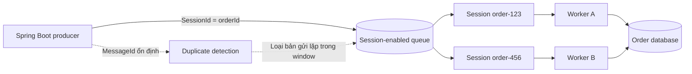
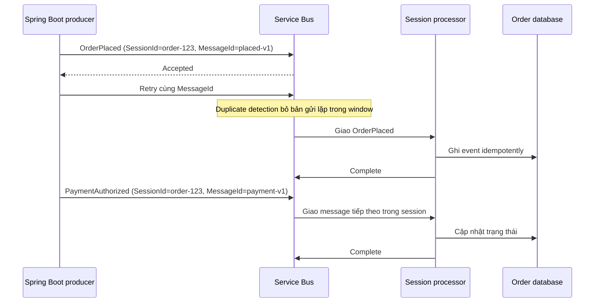

# Sessions, thứ tự thông điệp và phát hiện trùng lặp

> **Chương:** Azure Service Bus  
> **Module:** `SPRING_CLOUD_PROVIDER_INTEGRATION`  
> **Mục tiêu:** Thiết kế luồng message có thứ tự theo nhóm nghiệp vụ bằng Azure Service Bus sessions; phân biệt thứ tự enqueue, nhận và xử lý; cấu hình session-aware sender/processor trong Spring Boot; bật duplicate detection và xây consumer idempotent.

## 1. Bài toán: các sự kiện của cùng một đơn hàng phải theo đúng thứ tự

Một hệ thống thương mại điện tử dùng Spring Boot để phát các sự kiện:

```text
OrderPlaced(order-123)
PaymentAuthorized(order-123)
OrderPacked(order-123)
OrderShipped(order-123)
```

Nếu các message được đưa vào queue thông thường và có nhiều worker cạnh tranh nhận, worker A có thể nhận `OrderPlaced` nhưng xử lý lâu. Worker B nhận `PaymentAuthorized` và hoàn tất trước. Worker C tiếp tục xử lý `OrderPacked`. Kết quả là hệ thống cập nhật trạng thái đơn hàng theo thứ tự không mong muốn.

Một vấn đề khác xuất hiện ở producer: API gửi `PaymentAuthorized` thành công ở broker nhưng mất kết nối trước khi nhận acknowledgement. API retry và gửi lại cùng sự kiện. Nếu không có cách nhận diện lần gửi trùng, consumer có thể thực hiện tác dụng phụ hai lần.

Azure Service Bus cung cấp hai khả năng liên quan nhưng giải quyết hai vấn đề khác nhau:

- **Message sessions:** nhóm các message liên quan bằng `SessionId`, khóa độc quyền một session và hỗ trợ xử lý có thứ tự trong nhóm đó.
- **Duplicate detection:** nhận diện message producer gửi lại dựa trên `MessageId` trong một cửa sổ thời gian cấu hình.

Hai tính năng này bổ trợ nhau. Sessions giúp giữ thứ tự theo nhóm; duplicate detection giảm message trùng ở phía gửi. **Consumer vẫn phải idempotent** vì broker có thể giao lại message khi lock mất hoặc worker restart.



## 2. Session là gì?

**Session** là một nhóm message có quan hệ với nhau do ứng dụng xác định. Producer gán cùng một `SessionId` cho các message thuộc cùng nhóm. Ví dụ:

| Nhóm nghiệp vụ | SessionId gợi ý | Những message có thể cùng session |
| --- | --- | --- |
| Đơn hàng | `order-123` | OrderPlaced, PaymentAuthorized, OrderShipped |
| Tài khoản ngân hàng | `account-789` | MoneyDeposited, MoneyWithdrawn, BalanceRecalculated |
| Hồ sơ khách hàng | `customer-456` | CustomerCreated, AddressChanged, CustomerDeactivated |
| Một workflow | `workflow-9f31` | StepStarted, StepCompleted, WorkflowFinished |

Service Bus không tự biết quan hệ nghiệp vụ nào cần được nhóm. **Ứng dụng chọn SessionId** và quyết định message nào thuộc cùng session, khi nào một chuỗi bắt đầu/kết thúc.

Khi receiver chấp nhận một session, broker cấp **session lock độc quyền** cho receiver đó. Các message có cùng SessionId được giao cho receiver đang giữ lock. Receiver khác có thể xử lý session khác đồng thời, nhưng không thể đồng thời sở hữu cùng session.

### 2.1. Sessions bảo đảm điều gì?

- Message cùng SessionId được giao theo thứ tự trong session.
- Một receiver sở hữu session lock tại một thời điểm.
- Các message trong cùng session được giữ trong cùng luồng xử lý logic.
- Nhiều session khác nhau có thể được xử lý song song bởi nhiều worker.
- Nếu message chưa được complete và bị abandon, cùng message đó có thể được giao lại trước message tiếp theo trong session.
- Session lock có thể được gia hạn; nếu mất lock, receiver khác có thể tiếp quản session.

Sessions phù hợp với **FIFO theo từng nhóm**, ví dụ thứ tự sự kiện của một đơn hàng hoặc một tài khoản. Nó không tạo thứ tự toàn cục giữa mọi message của toàn hệ thống.

### 2.2. Sessions không tự định nghĩa trình tự nghiệp vụ

Nếu producer gửi sự kiện theo thứ tự sai:

```text
OrderShipped(order-123)
OrderPlaced(order-123)
```

Service Bus vẫn giữ thứ tự enqueue của hai message trong session. Broker không tự biết `OrderPlaced` phải xảy ra trước `OrderShipped`.

Nếu thứ tự nguồn có thể đến không đúng, event nên mang thêm thông tin như `aggregateVersion` hoặc `eventSequence`. Consumer kiểm tra số thứ tự nghiệp vụ và quyết định chờ, từ chối, defer hoặc xử lý bù trừ theo contract.

## 3. Điều kiện tiên quyết: bật sessions trên queue hoặc subscription

Sessions phải được bật trên **queue hoặc topic subscription khi tạo entity**.

Các điểm quan trọng:

- **Basic tier không hỗ trợ sessions.**
- **Standard và Premium hỗ trợ sessions.**
- Không thể bật hoặc tắt sessions sau khi queue/subscription đã được tạo.
- Khi entity yêu cầu sessions, producer phải gửi message có `SessionId`.
- Consumer phải dùng session-aware receiver/processor để accept session.
- Client thông thường không session-aware không thể gửi/nhận message như entity thường; thao tác peek vẫn có thể dùng.

Vì vậy, hãy quyết định nhu cầu ordering trước khi tạo tài nguyên. Nếu queue hiện tại không bật sessions mà nghiệp vụ bắt đầu cần thứ tự theo đơn hàng, thường phải tạo entity mới có sessions, chuyển producer/consumer và xử lý backlog theo kế hoạch migration.

### 3.1. Queue và topic subscription đều có thể dùng sessions

| Entity | Có thể bật sessions? | Cách consumer dùng |
| --- | --- | --- |
| Queue | Có | Session processor hoặc session receiver trên queue |
| Topic subscription | Có | Session processor hoặc session receiver trên topic + subscription |
| Topic | Producer publish vào topic; session được áp dụng ở subscription nhận | Subscription cần được cấu hình sessions |
| Basic namespace | Không hỗ trợ | Chọn Standard/Premium nếu cần |

Với topic, mỗi subscription có luồng nhận riêng. Nếu consumer cần xử lý có thứ tự trong subscription `order-projection`, hãy bật sessions trên chính subscription đó.

## 4. Chọn SessionId: nhóm đúng để giữ thứ tự và vẫn scale

SessionId là quyết định kiến trúc. Một khóa quá rộng làm giảm khả năng song song; một khóa quá hẹp không giữ được thứ tự cần thiết.

### 4.1. Dùng khóa aggregate nghiệp vụ

Ví dụ đơn hàng:

```java
String sessionId = orderId;

ServiceBusMessage message = new ServiceBusMessage(payload)
        .setSessionId(sessionId)
        .setMessageId(messageId);

sender.sendMessage(message);
```

Mọi sự kiện của `order-123` dùng cùng `SessionId`. Đơn hàng `order-456` dùng session khác và có thể được worker khác xử lý đồng thời.

### 4.2. Tránh một session toàn cục

Nếu mọi message đều dùng `SessionId = "global"`, toàn bộ hệ thống bị gom vào một session. Một receiver duy nhất giữ session lock và xử lý lần lượt, làm mất lợi ích scale ngang.

Ngược lại, nếu tạo một SessionId ngẫu nhiên cho mỗi message, mỗi message gần như thành một session riêng; hệ thống không giữ được thứ tự giữa các sự kiện cùng đơn hàng.

| Cách chọn | Hệ quả |
| --- | --- |
| Một session cho toàn bộ hệ thống | Nút thắt xử lý tuần tự toàn cục |
| Một session ngẫu nhiên cho từng message | Không gom được các message liên quan |
| Một session theo aggregate ID | Giữ thứ tự theo đơn hàng/tài khoản và cho phép song song giữa aggregate |
| Một session theo tenant | Mọi công việc trong tenant có thể tuần tự; dễ tạo hot session nếu tenant lớn |

**Quy tắc thực tế:** chọn khóa nhỏ nhất bao trùm đúng phạm vi cần tuần tự hóa, ví dụ `orderId` hoặc `accountId`. Đánh giá phân bố tải để tránh một session có lưu lượng quá lớn.

### 4.3. SessionId phải ổn định

Không tạo UUID mới cho mỗi lần retry cùng message. SessionId phải được tái tạo từ cùng business key để lần gửi lại vẫn thuộc đúng session. Nếu đổi cách tạo SessionId trong lúc hệ thống đang có message cũ, các message của cùng aggregate có thể bị chia thành hai session và mất thứ tự xuyên suốt.

## 5. Thứ tự enqueue, sequence number và thứ tự xử lý

Cần phân biệt ba khái niệm:

| Khái niệm | Ý nghĩa | Sessions có cần thiết? |
| --- | --- | --- |
| **Enqueue order** | Thứ tự broker chấp nhận message | Không; broker cấp sequence number |
| **Receive/extraction order** | Thứ tự message được lấy ra | Sequence number hỗ trợ quan sát thứ tự |
| **Processing/completion order** | Thứ tự tác vụ nghiệp vụ hoàn tất | Cần sessions nếu phải giữ FIFO theo nhóm |

Ví dụ queue có ba message và hai consumer:

1. Consumer A nhận message 1 nhưng xử lý lâu.
2. Consumer B nhận message 2 và xử lý xong.
3. Consumer B nhận message 3 và xử lý xong.
4. Consumer A cuối cùng mới xử lý xong message 1.

Thứ tự hoàn tất là 2, 3, 1 dù message được enqueue theo thứ tự 1, 2, 3.

**SequenceNumber không tự bảo đảm thứ tự hoàn tất xử lý.** Nếu nghiệp vụ cần message 1, 2, 3 được xử lý theo thứ tự, hãy gán cùng SessionId và sử dụng session-aware consumer.

### 5.1. Sessions chỉ bảo đảm trong cùng một nhóm

Giả sử:

```text
Session order-123:
  1. OrderPlaced
  2. PaymentAuthorized
  3. OrderShipped

Session order-456:
  1. OrderPlaced
  2. PaymentAuthorized
  3. OrderShipped
```

Service Bus có thể xử lý `order-123` và `order-456` đồng thời, nhưng vẫn giữ thứ tự message trong từng session. Không có cam kết rằng `OrderPlaced(order-123)` phải hoàn tất trước `OrderPlaced(order-456)`.

Nếu cần thứ tự toàn cục giữa mọi đơn hàng, phải xem xét lại yêu cầu vì nó buộc hệ thống tuần tự hóa rộng và hạn chế throughput. Hầu hết nghiệp vụ chỉ cần thứ tự theo aggregate.

### 5.2. Producer gửi đồng thời thì thứ tự được xác định thế nào?

Service Bus giữ thứ tự theo lúc broker enqueue message, không tự sắp xếp theo timestamp nghiệp vụ trong body. Nếu nhiều producer cùng gửi message vào một session, thứ tự chấp nhận ở broker là thứ tự được dùng.

Nếu nghiệp vụ yêu cầu `eventSequence` tăng liên tục, producer nên bảo đảm việc phát sự kiện theo thứ tự hoặc consumer kiểm tra version/sequence để phát hiện gap. Session không sửa được dữ liệu nguồn đã phát sai thứ tự.

## 6. Gửi message vào session bằng Azure SDK for Java

Sender vẫn dùng `ServiceBusSenderClient`. Điểm khác biệt là message phải có `SessionId`.

```java
import com.azure.messaging.servicebus.ServiceBusMessage;
import com.azure.messaging.servicebus.ServiceBusSenderClient;

public class OrderEventPublisher {

    private final ServiceBusSenderClient sender;

    public OrderEventPublisher(ServiceBusSenderClient sender) {
        this.sender = sender;
    }

    public void publish(
            String orderId,
            String eventId,
            String payload) {

        ServiceBusMessage message = new ServiceBusMessage(payload)
                .setSessionId(orderId)
                .setMessageId(eventId)
                .setSubject("OrderEvent")
                .setContentType("application/json; charset=utf-8");

        sender.sendMessage(message);
    }
}
```

Trong ví dụ:

- `orderId` được dùng làm SessionId.
- `eventId` là MessageId ổn định của một sự kiện logic.
- `Subject` mô tả loại message.
- Body là payload theo contract JSON đã thống nhất.

Nếu gửi cùng event sau timeout, hãy gửi lại cùng `eventId` và cùng SessionId. Không tạo MessageId mới cho cùng sự kiện logic chỉ vì producer không nhận được acknowledgement.

### 6.1. Nếu entity bật partitioning

Với entity partitioned, duplicate detection sử dụng `MessageId + PartitionKey` để xác định trùng. Khi sessions được bật cùng partitioning, `PartitionKey` và `SessionId` phải giống nhau.

Ví dụ nếu order ID là cả hai:

```java
ServiceBusMessage message = new ServiceBusMessage(payload)
        .setSessionId(orderId)
        .setPartitionKey(orderId)
        .setMessageId(eventId);
```

Chỉ đặt PartitionKey khi entity và thiết kế partition yêu cầu. Không đặt một giá trị khác SessionId trên entity session-enabled partitioned; broker có thể từ chối message hoặc hành vi dedup/partition không đúng mong đợi.

## 7. Nhận message theo session với ServiceBusProcessorClient

Đối với worker nhận liên tục, `ServiceBusProcessorClient` thường là lựa chọn phù hợp. Để nhận từ entity bật sessions, tạo builder bằng `sessionProcessor()` thay cho `processor()`.

### 7.1. Cấu hình processor cho queue

```java
import java.time.Duration;

import com.azure.identity.DefaultAzureCredentialBuilder;
import com.azure.messaging.servicebus.ServiceBusClientBuilder;
import com.azure.messaging.servicebus.ServiceBusProcessorClient;
import com.azure.messaging.servicebus.models.ServiceBusReceiveMode;

ServiceBusProcessorClient processor =
        new ServiceBusClientBuilder()
                .credential(
                        fullyQualifiedNamespace,
                        new DefaultAzureCredentialBuilder().build())
                .sessionProcessor()
                .queueName("order-events")
                .receiveMode(ServiceBusReceiveMode.PEEK_LOCK)
                .disableAutoComplete()
                .maxConcurrentSessions(8)
                .maxConcurrentCalls(1)
                .maxAutoLockRenewDuration(Duration.ofMinutes(5))
                .processMessage(context -> {
                    var message = context.getMessage();

                    try {
                        orderHandler.processIdempotently(
                                message.getSessionId(),
                                message.getMessageId(),
                                message.getBody());

                        context.complete();
                    } catch (TemporaryDependencyException exception) {
                        context.abandon();
                    } catch (InvalidOrderEventException exception) {
                        context.deadLetter();
                    }
                })
                .processError(errorContext -> {
                    // Ghi nhận namespace/entity/reason; không log payload nhạy cảm.
                })
                .buildProcessorClient();

processor.start();
```

Giải thích cấu hình:

- `sessionProcessor()` tạo processor dành cho session-enabled entity.
- `maxConcurrentSessions(8)` cho phép tối đa tám session được xử lý đồng thời.
- `maxConcurrentCalls(1)` giới hạn một message callback tại một thời điểm trong mỗi session processor session, phù hợp khi cần xử lý nghiệp vụ tuần tự.
- `disableAutoComplete()` để handler quyết định complete/abandon/dead-letter.
- `maxAutoLockRenewDuration` đặt cửa sổ gia hạn session lock ở phía client.
- `processMessage` nhận message và chuyển cho handler nghiệp vụ.
- `processError` xử lý lỗi nhận/transport; không thay thế exception handling trong nghiệp vụ.

Các giá trị 8 session và 5 phút chỉ là ví dụ. Chọn concurrency theo database pool, CPU, downstream và tải từng aggregate. Nếu tăng `maxConcurrentCalls`, hãy xác minh rằng việc chạy nhiều callback trong cùng session không phá thứ tự tác dụng phụ nghiệp vụ.

### 7.2. Với topic subscription

Thay cấu hình queue bằng:

```java
.sessionProcessor()
.topicName("order-events")
.subscriptionName("order-projection")
.maxConcurrentSessions(8)
.maxConcurrentCalls(1)
```

Subscription phải được bật sessions từ lúc tạo. Producer gửi lên topic và đặt SessionId; subscription nhận các message được filter/routing tới nó theo session.

### 7.3. Quản lý vòng đời processor trong Spring Boot

Có thể đăng ký processor thành bean để Spring khởi động và đóng cùng Application Context:

```java
@Configuration(proxyBeanMethods = false)
public class OrderSessionProcessorConfiguration {

    @Bean(initMethod = "start", destroyMethod = "close")
    ServiceBusProcessorClient orderSessionProcessor(
            ServiceBusSessionProcessorFactory factory) {
        return factory.createOrderProcessor();
    }
}
```

`ServiceBusSessionProcessorFactory` là factory do ứng dụng định nghĩa, chứa builder/callback ở ví dụ trước. Nếu dùng Spring Cloud Azure auto-configuration hoặc builder customizer, chỉ cấu hình một processor cho entity/consumer tương ứng; tránh vô tình chạy hai processor cùng nhận một session.

Khi ứng dụng shutdown, processor cần thời gian drain handler đang chạy để settlement trước khi connection đóng. Nếu message chưa được settle, session lock có thể hết hạn và session được receiver khác tiếp quản; handler phải idempotent.

## 8. Nhận một session cụ thể bằng ServiceBusSessionReceiverClient

Khi cần điều khiển pull semantics, có thể dùng `ServiceBusSessionReceiverClient`. Ứng dụng chấp nhận một session cụ thể hoặc session đầu tiên đang sẵn sàng.

```java
import com.azure.identity.DefaultAzureCredentialBuilder;
import com.azure.messaging.servicebus.ServiceBusClientBuilder;
import com.azure.messaging.servicebus.ServiceBusReceiverClient;
import com.azure.messaging.servicebus.ServiceBusSessionReceiverClient;

ServiceBusSessionReceiverClient sessionClient =
        new ServiceBusClientBuilder()
                .credential(
                        fullyQualifiedNamespace,
                        new DefaultAzureCredentialBuilder().build())
                .sessionReceiver()
                .queueName("order-events")
                .buildClient();

try (ServiceBusReceiverClient receiver =
             sessionClient.acceptSession("order-123")) {

    for (var message : receiver.receiveMessages(10)) {
        try {
            orderHandler.processIdempotently(
                    message.getSessionId(),
                    message.getMessageId(),
                    message.getBody());

            receiver.complete(message);
        } catch (TemporaryDependencyException exception) {
            receiver.abandon(message);
        }
    }
} finally {
    sessionClient.close();
}
```

`acceptSession("order-123")` yêu cầu lock cho session có ID cụ thể. Nếu session đang được receiver khác giữ, thao tác có thể thất bại. `acceptNextSession()` cho phép broker chọn session khả dụng tiếp theo.

Receiver trả về là receiver gắn với session đã accept. Khi đóng receiver, session lock được giải phóng. Hãy giữ receiver mở trong lúc xử lý và settlement.

### 8.1. Khi nào dùng acceptNextSession?

Dùng `acceptNextSession()` khi worker muốn tự lấy session đang có message và điều phối vòng đời receiver thủ công. Nếu không có session khả dụng, lời gọi có thể chờ tới timeout của client rồi trả lỗi timeout; ứng dụng nên xử lý như tình trạng tạm thời, không ghi nhận thành lỗi nghiệp vụ.

Với worker chạy liên tục và cần tự phục hồi khi lỗi transient, session processor thường ít code điều phối hơn.

## 9. Session lock và session state

Session lock là lock độc quyền ở cấp session, bao trùm việc nhận message trong session. Nó khác message lock thông thường: một receiver giữ session lock sẽ có quyền nhận các message hiện tại và message mới đến cùng SessionId.

### 9.1. Session lock

- Một session chỉ có một receiver giữ lock tại một thời điểm.
- Session lock có thể được gia hạn.
- Khi receiver đóng hoặc lock hết hạn, receiver khác có thể accept session.
- Nếu session lock mất, các message chưa complete có thể được giao lại.
- Session lock không thay thế idempotency hoặc checkpoint.

Processor session có auto-lock renewal; receiver session có thể gia hạn lock thủ công hoặc dùng API auto-renew phù hợp. Thời gian lock ban đầu đến từ cấu hình entity; cửa sổ auto-renew là cấu hình client.

### 9.2. Session state dùng để lưu tiến độ

Service Bus cho phép lưu một khối state tùy chỉnh gắn với session. State là dữ liệu nhị phân opaque với broker. Khi worker khác accept cùng session sau sự cố, nó có thể đọc state để tiếp tục workflow.

Ví dụ session state có thể chứa:

```json
{
  "workflowVersion": 2,
  "lastCompletedEventSequence": 17,
  "status": "PROCESSING",
  "checkpoint": "payment-authorized"
}
```

Java receiver của session có các API `getSessionState()` và `setSessionState(byte[])`. Ví dụ ý tưởng:

```java
byte[] currentState = receiver.getSessionState();

if (currentState == null) {
    // Chưa có checkpoint cho session này.
}

byte[] nextState = objectMapper.writeValueAsBytes(
        new OrderWorkflowState(2, 17, "PROCESSING"));

receiver.setSessionState(nextState);
```

Ví dụ giả định `receiver` là ServiceBusReceiverClient đã accept session và `OrderWorkflowState` là DTO của ứng dụng. Trong code thực tế, cần serialize/deserialize state theo schema có version và xử lý lỗi ghi state.

### 9.3. Session state không tự biến mất khi session hết message

Session state vẫn tồn tại kể cả khi tất cả message của session đã được complete, cho tới khi ứng dụng xóa state bằng cách đặt null. State chiếm storage quota của queue/subscription.

Giới hạn kích thước state theo tier:

| Tier | Kích thước session state tối đa |
| --- | --- |
| Standard | 256 KB |
| Premium | 100 MB |

Không nên dùng session state làm database nghiệp vụ hoặc lưu file lớn. Hãy lưu checkpoint nhỏ hoặc một reference tới database/blob storage. Khi workflow kết thúc, xóa state nếu không còn cần để tránh chiếm quota và phát sinh chi phí.

## 10. Sessions và retry, abandon, dead-letter

Sessions giữ thứ tự trong luồng nhận, nhưng không có nghĩa một message lỗi sẽ được bỏ qua tự động.

Ví dụ session order-123 có ba message:

```text
1. OrderPlaced
2. PaymentAuthorized
3. OrderShipped
```

Nếu `PaymentAuthorized` bị abandon, message đó có thể được giao lại ở lần receive tiếp theo trong session. Consumer cần xử lý lại message này trước khi tiếp tục các message sau theo thứ tự. Đây là hành vi cần thiết nếu các bước phụ thuộc nhau.

Nếu message vượt `MaxDeliveryCount`, broker chuyển nó vào DLQ và receiver có thể tiếp tục nhận các message tiếp theo trong session. Tuy nhiên, nếu nhóm vận hành đưa message DLQ trở lại queue để replay, message nhận sequence number và enqueue time mới; **thứ tự ban đầu tương đối với các message khác trong session bị mất**.

Vì vậy, replay DLQ của session cần quy trình riêng:

1. Ghi lại SessionId, MessageId, SequenceNumber, business sequence và reason.
2. Sửa nguyên nhân làm message lỗi.
3. Quyết định replay trước/sau các event nào.
4. Kiểm tra trạng thái aggregate và event sequence trước khi áp dụng lại.
5. Dùng idempotency để tránh tác dụng phụ lặp.
6. Ghi audit về việc replay và kết quả.

Không replay message lỗi vào queue rồi mặc định thứ tự đã được khôi phục.

## 11. Duplicate detection giải quyết điều gì?

Duplicate detection là tính năng phía broker giúp phát hiện producer gửi lại message có cùng định danh trong một cửa sổ thời gian.

Một tình huống:

1. Producer gửi `PaymentAuthorized(order-123)` với `MessageId` ổn định.
2. Service Bus nhận message.
3. Kết nối bị ngắt trước khi producer nhận acknowledgement.
4. Producer không biết lần gửi đầu đã thành công hay chưa và retry.
5. Nếu duplicate detection được bật, broker nhận ra MessageId đã có trong cửa sổ và bỏ bản gửi trùng.

Service Bus có thể báo thao tác send thành công/được chấp nhận nhưng message trùng bị loại bỏ. Broker chỉ xét ID theo quy tắc dedup; không so sánh body, event type hay các application properties để quyết định message có trùng hay không.

### 11.1. Duplicate detection không phải exactly-once processing

Cần phân biệt:

| Cơ chế | Bảo vệ điều gì? | Không bảo vệ điều gì? |
| --- | --- | --- |
| Duplicate detection | Producer gửi lại cùng MessageId trong cửa sổ cấu hình | Consumer nhận lại message sau lock loss/redelivery |
| Peek-Lock | Message chưa complete có thể được giao lại sau sự cố | Tác dụng phụ nghiệp vụ không bị lặp |
| Consumer idempotency | Xử lý cùng event nhiều lần không tạo thêm tác dụng phụ | Producer gửi event khác ID nhưng cùng ý nghĩa nghiệp vụ |
| Transactional outbox | Tránh mất event giữa DB commit và publish | Tự động loại bỏ mọi redelivery ở consumer |

Vì vậy, duplicate detection **không tạo exactly-once end-to-end**. Hãy kết hợp MessageId ổn định, duplicate detection và idempotency ở consumer.

## 12. Chọn MessageId để duplicate detection có hiệu quả

MessageId do producer kiểm soát. Khi retry cùng một sự kiện logic, producer phải tạo lại đúng cùng MessageId.

Một mẫu ID có thể tái tạo:

```text
order-123.payment-authorized.v1
order-123.order-shipped.v1
account-789.balance-recalculated.v3
```

Hoặc dùng một event UUID được lưu bền vững cùng bản ghi outbox. Điều quan trọng là ID không thay đổi khi producer retry cùng event.

### 12.1. Không dùng một MessageId cho các sự kiện khác nhau

Duplicate detection chỉ xét MessageId trong cửa sổ, không so sánh body. Nếu hai message hợp lệ khác nhau dùng cùng MessageId, message sau có thể bị loại bỏ dù payload khác.

Ví dụ sai:

```text
MessageId = order-123
Body = PaymentAuthorized

MessageId = order-123
Body = OrderShipped
```

Ví dụ đúng hơn:

```text
MessageId = order-123.payment-authorized.v1
MessageId = order-123.order-shipped.v1
```

SessionId có thể giống nhau cho cả hai message vì chúng cùng đơn hàng; MessageId phải khác nhau vì chúng là hai sự kiện khác nhau.

### 12.2. EventId và MessageId có thể cùng giá trị

Nếu một event tạo một message, đặt `MessageId = eventId` là cách đơn giản. Nếu một event tạo nhiều message độc lập, hãy tạo MessageId riêng cho từng message logic, đồng thời giữ eventId gốc trong payload/property để truy vết.

## 13. Cửa sổ duplicate detection và giới hạn

| Thuộc tính | Quy tắc |
| --- | --- |
| Tier hỗ trợ | Standard và Premium; Basic không hỗ trợ |
| Cửa sổ mặc định | 10 phút |
| Cửa sổ tối thiểu | 20 giây |
| Cửa sổ tối đa | 7 ngày |
| Đơn vị so khớp | MessageId; nếu partitioning bật thì MessageId + PartitionKey |
| Tác động hiệu năng | Cửa sổ càng dài, broker càng phải lưu và đối chiếu nhiều ID; throughput có thể giảm |

Cửa sổ nên đủ dài để bao phủ khoảng thời gian producer có thể retry một lần gửi không rõ kết quả, nhưng không nên đặt quá dài nếu không cần. Với entity throughput cao, cửa sổ nhỏ hơn có thể giảm chi phí đối chiếu.

### 13.1. Bật tính năng khi tạo entity

Duplicate detection cần được bật khi tạo queue/topic. Không thể tùy ý bật/tắt tính năng này sau khi entity đã tạo. Nếu đã bật, cửa sổ lịch sử có thể được điều chỉnh trong giới hạn được hỗ trợ.

Nếu bài lab cần duplicate detection, hãy xác minh cấu hình entity trước khi viết producer code. Chỉ đặt MessageId trong Java không tự bật tính năng trên broker.

### 13.2. Partitioning và duplicate detection

Quy tắc khóa phát hiện trùng:

- Nếu partitioning **không bật**, broker xét `MessageId`.
- Nếu partitioning **bật**, broker xét `MessageId + PartitionKey`.
- Nếu sessions được bật trên entity partitioned, `PartitionKey` và `SessionId` phải bằng nhau.

Với entity không partitioned, không cần thêm PartitionKey chỉ để duplicate detection. Với entity partitioned và session-enabled, hãy dùng cùng business key cho SessionId và PartitionKey theo yêu cầu của broker.

### 13.3. Scheduled message cũng tham gia duplicate detection

Scheduled message được tính vào lịch sử duplicate. Vì vậy, một message đã được schedule với MessageId X có thể khiến message không schedule gửi sau đó với cùng ID bị loại; trường hợp ngược lại cũng tương tự. Hãy đưa điều này vào thiết kế khi kết hợp lịch gửi và retry.

## 14. Kết hợp Sessions và Duplicate Detection

Hai tính năng có thể dùng cùng nhau:

- `SessionId` gom các sự kiện theo aggregate và giữ thứ tự.
- `MessageId` định danh từng sự kiện để phát hiện producer retry.
- `PartitionKey` được đặt cùng SessionId nếu entity partitioned.
- Consumer lưu event/message ID đã xử lý để chống redelivery.

Ví dụ:

| Sự kiện | SessionId | MessageId |
| --- | --- | --- |
| OrderPlaced | `order-123` | `order-123.placed.v1` |
| PaymentAuthorized | `order-123` | `order-123.payment.v1` |
| OrderShipped | `order-123` | `order-123.shipped.v1` |
| OrderPlaced của đơn khác | `order-456` | `order-456.placed.v1` |

Các sự kiện của cùng đơn hàng ở chung session nhưng có MessageId riêng. Retry một event giữ nguyên MessageId; event tiếp theo dùng ID khác.



Duplicate detection xử lý lần gửi lặp trước khi message được lưu thêm; session xử lý thứ tự khi consumer nhận; database idempotency bảo vệ tác dụng phụ khi message bị giao lại.

## 15. Consumer idempotency vẫn bắt buộc

Một message có thể được giao lại dù duplicate detection đã bật. Ví dụ worker đã commit database nhưng mất session/message lock trước khi complete. Broker có thể giao lại message cho worker khác.

Một bảng inbox/processed event:

```sql
CREATE TABLE processed_servicebus_messages (
    message_id VARCHAR(200) PRIMARY KEY,
    session_id VARCHAR(200) NOT NULL,
    processed_at TIMESTAMP NOT NULL
);
```

Pseudo-flow trong một transaction:

```text
BEGIN
  INSERT messageId vào processed_servicebus_messages

  Nếu unique conflict:
      Event đã xử lý; không lặp side effect
  Nếu insert mới:
      Kiểm tra aggregate version/sequence
      Cập nhật trạng thái đơn hàng
      Ghi kết quả nghiệp vụ
COMMIT

Sau commit:
  Complete message
```

Nếu complete thất bại và message được giao lại, consumer thấy MessageId đã có và bỏ qua side effect, sau đó complete lần giao lại. Insert inbox record và cập nhật trạng thái aggregate cần cùng transaction database nếu chúng phải nguyên tử.

### 15.1. Chống trùng không thay thế kiểm tra thứ tự nghiệp vụ

Idempotency trả lời câu hỏi: “Sự kiện này đã được áp dụng chưa?”. Nó không trả lời: “Sự kiện này có đúng là bước tiếp theo không?”.

Nếu payload có `aggregateVersion`, consumer có thể kiểm tra:

- Version bằng version hiện tại + 1: có thể áp dụng.
- Version nhỏ hơn hoặc bằng version hiện tại: có thể là event lặp/đã xử lý.
- Version lớn hơn version hiện tại + 1: có gap; cần chờ, defer hoặc yêu cầu reconcile theo workflow.

Sessions giúp giữ thứ tự broker trong nhóm; aggregate version giúp kiểm tra tính đúng đắn của domain state.

## 16. Session state và workflow dài

Session state có thể giữ checkpoint của workflow. Ví dụ một session `order-123` đã xử lý tới event sequence 17. Worker mới accept session có thể đọc state và tiếp tục từ bước kế tiếp.

Tuy nhiên, session state trong broker không thay thế database giao dịch:

- Nó là binary opaque, không có schema nghiệp vụ tự động.
- Nó có quota theo entity.
- Nó tồn tại sau khi message cuối đã complete nếu không xóa.
- Việc ghi session state và cập nhật database không mặc nhiên là một transaction ACID xuyên hai hệ thống.
- Nếu lưu trạng thái quan trọng, hãy có chiến lược versioning và reconciliation.

Đối với workflow lớn, nên lưu trạng thái chính trong database và dùng session state làm checkpoint nhỏ hoặc pointer. Khi hoàn tất workflow, xóa state không còn cần thiết.

## 17. Những tình huống đặc biệt cần lưu ý

### 17.1. Một message bị abandon

Khi message trong session bị abandon, nó có thể được giao lại trong lần receive tiếp theo của session. Điều này giúp giữ thứ tự nhưng có thể chặn các message sau nếu lỗi cứ lặp lại. Cần giới hạn retry và dead-letter message không thể phục hồi.

### 17.2. Message bị dead-letter rồi replay

Receiver có thể tiếp tục xử lý các message tiếp theo sau khi message lỗi bị đưa vào DLQ. Nếu đưa message đó trở lại queue/subscription, nó nhận sequence number mới và thứ tự ban đầu trong session không còn nguyên. Cần kiểm tra domain sequence và replay có kiểm soát.

### 17.3. TTL trên session-enabled entity

Với queue/subscription bật sessions, message được khóa ở cấp session. Nếu TTL của một message trong session hết hạn, Service Bus có thể drop hoặc dead-letter **các message liên quan trong session** theo cấu hình dead-letter-on-expiration. Đây là hành vi cần lưu ý khi đặt TTL khác nhau cho các message trong cùng workflow.

Đừng đặt TTL ngắn cho một bước mà không đánh giá ảnh hưởng tới các bước khác trong cùng session.

### 17.4. Session lock hết hạn

Session lock có thể hết hạn hoặc mất do connection/network. Khi session lock hết hạn, DeliveryCount của message trong session có thể tăng theo quy tắc sessions. Consumer mới có thể tiếp quản session; do đó handler phải lưu checkpoint bền vững và idempotent.

### 17.5. Hot session

Nếu một SessionId có lưu lượng cao vượt năng lực một receiver, backlog của session đó tăng dù các session khác rảnh. Không thể tăng số receiver sở hữu đồng thời cùng một session để xử lý song song mà vẫn giữ exclusive session lock.

Giải pháp có thể là chia nhỏ aggregate nếu nghiệp vụ cho phép, giảm thời gian handler, tăng năng lực xử lý trong giới hạn tuần tự, hoặc chuyển một phần công việc độc lập sang queue khác.

## 18. Kiểm thử Sessions và Duplicate Detection

Không chỉ test message đến được queue. Cần chứng minh thứ tự, khả năng song song, redelivery và dedup hoạt động theo contract.

| Bài test | Cách thực hiện | Kết quả mong đợi |
| --- | --- | --- |
| Cùng SessionId | Gửi 3 message với cùng SessionId và sequence 1,2,3 | Cùng session được nhận theo thứ tự |
| Khác SessionId | Gửi hai nhóm order-123 và order-456 | Hai session có thể xử lý song song |
| Exclusive session lock | Hai worker cùng accept một SessionId | Chỉ một worker giữ lock tại một thời điểm |
| Entity không bật sessions | Gửi/nhận theo session trên entity thường | Tài nguyên không đáp ứng yêu cầu session; test phát hiện cấu hình sai |
| MessageId lặp trong window | Gửi cùng MessageId hai lần | Bản gửi trùng bị loại trong cửa sổ |
| MessageId khác | Gửi hai event hợp lệ cùng SessionId nhưng MessageId khác | Cả hai được giữ |
| Hết duplicate window | Gửi lại ID sau cửa sổ | Không dựa vào dedup để ngăn bản gửi sau window |
| Consumer redelivery | Commit DB rồi làm mất lock trước complete | Message có thể giao lại nhưng side effect không lặp |
| Session state | Ghi state, đóng receiver, accept session ở worker khác | Worker mới đọc lại state |
| Abandon | Abandon message đầu trong session | Message đó có thể được giao lại trước message sau |
| DLQ replay | Dead-letter rồi đưa message về luồng chính | Kiểm tra thứ tự cũ đã thay đổi và domain sequence được xử lý |
| Partitioned + sessions | Đặt SessionId/PartitionKey khác nhau | Producer/broker từ chối hoặc cấu hình không hợp lệ; test xác minh rule |

### 18.1. Kiểm thử thứ tự bằng trạng thái nghiệp vụ

Trong test, lưu thứ tự event đã áp dụng vào bảng audit hoặc aggregate version. Không chỉ dựa vào thứ tự log vì các thread có thể ghi log lệch thời điểm.

Ví dụ kết quả mong đợi:

```text
order-123: placed -> payment-authorized -> shipped
order-456: placed -> payment-authorized -> shipped
```

Không yêu cầu thứ tự toàn cục giữa hai đơn hàng; chỉ yêu cầu thứ tự bên trong từng session.

### 18.2. Kiểm thử duplicate detection

Gửi hai lần cùng `MessageId` trong duplicate window và xác minh chỉ một message được enqueue. Sau đó gửi một event khác với cùng SessionId nhưng MessageId mới; event đó phải được nhận.

Thử cả trường hợp producer timeout sau khi gửi thành công rồi retry với cùng ID. Kết quả send retry có thể báo thành công nhưng message trùng bị broker bỏ qua.

### 18.3. Kiểm thử consumer idempotency riêng

Tắt hoặc không dựa vào duplicate detection, rồi làm worker crash sau khi database commit nhưng trước khi complete. Xác minh message redelivery không tạo side effect thứ hai. Đây là test bắt buộc vì duplicate detection không bảo vệ receive-side processing.

## 19. Quan sát và vận hành

| Tín hiệu | Câu hỏi cần trả lời |
| --- | --- |
| Active messages theo queue/subscription | Backlog tổng có tăng không? |
| Active messages theo session khi có công cụ hỗ trợ | Session nào đang là hot session? |
| Session lock lost | Worker/network/concurrency có làm mất lock không? |
| Session acquisition latency | Worker có phải chờ session đang bị receiver khác giữ? |
| Processing duration theo SessionId | Một session có bước nào quá chậm? |
| Duplicate detection/retry count phía producer | Producer có timeout/retry bất thường? |
| Consumer idempotency hit | Message redelivery hoặc event trùng có xảy ra? |
| DLQ count/reason | Message trong session có bị bỏ qua do lỗi lặp? |
| Session state size/retention | State có được xóa sau workflow không? |
| Aggregate version gap | Có event bị phát sai thứ tự hoặc bị thiếu? |

Log nên có `MessageId`, `SessionId`, `SequenceNumber`, `CorrelationId`, aggregate ID và event version. Không log toàn bộ payload nhạy cảm.

### Runbook: một session bị backlog lâu

1. Xác định SessionId có backlog và thời điểm message đầu tiên chờ.
2. Kiểm tra session lock hiện tại và receiver sở hữu nếu thông tin quan sát có sẵn.
3. Kiểm tra handler duration, lock renewal, database/downstream latency và DLQ.
4. Kiểm tra một message đầu session có bị abandon liên tục hoặc poison message không.
5. Khắc phục nguyên nhân trước khi replay hoặc bỏ qua event.
6. Xác minh aggregate version và thứ tự sau khi phục hồi.

### Runbook: message gửi lặp

1. So sánh MessageId và eventId của các lần gửi.
2. Xác nhận duplicate detection đã bật trên đúng queue/topic.
3. Kiểm tra duplicate window và partition/session key.
4. Xác minh producer retry cùng ID hay tạo ID mới.
5. Kiểm tra inbox/idempotency ở consumer vì message vẫn có thể redeliver.
6. Theo dõi tác dụng phụ nghiệp vụ, không chỉ số message trong broker.

## 20. Bài thực hành: xử lý sự kiện đơn hàng có thứ tự

**Tình huống:** Spring Boot Order API phát sự kiện `OrderPlaced`, `PaymentAuthorized` và `OrderShipped`. Các sự kiện của cùng một đơn hàng phải xử lý theo thứ tự; nhiều đơn hàng vẫn được xử lý song song. Producer có thể retry gửi message khi mất acknowledgement.

### Phần A — Thiết kế entity

- Tạo Service Bus Standard/Premium namespace.
- Tạo queue `order-events` bật sessions.
- Bật duplicate detection khi tạo queue và chọn window phù hợp.
- Nếu dùng topic, tạo subscription có sessions riêng cho consumer cần ordering.

### Phần B — Thiết kế ID

- SessionId = `orderId`.
- MessageId = ID ổn định của từng event.
- Cùng event retry giữ nguyên MessageId.
- Nếu entity partitioned, PartitionKey = SessionId.

### Phần C — Tạo producer

- Inject `ServiceBusSenderClient`.
- Gửi `ServiceBusMessage` có SessionId, MessageId và ContentType.
- Mô phỏng timeout rồi gửi lại cùng MessageId.
- Gửi event tiếp theo của cùng order với MessageId khác nhưng SessionId giữ nguyên.

### Phần D — Tạo session processor

- Dùng `sessionProcessor()`.
- Đặt `maxConcurrentSessions` lớn hơn 1 để nhiều đơn hàng xử lý song song.
- Giữ `maxConcurrentCalls(1)` cho thứ tự callback trong từng session.
- Dùng Peek-Lock và manual settlement.
- Ghi aggregate version và processed event ID trong database.

### Phần E — Kiểm thử failure

- Chạy hai worker và xác minh một session chỉ do một worker sở hữu tại một thời điểm.
- Làm worker crash giữa event và complete; xác minh redelivery không lặp side effect.
- Abandon event đầu, xác minh nó được giao lại trước event sau.
- Dead-letter event lỗi và thử replay; xác minh domain sequence.
- Gửi duplicate MessageId trong window và sau window.

### Phần F — Session state

- Ghi checkpoint vào session state.
- Đóng worker rồi accept lại session trên worker khác.
- Đọc checkpoint và tiếp tục workflow.
- Hoàn tất đơn hàng rồi xóa state không còn cần thiết.

**Tiêu chí hoàn thành:** giải thích được SessionId/MessageId/SequenceNumber; chọn đúng khóa session theo aggregate; cấu hình được session processor; chứng minh FIFO trong từng session và song song giữa session; bật duplicate detection đúng cách; và bảo vệ consumer bằng idempotency.

---

## 21. Checklist trước khi đưa sessions và dedup vào production

| Nhóm | Câu hỏi |
| --- | --- |
| Entity | Queue/subscription đã bật sessions từ lúc tạo chưa? Tier có hỗ trợ không? |
| SessionId | Có ổn định và đại diện đúng aggregate cần tuần tự hóa không? |
| Ordering | Nghiệp vụ cần thứ tự enqueue, nhận hay hoàn tất xử lý? |
| Producer | Producer có phát event đúng thứ tự và có event sequence/version không? |
| Processor | Có dùng session-aware processor/receiver không? |
| Concurrency | Có giới hạn callback trong cùng session để giữ thứ tự tác dụng phụ không? |
| Throughput | SessionId có tạo hot session hoặc một session toàn cục không? |
| Session lock | Có renewal, shutdown/drain và redelivery strategy không? |
| Session state | Có version, quota, cleanup và fallback database không? |
| Duplicate detection | Đã bật trên queue/topic và chọn window phù hợp chưa? |
| MessageId | Có ổn định khi retry và duy nhất cho từng event logic không? |
| Partitioning | Nếu bật partitioning, PartitionKey có khớp SessionId không? |
| Consumer | Có inbox/unique constraint/idempotency bền vững không? |
| DLQ/replay | Có xử lý việc replay làm mất thứ tự sequence ban đầu không? |
| TTL | Có hiểu ảnh hưởng expiration trên toàn session không? |
| Testing | Có test session ordering, duplicate window, redelivery và crash không? |

## Ghi nhớ

- **SessionId** nhóm các message liên quan; chọn theo aggregate/business key để giữ thứ tự đúng phạm vi.
- **Sessions** hỗ trợ ordered delivery/handling trong một session và exclusive session lock; các session khác vẫn có thể chạy song song.
- **SequenceNumber** cho biết thứ tự broker enqueue/extract; nếu cần thứ tự xử lý, dùng sessions.
- **Session processor** dùng `sessionProcessor()`; `maxConcurrentSessions` điều chỉnh số session song song, `maxConcurrentCalls` điều chỉnh message callback đồng thời.
- **Session state** lưu checkpoint nhỏ gắn với session, tồn tại cho tới khi xóa và chiếm storage quota.
- **Duplicate detection** dùng MessageId trong cửa sổ cấu hình; không thay thế idempotency ở consumer.
- Khi entity partitioned và sessions bật, **PartitionKey phải bằng SessionId**.
- Replay DLQ có thể làm mất thứ tự cũ; TTL của một message có thể ảnh hưởng các message cùng session.

Khi tích hợp Spring Boot với Azure Service Bus, hãy dùng sessions cho thứ tự theo nhóm nghiệp vụ và duplicate detection cho retry phía producer. Giữ MessageId ổn định, quản lý SessionId theo aggregate, kiểm soát concurrency trong session và bảo vệ tác dụng phụ bằng idempotency. Đó là cách kết hợp thứ tự, khả năng song song và xử lý message trùng mà không dựa vào giả định exactly-once end-to-end.

### Tài liệu chính thức

- [Azure Service Bus message sessions](https://learn.microsoft.com/en-us/azure/service-bus-messaging/message-sessions)
- [Enable message sessions for a queue or subscription](https://learn.microsoft.com/en-us/azure/service-bus-messaging/enable-message-sessions)
- [Duplicate detection in Azure Service Bus](https://learn.microsoft.com/en-us/azure/service-bus-messaging/duplicate-detection)
- [Enable duplicate message detection](https://learn.microsoft.com/en-us/azure/service-bus-messaging/enable-duplicate-detection)
- [Message sequencing and timestamps](https://learn.microsoft.com/en-us/azure/service-bus-messaging/message-sequencing)
- [Azure Service Bus Java SDK — session processing](https://learn.microsoft.com/en-us/java/api/com.azure.messaging.servicebus.servicebusclientbuilder.servicebussessionprocessorclientbuilder?view=azure-java-stable)
- [Azure Service Bus Java client library — send and receive from session-enabled entities](https://learn.microsoft.com/en-us/java/api/overview/azure/messaging-servicebus-readme?view=azure-java-stable)
- [Prevent message loss and duplicate processing](https://learn.microsoft.com/en-us/azure/service-bus-messaging/service-bus-message-loss-and-duplicates)

Kiểm tra tier, cấu hình queue/subscription, partitioning và phiên bản Azure SDK thực tế trước khi triển khai. Sessions và duplicate detection là tính năng broker; Java client chỉ khai báo SessionId/MessageId và điều phối nhận message theo entity đã được cấu hình.
