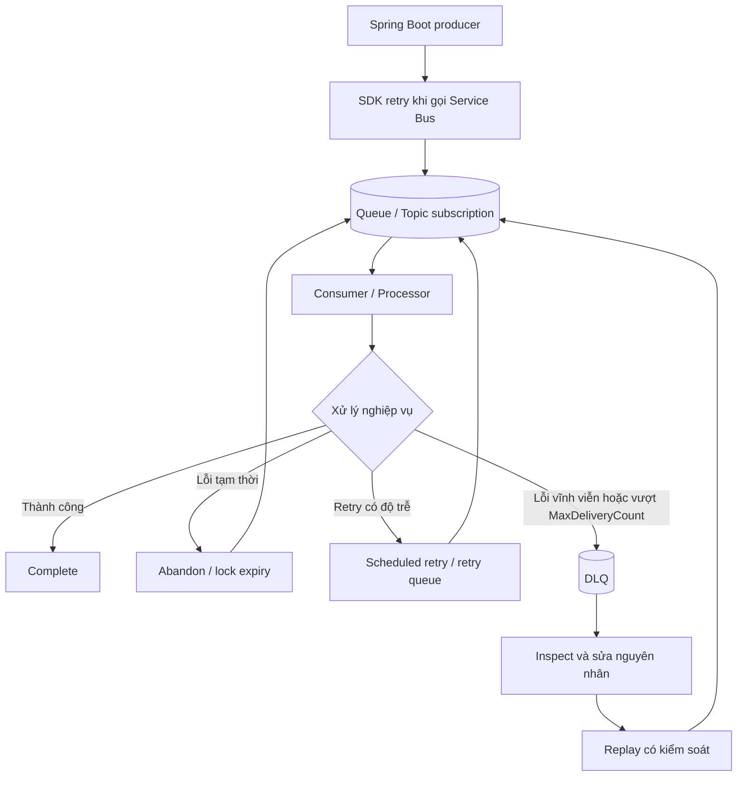
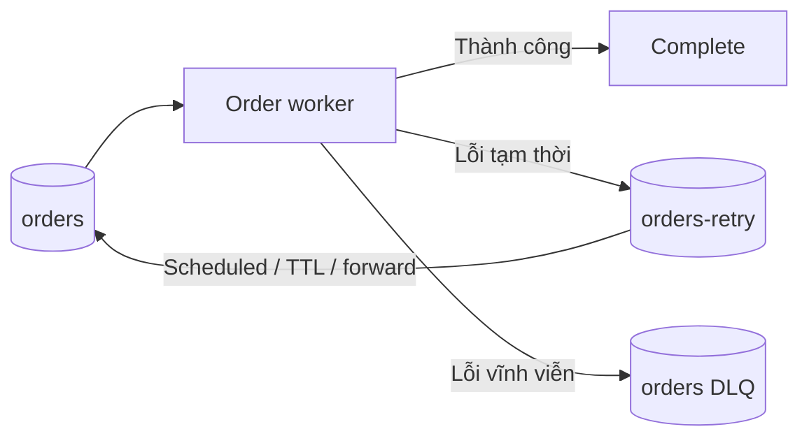

# Retry, số lần giao lại và phát lại dead-letter

> **Chương:** Azure Service Bus  
> **Module:** `SPRING_CLOUD_PROVIDER_INTEGRATION`  
> **Mục tiêu:** Phân biệt retry của Azure SDK, redelivery của broker và retry nghiệp vụ; hiểu `DeliveryCount`/`MaxDeliveryCount`; thiết kế backoff có giới hạn; đọc và phát lại message từ dead-letter queue (DLQ) an toàn bằng Spring Boot và Azure SDK for Java.

## 1. Một lỗi gửi message có thể tạo ra nhiều kiểu retry

Một worker Spring Boot nhận `DocumentUploaded` từ Azure Service Bus, đọc file trong Blob Storage rồi tạo bản xem trước. Trong lúc chạy, có thể gặp các tình huống:

- Kết nối AMQP tạm thời bị ngắt khi producer đang gửi.
- Service Bus trả lỗi throttling vì namespace nhận quá nhiều request.
- Message được nhận nhưng worker không hoàn tất trước khi lock hết hạn.
- Database tạm thời không truy cập được.
- Payload sai schema nên lần nào xử lý cũng thất bại.
- Worker đã commit kết quả nhưng mất kết nối trước khi `complete` message.
- Một message bị giao nhiều lần và cuối cùng được chuyển vào DLQ.

Từ “retry” thường được dùng cho tất cả tình huống trên, nhưng thực tế có **ba tầng khác nhau**:

1. **SDK retry:** thư viện Java thử lại một thao tác giao tiếp với Service Bus khi lỗi được xem là tạm thời.
2. **Broker redelivery:** Service Bus giao lại message cho consumer sau khi consumer abandon hoặc message lock hết hạn.
3. **Application retry:** ứng dụng quyết định thực hiện lại nghiệp vụ, chờ một khoảng thời gian, chuyển sang retry queue hoặc lên lịch message mới.

DLQ là nơi lưu message bị loại khỏi luồng xử lý bình thường sau lỗi vĩnh viễn hoặc vượt ngưỡng giao lại. **DLQ không tự động là một retry queue.** Nhóm vận hành cần điều tra, sửa nguyên nhân và quyết định có phát lại hay không.



**Điều cần đạt:** biết lỗi đang xảy ra ở tầng nào, chọn đúng cơ chế retry và chứng minh rằng message không bị mất hoặc tạo tác dụng phụ trùng.

## 2. Ba tầng retry khác nhau

| Cơ chế | Ai quyết định thử lại? | Thứ được thử lại | Có làm tăng DeliveryCount không? |
| --- | --- | --- | --- |
| **SDK retry** | Azure SDK | Thao tác gửi/nhận/settlement tới broker khi lỗi giao tiếp tạm thời | Không phải một lần giao message mới |
| **Broker redelivery** | Service Bus | Giao lại cùng message sau abandon hoặc lock hết hạn | Có |
| **Application retry** | Code nghiệp vụ | Gọi lại nghiệp vụ, abandon hoặc phát một message retry khác | Tùy cách triển khai |

Ví dụ, sender gọi `sendMessage` và gặp lỗi mạng. SDK có thể thử lại thao tác gửi theo `AmqpRetryOptions`. Đây không phải là consumer nhận message lần thứ hai.

Ngược lại, worker nhận message bằng Peek-Lock rồi gọi `abandon`. Broker thả lock và có thể giao lại message; `DeliveryCount` tăng. Đây là redelivery.

Cuối cùng, worker phát hiện dịch vụ xử lý ảnh đang quá tải và muốn thử lại sau 2 phút. `abandon` sẽ làm message sẵn sàng nhận lại ngay, không tự tạo khoảng chờ 2 phút. Nếu cần delay, ứng dụng phải dùng scheduled message hoặc retry queue/workflow riêng.

## 3. SDK retry: xử lý lỗi giao tiếp tạm thời

Azure SDK for Java có retry policy ở tầng AMQP. Khi thao tác gửi/nhận hoặc tương tác với broker gặp lỗi được đánh dấu transient, thư viện có thể thử lại theo cấu hình `AmqpRetryOptions`.

Các thuộc tính quan trọng:

| Thuộc tính | Ý nghĩa | Giá trị mặc định trong Java SDK 7.18.0 |
| --- | --- | --- |
| `Mode` | Cách tính khoảng chờ giữa các lần thử | `EXPONENTIAL` |
| `MaxRetries` | Số lần retry tối đa sau lần thử đầu | 3 |
| `Delay` | Khoảng chờ cơ sở | 800 ms |
| `MaxDelay` | Giới hạn khoảng chờ | 1 phút |
| `TryTimeout` | Thời gian tối đa cho mỗi lần thử riêng lẻ | 1 phút |

Giá trị mặc định có thể thay đổi theo phiên bản SDK. Hãy kiểm tra source/API reference của version thực tế trước khi dựa vào chúng trong SLO.

### 3.1. Cấu hình AmqpRetryOptions

Ví dụ tạo sender bean trong Spring configuration:

```java
import java.time.Duration;

import com.azure.core.amqp.AmqpRetryMode;
import com.azure.core.amqp.AmqpRetryOptions;
import com.azure.identity.DefaultAzureCredentialBuilder;
import com.azure.messaging.servicebus.ServiceBusClientBuilder;
import com.azure.messaging.servicebus.ServiceBusSenderClient;

import org.springframework.beans.factory.annotation.Value;
import org.springframework.context.annotation.Bean;
import org.springframework.context.annotation.Configuration;

@Configuration(proxyBeanMethods = false)
public class ServiceBusSenderConfiguration {

    @Bean(destroyMethod = "close")
    ServiceBusSenderClient documentEventSender(
            @Value("${app.servicebus.fqdn}") String namespace,
            @Value("${app.servicebus.queue}") String queueName) {

        AmqpRetryOptions retryOptions = new AmqpRetryOptions()
                .setMode(AmqpRetryMode.EXPONENTIAL)
                .setMaxRetries(3)
                .setDelay(Duration.ofMillis(800))
                .setMaxDelay(Duration.ofSeconds(30))
                .setTryTimeout(Duration.ofSeconds(20));

        return new ServiceBusClientBuilder()
                .credential(
                        namespace,
                        new DefaultAzureCredentialBuilder().build())
                .retryOptions(retryOptions)
                .sender()
                .queueName(queueName)
                .buildClient();
    }
}
```

Trong ví dụ:

- `namespace` là FQDN của Service Bus namespace.
- `DefaultAzureCredential` tìm credential theo môi trường; workload production cần Managed Identity hoặc identity phù hợp được cấp quyền Data Sender.
- Retry policy chỉ điều chỉnh thao tác giao tiếp của client.
- Sender là bean dùng lại trong suốt vòng đời ứng dụng; không tạo một kết nối mới cho mỗi message.

`TryTimeout` là giới hạn của **mỗi lần thử**, không phải tổng thời gian tối đa của toàn bộ chuỗi retry. Tổng thời gian còn phụ thuộc số lần thử và các khoảng chờ.

### 3.2. Exponential backoff

Với exponential backoff, khoảng chờ tăng theo số lần thử, thường bị giới hạn bởi `MaxDelay`. Một mô hình khái niệm:

```text
delay(attempt) = min(maxDelay, baseDelay * 2^(attempt - 1))
```

Một số retry policy có thể thêm jitter để tránh nhiều client cùng retry tại một thời điểm. Hãy xem hành vi cụ thể của SDK đang dùng; không tự giả định công thức nội bộ giống hệt mọi thư viện.

Ví dụ minh họa với base delay 800 ms và max delay 30 giây:

| Lần retry | Khoảng chờ khái niệm |
| --- | --- |
| 1 | 800 ms |
| 2 | 1,6 giây |
| 3 | 3,2 giây |
| Các lần sau | Tăng tiếp nhưng không vượt 30 giây |

Mục đích là cho dịch vụ thời gian phục hồi và tránh tạo thêm tải trong lúc đang throttling.

### 3.3. Không retry lỗi cấu hình hoặc lỗi nghiệp vụ

Một số lỗi không tự biến mất khi thử lại:

- Identity thiếu quyền `Azure Service Bus Data Sender` hoặc `Data Receiver`.
- Namespace hoặc queue/subscription không tồn tại.
- Payload vượt giới hạn message.
- Dữ liệu không hợp lệ hoặc schema version không được hỗ trợ.
- Gọi API sai trạng thái, ví dụ settlement bằng lock token đã mất.

SDK có thể trả exception sau khi đã dùng hết retry cho lỗi transient. Với `ServiceBusException`, hãy xem `isTransient()` và `getReason()` để phân loại:

```java
import com.azure.messaging.servicebus.ServiceBusException;

try {
    sender.sendMessage(message);
} catch (ServiceBusException exception) {
    if (exception.isTransient()) {
        // SDK đã thử theo retry policy nhưng thao tác vẫn thất bại.
        // Kiểm tra kết nối, tải và cấu hình retry.
    } else {
        // Kiểm tra reason: permission, entity, trạng thái hoặc request.
    }

    throw exception;
}
```

Khi `isTransient()` là `true`, SDK đã áp dụng retry policy cho thao tác đó và các lần thử đều thất bại. Ứng dụng có thể cần retry ở cấp cao hơn sau khi kiểm tra trạng thái, nhưng không nên lặp vô hạn.

### 3.4. Timeout không chứng minh thao tác chưa thành công

Đây là trường hợp đặc biệt quan trọng với producer:

1. Producer gửi message.
2. Broker nhận và lưu message.
3. Acknowledgement bị mất trên đường về.
4. Producer nhận timeout và không biết broker đã lưu message hay chưa.

Nếu producer gửi lại bằng MessageId mới, có thể tạo hai message. Dùng MessageId ổn định, bật duplicate detection khi phù hợp và bảo đảm consumer idempotent. Tương tự, nếu `complete` timeout sau khi nghiệp vụ đã commit, message có thể được giao lại.

## 4. Broker redelivery và DeliveryCount

Khi nhận bằng Peek-Lock, Service Bus giữ message trong trạng thái locked trong thời gian lock còn hiệu lực. Nếu consumer:

- Gọi `abandon`, hoặc
- Không settle trước khi lock hết hạn,

message có thể được giao lại. Mỗi lần abandon hoặc lock hết hạn làm `DeliveryCount` tăng.

`DeliveryCount` là số lần broker đã giao message tới consumer. Nó **không phải** số lần SDK retry thao tác send/receive và cũng không phải số lần code nghiệp vụ gọi một hàm nội bộ.

### 4.1. MaxDeliveryCount

Queue hoặc topic subscription có thuộc tính `MaxDeliveryCount`. Giá trị mặc định thường là **10**. Khi DeliveryCount vượt ngưỡng này, Service Bus chuyển message sang DLQ với reason `MaxDeliveryCountExceeded`.

Ví dụ:

```text
Message được giao (DeliveryCount = 1)
    ↓
Worker abandon hoặc lock hết hạn
    ↓
Message được giao lại (DeliveryCount tăng)
    ↓
Lặp lại cho tới khi xử lý thành công
    ↓
Nếu vượt MaxDeliveryCount
    ↓
Message được chuyển vào DLQ
```

Không hiểu `MaxDeliveryCount = 10` là “ứng dụng được phép gọi retry tùy ý 10 lần”. Nó là ngưỡng broker theo dõi các lần giao lại/abandon/lock expiry. Một lỗi database bên trong handler được retry bằng vòng lặp Java nhiều lần nhưng message vẫn đang ở cùng một lần giao; các vòng retry nội bộ đó không tự tăng DeliveryCount.

### 4.2. Khi nào DeliveryCount tăng?

| Sự kiện | DeliveryCount |
| --- | --- |
| Consumer nhận message bằng Peek-Lock | Có giá trị lần giao hiện tại |
| Consumer gọi `abandon` | Tăng khi message được giao lại |
| Message lock hết hạn | Tăng khi message được giao lại |
| Consumer complete thành công | Message bị loại khỏi luồng nhận bình thường |
| SDK retry một thao tác AMQP tạm thời | Không phải lần giao message mới |
| Consumer gọi retry một hàm nghiệp vụ trong cùng callback | Không tự tăng |
| Consumer đóng receiver trước settlement | Lock hết hạn, message có thể redeliver và DeliveryCount tăng |

Một lỗi phổ biến là callback nhận message, khởi chạy công việc nền rồi kết thúc mà không đợi kết quả. Processor có thể auto-complete hoặc auto-abandon theo cấu hình; message bị settle sai thời điểm hoặc bị giao lại. Hãy để callback quản lý đúng vòng đời công việc và settlement.

### 4.3. DeliveryCount cao là tín hiệu chẩn đoán

DeliveryCount tăng nhanh có thể chỉ ra:

- Handler luôn ném exception.
- Consumer thiếu quyền truy cập database/storage.
- Lock duration quá ngắn hoặc auto-renew không đủ.
- Consumer đóng connection trước khi settlement.
- Message chứa payload sai hoặc dependency không thể phục hồi.
- Throttling, network hoặc resource exhaustion.

Không nên chỉ tăng `MaxDeliveryCount` để làm DLQ ít message hơn. Trước tiên hãy xác định vì sao message không được complete.

## 5. Phân loại lỗi trước khi chọn retry

| Loại lỗi | Ví dụ | Hành động gợi ý |
| --- | --- | --- |
| **Transient ở Service Bus** | ServiceBusy, lỗi mạng ngắn, timeout tạm thời | Để SDK retry theo policy; nếu hết retry thì quan sát và thử lại có giới hạn |
| **Transient ở dependency nghiệp vụ** | Database timeout ngắn, Blob Storage throttling | Retry ngắn có backoff hoặc abandon; cân nhắc scheduled retry nếu cần delay |
| **Permanent theo payload** | JSON sai, thiếu document ID, schema không hỗ trợ | Dead-letter với reason rõ ràng |
| **Permanent theo cấu hình** | RBAC thiếu, namespace sai, entity không tồn tại | Dừng/pause consumer, sửa cấu hình/quyền; không retry message vô hạn |
| **Business rejection** | Tài liệu không đạt điều kiện nghiệp vụ | Ghi trạng thái từ chối; dead-letter hoặc hoàn tất theo contract |
| **Kết quả không chắc chắn** | Send/complete timeout sau khi broker hoặc DB có thể đã commit | Dùng ID ổn định, kiểm tra idempotency và trạng thái trước khi lặp side effect |
| **Lock lost** | Handler chạy lâu, connection bị detach | Không settle bằng lock cũ; message có thể redeliver, consumer phải idempotent |

### 5.1. Không biến lỗi vĩnh viễn thành retry nóng

Ví dụ worker thiếu quyền đọc Blob Storage. Nếu cứ abandon message, mỗi lần giao lại worker vẫn thiếu quyền và cuối cùng message vào DLQ. Cách đúng là:

1. Phát hiện lỗi permission.
2. Ghi log/audit an toàn với message ID và resource liên quan.
3. Cảnh báo nhóm vận hành.
4. Tạm dừng nhận nếu lỗi ảnh hưởng toàn bộ worker.
5. Sửa role hoặc policy.
6. Sau khi quyền đúng, replay có kiểm soát message đang ở DLQ.

Nếu lỗi chỉ xảy ra với một message do object key sai, hãy phân loại thành lỗi dữ liệu và không retry liên tục.

## 6. Retry nghiệp vụ: retry ngay hay retry có độ trễ?

Service Bus có thao tác `abandon`, nhưng abandon **không phải scheduled retry**. Nó mở khóa message để broker có thể giao lại ngay khi có receiver. Nếu dependency vẫn đang down, consumer có thể nhận và abandon liên tục.

Có ba cách xử lý thường gặp:

| Cách | Cách hoạt động | Phù hợp khi | Rủi ro |
| --- | --- | --- | --- |
| Retry ngắn trong handler | Gọi lại dependency một số lần với backoff ngắn trước settlement | Lỗi ngắn, thao tác nhanh, thời gian nằm trong lock budget | Giữ lock và thread; cần timeout rõ |
| Abandon/redelivery | Trả message cho broker để giao lại | Muốn thử lại sớm, consumer khác có thể xử lý | Không có delay tùy ý; DeliveryCount tăng |
| Scheduled retry/retry queue | Phát message retry có thời điểm enqueue trong tương lai | Cần chờ vài giây/phút hoặc dependency phục hồi | Phải quản lý retry count, ID và khả năng trùng |

Không dùng `Thread.sleep` dài trong callback để chờ dependency. Điều đó giữ lock, chiếm thread và giảm throughput. Nếu phải chờ lâu, hãy schedule một message mới hoặc chuyển công việc sang job bền vững.

### 6.1. Retry ngắn có giới hạn trong handler

Một số thao tác có thể retry nội bộ trước khi complete/abandon, ví dụ gọi một API có lỗi 429 trong thời gian ngắn. Cần:

- Giới hạn số lần thử.
- Dùng exponential backoff và jitter nếu có nhiều worker.
- Đặt timeout cho từng lần gọi.
- Tổng thời gian retry phải nằm trong lock/auto-renew budget.
- Chỉ retry lỗi được xác định là tạm thời.
- Nếu hết retry, chọn abandon, scheduled retry hoặc dead-letter theo loại lỗi.

Nếu handler chạy quá lâu, lock có thể hết hạn và message được giao cho worker khác trong khi worker cũ vẫn đang làm việc. Idempotency vẫn bắt buộc.

### 6.2. Abandon để broker giao lại

Ví dụ processor dùng manual settlement:

```java
private void handleMessage(ServiceBusReceivedMessageContext context) {
    var message = context.getMessage();

    try {
        documentService.processIdempotently(
                message.getMessageId(),
                message.getBody());

        context.complete();

    } catch (TemporaryDependencyException exception) {
        // Message có thể được giao lại ngay.
        context.abandon();

    } catch (InvalidPayloadException exception) {
        context.deadLetter();
    }
}
```

Ví dụ giả định processor đã được tạo với `disableAutoComplete()`. Trong ứng dụng thật, phân loại exception phải đủ chính xác; không bắt mọi `Exception` rồi abandon vì lỗi permission hoặc payload sai sẽ tạo retry loop.

### 6.3. Scheduled retry bằng Java SDK

Azure Service Bus hỗ trợ scheduled message. `ServiceBusSenderClient.scheduleMessage(message, scheduledEnqueueTime)` gửi một message sẽ chỉ xuất hiện trong queue/topic tại thời điểm được chỉ định. API trả về sequence number của scheduled message; có thể dùng để hủy nếu message chưa được kích hoạt.

Một message retry nên có:

- `originalEventId` hoặc business ID ổn định.
- `retryAttempt` tăng dần.
- `MessageId` mới, xác định cho **lần retry cụ thể**.
- `CorrelationId` giữ nguyên để truy vết.
- `SessionId`/`PartitionKey` được giữ nếu entity yêu cầu.
- Thời điểm retry và lý do retry được ghi rõ.

Ví dụ tạo scheduled retry message từ message đang xử lý:

```java
import java.time.OffsetDateTime;
import java.time.ZoneOffset;

import com.azure.messaging.servicebus.ServiceBusMessage;
import com.azure.messaging.servicebus.ServiceBusReceivedMessage;
import com.azure.messaging.servicebus.ServiceBusSenderClient;

public long scheduleRetry(
        ServiceBusSenderClient sender,
        ServiceBusReceivedMessage original,
        String originalEventId,
        int nextAttempt,
        java.time.Duration delay,
        String replayBatchId) {

    // Constructor này sao chép body và các message properties phù hợp.
    ServiceBusMessage retry = new ServiceBusMessage(original);

    // ID mới cho lần retry, ổn định nếu cùng lần retry phải được gửi lại.
    String retryMessageId = originalEventId
            + ":retry:" + nextAttempt
            + ":" + replayBatchId;

    retry.setMessageId(retryMessageId);

    retry.getApplicationProperties().put("originalEventId", originalEventId);
    retry.getApplicationProperties().put("retryAttempt", nextAttempt);
    retry.getApplicationProperties().put("retryReason", "TemporaryDependencyFailure");

    OffsetDateTime scheduledTime =
            OffsetDateTime.now(ZoneOffset.UTC).plus(delay);

    return sender.scheduleMessage(retry, scheduledTime);
}
```

Đây là helper minh họa; `originalEventId`, `replayBatchId` và `nextAttempt` phải được quản lý bền vững. Khi handler schedule thành công, nó mới complete message gốc. Nếu schedule thất bại, có thể abandon message gốc hoặc ghi trạng thái lỗi để retry theo chính sách.

**Cẩn thận với khoảng hở schedule/complete:** scheduled message có thể đã được broker nhận nhưng complete message gốc lại thất bại. Khi message gốc redeliver, worker có thể schedule lần nữa. Dùng ID retry ổn định, duplicate detection nếu phù hợp và bảng retry/inbox có unique constraint để chống tạo nhiều lịch retry cho cùng một lần thử. Nếu không có duplicate detection, cần cơ chế lưu retry operation ID trong database.

Không dùng lại MessageId của message gốc cho scheduled retry khi duplicate detection đang bật trên cùng entity; broker có thể xem retry là bản trùng trong cửa sổ dedup. Giữ `originalEventId` riêng để consumer idempotent theo sự kiện nghiệp vụ.

### 6.4. Backoff cho retry nghiệp vụ

Một lịch retry có thể dùng exponential backoff với jitter:

```text
delay = min(maxDelay, baseDelay * 2^(attempt - 1))
delayWithJitter = delay * random(0.8, 1.2)
```

Ví dụ bài lab:

| Retry attempt | Delay mục tiêu |
| --- | --- |
| 1 | Khoảng 10 giây |
| 2 | Khoảng 30 giây |
| 3 | Khoảng 2 phút |
| 4 | Khoảng 5 phút |
| Vượt số lần cho phép | Dead-letter hoặc chuyển sang quy trình điều tra |

Các con số là chính sách minh họa, không phải mặc định Service Bus. Hãy chọn theo SLO, TTL, thời gian phục hồi dependency và chi phí vận hành. Jitter giúp nhiều worker không cùng phát retry đúng một thời điểm.

### 6.5. Retry queue riêng

Một kiến trúc khác là có queue chính và một hoặc nhiều retry queue:



Retry queue có thể dùng scheduled delivery, TTL hoặc auto-forward để đưa message trở lại luồng xử lý. Cần thiết kế rõ:

- Queue nào sở hữu retry attempt.
- Cách bảo đảm MessageId không bị dedup nhầm.
- Cách giới hạn số lần chuyển qua retry queue.
- Cách quan sát backlog và message age ở từng queue.
- Cách tránh vòng auto-forward không giới hạn.
- Cách giữ SessionId nếu cần ordering.

Với workload đơn giản, scheduled message có thể đủ. Với workflow lớn hoặc nhiều mức delay, retry queue giúp vận hành dễ quan sát hơn.

## 7. MaxDeliveryCount, retry attempt và TTL

Không nên dùng một con số duy nhất cho mọi giới hạn.

| Thuộc tính | Tầng | Vai trò |
| --- | --- | --- |
| `AmqpRetryOptions.maxRetries` | SDK | Số lần SDK retry thao tác giao tiếp transient |
| `DeliveryCount` | Broker | Số lần message được giao; tăng khi abandon/lock expiry |
| `MaxDeliveryCount` | Queue/subscription | Ngưỡng chuyển message vào DLQ |
| `retryAttempt` | Ứng dụng | Số lần ứng dụng đã tạo một lần retry nghiệp vụ |
| `TimeToLive` | Message/entity | Thời gian message còn hữu ích trước khi hết hạn |

Ví dụ một message có thể có SDK retry 3 lần trong lúc gửi, sau đó consumer nhận message lần đầu. Consumer gặp lỗi database, schedule retry attempt 1. Scheduled message đến queue và được nhận lại. Consumer vẫn có thể gặp lock loss hoặc redelivery. Các chỉ số này có mục đích khác nhau.

### 7.1. TTL và scheduled retry

Với scheduled message, message chỉ trở thành active tại thời điểm scheduled enqueue. TTL được tính từ thời điểm message thực sự được enqueue/activate, không phải thời điểm producer gửi lệnh schedule.

Nếu đặt TTL quá ngắn, message retry có thể hết hạn ngay sau khi được kích hoạt. Hãy tính thời gian chờ schedule, TTL sau kích hoạt và mục tiêu xử lý nghiệp vụ. Nếu message hết TTL và entity bật dead-letter-on-expiration, message có thể vào DLQ với reason `TTLExpiredException`.

### 7.2. Retry không được vượt quá thời hạn nghiệp vụ

Một đơn hàng có thể chỉ được xử lý trong 30 phút; một mã OTP có thể chỉ có hiệu lực 5 phút. Không retry một message vô thời hạn khi sự kiện đã hết ý nghĩa.

Đặt `expiresAt` hoặc business deadline trong payload/metadata nếu cần. Consumer kiểm tra deadline trước khi tạo tác dụng phụ. Nếu đã quá hạn, ghi trạng thái hết hạn hoặc dead-letter theo quy trình; không tiếp tục schedule retry chỉ vì broker vẫn giữ message.

## 8. Dead-letter queue là gì?

DLQ là subqueue phụ gắn với **mỗi queue hoặc topic subscription**. Không cần tạo DLQ thủ công. Mỗi subscription của topic có DLQ riêng; topic không có một DLQ chung chứa tất cả message.

DLQ lưu message không thể giao hoặc không thể xử lý. Message chỉ được đưa vào DLQ bởi broker hoặc thao tác dead-letter của consumer; muốn gửi lại phải lấy message ra và phát lại qua queue/topic đích.

### 8.1. Những nguyên nhân phổ biến

| DeadLetterReason | Nguyên nhân | Hướng điều tra |
| --- | --- | --- |
| `MaxDeliveryCountExceeded` | DeliveryCount vượt MaxDeliveryCount | Kiểm tra exception handler, abandon, lock expiry, shutdown và dependency |
| `TTLExpiredException` | Message hết TTL khi dead-letter-on-expiration bật | Kiểm tra backlog, TTL và thời gian xử lý |
| `HeaderSizeExceeded` | Message/header vượt quota | Giảm payload hoặc application properties |
| `Session ID is null` | Entity yêu cầu sessions nhưng producer không gán SessionId | Kiểm tra producer và entity |
| `MaxTransferHopCountExceeded` | Auto-forward vượt số hop cho phép | Rút ngắn chuỗi forwarding |
| Custom reason | Ứng dụng chủ động dead-letter | Xem reason/description và contract |

Các reason hệ thống được broker gán; ứng dụng có thể tự định nghĩa reason riêng cho lỗi nghiệp vụ.

### 8.2. DLQ có một số đặc điểm riêng

- Mỗi queue và topic subscription có DLQ riêng.
- DLQ không tự động cleanup.
- TTL không được áp dụng cho message đang nằm trong DLQ.
- Message vẫn có thể được nhận bằng Peek-Lock và cần complete để xóa khỏi DLQ.
- Không thể dead-letter message từ DLQ sang một DLQ lồng nhau.
- Message trong DLQ có thể được inspect, sửa dữ liệu theo quy trình và resubmit.
- Với auto-forward hoặc send-via thất bại, có **transfer dead-letter queue (TDLQ)** riêng của entity nguồn.

Vì không có TTL và không tự cleanup, DLQ cần dashboard, cảnh báo, quy trình lưu giữ và người chịu trách nhiệm xử lý.

### 8.3. DLQ của topic nằm ở subscription

Ví dụ topic `document-events` có hai subscription:

```text
document-events
  ├── preview-worker
  │     └── $DeadLetterQueue
  └── audit-worker
        └── $DeadLetterQueue
```

Nếu preview worker không xử lý được message, message vào DLQ của `preview-worker`. Audit worker vẫn có thể đã xử lý message thành công ở subscription riêng. Không replay một message của preview subscription rồi mặc định audit cần nhận lại.

### 8.4. DLQ khác transfer DLQ

- **DLQ:** message không thể xử lý hoặc đã bị consumer/broker loại khỏi luồng chính.
- **Transfer DLQ:** message không thể được chuyển tiếp tới entity đích trong auto-forward/send-via scenario; message được giữ ở transfer DLQ của entity nguồn.

Khi DLQ chính trống nhưng message vẫn mất khỏi đích auto-forward, hãy kiểm tra transfer DLQ của nguồn.

## 9. Đọc DLQ bằng Azure SDK for Java

Java SDK hỗ trợ tạo receiver kết nối trực tiếp vào dead-letter subqueue bằng `SubQueue.DEAD_LETTER_QUEUE`.

### 9.1. Tạo DLQ receiver cho queue

```java
import com.azure.identity.DefaultAzureCredentialBuilder;
import com.azure.messaging.servicebus.ServiceBusClientBuilder;
import com.azure.messaging.servicebus.ServiceBusReceiverClient;
import com.azure.messaging.servicebus.models.ServiceBusReceiveMode;
import com.azure.messaging.servicebus.models.SubQueue;

ServiceBusReceiverClient dlqReceiver =
        new ServiceBusClientBuilder()
                .credential(
                        fullyQualifiedNamespace,
                        new DefaultAzureCredentialBuilder().build())
                .receiver()
                .queueName("preview-jobs")
                .subQueue(SubQueue.DEAD_LETTER_QUEUE)
                .receiveMode(ServiceBusReceiveMode.PEEK_LOCK)
                .buildClient();
```

Với topic subscription, thay `queueName` bằng:

```java
.topicName("document-events")
.subscriptionName("preview-worker")
.subQueue(SubQueue.DEAD_LETTER_QUEUE)
```

Identity đọc DLQ cần quyền Data Receiver trên entity tương ứng. Để replay sang queue/topic, sender cần quyền Data Sender trên đích.

### 9.2. Nhận và inspect một message

```java
import com.azure.messaging.servicebus.ServiceBusReceivedMessage;

ServiceBusReceivedMessage message =
        dlqReceiver.receiveMessage();

if (message != null) {
    System.out.println("MessageId: " + message.getMessageId());
    System.out.println("DeliveryCount: " + message.getDeliveryCount());
    System.out.println("Reason: " + message.getDeadLetterReason());
    System.out.println("Description: "
            + message.getDeadLetterErrorDescription());
    System.out.println("CorrelationId: " + message.getCorrelationId());
    System.out.println("SessionId: " + message.getSessionId());
    System.out.println("EnqueuedTime: " + message.getEnqueuedTime());

    // Chỉ complete sau khi đã lưu kết quả điều tra hoặc quyết định xử lý.
}
```

Đừng complete message ngay sau khi đọc nếu chưa ghi nhận thông tin cần thiết. Với Peek-Lock, message sẽ được giao lại nếu lock hết hạn; hãy xử lý trong thời gian lock và settlement trước khi đóng receiver.

### 9.3. Ghi nhận reason và description

DLQ reason/description giúp phân loại nguyên nhân. Không ghi toàn bộ payload nhạy cảm vào description. Nên giữ:

- Message ID, original event ID và correlation ID.
- Entity nguồn và subscription.
- Dead-letter reason/description.
- DeliveryCount và thời điểm enqueue.
- Schema version hoặc event type.
- Trace ID và mã lỗi có thể tra cứu log.

Nếu cần lưu payload để điều tra, dùng kho lưu trữ an toàn có quyền truy cập và retention phù hợp.

## 10. Phát lại message từ DLQ

Replay là việc **gửi lại message đã dead-letter** tới entity xử lý. Đây là hành động có thể tạo tác dụng phụ nghiệp vụ, vì vậy phải thực hiện sau khi nguyên nhân đã được xử lý.

Một quy trình tốt:

1. Inspect DLQ và phân loại reason.
2. Xác định lỗi nằm ở producer, schema, quyền, dependency hay worker.
3. Sửa code/config/data trước khi replay.
4. Chọn message hoặc batch có phạm vi nhỏ.
5. Giữ business event ID/original message ID trong metadata để consumer idempotent.
6. Gửi message mới tới đích phù hợp.
7. Chỉ complete bản ghi cũ trong DLQ sau khi việc resubmit được xác nhận.
8. Theo dõi kết quả xử lý, message mới có vào DLQ lại không và có side effect trùng không.

### 10.1. Replay bằng ServiceBusMessage

Java SDK có constructor `new ServiceBusMessage(ServiceBusReceivedMessage)` để tạo message mới từ message đã nhận và sao chép các thuộc tính phù hợp. Ứng dụng có thể đặt MessageId mới và thêm metadata audit.

Ví dụ replay từ DLQ của queue về chính queue đó:

```java
import com.azure.messaging.servicebus.ServiceBusMessage;
import com.azure.messaging.servicebus.ServiceBusReceivedMessage;
import com.azure.messaging.servicebus.ServiceBusReceiverClient;
import com.azure.messaging.servicebus.ServiceBusSenderClient;

public void replayOne(
        ServiceBusReceiverClient dlqReceiver,
        ServiceBusSenderClient originalQueueSender,
        ServiceBusReceivedMessage deadLettered,
        String replayBatchId) {

    String originalMessageId = deadLettered.getMessageId();

    // Constructor sao chép body và các message properties phù hợp.
    ServiceBusMessage replay = new ServiceBusMessage(deadLettered);

    // Dùng ID riêng cho lần replay, nhưng giữ ID gốc để idempotency.
    String replayMessageId = originalMessageId + ":replay:" + replayBatchId;
    replay.setMessageId(replayMessageId);

    replay.getApplicationProperties().put(
            "originalMessageId", originalMessageId);
    replay.getApplicationProperties().put(
            "replayBatchId", replayBatchId);
    replay.getApplicationProperties().put(
            "originalDeadLetterReason",
            deadLettered.getDeadLetterReason());

    // Gửi lại trước; chỉ complete DLQ khi send đã được chấp nhận.
    originalQueueSender.sendMessage(replay);
    dlqReceiver.complete(deadLettered);
}
```

Đây là ví dụ tối giản cho **queue không cần chỉnh sửa payload**. Trong ứng dụng thật:

- `replayBatchId` phải được lưu bền vững và giữ nguyên khi retry cùng một thao tác replay.
- Giữ `originalEventId` trong body/application properties để consumer chống tác dụng phụ lặp.
- Nếu message chứa schema cũ, có thể cần chuyển đổi payload trước khi gửi lại.
- Nếu entity yêu cầu sessions, bảo đảm SessionId được giữ.
- Nếu entity partitioned, bảo đảm PartitionKey được giữ đúng.
- Xem lại TTL; không sao chép TTL cũ một cách mù quáng. Chọn TTL mới theo chính sách replay.
- Không copy lock token, sequence number hoặc DeliveryCount như thuộc tính gửi đi; đây là metadata của lần giao cũ.

Nếu send thành công nhưng complete DLQ thất bại do network/lock loss, message cũ có thể vẫn còn trong DLQ và được replay lần nữa. Stable replay ID, duplicate detection và consumer idempotency giúp kiểm soát tình huống này. Không coi một lần gọi send/complete timeout là bằng chứng chắc chắn rằng thao tác chưa xảy ra.

### 10.2. MessageId nào nên dùng khi replay?

Có hai ID cần tách:

- **Original event ID:** giữ nguyên để xác định cùng một sự kiện nghiệp vụ và chống side effect trùng.
- **Replay MessageId:** ID mới, ổn định cho một lần replay operation cụ thể.

Nếu giữ nguyên MessageId cũ, duplicate detection trên entity đích có thể loại message replay trong cửa sổ dedup vì broker đã thấy ID đó trước đây. Nếu dùng ID mới hoàn toàn ngẫu nhiên mỗi lần chạy, retry thao tác replay có thể tạo nhiều bản sao.

Một mẫu là tạo ID replay xác định từ `originalMessageId + replayBatchId`. Khi cùng thao tác replay phải được gửi lại, giữ nguyên replayBatchId. Consumer vẫn idempotent theo original event ID/business key.

### 10.3. Replay DLQ của topic subscription cần đặc biệt cẩn thận

DLQ của topic thuộc về **một subscription**. Khi resubmit message vào topic gốc, broker lại phân phối tới tất cả subscription có rule phù hợp. Điều này có thể làm những consumer đã xử lý thành công ở lần đầu nhận lại cùng sự kiện.

Nếu mục tiêu chỉ là xử lý lại subscription bị lỗi:

- Cân nhắc một retry queue riêng cho consumer đó.
- Hoặc tạo một luồng replay được định tuyến chỉ tới consumer đích.
- Nếu buộc phải publish lại topic, bảo đảm tất cả subscription có consumer idempotent và hiểu rằng họ có thể nhận lại event.

Không có thao tác gửi trực tiếp vào một subscription như gửi vào queue; producer gửi lên topic, còn filter/rule quyết định subscription nhận bản sao.

### 10.4. Replay có thể làm thay đổi thứ tự

Khi resubmit, message được enqueue lại với sequence number và enqueue time mới. Nó không trở về vị trí ban đầu trong queue. Với entity bật sessions, message replay có thể xuất hiện sau những event khác của cùng session.

Vì vậy:

- Ghi lại original sequence number và business sequence/version.
- Replay theo thứ tự nghiệp vụ cần thiết.
- Kiểm tra aggregate state trước khi áp dụng.
- Không giả định SessionId tự khôi phục thứ tự ban đầu.
- Với workflow nghiêm ngặt, dùng repair/reconciliation thay vì replay hàng loạt.

## 11. Replay và retry phải có giới hạn

Một retry policy vận hành được cần giới hạn:

| Giới hạn | Mục đích |
| --- | --- |
| Max SDK retries | Tránh một thao tác giao tiếp giữ request quá lâu |
| Max application retry attempts | Tránh một nghiệp vụ lặp vô hạn |
| Retry max delay | Không chờ vượt quá deadline |
| Message TTL | Loại bỏ công việc đã hết ý nghĩa |
| MaxDeliveryCount | Đưa message giao lại quá nhiều lần vào DLQ |
| DLQ replay batch size | Giảm phạm vi ảnh hưởng khi phát lại |
| Replay rate limit | Không tạo tải đột biến lên dependency vừa phục hồi |

Không nên đặt mọi giới hạn bằng cùng một số. SDK retry, application retry, DeliveryCount và TTL có ý nghĩa khác nhau.

### 11.1. Poison message

Poison message là message mà consumer không thể xử lý thành công do payload hoặc điều kiện cố định. Ví dụ:

- JSON sai cú pháp.
- Event version không hỗ trợ.
- Document ID không tồn tại và không thể được tạo.
- Required property thiếu.
- Message có cấu trúc không hợp lệ.

Nếu lỗi là vĩnh viễn, dead-letter sớm với reason rõ ràng thay vì abandon đến khi MaxDeliveryCount bị vượt. Điều này giảm tải và giúp nhóm vận hành nhận diện vấn đề ngay.

### 11.2. Dependency outage

Nếu database hoặc storage ngừng hoạt động cho toàn bộ worker:

1. Đừng nhận vô hạn rồi abandon liên tục.
2. Dùng health signal/circuit breaker để pause hoặc giảm nhận.
3. Để SDK retry các thao tác Service Bus transient theo policy.
4. Khi dependency phục hồi, resume worker.
5. Theo dõi backlog và tốc độ xử lý để không tạo tải dồn.

Nếu chỉ một số message cần chờ lâu, scheduled retry hoặc retry queue có thể phù hợp hơn.

## 12. Xử lý DLQ bằng thao tác vận hành

Có thể dùng Service Bus Explorer trong Azure Portal hoặc công cụ quản trị phù hợp để:

- Peek message mà không khóa để điều tra.
- Nhận message bằng Peek-Lock khi cần thao tác.
- Xem reason, description, application properties và body.
- Chỉnh sửa nội dung/metadata theo quy trình.
- Resubmit từng message hoặc batch.
- Complete message trong DLQ sau khi đã xử lý.

Không chỉnh sửa hàng loạt payload mà không có bản ghi audit. Mỗi replay cần có người/phần mềm chịu trách nhiệm, thời điểm, lý do, batch ID và kết quả.

### 12.1. Checklist trước khi replay

- Nguyên nhân dead-letter đã được xác định chưa?
- Code/config/schema đã được sửa chưa?
- Đích replay có đúng queue/topic không?
- Topic replay có làm các subscription khác nhận lại không?
- Message có SessionId/PartitionKey cần giữ không?
- TTL mới có phù hợp không?
- MessageId replay có ổn định khi retry cùng operation không?
- Consumer có idempotent theo original event/business ID không?
- Có audit record và replay batch ID không?
- Có giới hạn tốc độ và số message trong batch không?
- Có thể rollback hoặc dừng replay nếu phát hiện tác dụng phụ không?

## 13. Observability cho retry và DLQ

Chỉ nhìn số message active là chưa đủ. Hãy theo dõi cả tầng SDK, broker, nghiệp vụ và DLQ.

| Metric/log | Ý nghĩa | Khi nào cần điều tra |
| --- | --- | --- |
| SDK transient exception count | Số lỗi giao tiếp tạm thời | Tăng theo thời gian hoặc cùng thời điểm ServiceBusy |
| SDK retry exhausted | Thao tác vẫn thất bại sau retry | Network, timeout, namespace health, client overload |
| DeliveryCount distribution | Mức độ message bị giao lại | Nhiều message gần MaxDeliveryCount |
| Active message count/age | Backlog và tuổi message | Consumer không theo kịp producer |
| Abandon count | Consumer trả message về | Handler lỗi hoặc dependency không ổn định |
| Dead-letter count theo reason | Lý do message bị loại | Poison payload, TTL, permission, lock loss |
| Retry scheduled count | Số message đang chờ retry | Retry queue phình hoặc dependency outage kéo dài |
| Replay count theo batch | Số message được phát lại | Phát lại quá nhiều hoặc lặp batch |
| Idempotency hit | Consumer gặp event đã xử lý | Redelivery/replay/producer retry |
| End-to-end completion time | Từ lúc phát event tới trạng thái cuối | Retry làm vượt SLO |

Log nên có `MessageId`, `originalEventId`, `CorrelationId`, `retryAttempt`, `DeliveryCount`, `DeadLetterReason` và entity name. Không ghi access token, connection string hoặc payload nhạy cảm.

### Runbook: MaxDeliveryCountExceeded tăng

1. Xác định queue/subscription và thời điểm bắt đầu.
2. Đọc một mẫu message trong DLQ; nhóm theo reason, schema version và event type.
3. Kiểm tra log worker để tìm lỗi handler, lock lost, permission hoặc dependency.
4. Kiểm tra DeliveryCount, lock duration, processor auto-renew và shutdown.
5. Sửa nguyên nhân trước khi replay.
6. Replay một nhóm nhỏ và theo dõi kết quả.
7. Điều chỉnh alert/test để phát hiện sớm lỗi tương tự.

### Runbook: SDK retry/ServiceBusy tăng

1. Kiểm tra namespace Resource health và Azure Service Bus metrics.
2. Xem số receiver, concurrency, prefetch và request rate.
3. Kiểm tra CPU/thread starvation và connection/I/O thread.
4. Giảm tải hoặc concurrency khi cần.
5. Xem retry policy, try timeout và backoff.
6. Khi dịch vụ phục hồi, theo dõi backlog và message age.

### Runbook: DLQ replay tạo message trùng

1. Dừng batch replay tiếp theo.
2. Kiểm tra replayBatchId, replay MessageId và original event ID.
3. Xác minh duplicate detection có bật trên entity đích không.
4. Kiểm tra consumer inbox/idempotency và side effect đã xảy ra.
5. Xác định message nào đã được xử lý; tránh replay lại vô điều kiện.
6. Tiếp tục theo batch nhỏ với audit.

## 14. Kiểm thử retry, delivery count và DLQ

| Bài test | Cách thực hiện | Kết quả mong đợi |
| --- | --- | --- |
| SDK transient retry | Tạo lỗi mạng/throttling có kiểm soát | SDK thử lại theo AmqpRetryOptions |
| SDK retry exhausted | Để lỗi transient kéo dài quá retry budget | Exception được trả về và log có reason |
| Lỗi permanent | Dùng identity thiếu quyền hoặc entity sai | Không retry vô hạn; lỗi được phân loại |
| Abandon | Handler lỗi tạm thời rồi abandon | Message được giao lại và DeliveryCount tăng |
| Lock expiry | Dừng worker trước settlement | Message redeliver sau lock expiry |
| MaxDeliveryCount | Lặp abandon/lock expiry vượt ngưỡng | Message vào DLQ với MaxDeliveryCountExceeded |
| Scheduled retry | Schedule message ở thời điểm tương lai | Message chỉ active sau thời điểm scheduled |
| Retry duplicate | Làm schedule thành công nhưng complete message gốc lỗi | Stable retry ID/dedup/inbox ngăn nhiều retry |
| DLQ inspect | Gửi payload sai và dead-letter | Reason/description được lưu |
| DLQ replay | Sửa nguyên nhân, resubmit một message | Message được xử lý lại, consumer idempotent |
| Topic subscription replay | Resubmit lên topic có nhiều subscription | Xác minh fan-out và idempotency của từng consumer |
| Session replay | Replay message thuộc session | Kiểm tra SessionId và thứ tự nghiệp vụ |

### 14.1. Không chỉ test số lần giao

Test phải kiểm tra trạng thái cuối của nghiệp vụ:

- Một event chỉ tạo một preview/đơn hàng/thanh toán.
- Message có DeliveryCount tăng đúng khi abandon hoặc lock expiry.
- Poison message vào DLQ với reason có thể chẩn đoán.
- Retry message có attempt tăng và thời điểm enqueue đúng.
- Replay không làm consumer khác xử lý lại ngoài ý muốn.
- Không có message bị mất khi send/replay thành công nhưng complete DLQ thất bại.

Không dùng sleep cố định để đo scheduled message. Hãy polling trạng thái với timeout hữu hạn và dùng test resource riêng.

## 15. Bài thực hành: thiết kế retry và DLQ cho hệ thống tài liệu

**Tình huống:** Spring Boot API phát `DocumentUploaded` vào queue `preview-jobs`. Worker đọc PDF từ Azure Blob Storage, tạo preview và ghi trạng thái vào PostgreSQL. Có thể xảy ra lỗi mạng, database timeout, payload sai schema hoặc lỗi permission.

### Phần A — Cấu hình SDK retry

- Tạo `AmqpRetryOptions` với exponential mode.
- Cấu hình max retries, delay, max delay và try timeout.
- Tạo sender/receiver bean dùng lại.
- Gây lỗi transient có kiểm soát và quan sát retry.

### Phần B — Quan sát broker redelivery

- Tạo processor Peek-Lock với manual settlement.
- Khi dependency tạm thời lỗi, abandon message.
- Quan sát DeliveryCount tăng.
- Lặp đến khi vượt MaxDeliveryCount và message vào DLQ.
- Xác minh SDK retry không bị nhầm với DeliveryCount.

### Phần C — Thêm scheduled retry

- Thêm `originalEventId` và `retryAttempt` vào metadata.
- Khi lỗi tạm thời kéo dài, schedule retry sau khoảng delay tăng dần.
- Complete message gốc chỉ sau khi scheduled send thành công.
- Gây lỗi giữa schedule và complete; xác minh stable retry ID và idempotency ngăn tạo công việc trùng.
- Giới hạn số lần retry nghiệp vụ.

### Phần D — Điều tra DLQ

- Gửi payload thiếu document ID.
- Dead-letter với reason `InvalidDocumentEvent`.
- Dùng DLQ receiver đọc reason, description, message ID, correlation ID và DeliveryCount.
- Sửa producer hoặc dữ liệu trước khi replay.

### Phần E — Replay có kiểm soát

- Tạo replayBatchId.
- Resubmit một message về queue gốc bằng ServiceBusMessage copy.
- Đặt replay MessageId mới, giữ original event ID.
- Complete message cũ trong DLQ sau khi send thành công.
- Mô phỏng send thành công nhưng complete thất bại.
- Xác minh consumer không tạo preview hai lần.

### Phần F — Topic subscription và sessions

- Tạo topic với hai subscription; làm một subscription dead-letter message.
- Replay lên topic và quan sát các subscription khác có nhận lại hay không.
- Thử một queue session-enabled: giữ SessionId khi replay.
- Kiểm tra replay nhận sequence number mới và có thể làm thay đổi thứ tự cũ.

**Tiêu chí đạt:** người học phân biệt SDK retry, broker redelivery và application retry; giải thích DeliveryCount/MaxDeliveryCount; cấu hình được AmqpRetryOptions; thiết kế scheduled retry có giới hạn; đọc DLQ và replay an toàn; chứng minh consumer idempotent khi send/complete có kết quả không chắc chắn.

---

## 16. Checklist trước khi đưa retry và DLQ vào production

| Nhóm | Câu hỏi |
| --- | --- |
| SDK retry | Đã phân loại transient/permanent và cấu hình maxRetries/delay/timeout chưa? |
| Client lifecycle | Sender/receiver có được tái sử dụng và đóng đúng lúc không? |
| Broker redelivery | Consumer có settle message đúng thời điểm không? |
| DeliveryCount | MaxDeliveryCount có phù hợp và được giám sát không? |
| Application retry | Có retry attempt, backoff, jitter và giới hạn không? |
| Scheduled retry | MessageId retry có ổn định cho cùng một attempt không? |
| TTL | Retry delay và business deadline có phù hợp TTL không? |
| Idempotency | Consumer có chống tác dụng phụ trùng sau redelivery/replay không? |
| DLQ | Có dashboard, alert, reason taxonomy và owner không? |
| Replay | Có audit, replayBatchId, rate limit và rollback/stop condition không? |
| Topic | Replay có gây fan-out tới subscription đã xử lý thành công không? |
| Sessions | Replay có giữ SessionId và kiểm tra thứ tự nghiệp vụ không? |
| Security | Payload/metadata và dead-letter description có lộ dữ liệu nhạy cảm không? |
| Testing | Có test SDK retry, abandon, lock expiry, scheduled retry, DLQ và replay không? |

## Ghi nhớ

- **SDK retry** xử lý lỗi giao tiếp transient và được cấu hình qua `AmqpRetryOptions`; nó không retry nghiệp vụ trong handler.
- **Broker redelivery** xảy ra sau abandon hoặc lock expiry; các lần giao lại làm `DeliveryCount` tăng.
- **MaxDeliveryCount** mặc định thường là 10; khi DeliveryCount vượt ngưỡng, message được chuyển vào DLQ với reason `MaxDeliveryCountExceeded`.
- **Abandon không có delay tùy ý**. Muốn retry sau một khoảng thời gian, dùng scheduled message hoặc retry queue.
- **DLQ** là nơi điều tra và lưu message lỗi; mỗi queue/subscription có DLQ riêng, không tự cleanup và không áp dụng TTL.
- **Replay** cần sửa nguyên nhân trước, dùng ID replay ổn định, giữ original event ID và complete bản cũ sau khi gửi lại thành công.
- Replay lên topic có thể fan-out sang nhiều subscription; replay message session có thể thay đổi thứ tự ban đầu.
- **Idempotency** vẫn bắt buộc vì timeout, redelivery và replay có thể làm một sự kiện xuất hiện nhiều lần.

Khi tích hợp Spring Boot với Azure Service Bus, hãy xem retry là một chính sách nhiều tầng. Để SDK xử lý lỗi giao tiếp transient, dùng broker redelivery cho lỗi có thể phục hồi ngay, dùng scheduled retry khi cần chờ, và chuyển lỗi vĩnh viễn vào DLQ. Trước khi replay, phải hiểu nguyên nhân, giữ dấu vết sự kiện gốc và bảo vệ side effect bằng idempotency.

### Tài liệu chính thức

- [Azure Service Bus — Dead-letter queues](https://learn.microsoft.com/en-us/azure/service-bus-messaging/service-bus-dead-letter-queues)
- [Azure Service Bus — Handle timeouts and configure retries](https://learn.microsoft.com/en-us/azure/service-bus-messaging/service-bus-timeouts-retries)
- [Azure Service Bus — Messaging exceptions](https://learn.microsoft.com/en-us/azure/service-bus-messaging/service-bus-messaging-exceptions)
- [Azure Service Bus — Prevent message loss and duplicate processing](https://learn.microsoft.com/en-us/azure/service-bus-messaging/service-bus-message-loss-and-duplicates)
- [Azure Service Bus — Scheduled messages and message sequencing](https://learn.microsoft.com/en-us/azure/service-bus-messaging/message-sequencing)
- [Azure Service Bus Java client library, version 7.18.0](https://learn.microsoft.com/en-us/java/api/overview/azure/messaging-servicebus-readme?view=azure-java-stable)
- [AmqpRetryOptions Java API](https://learn.microsoft.com/en-us/java/api/com.azure.core.amqp.amqpretryoptions?view=azure-java-stable)
- [ServiceBusException Java API](https://learn.microsoft.com/en-us/java/api/com.azure.messaging.servicebus.servicebusexception?view=azure-java-stable)
- [ServiceBusReceivedMessage Java API](https://learn.microsoft.com/en-us/java/api/com.azure.messaging.servicebus.servicebusreceivedmessage?view=azure-java-stable)
- [ServiceBusMessage Java API](https://learn.microsoft.com/en-us/java/api/com.azure.messaging.servicebus.servicebusmessage?view=azure-java-stable)
- [ServiceBusSenderClient Java API](https://learn.microsoft.com/en-us/java/api/com.azure.messaging.servicebus.servicebussenderclient?view=azure-java-stable)

Kiểm tra version Spring Cloud Azure BOM, Azure SDK, tier, MaxDeliveryCount, TTL, dead-letter-on-expiration và duplicate detection của entity thực tế trước khi triển khai. Giá trị mặc định và API có thể thay đổi theo version.
