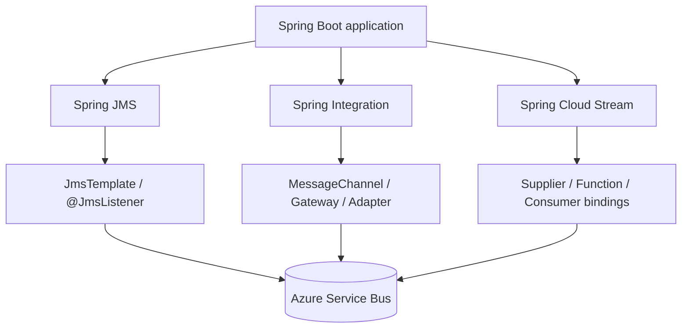
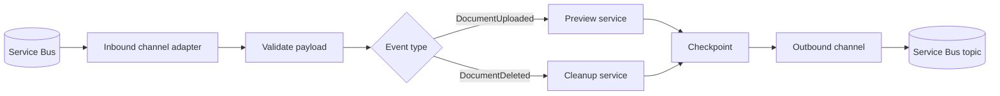

# JMS, Spring Integration và Stream binder khi phù hợp

> **Chương:** Azure Service Bus  
> **Module:** SPRING_CLOUD_PROVIDER_INTEGRATION  
> **Mục tiêu:** Chọn đúng abstraction Spring để tích hợp Azure Service Bus; triển khai gửi/nhận bằng Spring JMS, Spring Integration channel adapters và Spring Cloud Stream binder; hiểu khác biệt về subscription, settlement, session, tier, cấu hình và vận hành.

## 1. Chọn abstraction theo kiến trúc ứng dụng

Azure Service Bus cung cấp queue và topic/subscription. Một ứng dụng Spring Boot có thể kết nối trực tiếp bằng Azure SDK hoặc dùng các abstraction của hệ sinh thái Spring:

- **Spring JMS:** dùng chuẩn Java Message Service với JmsTemplate, @JmsListener và ConnectionFactory.
- **Spring Integration:** dùng message channel, gateway, inbound/outbound adapter để kết nối Service Bus với các luồng xử lý trong ứng dụng.
- **Spring Cloud Stream binder:** dùng mô hình function/binding với Supplier, Function, Consumer, destination và consumer group.

Cả ba cách đều có thể gửi và nhận message, nhưng cách tổ chức ứng dụng và phạm vi tính năng khác nhau. Chọn abstraction theo kiến trúc và yêu cầu của workload, không chỉ theo số dòng code.



### 1.1. Bảng chọn nhanh

| Nhu cầu | Lựa chọn phù hợp | Vì sao |
| --- | --- | --- |
| Đang có ứng dụng JMS hoặc cần tương thích JMS | **Spring JMS** | Giữ API JMS quen thuộc, giảm thay đổi khi chuyển từ broker khác |
| Tích hợp Service Bus vào nhiều luồng nội bộ, channel, gateway hoặc adapter | **Spring Integration** | Tách transport khỏi flow và kết nối với các endpoint Spring Integration |
| Microservice dùng mô hình event-driven, function và binding | **Spring Cloud Stream** | Khai báo destination/group qua cấu hình, code nghiệp vụ tập trung vào function |
| Cần kiểm soát sâu sessions, settlement, deferral, batch hoặc SDK options | Azure Service Bus native SDK hoặc abstraction có expose đúng tính năng | Không nên giả định mọi abstraction đều hỗ trợ toàn bộ Service Bus API |

Ba abstraction trong bài đều kết nối cùng Azure Service Bus. Chúng không tạo ra ba broker khác nhau và cũng không thay đổi quy tắc cơ bản về queue, topic, subscription, lock, TTL hay DLQ.

## 2. Chuẩn bị dependency và version

Spring Cloud Azure cung cấp BOM để quản lý đồng bộ phiên bản starter và Azure SDK. Không tự đặt version riêng cho từng starter nếu BOM đã quản lý.

Ví dụ Maven:

```xml
<dependencyManagement>
    <dependencies>
        <dependency>
            <groupId>com.azure.spring</groupId>
            <artifactId>spring-cloud-azure-dependencies</artifactId>
            <version>${spring-cloud-azure.version}</version>
            <type>pom</type>
            <scope>import</scope>
        </dependency>
    </dependencies>
</dependencyManagement>
```

Tài liệu Spring Cloud Azure hiện hành nêu các phiên bản BOM tương ứng với từng dòng Spring Boot. Ví dụ, BOM 7.4.0 dùng cho Spring Boot 4.0.x và BOM 6.5.0 dùng cho Spring Boot 3.5.x. Các dòng Spring Boot khác cần tra bảng Spring Versions Mapping trước khi chọn. Không ghép một starter mới với BOM cũ chỉ vì Maven vẫn resolve được dependency.

### 2.1. Chọn một dependency theo abstraction

Chỉ thêm dependency của cách tích hợp đang dùng:

```xml
<!-- Spring JMS -->
<dependency>
    <groupId>com.azure.spring</groupId>
    <artifactId>spring-cloud-azure-starter-servicebus-jms</artifactId>
</dependency>

<!-- Spring Integration -->
<dependency>
    <groupId>com.azure.spring</groupId>
    <artifactId>spring-cloud-azure-starter-integration-servicebus</artifactId>
</dependency>

<!-- Spring Cloud Stream binder -->
<dependency>
    <groupId>com.azure.spring</groupId>
    <artifactId>spring-cloud-azure-stream-binder-servicebus</artifactId>
</dependency>
```

Với Spring Cloud Stream, có thể dùng starter thuận tiện:

```xml
<dependency>
    <groupId>com.azure.spring</groupId>
    <artifactId>spring-cloud-azure-starter-stream-servicebus</artifactId>
</dependency>
```

Không cần thêm cả ba starter chỉ để thử mọi API trong cùng một service production. Mỗi abstraction có cấu hình, listener container, connection factory và cách settlement riêng; trộn nhiều abstraction có thể tạo hai consumer cùng đọc một queue mà nhóm không chủ ý.

## 3. Xác thực và quyền truy cập

Các tích hợp Spring Cloud Azure hỗ trợ Microsoft Entra ID và cấu hình connection string. Với workload chạy trên Azure, ưu tiên Managed Identity/passwordless khi môi trường hỗ trợ.

- Producer cần quyền gửi, thường là **Azure Service Bus Data Sender**.
- Consumer cần quyền nhận, thường là **Azure Service Bus Data Receiver**.
- Chỉ cấp quyền quản trị dữ liệu khi ứng dụng thật sự cần thao tác quản trị.
- Không commit connection string chứa SAS key hoặc client secret vào Git.
- Local development có thể dùng Azure CLI/IDE credential thông qua Azure Identity nếu cấu hình tương ứng được bật.
- User-assigned Managed Identity cần client ID; system-assigned identity không cần client ID riêng.

Các property xác thực không hoàn toàn giống nhau giữa JMS và các tích hợp dùng prefix spring.cloud.azure. Hãy dùng đúng prefix theo abstraction.

## 4. Spring JMS: giữ API chuẩn JMS

### 4.1. Khi nào nên dùng JMS?

Spring JMS phù hợp khi:

- Hệ thống đang dùng JMS với ActiveMQ, IBM MQ hoặc broker khác và muốn chuyển sang Azure Service Bus.
- Codebase đã chuẩn hóa JmsTemplate, @JmsListener, listener container và JMS message model.
- Kiến trúc yêu cầu API JMS tiêu chuẩn hoặc đội ngũ có kinh nghiệm JMS.
- Workload chủ yếu cần gửi/nhận queue và topic, không phụ thuộc tính năng Service Bus chuyên biệt mà JMS không expose.

JMS là API messaging tiêu chuẩn Java. Azure Service Bus JMS provider dùng AMQP 1.0 để giao tiếp với broker. Spring JMS giữ mô hình gửi/nhận của ứng dụng, còn starter cấu hình connection factory và tích hợp với Spring Boot.

### 4.2. Chú ý tier và giới hạn JMS

| Service Bus tier | Mức JMS | Ý nghĩa |
| --- | --- | --- |
| **Standard** | JMS 1.1 với tập tính năng giới hạn | Phù hợp workload tương thích JMS 1.1 |
| **Premium** | JMS 2.0 | Dùng khi cần đầy đủ JMS 2.0 |

JMS không phải lớp bọc có toàn bộ tính năng native SDK. Tài liệu Microsoft nêu các giới hạn quan trọng:

- JMS không hỗ trợ nhận message từ entity bật **Service Bus message sessions**. Khái niệm này khác với đối tượng Session của JMS.
- Hỗ trợ DLQ ở mức hạn chế; JMS có thể nhận từ DLQ nhưng không có toàn bộ khả năng đặt custom reason/description như native SDK.
- Message deferral chỉ được hỗ trợ một phần.
- Lock renewal phải được ứng dụng quản lý thủ công theo mô hình JMS.
- Một số khả năng như batch receive và AMQP over WebSocket không có như native SDK.
- Không có distributed transaction XA/JTA; transaction JMS không tạo giao dịch phân tán nguyên tử với database và các hệ thống ngoài Service Bus.

Nếu nghiệp vụ cần FIFO theo Service Bus SessionId, deferral bằng sequence number, DLQ custom reason, hoặc kiểm soát sâu lock/prefetch, hãy đánh giá native SDK trước khi chọn JMS.

### 4.3. Cấu hình JMS bằng Microsoft Entra ID

Dependency đã khai báo ở phần trên. Ví dụ application.yml:

```yaml
spring:
  jms:
    servicebus:
      namespace: ${AZURE_SERVICEBUS_NAMESPACE}
      pricing-tier: premium
      passwordless-enabled: true
    listener:
      receive-timeout: 60000
```

pricing-tier phải khớp tier thực tế của namespace. Ví dụ trên dùng premium để minh họa JMS 2.0. Với Standard, cấu hình standard và chỉ dựa vào các tính năng JMS 1.1 được hỗ trợ.

passwordless-enabled: true cho phép starter dùng Microsoft Entra ID. Trong local development, credential có thể đến từ Azure CLI hoặc môi trường IDE; khi chạy trên Azure, ưu tiên Managed Identity. Gán Data Sender/Data Receiver theo vai trò của từng workload.

### 4.4. Cấu hình JMS bằng connection string

Nếu môi trường chưa dùng Entra ID, có thể cấu hình connection string được cung cấp từ secret store:

```yaml
spring:
  jms:
    servicebus:
      connection-string: ${AZURE_SERVICEBUS_CONNECTION_STRING}
      pricing-tier: premium
    listener:
      receive-timeout: 60000
```

Không đưa giá trị SAS key thật vào file cấu hình được commit. Nên inject qua secret manager hoặc biến môi trường được bảo vệ. Khi chuyển sang Entra ID, bỏ connection string và dùng cấu hình passwordless.

### 4.5. Gửi và nhận queue với JmsTemplate và @JmsListener

JmsTemplate gửi message; @JmsListener đăng ký method nhận message. Ví dụ queue:

```java
import org.springframework.boot.SpringApplication;
import org.springframework.boot.autoconfigure.SpringBootApplication;
import org.springframework.jms.annotation.EnableJms;
import org.springframework.jms.annotation.JmsListener;
import org.springframework.jms.core.JmsTemplate;
import org.springframework.stereotype.Component;
import org.springframework.stereotype.Service;

@SpringBootApplication
@EnableJms
public class DocumentJmsApplication {
    public static void main(String[] args) {
        SpringApplication.run(DocumentJmsApplication.class, args);
    }
}

@Service
class DocumentCommandPublisher {

    private final JmsTemplate jmsTemplate;

    DocumentCommandPublisher(JmsTemplate jmsTemplate) {
        this.jmsTemplate = jmsTemplate;
    }

    public void publish(String documentId) {
        jmsTemplate.convertAndSend(
                "preview-jobs",
                "GeneratePreview:" + documentId);
    }
}

@Component
class PreviewCommandListener {

    @JmsListener(
            destination = "preview-jobs",
            containerFactory = "jmsListenerContainerFactory")
    public void receive(String command) {
        // Parse và validate command, sau đó gọi handler nghiệp vụ.
        System.out.println("Received: " + command);
    }
}
```

Ví dụ dùng chuỗi để tập trung vào API JMS. Ứng dụng thật nên gửi DTO hoặc JSON theo contract rõ ràng, đặt correlation ID và message ID phù hợp, validate payload trước khi xử lý. Không log toàn bộ payload nếu có dữ liệu nhạy cảm.

Spring Boot starter cung cấp cấu hình connection factory và listener container. Tên bean jmsListenerContainerFactory là factory được starter/tự cấu hình tạo trong ví dụ; nếu ứng dụng định nghĩa factory riêng, hãy dùng đúng bean name và transaction/acknowledgement mode tương ứng.

### 4.6. Gửi và nhận topic/subscription

Với topic, producer gửi vào topic; mỗi subscription phù hợp nhận bản sao theo rule. Listener cần cấu hình destination là topic và subscription tương ứng:

Ví dụ cấu hình topic listener bằng Microsoft Entra ID:

```yaml
spring:
  jms:
    servicebus:
      namespace: ${AZURE_SERVICEBUS_NAMESPACE}
      topic-client-id: ${AZURE_SERVICEBUS_TOPIC_CLIENT_ID}
      pricing-tier: premium
      passwordless-enabled: true
```

topic-client-id là JMS client ID dùng cho subscription theo cấu hình của Service Bus. Giá trị phải khớp định danh subscription/client mà ứng dụng được cấu hình sử dụng.

```java
import org.springframework.jms.annotation.JmsListener;
import org.springframework.stereotype.Component;

@Component
class AuditEventListener {

    @JmsListener(
            destination = "document-events",
            subscription = "audit-worker",
            containerFactory = "topicJmsListenerContainerFactory")
    public void receive(String event) {
        // Xử lý bản sao trong subscription audit-worker.
    }
}
```

Cần cấu hình topic listener container factory và durable/shared subscription theo yêu cầu ứng dụng. subscription là tên subscription đã được tạo trong Service Bus. Không nhầm subscription với queue name.

### 4.7. Transaction, acknowledgement và idempotency trong JMS

JMS listener container có cơ chế transaction/acknowledgement theo cấu hình. Khi listener hoàn tất, message có thể được acknowledge/settle theo chế độ đang dùng. Nếu listener ném exception, hành vi redelivery phụ thuộc transaction/session mode và provider.

Một transaction JMS không tự tạo giao dịch ACID xuyên Service Bus, PostgreSQL và Blob Storage. Nếu listener đã ghi database nhưng acknowledgement bị mất, message có thể được giao lại. Consumer vẫn cần idempotency bằng event ID/message ID và unique constraint trong database.

Không coi @JmsListener là exactly-once processing. Hãy kiểm tra transaction manager, acknowledgement mode, redelivery policy và dead-letter behavior của JMS provider trong đúng tier.

## 5. Spring Integration: kết nối Service Bus bằng message channels

### 5.1. Khi nào nên dùng Spring Integration?

Spring Integration phù hợp khi ứng dụng có nhiều endpoint hoặc cần nối Service Bus vào một flow xử lý thống nhất:

- Message từ Service Bus đi qua channel, transformer, filter, router hoặc service activator.
- Một luồng nghiệp vụ nhận từ nhiều hệ thống và phát tới nhiều đích.
- Muốn dùng MessageChannel, @ServiceActivator, @MessagingGateway và các adapter thay vì đặt logic transport trong service nghiệp vụ.
- Cần xây flow tích hợp có thể quan sát, kiểm thử và thay đổi từng bước.

Spring Integration Service Bus extension cung cấp inbound channel adapter và outbound channel handler. Inbound adapter dùng ServiceBusMessageListenerContainer, bên dưới sử dụng ServiceBusProcessorClient để nhận message. Outbound handler gửi qua ServiceBusTemplate.

### 5.2. Dependency và cấu hình kết nối

Thêm:

```xml
<dependency>
    <groupId>com.azure.spring</groupId>
    <artifactId>spring-cloud-azure-starter-integration-servicebus</artifactId>
</dependency>
```

Ví dụ cấu hình namespace và Managed Identity:

```yaml
spring:
  cloud:
    azure:
      credential:
        managed-identity-enabled: true
      servicebus:
        namespace: ${AZURE_SERVICEBUS_NAMESPACE}
```

Nếu dùng user-assigned identity, thêm client-id theo cấu hình credential của Spring Cloud Azure. Với local development, có thể dùng DefaultAzureCredential theo cấu hình môi trường được hỗ trợ. Identity cần Data Sender hoặc Data Receiver tùy flow.

### 5.3. Gửi message bằng outbound channel

Tạo output channel, ServiceBusTemplate và DefaultMessageHandler. Ví dụ queue:

```java
import com.azure.spring.integration.core.handler.DefaultMessageHandler;
import com.azure.spring.messaging.servicebus.core.ServiceBusTemplate;
import com.azure.spring.cloud.service.servicebus.properties.ServiceBusEntityType;
import org.springframework.context.annotation.Bean;
import org.springframework.context.annotation.Configuration;
import org.springframework.integration.annotation.ServiceActivator;
import org.springframework.integration.channel.DirectChannel;
import org.springframework.messaging.MessageChannel;
import org.springframework.messaging.MessageHandler;

@Configuration
class ServiceBusOutboundConfiguration {

    @Bean
    MessageChannel serviceBusOutput() {
        return new DirectChannel();
    }

    @Bean
    @ServiceActivator(inputChannel = "serviceBusOutput")
    MessageHandler queueMessageSender(ServiceBusTemplate template) {
        template.setDefaultEntityType(ServiceBusEntityType.QUEUE);
        return new DefaultMessageHandler("preview-jobs", template);
    }
}
```

Đưa message vào channel bằng MessageChannel.send(...), MessagingTemplate hoặc gateway. ServiceBusTemplate cần biết entity type nếu producer configuration không cung cấp entity type khác. Với topic, dùng ServiceBusEntityType.TOPIC và tên topic làm destination.

Một gateway giúp service nghiệp vụ không phải biết tên channel:

```java
import org.springframework.integration.annotation.MessagingGateway;

@MessagingGateway(defaultRequestChannel = "serviceBusOutput")
interface PreviewCommandGateway {
    void send(String payload);
}
```

Sau đó service có thể gọi previewCommandGateway.send(payload). Gateway chỉ là điểm vào flow; serialization, metadata và lỗi gửi vẫn cần được xử lý theo contract ứng dụng.

### 5.4. Nhận message bằng inbound channel adapter

Tạo listener container, tắt auto-complete nếu muốn kiểm soát checkpoint thủ công, rồi nối adapter vào input channel:

```java
import com.azure.spring.integration.servicebus.inbound.ServiceBusInboundChannelAdapter;
import com.azure.spring.messaging.servicebus.core.ServiceBusProcessorFactory;
import com.azure.spring.messaging.servicebus.core.listener.ServiceBusMessageListenerContainer;
import com.azure.spring.messaging.servicebus.core.properties.ServiceBusContainerProperties;
import org.springframework.context.annotation.Bean;
import org.springframework.context.annotation.Configuration;
import org.springframework.integration.channel.DirectChannel;
import org.springframework.messaging.MessageChannel;

@Configuration
class ServiceBusInboundConfiguration {

    @Bean
    MessageChannel serviceBusInput() {
        return new DirectChannel();
    }

    @Bean
    ServiceBusMessageListenerContainer previewListenerContainer(
            ServiceBusProcessorFactory processorFactory) {

        ServiceBusContainerProperties properties =
                new ServiceBusContainerProperties();

        properties.setEntityName("preview-jobs");
        properties.setAutoComplete(false);

        return new ServiceBusMessageListenerContainer(
                processorFactory,
                properties);
    }

    @Bean
    ServiceBusInboundChannelAdapter previewInboundAdapter(
            MessageChannel serviceBusInput,
            ServiceBusMessageListenerContainer listenerContainer) {

        ServiceBusInboundChannelAdapter adapter =
                new ServiceBusInboundChannelAdapter(listenerContainer);

        adapter.setOutputChannel(serviceBusInput);
        return adapter;
    }
}
```

Các import trong ví dụ tương ứng với package của Spring Cloud Azure 7.4.x. Nếu dùng major version khác, xác nhận package qua Javadoc/BOM đang triển khai. Mô hình chính vẫn là: cấu hình container → tạo inbound adapter → đặt output channel.

### 5.5. Xác nhận xử lý bằng Checkpointer

Khi autoComplete tắt, handler cần xác nhận message sau khi nghiệp vụ hoàn tất. Inbound adapter đưa Checkpointer vào message header AzureHeaders.CHECKPOINTER.

```java
import com.azure.spring.messaging.AzureHeaders;
import com.azure.spring.messaging.checkpoint.Checkpointer;
import org.springframework.integration.annotation.ServiceActivator;
import org.springframework.messaging.handler.annotation.Header;
import org.springframework.stereotype.Component;

@Component
class PreviewMessageEndpoint {

    @ServiceActivator(inputChannel = "serviceBusInput")
    public void receive(
            byte[] payload,
            @Header(AzureHeaders.CHECKPOINTER) Checkpointer checkpointer) {

        String json = new String(
                payload,
                java.nio.charset.StandardCharsets.UTF_8);

        previewService.processIdempotently(json);

        // Chỉ checkpoint sau khi nghiệp vụ đã commit thành công.
        checkpointer.success().block();
    }
}
```

Checkpointer.success() xác nhận message đã xử lý theo cơ chế của adapter. Chỉ gọi sau khi trạng thái nghiệp vụ đã được ghi nhận an toàn. Nếu xử lý thất bại, truyền lỗi vào error flow và để adapter/broker áp dụng chính sách retry phù hợp; không checkpoint thành công trong finally.

Không giữ message lock trong lúc đẩy công việc sang thread nền rồi trả khỏi service activator. Khi handler kết thúc, checkpoint/settlement phải phản ánh đúng kết quả xử lý thực tế. Nếu xử lý có thể kéo dài, cân nhắc durable job hoặc checkpoint theo chunk.

### 5.6. Message conversion và headers

Spring Integration dùng Spring Message payload và headers. Service Bus converter có thể ánh xạ các header như content type, message ID, correlation ID, session ID, partition key và scheduled enqueue time sang message properties.

- Payload byte[] cần được deserialize theo content type/contract.
- Header chuẩn Service Bus nên dùng hằng số ServiceBusMessageHeaders tương ứng.
- Metadata tùy chỉnh cần được giới hạn ở kiểu scalar được broker hỗ trợ.
- Không đưa secret hoặc dữ liệu cá nhân vào headers.
- Tùy chỉnh ObjectMapper/converter nếu cần hỗ trợ Java Time hoặc DTO riêng.

### 5.7. Khi flow cần nhiều bước

Một flow có thể gồm:



Dùng filter/router/transformer để tách điều phối khỏi nghiệp vụ. Đừng tạo một flow quá dài chỉ để thay thế vài dòng ServiceBusListener; Spring Integration hữu ích khi có nhiều bước hoặc nhiều hệ thống cần nối.

## 6. Spring Cloud Stream binder: function và binding

### 6.1. Khi nào nên dùng Stream binder?

Spring Cloud Stream phù hợp khi ứng dụng được tổ chức theo mô hình event-driven microservices và muốn code tập trung vào function:

- Producer được biểu diễn bằng Supplier.
- Consumer được biểu diễn bằng Consumer.
- Processor được biểu diễn bằng Function.
- destination và group nằm trong cấu hình.
- Có thể đổi binder hoặc broker ở cấp cấu hình khi abstraction tương thích.

Binder Azure Service Bus được xây trên Spring Integration Service Bus channel adapters. Vì vậy, Stream binder là một lớp binding/function cao hơn; nó vẫn dùng các cơ chế Service Bus bên dưới.

### 6.2. Consumer group của topic là subscription

Với Spring Cloud Stream, group trên binding topic được ánh xạ thành **Service Bus subscription**. Đây là điểm cần nhớ khi chuyển từ Kafka:

- Kafka consumer group có offset/partition assignment semantics riêng.
- Với Service Bus topic, mỗi subscription là một bản sao/luồng nhận riêng theo filter/rule.
- Nhiều instance của cùng một binding/subscription cạnh tranh xử lý message trong subscription đó.
- Hai group khác nhau tương ứng hai subscription khác nhau và mỗi subscription có thể nhận bản sao phù hợp.

Với queue, destination là queue name; không cần tạo topic group để nhận message.

### 6.3. Dependency

Dùng binder:

```xml
<dependency>
    <groupId>com.azure.spring</groupId>
    <artifactId>spring-cloud-azure-stream-binder-servicebus</artifactId>
</dependency>
```

Hoặc starter:

```xml
<dependency>
    <groupId>com.azure.spring</groupId>
    <artifactId>spring-cloud-azure-starter-stream-servicebus</artifactId>
</dependency>
```

### 6.4. Cấu hình queue binding

Ví dụ application.yml cho một queue:

```yaml
spring:
  cloud:
    azure:
      credential:
        managed-identity-enabled: true
      servicebus:
        namespace: ${AZURE_SERVICEBUS_NAMESPACE}
    function:
      definition: consume;supply
    stream:
      bindings:
        consume-in-0:
          destination: ${AZURE_SERVICEBUS_QUEUE}
        supply-out-0:
          destination: ${AZURE_SERVICEBUS_QUEUE}
      servicebus:
        bindings:
          consume-in-0:
            consumer:
              auto-complete: false
          supply-out-0:
            producer:
              entity-type: queue
```

Ý nghĩa:

- spring.cloud.function.definition bật hai function consume và supply.
- consume-in-0 là input binding của consumer.
- supply-out-0 là output binding của supplier.
- destination là queue name.
- producer.entity-type là bắt buộc cho binding producer; đặt queue hoặc topic đúng destination.
- auto-complete: false cho phép consumer sử dụng Checkpointer để checkpoint thủ công.

Nếu chỉ dùng consumer hoặc producer, chỉ khai báo function/binding tương ứng. Không cần tạo Supplier chỉ để ứng dụng nhận message.

### 6.5. Function consumer và supplier

```java
import com.azure.spring.messaging.AzureHeaders;
import com.azure.spring.messaging.checkpoint.Checkpointer;
import org.springframework.context.annotation.Bean;
import org.springframework.messaging.Message;
import org.springframework.messaging.support.MessageBuilder;

import java.util.function.Consumer;
import java.util.function.Supplier;

class DocumentEventFunctions {

    @Bean
    Consumer<Message<String>> consume() {
        return message -> {
            String payload = message.getPayload();

            // Xử lý nghiệp vụ và ghi nhận trạng thái bền vững.
            previewService.processIdempotently(payload);

            Checkpointer checkpointer = message.getHeaders()
                    .get(AzureHeaders.CHECKPOINTER, Checkpointer.class);

            if (checkpointer == null) {
                throw new IllegalStateException(
                        "Không có Checkpointer; kiểm tra auto-complete và binder config");
            }

            checkpointer.success().block();
        };
    }

    @Bean
    Supplier<Message<String>> supply() {
        return () -> MessageBuilder
                .withPayload("{\"eventType\":\"PreviewRequested\"}")
                .build();
    }
}
```

Ví dụ cho thấy cách binder đưa payload và headers vào Spring Message. Với production, không nên để Supplier tự phát cùng một event khi application context khởi động nếu chưa có cơ chế kiểm soát; thường producer được gọi từ service thông qua output binding hoặc function composition. Phần supplier trên chỉ minh họa binding output.

Consumer trong ví dụ là imperative Consumer nên block() chờ thao tác checkpoint hoàn tất trước khi callback kết thúc. Nếu dùng reactive Function, hãy compose Mono của Checkpointer vào pipeline thay vì block một thread.

Nếu xử lý lỗi, không gọi checkpointer.success(). Cấu hình requeue-rejected và error channel quyết định cách binder xử lý message bị từ chối; kiểm tra chính sách cụ thể trước khi đưa vào production.

### 6.6. Cấu hình topic và subscription group

Với topic, đặt destination là topic name và group là subscription name:

```yaml
spring:
  cloud:
    azure:
      servicebus:
        namespace: ${AZURE_SERVICEBUS_NAMESPACE}
    function:
      definition: consume
    stream:
      bindings:
        consume-in-0:
          destination: document-events
          group: preview-worker
      servicebus:
        bindings:
          consume-in-0:
            consumer:
              auto-complete: false
```

preview-worker phải là subscription được tạo hoặc được provision theo cấu hình/permission của binder. Một binding topic không có group sẽ không xác định được subscription theo mô hình consumer group mà binder sử dụng.

### 6.7. Consumer options: concurrency, sessions, prefetch và DLQ

Binder expose một số thuộc tính Service Bus theo binding:

| Property | Ý nghĩa |
| --- | --- |
| consumer.max-concurrent-calls | Số callback message đồng thời |
| consumer.max-concurrent-sessions | Số session có thể xử lý đồng thời |
| consumer.session-enabled | Cho biết consumer nhận từ entity bật sessions |
| consumer.prefetch-count | Số message prefetch |
| consumer.max-auto-lock-renew-duration | Cửa sổ auto-lock renewal |
| consumer.receive-mode | Receive mode, mặc định Peek-Lock |
| consumer.auto-complete | Tự settle message hay dùng Checkpointer |
| consumer.sub-queue | Kết nối subqueue như DLQ |
| consumer.requeue-rejected | Cách xử lý message bị từ chối trong error flow |

Ví dụ cấu hình:

```yaml
spring:
  cloud:
    stream:
      servicebus:
        bindings:
          consume-in-0:
            consumer:
              auto-complete: false
              max-concurrent-calls: 2
              prefetch-count: 0
              max-auto-lock-renew-duration: 5m
              requeue-rejected: true
```

Theo tài liệu binder, requeue-rejected: true cho phép default consumer error handler chuyển message lỗi vào DLQ; khi tắt, message bị abandon. Hãy xác minh hành vi với handler/error channel thực tế, không coi property này là retry delay.

Nếu entity bật sessions, bật session-enabled và cấu hình max-concurrent-sessions phù hợp. Producer có thể đặt ServiceBusMessageHeaders.SESSION_ID trong Spring Message header. Đừng tăng concurrency trong cùng session nếu điều đó làm sai thứ tự tác dụng phụ nghiệp vụ.

### 6.8. Scheduled message qua header x-delay

Binder hỗ trợ gửi scheduled message lên topic bằng header x-delay, tính bằng milliseconds:

```java
import org.springframework.messaging.Message;
import org.springframework.messaging.support.MessageBuilder;

Message<String> delayedEvent = MessageBuilder
        .withPayload("{\"eventType\":\"ReminderDue\"}")
        .setHeader("x-delay", 120_000)
        .build();
```

Ví dụ yêu cầu binder gửi message sau khoảng 120 giây. Đây là tính năng của binder cho topic theo tài liệu hiện hành; không suy rộng rằng mọi binding queue hoặc mọi phiên bản đều có cùng semantics. Với scheduled message cần API đầy đủ hơn, dùng native Service Bus SDK.

### 6.9. Error channel

Spring Cloud Stream binder cung cấp consumer error channel. Default handler có thể dead-letter message khi requeue-rejected bật; nếu không, message bị abandon. Có thể đăng ký error handler riêng bằng @ServiceActivator vào channel lỗi của binding.

Ví dụ khái niệm:

```java
@ServiceActivator(inputChannel = "document-events.preview-worker.errors")
public void handleConsumerError(Message<?> errorMessage) {
    // Ghi metric, correlation ID và nguyên nhân lỗi.
    // Không log payload nhạy cảm.
}
```

Tên error channel phụ thuộc destination/group và cấu hình binding. Dùng đúng tên theo binding thực tế. Không nuốt exception rồi coi message đã xử lý thành công nếu chưa checkpoint/settle.

## 7. So sánh sâu ba lựa chọn

| Tiêu chí | Spring JMS | Spring Integration | Spring Cloud Stream |
| --- | --- | --- | --- |
| Mô hình code | JmsTemplate, @JmsListener | Channel, adapter, gateway, service activator | Supplier, Function, Consumer, binding |
| Mức abstraction | Chuẩn JMS | Flow/message endpoint | Function/binder |
| Queue | Có | Có | Có |
| Topic/subscription | Có | Có | Có; group ánh xạ subscription |
| Microsoft Entra ID | Có qua starter | Có qua Spring Cloud Azure credential | Có qua Spring Cloud Azure credential |
| Sessions | Không hỗ trợ nhận Service Bus session | Dựa vào processor/container và cấu hình hỗ trợ; xác minh version | Có hỗ trợ qua consumer/session properties và header |
| DLQ | Hạn chế; nhận DLQ nhưng không có toàn bộ custom reason API | Có thể điều khiển qua underlying processor/checkpoint | Có consumer error handling và requeue-rejected |
| Scheduled messages | Có hỗ trợ delivery delay theo JMS | Dùng ServiceBusTemplate/API phù hợp | Binder hỗ trợ x-delay cho topic |
| Kiểm soát settlement | Theo JMS acknowledgement/transaction semantics | Checkpointer và container properties | Checkpointer khi tắt auto-complete |
| Phù hợp nhất | Tái sử dụng JMS code | Tích hợp nhiều bước/channel | Microservice theo function/event-driven |

Bảng mô tả abstraction và tính năng được expose. Khả năng cuối cùng còn phụ thuộc tier Service Bus, entity configuration, phiên bản BOM và phiên bản binder.

## 8. Chọn đúng công cụ theo tình huống

### Tình huống A — Chuyển ứng dụng từ broker JMS sang Azure

Ứng dụng hiện có nhiều @JmsListener, JmsTemplate, listener container và contract JMS. Nhóm muốn giữ code nghiệp vụ ổn định trong khi đổi broker.

**Chọn Spring JMS** nếu tier và feature set đáp ứng. Kiểm tra JMS 1.1/JMS 2.0, session, DLQ và scheduled delivery trước khi migration. Nếu cần Service Bus sessions hoặc native feature không có trong JMS, chọn native SDK hoặc refactor adapter cho phần đó.

### Tình huống B — Luồng tích hợp nhiều bước

Một event nhận từ Service Bus phải validate, enrich, route theo event type, ghi audit và gửi tiếp sang topic khác. Nhóm muốn các bước này là endpoint/channel riêng.

**Chọn Spring Integration.** Inbound/outbound adapters và channel giúp tách transport khỏi từng service activator. Giữ handler nhỏ và quản lý checkpoint sau khi tác vụ đã hoàn tất.

### Tình huống C — Microservice event-driven theo function

Một service có Consumer<DocumentUploadedEvent> và Supplier<PreviewCompletedEvent>, muốn cấu hình destination và group bên ngoài code.

**Chọn Spring Cloud Stream binder.** Function code tập trung vào payload; binding config quyết định queue/topic/subscription. Nếu cùng service cần nhiều broker/binder, Stream hỗ trợ nhiều binder nhưng phải quản lý từng environment/credential riêng.

### Tình huống D — Cần tính năng native chuyên sâu

Nghiệp vụ cần nhận deferred message theo sequence number, custom dead-letter reason, transaction cross-entity, session acceptance cụ thể, batch receive hoặc kiểm soát prefetch/lock sâu.

**Dùng Azure Service Bus native SDK** cho phần cần kiểm soát. Không ép JMS hoặc abstraction khác mô phỏng tính năng không được expose.

## 9. Những lỗi tích hợp thường gặp

| Triệu chứng | Nguyên nhân thường gặp | Hướng xử lý |
| --- | --- | --- |
| JmsTemplate không gửi được | Namespace, pricing tier, connection factory hoặc quyền Data Sender sai | Kiểm tra spring.jms.servicebus.*, Entra role và entity |
| @JmsListener không nhận queue | Sai destination, listener container hoặc quyền Data Receiver | Kiểm tra queue, factory, receive timeout và role |
| JMS topic không nhận message | Thiếu subscription hoặc topic listener factory sai | Kiểm tra topic/subscription và durable/shared config |
| JMS chạy trên Standard nhưng thiếu API | Standard chỉ cung cấp JMS 1.1 với feature set hạn chế | Chọn Premium nếu cần JMS 2.0 hoặc đổi abstraction |
| Integration adapter không checkpoint | autoComplete/manual checkpoint cấu hình sai | Kiểm tra ServiceBusContainerProperties và Checkpointer header |
| Stream binder không tạo producer | Thiếu producer.entity-type | Đặt queue hoặc topic theo destination |
| Topic binder không nhận message | Thiếu group hoặc subscription sai | Đặt group thành subscription name |
| Message lỗi bị giao lại liên tục | Error flow abandon hoặc exception bị ném lại | Xác định retry/DLQ policy và requeue-rejected |
| Message bị complete trước khi nghiệp vụ xong | Auto-complete bật hoặc callback trả về sớm | Tắt auto-complete và checkpoint sau commit |
| Hai abstraction cùng đọc một queue | Có nhiều listener/processor cùng được cấu hình | Chọn một consumer owner rõ ràng, kiểm tra startup beans |
| Managed Identity bị từ chối | Thiếu role hoặc scope không đúng | Gán Data Sender/Receiver ở đúng namespace/entity |
| Payload DTO không deserialize | Converter/ObjectMapper/schema khác nhau | Thống nhất content type, schema version và mapper |

### 9.1. Không dùng connection factory listener sai cách

Với JMS listener container, không nên dùng một SingleConnectionFactory chia sẻ một connection cho mọi listener container. Nếu connection bị đứt, mọi listener có thể cùng mất kết nối. Tài liệu JMS Azure khuyến nghị listener container dùng connection factory phù hợp để mỗi container tự phục hồi độc lập. Với các phiên bản starter mới, factory separation có thể đã được cấu hình mặc định; kiểm tra version đang dùng trước khi tự thay connection factory.

### 9.2. Không coi auto-complete là checkpoint nghiệp vụ

Với Spring Integration và Stream binder, khi cần manual settlement, tắt auto-complete và gọi Checkpointer.success() sau khi business transaction hoàn tất. Nếu xử lý lỗi mà vẫn checkpoint thành công, message sẽ bị loại khỏi luồng chính dù công việc chưa hoàn tất.

### 9.3. Không dùng JMS nếu bắt buộc FIFO theo session

JMS không expose Service Bus session receive. Nếu hệ thống cần thứ tự per-aggregate bằng SessionId, dùng native SDK hoặc một binder/adapter đã được xác minh hỗ trợ session. Đừng nhầm JMS topic subscription với Service Bus message session.

## 10. Kiểm thử ba abstraction

Kiểm thử cần chứng minh cả việc gửi/nhận lẫn kết quả nghiệp vụ.

### 10.1. Unit test

- JMS publisher gọi JmsTemplate với destination và payload đúng.
- Spring Integration flow gửi vào đúng output channel và route đúng service activator.
- Stream function xử lý payload, kiểm tra schema và phát event đúng contract.
- Handler idempotent khi nhận lại cùng event ID.
- Error path không checkpoint message trước khi nghiệp vụ hoàn tất.

Mock các abstraction ở unit test; không cần kết nối Azure cho từng test logic.

### 10.2. Integration test với Service Bus test namespace

Tạo tài nguyên test riêng:

- Một queue cho command.
- Một topic và ít nhất hai subscription cho pub/sub.
- Một entity sessions nếu kiểm thử session binder/adapter.
- Identity riêng có quyền Data Sender/Data Receiver.

Các tình huống nên kiểm thử:

| Test | JMS | Spring Integration | Stream binder |
| --- | --- | --- | --- |
| Gửi queue | JmsTemplate | Outbound handler/gateway | Supplier/output binding |
| Nhận queue | @JmsListener | Inbound adapter | Consumer binding |
| Topic subscription | @JmsListener với topic factory | Listener container có subscription | Binding group |
| Manual settlement | Transaction/ack config JMS | Checkpointer | Checkpointer |
| Identity | Entra/passwordless | Managed Identity | Managed Identity |
| Redelivery | Listener transaction/provider behavior | Checkpoint không thành công | Checkpoint/error channel |
| DLQ | Kiểm tra giới hạn JMS provider | Kiểm tra processor/DLQ policy | requeue-rejected và DLQ |
| Session | Không hỗ trợ JMS session receive | Xác minh adapter/container hỗ trợ theo version | session-enabled và SessionId header |

Emulator có thể giúp phát triển local nếu hỗ trợ feature cần test, nhưng không thay thế cloud integration test cho Microsoft Entra ID, RBAC, tier, subscription và broker behavior.

### 10.3. Kiểm thử failure và redelivery

1. Gửi một message có event ID duy nhất.
2. Consumer ghi kết quả nghiệp vụ vào database.
3. Làm acknowledgement/checkpoint thất bại có kiểm soát.
4. Quan sát message có được giao lại hay không.
5. Xác minh consumer không tạo side effect trùng.
6. Gửi payload sai schema và kiểm tra DLQ/error flow.
7. Kiểm tra retry/DLQ theo đúng abstraction và tier.

Không chỉ kiểm tra log “Received message”. Hãy xác minh trạng thái cuối trong database hoặc hệ thống đích.

## 11. Bài thực hành tổng hợp: cùng một queue qua ba abstraction

**Tình huống:** hệ thống quản lý tài liệu phát command GeneratePreview vào queue preview-jobs. Worker nhận command, đọc Blob Storage, tạo preview và cập nhật trạng thái document trong database.

### Phần A — JMS

- Thêm spring-cloud-azure-starter-servicebus-jms.
- Cấu hình Entra passwordless và pricing tier.
- Gửi command bằng JmsTemplate.convertAndSend.
- Nhận bằng @JmsListener.
- Kiểm tra redelivery, transaction và giới hạn JMS theo tier.

### Phần B — Spring Integration

- Thêm spring-cloud-azure-starter-integration-servicebus.
- Tạo outbound DefaultMessageHandler và ServiceBusTemplate.
- Tạo inbound ServiceBusInboundChannelAdapter.
- Nối channel với @ServiceActivator.
- Tắt auto-complete và checkpoint sau khi preview/database hoàn tất.

### Phần C — Spring Cloud Stream

- Thêm spring-cloud-azure-stream-binder-servicebus.
- Tạo Consumer<Message<String>>.
- Cấu hình consume-in-0.destination là preview-jobs.
- Tắt auto-complete và dùng Checkpointer.
- Tạo output binding nếu cần phát PreviewCompleted.

### Phần D — So sánh

Ghi nhận số lượng cấu hình, cách destination được xác định, cách xử lý exception/settlement, cách quan sát headers/correlation ID, khả năng test và hỗ trợ session/DLQ/scheduled delivery.

### Phần E — Thử topic/subscription

Tạo topic document-events với subscription preview-worker và audit-worker.

- Với JMS, dùng topic listener factory và subscription name.
- Với Spring Integration, cấu hình listener container cho topic/subscription.
- Với Stream binder, đặt destination=document-events, group=preview-worker.
- Gửi một event và xác minh hai subscription nhận bản sao theo rule.

**Tiêu chí đạt:** người học giải thích được khác biệt ba abstraction; cấu hình được đúng dependency và identity; gửi/nhận queue và topic; quản lý settlement theo abstraction; và chọn được cách tích hợp dựa trên feature/tier thực tế.

---

## 12. Checklist chọn abstraction trước khi triển khai

| Câu hỏi | Nếu câu trả lời là “có” |
| --- | --- |
| Codebase đã dùng JMS và cần migration ít thay đổi? | Đánh giá Spring JMS và yêu cầu tier JMS |
| Bắt buộc JMS 2.0? | Dùng Service Bus Premium |
| Cần Service Bus sessions? | Không chọn JMS; đánh giá native SDK, Spring Integration hoặc Stream binder với session support đã xác minh |
| Flow có nhiều channel/router/transformer/service activator? | Đánh giá Spring Integration |
| Microservice đã dùng Spring Cloud Stream functions/bindings? | Đánh giá Service Bus binder |
| Cần cấu hình destination/group mà không gắn code với broker? | Stream binder |
| Cần native API như defer, custom DLQ reason hoặc batch? | Dùng Azure Service Bus SDK cho phần đó |
| Cần kiểm soát acknowledgement/checkpoint? | Kiểm tra JMS transaction/ack hoặc manual Checkpointer |
| Có nhiều abstraction cùng kết nối một queue? | Xác định rõ consumer ownership trước khi deploy |

## Ghi nhớ

- **Spring JMS** phù hợp với hệ thống đã dùng JMS hoặc cần JMS API; Standard chỉ hỗ trợ JMS 1.1 với feature set hạn chế, Premium hỗ trợ JMS 2.0.
- **Spring Integration** dùng channel adapters, gateway và service activator để đưa Service Bus vào integration flow.
- **Spring Cloud Stream binder** dùng Supplier/Function/Consumer và binding; topic group tương ứng subscription.
- Với Spring Integration/Stream binder, manual checkpoint cần tắt auto-complete và gọi Checkpointer.success() sau khi nghiệp vụ đã commit.
- Binder có các cấu hình consumer như concurrency, session, prefetch, lock renewal và error/DLQ behavior; hãy đối chiếu property reference theo BOM.
- Không abstraction nào tự tạo exactly-once end-to-end. Redelivery vẫn có thể xảy ra; consumer cần idempotency.
- Nếu cần đầy đủ tính năng native Service Bus, chọn Azure SDK thay vì cố ép abstraction thiếu API.

Khi tích hợp Spring Boot với Azure Service Bus, hãy bắt đầu từ yêu cầu của hệ thống: chuẩn JMS, integration flow hay function-based event processing. Sau đó kiểm tra tier, sessions, settlement, DLQ và version compatibility trước khi chọn starter. Một abstraction phù hợp giúp code dễ đọc mà vẫn giữ được những semantics messaging mà nghiệp vụ cần.

### Tài liệu chính thức

- [Choose between JMS and native SDK for Azure Service Bus](https://learn.microsoft.com/en-us/azure/service-bus-messaging/service-bus-jms-versus-native-sdk)
- [Use JMS in Spring to access Azure Service Bus](https://learn.microsoft.com/en-us/azure/developer/java/spring-framework/configure-spring-boot-starter-java-app-with-azure-service-bus)
- [Spring Cloud Azure — Spring Integration with Azure Service Bus](https://microsoft.github.io/spring-cloud-azure/current/reference/html/index.html)
- [Spring Cloud Azure — Spring Cloud Stream Binder for Azure Service Bus](https://learn.microsoft.com/en-us/azure/developer/java/spring-framework/spring-cloud-stream-support)
- [Spring Cloud Stream with Azure Service Bus](https://learn.microsoft.com/en-us/azure/developer/java/spring-framework/configure-spring-cloud-stream-binder-java-app-with-service-bus)
- [Spring Cloud Azure developer guide and version mapping](https://learn.microsoft.com/en-us/azure/developer/java/spring-framework/developer-guide-overview)
- [Azure Service Bus JMS 2.0 developer guide](https://learn.microsoft.com/en-us/azure/service-bus-messaging/jms-developer-guide)

Kiểm tra Spring Boot/JDK, Spring Cloud Azure BOM, Service Bus tier, queue/topic/subscription và phiên bản binder trước khi áp dụng. Một số class/package và property có thể thay đổi giữa các major version; dùng reference/Javadoc của BOM đang triển khai thay vì sao chép nguyên xi ví dụ từ tài liệu cũ.
