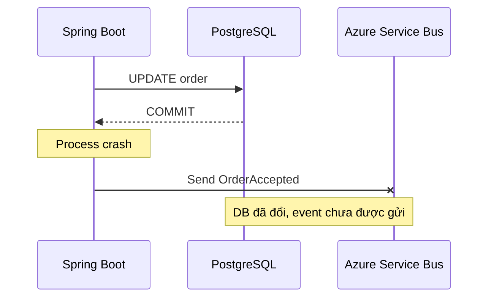
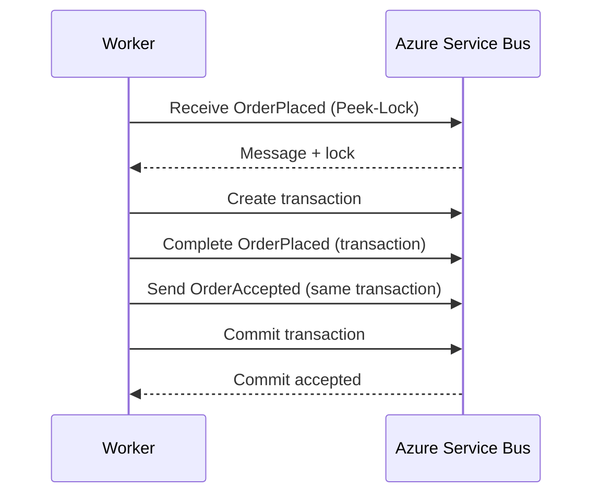
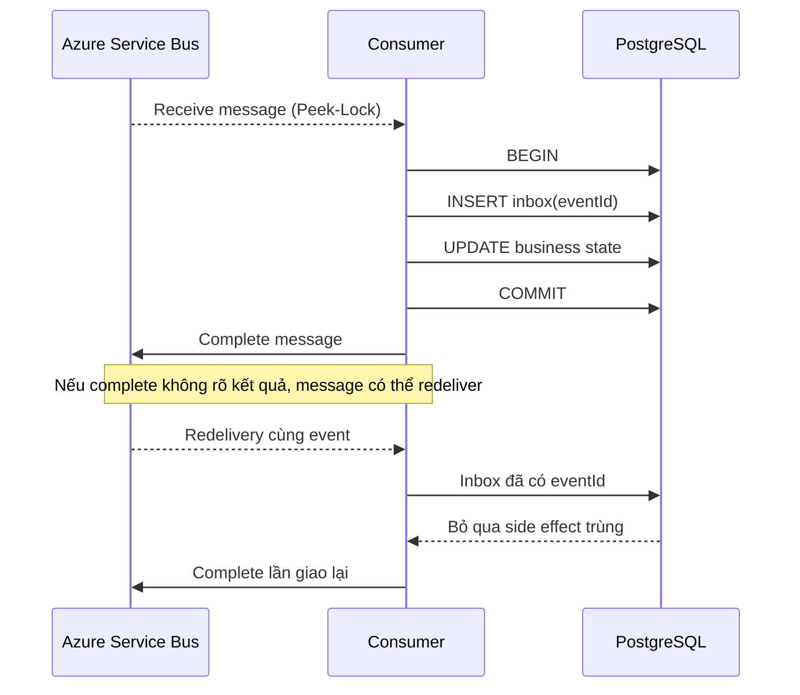
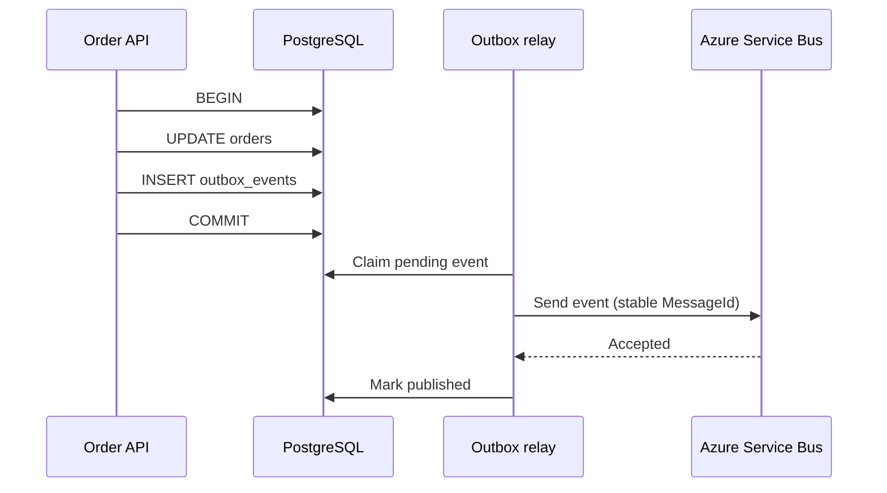
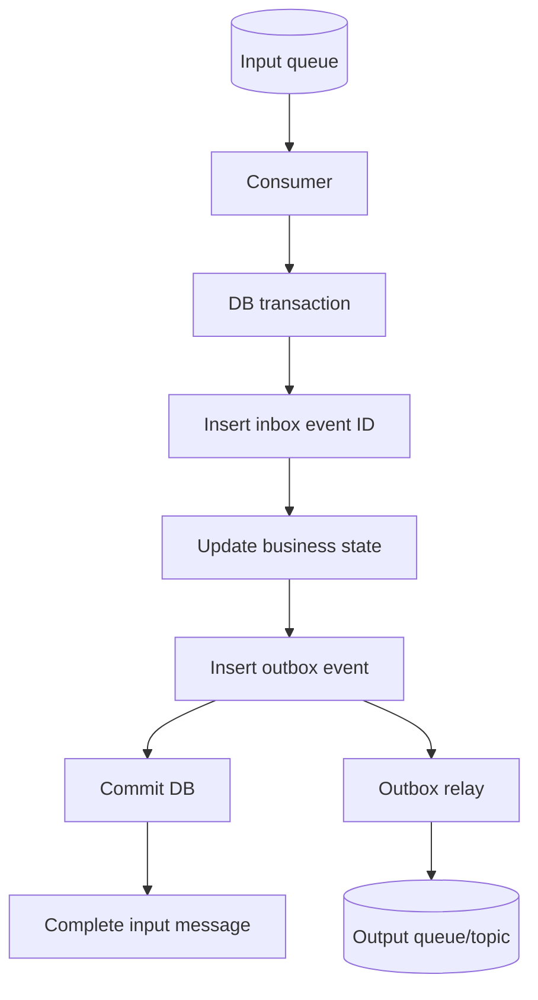
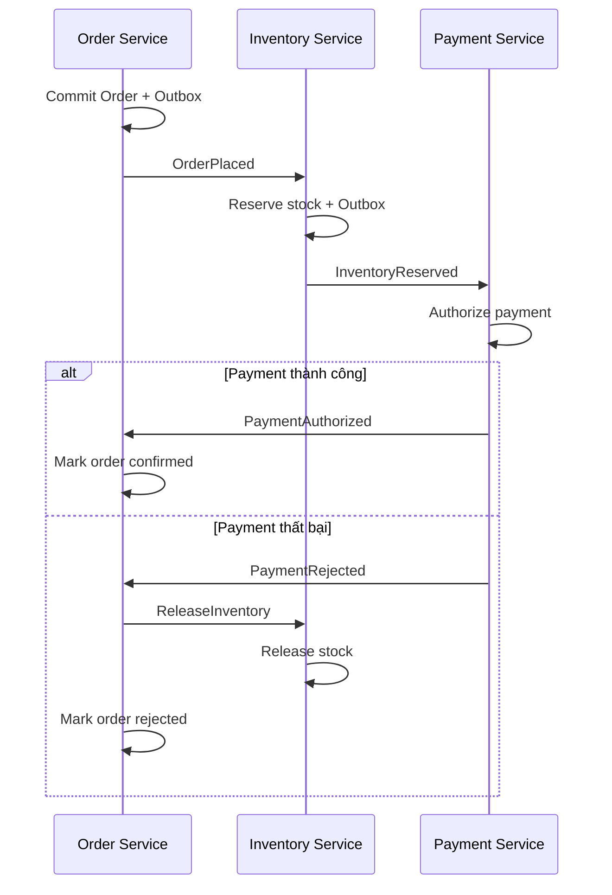

# Giới hạn giao dịch và ranh giới với giao dịch cơ sở dữ liệu

> **Chương:** Azure Service Bus  
> **Module:** SPRING_CLOUD_PROVIDER_INTEGRATION  
> **Mục tiêu:** Phân biệt transaction của Azure Service Bus với transaction cơ sở dữ liệu trong Spring Boot; dùng Java SDK để nhóm thao tác broker; xử lý khoảng hở giữa DB commit và message settlement bằng inbox, idempotency và transactional outbox.

## 1. Một nghiệp vụ thường chạm tới nhiều hệ thống

Giả sử ứng dụng Spring Boot nhận sự kiện OrderPlaced từ queue orders-in. Worker cần cập nhật trạng thái đơn hàng trong PostgreSQL, trừ tồn kho ở service khác, gửi sự kiện OrderAccepted tới queue orders-events rồi complete message đầu vào.

Mỗi hệ thống có cơ chế giao dịch riêng. PostgreSQL có transaction của database; Service Bus có transaction của broker; service tồn kho có thể có transaction riêng. Một lệnh @Transactional trong Spring mặc định chỉ quản lý resource do transaction manager tương ứng hỗ trợ. Nó không tự động gom database, Service Bus và HTTP API thành một giao dịch nguyên tử.

Nếu ứng dụng ghi database trước rồi gửi message, tiến trình có thể dừng sau DB commit nhưng trước khi send. Đơn hàng đã được cập nhật nhưng không có event cho hệ thống phía sau. Nếu gửi message trước rồi DB rollback, hệ thống phía sau nhận event mô tả thay đổi chưa được commit.

Đây là **dual-write problem**: hai lần ghi độc lập cần cùng xảy ra, nhưng không có transaction chung bao phủ cả hai.



Một hệ thống messaging đáng tin cậy phải xác định resource nào nằm trong cùng transaction, thời điểm DB commit, thời điểm broker complete message, và cách phục hồi nếu process dừng giữa hai thao tác hoặc acknowledgement bị mất.

## 2. Các loại transaction có phạm vi khác nhau

| Cơ chế | Resource được bảo vệ | Có bao gồm PostgreSQL và Service Bus cùng lúc không? |
| --- | --- | --- |
| Database transaction qua Spring JDBC/JPA | Một database/resource do DB transaction manager quản lý | Không tự động |
| Azure Service Bus transaction | Các thao tác messaging được broker hỗ trợ trong phạm vi transaction | Không |
| JMS local transaction | Các thao tác trong JMS session/connection transaction | Không tự động bao gồm JDBC |
| JTA/XA distributed transaction | Nhiều XA resource nếu tất cả resource và transaction manager hỗ trợ | Azure Service Bus JMS không hỗ trợ XA/JTA distributed transaction |
| Inbox/idempotency | DB commit một lần cho mỗi event logic; broker settlement diễn ra sau | Không tạo transaction chung, nhưng phục hồi an toàn khi redelivery |
| Transactional outbox | Business state và event record commit nguyên tử trong database | Không commit đồng thời DB và broker; relay gửi event sau commit |

**Transaction không có nghĩa mọi hệ thống tham gia nghiệp vụ đều tự động cùng commit hoặc rollback.** Phải xác định transaction manager và resource thực sự được enlist.

Trong Spring Boot, @Transactional thường dùng PlatformTransactionManager hoặc ReactiveTransactionManager. Với JDBC/JPA, transaction manager điều phối database connection/persistence context. Azure Service Bus native SDK có ServiceBusTransactionContext riêng, do sender/receiver quản lý. Hai context này không tự kết nối với nhau.

## 3. Transaction của Azure Service Bus

Azure Service Bus là transactional message broker. Transaction broker gom nhiều thao tác messaging thành một đơn vị: hoặc các thao tác trong transaction được commit cùng nhau, hoặc bị rollback.

### 3.1. Tier hỗ trợ và giới hạn phạm vi

- **Basic:** không hỗ trợ Service Bus transactions.
- **Standard và Premium:** hỗ trợ transactions.
- Transaction có thể áp dụng trên một queue, topic hoặc subscription.
- Cross-entity transaction có thể gom thao tác trên nhiều entity trong cùng namespace khi client được cấu hình đúng.
- Không thể mở một transaction Service Bus rồi tự enlist PostgreSQL, Cosmos DB, Blob Storage hoặc HTTP API vào cùng transaction.
- Các thao tác quản trị entity như tạo/xóa queue không thuộc messaging transaction.

### 3.2. Những thao tác được hỗ trợ trong transaction

| Thao tác | Có thể tham gia transaction? | Ý nghĩa |
| --- | --- | --- |
| Send | Có | Gửi một hoặc nhiều message |
| Complete | Có | Settlement message đã nhận |
| Abandon | Có | Trả message về luồng nhận |
| Dead-letter | Có | Chuyển message sang DLQ |
| Defer | Có | Đưa message vào trạng thái deferred |
| Renew lock | Có | Gia hạn lock trong phạm vi hỗ trợ |
| Receive | Không nằm trong transaction scope | Nhận Peek-Lock trước, sau đó mới mở transaction để settle/send |
| Management operation | Không | Tạo/xóa/sửa entity không nằm trong messaging transaction |

Ứng dụng thường nhận message bằng Peek-Lock trước. Sau khi có message và lock token, ứng dụng mới tạo transaction rồi thực hiện settlement cùng các thao tác send cần thiết. Broker có thể bảo đảm việc complete message đầu vào và phát message đầu ra cùng commit.

### 3.3. Luồng consume-transform-send

Một worker nhận OrderPlaced rồi phát OrderAccepted. Nếu complete message đầu vào và send message đầu ra cùng một Service Bus transaction, broker không để xảy ra trạng thái chỉ complete đầu vào nhưng không có event đầu ra, hoặc chỉ có event đầu ra mà đầu vào chưa được settle.



Transaction này chỉ bảo vệ thao tác trong Service Bus. Nếu worker còn cập nhật PostgreSQL, database vẫn nằm ngoài transaction broker.

## 4. Dùng ServiceBusTransactionContext trong Azure SDK for Java

Native Java SDK cung cấp ServiceBusTransactionContext. Ứng dụng tạo context bằng sender hoặc receiver, truyền context vào các thao tác cần nằm trong transaction rồi commit hoặc rollback.

### 4.1. Tạo transaction cho một entity

Ví dụ gửi hai message vào cùng queue trong một transaction:

```java
import com.azure.core.credential.TokenCredential;
import com.azure.messaging.servicebus.ServiceBusClientBuilder;
import com.azure.messaging.servicebus.ServiceBusSenderClient;
import com.azure.messaging.servicebus.ServiceBusMessage;
import com.azure.messaging.servicebus.ServiceBusTransactionContext;

public void sendBatchAtomically(
        String fullyQualifiedNamespace,
        TokenCredential credential) {

    try (ServiceBusSenderClient sender =
                 new ServiceBusClientBuilder()
                         .credential(fullyQualifiedNamespace, credential)
                         .sender()
                         .queueName("orders-events")
                         .buildClient()) {

        ServiceBusTransactionContext transaction =
                sender.createTransaction();
        boolean commitStarted = false;

        try {
            sender.sendMessage(
                    new ServiceBusMessage("OrderAccepted:order-123"),
                    transaction);

            sender.sendMessage(
                    new ServiceBusMessage(
                            "InventoryReservationRequested:order-123"),
                    transaction);

            commitStarted = true;
            sender.commitTransaction(transaction);

        } catch (RuntimeException exception) {
            if (!commitStarted) {
                try {
                    sender.rollbackTransaction(transaction);
                } catch (RuntimeException rollbackException) {
                    exception.addSuppressed(rollbackException);
                }
            }
            throw exception;
        }
    }
}
```

Hai lệnh send sử dụng cùng context. Message chỉ trở thành kết quả đã commit khi transaction commit thành công. Nếu thao tác trong transaction thất bại trước commit, ứng dụng nên rollback và xử lý lỗi theo chính sách của mình.

Đây là ví dụ minh họa; trong ứng dụng Spring Boot, sender nên được quản lý theo lifecycle bean thay vì tạo/đóng client cho từng request. Credential có thể lấy từ DefaultAzureCredential hoặc Managed Identity.

### 4.2. Complete message và send event trong cùng transaction

Đây là mẫu hữu ích cho worker chuyển message giữa hai queue trong cùng namespace. Message được nhận trước bằng Peek-Lock; sau đó transaction bao gồm complete đầu vào và send đầu ra.

```java
import com.azure.messaging.servicebus.ServiceBusReceiverClient;
import com.azure.messaging.servicebus.ServiceBusSenderClient;
import com.azure.messaging.servicebus.ServiceBusReceivedMessage;
import com.azure.messaging.servicebus.ServiceBusMessage;
import com.azure.messaging.servicebus.ServiceBusTransactionContext;
import com.azure.messaging.servicebus.models.CompleteOptions;

public void forwardAtomically(
        ServiceBusReceiverClient inputReceiver,
        ServiceBusSenderClient outputSender) {

    ServiceBusReceivedMessage input =
            inputReceiver.receiveMessage();

    if (input == null) {
        return;
    }

    ServiceBusTransactionContext transaction =
            inputReceiver.createTransaction();

    boolean commitStarted = false;

    try {
        ServiceBusMessage output =
                new ServiceBusMessage(input.getBody())
                        .setMessageId(input.getMessageId() + ":forwarded")
                        .setCorrelationId(input.getCorrelationId());

        inputReceiver.complete(
                input,
                new CompleteOptions().setTransactionContext(transaction));

        outputSender.sendMessage(output, transaction);

        commitStarted = true;
        inputReceiver.commitTransaction(transaction);

    } catch (RuntimeException exception) {
        if (!commitStarted) {
            try {
                inputReceiver.rollbackTransaction(transaction);
            } catch (RuntimeException rollbackException) {
                exception.addSuppressed(rollbackException);
            }
        }

        // Nếu commit đã bắt đầu nhưng client mất acknowledgement,
        // cần xem kết quả là chưa chắc chắn và dựa vào idempotency/reconciliation.
        throw exception;
    }
}
```

Ví dụ cần receiver và sender được tạo từ cấu hình client phù hợp, cùng namespace và dùng đúng entity. CompleteOptions.setTransactionContext gắn thao tác complete vào transaction; sendMessage(message, transaction) gắn send vào cùng context.

Nếu inputReceiver và outputSender cùng trỏ tới một entity thì transaction có thể nằm trong phạm vi entity đó. Nếu chúng trỏ tới hai entity khác nhau, hãy tạo cả hai từ cùng ServiceBusClientBuilder đã bật enableCrossEntityTransactions(); chỉ cùng namespace là chưa đủ.

Nếu transaction commit thành công, broker hoàn tất cả hai thao tác. Nếu transaction rollback, message đầu vào vẫn chưa được complete và có thể được giao lại; event đầu ra chưa được commit.

**Lưu ý về kết quả commit không chắc chắn:** nếu client mất kết nối đúng lúc gửi commit, ứng dụng có thể không biết broker đã commit hay chưa. Không suy luận rằng commit exception chắc chắn có nghĩa rollback. Hãy dùng MessageId/event ID ổn định, consumer idempotent và quy trình đối chiếu trạng thái.

### 4.3. Cross-entity transactions

Nếu transaction cần thao tác trên nhiều queue/topic/subscription trong cùng namespace, tạo các client bằng cùng một ServiceBusClientBuilder đã bật enableCrossEntityTransactions():

```java
ServiceBusClientBuilder builder =
        new ServiceBusClientBuilder()
                .credential(fullyQualifiedNamespace, credential)
                .enableCrossEntityTransactions();

ServiceBusReceiverClient orderReceiver =
        builder.receiver()
                .queueName("orders-in")
                .buildClient();

ServiceBusSenderClient eventSender =
        builder.sender()
                .queueName("orders-events")
                .buildClient();

ServiceBusSenderClient auditSender =
        builder.sender()
                .queueName("audit-events")
                .buildClient();
```

Sau đó dùng cùng ServiceBusTransactionContext cho settlement và các lệnh send. Cross-entity transaction dùng cơ chế **send-via** ở phía broker. Entity đầu tiên có thao tác sẽ đóng vai trò entity chuyển tiếp; vì vậy thứ tự thao tác và entity tham gia cần được thiết kế theo hướng dẫn SDK. Nếu receiver khác entity send-via, broker không thể định tuyến receive qua entity chuyển tiếp và thao tác có thể thất bại.

Không dùng cross-entity transaction để kết nối nhiều namespace hoặc dịch vụ Azure khác nhau. Phạm vi là các entity Service Bus thuộc cùng namespace. Hãy đọc sample chính thức và kiểm thử trên namespace Standard/Premium trước khi áp dụng.

### 4.4. Thời hạn transaction và retry

- Transaction Service Bus có thời hạn ngắn; Java API reference mô tả timeout khoảng **2 phút**, tính từ thao tác đầu tiên.
- Giữ transaction nhỏ và nhanh. Không tải file lớn, gọi API ngoài hoặc thực hiện nghiệp vụ kéo dài bên trong transaction broker.
- Service Bus không tự retry operation khi operation chạy trong transaction scope. Đây là chủ ý để tránh gửi lại một operation mà broker có thể đã nhận trong transaction đang chờ commit.
- Khi một thao tác trong transaction lỗi, ứng dụng phải quyết định rollback hoặc xử lý trạng thái chưa chắc chắn; không dùng retry loop vô hạn bên trong transaction.
- Receive không nằm trong transaction scope. Nhận message bằng Peek-Lock trước, sau đó thực hiện settlement/send trong transaction.

## 5. Vì sao transaction Service Bus không bao gồm database?

ServiceBusTransactionContext là transaction context của broker. DataSourceTransactionManager hoặc JpaTransactionManager là transaction manager của database. Chúng điều khiển hai loại resource khác nhau.

Ví dụ sau **không phải** một giao dịch nguyên tử:

```java
@Transactional
public void handleOrder(ServiceBusReceivedMessage message) {
    orderRepository.markAccepted(message.getMessageId());

    // Lệnh gửi này dùng transaction broker riêng hoặc không có transaction broker.
    sender.sendMessage(new ServiceBusMessage("OrderAccepted"));

    // Khi method kết thúc, Spring mới hoàn tất transaction database.
}
```

Nếu send thành công nhưng database commit thất bại, consumer phía sau có thể nhận event cho một đơn hàng chưa được commit. Nếu database commit thành công nhưng send thất bại, đơn hàng đã được cập nhật nhưng event không tồn tại.

Ngay cả khi tạo ServiceBusTransactionContext bên trong method @Transactional, Spring không tự động enlist JDBC connection vào transaction của Service Bus. Hai context chỉ tình cờ nằm trong cùng method Java; điều đó không tạo atomic commit xuyên hai resource.

### 5.1. Vì sao không dùng JTA/XA để giải quyết?

Một transaction phân tán XA/JTA cần mọi resource tham gia cung cấp giao diện XA phù hợp và transaction manager điều phối prepare/commit. Microsoft xác nhận Azure Service Bus JMS không hỗ trợ distributed transaction XA/JTA. Vì vậy không thể giả định JtaTransactionManager sẽ enlist Service Bus cùng JDBC để đạt two-phase commit.

Spring có thể cấu hình nhiều transaction manager, nhưng điều đó chỉ chọn transaction manager cho từng method hoặc resource. Hai transaction manager độc lập không tự trở thành một transaction phân tán nguyên tử.

### 5.2. Sau commit không có nghĩa là đã publish bền vững

Có thể dùng callback sau commit, ví dụ @TransactionalEventListener(phase = AFTER_COMMIT), để gửi message sau khi DB commit. Cách này tránh publish trước khi transaction database thành công, nhưng vẫn có khoảng hở:

1. Database commit thành công.
2. Process crash trước khi callback gửi message.
3. Không có outbox record để worker khác phát hiện event còn thiếu.

Callback sau commit phù hợp cho tác vụ phụ không bắt buộc bền vững. Với integration event quan trọng, dùng transactional outbox.

## 6. Consumer: inbox và idempotency bảo vệ database transaction

Với consumer, trình tự an toàn là:

1. Nhận message bằng Peek-Lock.
2. Mở transaction database.
3. Ghi nhận event/message ID vào inbox với unique constraint.
4. Nếu event chưa được xử lý, cập nhật business state trong cùng transaction.
5. Commit database.
6. Sau khi DB commit, complete message trên Service Bus.

Nếu DB transaction thất bại, không complete message. Broker có thể giao lại. Nếu DB commit thành công nhưng complete thất bại hoặc mất acknowledgement, broker cũng có thể giao lại. Inbox giúp lần giao lại nhận ra event đã được xử lý và bỏ qua side effect.



### 6.1. Tạo inbox table

Ví dụ PostgreSQL:

```sql
CREATE TABLE processed_events (
    event_id       VARCHAR(200) PRIMARY KEY,
    message_id     VARCHAR(200) NOT NULL,
    processed_at   TIMESTAMPTZ NOT NULL DEFAULT now()
);
```

Nên dùng event ID nghiệp vụ ổn định làm khóa dedup nếu cùng một event có thể được gửi lại với MessageId mới trong các đợt replay. MessageId vẫn được lưu để truy vết broker.

### 6.2. Insert idempotency record trong cùng transaction

Ví dụ repository dùng JDBC:

```java
@Repository
public class InboxRepository {

    private final JdbcTemplate jdbcTemplate;

    public InboxRepository(JdbcTemplate jdbcTemplate) {
        this.jdbcTemplate = jdbcTemplate;
    }

    public boolean insertIfAbsent(String eventId, String messageId) {
        int inserted = jdbcTemplate.update("""
                INSERT INTO processed_events(event_id, message_id)
                VALUES (?, ?)
                ON CONFLICT (event_id) DO NOTHING
                """,
                eventId,
                messageId);

        return inserted == 1;
    }
}
```

Kết quả true nghĩa là transaction hiện tại đã ghi nhận event mới. Kết quả false nghĩa là event đã được xử lý trước đó. Unique constraint là lớp bảo vệ cuối cùng khi hai consumer cùng cố ghi cùng event.

### 6.3. Điều phối DB commit rồi mới complete

Dùng TransactionTemplate để ranh giới commit thể hiện rõ trong code:

```java
@Service
public class OrderMessageHandler {

    private final TransactionTemplate transactionTemplate;
    private final InboxRepository inboxRepository;
    private final OrderRepository orderRepository;
    private final ServiceBusReceiverClient receiver;

    public OrderMessageHandler(
            TransactionTemplate transactionTemplate,
            InboxRepository inboxRepository,
            OrderRepository orderRepository,
            ServiceBusReceiverClient receiver) {
        this.transactionTemplate = transactionTemplate;
        this.inboxRepository = inboxRepository;
        this.orderRepository = orderRepository;
        this.receiver = receiver;
    }

    public void handle(ServiceBusReceivedMessage message) {
        String eventId = readEventId(message);

        // executeWithoutResult chỉ trả về sau khi transaction DB kết thúc.
        transactionTemplate.executeWithoutResult(status -> {
            boolean firstProcessing =
                    inboxRepository.insertIfAbsent(
                            eventId,
                            message.getMessageId());

            if (firstProcessing) {
                orderRepository.applyOrderPlaced(message.getBody());
            }
        });

        // DB đã commit. Nếu complete lỗi, lần giao lại sẽ bị inbox chặn.
        receiver.complete(message);
    }
}
```

Ví dụ giả định readEventId giải mã payload/property theo contract của ứng dụng. Trong code thực tế, inject receiver qua bean hoặc truyền context thích hợp, và quản lý lock/settlement theo lifecycle processor.

Không gọi receiver.complete bên trong callback transaction database nếu mục tiêu là chỉ complete sau commit. Khi complete xảy ra trước DB commit, broker có thể xóa message rồi database rollback, làm mất cơ hội redelivery.

### 6.4. Xử lý lỗi ở từng thời điểm

| Điểm lỗi | Trạng thái DB | Trạng thái message | Hành động khi phục hồi |
| --- | --- | --- | --- |
| Trước DB commit | Rollback | Chưa complete | Message redelivery; xử lý lại |
| Trong DB transaction | Rollback | Chưa complete | Message redelivery; xử lý lại |
| Sau DB commit, trước complete | Đã commit | Có thể còn active/lock hết hạn | Redelivery; inbox phát hiện event đã xử lý |
| Complete thành công | Đã commit | Đã settle | Kết thúc |
| Complete timeout/mất acknowledgement | Đã commit | Kết quả broker chưa chắc chắn | Redelivery nếu có; inbox bảo vệ side effect |

Nếu DB transaction thất bại, có thể abandon message khi lock còn hợp lệ hoặc để lock hết hạn theo chính sách. Nếu complete thất bại sau DB commit, không chạy lại business update một cách mù quáng; hãy để inbox xử lý lần giao lại.

## 7. Producer: transactional outbox giải quyết dual-write

Với producer, cần bảo đảm business state và event được ghi nhận cùng nhau. Mẫu transactional outbox làm điều này bằng một transaction database:

- Cập nhật bảng nghiệp vụ.
- Thêm event vào bảng outbox.
- Commit cả hai trong cùng DB transaction.
- Một relay worker đọc outbox và gửi event sang Service Bus.
- Sau khi send được xác nhận, relay đánh dấu outbox row đã publish.

Nếu DB transaction rollback, cả business update và outbox event đều rollback. Nếu DB commit, event còn trong outbox để relay có thể gửi sau khi ứng dụng phục hồi.



Outbox không tạo transaction phân tán DB + Service Bus. Nó lưu event trong cùng transaction với business state rồi gửi bất đồng bộ. Relay có thể gửi lại cùng event nếu acknowledgement hoặc thao tác đánh dấu published không chắc chắn, do đó consumer vẫn phải idempotent.

### 7.1. Tạo outbox table

```sql
CREATE TABLE outbox_events (
    event_id       VARCHAR(200) PRIMARY KEY,
    aggregate_id   VARCHAR(200) NOT NULL,
    event_type     VARCHAR(200) NOT NULL,
    payload        JSONB NOT NULL,
    occurred_at    TIMESTAMPTZ NOT NULL DEFAULT now(),
    published_at   TIMESTAMPTZ,
    attempts       INTEGER NOT NULL DEFAULT 0,
    lease_owner    VARCHAR(200),
    lease_until    TIMESTAMPTZ
);

CREATE INDEX idx_outbox_pending
    ON outbox_events (occurred_at)
    WHERE published_at IS NULL;
```

Các cột chính:

- event_id là ID ổn định của event logic và được dùng làm MessageId.
- aggregate_id là business key; có thể dùng làm SessionId nếu cần thứ tự theo aggregate.
- event_type xác định loại sự kiện.
- payload chứa event đã serialize theo schema version.
- published_at chỉ được ghi sau khi Service Bus xác nhận send.
- attempts hỗ trợ theo dõi số lần relay thử gửi.
- lease_owner và lease_until giúp nhiều relay instance claim row mà không gửi đồng thời một event.

### 7.2. Business update và outbox insert cùng transaction

Ví dụ Spring service:

```java
@Service
public class OrderApplicationService {

    private final OrderRepository orderRepository;
    private final OutboxRepository outboxRepository;

    public OrderApplicationService(
            OrderRepository orderRepository,
            OutboxRepository outboxRepository) {
        this.orderRepository = orderRepository;
        this.outboxRepository = outboxRepository;
    }

    @Transactional
    public void placeOrder(CreateOrderCommand command) {
        Order order = orderRepository.create(command);

        OrderPlacedEvent event = new OrderPlacedEvent(
                order.getId(),
                order.getCustomerId(),
                order.getTotal(),
                1);

        outboxRepository.insert(
                event.eventId(),
                order.getId(),
                "OrderPlaced",
                serialize(event));
    }
}
```

Nếu insert outbox thất bại, business update rollback. Nếu business update thất bại, outbox insert rollback. Hai thao tác nằm trong cùng transaction database do Spring quản lý.

Không gọi Service Bus sender trực tiếp trong method này nếu muốn tránh dual-write. Việc gửi được relay thực hiện sau commit.

### 7.3. Relay gửi event với MessageId ổn định

Relay đọc các row chưa publish, claim bằng lease, commit transaction claim rồi mới gọi Service Bus. Sau khi send thành công, relay cập nhật published state.

Ví dụ phần gửi:

```java
public void publishOutboxEvent(OutboxEvent event) {
    ServiceBusMessage message =
            new ServiceBusMessage(event.payload())
                    .setMessageId(event.eventId())
                    .setSubject(event.eventType())
                    .setContentType("application/json")
                    .setCorrelationId(event.eventId());

    if (sessionsEnabled) {
        message.setSessionId(event.aggregateId());
    }

    sender.sendMessage(message);

    // Chỉ đánh dấu published sau khi send được xác nhận.
    outboxRepository.markPublished(event.eventId());
}
```

Nếu send timeout sau khi broker đã nhận message, relay có thể thử gửi lại. Giữ cùng MessageId cho cùng event. Duplicate detection có thể loại bản gửi lặp trong cửa sổ cấu hình, nhưng consumer inbox vẫn cần thiết vì duplicate detection không bảo vệ redelivery ở phía nhận.

Nếu send thành công nhưng DB update published_at thất bại, relay sẽ gửi lại khi lease hết hạn. Đây là hành vi at-least-once có chủ đích. Không đánh dấu published trước khi send vì process có thể crash sau khi cập nhật DB và trước khi gửi, làm mất event.

### 7.4. Claim outbox row bằng lease

Một relay có thể claim một batch bằng transaction ngắn. Ví dụ PostgreSQL:

```sql
WITH candidates AS (
    SELECT event_id
    FROM outbox_events
    WHERE published_at IS NULL
      AND (lease_until IS NULL OR lease_until < now())
    ORDER BY occurred_at
    FOR UPDATE SKIP LOCKED
    LIMIT 50
)
UPDATE outbox_events o
SET lease_owner = :worker_id,
    lease_until = now() + interval '60 seconds',
    attempts = attempts + 1
FROM candidates c
WHERE o.event_id = c.event_id
RETURNING o.*;
```

Commit transaction claim trước khi gửi network request. Khi send thành công, cập nhật published_at và xóa lease. Nếu worker crash, lease hết hạn để worker khác claim lại.

Với yêu cầu thứ tự theo aggregate, cần đảm bảo relay không phát event version sau trước event version trước. Có thể claim theo aggregate/version, dùng một partition/worker cho mỗi aggregate key hoặc áp dụng sessions ở Service Bus với SessionId = aggregateId. Chỉ đặt SessionId không sửa được thứ tự nếu producer relay đã phát sai thứ tự.

## 8. Inbox và outbox phối hợp với Service Bus transaction như thế nào?

Ba cơ chế có vai trò khác nhau:

- **Service Bus transaction:** atomicity giữa các thao tác broker như complete message đầu vào và send message đầu ra.
- **Inbox/idempotency:** ghi nhận event đã xử lý trong cùng DB transaction với business update; bảo vệ khi broker redeliver.
- **Transactional outbox:** ghi event cần publish cùng business update trong DB transaction; bảo vệ khi producer crash trước khi gửi.

Một consumer có thể dùng cả inbox và outbox trong cùng DB transaction:

1. Nhận message đầu vào.
2. Mở DB transaction.
3. Insert event ID vào inbox.
4. Cập nhật business state.
5. Insert event đầu ra vào outbox.
6. Commit DB transaction.
7. Complete message đầu vào trên Service Bus.
8. Relay riêng gửi event đầu ra từ outbox.

Nếu bước 7 thất bại, message đầu vào có thể redeliver nhưng inbox chặn side effect trùng. Nếu bước 8 chưa xảy ra, outbox vẫn giữ event để relay tiếp tục.



Đây là một cách thiết kế rõ ràng cho integration service cần vừa cập nhật database vừa phát event.

## 9. Saga và compensation cho quy trình nhiều dịch vụ

Một nghiệp vụ có thể đi qua nhiều service và database riêng. Ví dụ đặt hàng gồm Order Service, Inventory Service và Payment Service. Không nên giữ một transaction broker hoặc DB mở trong suốt thời gian gọi các service.

Dùng saga:

1. Order Service commit order và outbox event.
2. Inventory Service nhận event, reserve stock trong DB transaction và phát kết quả.
3. Payment Service authorize payment và phát kết quả.
4. Order Service nhận kết quả, cập nhật trạng thái.
5. Nếu payment thất bại sau khi reserve stock, phát lệnh release inventory như compensation.

Mỗi bước có local transaction, inbox/outbox và idempotency riêng. Compensation là một hành động nghiệp vụ mới để khôi phục trạng thái phù hợp; nó không phải rollback ACID xuyên các service.



Saga phù hợp khi quy trình có thời gian dài, nhiều resource và có thể định nghĩa hành động bù. Cần lưu trạng thái workflow và correlation ID bền vững; không dựa vào một thread đang chạy hoặc một message lock giữ trong nhiều phút.

## 10. Các tình huống lỗi và cách phục hồi

| Tình huống | DB | Service Bus | Cách phục hồi |
| --- | --- | --- | --- |
| DB rollback trước commit | Không thay đổi | Message chưa complete | Redelivery và xử lý lại |
| DB commit, process crash trước complete | Đã cập nhật | Message có thể redeliver | Inbox phát hiện event đã xử lý rồi complete |
| Complete thành công, DB chưa commit | Chưa cập nhật | Message đã bị loại | Đây là thứ tự nguy hiểm; không complete trước DB commit |
| DB commit, outbox relay chưa chạy | Business + outbox đã lưu | Chưa có event output | Relay tiếp tục từ outbox |
| Send thành công, mark outbox published thất bại | Outbox còn pending | Event đã có thể tồn tại | Relay gửi lại cùng MessageId; consumer idempotent |
| Mark published trước send rồi crash | Outbox bị coi đã xong | Event chưa được gửi | Có thể mất event; không dùng thứ tự này |
| Service Bus transaction rollback | Không liên quan DB | Settlement/send trong transaction rollback | Message đầu vào còn khả năng redelivery |
| Service Bus commit acknowledgement mất | Không xác định qua client | Kết quả commit có thể không rõ | Dựa vào event ID, redelivery và reconciliation |
| API ngoài timeout sau khi đã thực hiện | Resource ngoài có thể đã đổi | Message có thể redeliver | Idempotency key/operation ID và trạng thái truy vấn |
| Replay cùng event | DB có thể đã xử lý | Message được gửi lại | Inbox dedupe theo event ID gốc |

## 11. Những lỗi thiết kế thường gặp

### 11.1. Complete message trước khi DB commit

Nếu consumer complete message rồi mới commit database, crash/rollback sau complete làm message biến mất khỏi luồng nhận trong khi business state chưa được cập nhật. Hãy commit DB trước, complete sau; inbox bảo vệ nếu complete không chắc chắn.

### 11.2. Gửi event trong method @Transactional rồi nghĩ nó cùng transaction

Gọi sender trong method có @Transactional không làm Service Bus tham gia transaction database. Nếu DB rollback sau send, event vẫn có thể tồn tại. Dùng outbox để lưu event cùng DB state và relay sau commit.

### 11.3. Chỉ dùng callback AFTER_COMMIT để gửi event quan trọng

Callback chỉ chạy sau commit, nhưng process có thể dừng sau commit trước khi callback gửi. Outbox lưu event bền vững nên worker khác có thể gửi sau restart.

### 11.4. Đánh dấu outbox published trước khi gửi

Nếu update DB thành published trước send, crash giữa hai thao tác sẽ làm event bị mất. Chỉ mark published sau khi send được xác nhận. Chấp nhận khả năng gửi trùng và bảo vệ bằng MessageId ổn định cùng inbox.

### 11.5. Giữ transaction quá lâu

Không gọi Blob Storage, HTTP API hoặc chạy xử lý file lớn trong transaction database/broker. Transaction dài giữ lock, connection và tài nguyên; Service Bus transaction còn có timeout ngắn. Tách tác vụ thành bước/job có checkpoint.

### 11.6. Dùng MessageId mới cho cùng event khi retry

Nếu mỗi lần retry tạo ID mới, duplicate detection không nhận diện được bản gửi trùng và inbox dựa trên MessageId cũng có thể thất bại. Giữ event ID ổn định xuyên retry/replay; phân biệt event ID nghiệp vụ với ID của từng lần giao.

### 11.7. Giả định transaction commit lỗi chắc chắn đã rollback

Mất kết nối trong lúc commit tạo ra kết quả không chắc chắn. Không thể dựa vào exception phía client để kết luận broker chưa commit. Reconcile bằng ID ổn định, inbox/outbox và trạng thái nghiệp vụ.

## 12. Kiểm thử transaction và dual-write

Kiểm thử phải chủ động tạo crash/failure giữa các ranh giới commit, không chỉ xác nhận method trả về thành công.

| Test | Cách tạo lỗi | Kết quả mong đợi |
| --- | --- | --- |
| Service Bus atomic send | Gửi hai message trong cùng transaction rồi rollback | Không message nào được commit |
| Complete + send | Complete input và send output trong transaction rồi commit | Cả hai cùng được áp dụng |
| Cross-entity | Dùng builder bật cross-entity transactions | Settlement/send trên các entity cùng namespace commit cùng nhau |
| Basic tier | Thử tạo transaction trên Basic | Tính năng không được hỗ trợ |
| DB rollback | Ném exception trước DB commit | Inbox/business/outbox rollback; message chưa complete |
| DB commit trước complete | Crash sau commit, trước complete | Redelivery; inbox ngăn side effect lặp |
| Complete timeout | Làm settlement acknowledgement mất | Kết quả có thể không rõ; consumer xử lý an toàn khi redelivery |
| Outbox relay crash trước send | Dừng worker sau claim | Lease hết hạn, worker khác gửi |
| Outbox relay crash sau send | Dừng worker trước mark published | Event có thể gửi lại với cùng MessageId |
| Outbox DB failure | Không thể mark published | Retry sau; consumer idempotent |
| Topic duplicate | Publish lại cùng event vào topic | Consumer mỗi subscription xử lý idempotently |
| Saga compensation | Payment thất bại sau inventory reserve | Release inventory và order chuyển trạng thái phù hợp |

### 12.1. Kiểm thử inbox bằng unique constraint

1. Gửi một event có event ID cố định.
2. Consumer insert inbox và cập nhật business state.
3. Giả lập lỗi trước khi complete.
4. Đợi message redeliver.
5. Xác minh lần giao lại không tăng số bản ghi nghiệp vụ và không lặp side effect.
6. Xác minh message cuối cùng được complete.

### 12.2. Kiểm thử outbox bằng crash point

1. Gọi API tạo order.
2. Xác minh order và outbox event cùng commit.
3. Dừng relay trước khi send; khởi động lại và xác minh event được gửi.
4. Dừng relay sau khi send nhưng trước mark published.
5. Khởi động lại; xác minh event có thể gửi lại nhưng consumer chỉ áp dụng một lần.
6. Xác minh outbox row được mark published sau send thành công.

### 12.3. Kiểm thử Service Bus transaction trên namespace thật

Emulator không nên được mặc định là mô phỏng đầy đủ transaction, cross-entity send-via, tier và hành vi broker. Dùng namespace Standard/Premium test riêng để xác minh Java SDK transaction, RBAC, queue/topic/subscription và commit/rollback.

## 13. Bài thực hành: xử lý OrderPlaced với PostgreSQL và Service Bus

**Tình huống:** Order API ghi đơn hàng vào PostgreSQL và phát OrderPlaced. Consumer nhận message, cập nhật trạng thái và phát OrderAccepted. Worker cần chịu được process crash ở mọi điểm giữa DB và broker.

### Phần A — Thử dual-write không an toàn

- Viết method @Transactional cập nhật order rồi gọi sender trực tiếp.
- Tạo failure sau DB commit nhưng trước send.
- Quan sát order đã có nhưng event bị thiếu.
- Đảo thứ tự: send trước rồi làm DB rollback.
- Quan sát event được nhận dù order chưa commit.

### Phần B — Transactional outbox

- Tạo bảng outbox.
- Cập nhật order và insert event trong cùng DB transaction.
- Viết relay claim row bằng lease.
- Gửi message với MessageId = eventId.
- Mark published sau khi send được xác nhận.
- Tạo crash sau send trước mark; xác minh duplicate không tạo side effect trùng.

### Phần C — Inbox consumer

- Tạo bảng processed_events với unique event ID.
- Consumer dùng TransactionTemplate để insert inbox và cập nhật order trong cùng DB transaction.
- Complete message sau khi transaction trả về.
- Tạo crash sau DB commit trước complete.
- Xác minh redelivery được nhận diện và complete an toàn.

### Phần D — Service Bus transaction

- Nhận message bằng Peek-Lock.
- Tạo ServiceBusTransactionContext.
- Complete message đầu vào và send message đầu ra bằng cùng context.
- Test commit và rollback.
- Bật cross-entity transactions khi gửi giữa hai queue cùng namespace.
- Xác minh transaction không bao gồm thao tác PostgreSQL.

### Phần E — Saga

- Thêm Inventory Service và Payment Service giả lập.
- Lưu trạng thái từng bước.
- Gửi event qua outbox.
- Mô phỏng payment thất bại sau khi reserve stock.
- Phát lệnh compensation và xác minh inventory được release.

**Tiêu chí đạt:** người học giải thích được transaction scope của Service Bus và DB; triển khai được send/settlement trong broker transaction; chỉ ra được dual-write failure windows; dùng inbox để chống redelivery và outbox để không mất event; và thiết kế saga cho quy trình nhiều service.

---

## 14. Checklist trước khi triển khai

| Nhóm | Câu hỏi |
| --- | --- |
| Service Bus tier | Namespace dùng Standard/Premium nếu cần transaction chưa? |
| Transaction scope | Những thao tác broker nào được gom trong transaction? |
| Cross entity | Có cần enableCrossEntityTransactions và cùng namespace không? |
| Receive | Message được nhận bằng Peek-Lock trước transaction chưa? |
| Timeout | Transaction có hoàn tất nhanh trong giới hạn broker không? |
| Retry | Có tránh tự retry operation bên trong transaction scope không? |
| DB transaction | Spring transaction manager quản lý chính xác resource nào? |
| Commit order | DB commit xảy ra trước complete message chưa? |
| Inbox | Event ID có unique constraint và được ghi cùng business update không? |
| Outbox | Business state và outbox row có cùng DB transaction không? |
| Relay | Có lease, retry và stable MessageId không? |
| Consumer | Có idempotency khi event được giao lại hoặc replay không? |
| Topic | Replay có làm subscription khác nhận lại event không? |
| Saga | Các bước dài có state và compensation rõ ràng không? |
| Observability | Có log event ID, correlation ID, transaction outcome và outbox age không? |
| Testing | Có crash test trước/sau DB commit, send và settlement không? |

## Ghi nhớ

- **Spring @Transactional** chỉ điều phối resource thuộc transaction manager được chọn; gọi Service Bus SDK bên trong method không tự enlist broker vào DB transaction.
- **Azure Service Bus transaction** nhóm send, complete, abandon, dead-letter, defer và renew lock; receive nằm ngoài scope.
- Service Bus transactions hỗ trợ Standard/Premium; Basic không hỗ trợ. Cross-entity transaction cần cùng namespace và client builder bật tính năng tương ứng.
- Java SDK dùng ServiceBusTransactionContext, CompleteOptions.setTransactionContext, send với cùng context rồi commit/rollback.
- Transaction Service Bus có timeout ngắn và operation trong transaction không được SDK tự retry.
- **Inbox/idempotency** ghi event ID cùng business update trong DB transaction, rồi mới complete message.
- **Transactional outbox** ghi business state và event trong cùng DB transaction; relay gửi sau commit với MessageId ổn định.
- Inbox/outbox cung cấp khả năng phục hồi at-least-once và eventual consistency; chúng không tạo exactly-once end-to-end.
- Với quy trình nhiều service, dùng saga và compensation thay vì giữ transaction dài xuyên hệ thống.

Khi tích hợp Spring Boot với Azure Service Bus, hãy xác định ranh giới transaction trước khi viết code. Dùng broker transaction cho các thao tác messaging cần atomicity với nhau; dùng database transaction để bảo vệ business state; kết hợp inbox và outbox để nối hai thế giới một cách có thể phục hồi. Đó là nền tảng để xử lý message tin cậy khi process crash, timeout hoặc acknowledgement không rõ kết quả.

### Tài liệu chính thức

- [Transactions in Azure Service Bus](https://learn.microsoft.com/en-us/azure/service-bus-messaging/service-bus-transactions)
- [Service Bus transaction troubleshooting](https://learn.microsoft.com/en-us/azure/service-bus-messaging/service-bus-troubleshooting-guide)
- [ServiceBusTransactionContext Java API](https://learn.microsoft.com/en-us/java/api/com.azure.messaging.servicebus.servicebustransactioncontext?view=azure-java-stable)
- [ServiceBusSenderClient Java API](https://learn.microsoft.com/en-us/java/api/com.azure.messaging.servicebus.servicebussenderclient?view=azure-java-stable)
- [ServiceBusReceiverClient Java API](https://learn.microsoft.com/en-us/java/api/com.azure.messaging.servicebus.servicebusreceiverclient?view=azure-java-stable)
- [CompleteOptions Java API](https://learn.microsoft.com/en-us/java/api/com.azure.messaging.servicebus.models.completeoptions?view=azure-java-stable)
- [Choose between JMS and native SDK for Azure Service Bus](https://learn.microsoft.com/en-us/azure/service-bus-messaging/service-bus-jms-versus-native-sdk)
- [Prevent message loss and duplicate processing](https://learn.microsoft.com/en-us/azure/service-bus-messaging/service-bus-message-loss-and-duplicates)
- [Transactional outbox pattern with Azure Cosmos DB](https://learn.microsoft.com/en-us/azure/architecture/databases/guide/transactional-out-box-cosmos)
- [Spring Framework: Using @Transactional](https://docs.spring.io/spring-framework/reference/data-access/transaction/declarative/annotations.html)
- [Spring Framework: Transaction implementation](https://docs.spring.io/spring/reference/7.0/data-access/transaction/declarative/tx-decl-explained.html)

Kiểm tra Spring Boot/JDK, Spring transaction manager, Azure SDK version, tier, queue/topic/subscription và cấu hình cross-entity trước khi triển khai. Transaction broker và transaction database là hai phạm vi riêng; hãy kiểm thử failure windows trên namespace và database test gần với production.
