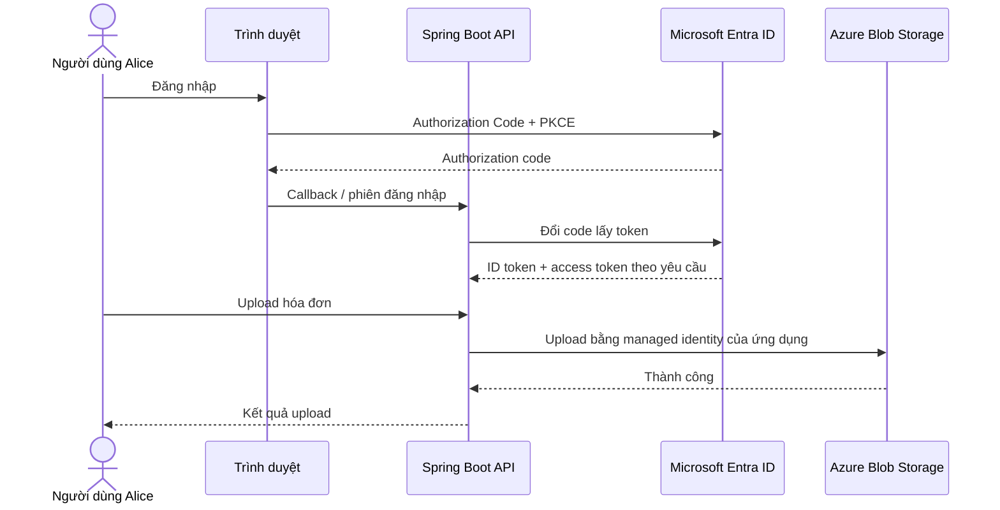
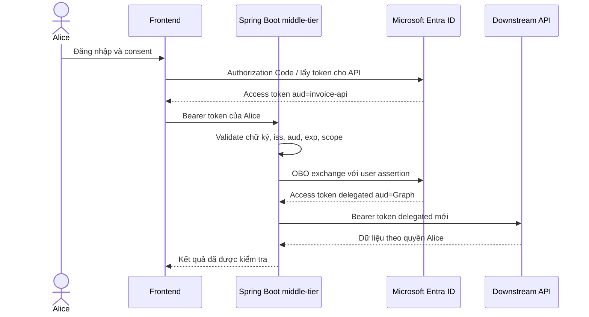

# Phân biệt danh tính ứng dụng gọi Azure và danh tính người dùng đăng nhập

> **Chương:** Microsoft Entra ID  
> **Học phần:** SPRING_CLOUD_PROVIDER_INTEGRATION — thực hành tích hợp Spring Boot với dịch vụ managed của AWS, Azure và Google Cloud qua các thư viện Spring Cloud tương ứng; tập trung vào danh tính, quyền, storage, messaging, dữ liệu và bảo vệ secret.

Một ứng dụng Spring Boot có thể đồng thời phục vụ nhân viên đăng nhập bằng tài khoản tổ chức và tự gọi Azure Blob Storage để lưu tài liệu. Hai hoạt động này diễn ra trong cùng một tiến trình, nhưng không nhất thiết dùng cùng danh tính. Người dùng đăng nhập có thể là Alice; ứng dụng gọi Storage có thể là managed identity `invoice-api-staging`. Nếu nhầm hai danh tính, hệ thống dễ cấp quyền quá rộng, ghi nhận sai người thực hiện thao tác hoặc dùng nhầm token khi gọi API downstream.

Bài học này giải thích cách Microsoft Entra ID biểu diễn **danh tính người dùng** và **danh tính ứng dụng**, cách chọn OAuth 2.0 flow phù hợp, và cách cấu hình Spring Boot/Spring Security để xác thực đúng chủ thể. Ba tình huống xuyên suốt là:

1. Một workload tự gọi Azure resource bằng danh tính của chính ứng dụng.
2. Một người dùng đăng nhập vào ứng dụng web và truy cập chức năng theo quyền của mình.
3. Một API nhận yêu cầu có người dùng, sau đó gọi API khác thay mặt người đó bằng luồng On-Behalf-Of (OBO).

## 1. Mục tiêu học tập

Sau bài này, bạn có thể:

- Phân biệt user object, application object, service principal và managed identity trong Microsoft Entra ID.
- Giải thích vì sao `client ID`, `object ID` và `tenant ID` là ba giá trị khác nhau.
- Chọn giữa managed identity/workload identity, client credentials, authorization code và OBO theo ngữ cảnh.
- Phân biệt delegated permissions, application permissions, app roles và Azure RBAC.
- Nhận diện claim quan trọng trong access token và xác minh chữ ký, `iss`, `aud`, thời hạn, tenant và quyền.
- Cấu hình Spring Boot làm OAuth2 Login client, OAuth2 Resource Server hoặc OAuth2 Client gọi API downstream.
- Kiểm thử riêng luồng app-only và user-delegated, tránh vô tình dùng credential local trong môi trường production.

## 2. Bốn đối tượng cần phân biệt trong Microsoft Entra ID

Microsoft Entra ID không chỉ lưu danh sách người dùng. Nó còn quản lý ứng dụng, đại diện ứng dụng trong từng tenant, danh tính workload và quyền truy cập.

| Đối tượng | Ý nghĩa | Ví dụ |
|---|---|---|
| **User object** | Đại diện một người dùng trong một tenant | Nhân viên `alice@contoso.example` |
| **Application object** | Bản định nghĩa ứng dụng trong tenant sở hữu; chứa cấu hình đăng nhập, redirect URI, exposed API, app roles và metadata credential | App registration `invoice-portal` |
| **Service principal** | Bản đại diện của ứng dụng trong một tenant cụ thể; là đối tượng được cấp quyền/consent và được ghi nhận khi ứng dụng hoạt động | Enterprise application `invoice-portal` trong tenant Contoso |
| **Managed identity** | Danh tính do Azure quản lý cho một workload; được biểu diễn trong Entra bằng service principal, không yêu cầu ứng dụng tự lưu secret để lấy token | System-assigned identity của Azure App Service |

### Application object và service principal

Khi đăng ký ứng dụng trong tenant sở hữu, Entra tạo **application object**. Nếu ứng dụng được dùng trong tenant khác (ví dụ ứng dụng đa tenant được khách hàng consent), tenant đó có **service principal** tương ứng. Application object là bản định nghĩa gốc; service principal là đại diện ứng dụng trong một tenant và gắn với quyền, consent, assignment, sign-in logs của tenant đó.

Một ứng dụng đa tenant có thể có một application object trong tenant nhà phát triển và nhiều service principal trong các tenant khách hàng. Vì thế, khi điều tra sự cố, phải xác định tenant đang phát hành token và service principal tương ứng trong tenant đó.

### Client ID, object ID và tenant ID

| ID | Nhận diện | Phạm vi |
|---|---|---|
| `client ID` / `application ID` | Ứng dụng mà client đăng ký sử dụng khi yêu cầu token | Dùng để cấu hình OAuth client |
| `object ID` | Một object cụ thể (user, application object, service principal hoặc managed identity) | Khác nhau giữa từng object và tenant |
| `tenant ID` / directory ID | Tenant phát hành token và chứa principal/consent tương ứng | Dùng chọn authority/issuer phù hợp |

Không lấy `object ID` của application object để điền vào `client-id`; cũng không lấy `client ID` làm `principal ID` khi cấu hình role assignment. Azure portal hiển thị các giá trị này ở những trang khác nhau, hãy kiểm tra đúng nhãn trường.

### Managed identity là danh tính ứng dụng

Managed identity không phải tài khoản nhân viên và cũng không phải “một secret tự động được giấu trong VM”. Azure cấp danh tính cho resource/workload, rồi SDK có thể yêu cầu token qua endpoint/credential provider được nền tảng hỗ trợ. Có hai loại:

- **System-assigned:** gắn với vòng đời một Azure resource; xóa resource thì identity gắn với nó cũng bị xóa.
- **User-assigned:** là một Azure resource độc lập, có thể gắn vào nhiều workload và có vòng đời riêng. Khi có nhiều identity, cần chọn đúng identity bằng client ID hoặc cấu hình tương ứng.

Managed identity vẫn có một service principal trong Entra và vẫn phải được cấp quyền tới Azure resource. Nó loại bỏ việc ứng dụng tự quản lý client secret, chứ không tự động có quyền đọc mọi storage account.

Nguồn: [Microsoft identity platform — Application model](https://learn.microsoft.com/entra/identity-platform/application-model), [Managed identities for Azure resources](https://learn.microsoft.com/entra/identity/managed-identities-azure-resources/overview).

## 3. Hai loại principal có thể tham gia cùng một request

Hãy xem luồng lưu hóa đơn:



Trong luồng trên:

- Alice là **người dùng đang đăng nhập**. Spring Security có thể tạo `Authentication` đại diện Alice để kiểm soát URL, nghiệp vụ và audit.
- `invoice-api-staging` là **danh tính ứng dụng/workload**. SDK dùng danh tính này để lấy token cho Azure Storage.
- Storage kiểm tra quyền của principal đã ký request từ ứng dụng. Nếu app dùng managed identity, Storage đánh giá quyền của managed identity đó; nó không tự biết Alice là người đã bấm nút upload.

Nếu chính sách yêu cầu Storage phải đánh giá quyền của Alice trên từng file, chỉ dùng managed identity sẽ không tự tạo ra ngữ cảnh delegated. Khi đó cần thiết kế delegation phù hợp, chẳng hạn API downstream hỗ trợ OAuth delegated/OBO hoặc ứng dụng kiểm tra quyền của Alice trước khi dùng app identity. Không được mặc định rằng “đã đăng nhập người dùng” đồng nghĩa “SDK Azure đang gọi dưới danh tính người dùng”.

## 4. Chọn đúng OAuth 2.0 flow

| Nhu cầu | Flow/danh tính | Có người dùng trong token? | Trường hợp điển hình |
|---|---|---|---|
| Workload tự gọi Azure resource | Managed identity / workload identity | Không; ứng dụng là principal | Spring Boot chạy trên Azure đọc Blob, Key Vault |
| Daemon gọi API theo quyền của ứng dụng | Client credentials | Không; app-only | Job nền đồng bộ dữ liệu với API |
| Người dùng đăng nhập web | Authorization Code (thường kèm PKCE) + OpenID Connect | Có | Portal nhân viên, dashboard |
| API gọi API khác thay mặt người dùng | On-Behalf-Of | Có; quyền downstream được ủy quyền | Middle-tier nhận yêu cầu của Alice và đọc dữ liệu Graph mà Alice được phép xem |
| Người dùng truy cập API trực tiếp bằng access token | Delegated access token | Có | SPA/mobile gọi Spring Boot API |

**Không dùng client credentials để giả lập một người dùng.** Client credentials chứng minh ứng dụng đang gọi API bằng quyền của ứng dụng. Ngược lại, không dùng authorization code chỉ để chạy một batch job không có người dùng; dùng workload identity/client credentials phù hợp.

### App-only và delegated khác nhau ở quyền

- **Application permission:** quyền cấp trực tiếp cho ứng dụng/service principal. Thường dùng cho daemon hoặc workload không có người dùng. Application permissions cần admin consent.
- **Delegated permission:** quyền cho ứng dụng hành động thay mặt người dùng đã đăng nhập; hiệu lực bị giới hạn bởi cả consent và quyền/ngữ cảnh người dùng theo chính sách API.

Với Microsoft Graph hoặc custom API, app-only permissions thường được biểu diễn bằng **app roles**. Delegated permissions được biểu diễn bằng **scopes**. Một API có thể hỗ trợ cả hai loại, hoặc chỉ hỗ trợ một loại.

Nguồn: [Application and delegated permissions](https://learn.microsoft.com/en-us/troubleshoot/entra/entra-id/app-integration/application-delegated-permission-access-tokens-identity-platform), [Scopes and permissions](https://learn.microsoft.com/entra/identity-platform/scopes-oidc), [Client credentials flow](https://learn.microsoft.com/en-us/entra/identity-platform/v2-oauth2-client-creds-grant-flow).

## 5. Luồng A — Ứng dụng tự truy cập Azure bằng managed identity

Đây là mô hình thường phù hợp khi Spring Boot gọi Storage, Key Vault hoặc dịch vụ Azure khác bằng quyền của workload. Không cần người dùng đăng nhập để ứng dụng lấy token truy cập tài nguyên.

### 5.1. Cấp danh tính cho workload

1. Chọn Azure compute resource chạy ứng dụng (App Service, Container Apps, VM, AKS hoặc dịch vụ hỗ trợ workload identity).
2. Bật system-assigned managed identity hoặc gắn user-assigned managed identity.
3. Ghi lại tenant ID, client ID của user-assigned identity (nếu dùng), principal/object ID và resource được gắn.
4. Gán role **data-plane** tối thiểu trên đúng tài nguyên. Ví dụ đọc Blob dùng role dữ liệu đọc Blob phù hợp; upload cần role dữ liệu có quyền ghi.
5. Chờ role assignment được áp dụng và xác minh từ chính workload.

Đừng nhầm quyền quản trị Azure resource với quyền đọc/ghi dữ liệu. Một role quản lý Storage Account ở control plane không tự động cấp quyền đọc nội dung blob.

### 5.2. Spring Cloud Azure và Azure Identity

Với Spring Boot dùng Spring Cloud Azure, import BOM phù hợp và thêm starter dịch vụ. Ví dụ Blob Storage:

```xml
<!-- Trong <dependencies> của Maven project đã import Spring Cloud Azure BOM -->
<dependency>
    <groupId>com.azure.spring</groupId>
    <artifactId>spring-cloud-azure-starter-storage-blob</artifactId>
</dependency>
```

Để minh họa lựa chọn managed identity, cấu hình:

```yaml
spring:
  cloud:
    azure:
      credential:
        managed-identity-enabled: true
        # Chỉ đặt client-id khi chọn user-assigned identity:
        client-id: ${AZURE_CLIENT_ID:}
```

Khi dùng system-assigned identity, không cần đặt client ID. Khi dùng user-assigned identity, cung cấp đúng client ID của identity được gắn vào workload. Kiểm tra prefix/property theo phiên bản Spring Cloud Azure đang sử dụng; dịch vụ cụ thể có thể hỗ trợ cấu hình credential riêng.

Một lựa chọn linh hoạt cho local và workload là `DefaultAzureCredential`. Ví dụ tạo credential bằng Azure Identity SDK:

```java
import com.azure.core.credential.TokenCredential;
import com.azure.identity.DefaultAzureCredentialBuilder;
import org.springframework.context.annotation.Bean;
import org.springframework.context.annotation.Configuration;

@Configuration(proxyBeanMethods = false)
public class AzureIdentityConfiguration {

    @Bean
    TokenCredential tokenCredential() {
        return new DefaultAzureCredentialBuilder().build();
    }
}
```

Các Azure SDK client có thể nhận `TokenCredential` này. Nếu Spring Cloud Azure auto-configuration đã tạo client, hãy cấu hình nó dùng credential bean theo cơ chế được phiên bản đó hỗ trợ; tránh tạo một client thủ công với identity khác mà không biết.

`DefaultAzureCredential` có thể chọn environment credential, managed identity, workload identity, credential từ IDE hoặc Azure CLI tùy phiên bản và môi trường. Điều này thuận tiện cho phát triển, nhưng cần xác minh credential source trong môi trường thật. Local có thể đang dùng tài khoản người phát triển trong khi production dùng managed identity.

Nguồn: [Spring Cloud Azure Authentication](https://learn.microsoft.com/azure/developer/java/spring-framework/authentication), [Azure Identity credential chains](https://learn.microsoft.com/azure/developer/java/sdk/authentication/credential-chains).

### 5.3. Khi nào dùng service principal với secret/certificate?

Một ứng dụng có thể xác thực bằng service principal thông qua client ID và client secret, certificate hoặc federated credential. Cách này hữu ích khi workload không có managed identity nhưng vẫn cần app-only token.

Ưu tiên theo tình huống:

1. Managed identity khi workload chạy trên Azure và dịch vụ hỗ trợ.
2. Workload identity federation khi nền tảng ngoài Azure hỗ trợ liên kết danh tính đáng tin cậy.
3. Certificate hoặc credential không có secret dài hạn nếu tổ chức yêu cầu service principal.
4. Client secret chỉ khi có lý do tương thích; lưu trong secret manager, đặt expiry/rotation và không commit vào source.

Service principal là principal của ứng dụng. Client secret/certificate là **phương thức chứng minh ứng dụng sở hữu credential**, không phải danh tính của một nhân viên.

## 6. Luồng B — Người dùng đăng nhập ứng dụng Spring Boot

Nếu ứng dụng có giao diện web cho nhân viên đăng nhập, dùng OpenID Connect trên OAuth 2.0 Authorization Code flow. Spring Security OAuth2 Client hỗ trợ `oauth2Login`; Entra thực hiện đăng nhập và trả ID token để client nhận diện phiên người dùng.

### 6.1. Đăng ký ứng dụng trong Entra

Trong Microsoft Entra admin center:

1. Mở **Entra ID → App registrations → New registration**.
2. Chọn single-tenant hay multitenant theo mô hình tổ chức; không chọn multitenant nếu không có yêu cầu phục vụ tenant bên ngoài.
3. Ghi **Application (client) ID** và **Directory (tenant) ID**.
4. Thêm platform phù hợp (Web cho server-side Spring Boot).
5. Đăng ký redirect URI khớp URL ứng dụng, ví dụ `http://localhost:8080/login/oauth2/code/entra` cho local.
6. Nếu là confidential web application, cấu hình credential phù hợp; ưu tiên certificate/federated credential theo khả năng triển khai. Secret chỉ dùng cho ví dụ/môi trường được quản lý.
7. Chỉ thêm API permissions khi ứng dụng thật sự gọi API khác. `openid`, `profile`, `email` là OIDC scopes cho sign-in, không tự cấp quyền đọc Microsoft Graph hoặc Storage.

Redirect URI phải khớp chính xác cấu hình đã đăng ký. Production cần HTTPS và URL công khai đúng; không dùng redirect URI localhost trong production.

### 6.2. Cấu hình Spring Security OAuth2 Login

Thêm dependency OAuth2 Client:

```xml
<dependency>
    <groupId>org.springframework.boot</groupId>
    <artifactId>spring-boot-starter-oauth2-client</artifactId>
</dependency>
```

Ví dụ `application.yml` cho tenant đơn:

```yaml
spring:
  security:
    oauth2:
      client:
        registration:
          entra:
            provider: entra
            client-id: ${ENTRA_CLIENT_ID}
            client-secret: ${ENTRA_CLIENT_SECRET}
            authorization-grant-type: authorization_code
            redirect-uri: "{baseUrl}/login/oauth2/code/{registrationId}"
            scope:
              - openid
              - profile
              - email
        provider:
          entra:
            issuer-uri: https://login.microsoftonline.com/${ENTRA_TENANT_ID}/v2.0
```

Đây là ví dụ cho **server-side confidential web app**. `ENTRA_CLIENT_SECRET` phải được inject từ secret store/CI secret; không ghi giá trị vào YAML commit. Ứng dụng public client (SPA/mobile) có mô hình PKCE riêng và không được nhúng client secret vào trình duyệt. Khi dùng certificate hoặc Entra starter chuyên dụng, cách cung cấp credential có thể khác.

Spring Security cấu hình login:

```java
import org.springframework.context.annotation.Bean;
import org.springframework.context.annotation.Configuration;
import org.springframework.security.config.Customizer;
import org.springframework.security.config.annotation.web.builders.HttpSecurity;
import org.springframework.security.web.SecurityFilterChain;

@Configuration
public class WebLoginSecurity {

    @Bean
    SecurityFilterChain webSecurity(HttpSecurity http) throws Exception {
        http
            .authorizeHttpRequests(auth -> auth
                .requestMatchers("/", "/assets/**", "/error").permitAll()
                .anyRequest().authenticated())
            .oauth2Login(Customizer.withDefaults());
        return http.build();
    }
}
```

Sau login, controller có thể đọc principal từ Spring Security:

```java
import org.springframework.security.core.annotation.AuthenticationPrincipal;
import org.springframework.security.oauth2.core.oidc.user.OidcUser;
import org.springframework.web.bind.annotation.GetMapping;
import org.springframework.web.bind.annotation.RestController;

@RestController
public class ProfileController {

    @GetMapping("/me")
    public ProfileView me(@AuthenticationPrincipal OidcUser user) {
        return new ProfileView(
                user.getClaimAsString("tid"),
                user.getClaimAsString("oid"),
                user.getFullName());
    }

    public record ProfileView(String tenantId, String objectId, String displayName) {}
}
```

Ví dụ chỉ trả thông tin minh họa. API production cần quyết định trường nào được phép hiển thị, không dùng email/display name để cấp quyền và không trả toàn bộ claims ra ngoài.

### 6.3. ID token và access token không thay thế nhau

- **ID token:** được phát cho ứng dụng client để xác nhận phiên đăng nhập và thông tin người dùng theo OIDC.
- **Access token:** được phát cho một resource/API cụ thể; client gửi token này đến đúng API có `aud` tương ứng.

Không gửi ID token tới Microsoft Graph, Azure Storage hoặc Spring Boot API như bearer token. Không dùng access token dành cho Graph để gọi API nội bộ. Mỗi token có audience, scope/permission và chính sách xác minh riêng.

Nguồn: [Secure Spring Boot apps using Microsoft Entra ID](https://learn.microsoft.com/azure/developer/java/identity/enable-spring-boot-webapp-authentication-entra-id), [Spring Security OAuth2](https://docs.spring.io/spring-security/reference/servlet/oauth2/).

## 7. Luồng C — Bảo vệ Spring Boot API bằng access token của Entra

Khi một SPA, ứng dụng di động hoặc một backend khác gọi Spring Boot API, API phải hoạt động như **OAuth2 Resource Server**. API xác minh access token do Entra phát hành cho chính API đó.

### 7.1. Đăng ký API và expose scope/app role

Trong app registration của API:

1. Mở **Expose an API** và đặt Application ID URI, ví dụ `api://<API_CLIENT_ID>`.
2. Nếu có người dùng gọi thay mặt họ, tạo delegated scope, ví dụ `Invoices.Read`.
3. Nếu workload/daemon cần gọi API không có người dùng, tạo app role dành cho application, ví dụ `Invoices.Read.All` với allowed member types phù hợp.
4. Trong app registration của client, thêm đúng permission và cấp consent cần thiết.
5. Với application permissions, admin consent là bắt buộc. Với delegated permissions, consent có thể do user hoặc admin tùy loại permission và chính sách tenant.

Scopes và app roles là hợp đồng quyền của **API**. Chúng không giống Azure RBAC role assignment cho Blob/Key Vault.

### 7.2. Cấu hình Resource Server

Thêm dependency:

```xml
<dependency>
    <groupId>org.springframework.boot</groupId>
    <artifactId>spring-boot-starter-oauth2-resource-server</artifactId>
</dependency>
```

Đặt issuer URI theo tenant của Entra:

```yaml
spring:
  security:
    oauth2:
      resourceserver:
        jwt:
          issuer-uri: https://login.microsoftonline.com/${ENTRA_TENANT_ID}/v2.0

app:
  security:
    audience: ${ENTRA_API_AUDIENCE}
```

Ví dụ `ENTRA_API_AUDIENCE` là Application ID URI hoặc audience thực tế được Entra phát trong token cho API. Không đoán audience từ client ID của frontend; kiểm tra access token dành cho API trong môi trường test và tài liệu cấu hình app registration.

Spring Security cấu hình filter chain:

```java
import org.springframework.context.annotation.Bean;
import org.springframework.context.annotation.Configuration;
import org.springframework.security.config.Customizer;
import org.springframework.security.config.annotation.web.builders.HttpSecurity;
import org.springframework.security.web.SecurityFilterChain;

@Configuration
public class ApiResourceServerSecurity {

    @Bean
    SecurityFilterChain apiSecurity(HttpSecurity http) throws Exception {
        http
            .authorizeHttpRequests(auth -> auth
                .requestMatchers("/api/invoices/**")
                    .hasAuthority("SCOPE_Invoices.Read")
                .anyRequest().authenticated())
            .oauth2ResourceServer(oauth2 ->
                oauth2.jwt(Customizer.withDefaults()));
        return http.build();
    }
}
```

Theo mặc định, Spring Security ánh xạ scopes từ claim `scope`/`scp` thành authority có tiền tố `SCOPE_`. Vì vậy scope `Invoices.Read` tương ứng `SCOPE_Invoices.Read`. Cấu hình trên minh họa API chỉ chấp nhận delegated scope cho endpoint hóa đơn.

### 7.3. Xác minh audience bên cạnh issuer và thời hạn

Khi cấu hình `issuer-uri`, Spring Security mặc định xác minh chữ ký JWT qua khóa công khai/JWKS, issuer và các timestamp như `exp`, `nbf`. Với API, cần kiểm tra thêm `aud` để chắc chắn token được phát **cho API này**, không phải cho một resource khác.

Ví dụ bổ sung validator audience:

```java
import java.util.List;

import org.springframework.beans.factory.annotation.Value;
import org.springframework.context.annotation.Bean;
import org.springframework.context.annotation.Configuration;
import org.springframework.security.oauth2.core.DelegatingOAuth2TokenValidator;
import org.springframework.security.oauth2.core.OAuth2TokenValidator;
import org.springframework.security.oauth2.core.validator.JwtClaimValidator;
import org.springframework.security.oauth2.jwt.Jwt;
import org.springframework.security.oauth2.jwt.JwtClaimNames;
import org.springframework.security.oauth2.jwt.JwtDecoder;
import org.springframework.security.oauth2.jwt.JwtValidators;
import org.springframework.security.oauth2.jwt.NimbusJwtDecoder;

@Configuration
public class EntraJwtValidationConfiguration {

    @Bean
    JwtDecoder jwtDecoder(
            @Value("${spring.security.oauth2.resourceserver.jwt.issuer-uri}")
            String issuer,
            @Value("${app.security.audience}") String expectedAudience) {

        NimbusJwtDecoder decoder =
                NimbusJwtDecoder.withIssuerLocation(issuer).build();

        OAuth2TokenValidator<Jwt> issuerAndTime =
                JwtValidators.createDefaultWithIssuer(issuer);

        OAuth2TokenValidator<Jwt> audience =
                new JwtClaimValidator<List<String>>(
                        JwtClaimNames.AUD,
                        values -> values != null
                                && values.contains(expectedAudience));

        decoder.setJwtValidator(
                new DelegatingOAuth2TokenValidator<>(
                        issuerAndTime, audience));
        return decoder;
    }
}
```

Đây là ví dụ validator cho một audience string và tenant đơn; kiểm tra import/package/API theo phiên bản Spring Security trong BOM dự án. Nếu API chấp nhận nhiều audience, dùng allowlist rõ ràng và test từng giá trị. Với ứng dụng đa tenant, phải xác thực issuer và tenant theo danh sách tenant được cho phép; không chấp nhận mọi issuer chỉ vì dùng endpoint `common` hoặc `organizations`.

Nguồn: [Spring Security — JWT validation](https://docs.spring.io/spring-security/reference/servlet/oauth2/resource-server/jwt.html).

## 8. Đọc access token để hiểu ứng dụng hay người dùng đang gọi API

JWT access token của Entra có các claim thường gặp:

| Claim | Ý nghĩa | Lưu ý |
|---|---|---|
| `iss` | Issuer phát hành token | Phải khớp issuer được tin cậy/tenant policy |
| `aud` | Resource/API nhận token | API phải xác minh audience của chính mình |
| `tid` | Tenant ID | Dùng trong quyết định tenant/tenant allowlist |
| `oid` | Object ID của subject trong tenant | Có thể là user hoặc service principal tùy token |
| `azp` | Client application ID trong v2 token | v1 thường dùng `appid` |
| `scp` | Danh sách delegated scopes trong user token | Cho biết quyền delegated được cấp cho client |
| `roles` | App roles/permissions | Có thể là application permissions trong app-only token hoặc user app roles trong user token |
| `idtyp` | Loại token, nếu resource cấu hình optional claim này | `app` là tín hiệu rõ ràng cho app-only token |
| `exp`, `nbf` | Thời hạn token | Phải xác minh trước khi dùng |

### Không suy luận app-only chỉ từ roles

`roles` có thể xuất hiện trong token delegated nếu người dùng được gán app role của API. Với application token, permissions thường nằm trong `roles` và claim `scp` không xuất hiện. Tuy nhiên, để API phân biệt chắc chắn app-only token, Microsoft khuyến nghị cấu hình optional claim `idtyp`; khi claim có giá trị `app`, token là app-only.

Không dùng quy tắc “có roles là ứng dụng” hoặc “không có scp chắc chắn là ứng dụng” mà không kiểm tra token context. ID token cũng không có `scp`; một token sai audience có thể bị gửi nhầm vào API. API phải xác minh loại token, audience và quyền theo hợp đồng của nó.

### Claim nào không dùng làm khóa phân quyền?

Không dùng `email`, `preferred_username`, `upn` hoặc `name` để quyết định user có quyền đọc dữ liệu. Các claim hiển thị này có thể thay đổi và không phải định danh authorization đáng tin cậy. Dùng object ID/tenant ID hoặc app role/scope được xác minh, kết hợp kiểm tra quyền nghiệp vụ trong dữ liệu ứng dụng.

### azp không phải người dùng

`azp` (v2) hoặc `appid` (v1) xác định client application đã lấy token. Trong token delegated, claim này vẫn có thể xuất hiện cùng user claims. Vì vậy nó không chứng minh rằng request không có người dùng. Khi cần cho phép một client app cụ thể gọi API, kiểm tra client ID **và** token type/permission phù hợp.

Nguồn: [Access token claims reference](https://learn.microsoft.com/entra/identity-platform/access-token-claims-reference), [Optional claims reference](https://learn.microsoft.com/en-us/entra/identity-platform/optional-claims-reference), [Validate claims](https://learn.microsoft.com/en-us/entra/identity-platform/claims-validation).

## 9. Ánh xạ scopes và app roles vào Spring Security

Spring Security mặc định chuyển scopes thành authority `SCOPE_...`. Claim `roles` không mặc định có cùng cách ánh xạ. Nếu API dùng app roles, có thể thêm converter riêng.

Ví dụ kết hợp scope và role:

```java
import java.util.ArrayList;
import java.util.Collection;
import java.util.List;

import org.springframework.context.annotation.Bean;
import org.springframework.context.annotation.Configuration;
import org.springframework.core.convert.converter.Converter;
import org.springframework.security.core.GrantedAuthority;
import org.springframework.security.core.authority.SimpleGrantedAuthority;
import org.springframework.security.oauth2.jwt.Jwt;
import org.springframework.security.oauth2.server.resource.authentication.JwtAuthenticationConverter;
import org.springframework.security.oauth2.server.resource.authentication.JwtGrantedAuthoritiesConverter;

@Configuration
public class EntraAuthoritiesConfiguration {

    @Bean
    JwtAuthenticationConverter jwtAuthenticationConverter() {
        JwtGrantedAuthoritiesConverter scopeConverter =
                new JwtGrantedAuthoritiesConverter();

        Converter<Jwt, Collection<GrantedAuthority>> combined = jwt -> {
            List<GrantedAuthority> authorities =
                    new ArrayList<>(scopeConverter.convert(jwt));

            List<String> roles = jwt.getClaimAsStringList("roles");
            if (roles != null) {
                roles.stream()
                        .map(role -> new SimpleGrantedAuthority(
                                "APPROLE_" + role))
                        .forEach(authorities::add);
            }
            return authorities;
        };

        JwtAuthenticationConverter converter =
                new JwtAuthenticationConverter();
        converter.setJwtGrantedAuthoritiesConverter(combined);
        return converter;
    }
}
```

Gắn converter vào resource server:

```java
http.oauth2ResourceServer(oauth2 -> oauth2
        .jwt(jwt -> jwt.jwtAuthenticationConverter(
                jwtAuthenticationConverter)));
```

Sử dụng `hasAuthority("APPROLE_Invoices.Read.All")` cho app role đã định nghĩa trong API, và `hasAuthority("SCOPE_Invoices.Read")` cho delegated scope. Đây là hai hợp đồng quyền khác nhau. Nếu một endpoint chỉ cho phép daemon app-only, còn phải xác minh token type (ví dụ optional claim `idtyp=app`) và client/role được phép; chỉ kiểm tra `APPROLE_` có thể không đủ vì user token cũng có thể chứa app role được gán cho người dùng.

Converter trên là mẫu đơn giản; cần tránh tin role tùy ý nếu token chưa được xác minh issuer/audience. Không tự thêm quyền mặc định khi claim vắng mặt.

## 10. Luồng D — Client credentials: ứng dụng gọi API bằng quyền của chính nó

Khi batch job hoặc backend cần gọi một API không có người dùng, sử dụng client credentials. Trong Entra, client app được cấp application permission/app role cho API đích; admin consent được cấp trước. Client yêu cầu token với scope dạng `resource/.default`, ví dụ `api://<DOWNSTREAM_API_CLIENT_ID>/.default`.

### 10.1. Đăng ký quyền

1. API đích khai báo app role cho application, ví dụ `Invoices.Read.All`.
2. Client application thêm Application permission tới role đó.
3. Tenant administrator cấp admin consent.
4. Service principal của client trong tenant có quyền được consent.
5. Client dùng certificate, federated credential, managed identity hoặc secret được bảo vệ để lấy token.

`/.default` yêu cầu các permission tĩnh đã cấu hình/được consent cho resource; không phải wildcard để bỏ qua kiểm soát quyền.

### 10.2. Cấu hình Spring Security OAuth2 Client

Ví dụ với confidential client và client secret được inject từ secret store:

```yaml
spring:
  security:
    oauth2:
      client:
        registration:
          entra-app:
            provider: entra
            client-id: ${ENTRA_CLIENT_ID}
            client-secret: ${ENTRA_CLIENT_SECRET}
            authorization-grant-type: client_credentials
            scope:
              - api://${DOWNSTREAM_API_CLIENT_ID}/.default
        provider:
          entra:
            issuer-uri: https://login.microsoftonline.com/${ENTRA_TENANT_ID}/v2.0
```

Không dùng secret trong production nếu có thể thay bằng certificate hoặc federated credential. Với workload chạy trên Azure, ưu tiên managed identity cho Azure resource access; khi cần OAuth client tới custom API, chọn cách lấy token tương thích với workload identity và API permissions.

### 10.3. Lấy token bằng OAuth2AuthorizedClientManager

```java
import org.springframework.context.annotation.Bean;
import org.springframework.context.annotation.Configuration;
import org.springframework.security.oauth2.client.AuthorizedClientServiceOAuth2AuthorizedClientManager;
import org.springframework.security.oauth2.client.ClientRegistrationRepository;
import org.springframework.security.oauth2.client.OAuth2AuthorizedClientManager;
import org.springframework.security.oauth2.client.OAuth2AuthorizedClientProviderBuilder;
import org.springframework.security.oauth2.client.OAuth2AuthorizedClientService;

@Configuration
public class AppOnlyOAuthClientConfiguration {

    @Bean
    OAuth2AuthorizedClientManager authorizedClientManager(
            ClientRegistrationRepository registrations,
            OAuth2AuthorizedClientService authorizedClients) {

        var provider = OAuth2AuthorizedClientProviderBuilder.builder()
                .clientCredentials()
                .build();

        var manager = new AuthorizedClientServiceOAuth2AuthorizedClientManager(
                registrations, authorizedClients);
        manager.setAuthorizedClientProvider(provider);
        return manager;
    }
}
```

Khi cần gọi API:

```java
import org.springframework.security.oauth2.client.OAuth2AuthorizeRequest;
import org.springframework.security.oauth2.client.OAuth2AuthorizedClient;
import org.springframework.security.oauth2.client.OAuth2AuthorizedClientManager;

public class InvoiceDownstreamClient {
    private final OAuth2AuthorizedClientManager manager;

    public InvoiceDownstreamClient(OAuth2AuthorizedClientManager manager) {
        this.manager = manager;
    }

    public String obtainApplicationAccessToken() {
        OAuth2AuthorizeRequest request = OAuth2AuthorizeRequest
                .withClientRegistrationId("entra-app")
                .principal("invoice-batch-worker")
                .build();

        OAuth2AuthorizedClient client = manager.authorize(request);
        if (client == null) {
            throw new IllegalStateException(
                    "Could not authorize the Entra application client");
        }
        return client.getAccessToken().getTokenValue();
    }
}
```

Token trả về dành cho API downstream. Không log giá trị token; chỉ log registration ID, resource đích, kết quả và request ID đã được phép ghi. Trong ứng dụng thật, dùng `RestClient`/`WebClient` hoặc interceptor để gắn bearer token và để OAuth2 client manager quản lý việc lấy/làm mới token.

## 11. Luồng E — On-Behalf-Of: API gọi API khác thay mặt người dùng

OBO dùng khi Spring Boot API nhận một **access token đại diện người dùng** từ client, rồi cần gọi downstream API bằng delegated permission của chính người dùng đó.

Ví dụ:

1. Alice đăng nhập vào frontend.
2. Frontend lấy access token có audience là `invoice-api`.
3. Frontend gửi token đó tới Spring Boot API.
4. API xác minh chữ ký, issuer, audience, thời hạn và scope.
5. API dùng token đầu vào làm user assertion để yêu cầu Entra cấp token mới cho Microsoft Graph hoặc downstream API.
6. API gọi downstream bằng token mới; downstream đánh giá delegated permission và ngữ cảnh người dùng.



### OBO không phải chuyển tiếp token đầu vào

Token đầu vào có `aud=invoice-api`; Graph yêu cầu token có audience của Graph. Gửi nguyên token của `invoice-api` tới Graph thường bị từ chối vì sai audience. Middle-tier phải đổi token qua OBO và sử dụng access token mới dành cho downstream resource.

OBO sử dụng **delegated scopes**, không dùng application permissions thay cho user. Nếu công việc không có user context (ví dụ cron job), dùng client credentials thay vì OBO.

### Minh họa MSAL4J

Ví dụ sau dùng confidential client với client secret để dễ thấy các thành phần. Production nên ưu tiên certificate hoặc federated credential theo chính sách tổ chức. Token đầu vào phải là **access token đã được API xác minh**, không phải ID token.

```java
import com.microsoft.aad.msal4j.ClientCredentialFactory;
import com.microsoft.aad.msal4j.ConfidentialClientApplication;
import com.microsoft.aad.msal4j.IAuthenticationResult;
import com.microsoft.aad.msal4j.IClientCredential;
import com.microsoft.aad.msal4j.OnBehalfOfParameters;
import com.microsoft.aad.msal4j.UserAssertion;

import java.util.Set;

public class EntraOnBehalfOfClient {

    public String acquireDownstreamToken(
            String tenantId,
            String clientId,
            String clientSecret,
            String validatedInboundAccessToken) throws Exception {

        IClientCredential credential =
                ClientCredentialFactory.createFromSecret(clientSecret);

        ConfidentialClientApplication application =
                ConfidentialClientApplication.builder(clientId, credential)
                        .authority("https://login.microsoftonline.com/" + tenantId)
                        .build();

        UserAssertion assertion =
                new UserAssertion(validatedInboundAccessToken);

        OnBehalfOfParameters parameters = OnBehalfOfParameters.builder(
                Set.of("https://graph.microsoft.com/User.Read"),
                assertion)
                .build();

        IAuthenticationResult result =
                application.acquireToken(parameters).join();

        return result.accessToken();
    }
}
```

Đây là đoạn minh họa MSAL4J; cần pin phiên bản thư viện và kiểm tra API tương ứng trong dự án. Client application phải được cấu hình delegated permission tới downstream API, consent hợp lệ và có credential để xác thực middle-tier. Không lưu inbound token trong log hoặc database như một credential lâu dài.

Nguồn: [Microsoft identity platform — On-Behalf-Of flow](https://learn.microsoft.com/entra/identity-platform/v2-oauth2-on-behalf-of-flow), [Spring Boot Entra starter scenarios](https://learn.microsoft.com/azure/developer/java/spring-framework/spring-boot-starter-for-entra-developer-guide).

## 12. Phân biệt Entra API permissions, app roles và Azure RBAC

Ba khái niệm thường bị gọi chung là “role”, nhưng chúng được dùng ở các lớp khác nhau:

| Cơ chế | Được cấu hình ở đâu? | Mục tiêu | Ví dụ |
|---|---|---|---|
| Delegated API scope | Expose an API / API permissions | Cho client gọi API thay mặt user | `Invoices.Read` |
| Application permission / app role | App registration của API và client permission/consent | Cho service principal gọi API không có user | `Invoices.Read.All` |
| User app role assignment | App roles của ứng dụng và assignment cho user/group | Phân quyền vai trò nghiệp vụ trong ứng dụng | `Invoice.Approver` |
| Azure RBAC role | IAM/Access control trên Azure resource/scope | Quyền quản lý hoặc data-plane trên resource | `Storage Blob Data Reader` |

Ví dụ:

- Spring Boot dùng managed identity để đọc Blob: gán `Storage Blob Data Reader` trên container/storage scope phù hợp.
- Người dùng Alice đăng nhập portal và được phép xem hóa đơn: ứng dụng kiểm tra delegated scope và/hoặc app role đã gán cho Alice, sau đó kiểm tra ACL nghiệp vụ.
- Batch app gọi custom Invoice API: cấp application permission/app role cho service principal của batch app và admin consent.

Không kỳ vọng claim `roles` trong token của Azure Storage luôn liệt kê mọi Azure RBAC role assignment. Azure resource service thực hiện authorization theo cơ chế RBAC/resource policy của nó; app roles trong access token dành cho authorization ở API theo hợp đồng token.

## 13. Kiểm thử riêng app identity và user identity

Nếu chỉ có một test “API trả 200”, chưa đủ để chứng minh ứng dụng dùng đúng loại token. Hãy tách các ca:

| Test | Token/identity | Kết quả mong đợi |
|---|---|---|
| User đăng nhập web | OIDC authorization code, ID token cho client | Spring Security tạo authenticated principal của user |
| User gọi API | Access token delegated, `aud` đúng API, có scope cần thiết | API chấp nhận đúng endpoint được cấp scope |
| App-only gọi API | Application token có app role và token type app-only | Chỉ endpoint cho phép workload app được truy cập |
| Token sai audience | Access token dành cho Graph/Storage hoặc API khác | API từ chối |
| Token hết hạn/chữ ký sai | JWT invalid | API trả 401 |
| Đúng user nhưng thiếu scope | Delegated token không có scope yêu cầu | API trả 403 |
| Đúng app nhưng thiếu app role | App-only token không có role yêu cầu | API trả 403 |
| OBO thiếu delegated consent | User assertion hợp lệ nhưng downstream permission không được consent | OBO token request thất bại; không fallback sang app-only nếu nghiệp vụ yêu cầu user context |
| Managed identity thiếu Azure RBAC | Token app hợp lệ, resource authorization không đủ | Azure resource từ chối; cần role đúng scope |

### Mock test trong Spring Security

`spring-security-test` hỗ trợ tạo request giả với JWT hoặc OAuth2 login để kiểm tra authorization logic mà không cần gọi Entra ở mọi unit test. Ví dụ dùng MockMvc `jwt()` để kiểm tra scope:

```java
import static org.springframework.security.test.web.servlet.request
        .SecurityMockMvcRequestPostProcessors.jwt;
import static org.springframework.test.web.servlet.request.MockMvcRequestBuilders.get;
import static org.springframework.test.web.servlet.result.MockMvcResultMatchers.status;

import org.junit.jupiter.api.Test;
import org.springframework.beans.factory.annotation.Autowired;
import org.springframework.boot.test.autoconfigure.web.servlet.AutoConfigureMockMvc;
import org.springframework.boot.test.context.SpringBootTest;
import org.springframework.test.web.servlet.MockMvc;

@SpringBootTest
@AutoConfigureMockMvc
class InvoiceApiSecurityTest {

    @Autowired
    MockMvc mvc;

    @Test
    void acceptsTokenWithRequiredScope() throws Exception {
        mvc.perform(get("/api/invoices/42")
                .with(jwt().jwt(token -> token
                        .claim("scp", "Invoices.Read"))))
                .andExpect(status().isOk());
    }
}
```

Đây là test authorization logic với JWT giả; nó **không** kiểm tra chữ ký Entra, issuer, audience, consent, tenant hoặc credential thật. Cần thêm integration test trong tenant test để xác minh token thật, identity và Azure resource permission. Tạo test riêng cho token app-only có `roles` và `idtyp=app` nếu API phân biệt loại caller.

## 14. Lỗi thường gặp và cách chẩn đoán

| Triệu chứng | Nguyên nhân thường gặp | Cách xử lý |
|---|---|---|
| Người dùng login được nhưng Blob trả 403 | App dùng managed identity nhưng identity thiếu data-plane RBAC | Xác minh principal của SDK và gán role đọc/ghi Blob đúng scope |
| `DefaultAzureCredential` local chạy bằng user developer, production chạy bằng managed identity | Credential chain chọn nguồn khác theo môi trường | Ghi rõ expected identity; kiểm tra credential source và workload logs |
| `AADSTS7000215` hoặc invalid client secret | Secret sai, hết hạn hoặc nhầm client ID/tenant | Xác minh credential trong app registration, rotate theo quy trình |
| `AADSTS500011` / resource principal not found | Resource/audience hoặc service principal/consent chưa đúng tenant | Kiểm tra API resource URI, tenant và service principal provisioning |
| API trả 401 dù token decode thấy `scp` | Sai signature, issuer, audience, token version hoặc token đã hết hạn | Kiểm tra toàn bộ validator; không chỉ nhìn payload |
| API trả 403 dù user đã đăng nhập | Thiếu delegated scope/app role hoặc policy nghiệp vụ | Kiểm tra consent, `scp`, `roles`, assignment và quyền dữ liệu |
| App-only token không có `scp` | Bình thường với client credentials | Kiểm tra app role `roles`, `idtyp=app` nếu được cấu hình |
| User token có `roles` | Người dùng có thể được gán app role của API | Không suy luận token app-only chỉ từ `roles` |
| Graph từ chối token do Spring Boot gửi | Token có `aud` là API của Spring Boot, không phải Graph | Dùng OBO hoặc client credentials theo nhu cầu; lấy token đúng resource |
| OBO trả consent/permission error | Client chưa được cấp delegated permission hoặc thiếu consent | Cấu hình downstream delegated scope và consent phù hợp |
| Token của tenant khác bị từ chối | API single-tenant hoặc issuer/tenant không nằm allowlist | Xác định rõ chính sách multi-tenant; không mở rộng issuer tùy tiện |
| Access token hết hạn trong request dài | Token cache/refresh hoặc thời gian hệ thống không phù hợp | Dùng OAuth2 client/MSAL để quản lý token lifecycle, đồng bộ clock |

### Checklist khi điều tra 401/403

1. Xác định token thuộc **user-delegated** hay **app-only**.
2. Kiểm tra token được phát cho resource nào (`aud`).
3. Kiểm tra tenant (`tid`) và issuer (`iss`).
4. Xác minh client application (`azp`/`appid`) và subject (`oid`) phù hợp.
5. Kiểm tra delegated scope `scp` hoặc application role `roles`.
6. Nếu gọi Azure resource, kiểm tra thêm Azure RBAC/resource policy ở data-plane.
7. Đối chiếu sign-in logs, service principal sign-in logs, audit logs và request ID.

## 15. Quy tắc bảo mật khi triển khai

- Dùng managed identity/workload identity cho workload khi nền tảng hỗ trợ.
- Không nhúng client secret/private key vào source, image hoặc `application.yml` đã commit.
- Nếu dùng secret, lấy từ secret manager, hạn chế quyền đọc và có lịch rotate.
- Chỉ yêu cầu delegated scopes/application permissions thật sự cần; application permissions cần admin consent và có thể có phạm vi tác động rộng.
- Không dùng token của một API cho API khác; luôn xác minh audience.
- Không log bearer token, refresh token, client secret hoặc toàn bộ claim set nếu không cần.
- Tách app-only endpoint và user-delegated endpoint theo hợp đồng authorization rõ ràng.
- Với API đa tenant, xác thực tenant và issuer theo allowlist.
- Với OBO, chỉ đổi token sau khi xác minh access token đầu vào; không dùng ID token làm user assertion.
- Không fallback từ delegated sang app-only khi OBO lỗi nếu hành vi đó thay đổi ý nghĩa quyền của request.
- Dùng HTTPS, secure cookies/session, CSRF protection phù hợp với web login; API stateless cần cấu hình session/CSRF theo mô hình thực tế.

## 16. Bài tập thực hành

**Bối cảnh:** Một ứng dụng quản lý hóa đơn gồm web portal cho nhân viên, Spring Boot API và một worker chạy nền. Portal cho phép nhân viên đăng nhập bằng Entra ID; API đọc Blob Storage; worker chạy theo lịch và gọi API tổng hợp báo cáo.

### Phần A — Mô hình danh tính

1. Tạo app registration cho web client và app registration cho API; xác định application object, service principal, client ID, object ID và tenant ID.
2. Gán managed identity cho workload API và cấp role đọc Blob đúng scope.
3. Tạo delegated scope `Invoices.Read` và app role `Invoices.Read.All` cho API.
4. Xác định worker cần app-only permission nào và ai cấp admin consent.

### Phần B — Cấu hình Spring Boot

1. Cấu hình OAuth2 Login Authorization Code cho web portal.
2. Cấu hình Resource Server cho `/api/**`, kiểm tra issuer và audience.
3. Ánh xạ `SCOPE_Invoices.Read` và `APPROLE_Invoices.Read.All` vào authorization rules.
4. Cấu hình Azure SDK dùng managed identity để đọc Blob; xác minh identity và role.
5. Cấu hình worker client credentials để gọi API không có user context.
6. Thiết kế một endpoint downstream cần OBO và giải thích vì sao không thể gửi nguyên access token có audience của API trung gian tới Graph.

### Phần C — Kiểm thử và báo cáo

Thực hiện các ca: user có scope được phép; user thiếu scope; app-only có app role; app-only thiếu role; token sai audience; managed identity thiếu Blob RBAC; OBO thiếu consent. Ghi token type/claims cần thiết đã được lọc, principal, resource, kết quả và cách sửa. Không lưu token thật.

**Mẫu bảng kết quả:**

| Request | Principal | Token type | Quyền | Resource | Kết quả |
|---|---|---|---|---|---|
| Nhân viên xem hóa đơn | User object ID | Delegated | `Invoices.Read` | Invoice API | 200 |
| User thiếu scope | User object ID | Delegated | Không có `Invoices.Read` | Invoice API | 403 |
| Worker tổng hợp | Service principal | App-only | `Invoices.Read.All` | Invoice API | 200 |
| API đọc Blob | Managed identity | App identity | Blob data read | Storage | 200 |
| API gọi Graph thay Alice | User + middle-tier app | OBO delegated | `User.Read` | Graph | 200 |

**Tiêu chí đạt:** Giải thích được request nào đang chạy dưới danh tính user, request nào dưới danh tính app; chọn đúng flow; kiểm tra token và quyền ở đúng lớp; chứng minh bằng test rằng một loại principal không thể tự động nhận quyền của loại còn lại.

## Tài liệu tham khảo chính thức

1. [Microsoft identity platform — Application model](https://learn.microsoft.com/entra/identity-platform/application-model): application object và service principal.
2. [Microsoft Entra — Managed identities overview](https://learn.microsoft.com/entra/identity/managed-identities-azure-resources/overview): system-assigned và user-assigned identity.
3. [Spring Cloud Azure — Authentication](https://learn.microsoft.com/azure/developer/java/spring-framework/authentication): credential types, managed identity và `DefaultAzureCredential`.
4. [Spring Security — OAuth2 Login and OAuth2 Client](https://docs.spring.io/spring-security/reference/servlet/oauth2/): login và client roles.
5. [Microsoft Entra — Secure Spring Boot web apps](https://learn.microsoft.com/azure/developer/java/identity/enable-spring-boot-webapp-authentication-entra-id): đăng nhập người dùng vào Spring Boot.
6. [Microsoft Entra — Spring Boot starter developer guide](https://learn.microsoft.com/azure/developer/java/spring-framework/spring-boot-starter-for-entra-developer-guide): web app, resource server và downstream API scenarios.
7. [Microsoft identity platform — Client credentials flow](https://learn.microsoft.com/entra/identity-platform/v2-oauth2-client-creds-grant-flow): app-only permission và token request.
8. [Microsoft identity platform — On-Behalf-Of flow](https://learn.microsoft.com/entra/identity-platform/v2-oauth2-on-behalf-of-flow): middle-tier gọi downstream thay mặt user.
9. [Microsoft identity platform — Access token claims](https://learn.microsoft.com/entra/identity-platform/access-token-claims-reference): `scp`, `roles`, `oid`, `tid`, `azp` và `appid`.
10. [Microsoft identity platform — Optional claims](https://learn.microsoft.com/entra/identity-platform/optional-claims-reference): claim `idtyp`.
11. [Microsoft identity platform — Validate claims](https://learn.microsoft.com/entra/identity-platform/claims-validation): kiểm tra actor, scope và claim.
12. [Spring Security — JWT Resource Server](https://docs.spring.io/spring-security/reference/servlet/oauth2/resource-server/jwt.html): chữ ký, issuer, timestamp, audience và custom validator.

> **Ghi nhớ:** Người dùng đăng nhập và ứng dụng gọi Azure là hai principal khác nhau, dù chúng cùng xuất hiện trong một request. Hãy chọn flow theo câu hỏi **ai đang hành động**, kiểm tra token dành cho **API nào**, và cấp quyền tại đúng lớp: delegated scope/app role cho API, Azure RBAC cho Azure resource. Không suy ra quyền của người dùng từ managed identity, hoặc quyền của ứng dụng từ phiên đăng nhập của người dùng.
