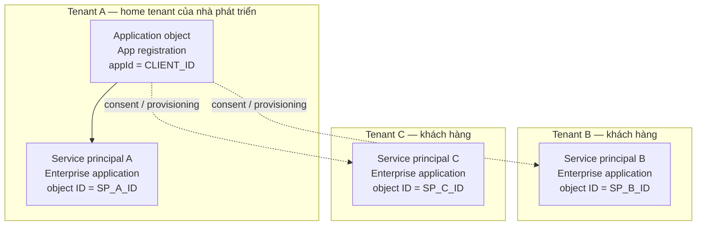
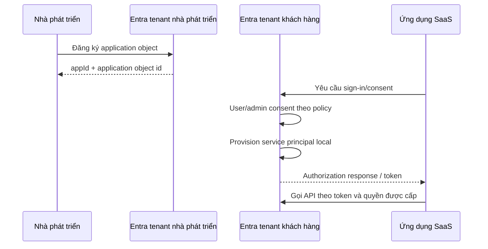

# App registration, tenant, application ID và đối tượng dịch vụ

> **Chương:** Microsoft Entra ID  
> **Học phần:** SPRING_CLOUD_PROVIDER_INTEGRATION — thực hành tích hợp Spring Boot với dịch vụ managed của AWS, Azure và Google Cloud qua các thư viện Spring Cloud tương ứng.

Khi cấu hình Spring Boot đăng nhập bằng Microsoft Entra ID, nhóm phát triển thường nhận một bảng thông tin gồm Tenant ID, Application (client) ID, Object ID, Application ID URI và đôi khi cả Service principal ID. Các giá trị đều có dạng định danh, nhưng chúng đại diện cho những đối tượng khác nhau. Điền nhầm Object ID vào client-id, hoặc dùng Application ID URI thay cho Tenant ID, có thể khiến ứng dụng không lấy được token hoặc token có audience sai.

Bài học này xây dựng mô hình rõ ràng về **tenant**, **app registration**, **application object**, **application/client ID**, **service principal** và **Application ID URI**. Bạn sẽ theo dõi vòng đời một ứng dụng từ lúc đăng ký ở tenant nhà đến lúc được một tenant khách hàng chấp thuận, rồi ánh xạ đúng thông tin đó vào cấu hình Spring Boot.

## 1. Mục tiêu học tập

Sau bài này, bạn có thể:

1. Giải thích tenant là ranh giới thư mục và chính sách danh tính trong Microsoft Entra ID.
2. Phân biệt app registration, application object và Enterprise application/service principal.
3. Đọc đúng appId, id, tenantId và hiểu vì sao client ID có thể giống nhau nhưng object ID khác nhau giữa các tenant.
4. Phân biệt Application (client) ID với Application ID URI và biết URI nào được dùng để định danh API.
5. Mô tả quan hệ một application object với nhiều service principal trong mô hình multi-tenant.
6. Hiểu consent, provisioning và cách service principal được tạo trong tenant khách hàng.
7. Chọn supported account types, redirect URI, API permissions, app roles và credential phù hợp.
8. Ánh xạ tenant/client ID và issuer URI vào Spring Security/Spring Cloud Azure mà không nhầm object ID.

## 2. Tenant là gì?

**Microsoft Entra tenant** là một phiên bản thư mục Microsoft Entra ID dành cho một tổ chức hoặc phạm vi quản trị danh tính. Tenant chứa các đối tượng như user, group, device, application object, service principal và các thiết lập bảo mật. Quản trị viên tenant áp dụng chính sách xác thực, Conditional Access, consent, quản lý ứng dụng và các quy tắc truy cập trong phạm vi tenant đó.

Một tổ chức có thể có nhiều tenant, ví dụ:

- Tenant production quản lý nhân viên và ứng dụng nội bộ.
- Tenant sandbox dùng để thử nghiệm đăng ký ứng dụng, consent và chính sách.
- Tenant của khách hàng B dùng để vận hành ứng dụng SaaS multi-tenant.

### Tenant ID và tên miền tenant

Mỗi tenant có một **Directory (tenant) ID** dạng GUID. Đây là định danh ổn định của tenant và thường xuất hiện trong:

- Authority/issuer URL khi yêu cầu hoặc xác minh token.
- Cấu hình OAuth2/OIDC của Spring Boot.
- Microsoft Graph khi truy vấn directory.
- Audit/sign-in logs và báo cáo vận hành.

Tenant cũng có tên miền mặc định dạng contoso.onmicrosoft.com và có thể có tên miền đã xác minh như contoso.com. Tên miền giúp người dùng đăng nhập và định tuyến theo tổ chức; nó không thay thế tenant ID trong mọi API/configuration. Tên hiển thị của tenant cũng có thể thay đổi, vì vậy hồ sơ triển khai nên lưu tenant ID.

### Một người dùng có thể xuất hiện trong nhiều tenant

Alice có tài khoản gốc (home identity) trong tenant Contoso. Nếu Alice được mời làm guest vào tenant Fabrikam, tenant Fabrikam có một user object đại diện cho Alice. Hai object có thể có oid khác nhau và chịu chính sách riêng của từng tenant. Do đó, khi xử lý token, ứng dụng cần xem cặp tid + oid trong tenant phát hành token, không chỉ dựa vào email hoặc tên hiển thị.

### Tenant là ranh giới quản trị, không phải một resource group

Tenant quản lý danh tính và chính sách Entra. Azure subscription/resource group quản lý tài nguyên Azure và có quan hệ liên kết với tenant. Một subscription được liên kết với một tenant tại một thời điểm; tuy nhiên, tenant có thể quản lý nhiều subscription. Đừng nhầm:

| Định danh | Đại diện | Ví dụ |
|---|---|---|
| Tenant ID | Thư mục Entra | 11111111-1111-1111-1111-111111111111 |
| Subscription ID | Subscription Azure | 22222222-2222-2222-2222-222222222222 |
| Resource group | Nhóm tài nguyên trong subscription | rg-invoice-staging |
| Application/client ID | Ứng dụng đã đăng ký | 33333333-3333-3333-3333-333333333333 |

Nguồn: [Tenancy in Microsoft Entra ID](https://learn.microsoft.com/entra/identity-platform/single-and-multi-tenant-apps).

## 3. App registration và application object

**App registration** là thao tác/experience trong Microsoft Entra admin center để khai báo cách một ứng dụng tích hợp với identity platform. Khi đăng ký, nhà phát triển mô tả loại ứng dụng, supported account types, redirect URI, API permissions, exposed scopes, app roles và phương thức xác thực ứng dụng.

Kết quả cốt lõi là một **application object** trong home tenant của ứng dụng. Có thể xem application object như bản định nghĩa hoặc bản thiết kế (blueprint) của ứng dụng:

- Ứng dụng có tên và định danh nào?
- Ai được phép đăng nhập theo supported account types?
- Token được phát cho client/API theo cấu hình nào?
- Redirect URI của web app hoặc SPA là gì?
- Ứng dụng công bố scope/app role nào?
- Ứng dụng cần API permission tới resource nào?
- Ứng dụng xác thực client bằng secret, certificate hay federated credential?

Application object được quản lý trong **App registrations**. Nó chứa cấu hình chung của ứng dụng ở tenant sở hữu (home tenant).

### App registration không phải binary Spring Boot

Đăng ký ứng dụng không tạo JAR, không triển khai API và cũng không tự tạo Azure Storage account. Nó tạo cấu hình danh tính trong Entra để ứng dụng có thể tham gia OAuth 2.0/OIDC. Spring Boot vẫn cần được cấu hình để dùng đúng authority, client ID, redirect URI, token validation và credential.

### App registration có thể phục vụ nhiều vai trò

Một application object có thể đại diện cho:

- Web application dùng OAuth2 Login.
- SPA hoặc mobile client.
- Web API nhận access token.
- Daemon/background worker gọi API bằng client credentials.
- Ứng dụng tích hợp cần scopes, app roles hoặc credentials.

Một sản phẩm lớn có thể tách frontend, API và worker thành các app registration riêng để giới hạn credential, permission và blast radius. Không nhất thiết phải dùng một client ID duy nhất cho mọi thành phần.

## 4. Service principal và Enterprise application

**Service principal** là bản đại diện của một ứng dụng trong một tenant cụ thể. Nó là security principal mà tenant dùng để quản lý ứng dụng tại chỗ: quyền được consent, app role assignment, user/group assignment, trạng thái bật/tắt và sign-in activity.

Trong Microsoft Entra admin center, service principal thường được quản lý dưới mục **Enterprise applications**. Vì vậy, khi tài liệu vận hành nói “mở Enterprise applications”, thông thường bạn đang thao tác với service principal của ứng dụng trong tenant hiện tại.

### Quan hệ giữa application object và service principal

Hãy hình dung:



Trong sơ đồ:

- Application object nằm ở tenant A, nơi ứng dụng được đăng ký.
- Service principal A đại diện ứng dụng ngay trong home tenant.
- Khi ứng dụng multi-tenant được chấp thuận trong tenant B và C, mỗi tenant có service principal riêng.
- Các service principal tham chiếu cùng một application ID, nhưng mỗi service principal có object ID riêng và được quản trị trong tenant của nó.

Đây là quan hệ **một application object tới nhiều service principal**. Service principal không phải bản sao độc lập của toàn bộ application object; nó là instance/đại diện tenant-local, kế thừa một số cấu hình chung và giữ những thiết lập/assignment thuộc tenant đó.

### App registration và Enterprise application khác nhau ở đâu?

| Góc quản lý | App registrations | Enterprise applications |
|---|---|---|
| Đối tượng chính | Application object | Service principal |
| Câu hỏi | Ứng dụng được định nghĩa và yêu cầu token thế nào? | Ứng dụng instance này được phép hoạt động thế nào trong tenant? |
| Thiết lập thường gặp | Redirect URI, supported account types, exposed API, app roles, API permissions, credentials metadata | User/group assignment, consent, sign-in logs, local properties, app role assignments, access controls |
| Tenant | Chủ yếu home tenant | Tenant hiện tại nơi service principal tồn tại |
| Người quản lý | Developer/app owner và admin có quyền phù hợp | Tenant admin/application admin và người có quyền quản lý Enterprise application |

Một số thuộc tính có thể được nhìn từ cả hai trải nghiệm hoặc được đồng bộ từ application object. Bảng này phân biệt mục đích quản trị, không có nghĩa hai object hoàn toàn không liên hệ.

### Service principal không phải một tài khoản người dùng

Service principal là danh tính ứng dụng. Nó có thể đăng nhập bằng certificate, client secret, federated credential hoặc cơ chế managed identity tùy loại. Nó không có mật khẩu người dùng và không nên được sử dụng như tài khoản nhân viên dùng để đăng nhập tương tác.

Nguồn: [Application and service principal objects](https://learn.microsoft.com/entra/identity-platform/app-objects-and-service-principals), [Enterprise applications](https://learn.microsoft.com/entra/identity/enterprise-apps/what-is-an-application).

## 5. Phân biệt các ID quan trọng

Đây là phần cần nắm chắc trước khi điền cấu hình Spring Boot hoặc tạo role assignment.

| Tên trong portal / Microsoft Graph | Tên thuộc tính thường gặp | Đại diện | Phạm vi |
|---|---|---|---|
| Directory (tenant) ID | tenantId / tenant id | Tenant | Một directory |
| Application (client) ID | Application appId; thường gọi clientId | Ứng dụng logic | Giống nhau giữa các service principal của cùng app |
| Application object ID | Application id | Application object trong home tenant | Một application object |
| Service principal object ID | Service principal id | Instance của app trong một tenant | Khác nhau theo tenant |
| Service principal appId | appId | Liên kết về ứng dụng logic | Trùng application/client ID |
| Application ID URI | identifierUris | Định danh resource/API | Được dùng trong scope/resource identifier |

### Ví dụ số liệu giả lập

Giả sử ứng dụng SaaS invoice-api được đăng ký trong tenant nhà phát triển:

| Giá trị | Tenant A | Tenant B |
|---|---|---|
| Tenant ID | 11111111-1111-1111-1111-111111111111 | aaaaaaaa-aaaa-aaaa-aaaa-aaaaaaaaaaaa |
| Application/client ID | 33333333-3333-3333-3333-333333333333 | Cùng 33333333-3333-3333-3333-333333333333 |
| Application object ID | 44444444-4444-4444-4444-444444444444 | Không có application object gốc này trong tenant B |
| Service principal object ID | 55555555-5555-5555-5555-555555555555 | bbbbbbbb-bbbb-bbbb-bbbb-bbbbbbbbbbbb |

Client ID nhận diện ứng dụng logic và giữ nguyên giữa các tenant. Object ID của service principal là định danh object local nên khác nhau. Khi gọi Microsoft Graph trong tenant B để quản lý service principal, phải dùng object ID của service principal B; không dùng object ID application object A.

### Các lỗi điền nhầm thường gặp

- client-id trong Spring OAuth2 client phải là **Application (client) ID**, không phải object ID.
- issuer-uri/authority cần tenant ID hoặc authority phù hợp, không phải application ID.
- Azure RBAC role assignment cho managed identity/service principal cần principal/object ID đúng trong tenant/resource context, không phải client ID.
- Microsoft Graph GET /applications/{id} nhận object ID của application object; GET /servicePrincipals/{id} nhận object ID của service principal.
- appId trên application và service principal có cùng giá trị; id của hai object khác nhau.

## 6. Application ID URI là gì?

**Application ID URI** là định danh duy nhất của một API/resource được công bố bởi application object. Nó giúp client xác định resource khi yêu cầu permission/scope. Ví dụ phổ biến:

```text
api://33333333-3333-3333-3333-333333333333
```

Nếu app registration đại diện cho Spring Boot API, URI này có thể được dùng làm prefix khi expose scope:

```text
api://33333333-3333-3333-3333-333333333333/Invoices.Read
```

Client yêu cầu scope api://<API_CLIENT_ID>/Invoices.Read để xin quyền delegated (tên scope cụ thể do API định nghĩa). Với application permission, client thường yêu cầu api://<API_CLIENT_ID>/.default để nhận các application permissions đã cấu hình và consent cho resource.

### Application ID URI không phải Client ID

| Giá trị | Dùng để làm gì? |
|---|---|
| Application/client ID | Nhận diện app registration/client trong OAuth request |
| Application ID URI | Nhận diện resource/API mà client muốn truy cập |
| Scope đầy đủ | Định danh permission cụ thể trên resource, thường có dạng Application ID URI + scope-name |
| Tenant ID | Chọn directory/authority phát hành token |

Trong một số cấu hình token, aud có thể là client ID dạng GUID hoặc Application ID URI. Không giả định audience luôn bằng một trong hai mà không kiểm tra token thực tế và cấu hình access token version của API. API phải xác minh audience đúng với hợp đồng của nó.

### Quy tắc duy nhất của Application ID URI

Application ID URI phải duy nhất theo quy tắc của Entra:

- Với ứng dụng single-tenant, URI phải duy nhất trong tenant.
- Với ứng dụng multi-tenant, URI phải duy nhất trên tất cả tenant để có thể định danh resource giữa các tenant.

URI không bắt buộc phải trỏ tới một website đang tồn tại. Nó là identifier trong giao thức; không phải URL endpoint mà client sẽ tự động gửi HTTP request tới. API endpoint thật được cấu hình riêng trong ứng dụng.

Nguồn: [Expose a web API](https://learn.microsoft.com/entra/identity-platform/quickstart-configure-app-expose-web-apis), [Convert an app to multitenant](https://learn.microsoft.com/entra/identity-platform/howto-convert-app-to-be-multi-tenant).

## 7. Single-tenant và multi-tenant

Khi đăng ký app, trường **Supported account types** quyết định những loại tài khoản nào có thể đăng nhập vào ứng dụng.

| Lựa chọn trong portal | Mô hình | Khi nào dùng |
|---|---|---|
| Accounts in this organizational directory only | Single-tenant | Ứng dụng nội bộ chỉ phục vụ một tổ chức/tenant |
| Accounts in any organizational directory | Multi-tenant | SaaS hoặc API phục vụ nhiều tổ chức dùng Entra work/school account |
| Accounts in any organizational directory and personal Microsoft accounts | Multi-tenant + personal Microsoft accounts | Sản phẩm cần hỗ trợ cả tổ chức và tài khoản Microsoft cá nhân |
| Personal Microsoft accounts only | Consumer account | Sản phẩm chỉ phục vụ tài khoản Microsoft cá nhân |

### Single-tenant

Single-tenant phù hợp với ứng dụng nội bộ, portal nhân viên hoặc API chỉ phục vụ một tenant. Authority thường dùng tenant ID cụ thể:

```text
https://login.microsoftonline.com/<TENANT_ID>/v2.0
```

Ưu điểm là phạm vi tenant rõ ràng, dễ kiểm soát issuer và chính sách. Nếu khách hàng khác muốn sử dụng ứng dụng, cần thay đổi mô hình đăng ký/provisioning theo thiết kế multi-tenant hoặc triển khai registration riêng.

### Multi-tenant

Multi-tenant cho phép người dùng từ nhiều Microsoft Entra tenant đăng nhập. Application object vẫn thuộc home tenant của nhà cung cấp ứng dụng; mỗi tenant khách hàng có service principal local sau khi ứng dụng được chấp thuận/provisioned.

Multi-tenant **không có nghĩa** ứng dụng tự động được đọc dữ liệu mọi tenant. Ứng dụng phải:

1. Xác thực token do đúng tenant phát hành.
2. Xác định tenant của request qua claim tid.
3. Ánh xạ tenant tới cấu hình và dữ liệu riêng của khách hàng.
4. Quản lý consent, admin approval, service principal và quyền trong từng tenant.
5. Ngăn dữ liệu tenant A bị truy cập từ phiên của tenant B.

Không chấp nhận mọi tenant chỉ vì API dùng authority common hoặc organizations. Phải có chính sách onboarding/allowlist hoặc quy trình xác minh khách hàng và issuer phù hợp.

### Khi nào không nên bật multi-tenant?

Không chọn multi-tenant chỉ để “đỡ cấu hình tenant ID”. Nếu ứng dụng chỉ phục vụ nhân viên của một tổ chức, single-tenant thường rõ ràng và ít bề mặt quản trị hơn. Multi-tenant tạo thêm trách nhiệm về consent, tenant isolation, onboarding, support và lifecycle service principal.

Microsoft khuyến nghị phần lớn ứng dụng bắt đầu với single-tenant trừ khi có yêu cầu phục vụ tenant bên ngoài. Ngoài ra, multi-tenant app không tự động hoạt động xuyên các ranh giới cloud sovereign khác nhau; cần kiểm tra cloud/authority tương ứng.

Nguồn: [Single and multitenant apps](https://learn.microsoft.com/entra/identity-platform/single-and-multi-tenant-apps), [Register an application](https://learn.microsoft.com/entra/identity-platform/quickstart-register-app).

## 8. Consent và vòng đời tạo service principal ở tenant khách hàng

Consent là cơ chế tenant/user chấp thuận cho ứng dụng truy cập resource theo permission được yêu cầu. Trong mô hình multi-tenant, consent là một phần quan trọng của quá trình provisioning service principal trong tenant khách hàng.

### Luồng đơn giản



Trong home tenant, khi tạo app registration qua portal, Entra tạo application object và service principal tương ứng ở tenant đó. Khi dùng Microsoft Graph để tạo application object bằng API, việc tạo service principal là thao tác riêng và cần thực hiện nếu muốn có instance local.

Ở tenant khách hàng, khi ứng dụng multi-tenant được sử dụng và được consent, service principal được provision trong tenant đó. Quản trị viên khách hàng có thể quản lý Enterprise application local, xem sign-in logs, kiểm soát user assignment và permission grant theo chính sách.

### User consent và admin consent

- **User consent:** người dùng chấp thuận permission mà tenant policy cho phép user tự consent. Không phải mọi permission đều cho phép user consent.
- **Admin consent:** administrator có thẩm quyền chấp thuận permission thay mặt tenant. Application permissions thường cần admin consent; nhiều delegated permissions nhạy cảm cũng có thể yêu cầu admin.
- **Permission grant:** ghi nhận quyền delegated đã được consent hoặc application role assignment đã được cấp cho service principal.

Consent không phải một thao tác cấp Azure RBAC cho Blob Storage. Nếu service principal cần đọc blob, vẫn phải được gán Azure data-plane role trên resource tương ứng.

### Quản trị service principal tại tenant khách hàng

Trong **Enterprise applications**, tenant admin có thể:

- Bật/tắt service principal.
- Kiểm tra permission/consent đã cấp.
- Gán user/group nếu ứng dụng yêu cầu assignment.
- Xem sign-in logs và kiểm soát access theo tenant policy.
- Quản lý các thuộc tính local, role assignment và cấu hình provisioning phù hợp.

Việc thay đổi application object ở home tenant không có nghĩa mọi cấu hình local ở tenant khách hàng đều biến mất hoặc tự thay đổi theo cùng cách. Phải phân biệt cấu hình gốc với assignment/consent thuộc tenant.

## 9. Các loại service principal

Trong Microsoft Graph, service principal có thuộc tính servicePrincipalType. Những loại thường gặp:

| Loại | Ý nghĩa | Ví dụ |
|---|---|---|
| Application | Service principal đại diện cho một application object/app registration | Enterprise application của SaaS hoặc API nội bộ |
| ManagedIdentity | Service principal đại diện cho Azure managed identity | System-assigned hoặc user-assigned identity |
| Legacy | Một số service principal thuộc mô hình legacy | Tùy ứng dụng/dịch vụ cũ |

### Service principal của app registration

Đây là loại thường được nhắc tới khi cấu hình OAuth client, admin consent và Enterprise applications. Nó liên kết với application object qua appId, nhưng có id riêng trong tenant.

### Service principal của managed identity

Managed identity cũng được biểu diễn bằng service principal trong Entra, nhưng không nên xem nó như app registration thông thường:

- Azure quản lý vòng đời credential.
- Không tạo client secret để ứng dụng tự cất giữ.
- System-assigned identity gắn với vòng đời Azure resource.
- User-assigned identity có vòng đời độc lập và có thể gắn vào nhiều resource.
- Quyền tới Storage/Key Vault vẫn phải được cấp trên tài nguyên.

Trong một số API và portal, managed identity không có application object tương ứng như app registration do nhà phát triển tạo. Khi tra cứu, cần dựa vào servicePrincipalType=ManagedIdentity, principal ID và resource association.

## 10. Các thuộc tính quan trọng trong application object và service principal

Khi làm việc với portal hoặc Microsoft Graph, hãy biết object nào sở hữu thuộc tính.

| Application object (application) | Service principal (servicePrincipal) |
|---|---|
| id — object ID của application | id — object ID local của service principal |
| appId — Application/client ID | appId — tham chiếu cùng application ID |
| displayName — tên ứng dụng | displayName — tên instance trong tenant |
| signInAudience — supported account types | servicePrincipalType — Application/ManagedIdentity/Legacy |
| identifierUris — Application ID URI | servicePrincipalNames — các tên định danh của instance |
| web, spa, publicClient — redirect/platform settings | accountEnabled — trạng thái service principal |
| requiredResourceAccess — API permissions mà app yêu cầu | Delegated consent grants được lưu trong resource oAuth2PermissionGrant, liên kết với service principal qua clientId |
| appRoles — định nghĩa role mà API công bố | appRoleAssignments — role assignment được cấp cho service principal |
| passwordCredentials, keyCredentials — metadata secret/certificate | Local assignment/consent và thông tin sign-in theo tenant |

Tên property/khả năng có thể mở rộng theo Microsoft Graph API version. Không sao chép toàn bộ object vào log hoặc tài liệu nếu có metadata nhạy cảm. Secret value thường chỉ được trả về lúc tạo credential; không thể đọc lại plaintext sau đó.

## 11. Tạo app registration trong Microsoft Entra admin center

Ví dụ: tạo ứng dụng web invoice-portal chạy Spring Boot, chỉ phục vụ tenant Contoso.

### Bước 1 — Chọn đúng tenant

1. Đăng nhập Microsoft Entra admin center bằng tài khoản có quyền tạo app registration.
2. Xác nhận tenant hiện hành ở phần directory/tenant switcher.
3. Ghi lại Directory (tenant) ID và tenant domain.
4. Nếu dùng tenant sandbox, đảm bảo đây là tenant thử nghiệm chứ không phải tenant production.

Không đăng ký nhầm vào tenant cá nhân hoặc tenant khác rồi lấy ID đưa vào cấu hình production.

### Bước 2 — Tạo app registration

1. Mở **Entra ID → App registrations → New registration**.
2. Đặt tên, ví dụ invoice-portal-staging.
3. Chọn **Accounts in this organizational directory only** cho ứng dụng nội bộ single-tenant.
4. Nếu là web app, có thể thêm Web platform và redirect URI phù hợp; hoặc tạo registration trước rồi cấu hình Authentication sau.
5. Chọn Register.

Khi hoàn tất, trang Overview hiển thị:

- Application (client) ID.
- Directory (tenant) ID.
- Object ID của application object.

Lưu các giá trị theo đúng tên trường. Không gọi cả ba là “App ID”.

### Bước 3 — Cấu hình platform và redirect URI

Trong **Authentication**:

- Chọn platform Web cho server-side Spring Boot OAuth2 Login.
- Thêm redirect URI, ví dụ https://localhost:8080/login/oauth2/code/entra nếu môi trường local dùng HTTPS; hoặc URI local phù hợp với cấu hình phát triển.
- Cấu hình logout/front-channel URI nếu ứng dụng cần.
- Chỉ bật implicit grant nếu có yêu cầu legacy cụ thể; ứng dụng mới nên dùng Authorization Code flow và PKCE theo loại client.

Redirect URI phải khớp chính xác URI mà Spring Security gửi trong authorization request. Production cần HTTPS và domain được kiểm soát.

### Bước 4 — Cấu hình API permissions

Trong **API permissions**:

- Chỉ thêm permission tới Microsoft Graph hoặc API khác khi ứng dụng thật sự cần.
- Phân biệt Delegated permissions với Application permissions.
- Kiểm tra admin consent requirement và tenant policy.
- Không yêu cầu Directory.ReadWrite.All hoặc permission rộng nếu ứng dụng chỉ cần đọc profile cơ bản.

### Bước 5 — Cấu hình credential cho confidential client

Trong **Certificates & secrets**:

- Ưu tiên certificate hoặc federated credential cho workload phù hợp.
- Client secret chỉ dùng khi cần tương thích; đặt expiry ngắn theo chính sách và có lịch rotation.
- Secret value chỉ hiển thị khi tạo; lưu ngay vào secret manager được phê duyệt.
- Không ghi secret vào Git, application.yml, log hoặc container image.

### Bước 6 — Xem service principal local

Mở **Enterprise applications** và tìm invoice-portal-staging. Kiểm tra Object ID của service principal. Object ID này khác Object ID ở trang App registrations. Khi cần gán Azure RBAC cho chính service principal, phải dùng principal/object ID của đúng instance trong tenant.

Nguồn: [Quickstart: Register an application](https://learn.microsoft.com/entra/identity-platform/quickstart-register-app), [Create a service principal](https://learn.microsoft.com/entra/identity-platform/howto-create-service-principal-portal).

## 12. Ví dụ đọc app registration và service principal bằng Microsoft Graph

Microsoft Graph biểu diễn application object bằng resource application và instance tenant-local bằng resource servicePrincipal.

### Đọc application object

```http
GET https://graph.microsoft.com/v1.0/applications?$filter=appId eq '33333333-3333-3333-3333-333333333333'
Authorization: Bearer <GRAPH_ACCESS_TOKEN>
```

Trong kết quả, chú ý:

- id: object ID của application object.
- appId: application/client ID.
- displayName: tên app registration.
- signInAudience: supported account types.
- identifierUris: Application ID URI.

### Đọc service principal trong tenant hiện tại

```http
GET https://graph.microsoft.com/v1.0/servicePrincipals?$filter=appId eq '33333333-3333-3333-3333-333333333333'
Authorization: Bearer <GRAPH_ACCESS_TOKEN>
```

Trong kết quả:

- id: object ID của service principal local.
- appId: application/client ID liên kết.
- servicePrincipalType: loại service principal.
- accountEnabled: trạng thái instance.
- appRoleAssignments hoặc delegated permission grants có thể cần truy vấn endpoint riêng.

Để truy vấn đúng tenant, token Graph phải được phát hành cho Microsoft Graph và caller cần Microsoft Graph permission/role phù hợp. Không dùng token dành cho Spring Boot API để gọi Graph.

### Tạo application object và service principal qua Graph

Khi tự động hóa bằng Microsoft Graph:

1. Gọi POST /applications để tạo application object.
2. Đọc appId trong response.
3. Gọi POST /servicePrincipals với appId đó để tạo service principal trong tenant cần thiết.
4. Ghi riêng id của application và id của service principal.

Ví dụ body tạo service principal:

```json
{
  "appId": "33333333-3333-3333-3333-333333333333"
}
```

Trong portal app registration, Entra tự tạo service principal home tenant như một phần trải nghiệm đăng ký. Với Microsoft Graph, việc tạo application object và service principal là hai thao tác riêng. Caller cần quyền Graph phù hợp; thao tác quản trị directory có thể yêu cầu application permission hoặc directory role cao hơn theo chính sách tenant.

## 13. Ánh xạ ID vào cấu hình Spring Boot

Giả sử Spring Boot là server-side web app đăng nhập bằng Entra. Ba giá trị chính:

| Biến cấu hình | Lấy từ đâu? | Dùng để làm gì? |
|---|---|---|
| ENTRA_TENANT_ID | Directory (tenant) ID | Tạo issuer/authority URL |
| ENTRA_CLIENT_ID | Application (client) ID / appId | Nhận diện OAuth client |
| ENTRA_CLIENT_SECRET | Credential value được tạo cho confidential client | Chứng minh client identity; lấy từ secret manager |

**Không dùng Application object ID hoặc Service principal object ID thay cho ENTRA_CLIENT_ID.**

Ví dụ application.yml:

```yaml
spring:
  security:
    oauth2:
      client:
        registration:
          entra:
            provider: entra
            client-id: ${ENTRA_CLIENT_ID}
            client-secret: ${ENTRA_CLIENT_SECRET}
            authorization-grant-type: authorization_code
            redirect-uri: "{baseUrl}/login/oauth2/code/{registrationId}"
            scope:
              - openid
              - profile
        provider:
          entra:
            issuer-uri: https://login.microsoftonline.com/${ENTRA_TENANT_ID}/v2.0
```

Trong cấu hình này:

- client-id là Application/client ID.
- issuer-uri chứa tenant ID.
- client-secret là secret value được bảo vệ, không phải secret ID hoặc object ID.
- redirect-uri phải trùng với URI đã đăng ký trong app registration.

### Nếu Spring Boot là Resource Server

API nhận access token do Entra phát hành cho API của mình:

```yaml
spring:
  security:
    oauth2:
      resourceserver:
        jwt:
          issuer-uri: https://login.microsoftonline.com/${ENTRA_TENANT_ID}/v2.0
app:
  security:
    audience: ${ENTRA_API_AUDIENCE}
```

ENTRA_API_AUDIENCE phải là audience mà Entra thực sự phát trong access token cho API. Nếu API expose scope qua Application ID URI, scope request có thể có dạng api://<API_CLIENT_ID>/Invoices.Read. Nhưng audience trong token phụ thuộc cấu hình resource/access token version; phải kiểm tra token thật và validator, không tự giả định aud luôn là Application ID URI.

### Nếu ứng dụng dùng managed identity để gọi Azure resource

Trong trường hợp workload chạy trên Azure và dùng managed identity, không cấu hình client-secret của app registration để truy cập Blob. SDK lấy token từ managed identity được gắn vào compute resource; quyền data-plane được cấp cho principal ID của managed identity. App registration của web portal (nếu có) và managed identity của workload có thể là hai danh tính riêng.

## 14. Bảng quyết định: cần ID nào cho tác vụ nào?

| Tác vụ | Định danh cần dùng |
|---|---|
| Cấu hình Spring OAuth2 Client | Application/client ID |
| Tạo authority/issuer tenant-specific | Tenant ID |
| Kiểm tra app registration bằng Graph | Application object ID hoặc filter theo appId |
| Cập nhật service principal local | Service principal object ID |
| Cấp Azure RBAC cho service principal | Principal/object ID của service principal trong tenant đích |
| Yêu cầu scope của custom API | Application ID URI + scope name |
| Yêu cầu application permissions bằng /.default | Resource identifier/Application ID URI + /.default |
| Xác định user trong token | tid + oid (với ngữ cảnh user) |
| Xác định client application trong token | azp (v2) hoặc appid (v1), theo token version |
| Kiểm tra managed identity | Principal ID/object ID, client ID và resource association theo loại identity |

## 15. Vòng đời và quản trị app registration

Đăng ký app không phải thao tác một lần rồi bỏ quên. Ứng dụng cần quy trình quản trị:

### Ownership

- Có ít nhất một owner chịu trách nhiệm cho app registration.
- Owner không mặc nhiên có quyền quản trị tenant hoặc Azure resource.
- Tách quyền developer quản lý app definition khỏi quyền tenant admin cấp consent/role.
- Ghi contact, business owner, technical owner và mục đích ứng dụng.

### Credential lifecycle

- Theo dõi certificate/client secret expiry.
- Ưu tiên certificate/federated credential hoặc managed identity khi phù hợp.
- Xoay vòng credential trước ngày hết hạn, kiểm tra overlap khi chuyển credential.
- Thu hồi credential cũ sau khi xác nhận workload dùng credential mới.
- Không lưu plaintext secret trong tài liệu onboarding.

### Permission lifecycle

- Định kỳ review delegated scopes, application permissions và app role assignments.
- Thu hồi consent không còn cần.
- Kiểm tra service principal không còn được dùng.
- Kiểm soát accountEnabled, user assignment và sign-in activity.
- Xác minh Azure RBAC riêng trên Storage, Key Vault, Service Bus và các resource khác.

### Xóa ứng dụng

Xóa application object ở home tenant có thể ảnh hưởng các service principal liên quan và ứng dụng ở tenant khác. Trước khi xóa:

1. Xác định mọi tenant/service principal đang sử dụng.
2. Thu hồi traffic và consent/permission theo kế hoạch.
3. Gỡ dependency ở client/API/workload.
4. Thu hồi certificate/secret/federated credentials.
5. Xác minh không còn integration đang chạy.
6. Thực hiện xóa theo quy trình thay đổi của tổ chức.

Không xóa service principal trong tenant khách hàng chỉ vì app registration ở home tenant đã đổi tên; tên và vòng đời object là hai vấn đề khác nhau.

## 16. Những nhầm lẫn thường gặp

| Nhầm lẫn | Sự thật | Cách kiểm tra |
|---|---|---|
| App registration và Enterprise application là cùng một object | Một bên là application object, bên kia là service principal | So sánh id và appId trong Graph |
| Application/client ID là object ID | appId và id là hai thuộc tính khác nhau | Xem đúng nhãn trên Overview |
| Service principal có cùng object ID ở mọi tenant | Mỗi tenant có service principal object ID riêng | Truy vấn SP ở từng tenant |
| Multi-tenant app có thể truy cập mọi tenant ngay khi đăng ký | Cần SP local, consent và quyền phù hợp | Kiểm tra Enterprise applications ở tenant khách hàng |
| Application ID URI là URL endpoint | Nó là resource identifier trong OAuth protocol | Kiểm tra Expose an API và aud/scope |
| Tenant name và tenant ID thay thế nhau hoàn toàn | Tenant ID là định danh GUID; domain/name có thể thay đổi | Dùng Directory ID cho issuer |
| Tạo app registration tự tạo Azure Storage role | App registration chỉ cấu hình danh tính Entra | Kiểm tra Azure IAM/RBAC riêng |
| Service principal là managed identity | Managed identity là một loại service principal chuyên biệt | Xem servicePrincipalType |
| Client secret ID là secret value | Secret ID nhận diện credential; value là chuỗi bí mật chỉ xem khi tạo | Lưu value vào secret manager ngay |
| Admin consent cấp quyền vào mọi Azure resource | Consent cấp API permission; Azure RBAC là cơ chế khác | Kiểm tra role assignment trên resource |
| Dùng tenant common là tự động an toàn cho multi-tenant | API vẫn phải xác minh issuer, tenant allowlist và isolation | Test token từ tenant không được phép |

## 17. Bài tập thực hành

**Bối cảnh:** Công ty Contoso phát triển SaaS quản lý hóa đơn bằng Spring Boot. Tenant Contoso là home tenant; khách hàng Fabrikam muốn đăng nhập bằng Entra tenant riêng. Ứng dụng có web portal, API và worker chạy nền. API cần đọc Blob Storage của môi trường triển khai.

### Phần A — Vẽ mô hình đối tượng

1. Tạo app registration invoice-portal trong tenant Contoso.
2. Tạo app registration riêng invoice-api nếu muốn tách web client và resource API.
3. Ghi tenant ID, application/client ID, application object ID của từng app.
4. Xác định service principal tương ứng trong Contoso.
5. Mô tả service principal sẽ được provision trong Fabrikam khi admin consent.
6. Giải thích vì sao appId giống nhau giữa Contoso và Fabrikam nhưng servicePrincipal.id khác nhau.

### Phần B — Cấu hình API

1. Đặt Application ID URI cho invoice-api.
2. Expose delegated scope Invoices.Read.
3. Tạo app role Invoices.Read.All dành cho application nếu worker cần gọi API app-only.
4. Cấu hình supported account types theo yêu cầu single-tenant hay multi-tenant.
5. Cấu hình Spring OAuth2 Login/Resource Server bằng tenant ID, client ID và audience phù hợp.
6. Kiểm tra redirect URI và consent trong tenant thử nghiệm.

### Phần C — Kiểm chứng và báo cáo

1. Truy vấn application object và service principal qua Microsoft Graph.
2. Ghi id, appId, tenantId, identifierUris, signInAudience và servicePrincipalType.
3. So sánh object ID của service principal ở hai tenant.
4. Thử cấu hình sai: dùng application object ID làm client-id; giải thích lỗi.
5. Thử dùng client ID thay cho principal ID khi gán Azure RBAC; giải thích vì sao phải chọn object ID local.
6. Xác minh app registration/API permission và Azure Storage RBAC là hai lớp độc lập.

**Mẫu kết quả:**

| Thuộc tính | Tenant Contoso | Tenant Fabrikam |
|---|---|---|
| Tenant ID | ... | ... |
| Application/client ID | ... | Cùng giá trị |
| Application object ID | ... | Không có object gốc này |
| Service principal object ID | ... | ... |
| Supported account types | ... | Kế thừa từ app registration |
| Consent/permission | ... | ... |
| Azure resource role | ... | ... |

**Tiêu chí đạt:** Có thể giải thích chính xác tenant, app registration, application object, application/client ID, Application ID URI và service principal; xác định đúng object ID trong từng tenant; cấu hình Spring Boot đúng client/issuer/audience; không nhầm API consent với Azure RBAC.

## 18. Checklist trước khi đưa app registration vào môi trường thật

- [ ] Đã xác nhận đúng home tenant và Directory (tenant) ID.
- [ ] Đã chọn single-tenant/multi-tenant theo mô hình người dùng thực tế.
- [ ] Đã ghi riêng Application/client ID và Application object ID.
- [ ] Đã xác định service principal local và object ID của nó trong từng tenant cần dùng.
- [ ] Đã cấu hình Application ID URI và scopes/app roles nếu app là API.
- [ ] Redirect URI khớp chính xác môi trường và platform.
- [ ] API permissions tối thiểu; admin consent được phê duyệt theo quy trình.
- [ ] Client secret/certificate/federated credential có owner, expiry và rotation plan.
- [ ] Spring Boot dùng client ID cho OAuth client, tenant ID cho issuer, audience đúng cho Resource Server.
- [ ] Azure RBAC/data-plane role được cấp riêng trên resource cần truy cập.
- [ ] Đã xác minh sign-in logs và service principal trong đúng tenant.
- [ ] Có quy trình review, thu hồi permission, credential và decommission ứng dụng.

## Tài liệu tham khảo chính thức

1. [Apps and service principals in Microsoft Entra ID](https://learn.microsoft.com/entra/identity-platform/app-objects-and-service-principals): application object, service principal và quan hệ một-nhiều.
2. [Microsoft identity platform application model](https://learn.microsoft.com/entra/identity-platform/application-model): mô hình ứng dụng, tenant và provisioning qua consent.
3. [Single and multitenant apps](https://learn.microsoft.com/entra/identity-platform/single-and-multi-tenant-apps): supported account types và trách nhiệm multi-tenant.
4. [Quickstart: Register an application](https://learn.microsoft.com/entra/identity-platform/quickstart-register-app): tạo app registration và đọc client/tenant ID.
5. [Application resource type](https://learn.microsoft.com/graph/api/resources/application): thuộc tính application trong Microsoft Graph.
6. [Service principal resource type](https://learn.microsoft.com/graph/api/resources/serviceprincipal): thuộc tính và định danh service principal.
7. [Create a service principal](https://learn.microsoft.com/entra/identity-platform/howto-create-service-principal-portal): tạo và quản lý service principal.
8. [Expose a web API](https://learn.microsoft.com/entra/identity-platform/quickstart-configure-app-expose-web-apis): Application ID URI, scopes và API permissions.
9. [Convert an app to multitenant](https://learn.microsoft.com/entra/identity-platform/howto-convert-app-to-be-multi-tenant): supported account types và quy tắc App ID URI.
10. [Microsoft Graph — Applications API overview](https://learn.microsoft.com/graph/applications-concept-overview): quản lý application object và service principal qua Graph.

> **Ghi nhớ:** appId nhận diện ứng dụng logic; id nhận diện một object cụ thể; tenantId xác định directory; Application ID URI định danh API/resource. Application object là bản định nghĩa ở home tenant, còn service principal là instance được quản trị trong từng tenant. Nắm đúng bốn khái niệm này sẽ giúp cấu hình Spring Boot, consent và Azure RBAC chính xác hơn.
