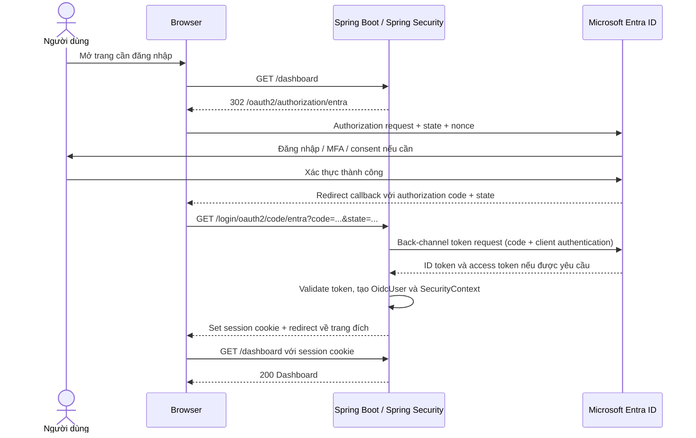

# Tích hợp đăng nhập OIDC với Spring Security

> **Chương:** Microsoft Entra ID  
> **Học phần:** SPRING_CLOUD_PROVIDER_INTEGRATION — thực hành tích hợp Spring Boot với dịch vụ managed của AWS, Azure và Google Cloud qua các thư viện Spring Cloud tương ứng.

Một ứng dụng Spring Boot dành cho nhân viên thường cần một trang đăng nhập, một phiên làm việc và cách nhận diện người dùng trong từng request. Microsoft Entra ID có thể đảm nhiệm việc xác thực qua OpenID Connect (OIDC), còn Spring Security xử lý redirect, callback, xác minh ID token, tạo principal và bảo vệ endpoint.

Bài này triển khai mô hình **server-side web application**: trình duyệt được chuyển tới Entra để đăng nhập; Spring Boot nhận authorization code ở callback, đổi code lấy token ở back channel và tạo phiên đăng nhập. Cách làm này phù hợp với portal nội bộ, dashboard và ứng dụng quản trị. Bài cũng giải thích cách lấy thông tin người dùng, logout, xử lý redirect sau reverse proxy và kiểm thử luồng đăng nhập.

## 1. Mục tiêu học tập

Sau bài này, bạn có thể:

1. Giải thích OIDC, OAuth 2.0 Authorization Code flow và vai trò của ID token.
2. Tạo app registration cho web application trong Microsoft Entra ID.
3. Cấu hình redirect URI, tenant, client ID và credential phù hợp.
4. Cấu hình Spring Security OAuth2 Client với oauth2Login().
5. Nhận OidcUser, đọc claim cần thiết và tạo định danh nội bộ an toàn.
6. Phân biệt đăng nhập OIDC với xác thực bearer access token cho REST API.
7. Cấu hình logout, session, CSRF và ứng dụng chạy sau reverse proxy.
8. Kiểm thử login thành công, lỗi cấu hình, quyền truy cập và xử lý sự cố thường gặp.

## 2. OIDC nằm ở đâu trong quá trình đăng nhập?

OAuth 2.0 là framework ủy quyền. OpenID Connect xây dựng trên OAuth 2.0 để cung cấp lớp xác thực người dùng. Khi ứng dụng yêu cầu scope openid, Entra có thể phát hành **ID token** chứa thông tin xác thực về người dùng và phiên đăng nhập.

Các thành phần chính:

| Thành phần | Vai trò |
|---|---|
| Browser | Khởi tạo đăng nhập, theo redirect và gửi cookie phiên |
| Spring Boot / Spring Security | OAuth2 client, nhận callback, đổi authorization code, xác minh ID token, tạo Authentication |
| Microsoft Entra ID | Xác thực người dùng, áp dụng tenant policy/MFA/Conditional Access và phát token |
| App registration | Khai báo client ID, tenant/account types, redirect URI và credential |
| Session cookie | Giữ trạng thái đăng nhập của browser với ứng dụng sau callback |

### Luồng Authorization Code



Spring Security quản lý state, nonce, callback, token exchange và xác minh OIDC theo cấu hình provider. Không tự viết endpoint callback để decode JWT rồi tin payload; làm vậy dễ bỏ sót kiểm tra chữ ký, issuer, audience, nonce và thời hạn.

### Các giá trị bảo vệ trong flow

- state: liên kết authorization response với request đã khởi tạo, giúp chống CSRF trong OAuth redirect flow.
- nonce: liên kết ID token với lần đăng nhập được khởi tạo, giúp chống replay/substitution.
- PKCE: ràng buộc authorization code với code verifier; đặc biệt quan trọng cho public clients và cũng được khuyến nghị rộng rãi.
- TLS: bảo vệ authorization response, token exchange và cookie trên đường truyền.

Spring Security xử lý các giá trị flow này. Ứng dụng vẫn phải cấu hình HTTPS, redirect URI chính xác, cookie an toàn và session phù hợp.

## 3. Chuẩn bị app registration trong Microsoft Entra ID

Ví dụ dùng ứng dụng invoice-portal-staging, chỉ cho phép tài khoản trong tenant Contoso đăng nhập.

### 3.1. Chọn đúng tenant và tạo registration

1. Mở Microsoft Entra admin center.
2. Chọn đúng directory/tenant dùng cho môi trường staging.
3. Vào **Entra ID → App registrations → New registration**.
4. Đặt tên, ví dụ invoice-portal-staging.
5. Chọn **Accounts in this organizational directory only** nếu ứng dụng chỉ phục vụ một tenant.
6. Hoàn tất đăng ký và ghi lại:
   - **Application (client) ID**.
   - **Directory (tenant) ID**.
   - **Object ID** của application object để quản trị/tra cứu.

Trong cấu hình Spring OAuth2 client, client-id là **Application (client) ID**. Không dùng Object ID của application object hoặc Object ID của service principal thay thế.

### 3.2. Thêm platform Web và redirect URI

Trong app registration, mở **Authentication → Add a platform → Web**. Đăng ký redirect URI mà Spring Security sẽ nhận callback.

Ví dụ local:

```text
http://localhost:8080/login/oauth2/code/entra
```

Ví dụ staging:

```text
https://invoice-staging.example.com/login/oauth2/code/entra
```

Giá trị phải khớp chính xác scheme, host, port, path và cấu hình redirect mà ứng dụng gửi tới Entra. Khi dùng reverse proxy, cần bảo đảm Spring Boot nhận đúng forwarded host/protocol để baseUrl được mở rộng thành URL public.

Không đăng ký callback local rồi dùng nó cho production. Production phải dùng HTTPS và hostname do tổ chức kiểm soát.

### 3.3. Chọn loại ứng dụng và credential

Spring Boot server-side web app là **confidential client** vì backend có thể giữ credential. Có thể xác thực client bằng:

- Certificate, thường phù hợp với môi trường production có quy trình quản lý certificate.
- Federated credential khi môi trường triển khai hỗ trợ federation.
- Client secret nếu cần tương thích; phải lưu trong secret manager/secret store, giới hạn quyền đọc, đặt thời hạn và có quy trình rotation.

Không đưa secret value vào Git, application.yml, Docker image, log hoặc tài liệu onboarding. Secret ID/credential ID không phải secret value. Nếu tạo client secret trong portal, lưu value vào kho bí mật ngay theo quy trình được duyệt; portal không hiển thị lại plaintext sau đó.

Public client như SPA/mobile không thể bảo vệ client secret. Với kiến trúc đó, dùng Authorization Code + PKCE và thư viện client phù hợp; không copy cấu hình confidential client của server-side Spring Boot vào mã JavaScript.

### 3.4. Scopes tối thiểu cho đăng nhập

OIDC login cần scope openid. Có thể yêu cầu profile và email nếu ứng dụng cần các claim hồ sơ tương ứng. Entra không bảo đảm mọi tài khoản đều có claim email; preferred_username cũng có thể thay đổi và không phải khóa phân quyền.

Chỉ thêm Microsoft Graph delegated scopes khi ứng dụng thực sự gọi Graph. Đăng nhập thành công không tự động cấp quyền đọc mailbox, profile mở rộng hoặc dữ liệu Azure Storage.

## 4. Cấu hình Spring Boot

### 4.1. Dependency

Trong Maven project đã dùng Spring Boot dependency management tương thích, thêm Spring Security và OAuth2 Client:

```xml
<dependencies>
    <dependency>
        <groupId>org.springframework.boot</groupId>
        <artifactId>spring-boot-starter-security</artifactId>
    </dependency>
    <dependency>
        <groupId>org.springframework.boot</groupId>
        <artifactId>spring-boot-starter-oauth2-client</artifactId>
    </dependency>
    <dependency>
        <groupId>org.springframework.boot</groupId>
        <artifactId>spring-boot-starter-web</artifactId>
    </dependency>
</dependencies>
```

Không đặt version riêng cho từng dependency nếu Spring Boot BOM/parent đang quản lý chúng. Kiểm tra ma trận phiên bản Spring Boot và Spring Security trước khi nâng cấp.

### 4.2. Khai báo OAuth2 client

Ví dụ application.yml:

```yaml
server:
  port: 8080
  forward-headers-strategy: framework

spring:
  security:
    oauth2:
      client:
        registration:
          entra:
            provider: entra
            client-id: ${ENTRA_CLIENT_ID}
            client-secret: ${ENTRA_CLIENT_SECRET}
            client-name: Microsoft Entra ID
            authorization-grant-type: authorization_code
            redirect-uri: "{baseUrl}/login/oauth2/code/{registrationId}"
            scope:
              - openid
              - profile
              - email
        provider:
          entra:
            issuer-uri: https://login.microsoftonline.com/${ENTRA_TENANT_ID}/v2.0
```

Giải thích:

| Thuộc tính | Ý nghĩa |
|---|---|
| registration.entra | Tên registration nội bộ; dùng trong URL /oauth2/authorization/entra |
| client-id | Application (client) ID trong Entra |
| client-secret | Secret value của confidential client; lấy từ secret store |
| authorization-grant-type | Authorization Code flow |
| redirect-uri | Callback path do Spring Security xử lý |
| scope | OIDC scopes ứng dụng yêu cầu |
| issuer-uri | Issuer/authority theo tenant; Spring dùng OIDC discovery để lấy metadata và endpoint |

Các biến môi trường cần được cung cấp khi chạy:

```bash
ENTRA_TENANT_ID=<directory-tenant-id>
ENTRA_CLIENT_ID=<application-client-id>
ENTRA_CLIENT_SECRET=<secret-value-from-secret-store>
```

Đây là tên biến và placeholder, không phải giá trị thật. Không commit giá trị credential. Nếu dùng certificate hoặc federated credential, cấu hình client authentication tương ứng theo phiên bản Spring Security/provider; không giữ client-secret giả trong file.

### 4.3. OIDC discovery

Với issuer tenant-specific, OIDC metadata thường được công bố tại:

```text
https://login.microsoftonline.com/<TENANT_ID>/v2.0/.well-known/openid-configuration
```

Metadata mô tả issuer, authorization endpoint, token endpoint, JWKS URI, UserInfo endpoint và các capability của provider. Spring Security dùng discovery khi cấu hình issuer-uri. Máy chạy ứng dụng phải truy cập được endpoint discovery và JWKS qua mạng outbound/proxy được cho phép.

Không cấu hình issuer bằng client ID hoặc Application ID URI. Issuer là định danh bên phát hành token; client ID nhận diện ứng dụng.

## 5. Bật OAuth2 Login trong Spring Security

Spring Security tạo các endpoint mặc định:

| Endpoint | Chức năng |
|---|---|
| /oauth2/authorization/entra | Bắt đầu login với registration entra |
| /login/oauth2/code/entra | Nhận authorization response từ Entra |
| /logout | Đăng xuất phiên local theo cấu hình Spring Security |

Filter chain tối thiểu:

```java
package com.example.invoice.security;

import org.springframework.context.annotation.Bean;
import org.springframework.context.annotation.Configuration;
import org.springframework.security.config.Customizer;
import org.springframework.security.config.annotation.web.builders.HttpSecurity;
import org.springframework.security.web.SecurityFilterChain;

@Configuration
public class WebSecurityConfiguration {

    @Bean
    SecurityFilterChain webSecurity(HttpSecurity http) throws Exception {
        http
            .authorizeHttpRequests(authorize -> authorize
                .requestMatchers("/", "/assets/**", "/favicon.ico", "/error")
                    .permitAll()
                .anyRequest().authenticated())
            .oauth2Login(Customizer.withDefaults())
            .logout(Customizer.withDefaults());

        return http.build();
    }
}
```

Spring Security giữ CSRF protection mặc định cho ứng dụng web có session. Không tắt CSRF toàn cục chỉ để sửa lỗi callback hoặc form POST; OAuth state và CSRF token bảo vệ các ranh giới khác nhau. Nếu ứng dụng vừa có browser session vừa có REST bearer API, hãy thiết kế filter chain và CSRF policy riêng cho từng loại endpoint.

### Bắt đầu đăng nhập từ trang ứng dụng

Có thể tạo link:

```html
<a href="/oauth2/authorization/entra">Đăng nhập bằng Microsoft Entra ID</a>
```

Hoặc bảo vệ trang /dashboard; khi người dùng chưa xác thực, Spring Security sẽ chuyển họ tới trang login và provider đã cấu hình. Không tự tạo URL authorization bằng cách nối chuỗi query thủ công.

## 6. Lấy thông tin người dùng bằng OidcUser

Sau khi OIDC login thành công, Spring Security lưu Authentication trong SecurityContext. Với OIDC, principal thường là OidcUser, chứa ID token và các claim đã được xử lý từ UserInfo endpoint nếu flow sử dụng endpoint đó.

Ví dụ controller:

```java
package com.example.invoice.web;

import org.springframework.security.core.annotation.AuthenticationPrincipal;
import org.springframework.security.oauth2.core.oidc.user.OidcUser;
import org.springframework.web.bind.annotation.GetMapping;
import org.springframework.web.bind.annotation.RestController;

@RestController
public class AccountController {

    @GetMapping("/me")
    public AccountView currentUser(@AuthenticationPrincipal OidcUser user) {
        return new AccountView(
                user.getSubject(),
                user.getClaimAsString("tid"),
                user.getClaimAsString("oid"),
                user.getFullName(),
                user.getClaimAsString("preferred_username"),
                user.getClaimAsString("email"));
    }

    public record AccountView(
            String subject,
            String tenantId,
            String objectId,
            String displayName,
            String preferredUsername,
            String email) {
    }
}
```

Đây là endpoint minh họa. Trong production, chỉ trả các trường thực sự cần thiết; không trả raw ID token, access token hoặc toàn bộ claim set cho browser.

### Claim nào phù hợp để nhận diện người dùng?

| Claim | Ý nghĩa | Cách sử dụng |
|---|---|---|
| iss | Issuer phát hành ID token | Phải thuộc issuer được tin cậy |
| sub | Subject theo OIDC | Dùng cùng issuer làm định danh OIDC |
| tid | Tenant ID trong Entra token | Phân vùng tenant và chính sách |
| oid | Object ID của user trong tenant | Có thể dùng cùng tid làm khóa user tenant-local |
| name | Tên hiển thị | Chỉ hiển thị, có thể thay đổi |
| preferred_username | Tên đăng nhập ưu tiên | Hiển thị/gợi ý; không phải khóa phân quyền |
| email | Email nếu được phát hành | Có thể vắng mặt/thay đổi; không giả định luôn có |

Với dữ liệu người dùng trong ứng dụng đa tenant, cặp tid + oid là một định danh tenant-local hữu ích. Với OIDC tổng quát, subject được định danh trong phạm vi issuer; lưu iss + sub khi cần tuân thủ mô hình OIDC. Guest user trong tenant khách hàng có object ID tenant-local riêng.

Không dùng email hoặc preferred_username làm khóa chính người dùng hay căn cứ duy nhất để cấp quyền. Email có thể đổi, có thể thiếu hoặc được cập nhật theo quy trình riêng.

### ID token không phải access token

OIDC login chủ yếu dùng ID token để client xác nhận phiên đăng nhập. Access token được phát cho resource/API cụ thể. Không gửi ID token tới Microsoft Graph, Azure Storage hoặc API của chính bạn như bearer access token. Nếu ứng dụng cần gọi Graph, phải yêu cầu delegated scope phù hợp và dùng OAuth2 Client để quản lý authorized client/access token.

## 7. Ánh xạ app roles vào quyền của ứng dụng web

Đăng nhập thành công chỉ chứng minh người dùng đã xác thực. Nó không tự cấp quyền nghiệp vụ như xem hóa đơn, phê duyệt hoặc quản trị.

Nếu ứng dụng khai báo app roles và gán role cho user/group trong Entra, claim roles có thể được đưa vào token phù hợp. Ứng dụng có thể ánh xạ các role đó thành Spring GrantedAuthority.

Ví dụ mapper:

```java
package com.example.invoice.security;

import java.util.Collection;
import java.util.HashSet;
import java.util.Set;

import org.springframework.context.annotation.Bean;
import org.springframework.context.annotation.Configuration;
import org.springframework.security.core.GrantedAuthority;
import org.springframework.security.core.authority.SimpleGrantedAuthority;
import org.springframework.security.core.authority.mapping.GrantedAuthoritiesMapper;
import org.springframework.security.oauth2.core.oidc.user.OidcUserAuthority;

@Configuration
public class OidcAuthoritiesConfiguration {

    @Bean
    GrantedAuthoritiesMapper userAuthoritiesMapper() {
        return authorities -> {
            Set<GrantedAuthority> mapped = new HashSet<>(authorities);

            for (GrantedAuthority authority : authorities) {
                if (authority instanceof OidcUserAuthority oidcAuthority) {
                    Object rolesClaim =
                            oidcAuthority.getIdToken().getClaims().get("roles");

                    if (rolesClaim instanceof Collection<?> roles) {
                        for (Object role : roles) {
                            if (role instanceof String roleName) {
                                mapped.add(new SimpleGrantedAuthority(
                                        "ROLE_" + roleName));
                            }
                        }
                    }
                }
            }
            return mapped;
        };
    }
}
```

Gắn mapper vào OAuth2 Login:

```java
@Bean
SecurityFilterChain webSecurity(
        HttpSecurity http,
        GrantedAuthoritiesMapper userAuthoritiesMapper) throws Exception {

    http
        .authorizeHttpRequests(authorize -> authorize
            .requestMatchers("/", "/assets/**", "/error").permitAll()
            .requestMatchers("/admin/**").hasRole("Invoice.Admin")
            .requestMatchers("/approvals/**").hasRole("Invoice.Approver")
            .anyRequest().authenticated())
        .oauth2Login(oauth2 -> oauth2
            .userInfoEndpoint(userInfo -> userInfo
                .userAuthoritiesMapper(userAuthoritiesMapper)));

    return http.build();
}
```

Đây là hai đoạn minh họa cùng một cấu hình; trong dự án, gộp thành **một** bean SecurityFilterChain, không khai báo hai bean trùng vai trò. hasRole("Invoice.Admin") kiểm tra authority ROLE_Invoice.Admin.

Chỉ ánh xạ role đã định nghĩa và quản trị trong app registration; không lấy chuỗi role tùy ý từ request. Nếu dùng group claims, cần xử lý trường hợp Entra group overage khiến token không chứa đầy đủ danh sách group; không giả định claim groups luôn có mặt.

## 8. Logout khỏi ứng dụng và Microsoft Entra ID

Logout có hai phạm vi:

- **Local logout:** xóa SecurityContext/session của ứng dụng.
- **OIDC provider logout:** chuyển browser tới endpoint kết thúc phiên Entra để đóng phiên SSO theo chính sách provider.

Chỉ gọi /logout với Customizer.withDefaults() sẽ thực hiện local logout. Nếu cần đăng xuất cả phiên Entra, có thể dùng OidcClientInitiatedLogoutSuccessHandler:

```java
import org.springframework.context.annotation.Bean;
import org.springframework.context.annotation.Configuration;
import org.springframework.security.config.annotation.web.builders.HttpSecurity;
import org.springframework.security.oauth2.client.registration.ClientRegistrationRepository;
import org.springframework.security.oauth2.client.oidc.web.logout.OidcClientInitiatedLogoutSuccessHandler;
import org.springframework.security.web.SecurityFilterChain;

@Configuration
public class OidcLogoutConfiguration {

    @Bean
    SecurityFilterChain webSecurity(
            HttpSecurity http,
            ClientRegistrationRepository registrations) throws Exception {

        var logoutHandler =
                new OidcClientInitiatedLogoutSuccessHandler(registrations);
        logoutHandler.setPostLogoutRedirectUri("{baseUrl}");

        http
            .authorizeHttpRequests(auth -> auth
                .requestMatchers("/", "/assets/**", "/error").permitAll()
                .anyRequest().authenticated())
            .oauth2Login(org.springframework.security.config.Customizer.withDefaults())
            .logout(logout -> logout
                .logoutSuccessHandler(logoutHandler));

        return http.build();
    }
}
```

Đoạn trên minh họa một filter chain có OIDC login và provider logout. Khi dùng, gộp với authorization rules thực tế của ứng dụng. Kiểm tra metadata OIDC có end_session_endpoint và cấu hình redirect sau logout được Entra chấp nhận/đăng ký đúng. Logout ở Entra không nhất thiết kết thúc mọi phiên của ứng dụng khác; SSO và session của từng ứng dụng có vòng đời riêng.

Nếu ứng dụng chỉ cần logout local, dùng handler mặc định và xóa session/cookie. Đừng tuyên bố người dùng đã sign out toàn bộ Microsoft 365 chỉ vì session Spring đã bị xóa.

## 9. Chạy Spring Boot sau reverse proxy

Trong staging/production, TLS thường kết thúc tại ingress, application gateway hoặc reverse proxy. Spring Boot có thể nhìn request nội bộ là HTTP và host nội bộ, trong khi browser truy cập HTTPS public. Nếu ứng dụng tạo redirect URI từ thông tin sai, Entra sẽ từ chối callback.

Kiểm tra:

1. Proxy chuyển tiếp Forwarded hoặc X-Forwarded-* header đáng tin cậy.
2. Spring Boot xử lý forwarded headers, ví dụ server.forward-headers-strategy: framework theo phiên bản Boot.
3. Proxy chỉ nhận forwarded headers từ nguồn tin cậy; không để client Internet tự giả mạo host/proto.
4. Redirect URI tạo ra phải đúng https://<public-host>/login/oauth2/code/entra.
5. Cookie session có thuộc tính Secure, HttpOnly và SameSite phù hợp với kiến trúc.
6. Callback path được proxy route nguyên vẹn tới ứng dụng.

Không dùng wildcard redirect URI để né lỗi host/path. Sửa canonical public URL và forwarded-header trust boundary.

### Cookie và session

Với web application:

- Dùng HTTPS toàn bộ luồng.
- Đặt session cookie Secure và HttpOnly.
- Chọn SameSite phù hợp với redirect/login architecture; kiểm tra browser thực tế.
- Giới hạn session timeout và có cơ chế invalidation.
- Không đưa access token/ID token vào URL hoặc localStorage.
- Dùng CSRF protection cho thao tác thay đổi trạng thái dựa trên cookie session.

## 10. Kiểm thử đăng nhập OIDC

Nên tách unit/security test khỏi integration test với Entra tenant thật.

### 10.1. Mock OIDC login bằng Spring Security Test

Thêm spring-security-test ở test scope:

```xml
<dependency>
    <groupId>org.springframework.security</groupId>
    <artifactId>spring-security-test</artifactId>
    <scope>test</scope>
</dependency>
```

Ví dụ kiểm tra /me với OIDC principal giả:

```java
import static org.springframework.security.test.web.servlet.request
        .SecurityMockMvcRequestPostProcessors.oidcLogin;
import static org.springframework.test.web.servlet.request.MockMvcRequestBuilders.get;
import static org.springframework.test.web.servlet.result.MockMvcResultMatchers.jsonPath;
import static org.springframework.test.web.servlet.result.MockMvcResultMatchers.status;

import org.junit.jupiter.api.Test;
import org.springframework.beans.factory.annotation.Autowired;
import org.springframework.boot.test.autoconfigure.web.servlet.AutoConfigureMockMvc;
import org.springframework.boot.test.context.SpringBootTest;
import org.springframework.test.web.servlet.MockMvc;

@SpringBootTest
@AutoConfigureMockMvc
class OidcAccountControllerTest {

    @Autowired
    MockMvc mvc;

    @Test
    void returnsCurrentOidcUserClaims() throws Exception {
        mvc.perform(get("/me").with(oidcLogin()
                        .idToken(token -> token
                                .claim("tid", "11111111-1111-1111-1111-111111111111")
                                .claim("oid", "22222222-2222-2222-2222-222222222222")
                                .claim("name", "Alice Example")
                                .claim("preferred_username", "alice@example.test"))))
                .andExpect(status().isOk())
                .andExpect(jsonPath("$.tenantId")
                        .value("11111111-1111-1111-1111-111111111111"))
                .andExpect(jsonPath("$.objectId")
                        .value("22222222-2222-2222-2222-222222222222"));
    }
}
```

Mock oidcLogin() tạo principal giả để kiểm tra controller và authorization rules. Nó không gọi Entra, không xác minh chữ ký token thật, tenant, consent hoặc redirect URI. Đây là unit/security test, không phải bằng chứng end-to-end của identity provider.

### 10.2. Integration test với tenant thử nghiệm

Tạo một app registration riêng cho môi trường test và kiểm tra:

1. Browser mở /dashboard khi chưa đăng nhập → được chuyển tới Entra.
2. Người dùng test hoàn tất sign-in → callback được nhận và session được tạo.
3. /me trả đúng tid, oid và claim được phép hiển thị.
4. User không được gán app role không truy cập được /admin/**.
5. Logout xóa session; nếu bật provider logout, browser được chuyển tới Entra end-session endpoint và quay lại đúng URI.
6. Redirect URI sai, tenant sai hoặc secret hết hạn tạo lỗi có thể chẩn đoán.

Không dùng tài khoản production hoặc secret production trong test. Không lưu HAR, browser trace hay log chứa authorization code, cookie, ID token, access token hoặc client secret.

### 10.3. Ma trận kiểm thử

| Tình huống | Kết quả mong đợi |
|---|---|
| Truy cập trang public | 200, không cần login |
| Truy cập trang private khi chưa login | Redirect sang /oauth2/authorization/entra hoặc authorization endpoint |
| Đăng nhập đúng tenant | Callback hợp lệ, session được tạo |
| Token/issuer không hợp lệ | Authentication thất bại |
| Người dùng không có app role | Login thành công nhưng endpoint role-protected bị từ chối |
| Session hết hạn | Yêu cầu xác thực lại |
| POST thiếu CSRF token | Bị từ chối theo CSRF policy |
| Logout local | Session local bị xóa |
| Logout OIDC | Có provider redirect nếu handler được cấu hình |

## 11. Phân biệt OAuth2 Login với Resource Server

Một hệ thống có thể vừa có trang web cho nhân viên, vừa cung cấp REST API cho SPA hoặc service khác. Hai use case dùng token và security chain khác nhau:

| Đặc điểm | OAuth2 Login (OIDC client) | OAuth2 Resource Server |
|---|---|---|
| Vai trò ứng dụng | Client đăng nhập người dùng | API nhận bearer token |
| Token trọng tâm | ID token để xác nhận user login; access token nếu gọi downstream | Access token có audience của API |
| Trạng thái | Thường dùng session/cookie | Thường stateless bearer token |
| Cấu hình Spring | oauth2Login() | oauth2ResourceServer().jwt() |
| Principal | OidcUser | Jwt/JwtAuthenticationToken |
| Redirect tới Entra | Có | Không tự redirect; trả 401 khi thiếu token |
| Ví dụ | Portal nhân viên | /api/invoices/** |

Không dùng ID token của login làm bearer token cho REST API. Nếu API nhận access token, nó phải xác minh issuer, audience, thời hạn và scope/app role của chính API. Nếu cần cả hai trong một ứng dụng, có thể tách filter chain theo matcher và thứ tự; phải kiểm tra CSRF/session policy cho từng nhóm endpoint.

## 12. Lỗi thường gặp

| Lỗi/triệu chứng | Nguyên nhân thường gặp | Cách xử lý |
|---|---|---|
| AADSTS50011 | Redirect URI gửi trong request không khớp URI đã đăng ký | So sánh scheme, host, port, path và forwarded headers |
| AADSTS700016 | Application/client ID không tồn tại trong tenant/authority đang dùng | Kiểm tra client ID, tenant ID và app registration |
| AADSTS7000215 | Client secret value sai/hết hạn hoặc dùng nhầm secret ID | Tạo/rotate credential và inject đúng secret value |
| AADSTS50105 | User chưa được assignment vào Enterprise application trong khi yêu cầu assignment được bật | Gán user/group phù hợp hoặc điều chỉnh chính sách assignment |
| Login thành công nhưng /me thiếu email | Entra không phát claim email cho tài khoản đó hoặc scope/optional claims chưa phù hợp | Không phụ thuộc email; dùng định danh ổn định và xử lý claim optional |
| Redirect loop sau proxy | Spring tạo redirect URI bằng HTTP/internal host hoặc cookie không được gửi | Cấu hình forwarded headers, public base URL và cookie |
| invalid_nonce hoặc state/correlation error | Cookie/session mất giữa redirect, nhiều instance không chia sẻ session, callback host khác | Kiểm tra cookie SameSite/domain, sticky/shared session và canonical host |
| Discovery/JWKS timeout | Outbound DNS/proxy/firewall không tới được Entra | Kiểm tra mạng, proxy và certificate trust |
| Login được nhưng trang admin 403 | User chưa được gán app role hoặc role chưa ánh xạ thành authority | Kiểm tra app role assignment, claim roles và mapper |
| Logout quay lại ứng dụng nhưng SSO vẫn còn | Chỉ logout local hoặc provider session chưa kết thúc | Cấu hình OIDC provider logout và kiểm tra end-session metadata |
| API trả 401 khi gửi ID token | ID token không phải access token dành cho API | Xin access token đúng audience và dùng Resource Server |

### Cách chẩn đoán theo thứ tự

1. Xác nhận đúng tenant và Application (client) ID.
2. Kiểm tra redirect URI thực tế trong authorization request.
3. Kiểm tra issuer discovery endpoint và metadata.
4. Xác nhận browser giữ state/nonce/session cookie qua redirect.
5. Kiểm tra client authentication và credential expiry.
6. Kiểm tra callback, ID token validation và claim được phát hành.
7. Kiểm tra role/authority sau authentication.
8. Đối chiếu Entra sign-in logs với timestamp, correlation ID và request ID; không cần lưu token.

## 13. Bảo mật khi đưa OIDC login vào production

- Dùng tenant-specific issuer cho ứng dụng single-tenant.
- Chọn supported account types đúng yêu cầu; không bật multi-tenant nếu không cần.
- Dùng HTTPS và redirect URI được đăng ký rõ ràng.
- Dùng certificate/federated credential hoặc secret được quản lý; có expiry và rotation.
- Không log authorization code, ID token, access token, refresh token, cookie hoặc client secret.
- Giữ state, nonce và CSRF protection; không tự tắt filter để sửa lỗi redirect.
- Bảo vệ session cookie với Secure, HttpOnly, SameSite phù hợp.
- Kiểm tra iss, aud, thời hạn và issuer theo provider; không chỉ decode JWT.
- Dùng tid + oid hoặc iss + sub để nhận diện ổn định; không phân quyền bằng email.
- Giới hạn claim và dữ liệu profile được lưu; chỉ lưu dữ liệu cần cho nghiệp vụ.
- Khi dùng nhiều instance, cấu hình session store/shared session và key material nhất quán để xử lý callback.
- Khi dùng reverse proxy, chỉ tin forwarded headers từ proxy được kiểm soát.
- Review app roles, API permissions và consent định kỳ.

## 14. Bài tập thực hành

**Bối cảnh:** Xây portal quản lý hóa đơn cho nhân viên Contoso bằng Spring Boot. Người dùng đăng nhập qua Microsoft Entra ID. Trang /dashboard yêu cầu đăng nhập; /admin/** chỉ dành cho user có app role Invoice.Admin; /me hiển thị một số claim định danh đã được cho phép.

### Phần A — App registration

1. Tạo app registration single-tenant cho web application.
2. Ghi tenant ID và Application/client ID.
3. Thêm platform Web và redirect URI local.
4. Tạo credential cho confidential client và lưu trong secret store.
5. Xác nhận discovery endpoint của tenant.

### Phần B — Spring Security

1. Thêm OAuth2 Client dependency.
2. Cấu hình registration entra, issuer URI tenant-specific và OIDC scopes.
3. Cấu hình SecurityFilterChain với public/private routes và oauth2Login().
4. Tạo /me nhận OidcUser; chỉ trả tid, oid, sub và display name cần thiết.
5. Thêm app role Invoice.Admin, gán cho user test và ánh xạ roles claim thành authority.
6. Cấu hình local logout; sau đó thử OIDC provider logout nếu yêu cầu.

### Phần C — Kiểm thử

1. Mock OIDC login bằng MockMvc để kiểm tra /me và role rules.
2. Chạy integration test với tenant test, xác nhận redirect/callback.
3. Thử redirect URI sai và giải thích lỗi.
4. Thử user không có app role truy cập /admin/**.
5. Kiểm tra cookie/session qua reverse proxy nếu triển khai sau ingress.
6. Kiểm tra log để bảo đảm không có code, token, cookie hoặc secret.

**Mẫu kết quả:**

| Ca kiểm thử | Kết quả mong đợi | Kết quả thực tế |
|---|---|---|
| Anonymous mở / | 200 | ... |
| Anonymous mở /dashboard | Redirect login | ... |
| User hợp lệ mở /me | 200 và claim được phép | ... |
| User không có Invoice.Admin mở /admin | 403 | ... |
| User có Invoice.Admin mở /admin | 200 | ... |
| Callback với redirect URI sai | Entra từ chối | ... |
| Logout local | Session bị xóa | ... |

**Tiêu chí đạt:** Người học có thể cấu hình OIDC login hoàn chỉnh, phân biệt ID token với access token, đọc claim đúng cách, kiểm tra role sau login và xử lý callback/logout an toàn.

## Tài liệu tham khảo chính thức

1. [Spring Security — OAuth2 Login](https://docs.spring.io/spring-security/reference/servlet/oauth2/login/index.html): cấu hình login client và callback.
2. [Spring Security — OAuth2 Client](https://docs.spring.io/spring-security/reference/servlet/oauth2/client/index.html): client registration, authorized client và token lifecycle.
3. [Spring Security — Testing OAuth2](https://docs.spring.io/spring-security/reference/servlet/test/mockmvc/oauth2.html): mock OIDC/OAuth2 principal trong MockMvc.
4. [Microsoft identity platform — OpenID Connect](https://learn.microsoft.com/entra/identity-platform/v2-protocols-oidc): OIDC discovery, authorization request và ID token.
5. [Microsoft identity platform — Authorization code flow](https://learn.microsoft.com/entra/identity-platform/v2-oauth2-auth-code-flow): authorization code, PKCE và token exchange.
6. [Quickstart: Register an application](https://learn.microsoft.com/entra/identity-platform/quickstart-register-app): app registration và tenant/client ID.
7. [Configure authentication in an app registration](https://learn.microsoft.com/entra/identity-platform/quickstart-register-app): platform, redirect URI và cấu hình authentication.
8. [Microsoft identity platform — ID token claims](https://learn.microsoft.com/entra/identity-platform/id-token-claims-reference): claim trong ID token.
9. [Microsoft identity platform — Optional claims](https://learn.microsoft.com/entra/identity-platform/optional-claims-reference): tùy chọn phát hành claim.
10. [Spring Boot — Forwarded Headers](https://docs.spring.io/spring-boot/reference/howto/webserver.html): xử lý request sau reverse proxy.

> **Ghi nhớ:** OIDC login xác thực người dùng và tạo phiên cho ứng dụng. Spring Security quản lý authorization redirect, callback, state, nonce và token validation; Entra quản lý danh tính và phát token. Hãy dùng đúng tenant/client/redirect URI, giữ session và CSRF an toàn, và phân biệt ID token của login với access token dành cho API.
