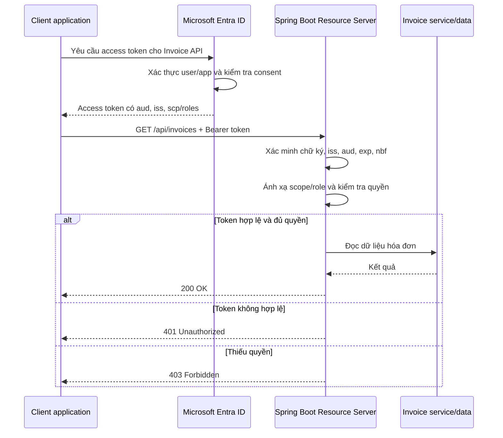

# Bảo vệ API bằng OAuth2 resource server

> **Chương:** Microsoft Entra ID  
> **Học phần:** SPRING_CLOUD_PROVIDER_INTEGRATION — thực hành tích hợp Spring Boot với dịch vụ managed của AWS, Azure và Google Cloud qua các thư viện Spring Cloud tương ứng. Bài này tập trung bảo vệ API Spring Boot bằng access token do Microsoft Entra ID phát hành.

Một API hóa đơn có thể được gọi từ web portal, ứng dụng di động, một dịch vụ backend hoặc worker chạy theo lịch. API cần biết request đến từ client nào, có người dùng đang ủy quyền hay không, và caller có quyền thực hiện thao tác hay không. Microsoft Entra ID phát hành access token; Spring Security Resource Server xác minh token và chuyển các quyền trong token thành authority để áp dụng cho endpoint.

Điểm quan trọng là **API phải xác minh access token dành cho chính API đó**. Token hợp lệ về chữ ký vẫn có thể không được phép dùng tại API nếu issuer (iss), audience (aud) hoặc permission không đúng. Bài học triển khai mô hình Spring Boot nhận bearer JWT từ Entra, xác minh issuer/audience/thời hạn, ánh xạ delegated scopes và application app roles, rồi kiểm tra quyền ở endpoint.

## 1. Mục tiêu học tập

Sau bài này, bạn có thể:

1. Giải thích vai trò OAuth2 Resource Server và phân biệt nó với OAuth2 Login.
2. Đăng ký Spring Boot API trong Microsoft Entra ID và expose delegated scope/app role.
3. Cấu hình Spring Security nhận bearer access token qua HTTP Authorization header.
4. Xác minh chữ ký JWT, issuer (iss), audience (aud), thời hạn và tenant.
5. Hiểu các claim Entra như scp, roles, tid, oid, azp, appid, idtyp.
6. Ánh xạ delegated scopes và application roles thành Spring GrantedAuthority.
7. Bảo vệ endpoint bằng request authorization và method security.
8. Phân biệt lỗi 401 (xác thực/token không hợp lệ) và 403 (đã xác thực nhưng thiếu quyền).
9. Kiểm thử API bằng JWT giả trong MockMvc và xác minh tích hợp với tenant thử nghiệm.

## 2. Resource Server hoạt động như thế nào?

OAuth2 Resource Server là ứng dụng/API nhận access token từ client và kiểm tra token trước khi xử lý request. Trong bài này:

- **Authorization Server:** Microsoft Entra ID, nơi xác thực principal và phát access token.
- **Client:** web portal, SPA, mobile app, worker hoặc backend gọi API.
- **Resource Server:** Spring Boot API bảo vệ dữ liệu hóa đơn.
- **Access token:** credential dạng bearer mà client gửi trong request.

Luồng cơ bản:



Client không tự xác minh access token của API đích. Resource Server chịu trách nhiệm xác minh token được phát cho API đó. Nếu token có chữ ký hợp lệ nhưng được phát cho Microsoft Graph hoặc một API khác, Invoice API phải từ chối.

### Bearer token nghĩa là gì?

Client gửi token trong HTTP header:

```http
GET /api/invoices/42 HTTP/1.1
Host: api.example.com
Authorization: Bearer <ACCESS_TOKEN>
Accept: application/json
```

Ai sở hữu bearer token có thể sử dụng token trong phạm vi quyền và thời hạn của nó. Vì vậy:

- Chỉ truyền token qua HTTPS.
- Không đưa token vào query string, URL, log hoặc analytics.
- Không lưu token trong source code hay image.
- Không gửi token tới host không đáng tin cậy.
- Không dùng ID token thay access token.

## 3. Đăng ký Spring Boot API trong Microsoft Entra ID

Giả sử API có tên invoice-api và chỉ chấp nhận token từ tenant Contoso trong ví dụ đầu tiên.

### 3.1. Tạo app registration cho API

1. Mở Microsoft Entra admin center và chọn đúng tenant.
2. Vào **Entra ID → App registrations → New registration**.
3. Đặt tên invoice-api-staging.
4. Chọn **Accounts in this organizational directory only** nếu API chỉ phục vụ một tenant.
5. Register và ghi lại Application (client) ID cùng Directory (tenant) ID.

Application/client ID nhận diện API trong Entra. Nó không phải Object ID của application object hoặc service principal.

### 3.2. Expose API và tạo delegated scope

Trong app registration của API, mở **Expose an API**:

1. Đặt Application ID URI, ví dụ api://<INVOICE_API_CLIENT_ID>.
2. Chọn **Add a scope**.
3. Đặt scope name Invoices.Read.
4. Cấu hình consent display name/description rõ nghĩa.
5. Chọn trạng thái enabled.

Client có thể yêu cầu delegated scope:

```text
api://<INVOICE_API_CLIENT_ID>/Invoices.Read
```

Scope này cho phép client gọi API thay mặt user đã đăng nhập. API vẫn cần kiểm tra quyền nghiệp vụ của user đối với hóa đơn cụ thể.

### 3.3. Tạo app role cho application permission

Nếu worker/daemon cần gọi API mà không có người dùng, tạo app role dành cho application, ví dụ:

| Thuộc tính | Giá trị minh họa |
|---|---|
| Display name | Read all invoices |
| Value | Invoices.Read.All |
| Allowed member types | Applications |
| Description | Cho phép workload đọc hóa đơn qua API |
| Enabled | Yes |

Client application thêm **Application permission** tới app role này và tenant admin cấp admin consent. Client credentials request thường dùng scope resource dạng:

```text
api://<INVOICE_API_CLIENT_ID>/.default
```

/.default yêu cầu các application permissions đã cấu hình và consent cho resource; nó không bỏ qua bước cấp quyền.

### 3.4. Delegated scope và app role khác nhau

| Loại quyền | Caller | Claim thường gặp trong access token | Ý nghĩa |
|---|---|---|---|
| Delegated permission | Client hành động thay mặt user | scp | Scope được consent cho client và user context |
| Application permission | Workload gọi bằng quyền của chính nó | roles | App role/permission được cấp cho service principal |
| User app role | User đăng nhập và được gán role | roles | Vai trò của user trên API/app |

Claim roles có thể xuất hiện trong token user nếu user được gán app role. Vì vậy, không phân loại token app-only chỉ bằng việc thấy roles. Nếu API cần phân biệt chắc chắn app-only, có thể cấu hình optional claim idtyp và yêu cầu giá trị app cho endpoint dành riêng cho workload.

Nguồn: [Expose a web API](https://learn.microsoft.com/entra/identity-platform/quickstart-configure-app-expose-web-apis), [Access token claims reference](https://learn.microsoft.com/entra/identity-platform/access-token-claims-reference).

## 4. Thêm dependency Resource Server cho Spring Boot

Với Maven và Spring Boot dependency management:

```xml
<dependencies>
    <dependency>
        <groupId>org.springframework.boot</groupId>
        <artifactId>spring-boot-starter-oauth2-resource-server</artifactId>
    </dependency>
    <dependency>
        <groupId>org.springframework.boot</groupId>
        <artifactId>spring-boot-starter-security</artifactId>
    </dependency>
    <dependency>
        <groupId>org.springframework.boot</groupId>
        <artifactId>spring-boot-starter-web</artifactId>
    </dependency>
</dependencies>
```

Resource Server cần phần xác thực bearer token và hỗ trợ giải mã/xác minh JWT. Starter OAuth2 Resource Server của Spring Boot đưa các thành phần cần thiết vào dependency graph. Để kiểm thử security bằng MockMvc, thêm spring-security-test ở test scope:

```xml
<dependency>
    <groupId>org.springframework.security</groupId>
    <artifactId>spring-security-test</artifactId>
    <scope>test</scope>
</dependency>
```

Không tự pin version Spring Security nếu Spring Boot BOM đã quản lý. Chọn một dòng Spring Boot/Spring Security tương thích rồi ghi lại version thực tế của build.

## 5. Cấu hình issuer và audience

Hai claim quan trọng cần kiểm tra là:

- iss (issuer): ai phát hành token.
- aud (audience): token được phát cho resource/API nào.

### 5.1. Issuer tenant-specific của Entra

Với v2.0 access token từ tenant Contoso, issuer thường có dạng:

```text
https://login.microsoftonline.com/<TENANT_ID>/v2.0
```

Giá trị này phải khớp claim iss của token. Token v1.0 có issuer format khác; nếu API chấp nhận v1 token, phải cấu hình issuer/validator theo token version và metadata tương ứng. Không lấy issuer URI từ ví dụ khác rồi mặc định nó đúng cho mọi tenant/token version.

### 5.2. Audience của access token Entra

Audience phụ thuộc access token version:

| Token version (ver) | aud thường có dạng |
|---|---|
| v2.0 | Application/client ID dạng GUID của API |
| v1.0 | Application ID URI được khai báo cho API hoặc resource identifier tương ứng theo cấu hình |

Vì vậy, dù client yêu cầu scope bằng Application ID URI, aud trong v2.0 token vẫn thường là client ID GUID của API. Luôn kiểm tra access token thực tế trong môi trường thử nghiệm và cấu hình audience theo token version mà API chấp nhận.

Không nhầm:

- client_id trong registration của client: nhận diện ứng dụng gọi API.
- aud trong access token: nhận diện API nhận token.
- iss: nhận diện tenant/authority phát hành token.
- Scope đầy đủ: định danh quyền mà client yêu cầu trên API.

### 5.3. Cấu hình Spring Boot bằng application.yml

Ví dụ cho single-tenant API phát hành/nhận v2.0 token:

```yaml
spring:
  security:
    oauth2:
      resourceserver:
        jwt:
          issuer-uri: https://login.microsoftonline.com/${ENTRA_TENANT_ID}/v2.0
          audiences:
            - ${ENTRA_API_CLIENT_ID}
```

issuer-uri cho Spring biết issuer được tin cậy và nơi discovery/JWKS được công bố. audiences yêu cầu token phải có audience của API. Spring Boot cấu hình decoder để kiểm tra chữ ký, issuer, thời hạn và audience. Nếu API nhận v1 token, hãy cấu hình đúng issuer và audience theo v1; không dùng giá trị v2 một cách máy móc.

Biến môi trường:

```bash
ENTRA_TENANT_ID=<directory-tenant-id>
ENTRA_API_CLIENT_ID=<application-client-id-of-the-api>
```

Không dùng client ID của frontend/worker làm audience. Audience là API resource nhận token.

### 5.4. OIDC discovery và JWKS

Spring Security dùng metadata của issuer để tìm public signing keys (JWKS). Khi Entra xoay signing key, JWKS có thể công bố key mới; Spring Security cập nhật key được dùng để xác minh JWT theo cơ chế của decoder.

Không hard-code private key của Entra vào ứng dụng. Resource Server chỉ cần lấy public keys từ endpoint tin cậy qua TLS. Nếu môi trường có proxy/firewall, phải cho phép outbound tới discovery/JWKS endpoint.

Nguồn: [Spring Boot OAuth2 Resource Server](https://docs.spring.io/spring-boot/reference/security/oauth2.html), [Spring Security JWT Resource Server](https://docs.spring.io/spring-security/reference/servlet/oauth2/resource-server/jwt.html), [Microsoft claims validation](https://learn.microsoft.com/entra/identity-platform/claims-validation).

## 6. Cấu hình SecurityFilterChain cho REST API

API thuần bearer token thường không dùng browser session. Có thể đặt session policy STATELESS và tắt CSRF cho chain này **chỉ khi** endpoint xác thực bằng Authorization bearer header và không chấp nhận cookie session cho thao tác thay đổi trạng thái.

Ví dụ bên dưới dùng matcher `/api/**`. Nếu ứng dụng chỉ là API và mọi request đều thuộc API, có thể bỏ `securityMatcher` để chain áp dụng cho toàn bộ ứng dụng. Nếu ứng dụng còn có trang web hoặc endpoint khác, phải có filter chain riêng bao phủ các request còn lại; không để request ngoài matcher đi qua mà không có chính sách bảo vệ.

Ví dụ:

```java
package com.example.invoice.security;

import org.springframework.context.annotation.Bean;
import org.springframework.context.annotation.Configuration;
import org.springframework.security.config.Customizer;
import org.springframework.security.config.annotation.web.builders.HttpSecurity;
import org.springframework.security.config.http.SessionCreationPolicy;
import org.springframework.security.web.SecurityFilterChain;

@Configuration
public class ApiSecurityConfiguration {

    @Bean
    SecurityFilterChain apiSecurity(HttpSecurity http) throws Exception {
        http
            .securityMatcher("/api/**")
            .csrf(csrf -> csrf.disable())
            .sessionManagement(session -> session
                .sessionCreationPolicy(SessionCreationPolicy.STATELESS))
            .authorizeHttpRequests(authorize -> authorize
                .requestMatchers("/api/public/**").permitAll()
                .requestMatchers("/api/invoices/**")
                    .hasAuthority("SCOPE_Invoices.Read")
                .requestMatchers("/api/jobs/**")
                    .hasAuthority("APPROLE_Invoices.Process")
                .anyRequest().authenticated())
            .oauth2ResourceServer(oauth2 ->
                oauth2.jwt(Customizer.withDefaults()));

        return http.build();
    }
}
```

Đây là chain cho API bearer-only. Nếu cùng ứng dụng có web portal dùng cookie/session, hãy tạo chain riêng với matcher và thứ tự phù hợp; giữ CSRF protection cho web session. Không tắt CSRF toàn ứng dụng chỉ vì một nhóm endpoint là REST API.

Spring Security mặc định:

- Trả 401 nếu thiếu bearer token hoặc token không hợp lệ.
- Trả 403 nếu token đã được xác thực nhưng thiếu authority cần thiết.
- Không tự redirect caller API tới trang login như OAuth2 Login.

## 7. Entra access token có những claim nào?

Các claim sau thường hữu ích khi bảo vệ API:

| Claim | Ý nghĩa | Cách sử dụng |
|---|---|---|
| iss | Issuer | So khớp authority/tenant được tin cậy |
| aud | API nhận token | Bắt buộc khớp API hiện tại |
| ver | Phiên bản access token | Xác định format/issuer/audience rules |
| tid | Tenant ID | Kiểm tra tenant và phân vùng dữ liệu |
| oid | Object ID của subject trong tenant | Định danh tenant-local; subject có thể là user hoặc service principal |
| sub | Subject của token | Định danh subject theo token contract |
| scp | Delegated scopes, chuỗi phân tách bằng dấu cách | Kiểm tra quyền delegated của user/client |
| roles | Danh sách app roles/permissions | Kiểm tra application permission hoặc user app role |
| azp | Client application ID trong v2 token | Xác định client gọi API |
| appid | Client application ID trong v1 token | Tương đương vai trò azp theo token version |
| idtyp | Loại token nếu được cấu hình phát hành | Giá trị app là tín hiệu cho app-only token |
| exp, nbf, iat | Thời hạn/thời điểm token | Xác minh token đang trong thời gian hiệu lực |

### scp và roles

Delegated token thường có claim scp chứa các scope mà client được phép dùng thay mặt user. Ví dụ:

```json
{
  "scp": "Invoices.Read Profile.Read",
  "tid": "11111111-1111-1111-1111-111111111111",
  "oid": "22222222-2222-2222-2222-222222222222",
  "aud": "33333333-3333-3333-3333-333333333333"
}
```

Application token lấy bằng client credentials thường không có scp; quyền ứng dụng được biểu diễn bằng roles. User token cũng có thể có roles nếu user được gán app role. Do đó:

- Scope phù hợp để kiểm tra quyền delegated như Invoices.Read.
- App role phù hợp để kiểm tra quyền workload như Invoices.Process.
- Không suy ra app-only chỉ từ việc token có roles.
- Nếu route chỉ cho phép app-only, cấu hình optional claim idtyp trong access token và xác minh giá trị app; đồng thời kiểm tra role/client được phép.

### azp/appid xác định client, không phải user

Một token delegated có thể chứa cả user claims và claim client application. azp hoặc appid cho biết client app yêu cầu token; nó không tự chứng minh request là app-only. Nếu API chỉ chấp nhận một nhóm client cụ thể, hãy kiểm tra client ID trong allowlist bên cạnh scope/role và token type.

### Không dùng email để phân quyền

Không dùng email, preferred_username hoặc name làm căn cứ duy nhất để cho phép truy cập. Các giá trị này có thể thay đổi hoặc không xuất hiện. Dùng tid + oid (hoặc định danh theo iss + sub) cùng scope/app role và quyền nghiệp vụ.

Nguồn: [Access token claims reference](https://learn.microsoft.com/entra/identity-platform/access-token-claims-reference), [Optional claims reference](https://learn.microsoft.com/entra/identity-platform/optional-claims-reference).

## 8. Ánh xạ delegated scopes và app roles vào Spring authorities

Spring Security dùng JwtAuthenticationConverter để chuyển JWT thành Authentication. JwtGrantedAuthoritiesConverter mặc định chuyển scope thành authority có tiền tố SCOPE_. Với Entra, claim delegated thường tên scp; có thể cấu hình rõ ràng để chỉ đọc claim đó. App role nằm trong claim roles, nên cần converter bổ sung.

Ví dụ kết hợp scopes và roles:

```java
package com.example.invoice.security;

import java.util.ArrayList;
import java.util.Collection;
import java.util.List;

import org.springframework.context.annotation.Bean;
import org.springframework.context.annotation.Configuration;
import org.springframework.core.convert.converter.Converter;
import org.springframework.security.core.GrantedAuthority;
import org.springframework.security.core.authority.SimpleGrantedAuthority;
import org.springframework.security.oauth2.jwt.Jwt;
import org.springframework.security.oauth2.server.resource.authentication.JwtAuthenticationConverter;
import org.springframework.security.oauth2.server.resource.authentication.JwtGrantedAuthoritiesConverter;

@Configuration
public class EntraAuthoritiesConfiguration {

    @Bean
    JwtAuthenticationConverter jwtAuthenticationConverter() {
        JwtGrantedAuthoritiesConverter scopeConverter =
                new JwtGrantedAuthoritiesConverter();
        scopeConverter.setAuthoritiesClaimName("scp");
        scopeConverter.setAuthorityPrefix("SCOPE_");

        Converter<Jwt, Collection<GrantedAuthority>> combined = jwt -> {
            Collection<GrantedAuthority> authorities = new ArrayList<>();

            Collection<GrantedAuthority> scopes = scopeConverter.convert(jwt);
            if (scopes != null) {
                authorities.addAll(scopes);
            }

            List<String> roles = jwt.getClaimAsStringList("roles");
            if (roles != null) {
                roles.stream()
                    .map(role -> new SimpleGrantedAuthority("APPROLE_" + role))
                    .forEach(authorities::add);
            }
            return authorities;
        };

        JwtAuthenticationConverter converter = new JwtAuthenticationConverter();
        converter.setJwtGrantedAuthoritiesConverter(combined);
        return converter;
    }
}
```

Gắn converter vào Resource Server:

```java
@Bean
SecurityFilterChain apiSecurity(
        HttpSecurity http,
        JwtAuthenticationConverter jwtAuthenticationConverter) throws Exception {

    http
        .securityMatcher("/api/**")
        .csrf(csrf -> csrf.disable())
        .sessionManagement(session -> session
            .sessionCreationPolicy(SessionCreationPolicy.STATELESS))
        .authorizeHttpRequests(authorize -> authorize
            .requestMatchers("/api/invoices/**")
                .hasAuthority("SCOPE_Invoices.Read")
            .requestMatchers("/api/jobs/**")
                .hasAuthority("APPROLE_Invoices.Process")
            .anyRequest().authenticated())
        .oauth2ResourceServer(oauth2 -> oauth2
            .jwt(jwt -> jwt.jwtAuthenticationConverter(jwtAuthenticationConverter)));

    return http.build();
}
```

Đây là một cấu hình đầy đủ khác của filter chain, minh họa cách gắn converter. Trong ứng dụng, dùng một bean SecurityFilterChain phù hợp cho API, tránh khai báo hai chain trùng matcher/priority.

Kết quả ánh xạ:

| Claim | Giá trị | Spring authority |
|---|---|---|
| scp | Invoices.Read | SCOPE_Invoices.Read |
| roles | Invoices.Process | APPROLE_Invoices.Process |

Không thêm authority mặc định khi claim thiếu. Một token không có scope/role không được tự nhận quyền chỉ vì đã qua bước xác minh chữ ký.

## 9. Bảo vệ endpoint và method

Có thể kiểm tra quyền ở URL layer:

```java
import java.util.List;

import org.springframework.web.bind.annotation.GetMapping;
import org.springframework.web.bind.annotation.RequestMapping;
import org.springframework.web.bind.annotation.RestController;

@RestController
@RequestMapping("/api/invoices")
public class InvoiceController {

    @GetMapping
    public List<InvoiceView> listInvoices() {
        return List.of();
    }

    public record InvoiceView(String id) {
    }
}
```

Với filter chain ở trên, request tới /api/invoices cần SCOPE_Invoices.Read.

Có thể dùng method security khi muốn đặt rule gần nghiệp vụ:

```java
import org.springframework.security.access.prepost.PreAuthorize;
import org.springframework.stereotype.Service;

@Service
public class InvoiceService {

    @PreAuthorize("hasAuthority('SCOPE_Invoices.Read')")
    public InvoiceView findInvoice(String invoiceId) {
        // Kiểm tra quyền truy cập invoice cụ thể trước khi trả dữ liệu.
        return null;
    }
}
```

Bật method security:

```java
import org.springframework.context.annotation.Configuration;
import org.springframework.security.config.annotation.method.configuration.EnableMethodSecurity;

@Configuration
@EnableMethodSecurity
public class MethodSecurityConfiguration {
}
```

Scope xác định client/user có quyền gọi nhóm chức năng của API; nó không thay thế authorization nghiệp vụ trên từng bản ghi. Ví dụ, Invoices.Read không có nghĩa Alice được đọc hóa đơn của mọi khách hàng. Service vẫn phải kiểm tra owner, tenant, organization hoặc ACL của invoice.

### Đọc principal trong controller

Trong Resource Server, principal mặc định thường là Jwt:

```java
import org.springframework.security.core.annotation.AuthenticationPrincipal;
import org.springframework.security.oauth2.jwt.Jwt;
import org.springframework.web.bind.annotation.GetMapping;
import org.springframework.web.bind.annotation.RestController;

@RestController
public class CallerController {

    @GetMapping("/api/whoami")
    public CallerView whoAmI(@AuthenticationPrincipal Jwt jwt) {
        return new CallerView(
                jwt.getClaimAsString("tid"),
                jwt.getClaimAsString("oid"),
                jwt.getClaimAsString("azp"),
                jwt.getClaimAsString("appid"));
    }

    public record CallerView(
            String tenantId,
            String objectId,
            String clientIdV2,
            String clientIdV1) {
    }
}
```

Đây là endpoint minh họa cho môi trường phát triển. Không trả toàn bộ claims/token cho client trong production; chỉ trả thông tin thực sự cần thiết và được phép công khai.

## 10. Phân biệt user-delegated và app-only endpoint

Một API có thể phục vụ cả user và workload. Cần quy định rõ endpoint nào chấp nhận loại caller nào:

| Endpoint | Caller | Quyền kiểm tra | Gợi ý |
|---|---|---|---|
| GET /api/invoices/** | User/client thay mặt user | SCOPE_Invoices.Read | Kiểm tra thêm quyền user trên invoice |
| POST /api/invoices/** | User/client thay mặt user | SCOPE_Invoices.Write | Kiểm tra tenant/owner và business rule |
| POST /api/jobs/reconcile | Worker app-only | APPROLE_Invoices.Process và idtyp=app nếu đã cấu hình | Không nhận user token cho route này |

### Optional claim idtyp

Nếu cần phân biệt app-only token một cách rõ ràng, cấu hình Entra phát hành optional claim idtyp trong access token của API. Khi token có idtyp=app, API có thể coi đây là tín hiệu app-only sau khi đã xác minh chữ ký, issuer, audience và các claim khác. Không cho phép endpoint nhạy cảm chỉ dựa vào roles vì user token cũng có thể có app role.

Nếu ứng dụng chưa cấu hình/nhận idtyp, hãy thiết kế API chỉ dựa trên permission contract có thể xác minh; không tự suy luận token type từ claim không có mặt. Kiểm tra cấu hình optional claims và access token thực tế trong tenant thử nghiệm.

### Giới hạn client application

Nếu chỉ cho phép một worker client gọi endpoint, có thể kiểm tra thêm azp (v2) hoặc appid (v1) theo allowlist. Cần kết hợp với app role và token type; client ID một mình không chứng minh client có quyền xử lý dữ liệu.

## 11. Single-tenant và multi-tenant API

### Single-tenant

Đây là mô hình dễ kiểm soát nhất cho API nội bộ. Cấu hình issuer với tenant ID cụ thể:

```yaml
spring:
  security:
    oauth2:
      resourceserver:
        jwt:
          issuer-uri: https://login.microsoftonline.com/${ENTRA_TENANT_ID}/v2.0
          audiences:
            - ${ENTRA_API_CLIENT_ID}
```

API chỉ chấp nhận token có issuer đúng tenant, audience đúng API và quyền hợp lệ.

### Multi-tenant

API SaaS có thể cần nhận token từ nhiều tenant. Khi đó không được thay tenant cụ thể bằng common rồi bỏ qua issuer/tenant validation. API phải:

1. Xác định tenant được onboarding và nằm trong allowlist.
2. Xác minh issuer thực tế tương ứng tenant/token version.
3. Kiểm tra tid khớp tenant đã được xác minh.
4. Xác minh audience vẫn là API của mình.
5. Áp dụng tenant isolation cho dữ liệu và authorization.
6. Có chính sách từ chối tenant chưa consent/provision hoặc đã bị thu hồi quyền.

Spring Security có thể dùng AuthenticationManagerResolver để chọn decoder/manager theo issuer hoặc tenant đã xác minh. Cần giới hạn tenant trước khi discovery metadata và tải JWKS; không tạo decoder cho mọi tid bất kỳ do caller gửi lên. Nếu chỉ có một tenant, dùng issuer URI tenant-specific đơn giản hơn.

## 12. Gọi API bằng token đúng audience

Client phải yêu cầu token cho API đích trước khi gửi request. Một số ví dụ:

- SPA/web client: authorization code flow và delegated scope api://<API_CLIENT_ID>/Invoices.Read.
- Backend daemon: client credentials với api://<API_CLIENT_ID>/.default, sau khi admin consent application permission.
- Middle-tier API: OBO để đổi user assertion thành token cho downstream API, nếu cần hành động thay mặt user.

Ví dụ gọi API bằng curl:

```bash
curl --request GET \
  --url https://localhost:8080/api/invoices \
  --header "Authorization: Bearer <ACCESS_TOKEN>" \
  --header "Accept: application/json"
```

Token phải được lấy cho Invoice API, không phải ID token và không phải access token có audience là Microsoft Graph. Không dán token thật vào terminal history, issue tracker hoặc tài liệu.

## 13. Kiểm thử Resource Server

Cần hai lớp kiểm thử:

- **Security/unit test:** kiểm tra mapping authority và quy tắc endpoint với JWT giả.
- **Integration test:** dùng token thật từ tenant test để kiểm tra chữ ký, issuer, audience, consent và quyền.

### 13.1. MockMvc với JWT giả

Ví dụ test delegated scope:

```java
import static org.springframework.security.test.web.servlet.request
        .SecurityMockMvcRequestPostProcessors.jwt;
import static org.springframework.test.web.servlet.request.MockMvcRequestBuilders.get;
import static org.springframework.test.web.servlet.request.MockMvcRequestBuilders.post;
import static org.springframework.test.web.servlet.result.MockMvcResultMatchers.status;

import java.util.List;

import org.junit.jupiter.api.Test;
import org.springframework.beans.factory.annotation.Autowired;
import org.springframework.boot.test.autoconfigure.web.servlet.AutoConfigureMockMvc;
import org.springframework.boot.test.context.SpringBootTest;
import org.springframework.test.web.servlet.MockMvc;

@SpringBootTest
@AutoConfigureMockMvc
class InvoiceResourceServerTest {

    @Autowired
    MockMvc mvc;

    @Test
    void acceptsDelegatedTokenWithReadScope() throws Exception {
        mvc.perform(get("/api/invoices")
                .with(jwt().jwt(token -> token
                        .claim("scp", "Invoices.Read")
                        .claim("tid", "11111111-1111-1111-1111-111111111111")
                        .claim("oid", "22222222-2222-2222-2222-222222222222"))))
                .andExpect(status().isOk());
    }

    @Test
    void rejectsTokenWithoutRequiredScope() throws Exception {
        mvc.perform(get("/api/invoices")
                .with(jwt().jwt(token -> token
                        .claim("scp", "Profile.Read"))))
                .andExpect(status().isForbidden());
    }
}
```

Nếu converter tùy chỉnh yêu cầu roles, idtyp hoặc audience, hãy thêm các claim tương ứng trong test. Request post-processor jwt() tạo principal/token giả để kiểm tra authorization; nó không chạy xác minh chữ ký, issuer, audience và timestamp của JWT thật. Vì thế test trên không chứng minh token Entra thật được chấp nhận.

### 13.2. Test app role

Với endpoint app-only, tạo JWT giả có roles:

```java
@Test
void acceptsWorkerWithRequiredApplicationRole() throws Exception {
    mvc.perform(post("/api/jobs/reconcile")
            .with(jwt().jwt(token -> token
                    .claim("roles", List.of("Invoices.Process"))
                    .claim("idtyp", "app")
                    .claim("azp", "44444444-4444-4444-4444-444444444444"))))
            .andExpect(status().isAccepted());
}
```

Test này chỉ chứng minh mapping/authorization trong Spring. Nếu code có validator app-only riêng, hãy test validator với token có và không có idtyp=app, role và client ID.

### 13.3. Integration test với Entra tenant thử nghiệm

1. Tạo API app registration riêng cho test và expose scope/app role.
2. Tạo client app registration riêng và cấp permission phù hợp.
3. Lấy delegated token và application token bằng flow tương ứng.
4. Gọi API qua HTTPS và xác minh response.
5. Thử token sai audience, sai tenant, hết hạn hoặc thiếu permission.
6. Đối chiếu Entra sign-in/service principal logs và API request ID.

Không ghi token thật vào test report, CI artifact hoặc log. Dùng secret store và tenant thử nghiệm; không chạy test phá hủy trên production.

### Ma trận kiểm thử

| Trường hợp | Kết quả mong đợi |
|---|---|
| Không gửi bearer token tới endpoint protected | 401 |
| Token sai chữ ký hoặc hết hạn | 401 |
| Token có issuer sai | 401 |
| Token có audience của Graph thay vì Invoice API | 401 |
| Token đúng nhưng thiếu Invoices.Read | 403 |
| Delegated token có scope đúng | 200 nếu business authorization cho phép |
| App-only token thiếu app role | 403 |
| App-only token có role và token type được chấp nhận | 202/200 theo endpoint |
| Token từ tenant không được allowlist | 401/403 theo error policy |
| Token hợp lệ nhưng user không sở hữu invoice | 403 hoặc 404 theo chính sách tránh lộ tài nguyên |

## 14. 401 và 403: đọc lỗi đúng cách

| HTTP status | Ý nghĩa | Ví dụ |
|---|---|---|
| 401 Unauthorized | API chưa xác thực được caller | Không có token, token hết hạn, chữ ký sai, issuer/audience sai |
| 403 Forbidden | Caller đã xác thực nhưng không có quyền | Thiếu scope, app role hoặc quyền nghiệp vụ |

Trong bearer token flow, 401 thường đi kèm WWW-Authenticate: Bearer challenge. 403 không nên được sửa bằng cách yêu cầu client đăng nhập lại nếu nguyên nhân là thiếu permission; cần cấp đúng quyền hoặc từ chối thao tác.

Không trả chi tiết nội bộ như signing key, token payload đầy đủ, secret, tenant configuration hoặc stack trace cho client. Log server nên có correlation/request ID và mã lỗi đã làm sạch.

## 15. Lỗi thường gặp và cách chẩn đoán

| Triệu chứng | Nguyên nhân có thể | Cách xử lý |
|---|---|---|
| API luôn trả 401 | Issuer URI không khớp token version/tenant | Đọc iss, ver, đối chiếu discovery metadata và tenant |
| JWT decode được nhưng API từ chối | Decode không xác minh chữ ký; hoặc sai aud/iss/thời hạn | Kiểm tra decoder/validator, không chỉ base64-decode |
| Token hợp lệ nhưng trả 403 | Thiếu scope hoặc app role | Kiểm tra scp, roles, consent và assignment |
| Scope có trong token nhưng authority không xuất hiện | Converter đọc claim/prefix không đúng | Kiểm tra JwtGrantedAuthoritiesConverter và tên authority |
| Worker token không có scp | Bình thường với client credentials | Kiểm tra roles application permission |
| User token có roles | User có thể được gán app role | Không coi mọi token có roles là app-only |
| Token của Graph bị gửi vào API | Client xin token sai resource | Yêu cầu token có audience của Invoice API |
| Tenant B bị từ chối | API đang cấu hình single-tenant | Chỉ mở multi-tenant nếu có quy trình onboarding/allowlist và validator phù hợp |
| Lỗi discovery/JWKS | Network, DNS, proxy hoặc endpoint metadata | Kiểm tra outbound connectivity/TLS và issuer metadata |
| Sau khi xoay signing key, API tạm lỗi | JWKS/cache/network hoặc decoder không refresh được | Kiểm tra JWKS endpoint, key ID (kid) và cache behavior |
| API stateless vẫn tạo session | Có filter/chain khác hoặc cấu hình session không đúng | Rà matcher, chain order và session policy |
| CORS preflight bị 401 | OPTIONS không được xử lý trước authorization hoặc CORS chưa cấu hình | Cấu hình CORS policy cụ thể, không mở wildcard credential |

### Quy trình điều tra 401/403

1. Xác định request có gửi bearer token hay không.
2. Xác định token có phải access token dành cho API hiện tại không.
3. Kiểm tra ver, iss, aud, exp, nbf.
4. Kiểm tra tid có thuộc tenant được chấp nhận không.
5. Kiểm tra delegated scope scp hoặc application/user role roles.
6. Nếu endpoint app-only, kiểm tra token type và client allowlist theo thiết kế.
7. Kiểm tra business authorization trên resource cụ thể.
8. Đối chiếu log Entra và API bằng correlation ID/request ID; không log token.

## 16. Bảo mật API khi triển khai production

- Chỉ nhận access token dành cho API của mình; kiểm tra aud bắt buộc.
- Xác minh chữ ký, issuer, thời hạn và tenant theo chính sách.
- Dùng issuer tenant-specific nếu API single-tenant.
- Nếu multi-tenant, xác minh issuer/tenant bằng allowlist và giữ tenant isolation.
- Cấp delegated scope/app role tối thiểu; review consent định kỳ.
- Không dùng email, UPN hoặc display name làm khóa phân quyền.
- Tách app-only route khỏi user-delegated route nếu ngữ nghĩa quyền khác nhau.
- Không phân loại app-only chỉ bằng claim roles; dùng token type/idtyp nếu cần.
- Không log bearer token, authorization header, cookie hoặc secret.
- Chỉ tắt CSRF khi API thật sự bearer-only và không dùng cookie authentication.
- Cấu hình CORS theo origin/method/header cần thiết; CORS không thay thế authentication.
- Giới hạn payload, rate limit và validate input sau khi xác thực token.
- Áp dụng authorization nghiệp vụ trên từng resource; scope không thay thế ACL.
- Đồng bộ thời gian hệ thống để tránh lỗi exp/nbf.
- Theo dõi key discovery/JWKS và outbound connectivity để hỗ trợ key rotation.

## 17. Bài tập thực hành

**Bối cảnh:** Xây Invoice API bằng Spring Boot. Web portal gọi API thay mặt nhân viên; worker chạy nền gọi endpoint reconcile không có user context. API lưu hóa đơn trong Azure Blob Storage.

### Phần A — Cấu hình Entra

1. Tạo app registration invoice-api.
2. Expose delegated scope Invoices.Read.
3. Tạo app role Invoices.Process cho application.
4. Tạo client app cho portal và worker.
5. Cấp delegated permission cho portal; cấp application permission và admin consent cho worker.
6. Cấu hình API access token version và ghi lại aud thực tế của token test.

### Phần B — Cấu hình Spring Boot

1. Thêm Resource Server dependency.
2. Cấu hình issuer URI tenant-specific và audience API.
3. Tạo SecurityFilterChain stateless cho /api/**.
4. Ánh xạ scp thành SCOPE_... và roles thành APPROLE_....
5. Bảo vệ /api/invoices/** bằng delegated scope.
6. Bảo vệ /api/jobs/reconcile bằng app role và token type app-only theo thiết kế.
7. Thêm method security để kiểm tra quyền trên invoice cụ thể.

### Phần C — Kiểm thử

1. Mock JWT có scope đúng và scope thiếu.
2. Mock JWT có app role và app-only marker.
3. Kiểm tra sai audience/issuer bằng validator test.
4. Lấy token thật trong tenant test và gọi API qua HTTPS.
5. Kiểm tra 401, 403, CORS và không ghi token vào log.
6. Ghi kết quả cùng request ID và cấu hình đã làm sạch.

**Mẫu báo cáo:**

| Request | Principal | Token type | Claim quyền | Audience | Kết quả |
|---|---|---|---|---|---|
| Nhân viên đọc hóa đơn | User | Delegated | scp=Invoices.Read | Invoice API | 200/403 theo ACL |
| User thiếu scope | User | Delegated | Không có scope đọc | Invoice API | 403 |
| Worker reconcile | Service principal | App-only | roles=Invoices.Process | Invoice API | 202 |
| Token Graph gọi Invoice API | User/app | Tùy token | Có thể hợp lệ với Graph | Microsoft Graph | 401 tại Invoice API |
| Token hết hạn | User/app | JWT hết hạn | Bất kỳ | Invoice API | 401 |

**Tiêu chí đạt:** API chỉ chấp nhận token có chữ ký, issuer, audience và thời hạn đúng; scope/app role được ánh xạ chính xác; endpoint user và workload có quyền tách biệt; test chứng minh rõ 401 và 403.

## Tài liệu tham khảo chính thức

1. [Spring Boot — OAuth2 Resource Server](https://docs.spring.io/spring-boot/reference/security/oauth2.html): cấu hình issuer, audience và JWT Resource Server.
2. [Spring Security — JWT Resource Server](https://docs.spring.io/spring-security/reference/servlet/oauth2/resource-server/jwt.html): JWT decoder, validators, authorities converter và key rotation.
3. [Spring Security — Testing OAuth2](https://docs.spring.io/spring-security/reference/servlet/test/mockmvc/oauth2.html): test bearer token/JWT với MockMvc.
4. [Microsoft identity platform — Access token claims reference](https://learn.microsoft.com/entra/identity-platform/access-token-claims-reference): aud, iss, scp, roles, tid, oid, azp và appid.
5. [Microsoft identity platform — Validate claims](https://learn.microsoft.com/entra/identity-platform/claims-validation): audience, tenant, subject và actor validation.
6. [Microsoft identity platform — Expose a web API](https://learn.microsoft.com/entra/identity-platform/quickstart-configure-app-expose-web-apis): Application ID URI, delegated scopes và app roles.
7. [Microsoft identity platform — Optional claims](https://learn.microsoft.com/entra/identity-platform/optional-claims-reference): cấu hình optional claims như idtyp.
8. [Microsoft identity platform — Client credentials flow](https://learn.microsoft.com/entra/identity-platform/v2-oauth2-client-creds-grant-flow): application permissions và app-only token.
9. [Microsoft identity platform — On-Behalf-Of flow](https://learn.microsoft.com/entra/identity-platform/v2-oauth2-on-behalf-of-flow): middle-tier lấy delegated token cho downstream API.

> **Ghi nhớ:** Resource Server không chỉ cần biết token có chữ ký hợp lệ. API phải xác minh token được phát bởi tenant được tin cậy, dành cho chính API (aud), còn hiệu lực và có đúng scope/app role. Delegated scope, application role và quyền nghiệp vụ là các lớp kiểm soát khác nhau; hãy kiểm tra từng lớp trước khi trả dữ liệu.
