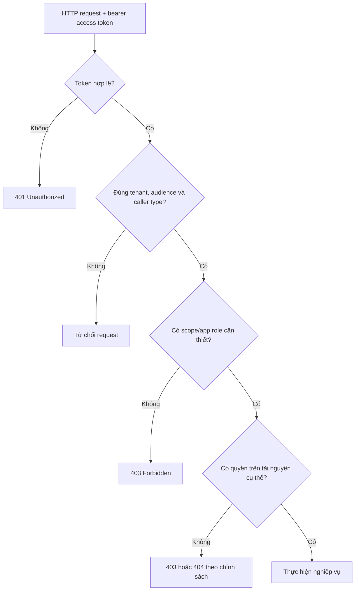

# Scope, application role và kiểm tra quyền trong ứng dụng

> **Chương:** Microsoft Entra ID  
> **Học phần:** SPRING_CLOUD_PROVIDER_INTEGRATION — thực hành tích hợp Spring Boot với dịch vụ managed của AWS, Azure và Google Cloud qua các thư viện Spring Cloud tương ứng. Bài này tập trung thiết kế quyền cho API và kiểm tra quyền trong ứng dụng Spring Boot.

Một nhân viên có thể đăng nhập thành công vào portal nhưng vẫn không được phép phê duyệt hóa đơn. Một worker có thể được phép gọi API để chạy đối soát mà không có người dùng đăng nhập. Cả hai request đều có thể mang access token hợp lệ, nhưng quyền của chúng khác nhau.

Microsoft Entra ID cung cấp hai cơ chế quan trọng để biểu diễn quyền API: **delegated scopes** cho client hành động thay mặt người dùng và **application roles/application permissions** cho ứng dụng hoặc vai trò người dùng. Spring Security đọc các claim trong access token, ánh xạ thành authority và áp dụng chính sách ở URL, method và tầng nghiệp vụ.

Bài học này giúp bạn thiết kế permission model từ yêu cầu nghiệp vụ, cấu hình scope/app role trong Entra, kiểm tra claim scp/roles, và xây dựng authorization nhiều lớp trong Spring Boot. Trọng tâm là xác định đúng **ai đang gọi**, **được làm hành động nào**, và **trên tài nguyên nào**.

## 1. Mục tiêu học tập

Sau bài này, bạn có thể:

1. Phân biệt authentication và authorization; giải thích vì sao đăng nhập thành công chưa đồng nghĩa có quyền nghiệp vụ.
2. Thiết kế delegated scopes theo hành động API và application roles theo vai trò/workload.
3. Cấu hình scope và app role trong app registration của API.
4. Mô tả consent, app role assignment và cách quyền xuất hiện trong access token.
5. Phân biệt claim scp với roles, kể cả trường hợp user token có cả hai.
6. Ánh xạ scopes/roles thành Spring GrantedAuthority với tiền tố rõ ràng.
7. Bảo vệ endpoint bằng SecurityFilterChain, @PreAuthorize và kiểm tra quyền theo từng bản ghi.
8. Thiết kế tenant isolation và tránh cấp quyền dựa trên email, header do client tự gửi hoặc dữ liệu chưa xác minh.
9. Kiểm thử trường hợp được phép, thiếu scope, thiếu role và không sở hữu tài nguyên.
10. Quản lý vòng đời permission, consent và role assignment theo nguyên tắc least privilege.

## 2. Authentication và authorization giải quyết hai câu hỏi khác nhau

**Authentication (xác thực)** trả lời: “Caller là ai và token có đáng tin cậy không?”. Với Entra, Spring Resource Server xác minh chữ ký, issuer, audience và thời hạn của access token.

**Authorization (ủy quyền/phân quyền)** trả lời: “Caller được phép thực hiện hành động nào trên tài nguyên nào?”. Sau khi xác thực, API kiểm tra scope, app role, vai trò nội bộ, quyền sở hữu và chính sách nghiệp vụ.

Ví dụ hệ thống hóa đơn:

- Alice đăng nhập thành công bằng Entra: authentication thành công.
- Alice có scope Invoices.Read: client được phép gọi API đọc hóa đơn thay mặt Alice.
- Alice được gán app role Invoice.Approver: ứng dụng có thể cho Alice dùng chức năng phê duyệt.
- Alice chỉ được phê duyệt hóa đơn thuộc đơn vị của mình: API còn phải kiểm tra quyền trên từng invoice.
- Worker invoice-reconcile có app role Invoice.Batch.Process: worker được phép gọi endpoint đối soát app-only.

Không có một claim duy nhất nào thay thế mọi lớp kiểm tra này.

### Mô hình quyết định quyền



Đây là mô hình khái quát. Thứ tự kiểm tra trong code có thể khác, nhưng API phải giữ được các ranh giới tin cậy: token, tenant, permission và quyền trên tài nguyên.

## 3. Delegated scope là gì?

**Delegated permission** cho phép một client gọi API thay mặt người dùng đã đăng nhập. Scope mô tả hành động mà client được phép yêu cầu trên API, ví dụ:

- Invoices.Read: đọc hóa đơn.
- Invoices.Write: tạo hoặc cập nhật hóa đơn.
- Invoices.Submit: gửi hóa đơn vào quy trình xử lý.

API công bố các scope này trong app registration của chính API, tại **Expose an API**. Client application thêm delegated permission tương ứng trong **API permissions** và user/admin consent theo policy của tenant.

### Scope không phải vai trò người dùng

Scope trả lời “client được phép gọi loại API nào thay mặt user?”. Nó không nhất thiết nói Alice là kế toán, quản lý hay người phê duyệt. Hai người dùng có thể đăng nhập qua cùng client với cùng scope, nhưng quyền nghiệp vụ của họ vẫn khác nhau.

Ví dụ:

- Portal có delegated scope Invoices.Read.
- Alice có quyền xem hóa đơn thuộc phòng ban A.
- Bob có quyền xem hóa đơn thuộc phòng ban B.
- Cả hai token đều có Invoices.Read, nhưng API phải lọc dữ liệu theo user/tenant/ACL.

### Cấu hình scope trong Entra

Trong app registration của API:

1. Mở **Expose an API**.
2. Đặt Application ID URI, ví dụ api://<INVOICE_API_CLIENT_ID>.
3. Chọn **Add a scope**.
4. Đặt scope name Invoices.Read.
5. Cung cấp consent display name và description dễ hiểu cho administrator/user.
6. Chọn trạng thái enabled và lưu.

Client yêu cầu scope đầy đủ:

```text
api://<INVOICE_API_CLIENT_ID>/Invoices.Read
```

Trong access token delegated dành cho API, Entra thường phát hành claim scp chứa các scope đã được cấp, phân tách bằng dấu cách:

```json
{
  "aud": "33333333-3333-3333-3333-333333333333",
  "scp": "Invoices.Read Invoices.Submit",
  "tid": "11111111-1111-1111-1111-111111111111",
  "oid": "22222222-2222-2222-2222-222222222222"
}
```

Đây là payload minh họa đã rút gọn, không phải token dùng thật. Resource Server phải xác minh chữ ký và các claim bảo mật trước khi tin bất kỳ dữ liệu nào trong payload.

### Consent có ý nghĩa gì?

- User consent ghi nhận người dùng chấp thuận delegated permission nếu tenant policy cho phép.
- Admin consent ghi nhận administrator chấp thuận permission thay mặt tenant.
- Tenant có thể giới hạn hoặc tắt user consent; khi đó client cần quy trình admin approval.
- Scope được định nghĩa trong app registration của API, còn client khai báo permission mà nó yêu cầu.

Consent không đồng nghĩa mọi user đều được phép truy cập mọi bản ghi. API vẫn phải kiểm tra quyền nghiệp vụ và dữ liệu.

## 4. Application role và application permission là gì?

**App role** là role do ứng dụng/API định nghĩa. Role có thể được gán cho user, group hoặc application tùy allowedMemberTypes. Khi được gán phù hợp, Entra có thể đưa giá trị role vào claim roles trong token.

Có hai cách dùng thường gặp:

1. **User app role:** gán cho người dùng/nhóm để biểu diễn vai trò nghiệp vụ trong ứng dụng, ví dụ Invoice.Approver hoặc Invoice.Admin.
2. **Application permission:** gán cho service principal của một client application để workload gọi API không cần user, ví dụ Invoice.Batch.Process.

### Định nghĩa app role trong app registration

Trong app registration của API, mở **App roles** và tạo role. Ví dụ:

| Thuộc tính | Role cho người dùng | Role cho workload |
|---|---|---|
| Display name | Invoice approver | Process invoice batches |
| Value | Invoice.Approver | Invoice.Batch.Process |
| Allowed member types | Users/Groups | Applications |
| Description | Được phép phê duyệt hóa đơn | Được phép chạy đối soát theo lô |
| Enabled | Yes | Yes |

allowedMemberTypes thường dùng User và/hoặc Application. Trong portal, lựa chọn Users/Groups cho phép gán role cho user/group; Applications cho phép cấp role như application permission cho service principal của client.

Nếu cùng một nghiệp vụ có cả người dùng và workload, nên định nghĩa role riêng theo principal type và mục đích. Không dùng một tên role mơ hồ cho cả user và daemon nếu API cần phân biệt rõ hai loại caller.

### Cấp application permission cho client

Ví dụ worker cần gọi Invoice API:

1. API định nghĩa app role Invoice.Batch.Process với member type Applications.
2. App registration của worker mở **API permissions**.
3. Chọn **Add a permission → My APIs → Invoice API → Application permissions**.
4. Chọn role Invoice.Batch.Process.
5. Tenant admin cấp **Grant admin consent**.
6. Xác minh service principal của worker có app role assignment tới service principal của API.

Worker yêu cầu token bằng client credentials với scope resource:

```text
api://<INVOICE_API_CLIENT_ID>/.default
```

/.default yêu cầu các application permissions đã cấu hình và được consent cho resource. Nó không tự tạo role assignment và không phải quyền wildcard.

Trong app-only access token, quyền ứng dụng thường nằm trong claim roles; claim scp thường không xuất hiện vì không có user-delegated context.

### App role không tự cấp Azure RBAC

App role là quyền trên API theo hợp đồng token. Azure RBAC là cơ chế cấp quyền tới Azure resource như Blob Storage, Key Vault hoặc Service Bus. Nếu worker có Invoice.Batch.Process nhưng cần đọc Blob, managed identity/service principal của workload vẫn phải được cấp role data-plane phù hợp trên Storage.

## 5. Phân biệt scope, app role và Azure RBAC

| Cơ chế | Được định nghĩa/cấp ở đâu? | Principal | Claim/token | Ví dụ |
|---|---|---|---|---|
| Delegated scope | Expose an API, API permissions và consent | Client + user | scp | Invoices.Read |
| User app role | App roles và user/group assignment | User/group | roles | Invoice.Approver |
| Application permission | App roles của API, client API permission và admin consent | Service principal của client | roles trong app-only token | Invoice.Batch.Process |
| Azure RBAC | IAM/Access control trên Azure resource/scope | User, group, service principal hoặc managed identity | Không nhất thiết là claim roles của custom API | Storage Blob Data Reader |

Không lấy roles trong access token của Invoice API để kết luận caller có quyền đọc Azure Blob. Storage thực hiện authorization theo role assignment và policy của resource.

## 6. scp và roles có thể cùng xuất hiện trong user token

Một lỗi thiết kế phổ biến là giả định:

- Có scp thì chỉ có scope, không có role.
- Có roles thì chắc chắn là app-only.

Hai giả định này đều không an toàn.

Delegated access token có thể chứa:

- scp: delegated scopes mà client được cấp.
- roles: app role được gán cho user trên API.

Application access token thường chứa:

- roles: application permissions được cấp cho service principal.
- Không có scp vì không có user context.

Vì vậy, API cần xem token context và hợp đồng quyền. Nếu endpoint chỉ cho app-only, hãy cấu hình optional claim idtyp trong access token và yêu cầu giá trị app, đồng thời kiểm tra application role và client allowlist nếu cần. Không suy luận loại caller chỉ từ roles hoặc sự vắng mặt của scp.

### Claim minh họa

User token có delegated scope và user app role:

```json
{
  "aud": "33333333-3333-3333-3333-333333333333",
  "tid": "11111111-1111-1111-1111-111111111111",
  "oid": "22222222-2222-2222-2222-222222222222",
  "scp": "Invoices.Read",
  "roles": ["Invoice.Approver"],
  "azp": "44444444-4444-4444-4444-444444444444"
}
```

App-only token:

```json
{
  "aud": "33333333-3333-3333-3333-333333333333",
  "tid": "11111111-1111-1111-1111-111111111111",
  "oid": "55555555-5555-5555-5555-555555555555",
  "roles": ["Invoice.Batch.Process"],
  "idtyp": "app",
  "azp": "66666666-6666-6666-6666-666666666666"
}
```

Các GUID và claim trong ví dụ chỉ mang tính minh họa. Token thật còn có iss, exp, nbf, ver và các claim khác tùy cấu hình.

## 7. Thiết kế permission model từ nghiệp vụ

Trước khi tạo scope/role, liệt kê hành động API và caller hợp lệ. Không bắt đầu bằng việc tạo một role Admin rồi dùng nó cho mọi endpoint.

### Ví dụ permission catalog

| Hành động nghiệp vụ | Caller dự kiến | Permission | Kiểm tra bổ sung |
|---|---|---|---|
| Xem danh sách hóa đơn | Nhân viên qua portal | Delegated scope Invoices.Read | Chỉ trả hóa đơn trong tenant/đơn vị được phép |
| Tạo hóa đơn | Nhân viên qua portal | Delegated scope Invoices.Write | Kiểm tra trạng thái và dữ liệu đầu vào |
| Phê duyệt hóa đơn | Người có vai trò approver | Scope Invoices.Submit + app role Invoice.Approver | Kiểm tra hạn mức, người tạo và workflow |
| Chạy đối soát theo lô | Worker app-only | Application role Invoice.Batch.Process | Chỉ chấp nhận app-only token từ worker đã đăng ký |
| Quản lý cấu hình API | Quản trị viên | User app role Invoice.Admin | Audit mọi thay đổi |

Đây là ví dụ thiết kế; tên quyền phải phản ánh hành vi thực tế của API. Scope thường thể hiện quyền gọi chức năng, app role thể hiện vai trò/permission được gán cho principal. Một API có thể chỉ dùng scope, chỉ dùng app role, hoặc kết hợp nếu có lý do rõ ràng.

### Quy tắc đặt tên

- Dùng tên ngắn, ổn định, theo hành động: Invoices.Read, Invoices.Write, Invoices.Submit.
- App role cho user biểu thị trách nhiệm: Invoice.Approver, Invoice.Admin.
- App role cho workload biểu thị tác vụ: Invoice.Batch.Process, Invoice.Export.Run.
- Tránh tên mơ hồ như FullAccess, PowerUser nếu không có mô tả phạm vi.
- Không tái sử dụng cùng một giá trị role cho hai ý nghĩa khác nhau.
- Viết description nêu rõ hành động, phạm vi dữ liệu và loại principal được phép.

### Least privilege

Mỗi client chỉ yêu cầu permission cần thiết. Portal đọc hóa đơn không cần application permission để xóa hóa đơn. Worker đối soát không cần quyền quản trị người dùng. Administrator không nên dùng credential của daemon để thực hiện thao tác tương tác.

Tách app registration giữa frontend, API và worker khi giúp giảm credential sharing, permission sprawl và blast radius.

## 8. Ánh xạ scope và app role vào Spring Security

Spring Resource Server xác minh JWT rồi chuyển token thành JwtAuthenticationToken. JwtGrantedAuthoritiesConverter có thể ánh xạ scope; ta bổ sung converter cho claim roles.

Trong Entra delegated token, scope thường được phát hành dưới claim scp. Cấu hình rõ claim này để authority có dạng SCOPE_.... App role được ánh xạ thành APPROLE_... để không nhầm với scope.

### Converter kết hợp

```java
package com.example.invoice.security;

import java.util.ArrayList;
import java.util.Collection;
import java.util.List;

import org.springframework.context.annotation.Bean;
import org.springframework.context.annotation.Configuration;
import org.springframework.core.convert.converter.Converter;
import org.springframework.security.core.GrantedAuthority;
import org.springframework.security.core.authority.SimpleGrantedAuthority;
import org.springframework.security.oauth2.jwt.Jwt;
import org.springframework.security.oauth2.server.resource.authentication.JwtAuthenticationConverter;
import org.springframework.security.oauth2.server.resource.authentication.JwtGrantedAuthoritiesConverter;

@Configuration
public class EntraAuthorityConfiguration {

    @Bean
    JwtAuthenticationConverter entraJwtAuthenticationConverter() {
        JwtGrantedAuthoritiesConverter scopeConverter =
                new JwtGrantedAuthoritiesConverter();
        scopeConverter.setAuthoritiesClaimName("scp");
        scopeConverter.setAuthorityPrefix("SCOPE_");

        Converter<Jwt, Collection<GrantedAuthority>> combined = jwt -> {
            Collection<GrantedAuthority> result = new ArrayList<>();

            Collection<GrantedAuthority> scopes = scopeConverter.convert(jwt);
            if (scopes != null) {
                result.addAll(scopes);
            }

            List<String> roles = jwt.getClaimAsStringList("roles");
            if (roles != null) {
                roles.stream()
                        .map(role -> new SimpleGrantedAuthority("APPROLE_" + role))
                        .forEach(result::add);
            }

            return result;
        };

        JwtAuthenticationConverter converter = new JwtAuthenticationConverter();
        converter.setJwtGrantedAuthoritiesConverter(combined);
        return converter;
    }
}
```

Kết quả ánh xạ:

| Claim trong token | Giá trị | Spring authority |
|---|---|---|
| scp | Invoices.Read | SCOPE_Invoices.Read |
| scp | Invoices.Write | SCOPE_Invoices.Write |
| roles | Invoice.Approver | APPROLE_Invoice.Approver |
| roles | Invoice.Batch.Process | APPROLE_Invoice.Batch.Process |

Converter không tự cấp quyền khi claim vắng mặt. Nó chỉ chuyển quyền đã được token mang theo sau khi JWT được xác minh.

### Gắn converter vào Resource Server

```java
import org.springframework.context.annotation.Bean;
import org.springframework.context.annotation.Configuration;
import org.springframework.security.config.annotation.web.builders.HttpSecurity;
import org.springframework.security.config.http.SessionCreationPolicy;
import org.springframework.security.oauth2.server.resource.authentication.JwtAuthenticationConverter;
import org.springframework.security.web.SecurityFilterChain;

@Configuration
public class ApiSecurityConfiguration {

    @Bean
    SecurityFilterChain apiSecurity(
            HttpSecurity http,
            JwtAuthenticationConverter entraJwtAuthenticationConverter)
            throws Exception {

        http
            .securityMatcher("/api/**")
            .csrf(csrf -> csrf.disable())
            .sessionManagement(session -> session
                .sessionCreationPolicy(SessionCreationPolicy.STATELESS))
            .authorizeHttpRequests(authorize -> authorize
                .requestMatchers("/api/public/**").permitAll()
                .requestMatchers("/api/invoices/**")
                    .hasAuthority("SCOPE_Invoices.Read")
                .requestMatchers("/api/approvals/**")
                    .hasAuthority("APPROLE_Invoice.Approver")
                .requestMatchers("/api/jobs/**")
                    .hasAuthority("APPROLE_Invoice.Batch.Process")
                .anyRequest().authenticated())
            .oauth2ResourceServer(oauth2 -> oauth2
                .jwt(jwt -> jwt.jwtAuthenticationConverter(
                        entraJwtAuthenticationConverter)));

        return http.build();
    }
}
```

Đây là chain minh họa cho API bearer-only. Nếu ứng dụng có browser session hoặc endpoint ngoài /api/**, cần một chain khác bao phủ các request còn lại. Chỉ tắt CSRF khi API không dựa vào cookie/session để xác thực; giữ CSRF protection cho web application dùng session.

### hasRole hay hasAuthority?

- hasAuthority("APPROLE_Invoice.Approver") so sánh đúng chuỗi authority.
- hasRole("Invoice.Approver") tự thêm tiền tố ROLE_, tức kiểm tra ROLE_Invoice.Approver.

Vì converter ở đây dùng tiền tố APPROLE_, hãy dùng hasAuthority hoặc đổi quy ước prefix một cách nhất quán. Tránh vừa thêm ROLE_ trong converter vừa truyền chuỗi đã có prefix vào hasRole.

## 9. Kiểm tra quyền ở URL và method

URL authorization là lớp bảo vệ đầu tiên, phù hợp với nhóm endpoint:

```java
authorize
    .requestMatchers(HttpMethod.GET, "/api/invoices/**")
        .hasAuthority("SCOPE_Invoices.Read")
    .requestMatchers(HttpMethod.POST, "/api/invoices/**")
        .hasAuthority("SCOPE_Invoices.Write")
    .requestMatchers("/api/approvals/**")
        .hasAuthority("APPROLE_Invoice.Approver")
    .requestMatchers("/api/jobs/**")
        .hasAuthority("APPROLE_Invoice.Batch.Process")
    .anyRequest().authenticated();
```

Đoạn trên giả định đã import org.springframework.http.HttpMethod và nằm trong DSL authorizeHttpRequests. Dùng method-specific matcher để GET không vô tình được coi giống POST.

Method security giúp đặt chính sách gần nghiệp vụ:

```java
import org.springframework.security.access.prepost.PreAuthorize;
import org.springframework.stereotype.Service;

@Service
public class InvoiceApprovalService {

    @PreAuthorize("hasAuthority('APPROLE_Invoice.Approver')")
    public void approve(String invoiceId) {
        // Thực hiện kiểm tra trạng thái, hạn mức và workflow trước khi duyệt.
    }
}
```

Bật method security:

```java
import org.springframework.context.annotation.Configuration;
import org.springframework.security.config.annotation.method.configuration.EnableMethodSecurity;

@Configuration
@EnableMethodSecurity
public class MethodSecurityConfiguration {
}
```

Method security không thay thế kiểm tra dữ liệu cụ thể. Role approver chỉ cho biết người dùng có trách nhiệm phê duyệt nói chung; nghiệp vụ vẫn phải kiểm tra hóa đơn có đang ở trạng thái chờ duyệt, có thuộc phạm vi của người duyệt và có nằm trong hạn mức hay không.

## 10. Kiểm tra quyền trên từng tài nguyên

Scope và app role thường là quyền ở mức API/chức năng. Ứng dụng còn phải kiểm tra quyền trên object cụ thể (object-level authorization).

Ví dụ:

- Alice có SCOPE_Invoices.Read, nhưng chỉ được đọc hóa đơn thuộc tenant và đơn vị của Alice.
- Bob có APPROLE_Invoice.Approver, nhưng không được phê duyệt hóa đơn do chính Bob tạo.
- Worker có APPROLE_Invoice.Batch.Process, nhưng chỉ được xử lý batch của tenant đã cấu hình.

### Lấy định danh từ principal đã xác minh

Trong Resource Server, principal có thể là Jwt. Dùng tid và oid sau khi decoder đã xác minh token:

```java
import org.springframework.security.core.annotation.AuthenticationPrincipal;
import org.springframework.security.oauth2.jwt.Jwt;
import org.springframework.web.bind.annotation.GetMapping;
import org.springframework.web.bind.annotation.PathVariable;
import org.springframework.web.bind.annotation.RestController;

@RestController
public class InvoiceController {

    private final InvoiceQueryService invoiceQueryService;

    public InvoiceController(InvoiceQueryService invoiceQueryService) {
        this.invoiceQueryService = invoiceQueryService;
    }

    @GetMapping("/api/invoices/{invoiceId}")
    public InvoiceView getInvoice(
            @PathVariable String invoiceId,
            @AuthenticationPrincipal Jwt jwt) {

        String tenantId = jwt.getClaimAsString("tid");
        String subjectObjectId = jwt.getClaimAsString("oid");
        return invoiceQueryService.findVisibleInvoice(
                tenantId, subjectObjectId, invoiceId);
    }
}
```

Đoạn controller minh họa cần có kiểu InvoiceView và InvoiceQueryService trong ứng dụng. Không nhận tenantId hoặc userId từ query/header do client tự gửi để thay thế principal. Nếu request có X-Tenant-ID, chỉ dùng nó như một selector sau khi xác minh caller được phép chọn tenant đó; không coi header là bằng chứng danh tính.

### Đưa điều kiện tenant vào truy vấn dữ liệu

Ví dụ service:

```java
import org.springframework.stereotype.Service;

@Service
public class InvoiceQueryService {

    private final InvoiceRepository repository;

    public InvoiceQueryService(InvoiceRepository repository) {
        this.repository = repository;
    }

    public InvoiceView findVisibleInvoice(
            String tenantId, String subjectId, String invoiceId) {

        return repository
                .findByTenantIdAndIdAndAllowedSubject(
                        tenantId, invoiceId, subjectId)
                .orElseThrow(InvoiceNotFoundException::new);
    }
}
```

Tên repository method là minh họa; triển khai thực tế cần join ACL/organization membership theo mô hình dữ liệu. Đưa tenant condition vào truy vấn giúp tránh tải nhầm bản ghi rồi quên kiểm tra ở một nhánh code khác.

Tùy chính sách, API có thể trả 404 khi bản ghi không thuộc phạm vi để tránh tiết lộ sự tồn tại của tài nguyên, hoặc trả 403 khi được phép tiết lộ tài nguyên nhưng caller thiếu quyền. Chọn nhất quán và không dùng status code thay cho authorization thật.

## 11. Phân biệt user role và application role trong API

Nếu endpoint chỉ dành cho người dùng, chỉ kiểm tra APPROLE_Invoice.Approver có thể chưa đủ khi API cũng cấp role cho application. Nếu role đó chỉ cho Users/Groups, thì app-only principal không thể được gán role này; đây là cách tách đơn giản.

Nếu một role được phép cho cả Users/Groups và Applications, cần kiểm tra thêm caller type. Có thể cấu hình optional claim idtyp để API nhận biết app-only token:

- idtyp=app: token app-only.
- Claim không có hoặc có giá trị khác: không được tự suy đoán; xử lý theo token contract đã định nghĩa.

Ví dụ kiểm tra caller type trong tầng nghiệp vụ:

```java
import org.springframework.security.access.AccessDeniedException;
import org.springframework.security.core.Authentication;
import org.springframework.security.oauth2.server.resource.authentication.JwtAuthenticationToken;
import org.springframework.stereotype.Component;

@Component("callerPolicy")
public class CallerPolicy {

    public boolean isApplicationCaller(Authentication authentication) {
        if (!(authentication instanceof JwtAuthenticationToken jwtAuth)) {
            return false;
        }

        String idtyp = jwtAuth.getToken().getClaimAsString("idtyp");
        return "app".equals(idtyp);
    }

    public void requireApplicationCaller(Authentication authentication) {
        if (!isApplicationCaller(authentication)) {
            throw new AccessDeniedException("Application caller required");
        }
    }
}
```

Có thể dùng trong method security:

```java
@PreAuthorize("""
    hasAuthority('APPROLE_Invoice.Batch.Process')
    and @callerPolicy.isApplicationCaller(authentication)
    """)
public void reconcileBatch(String batchId) {
    // Chỉ workload app-only có role phù hợp mới được chạy.
}
```

Đây là ví dụ minh họa cú pháp Java text block và Spring method security; cần bảo đảm idtyp thực sự được cấu hình phát hành trong access token của API. Nếu claim không xuất hiện, biểu thức trả false và request bị từ chối.

## 12. Tenant isolation và multi-tenant authorization

Trong SaaS multi-tenant, token hợp lệ từ tenant A không được phép truy cập dữ liệu tenant B chỉ vì cùng có scope Invoices.Read.

API cần:

1. Xác minh issuer và audience.
2. Kiểm tra tid nằm trong danh sách tenant đã onboarding.
3. Ánh xạ tenant ID tới tenant/customer record nội bộ.
4. Dùng tenant ID trong mọi truy vấn dữ liệu tenant-scoped.
5. Kiểm tra user membership/role trong tenant đó.
6. Không tin tenant ID do browser/client gửi lên nếu không khớp principal đã xác minh.
7. Có quy trình suspend tenant, thu hồi consent và chặn token/permission khi khách hàng ngừng dịch vụ.

Với guest user, cùng một người có thể có object ID khác nhau trong home tenant và resource tenant. Authorization phải theo tenant phát hành token và danh tính local tương ứng. Không ghép user giữa tenant chỉ bằng email.

### Không dùng group claim một cách ngây thơ

Entra có thể phát hành group claims cho user, nhưng khi user thuộc quá nhiều group, token có thể dùng overage indicator thay cho danh sách đầy đủ. API không được mặc định claim groups luôn chứa mọi group membership. Nếu authorization dựa trên group:

- Xác định rõ group ID và tenant.
- Xử lý overage theo quy trình phù hợp, có thể truy vấn Microsoft Graph với delegated permission thích hợp.
- Cache kết quả có thời hạn và invalidation phù hợp.
- Tránh cấp quyền chỉ vì một tên group do client gửi lên.

App role thường tạo permission contract rõ hơn cho ứng dụng; group phù hợp khi tổ chức muốn quản lý membership tập trung. Chọn theo nhu cầu vận hành.

## 13. Kiểm thử authorization

Một test chỉ xác minh “token hợp lệ trả 200” là chưa đủ. Cần test cả đường được phép và đường bị từ chối.

### 13.1. Test delegated scope

Thêm spring-security-test ở test scope. Ví dụ MockMvc:

```java
import static org.springframework.security.test.web.servlet.request
        .SecurityMockMvcRequestPostProcessors.jwt;
import static org.springframework.test.web.servlet.request.MockMvcRequestBuilders.get;
import static org.springframework.test.web.servlet.result.MockMvcResultMatchers.status;

import org.junit.jupiter.api.Test;
import org.springframework.beans.factory.annotation.Autowired;
import org.springframework.boot.test.autoconfigure.web.servlet.AutoConfigureMockMvc;
import org.springframework.boot.test.context.SpringBootTest;
import org.springframework.test.web.servlet.MockMvc;

@SpringBootTest
@AutoConfigureMockMvc
class InvoiceAuthorizationTest {

    @Autowired
    MockMvc mvc;

    @Test
    void allowsReadScope() throws Exception {
        mvc.perform(get("/api/invoices")
                .with(jwt().jwt(token -> token
                        .claim("scp", "Invoices.Read")
                        .claim("tid", "11111111-1111-1111-1111-111111111111")
                        .claim("oid", "22222222-2222-2222-2222-222222222222"))))
                .andExpect(status().isOk());
    }

    @Test
    void deniesTokenWithoutReadScope() throws Exception {
        mvc.perform(get("/api/invoices")
                .with(jwt().jwt(token -> token
                        .claim("scp", "Profile.Read"))))
                .andExpect(status().isForbidden());
    }
}
```

### 13.2. Test user role và app-only role

Ví dụ kiểm tra endpoint phê duyệt:

```java
@Test
void allowsApproverRole() throws Exception {
    mvc.perform(post("/api/approvals/INV-100/approve")
            .with(jwt().jwt(token -> token
                    .claim("roles", List.of("Invoice.Approver"))))
            .andExpect(status().isOk());
}

@Test
void deniesWorkerRoleOnApprovalEndpoint() throws Exception {
    mvc.perform(post("/api/approvals/INV-100/approve")
            .with(jwt().jwt(token -> token
                    .claim("roles", List.of("Invoice.Batch.Process"))
                    .claim("idtyp", "app"))))
            .andExpect(status().isForbidden());
}
```

Đây là ví dụ bổ sung cho class test ở trên; thêm import MockMvcRequestBuilders.post và java.util.List nếu ghép vào cùng file. User token không cần giả định có claim idtyp=user; claim idtyp=app là tín hiệu tùy chọn để nhận diện app-only token. Các request post thay đổi dữ liệu còn cần CSRF token nếu test chain có bật CSRF; ví dụ API bearer-only tắt CSRF theo đúng ranh giới đã mô tả ở bài Resource Server.

Mock jwt() kiểm tra authorization logic và authority mapping. Nó không xác minh chữ ký, issuer, audience, exp, nbf hay consent thật. Cần integration test với token từ tenant test để kiểm tra decoder và Entra configuration.

### 13.3. Ma trận test tối thiểu

| Caller | Claim/quyền | Endpoint | Kết quả mong đợi |
|---|---|---|---|
| User có scope đọc | scp=Invoices.Read | GET /api/invoices | 200 nếu ACL cho phép |
| User thiếu scope đọc | scp=Profile.Read | GET /api/invoices | 403 |
| User có role approver | roles=Invoice.Approver | POST /api/approvals/** | Qua bước role; vẫn kiểm tra workflow |
| User chỉ có role approver | Không có scope đọc | GET /api/invoices | 403 nếu endpoint yêu cầu scope |
| Worker có app role | roles=Invoice.Batch.Process, idtyp=app | POST /api/jobs/** | 202/200 theo hợp đồng |
| Worker chỉ có app role | Không có Invoice.Approver | POST /api/approvals/** | 403 |
| User role đúng nhưng sai tenant | tid không được phép | Bất kỳ tenant-scoped endpoint | Từ chối |
| User role đúng nhưng không sở hữu invoice | Scope/role hợp lệ | GET invoice cụ thể | 403 hoặc 404 theo policy |
| Token sai audience | aud là API khác | Bất kỳ protected endpoint | 401 |

## 14. 401, 403 và lỗi nghiệp vụ

| Trạng thái | Ý nghĩa | Ví dụ |
|---|---|---|
| 401 Unauthorized | Không xác thực được caller | Thiếu token, token hết hạn, chữ ký/issuer/audience sai |
| 403 Forbidden | Token hợp lệ nhưng thiếu permission | Thiếu delegated scope hoặc app role |
| 403/404 theo policy | Có permission API nhưng không có quyền trên object | Invoice thuộc tenant/đơn vị khác |
| 409 Conflict | Caller có quyền nhưng thao tác không hợp lệ với trạng thái nghiệp vụ | Hóa đơn đã được duyệt hoặc không còn ở trạng thái chờ duyệt |

Không biến lỗi nghiệp vụ thành 401. Không yêu cầu user đăng nhập lại khi vấn đề là thiếu scope/role. Không trả dữ liệu nhạy cảm trong error body để giải thích vì sao tài nguyên tồn tại.

## 15. Quản lý permission trong suốt vòng đời ứng dụng

Permission model thay đổi cùng sản phẩm. Cần quản trị từ lúc thiết kế đến lúc thu hồi:

### Khi thêm permission

1. Ghi rõ use case và caller type.
2. Xác định scope hay app role phù hợp.
3. Định nghĩa tên, mô tả và allowed member types.
4. Cập nhật client API permissions và consent plan.
5. Cập nhật Spring authority mapping và authorization rules.
6. Thêm test positive/negative.
7. Triển khai theo versioning/deprecation policy.

### Khi đổi hoặc thu hồi permission

- Không đổi ý nghĩa của scope/role đang được client sử dụng mà không có kế hoạch tương thích.
- Thông báo client owner và administrator trước khi thu hồi.
- Gỡ permission khỏi client registrations không còn cần.
- Thu hồi consent hoặc app role assignment khi workload ngừng sử dụng.
- Kiểm tra access token đã phát hành có thể còn hiệu lực đến khi hết hạn; không giả định xóa assignment làm token đang tồn tại biến mất ngay lập tức.
- Với sự cố cần thu hồi khẩn cấp, áp dụng biện pháp chặn phù hợp ở API/tenant, rút ngắn token lifetime theo khả năng chính sách và xử lý session/cache liên quan.

### Audit và review

Định kỳ rà soát:

- Client nào đang yêu cầu scope của API?
- Service principal nào được cấp application role?
- User/group nào có role quản trị/phê duyệt?
- Permission nào không còn được sử dụng?
- Tenant nào đã ngừng onboarding?
- Có credential hoặc client không còn owner không?
- Các thay đổi quyền có được audit và phê duyệt?

Không cấp role rộng để xử lý tạm thời một lỗi 403 mà không xác định nguyên nhân.

## 16. Những lỗi thiết kế thường gặp

| Lỗi | Hậu quả | Cách khắc phục |
|---|---|---|
| Coi scope là role nghiệp vụ | Hai user cùng scope bị cấp quyền dữ liệu giống nhau ngoài ý muốn | Kiểm tra app role và ACL/resource ownership |
| Coi mọi claim roles là app-only | User token có role bị phân loại sai | Kiểm tra caller type, idtyp và member type |
| Dùng một role Admin cho mọi chức năng | Quyền quá rộng, khó audit | Chia role theo nhiệm vụ và phạm vi |
| Chỉ kiểm tra scope ở URL | User có thể đọc object ngoài phạm vi | Thêm object-level authorization và tenant filter |
| Tin X-User-ID hoặc X-Tenant-ID | Caller giả mạo danh tính/tenant | Lấy subject/tenant từ token đã xác minh |
| Dùng email làm khóa user | Email đổi hoặc trùng giữa tenant | Dùng tid + oid hoặc iss + sub |
| Gán Azure RBAC thay app role | Cấp quyền ở sai lớp | Xác định resource đích là API hay Azure service |
| Tắt CSRF cho cả ứng dụng | Web session có thể bị tấn công CSRF | Chỉ tắt cho bearer-only chain |
| Không test quyền bị từ chối | Lỗi mapping có thể mở endpoint ngoài dự kiến | Test thiếu scope/role/tenant/ownership |
| Cho phép mọi tenant | Tenant ngoài dự kiến truy cập SaaS | Onboarding và allowlist tenant |
| Cho token quyền dài hạn mà không review | Permission tồn tại sau khi use case kết thúc | Review consent/assignment và thu hồi định kỳ |

## 17. Bài tập thực hành

**Bối cảnh:** Xây Invoice API cho doanh nghiệp. Nhân viên đọc và gửi hóa đơn qua portal. Nhân viên có role approver mới được phê duyệt. Một worker chạy nền có quyền đối soát theo lô. API phục vụ nhiều đơn vị trong cùng tenant.

### Phần A — Thiết kế permission catalog

1. Liệt kê endpoint và hành động: đọc, tạo, gửi, phê duyệt, đối soát.
2. Chọn delegated scopes cho portal.
3. Định nghĩa user app role Invoice.Approver và Invoice.Admin.
4. Định nghĩa application role Invoice.Batch.Process cho worker.
5. Ghi rõ allowed member types, consent/assignment và caller hợp lệ cho từng endpoint.

### Phần B — Cấu hình Entra và Spring

1. Expose scopes trong app registration của API.
2. Tạo app roles với member types đúng.
3. Cấp delegated permission cho portal và application permission cho worker.
4. Cấu hình admin consent và xác minh service principal role assignment.
5. Ánh xạ scp thành SCOPE_..., roles thành APPROLE_....
6. Bảo vệ URL/method theo permission catalog.
7. Kiểm tra tid + oid và tenant/ownership trong service/repository.

### Phần C — Kiểm thử

1. Test user có scope đọc và user thiếu scope.
2. Test approver và user thường.
3. Test app-only worker với role đúng và role thiếu.
4. Test worker gọi endpoint chỉ dành cho approver.
5. Test user có scope nhưng đọc invoice thuộc tenant khác.
6. Test token sai audience và tenant không được phép.
7. Viết báo cáo nêu rõ request bị từ chối ở lớp nào: token, permission hay business authorization.

**Mẫu permission matrix:**

| Principal | GET invoice | POST invoice | Approve | Batch reconcile | Giới hạn dữ liệu |
|---|---|---|---|---|---|
| Nhân viên thường | Invoices.Read | Invoices.Write | Không | Không | Đơn vị của user |
| Approver | Invoices.Read | Theo policy | Invoice.Approver | Không | Phạm vi được phân công |
| Admin | Theo policy | Theo policy | Invoice.Admin | Theo policy | Theo tenant và audit |
| Worker | Không dùng delegated scope | Không | Không | Invoice.Batch.Process | Tenant/job được cấu hình |

**Tiêu chí đạt:** Permission model phân biệt rõ delegated scope, user app role, application permission và Azure RBAC; Spring Security ánh xạ đúng claim; API kiểm tra quyền ở cả chức năng và tài nguyên; test chứng minh caller không được vượt quyền đã cấp.

## Tài liệu tham khảo chính thức

1. [Microsoft identity platform — Scopes and permissions](https://learn.microsoft.com/entra/identity-platform/scopes-oidc): delegated scopes và consent.
2. [Microsoft identity platform — App roles](https://learn.microsoft.com/entra/identity-platform/howto-add-app-roles-in-apps): định nghĩa app role và assignment.
3. [Microsoft identity platform — Access token claims reference](https://learn.microsoft.com/entra/identity-platform/access-token-claims-reference): scp, roles, tid, oid, azp, appid.
4. [Microsoft identity platform — Client credentials flow](https://learn.microsoft.com/entra/identity-platform/v2-oauth2-client-creds-grant-flow): application permissions và /.default.
5. [Microsoft identity platform — Optional claims](https://learn.microsoft.com/entra/identity-platform/optional-claims-reference): cấu hình claim idtyp.
6. [Microsoft Entra — Assign users and groups to an application](https://learn.microsoft.com/entra/identity/enterprise-apps/assign-user-or-group-access-portal): gán user/group cho Enterprise application.
7. [Spring Security — JWT Resource Server](https://docs.spring.io/spring-security/reference/servlet/oauth2/resource-server/jwt.html): JWT authentication và authorities conversion.
8. [Spring Security — Method Security](https://docs.spring.io/spring-security/reference/servlet/authorization/method-security.html): @PreAuthorize và method authorization.
9. [Spring Security — Testing OAuth2](https://docs.spring.io/spring-security/reference/servlet/test/mockmvc/oauth2.html): kiểm thử JWT/OAuth2 trong MockMvc.

> **Ghi nhớ:** Delegated scope cho phép client gọi API thay mặt user; app role có thể đại diện vai trò người dùng hoặc application permission tùy member type và assignment. scp và roles là dữ liệu quyền trong token, nhưng API vẫn phải xác minh caller type, tenant và quyền trên tài nguyên cụ thể. Hãy thiết kế permission theo hành động nghiệp vụ, cấp tối thiểu và kiểm thử cả trường hợp bị từ chối.
