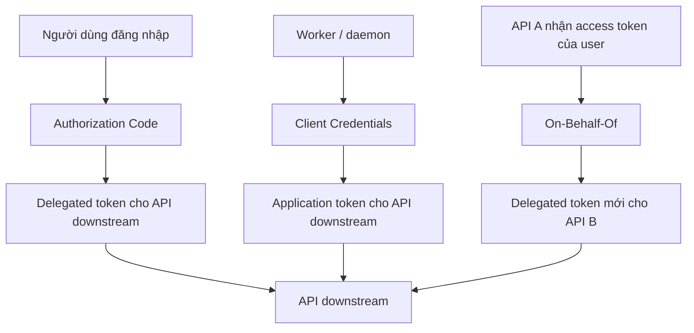
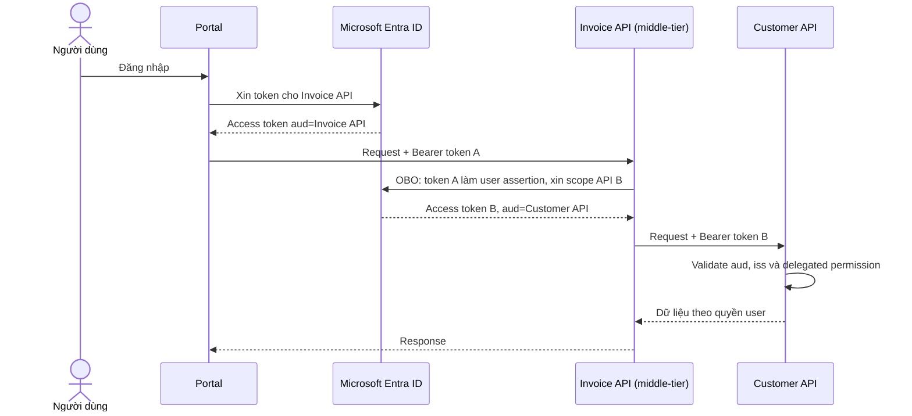

# Lấy token gọi API phía sau theo luồng phù hợp

> **Chương:** Microsoft Entra ID  
> **Học phần:** SPRING_CLOUD_PROVIDER_INTEGRATION — thực hành tích hợp Spring Boot với dịch vụ managed của AWS, Azure và Google Cloud qua các thư viện Spring Cloud tương ứng. Bài này tập trung lấy access token để Spring Boot gọi API downstream bằng đúng OAuth 2.0 flow.

Một ứng dụng Spring Boot thường không chỉ nhận request rồi trả response. Portal có thể cần đọc hồ sơ từ Microsoft Graph; Invoice API có thể gọi Customer API để lấy thông tin khách hàng; worker có thể gọi API đối soát theo lịch. Trong các trường hợp đó, ứng dụng phải lấy access token dành cho API đích, gửi token ở outbound request và quản lý việc cấp lại token khi cần.

Không có một OAuth flow phù hợp cho mọi tình huống. Nếu người dùng đã đăng nhập và ứng dụng gọi API thay mặt họ, dùng **Authorization Code với delegated permission**. Nếu một workload tự gọi API bằng quyền của chính ứng dụng, dùng **Client Credentials**. Nếu một API trung gian nhận token của người dùng rồi gọi API khác thay mặt người dùng đó, dùng **On-Behalf-Of (OBO)**.

Bài học triển khai ba tình huống này với Microsoft Entra ID và Spring Boot. Bạn sẽ dùng Spring Security OAuth2 Client/OAuth2AuthorizedClientManager cho các flow được hỗ trợ trực tiếp, dùng MSAL4J cho OBO, và hiểu cách cache/refresh token mà không tự quản lý chuỗi token thủ công.

## 1. Mục tiêu học tập

Sau bài này, bạn có thể:

1. Chọn đúng flow dựa trên việc có user context hay workload identity.
2. Phân biệt access token dành cho API downstream với ID token và token inbound của API hiện tại.
3. Cấu hình Entra app registration, delegated scope và application permission cho API đích.
4. Lấy delegated access token bằng OAuth2 Client trong Spring Security.
5. Dùng OAuth2AuthorizedClientManager để lấy và quản lý token cho client credentials.
6. Dùng MSAL4J thực hiện OBO khi middle-tier API cần gọi downstream API thay mặt user.
7. Gửi token qua Authorization: Bearer trong RestClient hoặc WebClient.
8. Hiểu token cache, refresh, consent, credential rotation và các lỗi downstream phổ biến.
9. Kiểm thử token acquisition và outbound API call mà không để lộ token/secret.

## 2. Chọn flow theo ngữ cảnh caller

Trước khi viết code, trả lời hai câu hỏi:

- Request có người dùng đã đăng nhập và cần giữ quyền của người dùng đó không?
- Hay một workload tự thực hiện công việc bằng quyền ứng dụng của chính nó?

| Tình huống | OAuth flow | Token đại diện cho | Permission chính |
|---|---|---|---|
| Web app đã đăng nhập, gọi Microsoft Graph thay mặt user | Authorization Code | User + client | Delegated scope |
| Worker chạy nền, không có user | Client Credentials | Application/service principal | Application permission/app role |
| API A nhận access token của user, rồi gọi API B thay mặt user | On-Behalf-Of | User qua middle-tier API | Delegated permission tới API B |
| SPA gọi API trực tiếp | Authorization Code + PKCE ở public client | User + client | Delegated scope |

Không dùng Client Credentials chỉ vì muốn tránh màn hình đăng nhập khi nghiệp vụ thực sự cần danh tính và quyền của user. Ngược lại, không dùng OBO cho worker không có user assertion.

### Sơ đồ ba luồng chính



Mỗi flow tạo token cho một resource/audience cụ thể. Việc có token hợp lệ cho API A không có nghĩa token đó được dùng ở API B.

## 3. Những khái niệm cần phân biệt

| Khái niệm | Ý nghĩa |
|---|---|
| ID token | Cho OIDC client biết user đã xác thực; không dùng làm bearer token gọi API |
| Access token | Token được phát cho resource/API cụ thể |
| Delegated permission | Client gọi API thay mặt user |
| Application permission | Workload gọi API bằng quyền của chính application |
| Audience (aud) | API/resource được nhận token |
| Scope (scp) | Delegated permission được cấp cho API |
| App role (roles) | Role/permission được gán cho user hoặc application tùy cấu hình |
| Authorized client | Đối tượng Spring giữ registration, principal và OAuth2 tokens được cấp |
| Token cache | Nơi thư viện OAuth lưu trạng thái/token để tái sử dụng hoặc lấy token mới |

### Không chuyển tiếp token inbound một cách mù quáng

Giả sử trình duyệt lấy token có aud=Invoice API rồi gửi tới Invoice API. Invoice API cần gọi Customer API. Token inbound được phát cho Invoice API, không phải Customer API. Gửi nguyên token đó tới Customer API thường sẽ bị từ chối vì audience không khớp.

Chọn cách xử lý:

- Nếu downstream API chính là resource có audience của token inbound và quyền đã đủ, có thể dùng token đó theo hợp đồng API.
- Nếu middle-tier cần gọi API khác thay mặt user, dùng OBO để đổi user assertion thành access token mới có audience của API đích.
- Nếu middle-tier gọi API bằng quyền riêng của workload, dùng Client Credentials.

Không đổi claim aud bằng cách sửa JWT. Token phải được authorization server phát hành cho đúng resource.

## 4. Chuẩn bị Microsoft Entra ID cho API downstream

Ví dụ hệ thống có:

- invoice-portal: web app cho nhân viên.
- invoice-api: API nhận request từ portal.
- customer-api: API phía sau cung cấp thông tin khách hàng.
- invoice-worker: workload chạy nền.

### 4.4. Dependency dùng trong các ví dụ

Với Maven và Spring Boot dependency management, OAuth2 Client phục vụ Authorization Code/Client Credentials; Resource Server xác minh token inbound cho API A trong luồng OBO; MSAL4J thực hiện token exchange:

```xml
<dependencies>
    <dependency>
        <groupId>org.springframework.boot</groupId>
        <artifactId>spring-boot-starter-web</artifactId>
    </dependency>
    <dependency>
        <groupId>org.springframework.boot</groupId>
        <artifactId>spring-boot-starter-oauth2-client</artifactId>
    </dependency>
    <dependency>
        <groupId>org.springframework.boot</groupId>
        <artifactId>spring-boot-starter-oauth2-resource-server</artifactId>
    </dependency>
    <dependency>
        <groupId>com.microsoft.azure</groupId>
        <artifactId>msal4j</artifactId>
        <version>${msal4j.version}</version>
    </dependency>
</dependencies>
```

Chỉ thêm Resource Server nếu ứng dụng nhận bearer token inbound như API A; worker thuần Client Credentials không cần starter này. Quản lý version MSAL4J trong dependency management và không pin version Spring Security riêng khi Spring Boot BOM đã quản lý.

### 4.1. API downstream công bố delegated scope

Trong app registration của customer-api:

1. Mở **Expose an API**.
2. Đặt Application ID URI, ví dụ api://<CUSTOMER_API_CLIENT_ID>.
3. Tạo delegated scope Customers.Read.
4. Cung cấp consent display name/description rõ ràng.
5. Bật scope và lưu.

Scope đầy đủ có dạng:

```text
api://<CUSTOMER_API_CLIENT_ID>/Customers.Read
```

Client cần delegated permission này nếu gọi Customer API thay mặt user.

### 4.2. API downstream công bố application role

Nếu invoice-worker cần đọc khách hàng mà không có user context:

1. Tạo app role Customers.Read.All trong app registration của customer-api.
2. Chọn allowed member type Applications.
3. Mô tả rõ quyền workload được phép thực hiện.
4. Trong app registration của invoice-worker, thêm Application permission tới Customer API.
5. Chọn role Customers.Read.All.
6. Tenant admin cấp admin consent.

Worker sẽ yêu cầu scope resource:

```text
api://<CUSTOMER_API_CLIENT_ID>/.default
```

/.default yêu cầu application permissions đã cấu hình và consent cho resource. Nó không tự cấp quyền nếu chưa có app role assignment/admin consent.

### 4.3. Quyền cho middle-tier OBO

Nếu invoice-api nhận user token rồi gọi customer-api:

1. invoice-api cần có confidential client identity trong Entra.
2. customer-api expose delegated scope Customers.Read.
3. App registration của invoice-api thêm delegated permission tới customer-api.
4. Tenant admin/user consent theo policy.
5. invoice-api xác thực confidential client bằng certificate hoặc credential được quản lý.
6. API A expose delegated scope access_as_user; client gửi access token dành cho invoice-api với scope này. Đây phải là access token, không phải ID token.

OBO dùng token inbound làm user assertion để Entra cấp token mới cho Customer API. Nó không biến quyền app-only thành delegated permission.

## 5. Luồng A — Web app lấy delegated token bằng Authorization Code

Đây là tình huống Spring Boot web app đã đăng nhập user bằng OIDC và cần gọi API downstream thay mặt user.

### 5.1. Cấu hình OAuth2 Client

Ví dụ application.yml:

```yaml
spring:
  security:
    oauth2:
      client:
        registration:
          entra-graph:
            provider: entra
            client-id: ${ENTRA_CLIENT_ID}
            client-secret: ${ENTRA_CLIENT_SECRET}
            client-name: Microsoft Entra ID
            authorization-grant-type: authorization_code
            redirect-uri: "{baseUrl}/login/oauth2/code/{registrationId}"
            scope:
              - openid
              - profile
              - offline_access
              - https://graph.microsoft.com/User.Read
        provider:
          entra:
            issuer-uri: https://login.microsoftonline.com/${ENTRA_TENANT_ID}/v2.0
```

Registration ID là entra-graph; Spring dùng nó trong endpoint khởi tạo login /oauth2/authorization/entra-graph. Scope openid yêu cầu OIDC login; https://graph.microsoft.com/User.Read yêu cầu delegated access tới Microsoft Graph. offline_access được yêu cầu khi ứng dụng cần refresh token theo chính sách Entra.

Trong app registration, cấu hình platform Web và redirect URI chính xác, ví dụ:

```text
https://invoice-portal.example.com/login/oauth2/code/entra-graph
```

Client ID là Application (client) ID. Tenant ID nằm trong issuer URI. Secret chỉ là một lựa chọn xác thực confidential client; production có thể dùng certificate hoặc federated credential theo môi trường.

### 5.2. Bật OAuth2 Login

```java
package com.example.invoice.security;

import org.springframework.context.annotation.Bean;
import org.springframework.context.annotation.Configuration;
import org.springframework.security.config.Customizer;
import org.springframework.security.config.annotation.web.builders.HttpSecurity;
import org.springframework.security.web.SecurityFilterChain;

@Configuration
public class WebSecurityConfiguration {

    @Bean
    SecurityFilterChain webSecurity(HttpSecurity http) throws Exception {
        http
            .authorizeHttpRequests(authorize -> authorize
                .requestMatchers("/", "/assets/**", "/error").permitAll()
                .anyRequest().authenticated())
            .oauth2Login(Customizer.withDefaults());
        return http.build();
    }
}
```

Khi user mở trang private, Spring Security chuyển họ tới Entra. Sau callback, Spring lưu OAuth2AuthorizedClient gắn với registration và principal đã đăng nhập. Authorized client chứa access token dành cho scope/resource đã yêu cầu; ID token được dùng cho OIDC login.

### 5.3. Gọi Microsoft Graph bằng token được quản lý

Có thể inject authorized client vào controller bằng @RegisteredOAuth2AuthorizedClient:

```java
package com.example.invoice.web;

import org.springframework.security.oauth2.client.OAuth2AuthorizedClient;
import org.springframework.security.oauth2.client.annotation.RegisteredOAuth2AuthorizedClient;
import org.springframework.web.bind.annotation.GetMapping;
import org.springframework.web.bind.annotation.RestController;
import org.springframework.web.client.RestClient;

@RestController
public class GraphProfileController {

    private final RestClient graphClient;

    public GraphProfileController(RestClient.Builder builder) {
        this.graphClient = builder
                .baseUrl("https://graph.microsoft.com/v1.0")
                .build();
    }

    @GetMapping("/profile/from-graph")
    public GraphProfile profile(
            @RegisteredOAuth2AuthorizedClient("entra-graph")
            OAuth2AuthorizedClient authorizedClient) {

        String accessToken = authorizedClient.getAccessToken().getTokenValue();

        return graphClient.get()
                .uri("/me?$select=id,displayName,userPrincipalName")
                .headers(headers -> headers.setBearerAuth(accessToken))
                .retrieve()
                .body(GraphProfile.class);
    }

    public record GraphProfile(
            String id,
            String displayName,
            String userPrincipalName) {
    }
}
```

Đoạn code minh họa:

- Dùng access token trong authorized client, không dùng ID token.
- Gửi token qua header Authorization.
- Giới hạn Graph permission ở User.Read.
- Không trả token cho browser hoặc ghi token vào log.

Trong ứng dụng thực tế, đặt RestClient thành bean dùng chung, cấu hình timeout, error handler và logging đã loại bỏ authorization header. Controller không nên tự chứa logic retry hoặc token lifecycle.

### 5.4. Khi nào dùng OAuth2AuthorizedClientManager?

@RegisteredOAuth2AuthorizedClient phù hợp khi controller cần một authorized client đã đăng nhập. Khi cần lấy token từ service, scheduler hoặc một component dùng chung, dùng OAuth2AuthorizedClientManager để tách việc cấp token khỏi HTTP client.

Với ứng dụng servlet, DefaultOAuth2AuthorizedClientManager làm việc cùng OAuth2AuthorizedClientRepository và ngữ cảnh HTTP request. Ví dụ cấu hình provider cho Authorization Code và refresh token:

```java
import org.springframework.context.annotation.Bean;
import org.springframework.context.annotation.Configuration;
import org.springframework.security.oauth2.client.OAuth2AuthorizedClientManager;
import org.springframework.security.oauth2.client.OAuth2AuthorizedClientProvider;
import org.springframework.security.oauth2.client.OAuth2AuthorizedClientProviderBuilder;
import org.springframework.security.oauth2.client.registration.ClientRegistrationRepository;
import org.springframework.security.oauth2.client.web.DefaultOAuth2AuthorizedClientManager;
import org.springframework.security.oauth2.client.web.OAuth2AuthorizedClientRepository;

@Configuration
public class WebOAuth2ClientConfiguration {

    @Bean
    OAuth2AuthorizedClientManager webAuthorizedClientManager(
            ClientRegistrationRepository registrations,
            OAuth2AuthorizedClientRepository authorizedClients) {

        OAuth2AuthorizedClientProvider provider =
                OAuth2AuthorizedClientProviderBuilder.builder()
                        .authorizationCode()
                        .refreshToken()
                        .build();

        var manager = new DefaultOAuth2AuthorizedClientManager(
                registrations, authorizedClients);
        manager.setAuthorizedClientProvider(provider);
        return manager;
    }
}
```

Manager điều phối việc authorize/re-authorize theo registration và principal. Với delegated flow, user phải có phiên đăng nhập hợp lệ; khi access token hết hạn, provider refresh token có thể lấy access token mới nếu refresh token tồn tại và còn được Entra chấp nhận. Nếu refresh thất bại do thu hồi consent, Conditional Access hoặc chính sách đăng nhập, ứng dụng có thể cần yêu cầu user xác thực lại.

## 6. Luồng B — Client Credentials cho workload không có user

Worker, scheduler hoặc service-to-service job thường không có browser và không có user session. Workload xác thực bằng danh tính ứng dụng của nó và nhận application token.

### 6.1. Cấu hình client registration

Ví dụ application.yml:

```yaml
spring:
  security:
    oauth2:
      client:
        registration:
          invoice-batch:
            provider: entra
            client-id: ${WORKER_CLIENT_ID}
            client-secret: ${WORKER_CLIENT_SECRET}
            authorization-grant-type: client_credentials
            scope:
              - ${CUSTOMER_API_APPLICATION_SCOPE}
        provider:
          entra:
            issuer-uri: https://login.microsoftonline.com/${ENTRA_TENANT_ID}/v2.0
```

Ví dụ giá trị cấu hình được cấp qua môi trường/secret manager:

```bash
ENTRA_TENANT_ID=<directory-tenant-id>
WORKER_CLIENT_ID=<worker-application-client-id>
WORKER_CLIENT_SECRET=<worker-client-secret-value>
CUSTOMER_API_APPLICATION_SCOPE=api://<CUSTOMER_API_CLIENT_ID>/.default
```

Worker cần Application permission tới Customer API và admin consent. Không đặt delegated scope Customers.Read trong registration này vì client credentials không có user context.

### 6.2. Cấu hình AuthorizedClientServiceOAuth2AuthorizedClientManager

Với worker không có servlet request, dùng AuthorizedClientServiceOAuth2AuthorizedClientManager cùng OAuth2AuthorizedClientService:

```java
package com.example.invoice.worker;

import org.springframework.context.annotation.Bean;
import org.springframework.context.annotation.Configuration;
import org.springframework.security.oauth2.client.OAuth2AuthorizedClientManager;
import org.springframework.security.oauth2.client.OAuth2AuthorizedClientProvider;
import org.springframework.security.oauth2.client.OAuth2AuthorizedClientProviderBuilder;
import org.springframework.security.oauth2.client.OAuth2AuthorizedClientService;
import org.springframework.security.oauth2.client.registration.ClientRegistrationRepository;
import org.springframework.security.oauth2.client.AuthorizedClientServiceOAuth2AuthorizedClientManager;

@Configuration
public class WorkerOAuth2Configuration {

    @Bean
    OAuth2AuthorizedClientManager workerAuthorizedClientManager(
            ClientRegistrationRepository registrations,
            OAuth2AuthorizedClientService authorizedClientService) {

        OAuth2AuthorizedClientProvider provider =
                OAuth2AuthorizedClientProviderBuilder.builder()
                        .clientCredentials()
                        .build();

        var manager = new AuthorizedClientServiceOAuth2AuthorizedClientManager(
                registrations, authorizedClientService);
        manager.setAuthorizedClientProvider(provider);
        return manager;
    }
}
```

Đây là cấu hình dành cho worker/service context. Không dùng bean này thay cho DefaultOAuth2AuthorizedClientManager của servlet web login nếu ứng dụng cần xử lý Authorization Code trong HTTP request.

### 6.3. Yêu cầu token và gọi API

```java
package com.example.invoice.worker;

import org.springframework.security.oauth2.client.OAuth2AuthorizeRequest;
import org.springframework.security.oauth2.client.OAuth2AuthorizedClient;
import org.springframework.security.oauth2.client.OAuth2AuthorizedClientManager;
import org.springframework.stereotype.Component;
import org.springframework.web.client.RestClient;

@Component
public class CustomerBatchClient {

    private final OAuth2AuthorizedClientManager authorizedClientManager;
    private final RestClient customerClient;

    public CustomerBatchClient(
            OAuth2AuthorizedClientManager authorizedClientManager,
            RestClient.Builder builder) {
        this.authorizedClientManager = authorizedClientManager;
        this.customerClient = builder
                .baseUrl("https://customer-api.example.com")
                .build();
    }

    public void startReconciliation() {
        OAuth2AuthorizeRequest authorizeRequest =
                OAuth2AuthorizeRequest
                        .withClientRegistrationId("invoice-batch")
                        .principal("invoice-reconcile-worker")
                        .build();

        OAuth2AuthorizedClient client =
                authorizedClientManager.authorize(authorizeRequest);

        if (client == null || client.getAccessToken() == null) {
            throw new IllegalStateException(
                    "Unable to obtain Customer API access token");
        }

        String accessToken = client.getAccessToken().getTokenValue();

        customerClient.post()
                .uri("/internal/reconciliation/start")
                .headers(headers -> headers.setBearerAuth(accessToken))
                .retrieve()
                .toBodilessEntity();
    }
}
```

Principal name ở đây là định danh ổn định cho worker trong kho authorized client. Nó không phải user đăng nhập. Dùng tên riêng cho từng workload để cache/authorized client không bị trộn giữa các job có danh tính hoặc quyền khác nhau.

### 6.4. Token lifecycle của Client Credentials

Client Credentials không phát refresh token cho workload. Khi token gần hoặc đã hết hạn, authorized client provider có thể lấy access token mới bằng client credential. OAuth2AuthorizedClientService lưu authorized client để manager quản lý trạng thái.

Trong môi trường nhiều instance:

- Chọn nơi lưu authorized client phù hợp với số instance và mô hình triển khai.
- Bảo vệ dữ liệu token ở trạng thái lưu trữ; hạn chế quyền đọc.
- Không giả định in-memory store chia sẻ giữa các pod.
- Dùng certificate hoặc workload federation/managed identity nếu nền tảng hỗ trợ, thay cho client secret dài hạn.
- Khi client secret/certificate bị xoay, cập nhật credential theo quy trình overlap và xác minh token mới trước khi thu hồi credential cũ.

## 7. Luồng C — On-Behalf-Of khi API gọi API khác thay mặt user

OBO phù hợp với kiến trúc middle-tier:

1. Client đăng nhập user và lấy access token dành cho API A.
2. Client gọi API A bằng bearer token đó.
3. API A cần gọi API B và giữ user context.
4. API A gửi inbound access token như user assertion tới Entra.
5. Entra cấp access token mới dành cho API B, theo delegated permission đã consent.
6. API A gọi API B bằng token mới.

### Sơ đồ OBO



Token A và token B có audience khác nhau. API A không được gửi token A cho API B nếu token đó không được phát hành cho API B.

### 7.1. Điều kiện để OBO hoạt động

- API A là confidential client và có credential để xác thực với Entra.
- Inbound access token có audience là API A.
- Inbound token mang user context và delegated scope access_as_user do API A expose.
- API A có delegated permission tới API B.
- User/admin consent đã được cấp theo policy.
- API B chấp nhận issuer, audience và delegated scope được phát hành.

OBO không phù hợp với app-only inbound token vì không có user assertion. Nếu API A gọi API B bằng quyền riêng của nó, dùng Client Credentials.

Trước khi chạy OBO, API A phải xác minh inbound token như Resource Server. Với token v2.0 single-tenant, cấu hình issuer và audience của chính API A:

```yaml
spring:
  security:
    oauth2:
      resourceserver:
        jwt:
          issuer-uri: https://login.microsoftonline.com/${ENTRA_TENANT_ID}/v2.0
          audiences:
            - ${INVOICE_API_CLIENT_ID}
```

Endpoint nhận request phải yêu cầu scope access_as_user. Không lấy user assertion từ request body hoặc query parameter; lấy token từ principal đã được Resource Server xác minh.

### 7.2. Dependency MSAL4J

Spring Security OAuth2 Client hỗ trợ các grant phổ biến như Authorization Code, Refresh Token và Client Credentials. OBO là flow đặc thù của Microsoft identity platform; có thể dùng Microsoft Authentication Library for Java (MSAL4J) để thực hiện token exchange.

Thêm dependency MSAL4J với phiên bản được tổ chức phê duyệt và tương thích với Java/runtime của ứng dụng:

```xml
<dependency>
    <groupId>com.microsoft.azure</groupId>
    <artifactId>msal4j</artifactId>
    <version>${msal4j.version}</version>
</dependency>
```

Không sao chép một version tùy ý vào production. Quản lý version qua dependency management và cập nhật bảo mật theo chính sách dự án.

### 7.3. Tạo confidential client dùng lại

Ví dụ cấu hình MSAL4J client một lần khi ứng dụng khởi động:

```java
package com.example.invoice.obo;

import org.springframework.boot.context.properties.ConfigurationProperties;

@ConfigurationProperties(prefix = "entra")
public record EntraClientProperties(
        String tenantId,
        String clientId,
        String clientSecret) {
}
```

Đặt record trên trong file EntraClientProperties.java. Khai báo các giá trị tương ứng qua secret manager hoặc environment:

```yaml
entra:
  tenant-id: ${ENTRA_TENANT_ID}
  client-id: ${INVOICE_API_CLIENT_ID}
  client-secret: ${INVOICE_API_CLIENT_SECRET}
```

Bean confidential client đặt trong file MsalConfiguration.java:

```java
package com.example.invoice.obo;

import com.microsoft.aad.msal4j.ClientCredentialFactory;
import com.microsoft.aad.msal4j.ConfidentialClientApplication;
import com.microsoft.aad.msal4j.IConfidentialClientApplication;
import org.springframework.boot.context.properties.EnableConfigurationProperties;
import org.springframework.context.annotation.Bean;
import org.springframework.context.annotation.Configuration;

@Configuration
@EnableConfigurationProperties(EntraClientProperties.class)
public class MsalConfiguration {

    @Bean
    IConfidentialClientApplication downstreamConfidentialClient(
            EntraClientProperties properties) throws Exception {

        return ConfidentialClientApplication
                .builder(properties.clientId(),
                        ClientCredentialFactory.createFromSecret(
                                properties.clientSecret()))
                .authority("https://login.microsoftonline.com/"
                        + properties.tenantId())
                .build();
    }
}
```

Ví dụ dùng client secret để dễ đọc. Trong production, ưu tiên certificate hoặc credential federation nếu phù hợp; secret phải lấy từ secret store và không ghi vào source/config version control. Giữ confidential client dùng chung thay vì tạo mới cho từng request để tận dụng cache và tránh overhead.

Các ví dụ Authorization Code, Client Credentials và OBO là ba cấu hình theo ba vai trò triển khai. Nếu một ứng dụng Spring Boot thực sự cần nhiều manager cùng kiểu interface, đặt tên bean và dùng qualifier rõ ràng; không để injection chọn nhầm manager.

### 7.4. Đổi user assertion lấy token API B

```java
package com.example.invoice.obo;

import com.microsoft.aad.msal4j.IAuthenticationResult;
import com.microsoft.aad.msal4j.IConfidentialClientApplication;
import com.microsoft.aad.msal4j.OnBehalfOfParameters;
import com.microsoft.aad.msal4j.UserAssertion;
import java.util.Set;
import org.springframework.stereotype.Service;

@Service
public class DownstreamTokenService {

    private final IConfidentialClientApplication confidentialClient;

    public DownstreamTokenService(
            IConfidentialClientApplication confidentialClient) {
        this.confidentialClient = confidentialClient;
    }

    public String acquireCustomerApiToken(String inboundAccessToken) {
        UserAssertion userAssertion = new UserAssertion(inboundAccessToken);

        Set<String> scopes = Set.of(
                "api://<CUSTOMER_API_CLIENT_ID>/Customers.Read");

        OnBehalfOfParameters parameters =
                OnBehalfOfParameters.builder(scopes, userAssertion).build();

        IAuthenticationResult result =
                confidentialClient.acquireToken(parameters).join();

        return result.accessToken();
    }
}
```

Trong code thật, lấy inbound token từ JwtAuthenticationToken/Jwt đã được Resource Server xác minh, không nhận raw token tùy ý từ query parameter. Scope phải là delegated scope mà API B đã công bố và API A đã được cấp consent.

### 7.5. Dùng token OBO gọi API B

```java
@RestController
public class CustomerLookupController {

    private final DownstreamTokenService tokenService;
    private final RestClient customerClient;

    public CustomerLookupController(
            DownstreamTokenService tokenService,
            RestClient.Builder builder) {
        this.tokenService = tokenService;
        this.customerClient = builder
                .baseUrl("https://customer-api.example.com")
                .build();
    }

    @GetMapping("/api/customers/{customerId}")
    public CustomerView customer(
            @PathVariable String customerId,
            @AuthenticationPrincipal Jwt inboundJwt) {

        String downstreamToken =
                tokenService.acquireCustomerApiToken(inboundJwt.getTokenValue());

        return customerClient.get()
                .uri("/api/customers/{id}", customerId)
                .headers(headers -> headers.setBearerAuth(downstreamToken))
                .retrieve()
                .body(CustomerView.class);
    }
}
```

Đây là ví dụ rút gọn; cần import Jwt, AuthenticationPrincipal, PathVariable, GetMapping, RestController và định nghĩa CustomerView. Trong production, đặt downstream client thành bean dùng chung, cấu hình timeout/error mapping, và tránh trả lỗi MSAL/Entra nội bộ cho browser.

### 7.6. Token cache và lỗi consent/Conditional Access

MSAL4J quản lý token cache trong confidential client. Với ứng dụng nhiều instance, cần xem xét cache persistence/distribution theo hướng dẫn MSAL để user không phải lấy token lại không cần thiết và các node có trạng thái nhất quán.

OBO có thể thất bại nếu:

- API A chưa được cấp delegated permission tới API B.
- User/admin chưa consent.
- Inbound assertion hết hạn, sai audience hoặc không có user context.
- Conditional Access/MFA yêu cầu thêm tương tác của user.
- API B không chấp nhận tenant/issuer hoặc scope yêu cầu.

Nếu downstream API trả claims challenge, middle-tier cần xử lý theo giao thức của Entra để client có thể yêu cầu user đáp ứng policy. Không log nguyên header challenge hoặc token; không biến lỗi Conditional Access thành retry vô hạn ở backend.

## 8. So sánh Authorization Code, Client Credentials và OBO

| Tiêu chí | Authorization Code | Client Credentials | OBO |
|---|---|---|---|
| Có user context | Có | Không | Có |
| Caller khởi đầu | Browser/web client | Workload | Client gọi middle-tier |
| Credential của backend | Có với confidential web app | Có | Có |
| Token đại diện | User + client | Application | User qua middle-tier |
| Scope/permission | Delegated scopes | Application permissions qua /.default | Delegated scopes của downstream API |
| Refresh/cache | Refresh token nếu được cấp; authorized client quản lý | Lấy access token mới bằng client credential; không có refresh token | MSAL token cache/OBO |
| Flow phù hợp | Portal gọi Graph thay user | Scheduled worker gọi API | API A gọi API B thay user |
| Không dùng khi | Không có user context | Cần giữ quyền user | Không có inbound user assertion |

### Cây quyết định

1. API downstream có cần quyền của người dùng hiện tại không?
   - Có, và Spring Boot là ứng dụng web trực tiếp đăng nhập user: dùng Authorization Code.
   - Có, nhưng request đi qua một API trung gian đã nhận user token: dùng OBO.
   - Không, workload tự thực hiện tác vụ: dùng Client Credentials.
2. API đích có đúng audience với token hiện tại không?
   - Có thể dùng token hiện tại nếu token được phát cho API đích và quyền phù hợp.
   - Không: phải lấy token mới cho API đích bằng flow tương ứng.
3. Caller có được consent/cấp permission chưa?
   - Chưa: hoàn tất cấu hình permission và consent trước khi gọi API.

## 9. Quản lý authorized client, cache và refresh token

Không nên tự viết code lưu chuỗi access token vào biến static, file text hoặc database không bảo vệ. Dùng cơ chế authorized client/token cache của thư viện OAuth.

### Spring OAuth2AuthorizedClient

Spring biểu diễn authorized client bằng:

- Client registration: grant type, client ID, provider và scopes.
- Principal name: user hoặc định danh workload.
- Access token: token hiện tại và thời hạn.
- Refresh token nếu authorization server cấp.

OAuth2AuthorizedClientManager quyết định có thể dùng token hiện tại, refresh token hay yêu cầu token mới theo grant provider được cấu hình. OAuth2AuthorizedClientService hoặc repository lưu authorized client theo cơ chế ứng dụng.

### Khác biệt giữa các flow

| Flow | Cách lấy token mới |
|---|---|
| Authorization Code | Refresh token nếu được Entra cấp và còn hợp lệ; nếu không, user có thể phải đăng nhập lại |
| Client Credentials | Yêu cầu access token mới bằng credential của application khi token cũ hết hạn |
| OBO | MSAL4J tra cache và thực hiện OBO token acquisition khi cần; có thể cần tương tác user nếu policy yêu cầu |

Không có refresh token trong Client Credentials. Đừng cố lưu refresh token giả hoặc dùng password grant để giải quyết token expiry.

### Cache trong môi trường nhiều instance

- In-memory cache phù hợp cho một số ứng dụng đơn giản, nhưng không tự chia sẻ giữa các instance.
- Nếu cần chia sẻ/persist, chọn implementation phù hợp và bảo vệ token ở trạng thái lưu trữ bằng encryption/access control.
- Không dùng principal name chung cho các workload có quyền khác nhau.
- Đặt giới hạn retention và quy trình xóa authorized client khi user/workload bị thu hồi.
- Khi scale out, kiểm tra race condition khi nhiều node đồng thời refresh hoặc lấy token.
- Với OBO, làm theo hướng dẫn MSAL token cache serialization; không tự xây cache raw token không có eviction/crypto.

### Refresh token không phải credential dài hạn để tùy ý xuất ra

Refresh token là credential nhạy cảm. Không trả refresh token cho frontend, không ghi log, không đưa vào cookie tùy biến. Để thư viện OAuth quản lý và xử lý rotation/replacement theo protocol. Khi user bị thu hồi consent hoặc policy thay đổi, refresh có thể thất bại và cần yêu cầu đăng nhập/consent lại.

## 10. Gửi access token tới downstream API an toàn

### Dùng RestClient

Với Spring Framework 6.1+:

```java
RestClient client = RestClient.builder()
        .baseUrl("https://customer-api.example.com")
        .build();

CustomerView customer = client.get()
        .uri("/api/customers/{id}", customerId)
        .headers(headers -> headers.setBearerAuth(accessToken))
        .retrieve()
        .body(CustomerView.class);
```

Đoạn này chỉ minh họa gắn token vào request. accessToken phải được lấy từ authorized client manager/MSAL theo flow phù hợp; không lấy từ cấu hình tĩnh.

### Dùng WebClient

Với ứng dụng reactive hoặc đang dùng WebClient:

```java
WebClient client = WebClient.builder()
        .baseUrl("https://customer-api.example.com")
        .defaultHeader(HttpHeaders.AUTHORIZATION, "Bearer " + accessToken)
        .build();

Mono<CustomerView> response = client.get()
        .uri("/api/customers/{id}", customerId)
        .retrieve()
        .bodyToMono(CustomerView.class);
```

Ví dụ trên phù hợp cho một request/client có token đã lấy. Với ứng dụng thực tế, tránh đặt token của một user thành default header trên WebClient singleton dùng chung cho mọi user. Hãy gắn header theo từng request hoặc dùng OAuth2-aware filter/client phù hợp với Spring Security.

### Quy tắc outbound HTTP

- Chỉ gọi host downstream đã được cấu hình/allowlist.
- Chỉ gửi bearer token qua HTTPS.
- Không log Authorization header, token, cookie hoặc refresh token.
- Cấu hình connect/read timeout và giới hạn response size.
- Xử lý 401/403/429/5xx theo nguyên nhân; không retry vô hạn.
- Chỉ retry request idempotent hoặc có idempotency key.
- Không chuyển token sang redirect host khác; tắt/kiểm soát redirect tự động với request mang bearer token.
- Không dùng cùng một RestClient token-bearing cho nhiều principal.

## 11. Xử lý lỗi khi gọi API phía sau

| Triệu chứng | Nguyên nhân thường gặp | Hướng xử lý |
|---|---|---|
| Entra trả lỗi khi lấy token | Sai tenant/client ID, credential, authority hoặc grant type | Kiểm tra registration và credential theo flow |
| invalid_scope | Scope sai resource, sai tên hoặc chưa được expose | Kiểm tra Application ID URI và scope đã publish |
| consent_required / admin approval | Client chưa được consent permission | Hoàn tất user/admin consent theo policy |
| Token lấy được nhưng downstream trả 401 | Sai audience/issuer, token hết hạn hoặc token gửi nhầm API | Kiểm tra aud, iss, exp và resource đích |
| Downstream trả 403 | Token hợp lệ nhưng thiếu delegated scope/app role hoặc ACL | Kiểm tra scp, roles, consent và quyền nghiệp vụ |
| Client Credentials không có scp | Bình thường vì không có user context | Kiểm tra application permission trong roles |
| OBO không lấy được token | Inbound token sai audience, thiếu user assertion hoặc thiếu delegated consent | Kiểm tra token dành cho middle-tier và permission API B |
| OBO yêu cầu tương tác | Conditional Access/MFA hoặc claims challenge | Chuyển challenge theo flow hỗ trợ để user đáp ứng policy |
| Token hết hạn khi job chạy lâu | Token không được lấy lại hoặc authorized client không được quản lý | Dùng manager/cache, lấy token gần thời điểm gọi |
| Nhiều instance lấy token liên tục | Cache cục bộ không chia sẻ hoặc principal key không ổn định | Thiết kế cache/persistence và principal naming |

### Không retry mọi lỗi giống nhau

- 401 có thể yêu cầu lấy token mới một lần nếu token cũ hết hạn; nếu sai audience/issuer, retry cùng token không có ích.
- 403 thường là lỗi permission/consent/ACL; xin token mới liên tục không tự tạo quyền.
- 429 cần tôn trọng Retry-After và dùng backoff.
- 5xx/network timeout có thể retry có giới hạn với request idempotent.
- Claims challenge/OBO cần luồng tương tác phù hợp, không phải vòng retry backend.

## 12. Bảo mật credential và danh tính workload

### Credential cho confidential client

Thứ tự ưu tiên tùy nền tảng và chính sách:

1. Managed identity/workload identity federation nếu môi trường triển khai hỗ trợ và resource flow phù hợp.
2. Certificate được quản lý và xoay vòng.
3. Client secret trong secret manager, thời hạn ngắn và rotation có kiểm soát.

Không commit secret vào Git, không bake vào container image, không in biến môi trường ra log. Phân quyền để chỉ workload cần thiết đọc được credential.

### Managed identity trong Azure

Nếu worker chạy trên Azure service hỗ trợ managed identity, có thể dùng danh tính do Azure quản lý để xin token mà không cần tự lưu client secret. Khi đó:

- Bật system-assigned hoặc gắn user-assigned managed identity cho resource.
- Cấp quyền cho identity tới API/resource tương ứng.
- Dùng Azure Identity/Spring Cloud Azure theo kiến trúc ứng dụng để lấy token.
- Không tạo thêm secret chỉ để mô phỏng managed identity.

Managed identity là lựa chọn cho workload Azure; nó không thay thế delegated flow khi ứng dụng cần hành động thay mặt người dùng.

### Tách registration và permission

- Web client chỉ giữ delegated permission cần thiết.
- API middle-tier chỉ có delegated permission downstream phục vụ OBO.
- Worker chỉ có application permission cho tác vụ của nó.
- Không chia sẻ client secret giữa portal, API và worker.
- Review consent và app role assignment định kỳ.

## 13. Kiểm thử token acquisition và downstream call

Tách kiểm thử thành ba lớp:

1. **Unit test:** xác minh service chọn registration/flow đúng, gắn token vào request và xử lý lỗi.
2. **Component test:** giả lập downstream API để kiểm tra URL, header, timeout và response mapping.
3. **Integration test:** dùng Entra tenant thử nghiệm để lấy token thật, xác minh permission/consent/audience và gọi API thật.

### Ma trận test theo flow

| Flow | Trường hợp | Kết quả mong đợi |
|---|---|---|
| Authorization Code | User đăng nhập và consent scope Graph | Có authorized client với access token Graph |
| Authorization Code | User thiếu consent hoặc bị Conditional Access chặn | Login/token acquisition thất bại hoặc cần tương tác |
| Client Credentials | Worker có application role và admin consent | Token có audience API B và role phù hợp |
| Client Credentials | Chưa cấp app role/admin consent | Entra từ chối hoặc API B trả 403 tùy bước |
| OBO | Inbound token đúng audience API A, delegated consent hợp lệ | Lấy token mới cho API B |
| OBO | Inbound token dành cho API khác | Token exchange thất bại |
| OBO | Inbound token app-only | OBO không phù hợp; dùng client credentials nếu nghiệp vụ cho phép |
| Outbound | Token có audience sai | API B trả 401 |
| Outbound | Token đúng audience nhưng thiếu permission | API B trả 403 |
| Cache | Access token hết hạn | Manager/MSAL lấy token mới theo flow |

### Component test cho outbound bearer header

Có thể dùng MockRestServiceServer để xác minh client gửi token vào đúng header mà không gọi API thật:

```java
import static org.springframework.test.web.client.match.MockRestRequestMatchers.header;
import static org.springframework.test.web.client.match.MockRestRequestMatchers.requestTo;
import static org.springframework.test.web.client.response.MockRestResponseCreators.withSuccess;

import org.junit.jupiter.api.Test;
import org.springframework.http.MediaType;
import org.springframework.test.web.client.MockRestServiceServer;
import org.springframework.web.client.RestClient;

class CustomerClientTest {

    @Test
    void sendsBearerTokenToConfiguredDownstream() {
        RestClient.Builder builder = RestClient.builder();
        MockRestServiceServer server =
                MockRestServiceServer.bindTo(builder).build();

        RestClient client = builder
                .baseUrl("https://customer-api.example.test")
                .build();

        server.expect(requestTo(
                        "https://customer-api.example.test/api/customers/C-42"))
                .andExpect(header(
                        "Authorization", "Bearer test-access-token"))
                .andRespond(withSuccess(
                        "{\"id\":\"C-42\",\"name\":\"Example\"}",
                        MediaType.APPLICATION_JSON));

        client.get()
                .uri("/api/customers/{id}", "C-42")
                .headers(headers -> headers.setBearerAuth("test-access-token"))
                .retrieve()
                .toBodilessEntity();

        server.verify();
    }
}
```

Token trong test là chuỗi giả. Test này kiểm tra outbound HTTP wiring, không xác minh token thật, consent, audience hoặc chữ ký Entra. Các bước đó cần integration test với tenant thử nghiệm.

### Kiểm tra an toàn log

Trước khi hoàn tất test, tìm trong log để chắc chắn không xuất hiện:

- Authorization: Bearer ...
- Access token, ID token hoặc refresh token.
- Client secret/certificate private key.
- Authorization code hoặc OBO user assertion.
- Cookie phiên hoặc thông tin đăng nhập.

Log chỉ nên có correlation ID, registration ID không nhạy cảm, downstream host đã cấu hình, HTTP status và mã lỗi đã làm sạch.

## 14. Bài tập thực hành

**Bối cảnh:** Hệ thống Invoice gồm portal cho nhân viên, Invoice API và Customer API. Portal cần đọc profile Graph; Invoice API cần lấy thông tin khách hàng thay mặt user; worker chạy nền cần gọi Customer API để đối soát hàng đêm.

### Phần A — Chọn flow

1. Portal gọi Graph /me: chọn flow và permission phù hợp.
2. Worker gọi Customer API không có user: chọn flow và application role.
3. Invoice API nhận token user rồi gọi Customer API: chọn flow và giải thích vì sao không forward token inbound.
4. Vẽ audience của từng access token.

### Phần B — Cấu hình Spring Boot

1. Tạo OAuth2 client registration cho delegated Graph access.
2. Bật oauth2Login() và dùng authorized client để gọi Graph.
3. Tạo registration client_credentials cho worker.
4. Cấu hình AuthorizedClientServiceOAuth2AuthorizedClientManager.
5. Tạo MSAL4J confidential client cho OBO.
6. Gửi access token theo từng request bằng RestClient.
7. Cấu hình token cache và credential store phù hợp.

### Phần C — Kiểm thử

1. Xác minh Graph token có audience Microsoft Graph.
2. Xác minh worker token có audience Customer API và application role.
3. Xác minh OBO token có audience Customer API và delegated scope.
4. Thử gửi token Invoice API trực tiếp tới Customer API và ghi nhận lỗi audience.
5. Thử thu hồi consent/role và kiểm tra lỗi downstream.
6. Kiểm tra cache khi token hết hạn và xác nhận không log token/secret.

**Mẫu kết quả:**

| Caller | Flow | Token audience | Quyền | API đích |
|---|---|---|---|---|
| Portal user | Authorization Code | Microsoft Graph | User.Read delegated | Graph /me |
| Invoice worker | Client Credentials | Customer API | Customers.Read.All application | Customer API batch |
| Invoice API thay mặt user | OBO | Customer API | Customers.Read delegated | Customer API lookup |

**Tiêu chí đạt:** Chọn đúng flow theo user context, lấy token cho đúng audience, quản lý authorized client/cache, xử lý credential an toàn và chứng minh ba flow bằng test riêng biệt.

## Tài liệu tham khảo chính thức

1. [Spring Security — OAuth2 Client](https://docs.spring.io/spring-security/reference/servlet/oauth2/client/index.html): client registration, authorized client và token lifecycle.
2. [Spring Security — Authorized Client Manager](https://docs.spring.io/spring-security/reference/servlet/oauth2/client/core.html): OAuth2AuthorizedClientManager và authorized client providers.
3. [Spring Security — OAuth2 Login](https://docs.spring.io/spring-security/reference/servlet/oauth2/login/index.html): Authorization Code login cho web application.
4. [Microsoft identity platform — Authorization code flow](https://learn.microsoft.com/entra/identity-platform/v2-oauth2-auth-code-flow): delegated access và refresh token.
5. [Microsoft identity platform — Client credentials flow](https://learn.microsoft.com/entra/identity-platform/v2-oauth2-client-creds-grant-flow): application permissions và /.default.
6. [Microsoft identity platform — On-Behalf-Of flow](https://learn.microsoft.com/entra/identity-platform/v2-oauth2-on-behalf-of-flow): đổi user assertion lấy token cho downstream API.
7. [MSAL for Java](https://learn.microsoft.com/entra/msal/java/): cấu hình confidential client, token acquisition và cache.
8. [Microsoft identity platform — Scopes and permissions](https://learn.microsoft.com/entra/identity-platform/scopes-oidc): delegated scopes, consent và resource identifiers.
9. [Microsoft identity platform — Access token claims reference](https://learn.microsoft.com/entra/identity-platform/access-token-claims-reference): audience, issuer, scopes và roles.
10. [Spring Framework — REST Clients](https://docs.spring.io/spring-framework/reference/integration/rest-clients.html): RestClient và WebClient.

> **Ghi nhớ:** Authorization Code lấy delegated token khi web app gọi API thay mặt user; Client Credentials lấy application token cho workload không có user; OBO đổi inbound user assertion thành token mới cho API phía sau. Luôn lấy token đúng audience, dùng authorized client/token cache của thư viện, và không chuyển tiếp token hoặc credential vượt khỏi phạm vi được cấp.
