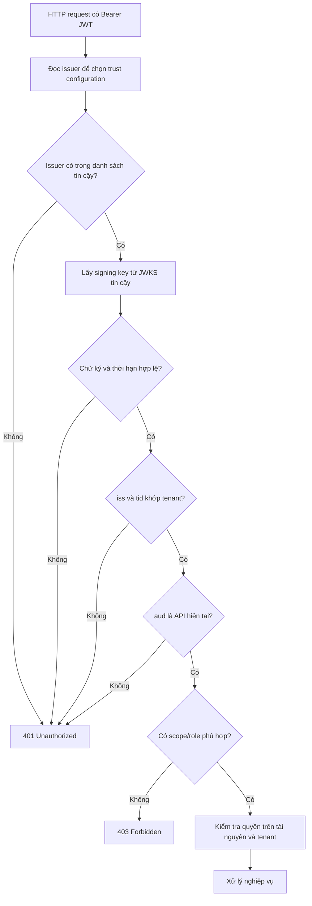

# Xác minh issuer, audience và ranh giới tin cậy nhiều tenant

> **Chương:** Microsoft Entra ID  
> **Học phần:** SPRING_CLOUD_PROVIDER_INTEGRATION — thực hành tích hợp Spring Boot với dịch vụ managed của AWS, Azure và Google Cloud qua các thư viện Spring Cloud tương ứng. Bài này tập trung xác minh access token do Microsoft Entra ID phát hành và thiết kế ranh giới tin cậy cho API single-tenant/multi-tenant.

Một API SaaS có thể phục vụ nhiều tổ chức. Người dùng ở tenant Contoso và Fabrikam đều đăng nhập thành công bằng Microsoft Entra ID, nhưng API chỉ được phép nhận token từ tenant đã được onboarding. Một token có chữ ký hợp lệ vẫn có thể được phát cho Microsoft Graph, một API khác hoặc một tenant không được tin cậy. Nếu chỉ kiểm tra chữ ký, API có thể chấp nhận nhầm caller.

Ba thông tin phải được kiểm tra trước khi xử lý request là:

- **Issuer (`iss`):** tenant/authority nào phát hành token?
- **Audience (`aud`):** token được phát cho API nào?
- **Tenant (`tid`):** token thuộc directory tenant nào, và tenant đó có nằm trong chính sách tin cậy không?

Với API multi-tenant, cần kiểm tra đồng thời issuer theo tenant, audience của chính API và tenant allowlist. Spring Security Resource Server có thể xác minh chữ ký JWT bằng JWKS của Entra; ứng dụng bổ sung validator và bộ chọn `AuthenticationManager` theo issuer được phép.

## 1. Mục tiêu học tập

Sau bài này, bạn có thể:

1. Giải thích vai trò của `iss`, `aud`, `tid`, `ver` trong access token Entra.
2. Phân biệt authority endpoint `common`, `organizations`, `consumers` với issuer thực tế trong token.
3. Nhận biết khác biệt issuer/audience giữa access token v1.0 và v2.0.
4. Cấu hình Spring Boot Resource Server cho API single-tenant.
5. Xây dựng tenant allowlist và resolver chọn decoder/manager theo issuer.
6. Xác minh chữ ký, thời hạn, issuer, audience và tenant ID theo cùng một trust policy.
7. Phân biệt tenant onboarding với việc token tự khai báo `tid`.
8. Kiểm thử token sai audience, issuer, tenant và chữ ký.
9. Tránh các lỗi SSRF, tenant confusion và truy cập chéo dữ liệu trong SaaS multi-tenant.

## 2. Ranh giới tin cậy của access token

Access token là credential bearer. API chỉ được tin token sau khi xác minh chữ ký bằng signing key được lấy từ metadata/JWKS của issuer tin cậy. Sau bước đó, API tiếp tục kiểm tra token có đúng mục đích và tenant được phép hay không.

### Ba câu hỏi bảo mật

| Thành phần | Câu hỏi | Ví dụ |
|---|---|---|
| Chữ ký và thời hạn | Token có được ký bởi key hợp lệ và còn hiệu lực không? | `kid`, `exp`, `nbf` |
| Issuer | Token được phát hành bởi tenant/authority nào? | `https://login.microsoftonline.com/<TENANT_ID>/v2.0` |
| Audience | Token có dành cho API này không? | Client ID của `invoice-api` trong v2 token |
| Tenant policy | Tenant này đã được tổ chức chấp nhận chưa? | `tid` thuộc allowlist |
| Permission | Caller có scope/app role cần thiết không? | `scp=Invoices.Read`, `roles=Invoice.Batch.Process` |

Các bước trên phục vụ mục đích khác nhau. Chữ ký hợp lệ không chứng minh audience đúng. Audience đúng không chứng minh tenant đã được onboarding. Tenant được phép cũng không tự cấp quyền nghiệp vụ.

### Luồng xác minh



Trong triển khai, Spring Resource Server thực hiện xác minh JWT trong filter chain. Resolver có thể chọn cấu hình theo issuer trước khi decoder kiểm tra chữ ký; giá trị issuer đọc từ token lúc này chưa được tin cậy, chỉ được dùng làm khóa tra cứu trong một danh sách cấu hình đã kiểm soát.

## 3. Hiểu `iss`, `aud`, `tid` và `ver` của Entra

### `iss` — issuer

Issuer xác định authority/tenant phát hành token. Với Microsoft Entra access token v2.0 của tenant cụ thể, issuer thường có dạng:

```text
https://login.microsoftonline.com/<TENANT_ID>/v2.0
```

Với v1.0 token, issuer thường có dạng:

```text
https://sts.windows.net/<TENANT_ID>/
```

Issuer phải được kiểm tra chính xác theo token version và authority được chấp nhận. Không tự sửa chuỗi issuer, bỏ tenant ID hoặc bỏ qua dấu `/` cuối trong issuer v1.

### `aud` — audience

Audience xác định resource/API nhận token. API phải từ chối token có audience là Microsoft Graph hoặc API khác, dù chữ ký và thời hạn đều hợp lệ.

Với Entra:

| Access token | Audience thường gặp |
|---|---|
| v2.0 | Application (client) ID dạng GUID của API |
| v1.0 | Application ID URI của API hoặc resource identifier tương ứng với cấu hình/token thực tế |

Client có thể yêu cầu scope bằng Application ID URI, nhưng v2 token thường mang `aud` là client ID GUID của API. Vì vậy, đừng suy ra `aud` từ chuỗi scope; hãy kiểm tra token thực tế của resource và cấu hình API chỉ chấp nhận các giá trị audience đã định nghĩa.

### `tid` — tenant ID

`tid` là định danh directory tenant chứa principal của token. Với multi-tenant API, `tid` giúp:

- Xác định tenant/customer nội bộ.
- Áp dụng tenant allowlist.
- Tạo partition key hoặc tenant filter cho dữ liệu.
- Kiểm tra `tid` khớp tenant trong issuer đã xác minh.

Không tin `tid` trước khi xác minh chữ ký. Kẻ gọi có thể tự tạo JWT giả chứa tenant ID bất kỳ; claim chỉ trở thành dữ liệu đáng tin sau khi decoder xác minh token.

### `ver` — token version

`ver` cho biết phiên bản access token, thường là `1.0` hoặc `2.0`. Phiên bản ảnh hưởng issuer format, audience format và một số claim khác. API nên chọn một token version làm chuẩn nếu có thể. Nếu phải nhận cả v1 và v2, cấu hình validator riêng cho từng format; không dùng một quy tắc issuer/audience chung quá rộng.

### Một số claim liên quan

| Claim | Ý nghĩa | Lưu ý |
|---|---|---|
| `azp` | Client application ID trong v2 token | Có thể allowlist client nếu API chỉ nhận một số client |
| `appid` | Client application ID trong v1 token | Không dùng thay cho audience |
| `oid` | Object ID của user/service principal trong tenant | Kết hợp với `tid` để định danh tenant-local |
| `sub` | Subject theo token contract | Có thể khác giữa các ứng dụng/resource |
| `scp` | Delegated scopes | Phục vụ authorization sau xác thực |
| `roles` | App roles/application permissions | Không tự chứng minh token là app-only |
| `exp`, `nbf`, `iat` | Thời gian hiệu lực | Decoder phải kiểm tra timestamp |

Không dùng `email`, `preferred_username` hoặc display name làm tenant key hoặc định danh phân quyền bền vững.

Nếu API chỉ cho phép một số client application, có thể kiểm tra thêm `azp` (v2) hoặc `appid` (v1) theo allowlist sau khi token đã được xác minh. Client allowlist là một điều kiện bổ sung; nó không thay thế audience validation.

## 4. `common`, `organizations` và issuer thực tế không giống nhau

Microsoft identity platform cung cấp các authority alias thường gặp:

| Authority segment | Ý nghĩa khái quát |
|---|---|
| `common` | Cho phép nhiều loại tài khoản tùy cấu hình app, có thể gồm work/school và Microsoft personal accounts |
| `organizations` | Tài khoản work/school trong Microsoft Entra |
| `consumers` | Microsoft personal accounts |
| Tenant ID/domain cụ thể | Giới hạn authority vào một tenant |

Ví dụ authorization endpoint:

```text
https://login.microsoftonline.com/organizations/oauth2/v2.0/authorize
```

Đây là authority alias dùng để bắt đầu authorization. Khi Entra phát hành access token cho tenant cụ thể, claim `iss` vẫn định danh tenant thực tế, ví dụ:

```text
https://login.microsoftonline.com/11111111-1111-1111-1111-111111111111/v2.0
```

Do đó:

- Không cấu hình `iss` bằng chuỗi `.../common/v2.0` chỉ vì client dùng `/common` hoặc `/organizations` để đăng nhập.
- Không coi việc client đăng nhập qua `organizations` là bằng chứng tenant đó đã được SaaS chấp nhận.
- Không chấp nhận mọi tenant chỉ vì token có issuer thuộc domain Microsoft.
- Authority alias quyết định nhóm tài khoản có thể xác thực; tenant allowlist của API quyết định tenant nào được truy cập dữ liệu dịch vụ.

Với sản phẩm chỉ phục vụ tổ chức, thường chọn tenant-specific authority cho single-tenant API hoặc `organizations` cho trải nghiệm đăng nhập multi-tenant; API vẫn phải xác minh tenant theo chính sách của mình.

## 5. Single-tenant API với Spring Boot

Nếu API chỉ phục vụ một directory tenant, cấu hình issuer tenant-specific giúp trust policy đơn giản.

### 5.1. Cấu hình `application.yml`

Ví dụ API chỉ nhận v2.0 token của một tenant:

```yaml
spring:
  security:
    oauth2:
      resourceserver:
        jwt:
          issuer-uri: https://login.microsoftonline.com/${ENTRA_TENANT_ID}/v2.0
          audiences:
            - ${INVOICE_API_CLIENT_ID}
```

Biến môi trường:

```bash
ENTRA_TENANT_ID=<directory-tenant-id>
INVOICE_API_CLIENT_ID=<application-client-id-of-invoice-api>
```

`issuer-uri` là issuer của tenant phát hành token; `audiences` là audience của API nhận token. Không dùng client ID của portal/worker làm audience nếu token được phát cho Invoice API.

### 5.2. Cấu hình SecurityFilterChain

```java
package com.example.invoice.security;

import org.springframework.context.annotation.Bean;
import org.springframework.context.annotation.Configuration;
import org.springframework.security.config.Customizer;
import org.springframework.security.config.annotation.web.builders.HttpSecurity;
import org.springframework.security.config.http.SessionCreationPolicy;
import org.springframework.security.web.SecurityFilterChain;

@Configuration
public class ApiSecurityConfiguration {

    @Bean
    SecurityFilterChain apiSecurity(HttpSecurity http) throws Exception {
        http
            .securityMatcher("/api/**")
            .csrf(csrf -> csrf.disable())
            .sessionManagement(session -> session
                .sessionCreationPolicy(SessionCreationPolicy.STATELESS))
            .authorizeHttpRequests(authorize -> authorize
                .requestMatchers("/api/public/**").permitAll()
                .anyRequest().authenticated())
            .oauth2ResourceServer(oauth2 ->
                    oauth2.jwt(Customizer.withDefaults()));

        return http.build();
    }
}
```

Đây là chain cho API bearer-only. Chỉ tắt CSRF khi endpoint không dùng cookie/session để xác thực; nếu cùng ứng dụng có web session, giữ CSRF cho web chain riêng. Nếu có request ngoài `/api/**`, phải có chain khác bao phủ chúng.

Spring Boot cấu hình decoder từ issuer URI và audience. Decoder xác minh JWT signature bằng public key từ JWKS, issuer và thời gian hiệu lực; audience được kiểm tra theo cấu hình `audiences`. Nếu dùng cấu hình decoder tùy chỉnh, phải giữ lại các validator timestamp và issuer thay vì chỉ xác minh chữ ký.

## 6. Multi-tenant: xác định tenant nào được tin cậy

API multi-tenant có thể cho phép nhiều tổ chức onboarding. Việc một tenant tồn tại trong Microsoft Entra không đồng nghĩa tenant đó là khách hàng của ứng dụng.

### Tenant allowlist

Một tenant được phép gọi API khi thỏa mãn chính sách onboarding, ví dụ:

1. Administrator của tenant đã consent các permission cần thiết.
2. Tenant đã được tạo record trong hệ thống SaaS.
3. Subscription/hợp đồng chưa bị suspend hoặc hết hiệu lực.
4. Tenant ID đã được thêm vào danh sách được phép.
5. API có thể áp dụng data isolation cho tenant đó.

Lưu tenant ID dạng GUID, không dùng domain/email làm khóa tin cậy. Tenant domain có thể đổi hoặc có nhiều domain; tenant ID là định danh directory ổn định hơn.

Với guest user, token được phát hành trong resource tenant mà guest đang truy cập. `tid` và `oid` cần được hiểu theo tenant đó; không ghép guest với tài khoản ở home tenant chỉ bằng email hoặc UPN.

### Cấu hình allowlist

Ví dụ:

```yaml
entra:
  api-client-id: ${INVOICE_API_CLIENT_ID}
  trusted-tenant-ids:
    - 11111111-1111-1111-1111-111111111111
    - 22222222-2222-2222-2222-222222222222
```

Trong production, allowlist thường được quản lý bởi onboarding/configuration service hoặc database có kiểm soát truy cập. Ví dụ YAML phù hợp với số tenant nhỏ và thay đổi qua deployment; không phải giải pháp quản trị hàng nghìn tenant động.

### Không lấy URL issuer tùy ý từ token

JWT là dữ liệu do caller gửi. Nếu ứng dụng đọc `iss` rồi gọi URL đó để tải OpenID metadata/JWKS mà không kiểm tra allowlist, attacker có thể lợi dụng để:

- Buộc server gọi tới host nội bộ hoặc endpoint không mong muốn (SSRF).
- Tạo lượng lớn issuer/decoder khiến cache phình hoặc cạn tài nguyên.
- Làm hệ thống tin cậy một authority ngoài chính sách.

Issuer trong token chỉ được dùng để tra cứu một cấu hình đã được tin cậy. Không nối chuỗi `iss` bất kỳ vào HTTP request hoặc tự động tạo decoder trước khi tenant/issuer được chấp nhận.

## 7. Resolver chọn AuthenticationManager theo issuer

Với một số tenant được biết trước, có thể tạo trước `AuthenticationManager` cho từng issuer. Mỗi manager có decoder dùng signing keys của Entra và validator riêng cho issuer, audience, tenant.

### 7.1. Quy tắc issuer cho v2.0

Với tenant ID `T`, issuer mong đợi là:

```text
https://login.microsoftonline.com/T/v2.0
```

Trong ví dụ code, `T` được lấy từ tenant allowlist, chuẩn hóa bằng `UUID`, rồi dùng để tạo issuer. Decoder dùng JWKS endpoint tenant-independent của Entra:

```text
https://login.microsoftonline.com/common/discovery/v2.0/keys
```

Endpoint JWKS cung cấp public signing keys. Nó không có nghĩa API chấp nhận mọi tenant: validator vẫn so khớp issuer và tenant ID với cấu hình allowlist.

### 7.2. Tạo decoder có issuer, audience và tenant validator

```java
package com.example.invoice.security;

import java.util.UUID;

import org.springframework.security.oauth2.core.OAuth2Error;
import org.springframework.security.oauth2.core.OAuth2TokenValidator;
import org.springframework.security.oauth2.core.OAuth2TokenValidatorResult;
import org.springframework.security.oauth2.core.DelegatingOAuth2TokenValidator;
import org.springframework.security.oauth2.jwt.Jwt;
import org.springframework.security.oauth2.jwt.JwtValidators;
import org.springframework.security.oauth2.jwt.NimbusJwtDecoder;

public final class EntraJwtDecoderFactory {

    private static final String JWKS_URI =
            "https://login.microsoftonline.com/common/discovery/v2.0/keys";

    private EntraJwtDecoderFactory() {
    }

    public static NimbusJwtDecoder forTenant(
            UUID trustedTenantId, String apiClientId) {

        String tenantId = trustedTenantId.toString();
        String issuer = "https://login.microsoftonline.com/"
                + tenantId + "/v2.0";

        NimbusJwtDecoder decoder =
                NimbusJwtDecoder.withJwkSetUri(JWKS_URI).build();

        OAuth2TokenValidator<Jwt> issuerAndTimeValidator =
                JwtValidators.createDefaultWithIssuer(issuer);

        decoder.setJwtValidator(new DelegatingOAuth2TokenValidator<>(
                issuerAndTimeValidator,
                audienceValidator(apiClientId),
                tenantValidator(trustedTenantId),
                v2TokenValidator()));

        return decoder;
    }

    public static OAuth2TokenValidator<Jwt> audienceValidator(
            String expectedAudience) {
        return jwt -> jwt.getAudience().contains(expectedAudience)
                ? OAuth2TokenValidatorResult.success()
                : OAuth2TokenValidatorResult.failure(
                        new OAuth2Error(
                                "invalid_token",
                                "Token audience is not this API",
                                null));
    }

    public static OAuth2TokenValidator<Jwt> tenantValidator(
            UUID trustedTenantId) {
        String expectedTenantId = trustedTenantId.toString();
        return jwt -> expectedTenantId.equalsIgnoreCase(
                jwt.getClaimAsString("tid"))
                ? OAuth2TokenValidatorResult.success()
                : OAuth2TokenValidatorResult.failure(
                        new OAuth2Error(
                                "invalid_token",
                                "Token tenant does not match issuer",
                                null));
    }

    public static OAuth2TokenValidator<Jwt> v2TokenValidator() {
        return jwt -> "2.0".equals(jwt.getClaimAsString("ver"))
                ? OAuth2TokenValidatorResult.success()
                : OAuth2TokenValidatorResult.failure(
                        new OAuth2Error(
                                "invalid_token",
                                "Only Entra v2.0 access tokens are accepted",
                                null));
    }
}
```

Các điểm quan trọng:

- `JwtValidators.createDefaultWithIssuer` giữ kiểm tra issuer và timestamp mặc định.
- Audience validator yêu cầu `aud` chứa đúng client ID của Invoice API.
- Tenant validator yêu cầu `tid` khớp tenant đã dùng để tạo decoder.
- Version validator chỉ chấp nhận claim `ver=2.0`; token v1 cần một decoder/policy riêng.
- `NimbusJwtDecoder` xác minh chữ ký bằng signing key lấy từ JWKS.
- Decoder chỉ được tạo cho tenant đã nằm trong allowlist.

Nếu API dùng v1.0 token, không thay issuer v2 bằng v1 một cách tùy tiện. Tạo cấu hình validator riêng theo issuer `https://sts.windows.net/<TENANT_ID>/`, audience thực tế của v1 token và metadata/JWKS phù hợp.

### 7.3. Tạo AuthenticationManager cho từng tenant

Dùng `@ConfigurationProperties` để bind danh sách tenant từ YAML:

```java
package com.example.invoice.security;

import java.util.List;

import org.springframework.boot.context.properties.ConfigurationProperties;

@ConfigurationProperties(prefix = "entra")
public record EntraTrustProperties(
        String apiClientId,
        List<String> trustedTenantIds) {
}
```

```java
package com.example.invoice.security;

import jakarta.servlet.http.HttpServletRequest;
import java.util.HashMap;
import java.util.Map;
import java.util.UUID;

import org.springframework.boot.context.properties.EnableConfigurationProperties;
import org.springframework.context.annotation.Bean;
import org.springframework.context.annotation.Configuration;
import org.springframework.security.authentication.AuthenticationManager;
import org.springframework.security.authentication.ProviderManager;
import org.springframework.security.oauth2.server.resource.authentication.JwtAuthenticationProvider;
import org.springframework.security.oauth2.server.resource.authentication.JwtIssuerAuthenticationManagerResolver;
import org.springframework.security.authentication.AuthenticationManagerResolver;

@Configuration
@EnableConfigurationProperties(EntraTrustProperties.class)
public class MultiTenantResourceServerConfiguration {

    @Bean
    AuthenticationManagerResolver<HttpServletRequest> tenantResolver(
            EntraTrustProperties properties) {

        Map<String, AuthenticationManager> managers = new HashMap<>();

        for (String configuredId : properties.trustedTenantIds()) {
            UUID tenantId = UUID.fromString(configuredId);
            String issuer = "https://login.microsoftonline.com/"
                    + tenantId + "/v2.0";

            var decoder = EntraJwtDecoderFactory.forTenant(
                    tenantId, properties.apiClientId());
            var provider = new JwtAuthenticationProvider(decoder);
            managers.put(issuer, new ProviderManager(provider));
        }

        return new JwtIssuerAuthenticationManagerResolver(
                issuer -> managers.get(issuer));
    }
}
```

Resolver đọc issuer từ token để tra cứu map. Map chỉ chứa issuer đã tạo từ tenant allowlist; issuer lạ không có manager và bị từ chối. Sau khi chọn manager, decoder vẫn phải xác minh chữ ký, issuer, audience, thời hạn và `tid`.

Issuer được tạo từ UUID chuẩn hóa trong allowlist nên map dùng một chuỗi canonical. Không tự lowercase/trim issuer lấy từ token để làm cho một issuer sai trở thành hợp lệ; việc so khớp issuer phải theo đúng giá trị đã cấu hình.

Gắn resolver vào filter chain:

```java
package com.example.invoice.security;

import jakarta.servlet.http.HttpServletRequest;
import org.springframework.context.annotation.Bean;
import org.springframework.context.annotation.Configuration;
import org.springframework.security.authentication.AuthenticationManagerResolver;
import org.springframework.security.config.annotation.web.builders.HttpSecurity;
import org.springframework.security.config.http.SessionCreationPolicy;
import org.springframework.security.web.SecurityFilterChain;

@Configuration
public class MultiTenantApiSecurityConfiguration {

    @Bean
    SecurityFilterChain apiSecurity(
            HttpSecurity http,
            AuthenticationManagerResolver<HttpServletRequest> tenantResolver)
            throws Exception {

        http
            .securityMatcher("/api/**")
            .csrf(csrf -> csrf.disable())
            .sessionManagement(session -> session
                .sessionCreationPolicy(SessionCreationPolicy.STATELESS))
            .authorizeHttpRequests(authorize -> authorize
                .requestMatchers("/api/public/**").permitAll()
                .anyRequest().authenticated())
            .oauth2ResourceServer(oauth2 ->
                oauth2.authenticationManagerResolver(tenantResolver));

        return http.build();
    }
}
```

Đây là một mẫu cho danh sách tenant được cấu hình tĩnh khi khởi động. Khi danh sách thay đổi, ứng dụng cần reload cấu hình/manager một cách có kiểm soát. Nếu dùng tenant registry động, chỉ tạo manager sau khi tenant được xác minh là đã onboarding; cần cache có giới hạn, eviction và bảo vệ trước việc tạo decoder hàng loạt.

## 8. Tenant động và quy mô SaaS lớn

Danh sách tenant trong YAML không phù hợp nếu khách hàng được onboarding liên tục. Có thể xây `AuthenticationManagerResolver` dựa trên tenant registry, nhưng thứ tự tin cậy phải rõ ràng:

1. Đọc issuer từ JWT chưa xác minh như một gợi ý định tuyến.
2. Parse tenant ID từ issuer theo đúng format được hỗ trợ; không chấp nhận issuer URL tùy ý.
3. Tra tenant registry nội bộ để xác định tenant active/approved.
4. Xây issuer canonical từ tenant ID đã xác thực định dạng.
5. Lấy hoặc tạo decoder từ cache giới hạn; chỉ dùng endpoint metadata/JWKS cố định của Microsoft.
6. Xác minh chữ ký, issuer, audience, `tid`, thời gian và token version.
7. Kiểm tra tenant còn active tại thời điểm authorization/data access theo yêu cầu nghiệp vụ.

Không để claim `tid` tự nó tạo ra một tenant mới. Tenant registry phải được cập nhật qua quy trình onboarding có xác minh administrator/consent.

### Khi tenant bị suspend hoặc offboard

- Từ chối request mới theo trạng thái tenant registry.
- Thu hồi app role assignment/consent khi quy trình offboarding yêu cầu.
- Xóa cache tenant/authorized client liên quan theo policy.
- Giữ audit record về thời điểm suspend/offboard.
- Không dựa vào việc access token cũ lập tức biến mất; JWT đã phát hành có thể còn hợp lệ đến `exp`.

## 9. Audience validation: không chấp nhận token dành cho API khác

Một lỗi phổ biến là xác minh issuer và chữ ký nhưng bỏ qua audience. Khi đó, token Microsoft Graph hoặc token của một service khác trong cùng tenant có thể bị API nhận nhầm.

### Quy tắc audience

- Chỉ chấp nhận audience của API hiện tại.
- Với v2.0, thường dùng client ID GUID của API.
- Với v1.0, xác định audience thực tế từ token và API registration; cấu hình riêng nếu thật sự hỗ trợ.
- Nếu có nhiều audience hợp lệ do migration, liệt kê rõ và có thời hạn loại bỏ giá trị cũ.
- Không dùng wildcard, substring hoặc so sánh tiền tố.

Ví dụ validator chấp nhận một tập audience có kiểm soát:

```java
Set<String> acceptedAudiences = Set.of(
        "33333333-3333-3333-3333-333333333333");

OAuth2TokenValidator<Jwt> audienceValidator = jwt ->
        jwt.getAudience().stream().anyMatch(acceptedAudiences::contains)
                ? OAuth2TokenValidatorResult.success()
                : OAuth2TokenValidatorResult.failure(
                        new OAuth2Error("invalid_token",
                                "Unexpected audience", null));
```

Trong production, danh sách audience phải là cấu hình được review. Không thêm audience của Microsoft Graph hoặc API khác chỉ để làm test pass.

## 10. Single-tenant và multi-tenant: chọn chính sách nào?

| Tiêu chí | Single-tenant | Multi-tenant |
|---|---|---|
| Issuer | Một tenant-specific issuer | Một issuer cụ thể cho mỗi tenant |
| Tenant trust | Tenant ID cấu hình cố định | Tenant registry/allowlist |
| Decoder | Một decoder | Decoder/manager theo issuer hoặc tenant |
| Onboarding | Thường nằm trong cùng tổ chức | Cần consent, onboarding và trạng thái subscription |
| Data isolation | Tenant cố định, vẫn cần authorization nội bộ | Bắt buộc tenant filter trên mọi dữ liệu |
| Rủi ro chính | Nhầm audience hoặc cấu hình nhầm tenant | Tenant confusion, issuer trust quá rộng, data leakage |

Single-tenant thường nên cấu hình issuer cụ thể thay vì dùng `common`. Multi-tenant chỉ nên bật khi sản phẩm có quy trình onboarding, tenant isolation, offboarding và audit đủ rõ.

## 11. Kiểm thử trust boundary

Test phải chứng minh API từ chối token có chữ ký hợp lệ nhưng sai audience/tenant, ngoài các trường hợp chữ ký sai hoặc token hết hạn.

### Ma trận test

| Trường hợp | Issuer | Audience | `tid` | Kết quả |
|---|---|---|---|---|
| Token hợp lệ tenant A | A được tin cậy | Invoice API | A | Qua bước xác thực |
| Token tenant B chưa onboarding | B không có trong allowlist | Invoice API | B | 401 |
| Token tenant A dành cho Graph | A được tin cậy | Microsoft Graph | A | 401 |
| Issuer tenant A nhưng `tid` khác | A được tin cậy | Invoice API | B | 401 |
| Token chữ ký sai | Có vẻ là A | Invoice API | A | 401 |
| Token hết hạn | A được tin cậy | Invoice API | A | 401 |
| Token chưa tới `nbf` | A được tin cậy | Invoice API | A | 401 |
| Token hợp lệ nhưng thiếu scope | A được tin cậy | Invoice API | A | 403 |
| Token đúng trust nhưng tenant bị suspend | A đã từng được tin cậy | Invoice API | A | Từ chối theo tenant policy |

### Unit test validator

Các validator được tách thành method để có thể kiểm thử trực tiếp:

```java
import static org.assertj.core.api.Assertions.assertThat;

import java.time.Instant;
import java.util.List;
import java.util.UUID;

import org.junit.jupiter.api.Test;
import org.springframework.security.oauth2.jwt.Jwt;

class AudienceValidatorTest {

    private final String apiAudience =
            "33333333-3333-3333-3333-333333333333";

    @Test
    void acceptsTokenForThisApi() {
        Jwt jwt = Jwt.withTokenValue("test")
                .header("alg", "RS256")
                .claim("aud", List.of(apiAudience))
                .claim("tid", "11111111-1111-1111-1111-111111111111")
                .claim("ver", "2.0")
                .issuedAt(Instant.now())
                .expiresAt(Instant.now().plusSeconds(300))
                .build();

        assertThat(EntraJwtDecoderFactory.audienceValidator(apiAudience)
                .validate(jwt).getErrors()).isEmpty();
        assertThat(EntraJwtDecoderFactory.tenantValidator(UUID.fromString(
                "11111111-1111-1111-1111-111111111111"))
                .validate(jwt).getErrors()).isEmpty();
        assertThat(EntraJwtDecoderFactory.v2TokenValidator()
                .validate(jwt).getErrors()).isEmpty();
    }

    @Test
    void doesNotTreatGraphAudienceAsThisApi() {
        Jwt jwt = Jwt.withTokenValue("test")
                .header("alg", "RS256")
                .claim("aud", List.of("https://graph.microsoft.com"))
                .claim("tid", "11111111-1111-1111-1111-111111111111")
                .claim("ver", "2.0")
                .issuedAt(Instant.now())
                .expiresAt(Instant.now().plusSeconds(300))
                .build();

        assertThat(EntraJwtDecoderFactory.audienceValidator(apiAudience)
                .validate(jwt).getErrors()).isNotEmpty();
    }

    @Test
    void rejectsTenantMismatch() {
        Jwt jwt = Jwt.withTokenValue("test")
                .header("alg", "RS256")
                .claim("aud", List.of(apiAudience))
                .claim("tid", "22222222-2222-2222-2222-222222222222")
                .claim("ver", "2.0")
                .issuedAt(Instant.now())
                .expiresAt(Instant.now().plusSeconds(300))
                .build();

        assertThat(EntraJwtDecoderFactory.tenantValidator(UUID.fromString(
                "11111111-1111-1111-1111-111111111111"))
                .validate(jwt).getErrors()).isNotEmpty();
    }
}
```

Các test này kiểm tra audience, tenant và token version validator với JWT object giả. Chúng không kiểm tra chữ ký, issuer, thời gian do decoder áp dụng hoặc khả năng tải JWKS; các phần đó cần test decoder/integration với token được ký trong môi trường thử nghiệm.

### Integration test với tenant thử nghiệm

1. Tạo app registration API riêng cho test.
2. Cấu hình audience và token version cần kiểm tra.
3. Tạo hai tenant thử nghiệm: một tenant được allowlist, một tenant không được allowlist.
4. Lấy token đúng API từ tenant được tin cậy.
5. Lấy token Graph hoặc token của API khác trong cùng tenant.
6. Gọi endpoint bằng token từng trường hợp và ghi nhận HTTP status.
7. Thử token hết hạn/sai tenant bằng bộ test token an toàn, không sửa payload rồi giả định chữ ký còn hợp lệ.
8. Xác nhận log không ghi bearer token.

## 12. Lỗi thường gặp và cách điều tra

| Triệu chứng | Nguyên nhân có thể | Cách xử lý |
|---|---|---|
| Token Entra hợp lệ nhưng API trả 401 | `iss` cấu hình sai tenant hoặc token version | Đọc `iss`, `ver`, đối chiếu issuer canonical |
| Đăng nhập qua `/organizations` nhưng API từ chối | Nhầm authority alias với issuer hoặc tenant chưa onboarding | Kiểm tra `iss`, `tid` và tenant registry |
| API nhận nhầm token Graph | Thiếu audience validation | Bắt buộc kiểm tra `aud` bằng allowlist |
| Một số tenant được chấp nhận ngoài ý muốn | Dùng `common` như trust rule hoặc resolver tự tải issuer tùy ý | Chỉ tra cứu manager từ tenant allowlist |
| Tenant A issuer nhưng claim `tid` là B | Token/validator không đồng bộ hoặc cấu hình trust sai | Yêu cầu `tid` khớp tenant trong issuer |
| Sau key rotation, token mới bị từ chối | JWKS không refresh được hoặc network chặn | Kiểm tra JWKS endpoint, `kid`, TLS và cache |
| Token v1 bị từ chối | API chỉ hỗ trợ v2 hoặc issuer/audience v1 chưa cấu hình | Chuẩn hóa v2 hoặc thêm validator v1 riêng |
| Multi-tenant API tăng memory liên tục | Tạo decoder/cache cho issuer bất kỳ | Allowlist trước, cache có giới hạn và eviction |
| Request tenant A đọc dữ liệu tenant B | Chỉ xác thực token mà không tenant-scope query | Dùng `tid` đã xác minh trong repository/service |

### Checklist điều tra

1. Token có phải access token dành cho API hiện tại không?
2. Chữ ký có xác minh được bằng JWKS tin cậy không?
3. `iss` có khớp issuer canonical theo `ver` không?
4. `aud` có chứa đúng audience của API không?
5. `tid` có khớp tenant trong issuer và nằm trong allowlist không?
6. Tenant có trạng thái active/onboarded không?
7. Caller có scope/app role cần thiết không?
8. Query dữ liệu có ràng buộc tenant và quyền trên object không?

Không dùng công cụ decode JWT trực tuyến hoặc log token thật để điều tra production. Nếu cần xem claim, dùng môi trường kiểm thử và dữ liệu token đã được bảo vệ/ẩn danh.

## 13. Bảo vệ tenant data sau khi token hợp lệ

Issuer/audience/tenant validation chỉ xác định request thuộc một principal/tenant tin cậy. API vẫn phải áp dụng tenant isolation ở tầng dữ liệu:

- Lấy `tid` từ `Jwt` đã xác minh, không lấy từ header/query làm nguồn danh tính.
- Map `tid` sang tenant record nội bộ và kiểm tra trạng thái active.
- Đưa tenant ID vào mọi truy vấn tenant-scoped.
- Dùng composite key hoặc unique constraint có tenant ID để tránh trùng ID giữa tenant.
- Kiểm tra membership/ACL trên từng tài nguyên.
- Không dùng cache key thiếu tenant ID nếu dữ liệu phụ thuộc tenant.
- Đưa tenant ID vào audit event, correlation context và metric label theo chính sách bảo vệ dữ liệu.
- Không trả lỗi tiết lộ tài nguyên tenant khác; chọn 403/404 theo policy nhất quán.

Nếu API gọi Storage, Service Bus hoặc Key Vault, quyền trên các resource đó vẫn được kiểm tra theo identity/role assignment của workload. Trust của access token Entra cho API không tự cấp Azure RBAC.

## 14. Bài tập thực hành

**Bối cảnh:** Invoice API được triển khai như SaaS cho hai khách hàng Contoso và Fabrikam. Cả hai dùng Microsoft Entra ID. Một tenant thứ ba chưa onboarding thử gọi API bằng token hợp lệ do Entra phát hành. API cần chỉ nhận token đúng audience và tenant được phép.

### Phần A — Phân tích token

1. Lấy một v2.0 access token dành cho Invoice API từ tenant Contoso trong môi trường test.
2. Ghi lại `iss`, `aud`, `tid`, `ver`, `exp`, `scp` hoặc `roles`.
3. Lấy token Graph từ cùng tenant và so sánh `aud`.
4. Lấy token từ tenant Fabrikam và so sánh issuer/tenant.
5. Giải thích vì sao `/organizations` không phải giá trị `iss` của token tenant cụ thể.

### Phần B — Cấu hình Spring Boot

1. Cấu hình single-tenant issuer và audience.
2. Chuyển sang multi-tenant resolver có allowlist Contoso/Fabrikam.
3. Tạo decoder với issuer, audience, timestamp và `tid` validator.
4. Dùng JWKS endpoint tin cậy của Entra.
5. Bảo đảm issuer ngoài allowlist không tạo decoder hoặc outbound metadata request.
6. Dùng `tid` đã xác minh để ràng buộc truy vấn dữ liệu.

### Phần C — Kiểm thử

1. Token Contoso đúng audience được xác thực.
2. Token tenant chưa onboarding bị từ chối.
3. Token Graph trong cùng tenant bị từ chối do audience.
4. Token có `tid` không khớp issuer bị từ chối.
5. Token hết hạn/sai chữ ký bị từ chối.
6. Token đúng trust nhưng thiếu scope nhận 403.
7. Tenant bị suspend không thể đọc dữ liệu mới.
8. Xác minh log không chứa bearer token.

**Mẫu báo cáo:**

| Test case | `iss` | `aud` | `tid` | Kết quả |
|---|---|---|---|---|
| Contoso hợp lệ | Tenant Contoso v2 | Invoice API | Contoso | 200 |
| Fabrikam hợp lệ | Tenant Fabrikam v2 | Invoice API | Fabrikam | 200 nếu active |
| Tenant chưa onboarding | Tenant C v2 | Invoice API | Tenant C | 401 |
| Graph token | Tenant Contoso v2 | Microsoft Graph | Contoso | 401 |
| `tid` không khớp | Issuer Contoso | Invoice API | Fabrikam | 401 |
| Thiếu scope | Tenant Contoso v2 | Invoice API | Contoso | 403 |
| Tenant suspended | Tenant Contoso v2 | Invoice API | Contoso | Từ chối theo policy |

**Tiêu chí đạt:** API xác minh chữ ký, issuer, audience, thời hạn và tenant; chỉ tenant đã onboarding được phép truy cập; token sai resource bị từ chối; dữ liệu luôn được truy vấn trong tenant context đã xác minh.

## Tài liệu tham khảo chính thức

1. [Microsoft identity platform — Access token claims reference](https://learn.microsoft.com/entra/identity-platform/access-token-claims-reference): issuer, audience, tenant, token version và các claim.
2. [Microsoft identity platform — Validate claims](https://learn.microsoft.com/entra/identity-platform/claims-validation): xác minh issuer, audience, tenant và subject.
3. [Microsoft identity platform — OpenID Connect metadata](https://learn.microsoft.com/entra/identity-platform/v2-protocols-oidc): authority, discovery metadata và signing keys.
4. [Microsoft identity platform — Signing key rollover](https://learn.microsoft.com/entra/identity-platform/signing-key-rollover): cập nhật public signing keys.
5. [Spring Security — JWT Resource Server](https://docs.spring.io/spring-security/reference/servlet/oauth2/resource-server/jwt.html): JWT decoder, validators và JWKS.
6. [Spring Security — Multi-tenancy](https://docs.spring.io/spring-security/reference/servlet/oauth2/resource-server/multitenancy.html): `JwtIssuerAuthenticationManagerResolver` và multi-tenant Resource Server.
7. [Spring Boot — OAuth2 Resource Server](https://docs.spring.io/spring-boot/reference/security/oauth2.html): cấu hình issuer và audience cho Resource Server.

> **Ghi nhớ:** `iss` xác định tenant/authority phát hành, `aud` xác định API nhận token, còn `tid` liên kết principal với directory tenant. Với multi-tenant API, chỉ tin issuer đã được allowlist, kiểm tra chữ ký/thời hạn/audience/tenant cùng nhau và dùng tenant đã xác minh để cô lập dữ liệu. `common` hoặc `organizations` là authority alias, không phải quy tắc chấp nhận mọi tenant.
