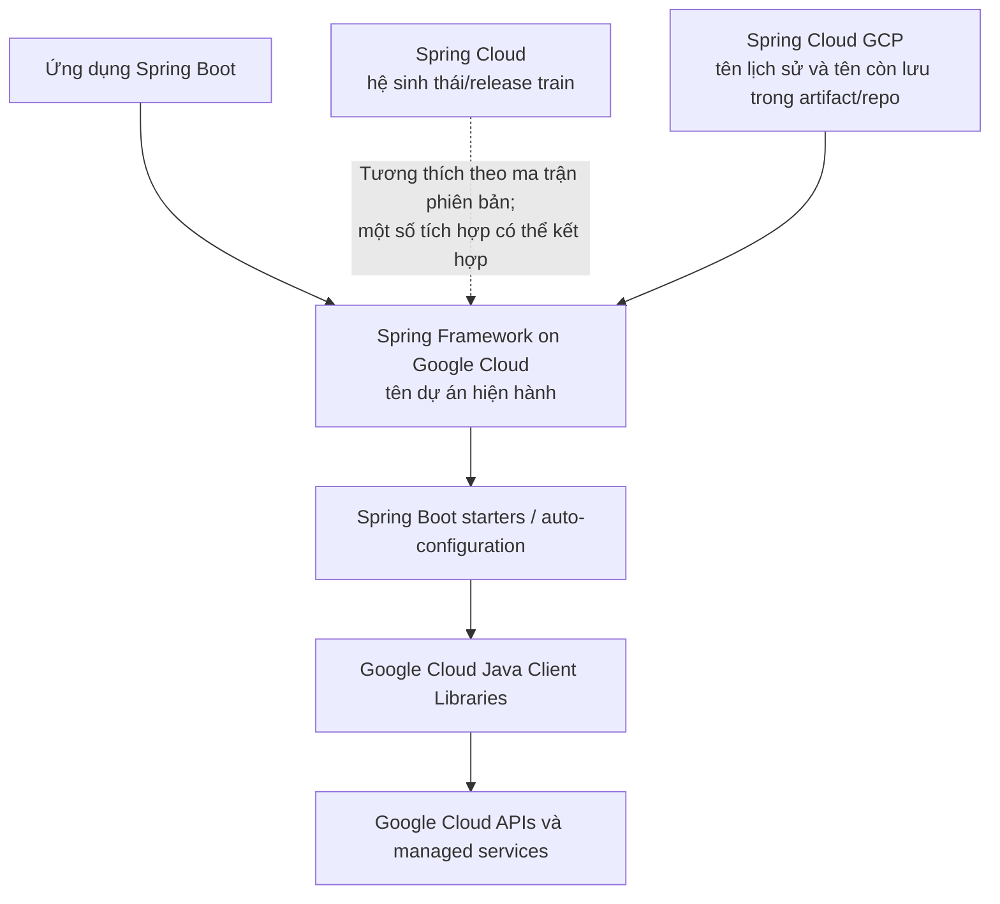

# Spring Cloud GCP và tên dự án Spring Framework on Google Cloud

Khi tìm tài liệu tích hợp Spring Boot với Google Cloud, bạn có thể gặp nhiều tên: **Spring Cloud GCP**, **Spring Framework on Google Cloud**, repository `spring-cloud-gcp`, Maven artifact `spring-cloud-gcp-starter-pubsub` và property prefix `spring.cloud.gcp.*`. Những tên này không chỉ đến các sản phẩm độc lập. Chúng thuộc cùng một dòng dự án tích hợp Spring với Google Cloud, nhưng xuất hiện ở những thời điểm và lớp kỹ thuật khác nhau.

Việc hiểu đúng tên dự án giúp chọn đúng tài liệu, dependency, BOM và package Java. Điều này đặc biệt quan trọng khi mô-đun `SPRING_CLOUD_PROVIDER_INTEGRATION` hướng tới việc tích hợp Spring Boot với các dịch vụ managed của AWS, Azure và Google Cloud: mỗi provider có bộ thư viện, nhịp phát hành và quy ước cấu hình riêng.

Bài học giải thích lịch sử tên gọi, vị trí của dự án trong hệ sinh thái Spring, các thành phần chính, cách chọn phiên bản và ví dụ bắt đầu với Google Cloud Pub/Sub.

## 1. Trước hết, phân biệt ba tên thường gặp

| Tên | Ý nghĩa | Nên hiểu như thế nào |
| --- | --- | --- |
| **Spring Cloud GCP** | Tên dự án đã được dùng rộng rãi trong các tài liệu và giai đoạn phát triển trước | Tên lịch sử/legacy vẫn xuất hiện trên trang dự án Spring, repository, artifact và một số property |
| **Spring Framework on Google Cloud** | Tên được dùng trong tài liệu tham chiếu và README hiện hành của dự án | Tên hiển thị hiện tại cho bộ tích hợp Spring với các dịch vụ Google Cloud |
| **Spring Cloud** | Hệ sinh thái các dự án hỗ trợ kiến trúc phân tán, cấu hình, discovery, messaging, routing… | Một umbrella project/release train khác; không đồng nhất với Spring Framework on Google Cloud |

Có thể hình dung mối quan hệ:



**Điểm quan trọng:** `Spring Framework on Google Cloud` là tên dự án hiện dùng trong tài liệu tham chiếu hiện hành. `Spring Cloud GCP` vẫn xuất hiện ở nhiều nơi vì lịch sử dự án và vì tên repository/artifact/property chưa được đổi đồng loạt. Không nên chỉ dựa vào tên trên trang tìm kiếm để kết luận đó là hai thư viện khác nhau.

## 2. Lịch sử và lý do có nhiều tên

Dự án bắt đầu với tên **Spring Cloud GCP**, nhằm đưa các dịch vụ Google Cloud vào ứng dụng Spring thông qua các abstraction, starter và auto-configuration quen thuộc. Từ phiên bản 2.0, dự án có repository phát triển riêng dưới tổ chức GoogleCloudPlatform và được **tách khỏi Spring Cloud release train**.

Việc tách này kéo theo thay đổi kỹ thuật trong quá trình nâng cấp:

- BOM quản lý dependency của dự án được khai báo riêng là `spring-cloud-gcp-dependencies`.
- Maven group ID của các artifact chuyển từ `org.springframework.cloud` sang `com.google.cloud`.
- Java package chuyển từ `org.springframework.cloud.gcp` sang `com.google.cloud.spring`.
- Property prefix phổ biến `spring.cloud.gcp.*` và nhiều artifact ID `spring-cloud-gcp-*` vẫn được giữ để tương thích với lịch sử và cách tổ chức module.

Trang dự án Spring vẫn có tiêu đề **Spring Cloud GCP** và ghi chú dự án không còn nằm trong Spring Cloud release train. Trong khi đó, README repository và reference documentation hiện dùng tên **Spring Framework on Google Cloud**. Đây là sự không đồng bộ về nhãn hiển thị giữa các trang, không phải dấu hiệu của hai bộ thư viện cạnh tranh.

### Dòng thời gian khái quát

| Giai đoạn | Tên/cấu trúc thường gặp | Ý nghĩa |
| --- | --- | --- |
| Giai đoạn đầu | Spring Cloud GCP 1.x | Dự án tích hợp Google Cloud với Spring; dependency gắn với hệ sinh thái Spring Cloud thời kỳ đầu |
| Từ 2.0 | Repository GoogleCloudPlatform, BOM riêng, group ID `com.google.cloud` | Dự án tách khỏi release train; bắt đầu quy ước dependency/package mới |
| Các thế hệ tiếp theo | Spring Cloud GCP 3.x, 4.x, 5.x… | Tiếp tục mở rộng theo các thế hệ Spring Boot/Spring Framework |
| Tài liệu hiện hành | Spring Framework on Google Cloud | Tên dự án trong README và reference documentation; artifact vẫn mang `spring-cloud-gcp` |

Mốc 2.0 là điểm cần chú ý khi đọc code cũ. Nếu một bài hướng dẫn sử dụng package `org.springframework.cloud.gcp.*` hoặc Maven group `org.springframework.cloud`, không thể mặc định copy nguyên vào dự án hiện hành. Cần đối chiếu migration guide và phiên bản BOM.

## 3. Spring Framework on Google Cloud có quan hệ gì với Spring Cloud?

**Spring Framework on Google Cloud là dự án tích hợp dịch vụ Google Cloud cho ứng dụng Spring.** Nó cung cấp starter, auto-configuration, template, abstraction và các tích hợp Spring Data/Spring Integration để lập trình viên sử dụng Google Cloud bằng mô hình quen thuộc của Spring.

**Spring Cloud** là hệ sinh thái rộng hơn. Nó cung cấp các dự án như:

- Spring Cloud Config cho cấu hình phân tán.
- Spring Cloud Stream cho mô hình messaging hướng function/binder.
- Spring Cloud Bus cho truyền sự kiện giữa các instance.
- Spring Cloud Gateway, Circuit Breaker và các thành phần phục vụ hệ thống phân tán.

Hai tên gần giống nhau nhưng không cùng phạm vi. Spring Framework on Google Cloud có thể tích hợp với một số thành phần Spring Cloud, ví dụ binder Pub/Sub hoặc Spring Cloud Bus tùy phiên bản, nhưng nó **không phải toàn bộ Spring Cloud** và cũng không được quản lý phiên bản bằng cách thay thế BOM của Spring Cloud.

### Vì sao vẫn có tên “Spring Cloud GCP” trong artifact?

Maven artifact là định danh kỹ thuật được công bố trong Maven Central. Đổi tên thương hiệu không đồng nghĩa phải đổi tất cả artifact, package, property prefix và repository slug. Ví dụ:

| Lớp | Tên hiện thấy | Ví dụ |
| --- | --- | --- |
| Tên dự án | Spring Framework on Google Cloud | Tên trên reference documentation |
| Tên lịch sử | Spring Cloud GCP | Trang dự án Spring và tài liệu cũ |
| Repository | `GoogleCloudPlatform/spring-cloud-gcp` | Nơi lưu source code |
| Maven group ID | `com.google.cloud` | Nhóm artifact hiện hành |
| Maven artifact ID | `spring-cloud-gcp-starter-pubsub` | Starter cho Pub/Sub |
| Java package | `com.google.cloud.spring.*` | Package code hiện hành |
| Spring property prefix | `spring.cloud.gcp.*` | Cấu hình project ID, credentials, storage, Pub/Sub… |

Do đó, khi đọc dependency có chữ `spring-cloud-gcp`, không nên kết luận dự án vẫn nằm trong Spring Cloud release train. Hãy xem **group ID, BOM và version compatibility**.

## 4. Dự án cung cấp những tích hợp nào?

Phạm vi không chỉ là một client cho Google Cloud. Các module giúp kết nối dịch vụ managed với abstraction của Spring:

| Nhóm | Dịch vụ/tích hợp tiêu biểu | Giá trị với ứng dụng Spring |
| --- | --- | --- |
| Core | Project ID, credentials provider, environment detection | Tự cấu hình thông tin dự án và danh tính Google Cloud |
| Object storage | Google Cloud Storage | Đọc/ghi object, tích hợp Spring Resource và Spring Integration |
| Messaging | Cloud Pub/Sub | Publish/subscribe, template, Spring Integration channel adapter |
| Event streaming | Pub/Sub Stream Binder | Kết nối mô hình Spring Cloud Stream với Pub/Sub khi module/version hỗ trợ |
| SQL | Cloud SQL MySQL/PostgreSQL | Hỗ trợ kết nối JDBC/R2DBC và IAM database authentication theo cấu hình |
| NoSQL/data | Cloud Spanner, Datastore, Firestore | Spring Data mapping, template và repository |
| Cache | Memorystore for Redis | Tích hợp Spring Data Redis và Spring Cache |
| Quan sát | Cloud Logging, Cloud Trace, Cloud Monitoring | Đưa log, trace và metric vào hệ thống quan sát Google Cloud |
| Bảo mật | Cloud IAP, Firebase Authentication | Tích hợp danh tính/xác thực cho ứng dụng |
| Secrets và key | Secret Manager, Cloud KMS | Đọc secret và sử dụng API mã hóa/giải mã |
| Cấu hình | Parameter Manager, Runtime Configuration API, Google Cloud Config | Nạp hoặc quản lý tham số theo module và phiên bản |
| Phân tích/AI | BigQuery, Cloud Vision | Truy vấn dữ liệu phân tích và xử lý hình ảnh |
| Database mới hơn | AlloyDB | Tích hợp với PostgreSQL-compatible managed database |

Danh sách tính năng thay đổi theo phiên bản. Một module có thể đã tồn tại trong repository nhưng không có trong starter/version bạn đang dùng, hoặc tên artifact và cách cấu hình có thể thay đổi. Hãy kiểm tra reference documentation của đúng version trước khi đưa vào dự án.

### Vai trò của starter

Starter giúp Spring Boot tự cấu hình các bean cần thiết khi dependency tương ứng có mặt. Ví dụ:

- Core starter cung cấp các thành phần chung về project ID và credentials.
- Pub/Sub starter cung cấp các bean như `PubSubTemplate` và thành phần quản lý Pub/Sub.
- Storage starter cấu hình tích hợp Google Cloud Storage với Spring Resource.
- Data starter cấu hình repository/template cho Spanner, Datastore hoặc Firestore.
- Logging/Trace starter bổ sung tích hợp quan sát tương ứng.

Không phải thêm một starter là ứng dụng có quyền truy cập mọi dịch vụ. Auto-configuration tạo client và bean; **IAM permission, project, resource, API enablement và network** vẫn phải được chuẩn bị ở Google Cloud.

## 5. Chọn phiên bản: BOM riêng và ma trận tương thích

Spring Framework on Google Cloud có **version riêng**. Nó không lấy version từ tên release train Spring Cloud. Dự án phát hành BOM riêng để quản lý phiên bản starter và thư viện liên quan.

### 5.1. Ma trận tương thích

Theo bảng tương thích trong reference documentation phiên bản 8.3.1 được kiểm tra ngày **24/11/2026**, các nhánh chính được công bố như sau:

| Spring Framework on Google Cloud | Spring Cloud | Spring Boot | Spring Framework | Trạng thái trong bảng tài liệu |
| --- | --- | --- | --- | --- |
| 8.x | 2025.1.x (Oakwood) | 4.0.x, 4.1.x | 7.0.0+ | Supported |
| 7.x | 2025.0.x (Northfields) | 3.5.x | 6.2.8+ | Supported |
| 6.x | 2024.0.x | 3.4.x | 6.2.0+ | Chỉ critical patches |
| 5.x | 2023.0.x | 3.2.x, 3.3.x (ngoại lệ module trace) | 6.1.x | Không còn hỗ trợ theo bảng hiện hành |
| 4.x | 2022.0.x | 3.0.x, 3.1.x | 6.0.x | Không còn hỗ trợ theo bảng hiện hành |
| 3.x | 2021.0.x | 2.6.x, 2.7.x | 5.3.x | Chỉ critical patches |
| 2.x | 2020.0.x | 2.4.x, 2.5.x | 5.3.x | Không còn hỗ trợ theo bảng hiện hành |

Bảng này là **ảnh chụp tại thời điểm biên soạn**, không phải cam kết hỗ trợ vĩnh viễn. Trước khi chọn version:

1. Xác định phiên bản Spring Boot đang dùng.
2. Tra nhánh Spring Framework on Google Cloud tương thích.
3. Kiểm tra Spring Cloud release train nếu ứng dụng có thêm dependency Spring Cloud.
4. Kiểm tra Java baseline, module cần dùng và ghi chú ngoại lệ.
5. Dùng BOM đúng nhánh; không tự nâng riêng một starter lên version mới hơn BOM.

Ví dụ: ứng dụng đang dùng Spring Boot 3.5.x nên tra nhánh 7.x theo bảng hiện hành; không chọn 8.x chỉ vì số version lớn hơn. Nếu đang chuyển sang Spring Boot 4.x, cần tra nhánh 8.x và kiểm tra các thay đổi của Spring Boot 4.

### 5.2. Khai báo BOM bằng Maven

Ví dụ dưới đây minh họa BOM 8.3.1 của tài liệu hiện hành. Khi áp dụng, thay bằng version tương thích với Spring Boot/Spring Cloud của dự án:

```xml
<dependencyManagement>
    <dependencies>
        <dependency>
            <groupId>com.google.cloud</groupId>
            <artifactId>spring-cloud-gcp-dependencies</artifactId>
            <version>8.3.1</version>
            <type>pom</type>
            <scope>import</scope>
        </dependency>
    </dependencies>
</dependencyManagement>

<dependencies>
    <dependency>
        <groupId>com.google.cloud</groupId>
        <artifactId>spring-cloud-gcp-starter-pubsub</artifactId>
    </dependency>
</dependencies>
```

BOM giúp các module của cùng dự án dùng phiên bản đã được kiểm thử cùng nhau. Khi khai báo dependency, không cần tự đặt version cho từng starter nếu BOM đã quản lý artifact đó.

### 5.3. Khai báo BOM bằng Gradle

```groovy
dependencies {
    implementation platform(
        "com.google.cloud:spring-cloud-gcp-dependencies:8.3.1"
    )

    implementation "com.google.cloud:spring-cloud-gcp-starter-pubsub"
}
```

Cú pháp trên dùng Groovy DSL. Với Gradle Kotlin DSL, có thể viết:

```kotlin
dependencies {
    implementation(platform(
        "com.google.cloud:spring-cloud-gcp-dependencies:8.3.1"
    ))

    implementation("com.google.cloud:spring-cloud-gcp-starter-pubsub")
}
```

Nếu ứng dụng đồng thời dùng Spring Cloud Config, Stream hoặc Bus, vẫn cần BOM Spring Cloud tương ứng với Spring Boot. BOM Spring Cloud và BOM Spring Framework on Google Cloud **quản lý hai nhóm artifact khác nhau**; kiểm tra dependency convergence để tránh xung đột phiên bản transitives.

## 6. Core: project ID và credentials

Các module tích hợp cần biết **Google Cloud project** và **danh tính dùng để gọi API**. Core starter cung cấp các abstraction chính:

- `GcpProjectIdProvider`: cung cấp project ID.
- `CredentialsProvider`: cung cấp credential để Google Cloud Java Client Libraries xác thực request.
- `GcpEnvironmentProvider`: hỗ trợ xác định môi trường Google Cloud đang chạy.

Các starter chuyên biệt sử dụng những thành phần này để cấu hình client. Nếu cần thay cách lấy project ID hoặc credentials, ứng dụng có thể cung cấp bean phù hợp theo extension point của phiên bản.

### 6.1. Xác định project ID

Có thể khai báo rõ project trong `application.yml`:

```yaml
spring:
  cloud:
    gcp:
      project-id: ${GOOGLE_CLOUD_PROJECT}
```

`spring.cloud.gcp.project-id` là property do dự án cung cấp. Nếu không khai báo, core starter có thể tự tìm project ID theo các nguồn môi trường được tài liệu mô tả, chẳng hạn:

1. Biến môi trường `GOOGLE_CLOUD_PROJECT`.
2. Project ID của App Engine.
3. Project ID trong tệp credentials được chỉ tới bởi `GOOGLE_APPLICATION_CREDENTIALS`.
4. Project đang chọn trong Google Cloud SDK.
5. Metadata server của môi trường Compute Engine.

Việc tự khám phá thuận tiện khi chạy trên Google Cloud, nhưng trong môi trường CI/CD hoặc đa project, khai báo project ID rõ ràng giúp giảm nguy cơ gửi request tới nhầm project. Project ID là định danh, không phải credential.

### 6.2. Application Default Credentials

Mặc định, `CredentialsProvider` của core starter sử dụng **Application Default Credentials (ADC)**. ADC là cơ chế tìm credential theo môi trường chạy, giúp code không phải tự đọc và quản lý private key.

Các môi trường thường gặp:

| Môi trường | Cách cấp danh tính nên xem xét |
| --- | --- |
| Máy lập trình | ADC từ Google Cloud CLI dành cho tài khoản phát triển |
| Compute Engine | Service account gắn với VM và metadata server |
| Google Kubernetes Engine | Workload Identity Federation for GKE để gắn Kubernetes Service Account với Google IAM principal |
| Cloud Run | Service account gắn với service/revision |
| CI/CD bên ngoài Google Cloud | Workload Identity Federation thay cho service account key dài hạn khi nền tảng hỗ trợ |

Trong môi trường production, ưu tiên **workload identity hoặc credential ngắn hạn**. Tránh đóng gói JSON service account key vào source code, image container, file cấu hình hoặc artifact build.

### 6.3. Credential key chỉ là phương án cần quản lý đặc biệt

Tài liệu có các property như `spring.cloud.gcp.credentials.location` và `spring.cloud.gcp.credentials.encoded-key` cho trường hợp phải dùng service account key. Ví dụ về mặt cú pháp:

```yaml
spring:
  cloud:
    gcp:
      credentials:
        location: file:/run/secrets/gcp-service-account.json
```

Đây là ví dụ chỉ dẫn tới file secret được mount an toàn, không phải khuyến nghị đưa private key vào repository. File cần được giới hạn quyền đọc, quản lý rotation và không được in nội dung ra log. Khi chạy trên môi trường Google Cloud hỗ trợ ADC, thường nên để starter tự phát hiện credentials thay vì đặt property key file.

**Phân biệt authentication và authorization:**

- Authentication xác định ứng dụng đang là principal nào.
- Authorization do IAM kiểm soát principal đó được phép thực hiện thao tác gì trên project/resource.
- OAuth scope có thể giới hạn phạm vi token trong một số môi trường, nhưng không thay thế IAM role và permission.

Ví dụ workload có thể xác thực thành công nhưng vẫn bị `PERMISSION_DENIED` khi không có quyền publish vào Pub/Sub topic.

## 7. Ví dụ thực hành: publish message lên Google Cloud Pub/Sub

Ta bắt đầu với một ứng dụng Spring Boot gửi sự kiện `order-created` lên Pub/Sub.

### 7.1. Thêm starter và cấu hình project/topic

Trong Maven, thêm BOM và `spring-cloud-gcp-starter-pubsub` như phần 5. Trong `application.yml`:

```yaml
spring:
  cloud:
    gcp:
      project-id: ${GOOGLE_CLOUD_PROJECT}

app:
  messaging:
    topic: ${ORDERS_TOPIC}
```

`GOOGLE_CLOUD_PROJECT` là project chứa topic hoặc project mặc định cho client; `ORDERS_TOPIC` là tên topic trong project hiện hành. Nếu publish sang project khác, tài liệu hỗ trợ tên đầy đủ theo dạng `projects/{project}/topics/{topic}`.

### 7.2. Dùng `PubSubTemplate`

Pub/Sub starter tự cấu hình `PubSubTemplate` để gửi message:

```java
package example.orders.messaging;

import java.util.concurrent.ExecutionException;

import org.springframework.beans.factory.annotation.Value;
import org.springframework.stereotype.Service;

import com.google.cloud.spring.pubsub.core.PubSubTemplate;

@Service
public class OrderEventPublisher {

    private final PubSubTemplate pubSubTemplate;
    private final String topicName;

    public OrderEventPublisher(
            PubSubTemplate pubSubTemplate,
            @Value("${app.messaging.topic}") String topicName) {
        this.pubSubTemplate = pubSubTemplate;
        this.topicName = topicName;
    }

    public void publish(String payload)
            throws InterruptedException, ExecutionException {
        // publish là thao tác bất đồng bộ; get() chờ kết quả gửi.
        pubSubTemplate.publish(topicName, payload).get();
    }
}
```

Ví dụ dùng payload `String` để tận dụng converter mặc định. Nếu gửi POJO dưới dạng JSON, cần cấu hình `PubSubMessageConverter` phù hợp, chẳng hạn converter dựa trên Jackson. Trong ứng dụng thật, cân nhắc cách xử lý future, timeout, retry, idempotency và lỗi publish; không nên bỏ qua kết quả bất đồng bộ.

### 7.3. Quyền IAM cần có

Principal của ứng dụng phải được cấp quyền publish trên topic đích, thường thông qua role phù hợp như `roles/pubsub.publisher` tại phạm vi topic. Không cấp quyền project-wide rộng hơn mức cần thiết chỉ để làm ví dụ chạy được.

Cần phân biệt:

- Topic tồn tại và tên topic đúng.
- Project ID trỏ tới đúng project.
- Principal đã xác thực thành công.
- Principal có quyền publish lên topic.

Đây là bốn điều kiện riêng. Starter có thể tự cấu hình client, nhưng không tự tạo IAM permission hoặc resource trừ khi ứng dụng chủ động gọi API quản trị.

## 8. Các module tiêu biểu và khi nào nên dùng

### 8.1. Google Cloud Storage

Storage starter tích hợp Google Cloud Storage với Spring Resource và các API client. Phù hợp khi ứng dụng cần:

- Lưu file upload, ảnh, báo cáo hoặc object.
- Đọc/ghi object bằng abstraction của Spring.
- Dùng Spring Integration channel adapter để kết hợp luồng xử lý file.

Hãy phân biệt bucket, object name, project và location. Cấu hình client không tự cấp quyền; workload cần quyền đọc/ghi đúng bucket hoặc prefix theo thiết kế.

### 8.2. Cloud SQL

Cloud SQL module hỗ trợ kết nối cơ sở dữ liệu managed qua JDBC/R2DBC tùy engine và version. Khi chọn module, cần xem:

- Database engine là MySQL hay PostgreSQL.
- Dùng JDBC hay R2DBC.
- Network/private IP, connector/proxy và TLS.
- Password authentication hay IAM database authentication.
- Connection pool, transaction, timeout và rotation.

Không nên giả định starter Cloud SQL thay thế hoàn toàn JDBC driver hoặc tự giải quyết mọi cấu hình network. Đọc hướng dẫn của đúng engine và phiên bản.

### 8.3. Spanner, Datastore và Firestore

Đây là các dịch vụ dữ liệu có mô hình khác nhau:

| Dịch vụ | Đặc điểm | Hướng tích hợp Spring |
| --- | --- | --- |
| Cloud Spanner | Cơ sở dữ liệu quan hệ phân tán, SQL và transaction | Spring Data Cloud Spanner, template/repository |
| Cloud Datastore | Cơ sở dữ liệu NoSQL dạng entity/kind | Spring Data Cloud Datastore |
| Cloud Firestore | Document database, có API/semantics riêng | Spring Data Cloud Firestore và reactive repository tùy module |

Không chọn thư viện chỉ vì cùng có từ “database”. Cần đánh giá data model, consistency, transaction, index, query và giới hạn dịch vụ trước khi quyết định.

### 8.4. Logging, Trace và Monitoring

Các starter quan sát giúp đưa log/trace/metric vào Google Cloud. Tuy nhiên, nên xem xét:

- Dữ liệu nhạy cảm có bị ghi vào log hoặc span không.
- Correlation ID và trace context có đi qua HTTP/messaging không.
- Chi phí ingestion, retention và sampling.
- Cách tích hợp với Micrometer/Actuator của Spring Boot.
- Có trùng exporter/agent đang chạy ở hạ tầng không.

### 8.5. Secret Manager, KMS và Parameter Manager

Các module này phục vụ những nhiệm vụ khác nhau:

- **Secret Manager:** lưu và lấy secret như API key, password, private key.
- **Cloud KMS:** thực hiện các thao tác mã hóa/giải mã hoặc quản lý key theo API.
- **Parameter Manager:** quản lý tham số cấu hình theo cấu trúc và phiên bản.

Không đưa secret value vào `application.yml` hoặc log. Có thể lưu tham chiếu và để ứng dụng dùng workload identity truy cập Secret Manager theo quyền tối thiểu. Cơ chế Config Data/refresh có sẵn phụ thuộc version; phải theo tài liệu của module thay vì tự suy luận từ tên starter.

## 9. Kiểm thử và môi trường phát triển

Không phải mọi kiểm thử đều cần tài khoản Google Cloud thật.

| Cấp kiểm thử | Công cụ/cách làm | Kiểm tra được |
| --- | --- | --- |
| Unit test | Mock abstraction như publisher/repository | Nghiệp vụ không phụ thuộc API cloud |
| Spring context test | Tạo context với cấu hình giả và starter | Bean/auto-configuration, validation |
| Emulator test | Pub/Sub Emulator, Datastore Emulator hoặc emulator phù hợp | Giao tiếp và mapping ở môi trường local |
| Testcontainers | Module/container emulator khi có hỗ trợ | Khởi tạo môi trường test cô lập |
| Integration test cloud thật | Project test, resource test và IAM tối thiểu | IAM, API enablement, network, service behavior thực tế |

Emulator không chứng minh production IAM, quota, network policy, endpoint và billing. Integration test cloud thật nên dùng project riêng, dữ liệu có thể dọn dẹp và quyền giới hạn.

### Những lỗi thường gặp

| Lỗi | Nguyên nhân thường gặp | Cách xử lý |
| --- | --- | --- |
| Không tìm thấy project ID | Thiếu property và ADC không phát hiện project | Cấp `GOOGLE_CLOUD_PROJECT` hoặc cấu hình project ID |
| `Unauthenticated` | ADC không tìm được credential hợp lệ | Kiểm tra danh tính runtime/ADC |
| `Permission denied` | Principal không có IAM permission | Cấp đúng role tại resource cần truy cập |
| `Not found` | Sai project, tên bucket/topic hoặc resource chưa tạo | Kiểm tra project ID và resource name |
| Không tạo được bean | Thiếu starter hoặc auto-configuration bị tắt | Kiểm tra dependency, property và version |
| Xung đột dependency | BOM không tương thích Spring Boot/Spring Cloud | Tra compatibility matrix và dependency tree |
| Chạy local được nhưng lên GKE lỗi | Khác biệt identity/network/metadata giữa local và cluster | Kiểm tra Workload Identity, service account và network policy |
| Gửi message thành công nhưng consumer không nhận | Subscription, filter, ack deadline hoặc consumer config sai | Kiểm tra topic-subscription relationship và subscriber lifecycle |

## 10. Những điểm cần chú ý khi nâng cấp từ tên và cấu trúc cũ

Khi đọc dự án Spring Cloud GCP 1.x hoặc 2.x trở lên, cần phân biệt đổi tên dự án với các thay đổi kỹ thuật.

| Thành phần | Dự án 1.x cũ | Từ 2.0 trở đi |
| --- | --- | --- |
| Maven group ID | `org.springframework.cloud` | `com.google.cloud` |
| BOM | Spring Cloud release train BOM trong cấu hình cũ | `com.google.cloud:spring-cloud-gcp-dependencies` |
| Java package | `org.springframework.cloud.gcp.*` | `com.google.cloud.spring.*` |
| Tên repository | Tổ chức/repository trước khi chuyển | `GoogleCloudPlatform/spring-cloud-gcp` |
| Tên hiển thị trong tài liệu hiện hành | Spring Cloud GCP | Spring Framework on Google Cloud |

Khi nâng cấp:

1. Đọc migration guide từ đúng major version đang dùng.
2. Thay group ID và BOM theo hướng dẫn; không chỉ sửa version number.
3. Chuyển import/package Java theo migration guide.
4. Kiểm tra property đã đổi tên hoặc bị loại bỏ.
5. Kiểm thử các module đặc biệt như Pub/Sub, Cloud SQL, Trace và Secret Manager.
6. Kiểm tra dependency tree để bảo đảm Spring Boot, Spring Framework, Spring Cloud, Spring Data và Google Cloud libraries tương thích.

Một số tên property vẫn giữ prefix `spring.cloud.gcp.*` dù tên dự án hiện hành đã đổi. Đây là lý do cần dùng migration guide thay vì thay thế chuỗi `gcp` hàng loạt trong source code.

## 11. Phân biệt Spring Framework on Google Cloud với các lựa chọn khác

Không phải mọi ứng dụng Java chạy trên Google Cloud đều cần starter của dự án này.

| Lựa chọn | Khi phù hợp |
| --- | --- |
| Google Cloud Java Client Libraries trực tiếp | Ứng dụng Java không dùng Spring hoặc muốn kiểm soát API client ở mức thấp |
| Spring Framework on Google Cloud | Ứng dụng Spring muốn starter, auto-configuration, template, Spring Data/Spring Integration |
| Spring Cloud Stream với Pub/Sub binder | Ứng dụng cần mô hình function/binding và abstraction messaging đa binder |
| Spring Cloud Config | Cần server/quy trình cấu hình phân tán theo mô hình Spring Cloud Config |
| Google Cloud SDK/CLI | Quản trị, triển khai và thao tác tài nguyên từ command line; không thay thế thư viện tích hợp runtime |

Dùng abstraction của Spring giúp code nhất quán hơn với ứng dụng Spring, nhưng không loại bỏ kiến thức về semantics của Google Cloud. Lập trình viên vẫn cần hiểu Pub/Sub ack/retry, GCS object lifecycle, Spanner transaction, Cloud SQL connection và IAM.

## 12. Bài thực hành định hướng

Hãy xây dựng một dịch vụ Spring Boot nhỏ có nhiệm vụ nhận yêu cầu tạo đơn hàng và phát sự kiện lên Pub/Sub.

1. **Xác định tên dự án và version:** tìm tài liệu Spring Framework on Google Cloud, đọc compatibility matrix và chọn BOM phù hợp Spring Boot hiện tại.
2. **Thêm dependency:** import `spring-cloud-gcp-dependencies` và thêm `spring-cloud-gcp-starter-pubsub`.
3. **Cấu hình project:** khai báo `spring.cloud.gcp.project-id` hoặc sử dụng ADC theo môi trường. Không commit JSON private key.
4. **Cấp IAM:** tạo topic test và cấp quyền publish tối thiểu cho principal của ứng dụng.
5. **Tạo publisher:** inject `PubSubTemplate`, gửi payload chuỗi hoặc JSON converter đã cấu hình.
6. **Tạo subscriber:** dùng subscription riêng để nhận, xử lý và acknowledge message theo chính sách.
7. **Kiểm thử:** dùng Pub/Sub Emulator hoặc môi trường test cô lập; xác minh cả publish, receive, ack và xử lý lỗi.
8. **Quan sát:** thêm Actuator/metrics phù hợp; không ghi payload nhạy cảm hoặc credential vào log.
9. **Nâng cấp thử:** đối chiếu một ví dụ Spring Cloud GCP cũ với package/artifact hiện hành; ghi lại các thay đổi group ID, BOM và Java package.

### Câu hỏi tự đánh giá

- Vì sao tài liệu hiện hành dùng tên Spring Framework on Google Cloud nhưng Maven artifact vẫn có `spring-cloud-gcp`?
- Spring Cloud GCP có còn nằm trong Spring Cloud release train không? BOM nào quản lý dependency của nó?
- Tại sao phải kiểm tra compatibility matrix trước khi chọn BOM?
- `GcpProjectIdProvider` và `CredentialsProvider` có trách nhiệm gì?
- ADC khác với việc lưu service account JSON trong repository như thế nào?
- Vì sao có starter Pub/Sub không có nghĩa ứng dụng đã có quyền publish?
- Khi nào nên dùng `PubSubTemplate`, Spring Integration channel adapter hoặc Spring Cloud Stream binder?
- Một unit test với mock publisher chứng minh được điều gì và không chứng minh được điều gì?

## 13. Ghi nhớ

- **Spring Cloud GCP** là tên lịch sử vẫn còn xuất hiện trong trang dự án, repository, artifact và property; **Spring Framework on Google Cloud** là tên hiển thị trong README/reference documentation hiện hành.
- Dự án đã được tách khỏi Spring Cloud release train từ 2.0 và có **BOM riêng**: `com.google.cloud:spring-cloud-gcp-dependencies`.
- Maven group ID hiện hành là `com.google.cloud`; Java package hiện hành là `com.google.cloud.spring.*`; property prefix vẫn thường là `spring.cloud.gcp.*`.
- Chọn version theo **ma trận Spring Boot/Spring Cloud/Spring Framework**, không dựa vào số version lớn nhất.
- Starter/auto-configuration tạo bean và client; **project ID, ADC/workload identity, IAM permission, resource và network** vẫn cần được cấu hình đúng.
- Dùng emulator và unit test để tăng tốc phát triển, nhưng vẫn cần integration test trong project cloud riêng để xác nhận quyền và hành vi dịch vụ thật.

## Tài liệu tham khảo chính thức

1. [Spring Cloud GCP — trang dự án Spring](https://spring.io/projects/spring-cloud-gcp/)
2. [GoogleCloudPlatform/spring-cloud-gcp — repository và README hiện hành](https://github.com/GoogleCloudPlatform/spring-cloud-gcp)
3. [Spring Framework on Google Cloud Reference Documentation 8.3.1](https://googlecloudplatform.github.io/spring-cloud-gcp/8.3.1/reference/html/index.html)
4. [Thông báo ban đầu về Spring Cloud GCP](https://cloud.google.com/blog/products/gcp/announcing-spring-cloud-gcp-integrating-your-favorite-java-framework-with-google-cloud)

Phiên bản và ma trận tương thích trong bài phản ánh tài liệu tham chiếu 8.3.1 được kiểm tra ngày 24/11/2026. Khi bắt đầu dự án mới hoặc nâng cấp, hãy kiểm tra lại tài liệu chính thức của version đang chọn.
