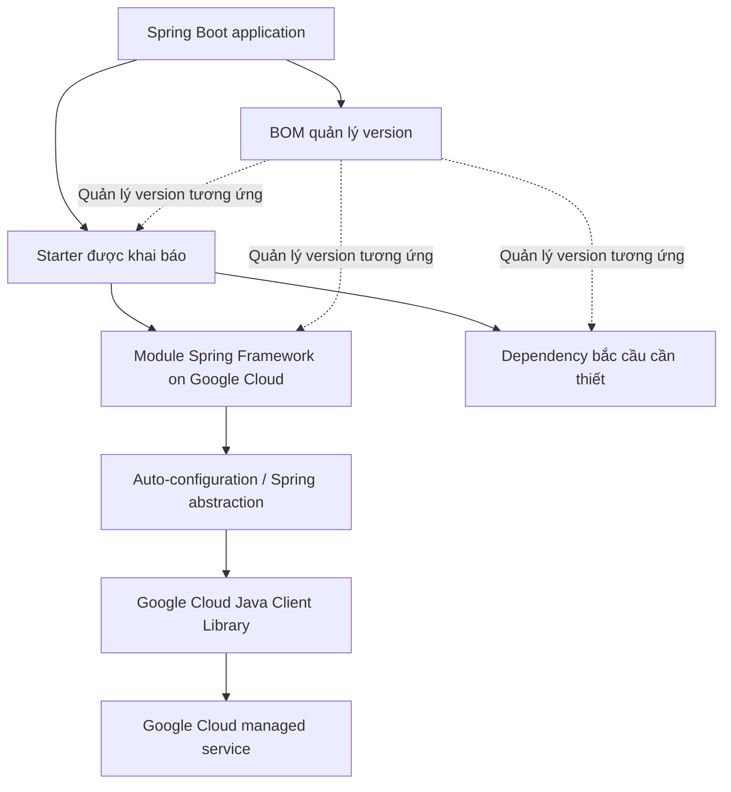

# BOM, starter và ma trận tương thích Spring Boot

Khi thêm tích hợp Google Cloud vào một ứng dụng Spring Boot, câu hỏi đầu tiên không chỉ là “cần starter nào?”. Cần chọn **đúng phiên bản thư viện cho phiên bản Spring Boot**, nhập đúng **Bill of Materials (BOM)** và chỉ thêm các **starter** tương ứng với dịch vụ sẽ sử dụng. Nếu ba lựa chọn này không khớp, dự án có thể gặp lỗi classpath, xung đột dependency, auto-configuration thất bại hoặc lỗi chỉ xuất hiện khi chạy.

Trong mô-đun **SPRING_CLOUD_PROVIDER_INTEGRATION**, Spring Boot được tích hợp với các dịch vụ managed của AWS, Azure và Google Cloud. Mỗi provider có BOM, starter, nhịp phát hành và ma trận tương thích riêng. Bài học này tập trung vào **Spring Framework on Google Cloud** (tên lịch sử thường gặp là **Spring Cloud GCP**): cách BOM quản lý dependency, starter đóng gói module nào, cách đối chiếu Spring Boot/Spring Cloud và cách kiểm tra dependency thực tế sau khi build.

## 1. Phân biệt BOM, starter và thư viện tích hợp

Ba khái niệm thường xuất hiện cạnh nhau nhưng đảm nhiệm các việc khác nhau:

| Thành phần | Vai trò | Ví dụ trong Spring Framework on Google Cloud |
| --- | --- | --- |
| **BOM (Bill of Materials)** | Quản lý tập phiên bản dependency tương thích để dự án không phải khai báo version rời rạc cho từng module | **com.google.cloud:spring-cloud-gcp-dependencies** |
| **Starter** | Dependency tiện dụng để đưa một tích hợp và các dependency cần thiết vào classpath; thường kích hoạt auto-configuration | **com.google.cloud:spring-cloud-gcp-starter-pubsub** |
| **Module/library** | Chứa API, implementation hoặc abstraction thực hiện tích hợp cụ thể | **com.google.cloud:spring-cloud-gcp-pubsub** |
| **Auto-configuration** | Tạo và cấu hình các Spring bean khi điều kiện classpath/property phù hợp | Tạo **PubSubTemplate** và các bean liên quan |
| **Google Cloud Java Client Library** | Thư viện cấp thấp gọi API dịch vụ Google Cloud | Pub/Sub Java client, Storage client, Spanner client… |

Có thể hình dung chuỗi phụ thuộc:



**BOM không tự thêm chức năng vào ứng dụng.** Nó chỉ cung cấp quy tắc quản lý phiên bản. Muốn sử dụng Pub/Sub, Storage hay Cloud SQL, ứng dụng vẫn phải khai báo starter/module tương ứng. Ngược lại, starter không thay thế BOM: nếu không có BOM hoặc version được quản lý ở nơi khác, dự án có thể phải chỉ định version trực tiếp và dễ bị lệch dependency.

## 2. BOM riêng của Spring Framework on Google Cloud

Tên dự án hiện hành trong reference documentation là **Spring Framework on Google Cloud**; nhiều tọa độ Maven vẫn giữ chuỗi **spring-cloud-gcp** do lịch sử dự án. BOM chính có tọa độ:

```text
com.google.cloud:spring-cloud-gcp-dependencies
```

BOM này quản lý phiên bản của các artifact thuộc dự án và những dependency liên quan theo từng release. Ví dụ, khi BOM quản lý starter Pub/Sub, ta có thể khai báo starter mà không ghi version ngay trên dependency.

**Ví dụ:** với dòng 8.x, dùng BOM 8.3.1 (bản phát hành ngày 29/10/2026); với dòng 7.x, dùng BOM 7.5.2 (bản phát hành ngày 30/10/2026). Đây là các patch release mới được liệt kê trong trang Releases tại thời điểm biên soạn ngày 24/11/2026. Việc chọn giữa hai dòng phải dựa trên Spring Boot compatibility, không chỉ dựa vào số version lớn hơn.

Một BOM thường được dùng theo nguyên tắc:

- Chọn **một release line** phù hợp với Spring Boot.
- Dùng patch release mới nhất trong line đó, trừ khi dự án có ràng buộc đã được kiểm thử.
- Để BOM quản lý version của các starter cùng hệ sinh thái.
- Chỉ override một dependency riêng lẻ khi có lý do kỹ thuật và đã kiểm tra tương thích.
- Ghi version BOM trong build file hoặc version catalog để các môi trường CI và máy lập trình dùng cùng một cấu hình.

BOM của Google Cloud không phải BOM của Spring Boot và cũng không phải BOM của Spring Cloud. Ba BOM này có phạm vi quản lý khác nhau; cần phối hợp đúng khi dự án sử dụng nhiều hệ sinh thái.

## 3. Ma trận tương thích Spring Boot, Spring Cloud và Spring Framework on Google Cloud

Spring Framework on Google Cloud có dependency và dependency bắc cầu tới các dự án Spring. Vì vậy, tài liệu công bố ma trận tương thích giữa **phiên bản dự án Google Cloud**, **Spring Cloud**, **Spring Boot** và **Spring Framework**.

Bảng dưới đây tổng hợp các dòng được nêu trong reference documentation và bổ sung patch release mới nhất hiển thị trên trang phát hành tại ngày 24/11/2026:

| Spring Framework on Google Cloud | Patch release tham khảo | Spring Boot tương thích | Spring Cloud tương ứng | Spring Framework | Ghi chú |
| --- | --- | --- | --- | --- | --- |
| **8.x** | 8.3.1 | 4.0.x, 4.1.x | 2025.1.x (Oakwood) | 7.0.0+ | Dòng dành cho Spring Boot 4.x theo ma trận đã công bố |
| **7.x** | 7.5.2 | 3.5.x | 2025.0.x | 6.2.8+ | Dòng dành cho Spring Boot 3.5 |
| **6.x** | 6.5.12 | 3.4.x | 2024.0.x | 6.2.0+ | Dòng dành cho Spring Boot 3.4 |
| **5.x** | 5.13.12 | 3.2.x*, 3.3.x | 2023.0.x | 6.1.x | Có ngoại lệ module Trace với Boot 3.2 |
| **4.x** | — | 3.0.x, 3.1.x | 2022.0.x | 6.x | Ma trận đánh dấu không hỗ trợ |
| **3.x** | 3.9.19 | 2.6.x, 2.7.x | 2021.0.x | 5.3.x | Dòng cũ; cần xét vòng đời hỗ trợ của Spring Boot/Spring Cloud |
| **2.x** | — | 2.4.x, 2.5.x | 2020.0.x | 5.3.x | Ma trận đánh dấu không hỗ trợ |

**\*** Với dòng 5.x, tài liệu ghi chú ngoại lệ đối với Trace khi dùng Spring Boot 3.2.x.

**Cách đọc bảng:**

- Nếu ứng dụng đang dùng **Spring Boot 4.0.x hoặc 4.1.x**, chọn dòng Google Cloud **8.x** và Spring Cloud **2025.1.x** nếu ứng dụng cũng dùng Spring Cloud.
- Nếu ứng dụng đang dùng **Spring Boot 3.5.x**, chọn dòng Google Cloud **7.x**; Spring Cloud tương ứng là **2025.0.x**.
- Nếu ứng dụng đang dùng **Spring Boot 3.4.x**, chọn dòng Google Cloud **6.x**.
- Nếu ứng dụng đang dùng **Spring Boot 3.2.x hoặc 3.3.x**, dòng Google Cloud **5.x** là dòng được tài liệu ghép tương ứng; kiểm tra ngoại lệ module cụ thể.
- Không chọn dòng **4.x** chỉ vì số version lớn hơn 3.x: bảng tương thích đánh dấu dòng 4.x là không hỗ trợ.

### Giới hạn của ma trận và phiên bản mới

Ma trận là hợp đồng tương thích được công bố cho các release line cụ thể, không phải quy tắc suy luận theo số major. Tại thời điểm biên soạn, Spring Cloud đã có release train **2026.0.x** dành cho Spring Boot **4.2.x**, nhưng ma trận Spring Framework on Google Cloud được tham chiếu ở đây mới nêu dòng 8.x với Boot 4.0.x/4.1.x. Vì vậy, **không tự suy ra rằng Google Cloud 8.x hỗ trợ Boot 4.2.x** chỉ vì Spring Cloud có release train tương ứng. Chờ ma trận của dự án Google Cloud cập nhật hoặc xác minh bằng release notes/chính sách hỗ trợ chính thức trước khi nâng cấp.

Tương tự, một patch release mới của BOM không tự động mở rộng dải Spring Boot được hỗ trợ. Hãy đọc compatibility matrix và release notes của chính release line.

## 4. Chọn BOM theo Spring Boot đang sử dụng

Thực hiện theo thứ tự:

1. **Xác định Spring Boot version thực tế** từ parent/BOM hoặc Gradle plugin của dự án.
2. **Tra bảng tương thích của Spring Framework on Google Cloud** để chọn release line.
3. Nếu ứng dụng dùng các dự án Spring Cloud (Config, Stream, Gateway, Bus…), tra tiếp **Spring Cloud release train** tương ứng với Spring Boot.
4. Chọn **patch release** mới nhất trong line đã chọn, nếu không có ràng buộc nội bộ.
5. Kiểm tra Java baseline, module cụ thể, ghi chú ngoại lệ và các thay đổi migration.
6. Build lại và kiểm tra dependency graph, không chỉ nhìn file khai báo.

Ví dụ quyết định:

| Tình huống | BOM Google Cloud nên bắt đầu kiểm tra | BOM Spring Cloud nếu có sử dụng |
| --- | --- | --- |
| Spring Boot 4.0.x | **com.google.cloud:spring-cloud-gcp-dependencies:8.3.1** | **org.springframework.cloud:spring-cloud-dependencies:2025.1.x** |
| Spring Boot 4.1.x | Dòng 8.x, kiểm tra patch mới nhất | Dòng 2025.1.x |
| Spring Boot 3.5.x | **com.google.cloud:spring-cloud-gcp-dependencies:7.5.2** | Dòng 2025.0.x |
| Spring Boot 3.4.x | Dòng 6.x, kiểm tra patch mới nhất | Dòng 2024.0.x |
| Spring Boot 3.2/3.3 | Dòng 5.x, kiểm tra ngoại lệ module | Dòng 2023.0.x |

Các giá trị 2025.1.x, 2025.0.x trong bảng là **release line**, không phải version cụ thể có thể copy nguyên vào build file. Khi triển khai, chọn patch release chính thức trong line đó. Không nhập chuỗi x làm version Maven/Gradle.

### Tại sao phải kiểm tra cả Spring Cloud?

Spring Framework on Google Cloud và Spring Cloud là hai dự án có BOM riêng. Nếu chỉ thêm GCP starter, có thể ứng dụng không cần Spring Cloud BOM. Nhưng nếu ứng dụng dùng thêm Spring Cloud Config, Stream hoặc Bus, các dependency đó cần được quản lý theo release train phù hợp với Spring Boot.

**Hai việc phải đồng thời đúng:**

- BOM Google Cloud phù hợp với Spring Boot/Spring Framework theo ma trận của Google Cloud.
- BOM Spring Cloud phù hợp với Spring Boot theo ma trận của Spring Cloud.

Không thể dùng một BOM để thay thế BOM còn lại.

## 5. Khai báo BOM và starter bằng Maven

Giả sử ứng dụng dùng Spring Boot 4.0.x và cần publish sự kiện lên Google Cloud Pub/Sub. Dự án đã có Spring Boot parent hoặc Spring Boot BOM quản lý phiên bản Boot; phần sau thêm BOM Google Cloud và starter Pub/Sub.

```xml
<dependencyManagement>
    <dependencies>
        <dependency>
            <groupId>com.google.cloud</groupId>
            <artifactId>spring-cloud-gcp-dependencies</artifactId>
            <version>8.3.1</version>
            <type>pom</type>
            <scope>import</scope>
        </dependency>

        <!-- Chỉ thêm BOM này nếu dự án dùng các module Spring Cloud. -->
        <dependency>
            <groupId>org.springframework.cloud</groupId>
            <artifactId>spring-cloud-dependencies</artifactId>
            <version>2025.1.5</version>
            <type>pom</type>
            <scope>import</scope>
        </dependency>
    </dependencies>
</dependencyManagement>

<dependencies>
    <dependency>
        <groupId>com.google.cloud</groupId>
        <artifactId>spring-cloud-gcp-starter-pubsub</artifactId>
    </dependency>
</dependencies>
```

Trong ví dụ, BOM Google Cloud quản lý version cho starter Pub/Sub. BOM Spring Cloud chỉ cần thiết nếu ứng dụng thực sự có dependency Spring Cloud; không cần thêm chỉ vì artifact Google Cloud có chữ spring-cloud-gcp.

Nếu dự án đang dùng Spring Boot 3.5.x, thay BOM Google Cloud bằng dòng **7.x** (ví dụ **7.5.2**) và Spring Cloud release train bằng dòng **2025.0.x**. Không giữ BOM 8.x chỉ vì nó là version mới hơn.

### Nếu không dùng Spring Boot parent

Có thể import Spring Boot BOM trong dependencyManagement cùng các BOM khác, nhưng phải quản lý rõ thứ tự và phạm vi version. Không khai báo đồng thời nhiều phiên bản của cùng một dependency một cách tùy tiện. Sau khi thêm BOM, xem effective POM để biết version cuối cùng mà Maven chọn.

## 6. Khai báo BOM và starter bằng Gradle

Với Groovy DSL:

```groovy
dependencies {
    implementation platform(
        "com.google.cloud:spring-cloud-gcp-dependencies:8.3.1"
    )

    // Chỉ cần nếu ứng dụng có sử dụng các dự án Spring Cloud.
    implementation platform(
        "org.springframework.cloud:spring-cloud-dependencies:2025.1.5"
    )

    implementation "com.google.cloud:spring-cloud-gcp-starter-pubsub"
}
```

Với Kotlin DSL:

```kotlin
dependencies {
    implementation(
        platform("com.google.cloud:spring-cloud-gcp-dependencies:8.3.1")
    )

    // Chỉ cần nếu ứng dụng có sử dụng các dự án Spring Cloud.
    implementation(
        platform("org.springframework.cloud:spring-cloud-dependencies:2025.1.5")
    )

    implementation("com.google.cloud:spring-cloud-gcp-starter-pubsub")
}
```

**platform(...)** đưa BOM vào dependency constraints để Gradle chọn các version được quản lý. Nếu cần ép version mạnh hơn, Gradle có **enforcedPlatform(...)**, nhưng không nên dùng như cách chữa xung đột mặc định: nó có thể ép các dependency bắc cầu xuống version không tương thích.

Trong dự án thực tế, có thể đặt version BOM trong **gradle.properties**, version catalog hoặc convention plugin để tránh lặp version ở nhiều module. Điều quan trọng là **mọi module cùng một ứng dụng dùng chung release line đã chọn**.

## 7. Starter cung cấp gì và nên chọn starter nào?

Starter là điểm vào thuận tiện cho một tích hợp. Tài liệu Spring Framework on Google Cloud mô tả các starter tiêu biểu sau:

| Nhu cầu | Maven artifact | Chức năng |
| --- | --- | --- |
| Core/project/credentials | **com.google.cloud:spring-cloud-gcp-starter** | Auto-configure authentication và Google project settings |
| Pub/Sub messaging | **com.google.cloud:spring-cloud-gcp-starter-pubsub** | Tích hợp publish/subscribe với Google Cloud Pub/Sub |
| Object storage | **com.google.cloud:spring-cloud-gcp-starter-storage** | Tích hợp Cloud Storage và Spring Resource |
| Cloud Spanner | **com.google.cloud:spring-cloud-gcp-starter-data-spanner** | Tích hợp Spanner với Spring Data |
| Cloud Datastore | **com.google.cloud:spring-cloud-gcp-starter-data-datastore** | Tích hợp Datastore |
| Cloud SQL MySQL | **com.google.cloud:spring-cloud-gcp-starter-sql-mysql** | Cấu hình kết nối Cloud SQL cho MySQL |
| Cloud SQL PostgreSQL | **com.google.cloud:spring-cloud-gcp-starter-sql-postgresql** | Cấu hình kết nối Cloud SQL cho PostgreSQL |
| Cloud Logging | **com.google.cloud:spring-cloud-gcp-starter-logging** | Tích hợp Cloud Logging |
| Cloud Trace | **com.google.cloud:spring-cloud-gcp-starter-trace** | Instrumentation cho Cloud Trace |
| Runtime Config | **com.google.cloud:spring-cloud-gcp-starter-config** | Tích hợp Google Runtime Configuration API trong vai trò Spring Cloud Config server |
| Cloud Vision | **com.google.cloud:spring-cloud-gcp-starter-vision** | Tích hợp Google Cloud Vision |
| Security IAP | **com.google.cloud:spring-cloud-gcp-starter-security-iap** | Bảo vệ ứng dụng với Identity-Aware Proxy |
| Security Firebase | **com.google.cloud:spring-cloud-gcp-starter-security-firebase** | Tích hợp xác thực Firebase |
| AlloyDB | **com.google.cloud:spring-cloud-gcp-starter-alloydb** | Tích hợp AlloyDB với PostgreSQL |

Danh sách đầy đủ có thể thay đổi theo release line. Một starter có thể chỉ xuất hiện từ một phiên bản nhất định hoặc có điều kiện tương thích riêng. Kiểm tra danh sách artifact trong reference documentation đúng version trước khi thêm dependency.

### Starter và module bên dưới

Ví dụ với Pub/Sub:

```text
com.google.cloud:spring-cloud-gcp-starter-pubsub
    └── com.google.cloud:spring-cloud-gcp-pubsub
        └── Google Cloud Pub/Sub Java client và dependency cần thiết
```

Khi đã khai báo **spring-cloud-gcp-starter-pubsub**, thông thường **không cần khai báo lại module spring-cloud-gcp-pubsub** vì starter đã kéo module đó và dependency bắc cầu cần thiết. Chỉ khai báo module trực tiếp khi có lý do cụ thể, chẳng hạn muốn tự kiểm soát cách cấu hình thay vì dùng starter; khi đó phải hiểu rõ bean nào ứng dụng cần tự tạo.

Starter cũng không tự tạo topic, bucket, database hay IAM permission. Nó chuẩn bị tích hợp trong ứng dụng; resource và quyền vẫn phải được thiết lập ở Google Cloud.

## 8. Ví dụ chọn starter theo bài toán

### 8.1. Ứng dụng chỉ publish sự kiện Pub/Sub

Khai báo BOM Google Cloud và starter Pub/Sub:

```xml
<dependency>
    <groupId>com.google.cloud</groupId>
    <artifactId>spring-cloud-gcp-starter-pubsub</artifactId>
</dependency>
```

Cấu hình project và topic:

```yaml
spring:
  cloud:
    gcp:
      project-id: ${GOOGLE_CLOUD_PROJECT}

app:
  messaging:
    orders-topic: ${ORDERS_TOPIC}
```

Starter cung cấp các bean tích hợp Pub/Sub, chẳng hạn **PubSubTemplate**, theo phiên bản được chọn. Ứng dụng vẫn cần project tồn tại, Pub/Sub API được bật, topic được tạo và workload identity có quyền publish phù hợp.

### 8.2. Ứng dụng ghi object và gửi sự kiện

Nếu cùng ứng dụng vừa lưu tài liệu lên Cloud Storage vừa publish event, có thể khai báo hai starter:

```xml
<dependencies>
    <dependency>
        <groupId>com.google.cloud</groupId>
        <artifactId>spring-cloud-gcp-starter-storage</artifactId>
    </dependency>

    <dependency>
        <groupId>com.google.cloud</groupId>
        <artifactId>spring-cloud-gcp-starter-pubsub</artifactId>
    </dependency>
</dependencies>
```

Hai starter được quản lý bởi cùng BOM Google Cloud. Mỗi tích hợp vẫn có cấu hình và quyền riêng: storage cần quyền phù hợp trên bucket, Pub/Sub cần quyền publish trên topic. Không vì cùng dùng một project mà mặc định mọi quyền đều giống nhau.

### 8.3. Ứng dụng dùng Cloud SQL

Chọn starter theo database engine:

- MySQL: **spring-cloud-gcp-starter-sql-mysql**.
- PostgreSQL: **spring-cloud-gcp-starter-sql-postgresql**.

Cloud SQL starter có thể cung cấp cấu hình **DataSource** dựa trên property và thông tin instance. Ứng dụng vẫn cần JDBC driver, database instance, API được bật, network và danh tính/quyền phù hợp. Không thêm cả hai starter nếu ứng dụng chỉ kết nối một engine và không có nhu cầu riêng.

## 9. BOM Google Cloud, BOM Spring Cloud và BOM Spring Boot

Một ứng dụng có thể cần nhiều BOM cùng lúc:

| BOM | Maven coordinates | Quản lý chủ yếu |
| --- | --- | --- |
| Spring Boot BOM | **org.springframework.boot:spring-boot-dependencies** | Dependency thuộc Spring Boot và hệ sinh thái được Boot quản lý |
| Spring Cloud BOM | **org.springframework.cloud:spring-cloud-dependencies** | Các dự án trong Spring Cloud release train |
| Spring Framework on Google Cloud BOM | **com.google.cloud:spring-cloud-gcp-dependencies** | Starter/module Google Cloud và dependency liên quan do dự án quản lý |
| Google Cloud Libraries BOM | **com.google.cloud:libraries-bom** | Các Google Cloud Java Client Libraries khi cần quản lý trực tiếp |

Thông thường, **không cần tự import libraries-bom riêng** nếu BOM Spring Framework on Google Cloud đã quản lý các thư viện cần thiết. Chỉ thêm BOM khác khi dự án có dependency trực tiếp tới Google Cloud Java Client Libraries ngoài phạm vi được GCP BOM quản lý hoặc có yêu cầu version cụ thể đã kiểm tra.

### Tránh quản lý cùng một dependency ở nhiều nơi

Ví dụ rủi ro:

- GCP BOM chọn version của Google Cloud client library A.
- Một BOM khác hoặc explicit dependency trong ứng dụng ép library A về version khác.
- Kết quả compile có thể thành công nhưng runtime gặp **NoSuchMethodError**, **NoClassDefFoundError** hoặc lỗi serialization/authentication.

Khi có nhiều BOM, cần xác định nguồn quản lý version cuối cùng cho dependency bị trùng. Maven có quy tắc dependency management và import BOM; Gradle có platform constraints và conflict resolution. Đừng giả định thứ tự khai báo BOM trong mọi build tool có cùng semantics.

Nếu cần override, ghi lại:
1. Dependency nào bị override.
2. BOM nào đang quản lý version mặc định.
3. Lý do cần version khác.
4. Các module phụ thuộc đã được kiểm thử.
5. Cách rollback nếu xuất hiện lỗi runtime.

## 10. Kiểm tra dependency sau khi thêm BOM/starter

File build chỉ cho biết **đã khai báo gì**. Dependency graph mới cho thấy **thực tế ứng dụng nhận version nào** sau khi xử lý BOM, transitive dependency và conflict resolution.

### Maven

Xem cây dependency:

```bash
mvn dependency:tree
```

Lọc các nhóm liên quan:

```bash
mvn dependency:tree -Dincludes=com.google.cloud,org.springframework.cloud,org.springframework.boot
```

Xem POM hiệu lực:

```bash
mvn help:effective-pom
```

Kiểm tra:
- Chỉ có một release line GCP dự kiến.
- Starter cần thiết có mặt.
- Không vô tình có module cùng chức năng từ hai version khác nhau.
- Spring Boot và Spring Cloud nằm trong ma trận tương thích.
- Không có explicit version ghi đè BOM mà không có chủ đích.

### Gradle

Xem dependency runtime:

```bash
./gradlew dependencies --configuration runtimeClasspath
```

Xem lý do Gradle chọn version cho một artifact:

```bash
./gradlew dependencyInsight --dependency spring-cloud-gcp-starter-pubsub --configuration runtimeClasspath
```

Có thể dùng **dependencyInsight** với tên Google Cloud client library hoặc Spring module đang xung đột để tìm nguồn constraint. Trên Windows, chạy **gradlew.bat** thay cho **./gradlew** nếu môi trường shell yêu cầu.

### Những dấu hiệu cần điều tra

| Triệu chứng | Khả năng nguyên nhân | Hướng xử lý |
| --- | --- | --- |
| **NoSuchMethodError** khi chạy | Dependency runtime lệch version với API mà module được biên dịch | Kiểm tra dependency tree/effective POM |
| Không tìm thấy class auto-configuration | Thiếu starter hoặc nhầm artifact ID | Kiểm tra đúng starter và version |
| Spring Boot báo không tương thích | Chọn GCP/Spring Cloud release line không khớp Boot | Tra compatibility matrix, không tắt compatibility verifier để né lỗi |
| Bean không được tạo | Auto-configuration condition không thỏa, thiếu property hoặc dependency | Xem condition evaluation report và cấu hình |
| Hai client hoặc hai bean cùng loại | Thêm nhiều starter/auto-configuration chồng lấn | Kiểm tra module, điều kiện enable/disable và bean custom |
| Runtime dùng version không mong đợi | Explicit version, platform hoặc BOM khác đang điều khiển | Xem dependencyInsight/effective POM |

## 11. Các sai lầm phổ biến khi chọn BOM và starter

1. **Chọn BOM mới nhất mà không xem Spring Boot.** GCP 8.x mới hơn 7.x nhưng không có nghĩa phù hợp với ứng dụng Boot 3.5.
2. **Nhầm BOM Google Cloud với BOM Spring Cloud.** Chúng quản lý các nhóm artifact khác nhau; một ứng dụng dùng cả hai có thể cần import cả hai.
3. **Tưởng BOM tự thêm module.** BOM chỉ quản lý version; starter mới đưa tích hợp vào classpath.
4. **Thêm module bên dưới cùng với starter một cách không cần thiết.** Điều này làm build file dư thừa và dễ tạo xung đột khi version không đồng nhất.
5. **Tự đặt version trên từng starter dù đã có BOM.** Việc này vô hiệu hóa một phần lợi ích của BOM và làm khó nâng cấp.
6. **Đổi Spring Boot nhưng giữ nguyên GCP BOM.** Cần tra lại ma trận sau mỗi lần nâng major/minor framework.
7. **Dùng một BOM Google Cloud cho mọi major Boot.** Các release line khác nhau có thể dựa trên các generation Spring khác nhau.
8. **Nghĩ rằng starter cấp quyền cloud.** Starter chỉ cấu hình client; IAM, resource, API enablement và network vẫn do môi trường Google Cloud quản lý.
9. **Tắt compatibility verifier để build qua.** Nếu verifier báo không tương thích, hãy xử lý nguyên nhân thay vì che tín hiệu.
10. **Không kiểm tra dependency runtime.** Build thành công không bảo đảm classpath runtime đã nhất quán.

## 12. Quy trình nâng cấp BOM và starter an toàn

Khi nâng từ GCP 7.x lên 8.x, không chỉ thay một con số trong BOM. Cần xem đây là một đợt nâng cấp framework:

1. Xác định phiên bản Spring Boot mới và dòng Spring Cloud nếu có.
2. Tra compatibility matrix của Spring Framework on Google Cloud.
3. Đọc release notes/migration guide từ major hiện tại tới major đích.
4. Nâng BOM và starter theo một nhánh nhất quán; không nâng từng module riêng lẻ nếu không có hướng dẫn.
5. Kiểm tra Java baseline, package/API thay đổi và property đã bị thay thế.
6. Chạy unit test, Spring context test và integration test cho các dịch vụ đang dùng.
7. Kiểm tra IAM, ADC/workload identity, project ID và resource mapping trong môi trường test.
8. Xem dependency tree và xác nhận không còn version override ngoài dự kiến.
9. Rollout có kiểm soát, theo dõi authentication, API error, latency và message processing.
10. Giữ khả năng rollback về BOM và image trước nếu adapter hoặc client gặp lỗi runtime.

Nếu ứng dụng đang dùng nhiều provider, nâng GCP BOM không đồng nghĩa phải nâng Spring Cloud AWS hoặc Spring Cloud Azure cùng lúc. Tuy nhiên, tất cả thư viện phải tiếp tục tương thích với **cùng Spring Boot/Spring Framework generation**. Quản lý thay đổi theo từng provider giúp khoanh vùng lỗi tốt hơn.

## 13. Bài thực hành: chọn BOM và starter cho ứng dụng đơn hàng

Một ứng dụng Spring Boot có các yêu cầu:

- Ghi hóa đơn vào Google Cloud Storage.
- Publish sự kiện **order-created** lên Pub/Sub.
- Lưu metadata đơn hàng vào Cloud SQL PostgreSQL.
- Có thể dùng Spring Cloud Stream để xử lý event theo function.

Thực hiện:

1. Chọn phiên bản Spring Boot. Nếu dùng Boot 4.0.x/4.1.x, tra dòng GCP 8.x; nếu dùng Boot 3.5.x, tra dòng GCP 7.x.
2. Import BOM **com.google.cloud:spring-cloud-gcp-dependencies** tương ứng.
3. Thêm ba starter cần thiết: Storage, Pub/Sub và Cloud SQL PostgreSQL.
4. Chỉ import Spring Cloud BOM nếu thật sự dùng Spring Cloud Stream hoặc module Spring Cloud khác; chọn release train khớp Boot.
5. Khai báo project ID và cấu hình tên bucket, topic, database instance theo deployment. Không đưa private key/password vào Git.
6. Cấp IAM permission tối thiểu cho principal của workload: quyền storage phù hợp, Pub/Sub publisher và quyền kết nối database tương ứng.
7. Chạy dependency tree/effective POM để kiểm tra version cuối.
8. Viết Spring context test xác nhận starter/bean được cấu hình và integration test trên project test hoặc emulator phù hợp.
9. Thử cố ý thay BOM sang release line không tương thích trong branch thử nghiệm để quan sát compatibility verifier và dependency resolution; khôi phục version hợp lệ sau khi hoàn thành.
10. Ghi lại lý do chọn BOM, starter, phiên bản Boot và release train để người khác có thể tái lập build.

### Kết quả mong đợi

Người học có thể giải thích:
- BOM quản lý version nào và không làm việc gì.
- Starter kéo module và dependency nào.
- Vì sao Boot 3.5 và Boot 4.x cần các GCP release line khác nhau.
- Khi nào cần Spring Cloud BOM bên cạnh GCP BOM.
- Cách kiểm tra version thực tế trong classpath và xử lý xung đột.

## 14. Ghi nhớ

- BOM Google Cloud có tọa độ **com.google.cloud:spring-cloud-gcp-dependencies**; nó quản lý version, không tự thêm tích hợp vào classpath.
- Starter có dạng **com.google.cloud:spring-cloud-gcp-starter-***, đóng gói module và dependency cần thiết cho từng dịch vụ.
- **Chọn BOM theo ma trận tương thích Spring Boot**, không chọn version mới nhất một cách máy móc.
- Dòng 8.x được tài liệu ghép với Boot 4.0.x/4.1.x; dòng 7.x với Boot 3.5.x; các dòng cũ cần kiểm tra kỹ support và ngoại lệ module.
- Spring Cloud BOM **org.springframework.cloud:spring-cloud-dependencies** là BOM riêng, chỉ thêm khi ứng dụng dùng dự án Spring Cloud.
- Kiểm tra **dependency:tree**, **effective-pom**, Gradle **dependencies** và **dependencyInsight** để biết version thực sự được chọn.
- Starter không tạo resource và không cấp IAM permission; project, API, identity, role và network vẫn phải được cấu hình tại Google Cloud.

## Tài liệu tham khảo chính thức

1. [Spring Framework on Google Cloud — Getting Started và compatibility matrix](https://googlecloudplatform.github.io/spring-cloud-gcp/8.2.2/reference/html/getting-started.html)
2. [Spring Framework on Google Cloud — Reference Documentation](https://googlecloudplatform.github.io/spring-cloud-gcp/reference/html/)
3. [Spring Framework on Google Cloud — Releases](https://github.com/GoogleCloudPlatform/spring-cloud-gcp/releases)
4. [Spring Cloud — Release train và Spring Boot compatibility](https://spring.io/projects/spring-cloud/)
5. [Spring Boot — System Requirements](https://docs.spring.io/spring-boot/system-requirements.html)

Ma trận và patch version trong bài phản ánh các tài liệu/phát hành được kiểm tra ngày 24/11/2026. Khi bắt đầu dự án hoặc nâng cấp, hãy kiểm tra lại trang compatibility và release notes của đúng version đang chọn.
