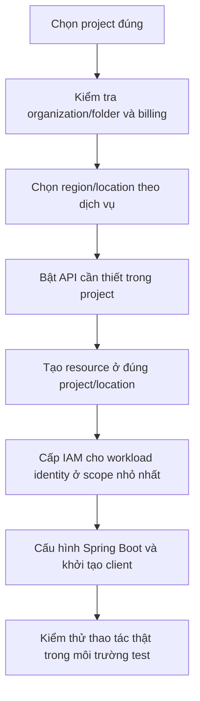
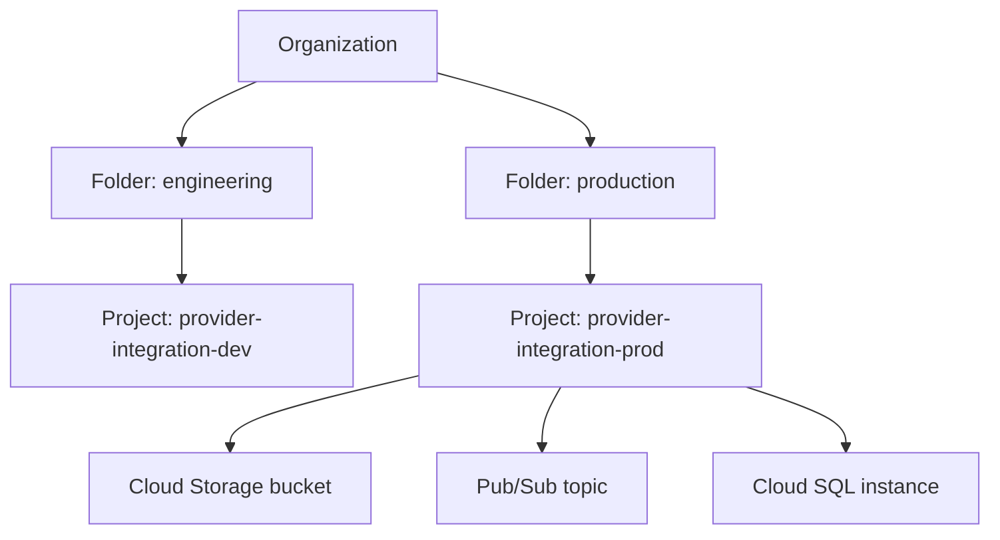
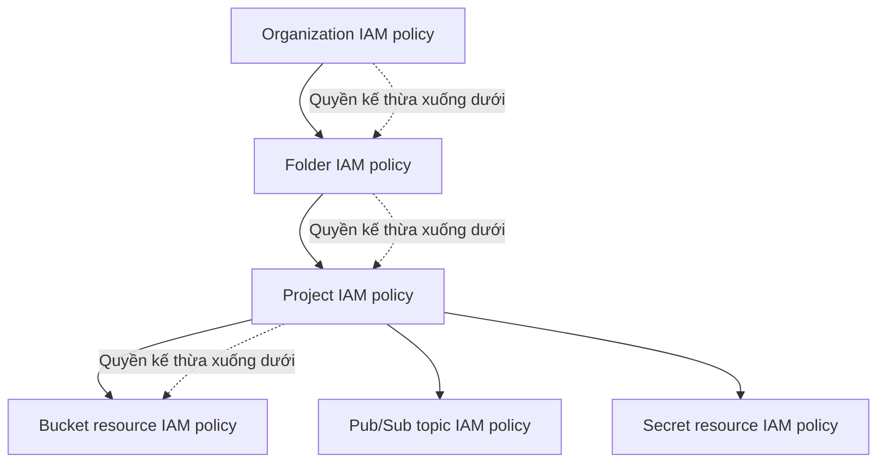

# Project ID, region, API cần bật và phạm vi tài nguyên

Một ứng dụng Spring Boot có thể dùng đúng thư viện Google Cloud nhưng vẫn không hoạt động nếu cấu hình nhầm project, chọn vị trí không được dịch vụ hỗ trợ, chưa bật API hoặc workload không có quyền trên tài nguyên đích. Bốn vấn đề này thường xuất hiện cùng nhau, nhưng thuộc bốn lớp khác nhau: **Project ID**, **region/location**, **API enablement** và **resource/IAM scope**.

Trong mô-đun **SPRING_CLOUD_PROVIDER_INTEGRATION**, Spring Boot được tích hợp với các dịch vụ managed của AWS, Azure và Google Cloud. Bài học này tập trung vào nền tảng Google Cloud: xác định project đúng, chọn region phù hợp với từng dịch vụ, bật API cần thiết và giới hạn quyền ở phạm vi tài nguyên nhỏ nhất có thể.

## 1. Bốn lớp cần xác định trước khi tạo client

| Lớp | Câu hỏi cần trả lời | Ví dụ | Nơi cấu hình/quản lý |
| --- | --- | --- | --- |
| **Project** | Ứng dụng gọi API và sử dụng tài nguyên thuộc dự án nào? | `provider-integration-prod` | Resource Manager, Spring configuration, môi trường triển khai |
| **Region/location** | Tài nguyên hoặc thao tác được đặt ở khu vực nào? | `asia-southeast1`, `asia-southeast2` | Cấu hình riêng của dịch vụ/tài nguyên |
| **API enablement** | Project đã bật API mà client cần gọi chưa? | `pubsub.googleapis.com` | Service Usage / API Library |
| **Resource scope và IAM** | Tài nguyên cụ thể nào được phép truy cập và principal có quyền gì? | Bucket `invoice-prod`, topic `orders-created` | Resource hierarchy, IAM policy, workload identity |

Một quy trình khởi tạo hợp lý là:



**Không bước nào thay thế bước khác.** Bật Pub/Sub API không tạo topic; tạo topic không tự cấp quyền publish; cấp quyền publish không tự chọn project đúng; Project ID đúng cũng không quyết định bucket phải ở region nào.

## 2. Project name, Project ID và Project number

Google Cloud cung cấp ba thông tin thường được gọi chung là “tên project”, nhưng có vai trò khác nhau:

| Giá trị | Ai tạo/cấp? | Tính chất | Khi nào dùng |
| --- | --- | --- | --- |
| **Project name** | Người tạo project đặt | Tên hiển thị; có thể đổi | Nhận diện trong Console và tài liệu vận hành |
| **Project ID** | Người tạo chọn hoặc Google Cloud gợi ý/cấp | Chuỗi định danh duy nhất trên toàn Google Cloud; ID đã xóa không được tái sử dụng | Cấu hình ứng dụng, lệnh CLI và resource name thường gặp |
| **Project number** | Google Cloud cấp | Số định danh của project | Một số API/resource name, service agent và thao tác quản trị cần số project |

Ví dụ minh họa:

```text
Project name:   Provider Integration - Production
Project ID:     provider-integration-prod
Project number: 123456789012
```

`provider-integration-prod` là Project ID dùng trong cấu hình Spring Boot. `123456789012` là Project number do Google Cloud cấp; không tự thay nó bằng Project ID trong mọi API. Một số resource name và service agent sử dụng project number, trong khi nhiều resource name khác dùng Project ID.

**Project name không phải định danh để code phụ thuộc.** Tên hiển thị có thể được đổi để phản ánh tên nhóm hoặc môi trường; ứng dụng nên dùng Project ID được quản lý như một cấu hình triển khai.

### Project thuộc resource hierarchy

Google Cloud tổ chức tài nguyên theo cấu trúc cha/con:



- **Organization** thường đại diện cho doanh nghiệp và là gốc của hệ thống quản trị.
- **Folder** là tầng nhóm tùy chọn, có thể đại diện cho bộ phận, nhóm hoặc môi trường.
- **Project** là đơn vị tổ chức cơ bản chứa service resources, cấu hình, quyền và metadata của workload.
- **Service resource** là tài nguyên cụ thể như VM, bucket, topic, database hoặc secret.

IAM và organization policy có thể được đặt ở organization/folder/project và **kế thừa xuống các resource con**. Do đó, một quyền được cấp ở folder production có thể ảnh hưởng tới mọi project con. Khi điều tra một quyền bất ngờ xuất hiện, cần xem cả policy kế thừa thay vì chỉ nhìn policy trực tiếp của bucket/topic.

Tách project theo môi trường dev/staging/prod giúp giới hạn ảnh hưởng của cấu hình, quota, billing và quyền truy cập. Tài nguyên trong một project có thể kết nối với nhau theo network và quy tắc location; truy cập tài nguyên ở project khác cần cấu hình kết nối và IAM phù hợp, không tự động được phép.

## 3. Đặt Project ID trong Spring Boot và Google Cloud SDK

Spring Framework on Google Cloud (tên lịch sử thường gặp là Spring Cloud GCP) hỗ trợ cấu hình project qua property:

```yaml
spring:
  cloud:
    gcp:
      project-id: ${GOOGLE_CLOUD_PROJECT}
```

`spring.cloud.gcp.project-id` là property của tích hợp Spring Framework on Google Cloud. Giá trị `GOOGLE_CLOUD_PROJECT` được cung cấp theo môi trường triển khai. Với mỗi deployment, nên khai báo rõ project ID để tránh việc client vô tình dùng project được phát hiện từ máy lập trình hoặc credential context.

Ví dụ profile production:

```yaml
# application-prod.yml
spring:
  cloud:
    gcp:
      project-id: provider-integration-prod
```

Trong hệ thống thực tế, giá trị project nên được inject qua environment/Config Data thay vì hardcode vào một artifact dùng chung. Có thể kiểm tra property hiệu lực qua cấu hình đã bind và Actuator trong môi trường được bảo vệ.

### 3.1. Không nhầm project của gcloud CLI với project của ứng dụng

Google Cloud CLI lưu một **project mặc định cho cấu hình CLI đang hoạt động**:

```bash
gcloud config get-value project
gcloud config set project provider-integration-dev
gcloud config list --format="text(core.project)"
```

Các lệnh trên thay đổi/đọc project mặc định mà `gcloud` dùng khi lệnh không chỉ định project khác. Chúng **không tự sửa** biến môi trường `GOOGLE_CLOUD_PROJECT`, không tự đổi property `spring.cloud.gcp.project-id` của tiến trình Spring Boot và cũng không thay đổi project gắn với mọi credentials.

Để tránh bật API hoặc tạo resource nhầm project, ưu tiên truyền rõ `--project` trong script:

```bash
gcloud projects describe provider-integration-prod \
  --format="value(projectId,projectNumber,name)"

gcloud services list --enabled \
  --project=provider-integration-prod
```

Trong CI/CD, project ID nên là input rõ ràng của pipeline, được kiểm tra với môi trường đích trước khi chạy lệnh thay đổi hạ tầng.

### 3.2. Project ID và Application Default Credentials là hai đầu vào khác nhau

Project ID trả lời **client làm việc trong project nào**; credential trả lời **request được gửi dưới danh tính nào**.

Ở máy phát triển, `gcloud auth login` đăng nhập cho Google Cloud CLI. Để thư viện client sử dụng Application Default Credentials (ADC) từ tài khoản phát triển, thường dùng:

```bash
gcloud auth application-default login
```

Trên môi trường cloud, ưu tiên service account gắn với workload hoặc Workload Identity Federation/ADC phù hợp. Không đóng gói service account private key vào repository hoặc image chỉ để “chọn project”.

Một ứng dụng có thể dùng Project ID A làm project mặc định nhưng credential đại diện principal được cấp từ project B. Điều này không nhất thiết sai, nhưng phải hiểu rõ project tiêu thụ API, project sở hữu resource và IAM policy của resource. Không dùng việc ADC tìm được credential làm bằng chứng rằng Project ID và quyền đã đúng.

## 4. Region, zone, multi-region và location không phải một thuộc tính chung

Google Cloud có các phạm vi địa lý khác nhau:

| Phạm vi | Ý nghĩa | Ví dụ |
| --- | --- | --- |
| **Global** | Resource hoặc thao tác dùng phạm vi toàn cục trong universe của Google Cloud | Một số network resource và API endpoint |
| **Region** | Khu vực địa lý độc lập, gồm nhiều zone | `asia-southeast1` (Singapore), `asia-southeast2` (Jakarta) |
| **Zone** | Khu vực triển khai bên trong một region; được xem như một failure domain | `asia-southeast1-a` |
| **Dual-region** | Cặp hai region được cấu hình cho một số dịch vụ lưu trữ | Một location code đại diện hai region |
| **Multi-region** | Khu vực địa lý lớn gồm nhiều region | `ASIA`, `EU`, `US` trong Cloud Storage |

Region và zone là các abstraction của hạ tầng vật lý. Zone được xem là một failure domain; triển khai trên nhiều zone trong cùng region giúp tăng khả năng chịu lỗi của sự cố zone. Phân tán qua nhiều region có thể tăng mức độc lập khi một region gặp sự cố, nhưng đòi hỏi thiết kế replication, consistency, network, chi phí và disaster recovery riêng.

### 4.1. Không phải mọi dịch vụ đều có cùng một region

Vị trí được chọn **theo từng dịch vụ và resource**:

- Compute Engine VM thường nằm trong một zone.
- Một số địa chỉ IP là regional resource.
- Cloud Storage bucket có location là region, dual-region hoặc multi-region theo lựa chọn được hỗ trợ.
- Cloud SQL instance có region cụ thể.
- Spanner instance configuration xác định topology/location của instance.
- Pub/Sub có global, regional và locational endpoint; message storage policy có thể giới hạn vùng lưu trữ/xử lý.

Vì vậy, không nên tạo một biến `GCP_REGION` duy nhất rồi áp dụng cho mọi API mà không kiểm tra semantics. Một ứng dụng dùng Cloud Storage ở `asia-southeast1` có thể publish Pub/Sub qua global endpoint, trong khi Cloud SQL instance lại có location được chọn riêng.

### 4.2. Chọn location theo tiêu chí nào?

| Tiêu chí | Câu hỏi cần xem xét |
| --- | --- |
| **Độ trễ** | Người dùng, workload, database và dịch vụ phụ thuộc nằm ở đâu? |
| **Data residency** | Dữ liệu có phải lưu trữ/xử lý trong quốc gia hoặc khu vực cụ thể không? |
| **Tính sẵn sàng** | Dịch vụ hỗ trợ regional, dual-region hay multi-region? Cần chịu lỗi zone hay region? |
| **Khả năng sản phẩm** | Dịch vụ và tính năng cần dùng có được cung cấp ở region đó không? |
| **Chi phí** | Giá lưu trữ, request, replication và truyền dữ liệu khác nhau thế nào? |
| **Phụ thuộc liên vùng** | Database, bucket, message processor và compute có phải truyền dữ liệu qua region khác không? |

Không chọn region chỉ vì nó gần về mặt địa lý. Phải xét thêm SLA, khả năng cung cấp sản phẩm, yêu cầu tuân thủ, nơi lưu dữ liệu và đường đi mạng.

### 4.3. Ví dụ với Cloud Storage

Với bucket, location quyết định nơi dữ liệu object được lưu. Ví dụ:

```yaml
app:
  gcp:
    storage:
      bucket: invoice-archive-prod
      location: asia-southeast1
```

Hai key `app.gcp.storage.bucket` và `app.gcp.storage.location` ở đây là **namespace do ứng dụng tự định nghĩa**; chúng không phải property chung của Spring Cloud GCP. Khi tạo bucket, phải truyền location cho thao tác tạo resource. Chỉ đổi giá trị YAML sau đó **không di chuyển dữ liệu hoặc thay location của bucket hiện có**. Nếu cần đổi location, kiểm tra tính năng relocation và điều kiện dịch vụ hỗ trợ; phương án phổ biến khác là tạo bucket mới ở location đích, chuyển dữ liệu và cutover.

Cloud Storage còn có dual-region và multi-region. Multi-region không đồng nghĩa “đặt dữ liệu ở mọi quốc gia trong khu vực”; cần đọc chính xác phạm vi địa lý và quy tắc lưu trữ của location được chọn.

### 4.4. Ví dụ với Pub/Sub endpoint

Pub/Sub có global endpoint `pubsub.googleapis.com` và các regional/locational endpoint. Global endpoint là lựa chọn thuận tiện, nhưng request có thể được định tuyến theo cơ chế dịch vụ; nó không tự chứng minh dữ liệu chỉ được xử lý tại một region cụ thể.

Nếu có yêu cầu data residency nghiêm ngặt, cần kết hợp endpoint phù hợp với **message storage policy** của topic. Regional endpoint định tuyến request tới region đã chọn và không tự chuyển sang region khác; policy của topic phải cho phép region đó. Đừng chỉ đặt `region=asia-southeast1` trong YAML rồi kết luận Pub/Sub đã đáp ứng yêu cầu residency.

## 5. API enablement: bật dịch vụ trong đúng project

Google Cloud cung cấp API thông qua các service endpoint như `pubsub.googleapis.com` hoặc `storage.googleapis.com`. Để sử dụng phần lớn Google Cloud APIs, trước tiên cần **enable API trong project**.

Enable API có nghĩa project được đăng ký sử dụng dịch vụ đó. Việc này có thể bổ sung thông tin giám sát trong Console và làm cho các IAM role liên quan xuất hiện. Nếu project đã liên kết billing, các request tới API có thể phát sinh chi phí theo pricing và mức sử dụng của dịch vụ.

**API enablement không phải cấp quyền IAM.** Sau khi bật API, principal vẫn cần credential hợp lệ và permission phù hợp. Tương tự, API đã bật không tự tạo bucket, topic, database hay secret.

### 5.1. API thường gặp trong mô-đun tích hợp

| Dịch vụ | Service name cần enable | Dùng khi |
| --- | --- | --- |
| Cloud Pub/Sub | `pubsub.googleapis.com` | Publish/subscribe message |
| Cloud Storage | `storage.googleapis.com` | Tạo bucket, đọc/ghi object qua API |
| Cloud SQL Admin | `sqladmin.googleapis.com` | Tích hợp/quản lý Cloud SQL qua API, connector hoặc công cụ liên quan |
| Cloud Spanner | `spanner.googleapis.com` | Dùng Cloud Spanner |
| Secret Manager | `secretmanager.googleapis.com` | Đọc/ghi secret bằng API |
| IAM Service Account Credentials | `iamcredentials.googleapis.com` | Dùng các luồng impersonation hoặc generate credential được hỗ trợ |
| Security Token Service | `sts.googleapis.com` | Dùng một số luồng Workload Identity Federation |

Danh sách là ví dụ theo nhu cầu, không phải danh sách cần bật toàn bộ cho mọi ứng dụng. Một starter có thể gọi nhiều API hoặc cần thêm API phụ thuộc; kiểm tra hướng dẫn của module, connector và deployment. Một số API đã được bật mặc định khi tạo project, vì vậy hãy **liệt kê trạng thái thực tế** trước khi bật thêm.

### 5.2. Enable API bằng Console

1. Chọn đúng project ở project selector trên Google Cloud Console.
2. Mở **APIs & Services → API Library**.
3. Tìm API theo tên dịch vụ.
4. Kiểm tra project đang được chọn.
5. Chọn **Enable**.
6. Xác nhận trạng thái ở trang APIs & Services hoặc bằng lệnh CLI.

Nếu làm trên nhiều môi trường, ghi danh sách API vào tài liệu triển khai/IaC để dev, staging và prod có cấu hình nhất quán.

### 5.3. Enable API bằng Google Cloud CLI

Đặt project rõ ràng và bật các API cần thiết:

```bash
gcloud services enable \
  pubsub.googleapis.com \
  storage.googleapis.com \
  secretmanager.googleapis.com \
  --project=provider-integration-dev
```

Với ứng dụng có Cloud SQL, thêm `sqladmin.googleapis.com` nếu integration yêu cầu. Không bật API chỉ vì nó xuất hiện trong một tutorial; bật đúng dịch vụ mà workload thực sự sử dụng.

Liệt kê API đã bật:

```bash
gcloud services list --enabled \
  --project=provider-integration-dev
```

Kiểm tra một API cụ thể:

```bash
gcloud services describe pubsub.googleapis.com \
  --project=provider-integration-dev
```

Trong các lệnh trên, `--project` giúp tránh phụ thuộc vào project mặc định của gcloud. Nếu lệnh trả về lỗi quyền, người thực hiện cần quyền Service Usage tương ứng.

### 5.4. Ai được quyền bật API?

Để bật/tắt service qua Service Usage, principal cần permission `serviceusage.services.enable` trên project. Role dựng sẵn thường dùng cho người quản trị việc bật API là:

```text
roles/serviceusage.serviceUsageAdmin
```

Đây là quyền dành cho **quy trình bootstrap/quản trị project**, không nên cấp mặc định cho runtime service account của ứng dụng. Workload chạy Spring Boot thường chỉ cần quyền gọi dịch vụ mà nó sử dụng, ví dụ publish vào topic hoặc ghi object vào bucket.

Service Usage API thường được bật mặc định trong project mới. Nếu API này đã bị tắt, thao tác quản lý API khác qua Service Usage có thể thất bại; kiểm tra và khôi phục qua Console/CLI theo hướng dẫn chính thức.

### 5.5. API phụ thuộc và nhiều project

Một API có thể phụ thuộc API khác; một số thao tác enable có thể tự bật dependency cần thiết. Trong kiến trúc nhiều project, cần phân biệt:

- **Consumer/client project:** project mà ứng dụng dùng để gọi hoặc tiêu thụ API.
- **Resource project:** project sở hữu bucket, topic, database hoặc resource đích.

Tùy dịch vụ, API có thể phải bật ở project tạo request, project sở hữu resource hoặc cả hai. Không áp dụng một quy tắc chung cho tất cả dịch vụ; xem hướng dẫn API cụ thể khi truy cập chéo project.

## 6. Resource scope: project, service resource và location scope

Từ “scope” có thể chỉ nhiều khái niệm khác nhau. Cần phân biệt:

| Loại scope | Ý nghĩa | Ví dụ |
| --- | --- | --- |
| **Project scope** | Project chứa resource, cấu hình, API enablement, quota và một phần chính sách | Project `provider-integration-prod` |
| **IAM scope** | Resource nơi policy cấp role cho principal; quyền có thể kế thừa xuống resource con | Role tại project, bucket hoặc topic |
| **Location scope** | Resource hoặc operation là global, regional, zonal, dual-region hoặc multi-region | VM zonal, Cloud SQL regional, bucket multi-region |
| **API scope** | Phạm vi project mà service đã được enable/consumer đăng ký | Pub/Sub API enabled trong project |

Các scope này độc lập. Ví dụ, bucket thuộc project production, có location `asia-southeast1`, API Cloud Storage được bật trong project và principal có quyền object trên bucket. Việc bucket ở một region không thay đổi project sở hữu bucket.

### 6.1. IAM kế thừa theo resource hierarchy

IAM policy có thể được gắn ở nhiều cấp:



Role được cấp ở cấp organization/folder/project có thể được kế thừa bởi tài nguyên con theo cơ chế IAM. Vì vậy, nếu principal có quyền quá rộng tại project, việc chỉ cấp một role hẹp ở bucket không thu hẹp được quyền rộng đã được kế thừa.

Khi thiết kế, ưu tiên cấp role tại **resource cụ thể nếu dịch vụ hỗ trợ**. Nếu role bắt buộc ở project scope, giới hạn permission bằng role phù hợp và tránh cấp Owner/Editor cho workload.

### 6.2. Ví dụ role theo tài nguyên

| Nghiệp vụ | Resource scope có thể dùng | Role/permission ví dụ |
| --- | --- | --- |
| Chỉ tạo object mới vào bucket | Bucket | `roles/storage.objectCreator` |
| Đọc object trong bucket | Bucket | `roles/storage.objectViewer` |
| Publish message | Pub/Sub topic | `roles/pubsub.publisher` |
| Đọc giá trị secret | Secret Manager secret | `roles/secretmanager.secretAccessor` |
| Kết nối Cloud SQL qua connector/proxy | Thường cần role ở project chứa instance | `roles/cloudsql.client` |

Role là ví dụ cho các thao tác cụ thể, không phải danh sách bắt buộc. Một adapter có thể cần thêm permission cho metadata, list hoặc thao tác quản trị. Hãy kiểm tra API call thực tế và chọn predefined/custom role phù hợp, không cấp role rộng chỉ để loại bỏ lỗi 403.

**IAM và database authorization cũng có thể là hai lớp khác nhau.** Quyền Cloud IAM để kết nối Cloud SQL không tự tạo user/database permission bên trong MySQL/PostgreSQL. Tương tự, quyền đọc secret không tự cấp quyền truy cập bucket chứa dữ liệu ứng dụng.

## 7. Kết hợp Project ID, location và resource name trong Spring Boot

Spring Cloud GCP cung cấp property chung cho project ID. Những giá trị như bucket, topic, instance name và location nên được đặt trong namespace riêng theo hợp đồng của ứng dụng hoặc property mà starter cụ thể hỗ trợ.

Ví dụ:

```yaml
spring:
  application:
    name: provider-integration
  cloud:
    gcp:
      project-id: ${GOOGLE_CLOUD_PROJECT}

app:
  gcp:
    environment: ${APP_ENVIRONMENT}
    storage:
      bucket: ${GCS_BUCKET}
      location: ${GCS_BUCKET_LOCATION}
    messaging:
      topic: projects/${GOOGLE_CLOUD_PROJECT}/topics/${ORDERS_TOPIC}
    database:
      cloud-sql-instance: ${CLOUD_SQL_INSTANCE}
```

Trong cấu hình trên:

- `spring.cloud.gcp.project-id` là property thuộc tích hợp Spring Framework on Google Cloud.
- `app.gcp.environment`, `app.gcp.storage.*`, `app.gcp.messaging.*` và `app.gcp.database.*` là **key do ứng dụng tự định nghĩa**; Spring Cloud GCP không tự gán semantics cho chúng.
- `GCS_BUCKET_LOCATION` chỉ áp dụng cho bucket được tạo ở location tương ứng; nó không cấu hình region chung cho toàn bộ GCP.
- `ORDERS_TOPIC` là tên topic trong project được chỉ định. Nếu dùng fully qualified resource name, project trong tên resource phải khớp project được phê duyệt.
- `CLOUD_SQL_INSTANCE` thường biểu diễn instance connection name theo định dạng `project:region:instance` khi dùng connector tương ứng.

Không nên tự thêm property `spring.cloud.gcp.region` rồi giả định mọi starter đều đọc nó như region mặc định. Google Cloud không có một region duy nhất áp dụng đồng nhất cho tất cả resource; hãy dùng property đúng của module hoặc namespace riêng của ứng dụng và truyền location vào thao tác tạo resource/client cần thiết.

### 7.1. Binding cấu hình resource bằng `@ConfigurationProperties`

Ví dụ dùng Spring Boot 3.x/4.x và Jakarta Bean Validation tương thích với phiên bản dự án:

```java
package example.cloud.config;

import jakarta.validation.constraints.NotBlank;
import org.springframework.boot.context.properties.ConfigurationProperties;
import org.springframework.validation.annotation.Validated;

@Validated
@ConfigurationProperties(prefix = "app.gcp.storage")
public record GcsStorageSettings(
        @NotBlank String bucket,
        @NotBlank String location
) {}
```

Đăng ký qua `@ConfigurationPropertiesScan` hoặc `@EnableConfigurationProperties(GcsStorageSettings.class)`. Thêm `spring-boot-starter-validation` nếu ứng dụng cần Bean Validation.

Bean này kiểm tra ứng dụng đã nhận được bucket và location hay chưa. Nó **không chứng minh** bucket tồn tại, location được hỗ trợ, project sở hữu bucket hay principal có quyền truy cập. Những điều đó cần deployment contract, API metadata check hoặc integration test riêng.

### 7.2. Tránh hardcode resource vào code

Không nên viết:

```java
storage.get("invoice-prod");
```

Thay vào đó, inject resource name từ cấu hình và kiểm tra môi trường:

```java
package example.cloud.storage;

import example.cloud.config.GcsStorageSettings;
import org.springframework.stereotype.Service;

@Service
public class InvoiceStorage {
    private final GcsStorageSettings settings;

    public InvoiceStorage(GcsStorageSettings settings) {
        this.settings = settings;
    }

    public String bucketName() {
        return settings.bucket();
    }
}
```

Đoạn code chỉ minh họa việc đọc cấu hình. Client Cloud Storage thật cần được cấu hình qua starter/SDK tương ứng và workload identity; `bucketName()` không thực hiện request hoặc kiểm tra IAM.

## 8. Ví dụ chuẩn bị project cho ba tích hợp

Giả sử ứng dụng có ba chức năng:

1. Lưu hóa đơn vào Cloud Storage.
2. Phát sự kiện đơn hàng lên Pub/Sub.
3. Lưu metadata vào Cloud SQL PostgreSQL.

Một bảng triển khai tối thiểu:

| Hạng mục | Giá trị ví dụ | Phạm vi |
| --- | --- | --- |
| Project ID | `provider-integration-dev` | Project |
| Cloud Storage bucket | `invoice-archive-dev` | Bucket resource |
| Bucket location | `asia-southeast1` | Location của bucket |
| Pub/Sub topic | `projects/provider-integration-dev/topics/orders-created` | Topic resource |
| Cloud SQL instance | `provider-integration-dev:asia-southeast1:orders-db` | Instance resource/location |
| API Storage | `storage.googleapis.com` | API enablement trong project |
| API Pub/Sub | `pubsub.googleapis.com` | API enablement trong project |
| API Cloud SQL Admin | `sqladmin.googleapis.com` | API enablement khi integration yêu cầu |
| Principal ứng dụng | Workload identity/service account được gắn với workload | Identity |
| Quyền storage | Object creator trên bucket | Bucket IAM |
| Quyền publish | Pub/Sub publisher trên topic | Topic IAM |
| Quyền Cloud SQL | Cloud SQL Client khi dùng connector | Project IAM; database user/role vẫn cấu hình riêng |

Các bước bootstrap bằng CLI:

```bash
# Chọn project tường minh cho các lệnh tiếp theo.
gcloud config set project provider-integration-dev

# Xác nhận metadata project.
gcloud projects describe provider-integration-dev

# Bật các API cần dùng.
gcloud services enable \
  storage.googleapis.com \
  pubsub.googleapis.com \
  sqladmin.googleapis.com \
  --project=provider-integration-dev

# Kiểm tra API đã bật.
gcloud services list --enabled \
  --project=provider-integration-dev
```

Các lệnh trên chỉ chuẩn bị project và API. Tạo bucket, topic, database và cấp IAM là những bước riêng, có thể thực hiện bằng Terraform, công cụ IaC hoặc lệnh quản trị phù hợp. Không chạy các lệnh bootstrap bằng runtime service account của ứng dụng.

### Cấu hình danh tính và quyền

Sau khi resource tồn tại:

- Gắn Workload Identity/service account phù hợp với workload.
- Cấp role đọc/ghi bucket đúng phạm vi.
- Cấp publisher role tại topic cần gửi.
- Cấp quyền Cloud SQL connector ở project/instance scope phù hợp và tạo database user có quyền nghiệp vụ riêng.
- Nếu đọc Secret Manager, cấp secret accessor trên secret cần dùng, không cấp toàn project nếu không cần.

Khi một request trả `PERMISSION_DENIED`, kiểm tra principal thật mà SDK sử dụng, IAM policy trực tiếp và policy kế thừa, project/resource đích, VPC Service Controls nếu có và permission cụ thể của thao tác.

## 9. Kiểm tra project, API và resource trước khi khởi chạy

Có thể tổ chức một checklist preflight theo thứ tự:

| Kiểm tra | Cách xác minh | Kết quả cần có |
| --- | --- | --- |
| Project ID | So sánh environment với deployment manifest; `gcloud projects describe` | Đúng dev/staging/prod |
| Project number | Đối chiếu metadata khi API/resource yêu cầu number | Không nhầm ID với number |
| Active gcloud project | `gcloud config get-value project` | Đúng project cho script CLI |
| API enablement | `gcloud services list --enabled --project=...` | Có đủ API theo module |
| Resource location | Xem metadata bucket/instance/resource | Location khớp thiết kế |
| Resource name | Kiểm tra full resource name và project prefix | Đúng resource đích |
| Principal | Kiểm tra workload identity/ADC | Đúng danh tính runtime |
| IAM | Xem policy và permission cần cho thao tác | Có quyền tối thiểu |
| Billing/quota | Kiểm tra billing link, quota và giới hạn dịch vụ | Có thể thực hiện request dự kiến |

Với các giá trị không nhạy cảm, có thể log project ID, resource alias, location và config generation để chẩn đoán. Không log access token, private key, secret value hoặc signed URL.

### API enablement không thay thế kiểm tra resource

Các trạng thái sau có thể cùng xảy ra:

- Pub/Sub API đã bật nhưng topic chưa được tạo.
- Topic đã tồn tại nhưng principal thiếu quyền publish.
- Bucket tồn tại nhưng nằm sai location so với yêu cầu dữ liệu.
- Cloud SQL instance có đúng region nhưng ứng dụng đang trỏ nhầm project.
- Project ID đúng nhưng credential thuộc một principal khác và bị IAM từ chối.

Do đó, một health check chỉ gọi được API discovery hoặc nhận phản hồi thành công ở endpoint chung không đủ chứng minh ứng dụng thao tác đúng resource. Cần test ở đúng mức thao tác nghiệp vụ, trong project test.

## 10. Những lỗi thường gặp và cách xử lý

| Triệu chứng | Nguyên nhân thường gặp | Hướng kiểm tra |
| --- | --- | --- |
| `Project not found` hoặc project sai | Sai Project ID, project đã bị xóa hoặc principal không nhìn thấy project | Đối chiếu Project ID/number và quyền Resource Manager |
| Ứng dụng local đúng nhưng cluster gọi nhầm project | Dựa vào project tự phát hiện từ ADC hoặc environment khác | Khai báo rõ `spring.cloud.gcp.project-id` và kiểm tra property hiệu lực |
| `SERVICE_DISABLED` / API not enabled | Chưa enable API ở project cần dùng | Kiểm tra Service Usage và enable đúng service name |
| Không bật được API | Thiếu `serviceusage.services.enable` hoặc API Service Usage bị tắt | Kiểm tra role Service Usage Admin và trạng thái Service Usage API |
| `PERMISSION_DENIED` dù API đã bật | Principal không có IAM permission trên resource | Xác định principal, role, resource scope và policy kế thừa |
| `NOT_FOUND` cho bucket/topic/database | Sai resource name hoặc project prefix; resource chưa được tạo | Kiểm tra full resource name và project đích |
| Bucket location không khớp | Cấu hình location của app khác metadata bucket | Đọc metadata bucket; không chỉ tin giá trị YAML |
| Cloud SQL connector không kết nối | Sai instance connection name, API, network hoặc IAM | Kiểm tra project:region:instance, Cloud SQL API, identity và network |
| Pub/Sub có message nhưng xử lý ở region không mong muốn | Dùng global endpoint hoặc message storage policy không như dự kiến | Kiểm tra endpoint type, topic policy và allowed regions |
| Lệnh gcloud bật API nhầm môi trường | Dùng CLI default project khác project dự định | Truyền `--project` cho từng lệnh |
| Runtime service account không cần thiết có quyền enable API | Gộp quyền bootstrap và quyền chạy ứng dụng | Tách operator identity khỏi workload identity |

Không nên xử lý lỗi API disabled bằng cách cấp Owner/Editor cho service account. API enablement và IAM runtime là hai việc khác nhau; sửa đúng nguyên nhân sẽ giữ được quyền tối thiểu.

## 11. Bài thực hành: chuẩn bị project GCP cho Spring Boot

Tạo một project thử nghiệm riêng, ví dụ `provider-integration-lab`. Không dùng project production cho các bước tạo/xóa resource trong bài.

### Bước 1 — Xác định project

- Chọn hoặc tạo project trong organization/folder phù hợp.
- Ghi lại Project ID và Project number.
- Xác nhận billing nếu các dịch vụ thử nghiệm yêu cầu billing.
- Kiểm tra active project của gcloud và biến môi trường ứng dụng.

### Bước 2 — Chọn location

- Chọn region cho bucket và Cloud SQL dựa trên vị trí workload, latency, data residency, availability và giá.
- Xác minh dịch vụ cần dùng được cung cấp ở region đó.
- Nếu dùng Pub/Sub với yêu cầu residency, xác định message storage policy và endpoint phù hợp.
- Ghi location vào deployment contract, không dùng một region mặc định cho tất cả dịch vụ.

### Bước 3 — Bật API

Bật các API cần thiết trong project lab:

```bash
gcloud services enable \
  storage.googleapis.com \
  pubsub.googleapis.com \
  sqladmin.googleapis.com \
  --project=provider-integration-lab
```

Sau đó liệt kê lại API đã bật và lưu danh sách này trong hồ sơ triển khai.

### Bước 4 — Tạo resource và cấp IAM

- Tạo bucket test ở location đã chọn.
- Tạo topic và subscription test.
- Tạo Cloud SQL instance nếu bài lab cần database.
- Cấp quyền cho principal của ứng dụng trên bucket/topic/instance theo thao tác thực tế.
- Không cấp quyền quản trị project cho runtime workload.

### Bước 5 — Cấu hình Spring Boot

```yaml
spring:
  cloud:
    gcp:
      project-id: provider-integration-lab

app:
  gcp:
    storage:
      bucket: invoice-lab
      location: asia-southeast1
    messaging:
      topic: projects/provider-integration-lab/topics/orders-lab
```

Các key dưới `app.gcp.*` là ví dụ do ứng dụng tự định nghĩa. Dùng `@ConfigurationProperties` để bind và validate; dùng starter/SDK tương ứng để khởi tạo client.

### Bước 6 — Kiểm thử

- Xác nhận client dùng đúng project.
- Publish một message test vào đúng topic.
- Ghi một object có tên duy nhất vào bucket test rồi đọc lại.
- Nếu dùng Cloud SQL, kết nối bằng connector/driver đã cấu hình và thực hiện truy vấn kiểm tra.
- Thử principal không có quyền để quan sát lỗi IAM.
- Thử một project ID hoặc resource name sai trong profile test để xác nhận ứng dụng phát hiện sớm.

### Bước 7 — Ghi nhận kết quả

Lưu lại Project ID, Project number, location từng resource, danh sách API enabled, principal và role đã cấp. Không lưu secret value hoặc access token. Đây là contract giúp các thành viên khác tái tạo môi trường và tránh cấu hình nhầm staging/production.

## 12. Ghi nhớ

- **Project name, Project ID và Project number khác nhau.** Dùng Project ID trong cấu hình ứng dụng khi property yêu cầu; dùng Project number ở API/resource name có yêu cầu số project.
- **Region không phải thuộc tính toàn cục của project.** Location phải được chọn theo từng resource/service; phân biệt global, regional, zonal, dual-region và multi-region.
- **API enablement là đăng ký dịch vụ cho project**, không tạo resource và không cấp quyền IAM. Bật đúng API và kiểm tra trạng thái thực tế.
- **Resource hierarchy** gồm organization, folder, project và service resources; IAM có thể kế thừa từ cấp cha xuống resource con.
- **Cấp quyền ở scope nhỏ nhất có thể**: bucket cho thao tác object, topic cho publish, secret cho đọc secret; tách quyền bootstrap API khỏi workload runtime.
- Trong Spring Boot, dùng `spring.cloud.gcp.project-id` cho project mặc định của tích hợp; location và resource name nên cấu hình theo từng dịch vụ, không tự giả định có một `spring.cloud.gcp.region` dùng chung.
- Kiểm tra project, API, resource, location, principal và IAM cùng nhau trước khi đánh dấu ứng dụng ready.

## Tài liệu tham khảo chính thức

1. [Organize resources — Project ID, Project number và resource hierarchy](https://docs.cloud.google.com/docs/get-started/organize-resources)
2. [About resource hierarchy — Organization, Folder, Project và IAM inheritance](https://docs.cloud.google.com/resource-manager/docs/cloud-platform-resource-hierarchy)
3. [Geography and regions — Regions, zones và failure domains](https://docs.cloud.google.com/docs/geography-and-regions)
4. [Enable and disable services — Service Usage và gcloud services enable](https://docs.cloud.google.com/service-usage/docs/enable-disable)
5. [Enabled services — Điều kiện để gọi Google Cloud API](https://docs.cloud.google.com/service-usage/docs/enabled-service)
6. [Cloud Storage bucket locations — Region, dual-region và multi-region](https://docs.cloud.google.com/storage/docs/locations)
7. [Pub/Sub API endpoints — Global, regional và locational endpoint](https://docs.cloud.google.com/pubsub/docs/reference/service_apis_overview)
8. [Google Cloud APIs — Getting started](https://docs.cloud.google.com/apis/docs/getting-started)

Các ví dụ Project ID, project number, bucket, topic và instance trong bài là dữ liệu minh họa. Kiểm tra lại danh sách location, API và yêu cầu quyền trong tài liệu chính thức của dịch vụ trước khi triển khai thực tế.
