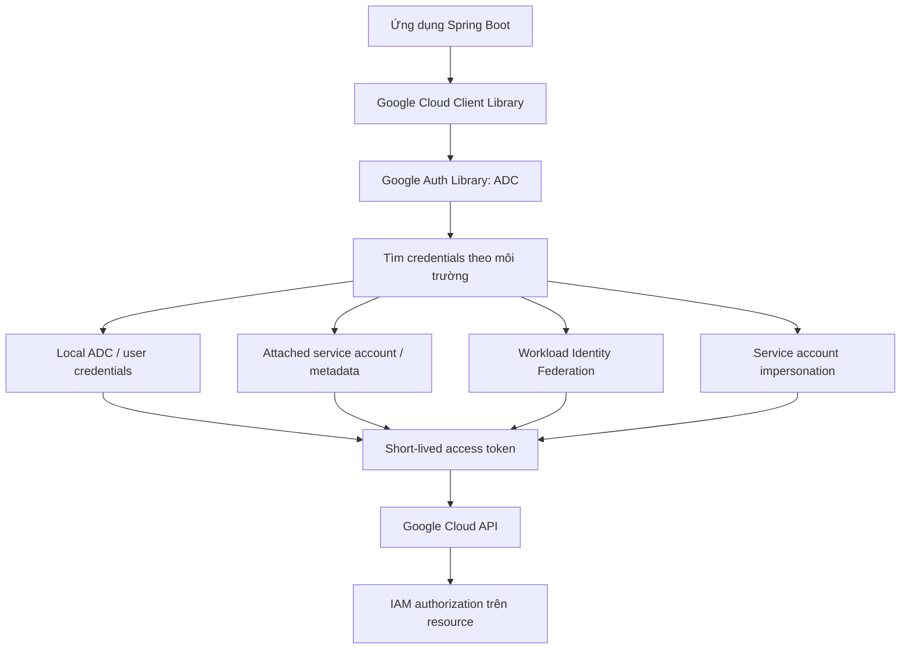
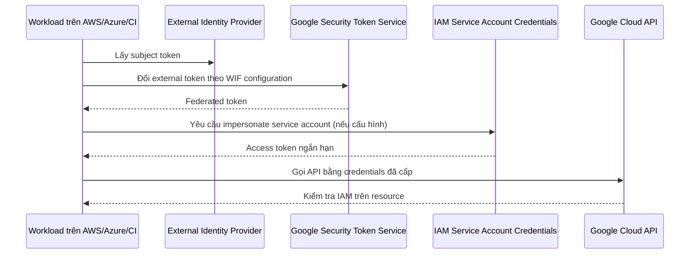

# Application Default Credentials và thứ tự chọn danh tính

Một ứng dụng Spring Boot gọi Cloud Storage, Pub/Sub, Cloud SQL hoặc Secret Manager cần một **danh tính để xác thực** và một tập **quyền IAM để được phép thực hiện thao tác**. Trong ứng dụng Java, cách phổ biến để cung cấp danh tính cho Google Cloud Client Libraries là **Application Default Credentials (ADC)**.

ADC giúp cùng một mã nguồn chạy trên máy lập trình, máy ảo, GKE, Cloud Run, CI/CD hoặc hạ tầng của AWS/Azure mà không phải viết một nhánh đăng nhập riêng cho từng môi trường. Thư viện xác thực tìm credentials theo môi trường đang chạy, tạo access token khi cần và chuyển token cho client library.

Trong mô-đun **SPRING_CLOUD_PROVIDER_INTEGRATION**, Spring Boot tích hợp với dịch vụ managed của AWS, Azure và Google Cloud. Bài này tập trung vào Google Cloud: cách ADC chọn nguồn credentials, thứ tự ưu tiên trong Google Auth Library for Java, cách Spring Framework on Google Cloud sử dụng ADC, và cách chọn danh tính an toàn cho local development, production và môi trường đa cloud.

## 1. ADC là gì và giải quyết vấn đề nào?

**Application Default Credentials** là một chiến lược tìm credentials do Google authentication libraries triển khai. Ứng dụng gọi cơ chế chuẩn, còn thư viện xác định credentials thích hợp dựa trên môi trường:

- Máy lập trình có thể dùng credentials của người phát triển.
- Ứng dụng chạy trên Google Cloud có thể dùng service account được gắn vào workload.
- Workload chạy trên AWS, Azure hoặc CI/CD bên ngoài Google Cloud có thể dùng Workload Identity Federation.
- Một ứng dụng cần kiểm thử quyền của service account có thể dùng service account impersonation.

Vì vậy, mã nghiệp vụ không cần chứa private key hoặc tự xây dựng quy trình lấy token. Với Google Cloud Client Libraries, client thường tự sử dụng ADC nếu ứng dụng không truyền credentials tường minh.



ADC giải quyết **cách tìm danh tính và lấy credentials**. ADC không tự quyết định ứng dụng được đọc bucket nào, publish topic nào hay truy cập database nào. Những quyền đó do IAM và authorization của dịch vụ quyết định.

### Phân biệt bốn khái niệm

| Khái niệm | Trả lời câu hỏi | Ví dụ |
| --- | --- | --- |
| **ADC / credentials** | Ứng dụng xác thực bằng danh tính nào? | User account, service account, federated identity |
| **Access token** | Request hiện tại chứng minh quyền truy cập bằng gì? | OAuth 2.0 bearer token có thời hạn |
| **Project ID** | Client dùng project mặc định nào hoặc resource thuộc project nào? | `provider-integration-prod` |
| **IAM role/permission** | Principal được phép làm thao tác gì trên resource? | Pub/Sub Publisher trên một topic |

Project ID và credentials là hai cấu hình riêng. ADC có thể xác thực bằng service account ở project A trong khi ứng dụng truy cập bucket thuộc project B, nếu IAM và cấu hình resource cho phép. Không suy ra project ID từ danh tính, cũng không suy ra quyền từ việc lấy được token thành công.

## 2. Thứ tự ADC trong ứng dụng Java

Với ứng dụng Spring Boot, điều quan trọng là biết Google Auth Library for Java thực hiện tìm kiếm thế nào. Tài liệu Java hiện công bố thứ tự của `GoogleCredentials.getApplicationDefault()` như sau:

1. **Tệp credentials được chỉ định bởi `GOOGLE_APPLICATION_CREDENTIALS`.**
2. **Credentials do Google Cloud SDK tạo bằng `gcloud auth application-default login`.**
3. **Credentials tích hợp của Google App Engine.**
4. **Credentials tích hợp của Google Cloud Shell.**
5. **Credentials tích hợp của Google Compute Engine**, lấy từ metadata server.

Đây là thứ tự tìm kiếm được tài liệu Google Auth Library for Java mô tả. Tài liệu ADC tổng quát hiện trình bày ba nhóm nguồn: biến môi trường, local ADC file và attached service account qua metadata server; cách trình bày này gom các runtime credentials vào một nhóm. Với ứng dụng Java, cần đối chiếu tài liệu của phiên bản Google Auth Library thực tế trong dependency graph nếu có khác biệt về môi trường hỗ trợ.

**Thứ tự trên không phải bảng xếp hạng mức an toàn.** Nguồn đứng đầu không có nghĩa luôn là nguồn nên dùng. Đây là thứ tự thư viện kiểm tra; lựa chọn credentials production vẫn phải dựa trên mô hình danh tính và rủi ro của môi trường.

### 2.1. Nguồn 1 — `GOOGLE_APPLICATION_CREDENTIALS`

Biến môi trường này trỏ tới một tệp JSON. Tùy loại tệp, nó có thể là:

- **Workload Identity Federation credential configuration**: mô tả cách lấy subject token từ AWS, Azure, OIDC/SAML provider hoặc nguồn external identity khác rồi đổi lấy credentials ngắn hạn của Google Cloud.
- **Workforce Identity Federation credential configuration**: dành cho danh tính người dùng/nhân sự từ external identity provider.
- **Service account key JSON**: khóa dài hạn của service account. Đây là loại cần tránh nếu có phương án identity federation hoặc attached service account.

Ví dụ trên Linux/macOS:

```bash
export GOOGLE_APPLICATION_CREDENTIALS="/run/config/gcp-workload-identity.json"
```

Ví dụ PowerShell:

```powershell
$env:GOOGLE_APPLICATION_CREDENTIALS = "C:\app\config\gcp-workload-identity.json"
```

Tệp federation configuration thường không chứa private key của Google service account. Nó mô tả provider, audience, token source và có thể cả service account cần impersonate. Tuy vậy, tệp này vẫn là cấu hình bảo mật: bảo vệ quyền sửa file, đường dẫn token source và các endpoint được khai báo.

Nếu biến môi trường trỏ tới một tệp key JSON, credentials ở nguồn này sẽ được xét trước local ADC file và metadata server. Vì vậy, một biến môi trường còn sót trong container có thể khiến ứng dụng dùng danh tính khác với service account gắn vào workload.

### 2.2. Nguồn 2 — local ADC file do gcloud tạo

Khi phát triển trên máy cá nhân, có thể đăng nhập tài khoản người dùng để cấp credentials cho client libraries:

```bash
gcloud auth application-default login
```

Lệnh này tạo local ADC file ở vị trí mặc định:

| Hệ điều hành | Đường dẫn |
| --- | --- |
| Linux/macOS | `$HOME/.config/gcloud/application_default_credentials.json` |
| Windows | `%APPDATA%\\gcloud\\application_default_credentials.json` |

Tệp local ADC có thể đại diện cho user account hoặc credentials impersonating service account nếu lệnh login có tham số tương ứng. Không commit tệp này vào Git, không đưa vào Docker image và không chia sẻ giữa các developer.

**Lưu ý quan trọng:** `gcloud auth login` và `gcloud auth application-default login` phục vụ hai mục đích khác nhau.

- `gcloud auth login` đăng nhập cho chính Google Cloud CLI.
- `gcloud auth application-default login` tạo credentials mà ứng dụng Java/Cloud Client Libraries sử dụng thông qua ADC.

Do đó, lệnh `gcloud auth list` hiển thị tài khoản đang đăng nhập trong CLI không đủ để kết luận ứng dụng Spring Boot đang dùng cùng danh tính. Local ADC file có thể chứa một user khác hoặc service account đang được impersonate.

### 2.3. Nguồn 3–5 — credentials tích hợp của runtime

Nếu không tìm thấy credentials ở hai nguồn đầu, Google Auth Library for Java có thể dùng credentials tích hợp theo môi trường:

| Runtime | Nguồn credentials | Cần cấu hình |
| --- | --- | --- |
| App Engine | App Engine built-in credentials | Gắn service account/identity phù hợp với ứng dụng |
| Cloud Shell | Cloud Shell built-in credentials | Dùng môi trường Cloud Shell và tài khoản đã xác thực |
| Compute Engine | Metadata server của VM | Gắn service account vào VM và cấp IAM role cần thiết |

Trên các runtime Google Cloud hiện đại, cách triển khai phổ biến là **gắn một service account do tổ chức quản lý vào workload**. ADC lấy credential ngắn hạn qua metadata server; ứng dụng không cần lưu file private key.

Các môi trường như Cloud Run và GKE cũng cung cấp cơ chế danh tính workload phù hợp. Cloud Run dùng service account gắn vào service/job; GKE nên cấu hình Workload Identity Federation for GKE để ánh xạ Kubernetes Service Account tới Google IAM principal. Không mặc định rằng mọi pod sẽ tự dùng đúng service account chỉ vì cluster chạy trên Google Cloud.

### Điều gì xảy ra nếu có nhiều nguồn cùng tồn tại?

ADC không trộn quyền của nhiều danh tính. Thư viện chọn nguồn credentials theo thứ tự của implementation; credentials được chọn đại diện cho một principal hoặc một luồng federation/impersonation cụ thể.

Ví dụ:

- Container có `GOOGLE_APPLICATION_CREDENTIALS` trỏ tới file federation.
- Máy host cũng có local ADC file từ `gcloud auth application-default login`.
- Pod chạy trên GKE có Workload Identity được cấu hình.

Nếu file được chỉ định ở nguồn đầu tiên hợp lệ, ứng dụng có thể sử dụng federation credentials đó thay vì danh tính được cấp từ GKE metadata. Vì thế, không để biến môi trường credentials cũ tồn tại ngoài ý muốn.

Nếu tệp đầu tiên được cấu hình sai hoặc không đọc được, không nên trông chờ thư viện luôn bỏ qua lỗi rồi tự chuyển sang nguồn sau. Hãy sửa cấu hình nguồn được chọn và kiểm thử rõ hành vi trên đúng phiên bản thư viện.

## 3. ADC không phải thứ tự chọn Project ID

Một lỗi phổ biến là nhầm **thứ tự tìm credentials** với **thứ tự phát hiện project**.

- ADC chọn credentials để xác thực request.
- `GcpProjectIdProvider` của Spring Framework on Google Cloud cung cấp Project ID mặc định cho các module.
- Property `spring.cloud.gcp.project-id` có thể được khai báo tường minh để xác định project mặc định.
- Một số dịch vụ có thể nhận project/resource name riêng theo từng thao tác.

Ví dụ:

```yaml
spring:
  cloud:
    gcp:
      project-id: provider-integration-prod
```

Property trên xác định project mặc định cho tích hợp Spring. Nó không đổi principal được ADC chọn và cũng không cấp IAM permission cho principal đó.

Một số Google Cloud API cho phép gọi resource thuộc project khác. Khi đó, cần phân biệt:

1. **Project tiêu thụ API/quota** nếu dịch vụ yêu cầu.
2. **Project sở hữu resource** như bucket, topic, secret hoặc database.
3. **Principal trong access token**.
4. **IAM policy** ở resource project.

Không dùng Project ID lấy từ local SDK để kết luận resource đích hoặc principal đã đúng.

## 4. Spring Framework on Google Cloud sử dụng ADC thế nào?

Spring Framework on Google Cloud (tên lịch sử là Spring Cloud GCP) cung cấp Core starter để tự cấu hình các thành phần chung.

Mỗi module thường sử dụng:

- `GcpProjectIdProvider` để lấy Project ID.
- `CredentialsProvider` để lấy credentials xác thực và ủy quyền các request qua Google Cloud Client Libraries.

Core starter tự cấu hình `CredentialsProvider` và **mặc định sử dụng ADC**. Vì vậy, trong ứng dụng dùng Pub/Sub, Cloud Storage, Spanner hoặc module hỗ trợ khác, thông thường không cần tự đọc file credentials hoặc tạo access token.

Ví dụ dependency Maven:

```xml
<dependency>
    <groupId>com.google.cloud</groupId>
    <artifactId>spring-cloud-gcp-starter</artifactId>
</dependency>

<dependency>
    <groupId>com.google.cloud</groupId>
    <artifactId>spring-cloud-gcp-starter-pubsub</artifactId>
</dependency>
```

BOM Spring Framework on Google Cloud phải được import theo ma trận tương thích với Spring Boot đang dùng. Core starter chuẩn bị credentials provider; Pub/Sub starter sử dụng provider đó để cấu hình client Pub/Sub.

### 4.1. Các property credentials của Spring Core

Core module hỗ trợ một số property:

| Property | Vai trò | Khi nào cân nhắc |
| --- | --- | --- |
| `spring.cloud.gcp.credentials.location` | Đường dẫn Spring Resource tới credentials file của service account | Trường hợp tích hợp cũ buộc phải dùng key file |
| `spring.cloud.gcp.credentials.encoded-key` | Nội dung JSON private key đã Base64 encode | Chỉ khi có yêu cầu đặc biệt và cơ chế quản lý secret phù hợp |
| `spring.cloud.gcp.credentials.scopes` | Danh sách OAuth scopes, phân tách bằng dấu phẩy | Khi cần giới hạn/điều chỉnh scopes của credentials |

Nếu `credentials.location` hoặc `credentials.encoded-key` được khai báo, ứng dụng đang cấu hình credentials tường minh cho Spring Core; không nên nghĩ rằng ADC sẽ luôn được ưu tiên hơn các property này. Hãy kiểm tra hành vi của đúng release line và tránh cấu hình trùng nhiều nguồn danh tính.

Ví dụ tham chiếu file key:

```yaml
spring:
  cloud:
    gcp:
      credentials:
        location: file:/run/secrets/gcp-service-account.json
```

Đây là cú pháp tích hợp có hỗ trợ, nhưng **không phải lựa chọn khuyến nghị cho production nếu có thể dùng ADC với attached identity hoặc Workload Identity Federation**. Đường dẫn file có thể bị ghi log hoặc bị mount nhầm; private key bị lộ có thể được dùng từ nơi khác cho đến khi bị thu hồi.

Không đưa giá trị `encoded-key` vào repository, CI variable dạng plaintext, image hoặc log. Base64 chỉ là encoding, không phải mã hóa và không bảo vệ private key.

### 4.2. OAuth scopes không thay thế IAM roles

Spring Core có property `spring.cloud.gcp.credentials.scopes` để chọn OAuth scopes. Scope giới hạn phạm vi token mà ứng dụng yêu cầu; IAM role/permission quyết định principal có thể thao tác trên resource.

Ví dụ:

- Token có scope Cloud Platform không tự cấp quyền đọc mọi bucket.
- Service account có IAM role Pub/Sub Publisher nhưng token không có scope/API access phù hợp trong một số môi trường vẫn có thể gặp lỗi.
- Một scope chỉ định Pub/Sub không thay thế IAM permission trên topic.

Tài liệu Spring Framework on Google Cloud có hỗ trợ `DEFAULT_SCOPES` placeholder để dùng scopes mặc định của starter rồi bổ sung scope cần thiết. Khi điều chỉnh, hãy xem danh sách scope mà module đang dùng và tài liệu của Google Auth Library. Không thêm scope rộng một cách tùy tiện để chữa lỗi IAM.

## 5. Chọn danh tính theo môi trường

Cùng một ứng dụng có thể dùng các nguồn credentials khác nhau tùy nơi chạy:

| Môi trường | Lựa chọn nên ưu tiên | Lý do |
| --- | --- | --- |
| Máy lập trình cá nhân | User ADC qua `gcloud auth application-default login` | Dễ phát triển, không cần key riêng |
| Máy lập trình cần kiểm tra quyền production | ADC impersonating service account | Kiểm thử chính sách của workload bằng credential ngắn hạn |
| Compute Engine | Service account gắn vào VM | Metadata server cấp credential ngắn hạn |
| Cloud Run | Service account gắn vào service/job | Identity theo từng workload |
| GKE | Workload Identity Federation for GKE | Ánh xạ Kubernetes Service Account với Google IAM |
| AWS workload gọi Google Cloud | Workload Identity Federation | Dùng AWS role/credential tạm thời để đổi token |
| Azure workload gọi Google Cloud | Workload Identity Federation | Dùng Microsoft Entra ID/Azure identity |
| GitHub/GitLab CI/CD | Workload Identity Federation qua OIDC | Không lưu service account key dài hạn |
| On-premises | Workload Identity Federation hoặc phương án được tổ chức phê duyệt | Liên kết external IdP với Google Cloud |

### 5.1. Local development bằng user ADC

Đăng nhập Google Cloud CLI:

```bash
gcloud auth application-default login
```

Sau đó chạy ứng dụng Spring Boot như bình thường. Google Cloud Client Libraries và Core starter sẽ tìm local ADC file.

Tài khoản người dùng cần được cấp quyền vừa đủ trên project/resource test. Không dùng tài khoản có Owner/Editor trên production để chạy một bài lab chỉ cần publish một topic.

Nếu cần quota project cho local ADC:

```bash
gcloud auth application-default set-quota-project provider-integration-dev
```

Quota project phục vụ quota/billing attribution theo yêu cầu API; nó không thay đổi principal, không đổi project sở hữu resource và không cấp quyền nghiệp vụ. Người dùng cần quyền Service Usage Consumer tương ứng trên quota project.

### 5.2. Kiểm thử service account bằng impersonation

Thay vì tải private key của service account về máy, developer có thể dùng danh tính người dùng hiện tại để yêu cầu credentials ngắn hạn cho service account mục tiêu.

Ví dụ:

```bash
gcloud auth application-default login \
  --impersonate-service-account=orders-api@provider-integration-dev.iam.gserviceaccount.com
```

Để impersonate, user principal cần quyền phù hợp trên service account đích, thường là role `roles/iam.serviceAccountTokenCreator`. Project liên quan cần bật IAM Service Account Credentials API theo hướng dẫn của Google Cloud.

Sau khi tạo local ADC, Java client libraries hỗ trợ impersonation có thể sử dụng credentials đó như ADC thông thường. Cần xác minh phiên bản auth library hỗ trợ tính năng và không giả định mọi thư viện ngoài Google đều hiểu định dạng credentials này.

Impersonation hữu ích khi cần kiểm thử chính xác quyền của workload. Principal đang đăng nhập không cần nhận toàn bộ quyền của service account; nó chỉ cần quyền impersonate, còn service account đích có các IAM role của nghiệp vụ.

### 5.3. Production trên Google Cloud

Với Compute Engine, Cloud Run và các môi trường hỗ trợ attached identity:

1. Tạo user-managed service account riêng cho workload.
2. Cấp role tối thiểu cho resource cần truy cập.
3. Gắn service account vào VM/service/job hoặc cấu hình identity theo nền tảng.
4. Không đặt `GOOGLE_APPLICATION_CREDENTIALS` trỏ tới key file nếu muốn dùng metadata credentials.
5. Để ADC lấy credential ngắn hạn qua metadata server.
6. Kiểm thử trên đúng runtime identity trước khi đưa traffic production.

Không dùng default service account có sẵn với quyền rộng nếu tổ chức có thể tạo service account chuyên biệt. Tách danh tính theo ứng dụng và môi trường giúp thu hồi quyền và điều tra audit log dễ hơn.

### 5.4. GKE và Workload Identity Federation for GKE

Trong GKE, cần phân biệt:

- **Kubernetes Service Account (KSA):** danh tính workload trong Kubernetes namespace.
- **Google IAM service account (GSA):** danh tính Google Cloud truyền thống có thể được gắn IAM role.
- **Workload Identity Federation for GKE:** cơ chế liên kết KSA với Google IAM principal, giúp pod lấy credential mà không cần key JSON.

Thiết kế thường gồm:

1. Chọn KSA riêng cho deployment.
2. Cấu hình cluster/workload identity theo hướng dẫn GKE.
3. Tạo IAM binding cho KSA principal hoặc liên kết tới GSA nếu kiến trúc dùng service account impersonation.
4. Cấp role chỉ trên bucket/topic/secret cần thiết.
5. Triển khai pod bằng KSA đã cấu hình.
6. Kiểm thử từ trong pod để xác nhận client thực sự dùng workload identity mong muốn.

Đừng nhầm KSA mặc định của namespace với GSA có quyền rộng. Không mount key JSON vào Kubernetes Secret chỉ để làm cho ADC hoạt động nếu Workload Identity đã đáp ứng yêu cầu.

### 5.5. AWS, Azure và CI/CD bên ngoài Google Cloud

Workload chạy ngoài Google Cloud không có metadata server Google. Có thể dùng **Workload Identity Federation (WIF)** để external identity provider cấp token, sau đó Google Cloud xác minh token và phát credential ngắn hạn.

Các bước khái quát:

1. Tạo workload identity pool và provider trong Google Cloud.
2. Cấu hình trust với AWS IAM, Microsoft Entra ID, OIDC/SAML provider hoặc CI/CD platform.
3. Thiết lập attribute mapping và attribute condition để chỉ workload/repository/account được phép.
4. Cấu hình quyền truy cập trực tiếp tới resource hoặc cho phép impersonate service account.
5. Sinh credential configuration file theo hướng dẫn của `gcloud`.
6. Đặt `GOOGLE_APPLICATION_CREDENTIALS` trỏ tới file cấu hình đó.
7. Dùng Google Cloud Java Client Libraries qua ADC như bình thường.

Ví dụ cấu hình biến môi trường trên Linux:

```bash
export GOOGLE_APPLICATION_CREDENTIALS="/etc/gcp/wif-credential-config.json"
```

File WIF là **credential configuration**, không phải private key của service account. Thư viện dùng token từ external identity provider, trao đổi với Security Token Service và có thể impersonate service account để lấy access token ngắn hạn.

Điểm cần kiểm soát là trust policy: chỉ chấp nhận đúng AWS account/role, Azure tenant/application, repository/branch/environment hoặc external subject đã phê duyệt. Attribute mapping/condition quá rộng có thể cho workload không mong muốn truy cập Google Cloud.

## 6. Service account impersonation và WIF khác nhau thế nào?

Hai cơ chế có thể kết hợp nhưng không đồng nghĩa:

| Khía cạnh | Service account impersonation | Workload Identity Federation |
| --- | --- | --- |
| Mục tiêu | Dùng danh tính hiện tại để nhận credentials của service account khác | Tin cậy một external identity để cấp quyền truy cập Google Cloud |
| Danh tính ban đầu | User hoặc workload đã có Google credentials | AWS role, Azure identity, OIDC/SAML, certificate hoặc IdP khác |
| Kết quả | Credentials ngắn hạn đại diện service account mục tiêu | Federated credentials; có thể impersonate service account |
| Quyền quan trọng | Quyền impersonate, thường `roles/iam.serviceAccountTokenCreator` | Trust provider/attribute mapping, binding IAM cho external principal hoặc service account |
| Trường hợp điển hình | Developer kiểm thử quyền của workload | AWS/Azure/GitHub/GitLab workload gọi Google Cloud |
| Private key Google SA | Không cần | Không cần |

Một luồng WIF có thể là:



Nếu WIF cho phép principal truy cập resource trực tiếp, không nhất thiết phải impersonate service account. Nếu tổ chức muốn chuẩn hóa quyền qua một service account, cần cấu hình binding và permission phù hợp. Không cấp quyền rộng cho toàn bộ workload identity pool khi chỉ một provider/subject cần truy cập.

## 7. Authentication, authorization, OAuth scope và project quota

ADC giúp lấy credentials, nhưng request chỉ thành công khi các lớp liên quan đều đúng.

| Lớp | Ví dụ lỗi | Cách kiểm tra |
| --- | --- | --- |
| Credentials source | Không tìm thấy file ADC, metadata server không truy cập được | Kiểm tra env var, local ADC và runtime identity |
| Authentication | `UNAUTHENTICATED`, token hết hạn hoặc external token không hợp lệ | Kiểm tra provider, token exchange và clock skew |
| OAuth scope | Token không có scope cần thiết trong môi trường yêu cầu scope | Kiểm tra scopes và client configuration |
| IAM authorization | `PERMISSION_DENIED` | Kiểm tra principal, role và resource scope |
| API enablement | `SERVICE_DISABLED` | Kiểm tra API đã bật trong project phù hợp |
| Project/resource | `NOT_FOUND` hoặc sai resource name | Kiểm tra Project ID, resource owner và tên tài nguyên |
| Quota/billing | Quota project không hợp lệ hoặc vượt giới hạn | Kiểm tra quota project, billing và quota |

**Access token hợp lệ không đồng nghĩa được phép truy cập resource.** Một user ADC có thể đăng nhập thành công nhưng không có quyền publish vào topic. Một service account có thể có quyền trên bucket test nhưng không có quyền trên bucket production.

### OAuth scopes và IAM

OAuth scope là phạm vi API mà access token được yêu cầu hỗ trợ. IAM role chứa permissions mà principal được cấp trên resource. Khi chạy trên Compute Engine, OAuth scopes gắn với VM có thể giới hạn phạm vi token; IAM vẫn kiểm tra quyền thực tế. Cả hai cần tương thích với thao tác.

Trong nhiều môi trường hiện đại, scope `cloud-platform` được dùng để cho phép token gọi Cloud APIs, còn IAM role giới hạn tài nguyên mà principal được truy cập. Không dùng scope rộng để thay cho IAM least privilege.

### Quota project

Local ADC user credentials có thể chứa quota project. Quota project ảnh hưởng project được tính quota/billing cho một số request, tùy API. Nó không phải project resource mặc định và không đổi danh tính.

Nếu API báo thiếu quyền `serviceusage.services.use`, có thể cần role Service Usage Consumer trên quota project. Không cấp Owner chỉ để vượt qua lỗi quota project.

## 8. Dùng ADC trong code Java và Spring Boot

### 8.1. Cloud Client Libraries tự sử dụng ADC

Khi dùng Google Cloud Client Libraries, thường chỉ cần tạo client theo API của dịch vụ. Ví dụ với Cloud Storage:

```java
import com.google.cloud.storage.Storage;
import com.google.cloud.storage.StorageOptions;

public class StorageClientFactory {

    public Storage create(String projectId) {
        return StorageOptions.newBuilder()
                .setProjectId(projectId)
                // Không truyền credentials:
                // Cloud Client Library sẽ dùng ADC.
                .build()
                .getService();
    }
}
```

Đoạn code không tự đọc file key hoặc token. Client library tìm ADC theo môi trường và tự xử lý việc làm mới credentials theo hỗ trợ của auth library.

### 8.2. Lấy ADC tường minh khi cần tích hợp API khác

Với một số Google API Client Libraries hoặc khi tự cấu hình một client cần `GoogleCredentials`, có thể gọi:

```java
import com.google.auth.oauth2.GoogleCredentials;

import java.io.IOException;

public class DefaultCredentialsFactory {

    public GoogleCredentials create() throws IOException {
        return GoogleCredentials.getApplicationDefault();
    }
}
```

Không cần gọi phương thức này chỉ để “kiểm tra” credentials trước mọi request. Với Cloud Client Libraries, để client sử dụng ADC mặc định thường đơn giản và ít sai sót hơn.

Không tự lấy access token thành chuỗi, lưu vào static field rồi dùng mãi. Token có thời hạn; hãy giữ đối tượng credentials/provider được thư viện hỗ trợ để cơ chế refresh hoạt động.

### 8.3. Spring Core tự cấu hình CredentialsProvider

Khi dùng Spring Framework on Google Cloud Core starter, có thể để auto-configuration tạo `CredentialsProvider`. Module Pub/Sub, Storage hoặc module khác sẽ sử dụng provider đó để dựng client.

Ví dụ cấu hình project và scopes:

```yaml
spring:
  cloud:
    gcp:
      project-id: ${GOOGLE_CLOUD_PROJECT}
      credentials:
        scopes: DEFAULT_SCOPES,https://www.googleapis.com/auth/cloud-vision
```

Ví dụ thêm scope Cloud Vision vào scopes mặc định của starter. Chỉ khai báo scope cần thiết và kiểm tra tài liệu của phiên bản GCP starter. Nếu không có yêu cầu tùy chỉnh, giữ cấu hình mặc định giúp giảm rủi ro scope bị thiếu.

### 8.4. Tùy biến CredentialsProvider khi thật sự cần

Ứng dụng có thể thay thế bean credentials provider trong trường hợp đặc biệt, nhưng cần kiểm tra API và package của release line đang sử dụng. Khi tự cung cấp credentials:

- Không hardcode access token.
- Ưu tiên `GoogleCredentials.getApplicationDefault()` hoặc federation/impersonation phù hợp.
- Bảo đảm credentials hỗ trợ refresh.
- Cấp scope cần thiết cho client.
- Kiểm tra auto-configuration và điều kiện bean để không tạo hai provider cạnh tranh.
- Kiểm thử danh tính và quyền của client thật, không chỉ kiểm tra bean được tạo.

Không tự viết cơ chế metadata server/token exchange nếu Google Auth Library đã có hỗ trợ chính thức.

## 9. Kiểm tra và chẩn đoán danh tính mà ứng dụng đang dùng

Khi ứng dụng truy cập sai project hoặc nhận lỗi IAM, hãy kiểm tra theo trình tự:

1. **Có `GOOGLE_APPLICATION_CREDENTIALS` không?** Nếu có, file đang trỏ tới loại credentials nào? Đường dẫn có bị set trong container/CI từ môi trường khác không?
2. **Có local ADC file không?** Developer có chạy `gcloud auth application-default login` bằng tài khoản khác không?
3. **Runtime có attached identity không?** VM/Cloud Run/GKE đang gắn service account/KSA nào?
4. **Có cấu hình credentials tường minh trong Spring không?** Kiểm tra `spring.cloud.gcp.credentials.location` và `encoded-key`.
5. **Project ID hiệu lực là gì?** Kiểm tra `spring.cloud.gcp.project-id` và property source.
6. **Principal có IAM permission không?** Xem role trực tiếp, role kế thừa và resource đích.
7. **Quota project/API enablement có phù hợp không?** Tách lỗi quota/API khỏi lỗi authentication.

### Các lệnh local thường dùng

Đăng nhập Google Cloud CLI:

```bash
gcloud auth login
```

Tạo ADC cho client libraries:

```bash
gcloud auth application-default login
```

Liệt kê tài khoản CLI đang đăng nhập:

```bash
gcloud auth list
```

Đặt quota project cho local ADC:

```bash
gcloud auth application-default set-quota-project provider-integration-dev
```

Thu hồi local ADC khi không còn cần trên máy:

```bash
gcloud auth application-default revoke
```

`gcloud auth list` chỉ cho biết tài khoản Google Cloud CLI; để xác định danh tính ứng dụng, phải kiểm tra ADC source mà tiến trình Java đang đọc. Không in access token ra terminal, log hoặc ticket hỗ trợ. Token là bearer credential: ai có token còn hiệu lực có thể sử dụng nó trong phạm vi quyền tương ứng.

### Log và Actuator

Có thể log metadata không nhạy cảm như:

- Tên môi trường và project ID.
- Loại adapter đang dùng.
- Tên service account đã được cấu hình nếu tổ chức cho phép.
- Nguồn credential theo deployment contract (ví dụ workload identity hoặc local ADC), nếu xác định được mà không đọc/ghi token.
- Mã lỗi và request ID để đối chiếu audit log.

Không log:

- Access token, refresh token hoặc ID token.
- Private key JSON, encoded-key hoặc credential file content.
- Subject token của AWS/Azure/OIDC.
- Toàn bộ object credentials hoặc environment chứa secret.

Các endpoint Actuator `env` và `configprops` cần được bảo vệ, che giá trị nhạy cảm và chỉ expose cho người vận hành được phép. Không xem việc endpoint không hiển thị secret là bằng chứng SDK đang dùng đúng identity.

## 10. Những lỗi thường gặp

| Triệu chứng | Nguyên nhân thường gặp | Cách xử lý |
| --- | --- | --- |
| Không tìm thấy ADC | Không có env file, local ADC hoặc metadata server phù hợp | Thiết lập nguồn credentials cho đúng môi trường |
| Ứng dụng local dùng sai user | Local ADC file được tạo từ tài khoản khác | Đăng nhập lại ADC bằng tài khoản phát triển phù hợp |
| Container dùng key cũ | `GOOGLE_APPLICATION_CREDENTIALS` còn trỏ tới file cũ | Kiểm tra env của container và loại bỏ cấu hình không mong muốn |
| Cloud Run không dùng service account mong muốn | Service/revision gắn sai service account | Kiểm tra service account của revision và metadata credentials |
| GKE nhận sai danh tính | KSA hoặc Workload Identity binding không đúng | Kiểm tra namespace, KSA, provider và IAM binding |
| `UNAUTHENTICATED` | Credential không hợp lệ, token hết hạn hoặc external subject token lỗi | Kiểm tra auth source, token exchange và đồng bộ thời gian |
| `PERMISSION_DENIED` | Principal đúng nhưng IAM role thiếu | Cấp permission tối thiểu trên resource đúng |
| `SERVICE_DISABLED` | API chưa bật ở project liên quan | Enable API qua quy trình bootstrap |
| Project đúng nhưng quota lỗi | Quota project chưa được đặt hoặc thiếu Service Usage Consumer | Kiểm tra quota project và quyền `serviceusage.services.use` |
| Spring Boot dùng key dù có ADC | Spring credentials property được khai báo tường minh | Rà soát `credentials.location` và `encoded-key` |
| GCP API hoạt động trên máy nhưng thất bại trong AWS/Azure | Chưa cấu hình Workload Identity Federation | Thiết lập trust provider, mapping, credential config và IAM binding |
| Token lấy được nhưng request vẫn bị từ chối | Nhầm authentication với authorization | Kiểm tra IAM role, API scope và resource policy |

Không khắc phục `PERMISSION_DENIED` bằng cách cấp Owner cho service account. Xác định principal và permission cụ thể trước, rồi cấp role tối thiểu ở phạm vi phù hợp.

## 11. Bài thực hành: so sánh thứ tự chọn danh tính

Tạo ứng dụng Spring Boot nhỏ có một thao tác đọc metadata bucket test. Dùng cùng mã nguồn nhưng chạy trong các môi trường khác nhau.

### Bước 1 — Local user ADC

1. Đăng nhập Google Cloud CLI bằng tài khoản phát triển.
2. Chạy `gcloud auth application-default login`.
3. Đặt `spring.cloud.gcp.project-id` tới project test.
4. Chạy ứng dụng và xác minh user principal có quyền đọc metadata bucket.

### Bước 2 — Kiểm tra ưu tiên của environment variable

1. Chuẩn bị một credential configuration file hợp lệ cho môi trường test.
2. Đặt `GOOGLE_APPLICATION_CREDENTIALS` trỏ tới file đó.
3. Giữ local ADC file tồn tại.
4. Chạy ứng dụng và kiểm tra principal được chọn.
5. Gỡ biến môi trường, chạy lại và so sánh kết quả.

Mục tiêu là chứng minh nguồn ở vị trí ưu tiên cao hơn có thể che khuất local ADC file. Không dùng service account key production cho bài tập này.

### Bước 3 — Service account impersonation

1. Tạo service account test có quyền chỉ đọc bucket.
2. Cấp quyền impersonate cho tài khoản phát triển.
3. Bật IAM Service Account Credentials API.
4. Tạo local ADC bằng lệnh impersonation.
5. Chạy ứng dụng và kiểm tra hành vi theo quyền của service account đích.
6. Thu hồi local ADC sau bài lab nếu không cần dùng tiếp.

### Bước 4 — Attached identity

1. Deploy cùng image lên Cloud Run hoặc GKE test.
2. Gắn service account/KSA chuyên biệt.
3. Xóa `GOOGLE_APPLICATION_CREDENTIALS` khỏi môi trường runtime nếu muốn dùng metadata/workload identity.
4. Chạy cùng thao tác đọc bucket.
5. Xác minh request dùng identity của workload và chỉ có quyền được cấp.

### Bước 5 — External workload

1. Nếu có môi trường AWS/Azure/CI test, cấu hình Workload Identity Federation.
2. Sinh credential configuration file bằng công cụ chính thức.
3. Đặt `GOOGLE_APPLICATION_CREDENTIALS` tới file WIF.
4. Chạy cùng mã nguồn và xác minh quyền truy cập.
5. Kiểm tra attribute condition chỉ cho phép workload/repository đã định danh.

### Ma trận kết quả cần ghi

| Môi trường | Nguồn ADC dự kiến | Principal hiệu lực | Quyền thử nghiệm | Kết quả |
| --- | --- | --- | --- | --- |
| Local developer | Local ADC file | User account | Read bucket test | Thành công/thất bại |
| Local với env var | Credential file | External/federated principal hoặc service account | Read bucket test | Thành công/thất bại |
| Local impersonation | ADC impersonated | Service account test | Read bucket test | Thành công/thất bại |
| Cloud Run/GKE | Attached identity/metadata | Workload service account hoặc federated principal | Read bucket test | Thành công/thất bại |
| AWS/Azure/CI | WIF credential config | Federated principal hoặc impersonated service account | Read bucket test | Thành công/thất bại |

Không ghi token hoặc credential file vào báo cáo. Ghi lại source loại nào được dùng, principal không nhạy cảm, resource alias và kết quả thao tác.

## 12. Ghi nhớ

- **ADC là cơ chế tìm credentials**, không phải IAM policy và không phải lựa chọn Project ID.
- Với Google Auth Library for Java, tài liệu mô tả thứ tự: `GOOGLE_APPLICATION_CREDENTIALS` → local ADC file từ `gcloud auth application-default login` → App Engine → Cloud Shell → Compute Engine metadata. Kiểm tra tài liệu của phiên bản auth library thực tế khi nâng cấp.
- `gcloud auth login` dành cho CLI; `gcloud auth application-default login` tạo credentials cho ứng dụng dùng ADC.
- Spring Framework on Google Cloud Core tự cấu hình `CredentialsProvider` và mặc định dùng ADC. Property `spring.cloud.gcp.credentials.location`/`encoded-key` có thể cấu hình credentials tường minh; tránh service account key nếu có lựa chọn an toàn hơn.
- Production trên Google Cloud nên ưu tiên **attached service account/workload identity**; AWS, Azure và CI/CD bên ngoài nên ưu tiên **Workload Identity Federation**.
- Service account impersonation cấp credentials ngắn hạn cho một service account đích mà không cần private key của tài khoản đó.
- OAuth scopes, IAM roles, Project ID, quota project và API enablement là các lớp khác nhau; kiểm tra đúng lớp khi xử lý lỗi.
- Không lưu hoặc log token/private key; không dùng quyền Owner/Editor để chữa lỗi authorization. Cấp IAM least privilege và xác minh principal thực tế của workload.

## Tài liệu tham khảo chính thức

1. [How Application Default Credentials works — thứ tự tìm credentials](https://docs.cloud.google.com/docs/authentication/application-default-credentials)
2. [Get started with Google Auth Library for Java — GoogleCredentials.getApplicationDefault()](https://docs.cloud.google.com/java/getting-started/getting-started-with-google-auth-library)
3. [Spring Framework on Google Cloud Core — CredentialsProvider và ADC](https://googlecloudplatform.github.io/spring-cloud-gcp/reference/html/core.html)
4. [Set up Application Default Credentials](https://docs.cloud.google.com/docs/authentication/provide-credentials-adc)
5. [Authenticate workloads with Google Cloud auth libraries](https://docs.cloud.google.com/iam/docs/authenticate-with-auth-libraries)
6. [Workload Identity Federation](https://docs.cloud.google.com/iam/docs/workload-identity-federation)
7. [Use service account impersonation](https://docs.cloud.google.com/docs/authentication/use-service-account-impersonation)
8. [Authenticate with client libraries](https://docs.cloud.google.com/docs/authentication/client-libraries)

Thứ tự và khả năng tìm credentials trong bài dựa trên tài liệu Google Auth Library for Java được kiểm tra ngày 24/11/2026. Khi nâng cấp Spring Framework on Google Cloud hoặc Google Auth Library, hãy kiểm tra lại reference documentation của đúng version.
