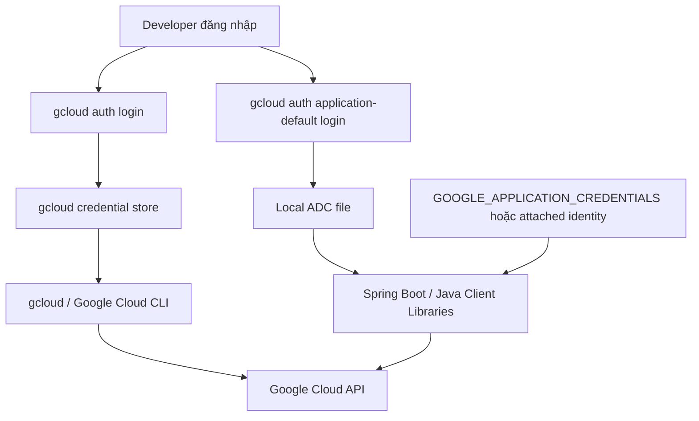

# Phân biệt đăng nhập gcloud với thông tin xác thực ADC

Một developer có thể chạy lệnh `gcloud projects list` thành công nhưng ứng dụng Spring Boot vẫn báo `UNAUTHENTICATED` hoặc `PERMISSION_DENIED`. Ngược lại, ứng dụng có thể đọc được bucket qua Google Cloud Client Libraries trong khi lệnh `gcloud auth list` hiển thị một tài khoản khác. Hai tình huống này không mâu thuẫn: **Google Cloud CLI và Application Default Credentials (ADC) là hai bộ thông tin xác thực riêng**.

`gcloud auth login` đăng nhập cho công cụ dòng lệnh `gcloud`. `gcloud auth application-default login` tạo credentials cho ứng dụng và các client libraries sử dụng ADC. Cả hai có thể cùng dùng một tài khoản Google, nhưng cũng có thể đại diện cho hai principal khác nhau, có quota project và phạm vi quyền khác nhau.

Trong mô-đun **SPRING_CLOUD_PROVIDER_INTEGRATION**, ta thực hành tích hợp Spring Boot với các dịch vụ managed của AWS, Azure và Google Cloud. Bài này tập trung vào Google Cloud: phân biệt hai cơ chế đăng nhập, hiểu cấu hình CLI, kiểm tra credentials mà ứng dụng thực sự sử dụng, và tránh nhầm lẫn khi phát triển, kiểm thử hoặc vận hành.

## 1. Hai cơ chế xác thực, hai mục đích

| Khía cạnh | Google Cloud CLI | Application Default Credentials |
| --- | --- | --- |
| Mục đích | Cho phép `gcloud` và các công cụ Google Cloud CLI gọi API thay mặt principal đang hoạt động | Cung cấp credentials cho ứng dụng thông qua Google authentication libraries |
| Lệnh đăng nhập phổ biến | `gcloud auth login` | `gcloud auth application-default login` |
| Nơi lưu | Credential store trong thư mục cấu hình gcloud | ADC file ở vị trí chuẩn của hệ điều hành hoặc nguồn ADC khác |
| Lệnh kiểm tra chính | `gcloud auth list` | Kiểm tra nguồn ADC của tiến trình; có thể lấy token thử nghiệm bằng lệnh ADC riêng |
| Phạm vi sử dụng | `gcloud`, `gsutil` và công cụ CLI liên quan | Google Cloud Client Libraries, Google API Client Libraries và ứng dụng hỗ trợ ADC |
| Chọn tài khoản | Active account trong gcloud configuration | Principal nằm trong ADC file hoặc được tìm từ nguồn ADC hiện hành |
| Thu hồi local credentials | `gcloud auth revoke` | `gcloud auth application-default revoke` đối với ADC file do lệnh login tạo |

**Điểm cần nhớ:** `gcloud auth login` không tự tạo local ADC file. `gcloud auth application-default login` không thay đổi active account của gcloud. Tài liệu Google Cloud xác định hai bộ credentials này độc lập với nhau.

Sơ đồ tổng quát:



Ứng dụng có thể dùng nguồn ADC khác với local ADC file. Ví dụ, `GOOGLE_APPLICATION_CREDENTIALS` có thể trỏ tới Workload Identity Federation configuration; khi đó tiến trình Java sẽ xét nguồn này trước local ADC file.

## 2. `gcloud auth login` làm gì?

Lệnh:

```bash
gcloud auth login
```

mở quy trình xác thực người dùng qua trình duyệt và lưu credentials để Google Cloud CLI sử dụng. Sau khi đăng nhập, tài khoản được thêm vào credential store của gcloud. Một tài khoản trong số đó được chọn làm **active account** cho cấu hình CLI đang hoạt động.

Có thể đăng nhập nhiều tài khoản:

```bash
gcloud auth login developer@example.com
gcloud auth login operator@example.com
```

Xem các tài khoản đã lưu và tài khoản đang hoạt động:

```bash
gcloud auth list
```

Ví dụ đầu ra:

```text
Credentialed Accounts
ACTIVE  ACCOUNT
        developer@example.com
*       operator@example.com
```

Dấu `*` biểu thị active account. Những lệnh gcloud thông thường sẽ dùng tài khoản này, trừ khi command có cờ hoặc cấu hình khác ghi đè.

Chọn tài khoản đang hoạt động:

```bash
gcloud config set account developer@example.com
```

Lệnh trên chỉ cập nhật property `core/account` của **gcloud configuration hiện hành**. Nó không tự thay tài khoản trong local ADC file.

### 2.1. `gcloud init` và gcloud configuration

Khi thiết lập máy phát triển lần đầu, thường chạy:

```bash
gcloud init
```

`gcloud init` hỗ trợ đăng nhập, chọn project mặc định và thiết lập cấu hình ban đầu cho CLI. Cấu hình gcloud có các property thường gặp:

| Property | Vai trò |
| --- | --- |
| `core/account` | Tài khoản gcloud sử dụng để xác thực |
| `core/project` | Project mặc định cho các lệnh gcloud không chỉ định project khác |
| `compute/region` | Region mặc định cho một số lệnh Compute |
| `compute/zone` | Zone mặc định cho một số lệnh Compute |

Xem cấu hình đang hoạt động:

```bash
gcloud config list
```

Đổi project mặc định của CLI:

```bash
gcloud config set project provider-integration-dev
```

Có thể tạo nhiều named configuration để tách môi trường:

```bash
gcloud config configurations create dev
gcloud config configurations create prod

gcloud config configurations activate dev
gcloud config set account developer@example.com
gcloud config set project provider-integration-dev

gcloud config configurations activate prod
gcloud config set account operator@example.com
gcloud config set project provider-integration-prod
```

Các cấu hình này giúp người vận hành đổi nhanh account/project mặc định của CLI. Chúng không phải các bộ ADC riêng. Chuyển active gcloud configuration **không tự chuyển local ADC** sang user hoặc project tương ứng.

Khi chạy script bootstrap, nên truyền rõ `--project` thay vì dựa hoàn toàn vào project mặc định:

```bash
gcloud services list --enabled \
  --project=provider-integration-dev
```

Điều này giảm nguy cơ bật API, tạo resource hoặc thay đổi IAM nhầm môi trường.

## 3. `gcloud auth application-default login` làm gì?

Lệnh:

```bash
gcloud auth application-default login
```

thực hiện OAuth web flow để lấy user credentials và ghi chúng vào vị trí chuẩn của **Application Default Credentials**. Google Cloud Client Libraries và các thư viện hỗ trợ ADC có thể tìm file này tự động mà không cần truyền đường dẫn credentials trong code.

Vị trí mặc định:

| Hệ điều hành | ADC file |
| --- | --- |
| Linux/macOS | `$HOME/.config/gcloud/application_default_credentials.json` |
| Windows | `%APPDATA%\\gcloud\\application_default_credentials.json` |

Tệp ADC cục bộ dùng user credentials thường chứa refresh token. Người có quyền đọc tệp có thể dùng nó để lấy access token hợp lệ, vì vậy phải bảo vệ tệp như một thông tin xác thực nhạy cảm:

- Không commit ADC file vào Git.
- Không đưa file vào Docker image hoặc artifact build.
- Không gửi file qua email/chat hoặc lưu trong thư mục chia sẻ công khai.
- Không dùng chung file giữa nhiều developer.
- Giới hạn quyền đọc trên máy phát triển.
- Thu hồi ADC khi không còn cần sử dụng.

### 3.1. Lệnh ADC không đổi active account của gcloud

Giả sử trước khi chạy ADC login:

- `gcloud auth list` cho thấy `operator@example.com` là active account.
- Developer chạy `gcloud auth application-default login` và chọn `developer@example.com` trong trình duyệt.

Sau đó:

- `gcloud auth list` vẫn hiển thị `operator@example.com` là active account của CLI.
- Ứng dụng dùng ADC có thể xác thực bằng `developer@example.com`.
- `gcloud config list` vẫn giữ property account/project của CLI như trước.

Đây là hành vi bình thường. Khi debug ứng dụng, không được dùng kết quả `gcloud auth list` làm bằng chứng duy nhất về danh tính mà Java process đang sử dụng.

### 3.2. ADC login có thể ghi đè ADC file hiện tại

Mỗi lần chạy `gcloud auth application-default login`, credentials ADC trước đó do lệnh này tạo có thể bị thay thế. Vì vậy, nếu local ADC đang được cấu hình để impersonate service account hoặc đại diện một user khác, hãy kiểm tra trước khi chạy login lại.

Lệnh này cũng có thể ghi quota project vào ADC dựa trên cấu hình gcloud. Quota project được dùng bởi client libraries cho quota/billing đối với những API hỗ trợ cơ chế này. Nó không thay đổi principal và không đổi project sở hữu bucket, topic hay database.

## 4. So sánh theo một ví dụ thực tế

Giả sử máy phát triển có cấu hình:

| Thành phần | Giá trị |
| --- | --- |
| Active gcloud account | `operator@example.com` |
| gcloud default project | `provider-integration-prod` |
| Local ADC principal | `developer@example.com` |
| ADC quota project | `provider-integration-dev` |
| Spring Boot property | `spring.cloud.gcp.project-id=provider-integration-dev` |

Trong trường hợp này:

- `gcloud services list` có thể gọi API bằng `operator@example.com` và project mặc định production, nếu không truyền project khác.
- Spring Boot dùng credentials ADC của `developer@example.com`.
- Spring Boot sử dụng project mặc định được cấu hình trong property `spring.cloud.gcp.project-id`.
- Quota project của local ADC có thể là project dev, tùy API.
- Resource thực tế vẫn có thể thuộc project khác nếu resource name chỉ định project đó và IAM cho phép.

Không nên kết luận ứng dụng đang dùng production chỉ vì CLI default project là production. Cũng không nên kết luận request được tính quota vào project resource chỉ vì project ID của resource là production.

### Bốn câu hỏi cần trả lời riêng

1. **CLI dùng ai?** Kiểm tra `gcloud auth list` và `gcloud config list`.
2. **Ứng dụng dùng ai?** Kiểm tra nguồn ADC mà tiến trình Java đọc và principal trong audit log của request.
3. **Ứng dụng mặc định dùng project nào?** Kiểm tra `spring.cloud.gcp.project-id` hoặc project được cung cấp rõ trong code/config.
4. **Request dùng quota project nào?** Kiểm tra ADC quota project, API hỗ trợ quota project và quyền `serviceusage.services.use`.

## 5. Phân biệt các lệnh kiểm tra token

Có hai lệnh in access token thường bị nhầm:

| Lệnh | Token đại diện cho | Dùng khi |
| --- | --- | --- |
| `gcloud auth print-access-token` | Active account hoặc principal được chỉ định cho gcloud CLI command | Kiểm tra REST request bằng credentials của CLI |
| `gcloud auth application-default print-access-token` | Credentials ADC hiện hành | Kiểm tra REST request bằng credentials mà client libraries sử dụng |

Ví dụ kiểm tra token của CLI:

```bash
gcloud auth print-access-token
```

Ví dụ kiểm tra token ADC:

```bash
gcloud auth application-default print-access-token
```

Hai lệnh có thể trả token cho hai principal khác nhau. Chúng chỉ in token để dùng trong thao tác tiếp theo; **không nên copy token vào log, issue, terminal recording hoặc gửi cho người khác**. Access token là bearer credential và có thể được dùng bởi người sở hữu token trong phạm vi quyền tương ứng cho đến khi hết hạn hoặc bị vô hiệu hóa theo cơ chế dịch vụ.

Nếu cần kiểm tra một REST API bằng đúng credentials của ứng dụng local, có thể dùng token ADC:

```bash
gcloud auth application-default print-access-token
```

Sau đó truyền token trong header Authorization của request test. Không lưu token vào file hoặc script dùng lâu dài. Nếu chỉ cần xác minh ứng dụng, tốt hơn là chạy một thao tác đọc/ghi test từ chính Java process và xem Cloud Audit Logs để xác định principal thực tế.

### Không dùng `gcloud auth list` để suy ra ADC principal

`gcloud auth list` chỉ liệt kê các tài khoản có credentials được cấu hình cho Google Cloud CLI và cho biết active account. Nó không đọc local ADC file để báo principal của ứng dụng.

Tương tự, `gcloud auth print-access-token` lấy token cho CLI account; không phải lệnh kiểm tra ADC. Hãy dùng lệnh có tiền tố `application-default` khi mục tiêu là credentials ADC.

## 6. `GOOGLE_APPLICATION_CREDENTIALS` có thể làm ADC chọn nguồn khác

Ngay cả khi đã chạy `gcloud auth application-default login`, ứng dụng vẫn có thể dùng một nguồn credentials khác nếu biến môi trường `GOOGLE_APPLICATION_CREDENTIALS` được thiết lập.

ADC thường tìm credentials theo thứ tự tổng quát:

1. Credential configuration được chỉ định bởi `GOOGLE_APPLICATION_CREDENTIALS`.
2. Local ADC file ở vị trí chuẩn.
3. Attached service account/metadata server của môi trường runtime.

Nguồn đầu tiên có thể là Workload Identity Federation configuration, Workforce Identity Federation configuration hoặc service account key JSON. Service account key là thông tin xác thực dài hạn có rủi ro cao; ưu tiên federation hoặc attached identity khi có thể.

Kiểm tra biến môi trường trong PowerShell:

```powershell
$env:GOOGLE_APPLICATION_CREDENTIALS
```

Trong Linux/macOS:

```bash
printenv GOOGLE_APPLICATION_CREDENTIALS
```

Nếu muốn ứng dụng local sử dụng local ADC file do `gcloud auth application-default login` tạo, hãy bảo đảm biến môi trường không trỏ tới một credential file khác. Nếu muốn dùng WIF, hãy cấu hình rõ file WIF và kiểm thử principal của external workload.

### Thứ tự ưu tiên có ý nghĩa gì trong thực tế?

Ví dụ, máy developer có local ADC của `developer@example.com` nhưng biến môi trường trỏ tới WIF configuration của một CI principal. Java process sẽ xét credential configuration từ environment variable trước. Kết quả có thể khác với điều developer thấy trong `gcloud auth list` và khác với tài khoản vừa chọn trong browser flow.

Khi chạy trong IDE, container hoặc test runner, cần kiểm tra **environment variables của chính tiến trình đó**. Mở PowerShell mới hoặc terminal mới không bảo đảm IDE đã nhận biến môi trường mới; IDE cần được khởi động lại nếu nó kế thừa environment cũ.

## 7. Tích hợp Spring Boot: ứng dụng thực sự đọc credentials nào?

Spring Framework on Google Cloud (tên lịch sử thường gặp là Spring Cloud GCP) cung cấp Core starter và `CredentialsProvider`. Mặc định, provider này dùng ADC để lấy credentials cho Google Cloud Client Libraries.

Ví dụ dependency Maven:

```xml
<dependency>
    <groupId>com.google.cloud</groupId>
    <artifactId>spring-cloud-gcp-starter</artifactId>
</dependency>
```

Khi thêm starter Pub/Sub:

```xml
<dependency>
    <groupId>com.google.cloud</groupId>
    <artifactId>spring-cloud-gcp-starter-pubsub</artifactId>
</dependency>
```

Pub/Sub client được cấu hình thông qua credentials provider của Core. Nếu không có cấu hình credentials tường minh, Java library có thể sử dụng ADC theo môi trường.

Ví dụ cấu hình project:

```yaml
spring:
  cloud:
    gcp:
      project-id: ${GOOGLE_CLOUD_PROJECT}
```

`spring.cloud.gcp.project-id` xác định project mặc định cho tích hợp Spring; nó không quyết định user/service account được ADC chọn. Hai cấu hình phải được kiểm tra riêng.

### 7.1. Credentials property tường minh có thể thay đổi nguồn xác thực

Spring Core có thể hỗ trợ property như:

- `spring.cloud.gcp.credentials.location`: đường dẫn tới credentials file.
- `spring.cloud.gcp.credentials.encoded-key`: JSON key được Base64 encode.
- `spring.cloud.gcp.credentials.scopes`: OAuth scopes.

Nếu ứng dụng khai báo credentials location hoặc encoded key, cần xem cấu hình thực tế của release line vì provider có thể sử dụng credentials tường minh thay vì ADC mặc định. Không khai báo đồng thời nhiều nguồn danh tính một cách vô tình.

**Base64 không phải mã hóa.** Không lưu encoded key trong Git hoặc log. Trong production, ưu tiên attached service account, Workload Identity Federation hoặc cơ chế danh tính ngắn hạn.

### 7.2. Không dùng credentials của CLI như một mặc định ngầm

Một ứng dụng Java không nên phụ thuộc vào việc máy developer đã chạy `gcloud auth login`. Điều cần thiết cho client libraries là ADC hoặc một nguồn credentials được cấu hình rõ ràng.

Nếu máy developer chỉ chạy `gcloud auth login` mà chưa có ADC, các lệnh gcloud có thể hoạt động nhưng Spring Boot local vẫn có thể báo không tìm thấy credentials. Cách xử lý cho local development thường là:

```bash
gcloud auth application-default login
```

Sau đó chạy lại ứng dụng. Với production, không chạy lệnh này trên server; dùng identity được gắn vào workload hoặc federation theo nền tảng.

## 8. Quota project của ADC không phải project mặc định của gcloud

Khi chạy `gcloud auth application-default login`, gcloud có thể ghi quota project vào ADC. Quota project được một số Google APIs sử dụng để xác định project chịu quota/billing cho request.

Xem hoặc cập nhật quota project:

```bash
gcloud auth application-default set-quota-project provider-integration-dev
```

Để dùng project làm quota project, principal trong ADC cần permission `serviceusage.services.use` trên project đó, thường được cấp qua role `roles/serviceusage.serviceUsageConsumer`.

Cần phân biệt:

| Giá trị | Tác động |
| --- | --- |
| gcloud `core/project` | Project mặc định cho lệnh CLI |
| Spring `spring.cloud.gcp.project-id` | Project mặc định của tích hợp Spring nếu property được dùng |
| ADC quota project | Project quota/billing cho các API có hỗ trợ |
| Resource project | Project sở hữu bucket, topic, database hoặc secret |

Một số dịch vụ có thể bỏ qua quota project và tính phí/quota theo project sở hữu resource. Không giả định mọi API đều xử lý quota project giống nhau.

Nếu gặp lỗi thiếu quota project hoặc `serviceusage.services.use`, kiểm tra quota project và permission tương ứng. Không cấp Owner/Editor chỉ để làm cho request chạy được.

## 9. Thu hồi credentials: hai lệnh revoke khác nhau

Đăng xuất khỏi gcloud CLI:

```bash
gcloud auth revoke
```

Hoặc thu hồi một account cụ thể:

```bash
gcloud auth revoke developer@example.com
```

Lệnh này tác động đến credentials của Google Cloud CLI. Với user credentials, nó có thể thu hồi token phía server và xóa credentials local. Với service account/external account, hành vi có thể chỉ xóa credentials local hoặc yêu cầu thu hồi nguồn credentials bên ngoài; không được hiểu là xóa service account key khỏi IAM.

Thu hồi ADC local:

```bash
gcloud auth application-default revoke
```

Lệnh này thu hồi ADC được tạo bởi `gcloud auth application-default login` và xóa local ADC file. Nó không tác động đến các nguồn credentials khác, ví dụ:

- Credential file được tham chiếu bởi `GOOGLE_APPLICATION_CREDENTIALS`.
- Attached service account đang cung cấp credentials qua metadata server.
- Workload Identity Federation configuration nằm ở vị trí khác.
- Credentials của Google Cloud CLI được tạo bởi `gcloud auth login`.

Vì vậy, nếu muốn dừng ứng dụng local dùng ADC, phải thu hồi đúng ADC file hoặc loại bỏ nguồn credentials đang được tiến trình sử dụng. Nếu key JSON đã bị lộ, cần xử lý key ở IAM (disable/delete key) theo quy trình incident; chỉ xóa local file không làm key phía Google Cloud mất hiệu lực.

## 10. Bảng tình huống: lệnh nào cần chạy?

| Mục tiêu | Lệnh phù hợp | Tác động chính |
| --- | --- | --- |
| Đăng nhập để chạy gcloud CLI | `gcloud auth login` | Lưu CLI credentials |
| Khởi tạo account/project mặc định cho CLI | `gcloud init` | Thiết lập gcloud configuration |
| Xem account đang active trong CLI | `gcloud auth list` | Chỉ xem CLI accounts |
| Đổi account active của CLI | `gcloud config set account EMAIL` | Thay active CLI account |
| Đổi project mặc định của CLI | `gcloud config set project PROJECT_ID` | Thay CLI project |
| Tạo credentials cho Spring Boot/Java Client Libraries local | `gcloud auth application-default login` | Ghi local ADC file |
| Kiểm tra token theo CLI account | `gcloud auth print-access-token` | In token của CLI credentials |
| Kiểm tra token theo ADC | `gcloud auth application-default print-access-token` | In token của ADC |
| Đặt quota project cho ADC | `gcloud auth application-default set-quota-project PROJECT_ID` | Cập nhật quota project trong ADC |
| Đăng xuất CLI | `gcloud auth revoke` | Thu hồi/xóa CLI credentials |
| Thu hồi local ADC | `gcloud auth application-default revoke` | Thu hồi ADC file do lệnh login tạo |
| Dùng CLI login credentials để cập nhật ADC một cách chủ đích | `gcloud auth login --update-adc` | Ghi credentials CLI vào ADC và ghi đè ADC trước đó |

### Ngoại lệ: `gcloud auth login --update-adc`

Tài liệu Google Cloud CLI hiện có cờ `--update-adc` cho `gcloud auth login`. Khi dùng cờ này, credentials vừa lấy được sẽ được ghi vào vị trí chuẩn của ADC; ADC được tạo trước đó có thể bị ghi đè.

Đây là **hành vi được yêu cầu rõ ràng bằng cờ**, không phải hành vi mặc định của `gcloud auth login`. Chỉ dùng khi bạn thực sự muốn cùng credentials vừa đăng nhập cho CLI được dùng làm ADC cho client libraries. Nếu chỉ cần đăng nhập CLI để chạy lệnh quản trị, không thêm cờ này.

## 11. Quy trình phát triển local được khuyến nghị

Đối với một ứng dụng Spring Boot gọi Pub/Sub hoặc Cloud Storage trong project dev:

1. Cài Google Cloud CLI và chạy `gcloud init` để thiết lập CLI account/project.
2. Dùng `gcloud auth list` xác nhận account active dành cho công việc CLI.
3. Chạy `gcloud auth application-default login` để tạo local ADC cho ứng dụng.
4. Kiểm tra `GOOGLE_APPLICATION_CREDENTIALS` có đang trỏ tới file khác không.
5. Cấu hình `spring.cloud.gcp.project-id` tới project dev.
6. Cấp IAM tối thiểu cho principal ADC trên bucket/topic test.
7. Chạy ứng dụng từ IDE hoặc terminal.
8. Thực hiện thao tác test thực tế và xem audit log nếu cần xác nhận principal.
9. Khi đổi user ADC, chạy lại lệnh ADC login và kiểm tra lại ứng dụng.
10. Khi kết thúc môi trường local dùng chung hoặc máy thử nghiệm, thu hồi ADC và CLI credentials phù hợp.

Ví dụ chuỗi lệnh:

```bash
# 1. Thiết lập tài khoản và project mặc định cho CLI.
gcloud init

# 2. Xem danh tính CLI.
gcloud auth list
gcloud config list

# 3. Tạo credentials riêng cho ứng dụng.
gcloud auth application-default login

# 4. Kiểm tra project/quota project và cấu hình môi trường.
gcloud auth application-default print-access-token
gcloud config get-value project
```

Lệnh in access token chỉ dùng để kiểm tra có kiểm soát; không ghi kết quả vào file hoặc chia sẻ. Trong ứng dụng, hãy để Google Cloud Client Libraries sử dụng ADC và tự quản lý token refresh.

## 12. Troubleshooting: CLI chạy được nhưng Spring Boot lỗi

| Triệu chứng | Nguyên nhân có thể | Cách kiểm tra/khắc phục |
| --- | --- | --- |
| `gcloud projects list` chạy được nhưng Spring Boot báo ADC not found | Đã chạy CLI login nhưng chưa tạo ADC | Chạy `gcloud auth application-default login` cho local development |
| `gcloud auth list` hiển thị user A nhưng ứng dụng gọi bằng user B | Local ADC hoặc environment credentials đại diện user/principal khác | Kiểm tra ADC source và audit log của request |
| Đổi active account CLI nhưng Spring Boot không đổi danh tính | CLI configuration và ADC độc lập | Cập nhật ADC riêng hoặc cấu hình nguồn identity của app |
| Chạy Spring Boot trong IDE dùng danh tính bất ngờ | IDE có environment variable `GOOGLE_APPLICATION_CREDENTIALS` hoặc ADC cũ | Kiểm tra environment của IDE, local ADC và restart IDE khi cần |
| `gcloud auth application-default login` xong vẫn `PERMISSION_DENIED` | User ADC không có IAM permission trên resource | Cấp role tối thiểu cho đúng principal và resource |
| API báo thiếu quota project | ADC chưa có quota project hoặc principal thiếu quyền dùng quota project | Dùng `set-quota-project` và cấp Service Usage Consumer nếu cần |
| `gcloud auth revoke` xong app vẫn chạy | Chỉ revoke CLI credentials, ADC vẫn còn | Thu hồi ADC riêng nếu app đang dùng local ADC |
| `gcloud auth application-default revoke` xong app vẫn truy cập được | App dùng env credential file hoặc attached identity | Kiểm tra `GOOGLE_APPLICATION_CREDENTIALS` và metadata/workload identity |
| REST request với token CLI thành công nhưng ứng dụng thất bại | Token CLI và ADC token khác principal/scope/quota | Kiểm tra bằng ADC token và test từ Java process |
| ADC login ghi đè impersonated ADC | Đăng nhập lại bằng user credentials | Tạo lại ADC impersonation nếu muốn ứng dụng đại diện service account |

Không xử lý lỗi quyền bằng cách cấp Owner cho user hoặc service account. Hãy xác định principal thật, API/resource đích và permission thiếu trước khi thay đổi IAM.

## 13. Bài thực hành: chứng minh hai bộ credentials độc lập

Tạo project test riêng và một bucket hoặc Pub/Sub topic không chứa dữ liệu thật. Dùng hai tài khoản thử nghiệm có quyền khác nhau.

### Bước 1 — Thiết lập CLI identity

1. Chạy `gcloud auth login` bằng user A.
2. Chọn project test cho CLI bằng `gcloud config set project`.
3. Chạy `gcloud auth list` và ghi lại active account.
4. Chạy một lệnh chỉ đọc như `gcloud projects describe` để xác nhận CLI hoạt động.

### Bước 2 — Thiết lập ADC identity khác

1. Chạy `gcloud auth application-default login`.
2. Trong browser flow, đăng nhập user B.
3. Cấp cho user B quyền tối thiểu trên bucket/topic test.
4. Chạy ứng dụng Spring Boot và thực hiện thao tác đọc/ghi test.
5. Xem Cloud Audit Logs để xác nhận principal của request là user B.

### Bước 3 — Đổi CLI account

1. Chạy `gcloud config set account USER_A`.
2. Xác nhận `gcloud auth list` vẫn hiển thị user A active.
3. Chạy lại ứng dụng Spring Boot.
4. Kiểm tra principal trong audit log.

Kết quả mong đợi: đổi active account CLI không tự đổi local ADC của ứng dụng.

### Bước 4 — Đổi ADC account

1. Chạy lại `gcloud auth application-default login` bằng user A.
2. Chạy ứng dụng lại.
3. Kiểm tra principal trong audit log.
4. So sánh kết quả với bước trước.

Kết quả mong đợi: ứng dụng đổi danh tính khi ADC thay đổi, còn gcloud active account được quản lý riêng.

### Bước 5 — So sánh token command

- Dùng `gcloud auth print-access-token` để kiểm tra token của CLI.
- Dùng `gcloud auth application-default print-access-token` để kiểm tra token ADC.
- Không lưu hoặc chia sẻ hai token.
- Không kết luận principal chỉ bằng cách so sánh chuỗi token; dùng audit log hoặc thao tác test có kiểm soát.

### Bước 6 — Thu hồi và dọn môi trường

1. Dùng `gcloud auth application-default revoke` để thu hồi local ADC test.
2. Dùng `gcloud auth revoke` nếu cần đăng xuất tài khoản CLI.
3. Xóa resource lab và thu hồi IAM role đã cấp theo quy trình quản trị.
4. Không xóa service account key hoặc credential của người khác nếu không thuộc phạm vi quản trị được ủy quyền.

### Bảng kết quả cần ghi

| Thử nghiệm | CLI active account | ADC principal | Danh tính request Spring Boot |
| --- | --- | --- | --- |
| Ban đầu | User A | User B | User B |
| Chỉ đổi CLI account | User C | User B | User B |
| Đổi ADC sang user A | User C | User A | User A |
| Thu hồi ADC file | User C | Không còn local ADC file | Ứng dụng cần nguồn ADC khác hoặc báo lỗi |

Nếu biến môi trường hoặc attached identity đang có, kết quả có thể khác vì nguồn đó có thể được ADC ưu tiên. Bài lab nên xác nhận và loại bỏ nguồn ngoài ý muốn trước khi rút ra kết luận.

## 14. Ghi nhớ

- `gcloud auth login` xác thực **Google Cloud CLI**; `gcloud auth application-default login` tạo credentials **ADC cho ứng dụng/client libraries**.
- `gcloud auth list` hiển thị tài khoản CLI và active account; nó không xác định principal mà Spring Boot đang dùng.
- gcloud configuration chứa account/project mặc định cho CLI. Chuyển configuration hoặc đổi active account không tự cập nhật local ADC.
- ADC file nằm ở vị trí chuẩn của hệ điều hành, chứa credentials nhạy cảm và có thể bị ghi đè khi chạy ADC login lại.
- `GOOGLE_APPLICATION_CREDENTIALS` có thể khiến ứng dụng dùng credential file khác local ADC; kiểm tra environment của đúng tiến trình Java.
- `gcloud auth print-access-token` và `gcloud auth application-default print-access-token` in token từ hai bộ credentials khác nhau.
- `gcloud auth revoke` và `gcloud auth application-default revoke` thu hồi hai bộ credentials khác nhau; revoke ADC file không xóa key hoặc attached identity.
- `gcloud auth login --update-adc` là ngoại lệ có chủ đích để ghi credentials CLI vào ADC và có thể ghi đè ADC cũ.
- Trong local development, tạo ADC riêng và cấp IAM tối thiểu. Trong production, dùng attached service account hoặc Workload Identity Federation thay vì user ADC/key file.
- Khi debug, xác định riêng **CLI principal**, **ADC principal**, **Project ID**, **quota project** và **resource IAM**; không dùng một giá trị để suy ra các giá trị còn lại.

## Tài liệu tham khảo chính thức

1. [Authenticate for the gcloud CLI](https://docs.cloud.google.com/sdk/docs/authenticate)
2. [gcloud auth login — đăng nhập Google Cloud CLI](https://docs.cloud.google.com/sdk/gcloud/reference/auth/login)
3. [gcloud auth application-default login — tạo credentials ADC](https://docs.cloud.google.com/sdk/gcloud/reference/auth/application-default/login)
4. [How Application Default Credentials works](https://docs.cloud.google.com/docs/authentication/application-default-credentials)
5. [Set up ADC for a local development environment](https://docs.cloud.google.com/docs/authentication/set-up-adc-local-dev-environment)
6. [gcloud auth list — danh sách tài khoản CLI](https://docs.cloud.google.com/sdk/gcloud/reference/auth/list)
7. [gcloud auth application-default print-access-token](https://docs.cloud.google.com/sdk/gcloud/reference/auth/application-default/print-access-token)
8. [gcloud auth application-default revoke](https://docs.cloud.google.com/sdk/gcloud/reference/auth/application-default/revoke)
9. [gcloud auth revoke](https://docs.cloud.google.com/sdk/gcloud/reference/auth/revoke)
10. [Managing gcloud CLI configurations](https://docs.cloud.google.com/sdk/docs/configurations)
11. [gcloud auth application-default set-quota-project](https://docs.cloud.google.com/sdk/gcloud/reference/auth/application-default/set-quota-project)

Các lệnh và hành vi trong bài phản ánh tài liệu Google Cloud CLI/ADC được kiểm tra ngày 24/11/2026. Một số tùy chọn có thể thay đổi theo phiên bản Google Cloud CLI; hãy kiểm tra help/reference của phiên bản đang cài trước khi dùng trong script tự động.
