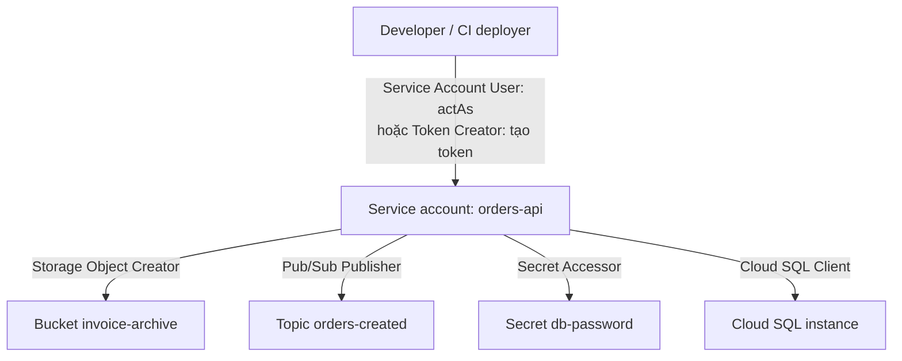
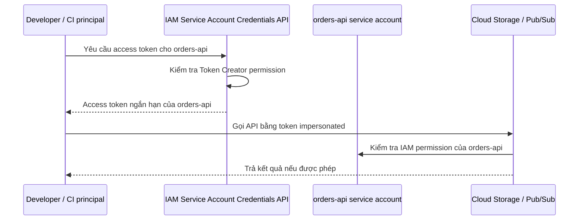

# Service account, impersonation và quyền IAM tối thiểu

Một ứng dụng Spring Boot gọi Cloud Storage, Pub/Sub, Secret Manager hoặc Cloud SQL cần một danh tính để Google Cloud nhận biết request đến từ workload nào. Trong môi trường production, danh tính thường là **service account** được gắn với ứng dụng. IAM sau đó cấp cho service account những quyền cần thiết trên từng tài nguyên.

Có hai chiều quyền cần phân biệt: quyền của service account **trên tài nguyên ứng dụng sử dụng**, và quyền của người hoặc workload **được phép sử dụng service account đó**. Chiều thứ nhất quyết định ứng dụng đọc/ghi dữ liệu gì; chiều thứ hai quyết định ai có thể gắn hoặc impersonate danh tính ứng dụng. Nhầm hai chiều này dễ tạo ra đường leo thang đặc quyền.

Trong mô-đun **SPRING_CLOUD_PROVIDER_INTEGRATION**, ta thực hành tích hợp Spring Boot với các dịch vụ managed của AWS, Azure và Google Cloud. Bài này tập trung vào Google Cloud: thiết kế service account theo workload, phân biệt Service Account User với Service Account Token Creator, dùng impersonation để phát hành credentials ngắn hạn và cấp IAM role ở phạm vi nhỏ nhất.

## 1. Service account là danh tính của workload

Service account là một loại principal trong IAM, thường đại diện cho ứng dụng, VM, job, service hoặc một quy trình tự động. Một service account có email dạng:

```text
orders-api@provider-integration-prod.iam.gserviceaccount.com
```

Email là định danh của principal, không phải mật khẩu hay secret. Ứng dụng không cần tự nhập email và mật khẩu để đăng nhập; runtime được cấu hình để cung cấp credentials cho service account đó.

Ví dụ, một hệ thống xử lý đơn hàng có thể dùng các danh tính riêng:

| Workload | Service account | Nhiệm vụ |
| --- | --- | --- |
| API nhận đơn hàng | `orders-api@PROJECT_ID.iam.gserviceaccount.com` | Ghi hóa đơn và publish sự kiện |
| Consumer thanh toán | `payment-worker@PROJECT_ID.iam.gserviceaccount.com` | Đọc subscription và lấy secret kết nối |
| Job đối soát | `reconciliation-job@PROJECT_ID.iam.gserviceaccount.com` | Đọc dữ liệu báo cáo và ghi kết quả |
| Pipeline triển khai | Danh tính deploy riêng | Triển khai revision và gắn runtime identity |

Không nên dùng một service account chung cho mọi ứng dụng. Khi nhiều workload chia sẻ cùng danh tính, quyền thường bị cộng dồn theo yêu cầu của từng ứng dụng. Một lỗi ở một workload khi đó có thể mở đường tới tài nguyên của workload khác; audit log cũng khó chỉ ra ứng dụng nào đã thực hiện hành động.

### 1.1. Service account vừa là principal vừa là resource

Đây là điểm quan trọng nhất khi thiết kế IAM:

| Vai trò | Ý nghĩa | Ví dụ |
| --- | --- | --- |
| **Principal** | Service account được cấp quyền trên resource khác | `orders-api` có quyền tạo object trong bucket hóa đơn |
| **Resource** | Service account có policy riêng xác định ai được phép sử dụng, gắn hoặc impersonate nó | Developer được phép impersonate `orders-api` để chạy test |



Developer/deployer cần quyền trên **service account resource** để gắn hoặc impersonate nó. Còn `orders-api` cần quyền trên bucket/topic/secret/database để thực hiện nghiệp vụ.

Cấp quyền cho developer sử dụng service account không có nghĩa developer được cấp trực tiếp role đọc/ghi bucket. Tuy nhiên, nếu developer có thể impersonate service account thì họ có thể thực hiện các thao tác mà service account được phép làm. Vì vậy, quyền sử dụng service account cũng cần được kiểm soát như một quyền truy cập dữ liệu.

## 2. Tạo service account riêng cho ứng dụng

Nên tạo service account theo workload và môi trường. Tên nên dễ hiểu, ổn định và không chứa thông tin bí mật.

```bash
PROJECT_ID="provider-integration-dev"

gcloud iam service-accounts create orders-api \
  --display-name="Orders API runtime" \
  --description="Identity for the Spring Boot orders API" \
  --project="$PROJECT_ID"
```

Email service account được tạo theo project chứa service account. Ghi lại email này trong cấu hình triển khai/IaC; không cần lưu private key.

| Thành phần | Ví dụ | Mục đích |
| --- | --- | --- |
| Workload | `orders-api` | Nhận diện ứng dụng |
| Environment | `dev`, `staging`, `prod` | Tách quyền giữa môi trường |
| Service account ID | `orders-api-runtime` | Nhận diện danh tính runtime |
| Display name | `Orders API runtime - production` | Giải thích trong Console |
| Owner | `team-orders` | Nhóm chịu trách nhiệm |
| Purpose | `publish-orders-and-write-invoices` | Phạm vi nghiệp vụ được phép |

Một project có thể chứa nhiều service account. Một service account cũng có thể được tạo ở project trung tâm và được gắn vào workload ở project khác nếu tổ chức bật cơ chế cross-project service account usage. Tuy nhiên, hãy bắt đầu với service account riêng cho workload trong project môi trường tương ứng, trừ khi có yêu cầu quản trị tập trung.

### Không mặc định dùng default service account

Một số dịch vụ Google Cloud tạo default service account khi API được bật hoặc khi tài nguyên được khởi tạo. Trong một số cấu hình tổ chức cũ, default service account có thể được tự động cấp role Editor (`roles/editor`) trên project. Google khuyến nghị tắt automatic role grants cho default service accounts và dùng service account do người quản trị tạo riêng với quyền tối thiểu.

Không giả định default service account nào cũng có cùng quyền ở mọi project. Hãy kiểm tra IAM policy và Organization Policy thực tế trước khi sử dụng. Không cấp thêm Editor/Owner cho runtime identity chỉ để tránh lỗi permission.

## 3. Phân biệt Service Account User và Token Creator

IAM có các role riêng cho hai hành động khác nhau.

### 3.1. Service Account User — quyền gắn service account vào resource

Role:

```text
roles/iam.serviceAccountUser
```

Role này chứa permission `iam.serviceAccounts.actAs`. Nó cho phép principal gắn service account vào tài nguyên có thể chạy workload, chẳng hạn VM, Cloud Run service/job hoặc một số tài nguyên triển khai khác.

Ví dụ: developer triển khai Cloud Run service và chọn service account `orders-api`. Developer cần quyền tạo/cập nhật Cloud Run service và quyền `actAs` trên service account được gắn. Service Account User thường được cấp trên **chính service account** đó.

**Service Account User không tự cho phép tạo access token để impersonate service account.** Nó cho phép gắn service account vào tài nguyên; sau khi gắn, workload chạy bằng danh tính service account và nhận quyền mà service account đang có.

### 3.2. Service Account Token Creator — quyền tạo credentials ngắn hạn/impersonate

Role:

```text
roles/iam.serviceAccountTokenCreator
```

Role này cho phép principal tạo credentials ngắn hạn đại diện service account, gồm OAuth access token, OIDC ID token và các chữ ký JWT/blob được hỗ trợ. Permission quan trọng cho access token là `iam.serviceAccounts.getAccessToken`.

Dùng role này khi developer cần chạy ứng dụng local bằng danh tính runtime, CI/CD cần impersonate service account triển khai, một workload cần lấy access token ngắn hạn của service account khác hoặc một quy trình cần ký JWT/blob bằng danh tính service account.

Token Creator có phạm vi mạnh hơn việc gắn service account. Khi principal impersonate service account, principal đó có thể truy cập các tài nguyên mà service account được phép truy cập. Chỉ cấp Token Creator trên service account cụ thể; tránh cấp ở project/folder nếu không có yêu cầu rõ ràng.

### 3.3. So sánh nhanh

| Tiêu chí | Service Account User | Service Account Token Creator |
| --- | --- | --- |
| Role | `roles/iam.serviceAccountUser` | `roles/iam.serviceAccountTokenCreator` |
| Permission tiêu biểu | `iam.serviceAccounts.actAs` | `iam.serviceAccounts.getAccessToken`, `signBlob`, `signJwt`, `getOpenIdToken` |
| Mục đích | Gắn service account vào tài nguyên | Tạo credentials ngắn hạn/impersonate |
| Dùng với `gcloud run deploy --service-account` | Người triển khai cần quyền phù hợp để attach SA | Không bắt buộc chỉ để attach SA |
| Dùng `--impersonate-service-account` | Không đủ | Cần Token Creator hoặc permission tương đương |
| Scope khuyến nghị | Policy trên service account được gắn | Policy trên service account đích |

### 3.4. Workload Identity User dành cho GKE federation

Role:

```text
roles/iam.workloadIdentityUser
```

Trong mô hình Workload Identity Federation for GKE liên kết Kubernetes Service Account (KSA) với Google IAM service account (GSA), role này được cấp trên GSA cho principal KSA tương ứng. Nó cho phép workload trong Kubernetes lấy credentials theo cơ chế federation/impersonation được hỗ trợ.

Không nhầm ba role:

- `roles/iam.serviceAccountUser`: người triển khai có thể gắn service account vào resource.
- `roles/iam.serviceAccountTokenCreator`: principal có thể tạo credentials ngắn hạn của service account.
- `roles/iam.workloadIdentityUser`: KSA được phép sử dụng GSA theo liên kết Workload Identity for GKE.

Chỉ cấp role đúng với mô hình runtime. Không cấp cả ba role cho mọi principal theo thói quen.

## 4. Service account impersonation hoạt động thế nào?

Impersonation là quá trình một principal đã xác thực yêu cầu Google Cloud phát hành credentials ngắn hạn cho service account đích.



Hai danh tính tồn tại trong luồng:

1. **Source principal:** user, service account hoặc external identity đã xác thực ban đầu.
2. **Target service account:** danh tính mà source principal yêu cầu impersonate.

Source principal cần quyền tạo credentials cho target service account. Target service account cần role nghiệp vụ trên bucket/topic/secret/database. Hai loại quyền được cấp ở hai nơi khác nhau.

### 4.1. Impersonation bằng Google Cloud CLI

Cấp Token Creator cho developer trên đúng service account:

```bash
PROJECT_ID="provider-integration-dev"
SA="orders-api@provider-integration-dev.iam.gserviceaccount.com"

gcloud iam service-accounts add-iam-policy-binding "$SA" \
  --member="user:developer@example.com" \
  --role="roles/iam.serviceAccountTokenCreator" \
  --project="$PROJECT_ID"
```

Sau đó có thể chạy một lệnh CLI với impersonation:

```bash
gcloud storage buckets describe gs://invoice-archive-dev \
  --impersonate-service-account="$SA" \
  --project="$PROJECT_ID"
```

Hoặc tạo local ADC dùng impersonation cho các client libraries được hỗ trợ:

```bash
gcloud auth application-default login \
  --impersonate-service-account="$SA"
```

Java client libraries hỗ trợ ADC impersonation có thể sử dụng local ADC này. Khi chạy ứng dụng Spring Boot, client sẽ sử dụng credentials đại diện service account đích; không cần tải private key của service account về máy.

Không cấp Token Creator cho developer trên toàn project nếu chỉ cần impersonate một service account. Policy ở project scope có thể cho phép impersonate nhiều service account trong project, bao gồm cả tài khoản có quyền cao hơn.

### 4.2. Impersonation không phải là cấp thêm role cho developer

Ví dụ, developer không có quyền đọc production bucket. `orders-api` có quyền đọc bucket production. Nếu developer được cấp Token Creator trên `orders-api`, họ có thể tạo credentials ngắn hạn đại diện `orders-api` và thực hiện thao tác mà service account được phép.

Đây là cơ chế hữu ích để test quyền workload, nhưng cũng là ranh giới bảo mật. Trước khi cấp Token Creator, hãy kiểm tra service account đích có quyền trên resource nào, developer có thực sự cần danh tính này không, có thể tạo service account test ít quyền hơn không, và quyền impersonation có được giới hạn ở service account cụ thể không.

### 4.3. Audit và truy vết impersonation

Khi request được thực hiện bằng credentials impersonated, nhiều audit log của Google Cloud ghi nhận cả source principal và service account đích. Một số dịch vụ hoặc loại thao tác có thể chỉ ghi danh tính service account; vì vậy, hãy kiểm tra loại audit log cụ thể và bật Data Access logs khi cần điều tra truy cập dữ liệu.

Không xem service account email trong log là bằng chứng duy nhất rằng workload gốc là ai. Dùng thông tin delegation/audit log mà dịch vụ hỗ trợ và giữ ranh giới service account theo từng workload để tăng khả năng truy vết.

## 5. Gắn service account vào Cloud Run, VM và GKE

### 5.1. Cloud Run

Cloud Run service/job có thể được cấu hình service account runtime. Ví dụ:

```bash
gcloud run deploy orders-api \
  --image="REGION-docker.pkg.dev/PROJECT_ID/apps/orders-api:VERSION" \
  --service-account="orders-api@PROJECT_ID.iam.gserviceaccount.com" \
  --region="asia-southeast1" \
  --project="PROJECT_ID"
```

Người hoặc pipeline triển khai cần quyền tạo/cập nhật Cloud Run resource và quyền `iam.serviceAccounts.actAs` trên service account được gắn, thường qua Service Account User. Runtime code dùng identity đã gắn để gọi Google Cloud APIs qua ADC/metadata server.

Không đặt `GOOGLE_APPLICATION_CREDENTIALS` trỏ tới key JSON trong container nếu muốn dùng attached service account. Tránh đưa key vào environment variable hoặc image layer.

### 5.2. Compute Engine

Khi tạo VM, chọn service account riêng cho workload và OAuth access scopes phù hợp. Google khuyến nghị không dựa vào access scopes để thay thế IAM role; với workload hiện đại thường dùng scope `cloud-platform` và giới hạn quyền thực tế bằng IAM.

Một VM gắn service account có thể lấy credentials ngắn hạn từ metadata server. Người có quyền truy cập shell hoặc chạy code trên VM có thể sử dụng identity của VM; do đó, hạn chế quyền SSH/OS Login, metadata access và nguồn code được chạy trên máy có service account đặc quyền.

### 5.3. Google Kubernetes Engine

Với GKE, nên dùng Workload Identity Federation for GKE:

1. Tạo Kubernetes Service Account riêng cho deployment.
2. Cấu hình cluster hỗ trợ Workload Identity.
3. Liên kết KSA với Google IAM principal/GSA theo mô hình được chọn.
4. Cấp `roles/iam.workloadIdentityUser` trên GSA cho KSA nếu dùng mô hình KSA impersonates GSA.
5. Cấp quyền dữ liệu cho GSA trên bucket/topic/secret cần dùng.
6. Cấu hình Deployment sử dụng KSA đó.
7. Kiểm thử từ pod để xác nhận principal và quyền.

Không chia sẻ một KSA có quyền cao cho mọi namespace. Không lưu key JSON trong Kubernetes Secret chỉ để cấp danh tính cho pod khi Workload Identity có thể đáp ứng.

## 6. Cấp IAM role tối thiểu theo từng dịch vụ

Service account cần role trên resource nghiệp vụ. Bắt đầu từ thao tác cụ thể, xác định permission cần thiết, rồi chọn predefined role phù hợp ở cấp thấp nhất dịch vụ hỗ trợ.

### 6.1. Cloud Storage

| Nghiệp vụ | Role gợi ý | Scope | Giới hạn |
| --- | --- | --- | --- |
| Chỉ tạo object mới | `roles/storage.objectCreator` | Bucket hoặc managed folder | Không đọc, liệt kê, xóa hoặc ghi đè object hiện có |
| Đọc object và metadata | `roles/storage.objectViewer` | Bucket hoặc managed folder | Có thể list và đọc object |
| Quản lý object | `roles/storage.objectAdmin` | Bucket hoặc managed folder | Có thể tạo, đọc, sửa và xóa object; không đồng nghĩa quản trị bucket |
| Quản trị bucket và cấu hình | `roles/storage.admin` | Bucket/project tùy nhu cầu | Quyền rộng; chỉ dùng cho quản trị |

Ví dụ chỉ cho phép tạo object vào bucket:

```bash
gcloud storage buckets add-iam-policy-binding gs://invoice-archive-dev \
  --member="serviceAccount:orders-api@provider-integration-dev.iam.gserviceaccount.com" \
  --role="roles/storage.objectCreator"
```

Nếu ứng dụng cần đọc object, cấp thêm Object Viewer trên bucket hoặc dùng role phù hợp với toàn bộ thao tác. Object Creator không cho phép overwrite object đã có; nếu ứng dụng dùng tên object cố định và ghi đè, cần đánh giá quyền update tương ứng.

### 6.2. Pub/Sub

| Nghiệp vụ | Role gợi ý | Scope |
| --- | --- | --- |
| Publish message | `roles/pubsub.publisher` | Topic |
| Consume message/acknowledge | `roles/pubsub.subscriber` | Subscription |
| Xem metadata topic/subscription | `roles/pubsub.viewer` | Resource/project tùy nhu cầu |
| Quản trị topic/subscription | `roles/pubsub.editor` hoặc role quản trị phù hợp | Chỉ cấp cho quy trình quản trị |

Ví dụ cấp publisher cho topic đơn hàng:

```bash
gcloud pubsub topics add-iam-policy-binding orders-created \
  --project=provider-integration-dev \
  --member="serviceAccount:orders-api@provider-integration-dev.iam.gserviceaccount.com" \
  --role="roles/pubsub.publisher"
```

Consumer chỉ cần đọc một subscription thì cấp Subscriber tại subscription đó. Không cấp Pub/Sub Editor cho publisher chỉ vì ứng dụng cần gửi message.

### 6.3. Secret Manager

| Nghiệp vụ | Role gợi ý | Scope |
| --- | --- | --- |
| Đọc payload của secret | `roles/secretmanager.secretAccessor` | Secret cụ thể |
| Xem metadata | `roles/secretmanager.viewer` | Secret/project tùy nhu cầu |
| Thêm version mới | `roles/secretmanager.secretVersionAdder` | Secret cụ thể |
| Quản trị secret | `roles/secretmanager.admin` | Chỉ cho quy trình quản trị |

Ví dụ cấp quyền đọc một secret:

```bash
gcloud secrets add-iam-policy-binding orders-db-password \
  --project=provider-integration-prod \
  --member="serviceAccount:orders-api@provider-integration-prod.iam.gserviceaccount.com" \
  --role="roles/secretmanager.secretAccessor"
```

Role Secret Accessor có thể được cấp ở secret-level. Nếu cấp ở project-level, service account có thể đọc payload của nhiều secret trong project. Vì vậy, không cấp toàn project nếu ứng dụng chỉ cần một secret.

### 6.4. Cloud SQL

Cloud SQL có hai lớp quyền thường bị nhầm:

| Nhu cầu | Role | Ý nghĩa |
| --- | --- | --- |
| Kết nối qua Cloud SQL connector/proxy | `roles/cloudsql.client` | Cho phép các permission kết nối/đọc metadata instance cần thiết |
| Đăng nhập bằng IAM database authentication | `roles/cloudsql.instanceUser` | Cấp quyền IAM login vào database khi instance và database user đã cấu hình IAM authentication |
| Quản trị instance | `roles/cloudsql.admin` | Quản trị Cloud SQL; không cấp cho runtime chỉ cần kết nối |

`roles/cloudsql.client` thường được cấp ở project chứa instance. Nếu dùng IAM database authentication, cần thêm `roles/cloudsql.instanceUser` và tạo IAM database user phù hợp trong MySQL/PostgreSQL. IAM role kết nối không tự tạo database user hoặc quyền SELECT/INSERT/UPDATE bên trong database.

Ví dụ cấp quyền kết nối ở project:

```bash
gcloud projects add-iam-policy-binding provider-integration-prod \
  --member="serviceAccount:orders-api@provider-integration-prod.iam.gserviceaccount.com" \
  --role="roles/cloudsql.client"
```

Nếu bật IAM database authentication, cấp thêm role Instance User theo tài liệu Cloud SQL và tạo database user cho service account. Sau đó cấp quyền SQL schema/table riêng theo nguyên tắc least privilege.

## 7. Bảng quyền tối thiểu cho một ứng dụng Spring Boot

Giả sử `orders-api` cần ghi hóa đơn mới vào bucket, publish sự kiện lên topic, đọc một secret chứa thông tin kết nối và kết nối Cloud SQL bằng connector.

| Tài nguyên | Thao tác | Principal | Role đề xuất | Scope |
| --- | --- | --- | --- | --- |
| Bucket `invoice-archive-prod` | Tạo object mới | `orders-api` | `roles/storage.objectCreator` | Bucket |
| Topic `orders-created` | Publish message | `orders-api` | `roles/pubsub.publisher` | Topic |
| Secret `orders-db-password` | Đọc secret version | `orders-api` | `roles/secretmanager.secretAccessor` | Secret |
| Cloud SQL instance | Kết nối connector/proxy | `orders-api` | `roles/cloudsql.client` | Project chứa instance |
| Database user | Đọc/ghi bảng nghiệp vụ | DB user tương ứng | SQL grants | Database/schema/table |
| Service account `orders-api` | Developer chạy local impersonation | Developer | `roles/iam.serviceAccountTokenCreator` | Chính service account |
| Service account `orders-api` | Pipeline gắn identity vào Cloud Run | Deployer | `roles/iam.serviceAccountUser` | Chính service account |

Không cấp các role trên cho tất cả developer hoặc mọi workload. Tách deployer, runtime service account và operator để mỗi danh tính chỉ làm đúng nhiệm vụ.

Một số điều không cần cấp trong mô hình này:

- Runtime service account không cần `roles/iam.serviceAccountAdmin`.
- Runtime service account không cần `roles/iam.serviceAccountTokenCreator` trên chính nó trong mô hình thông thường.
- Developer không cần Pub/Sub Publisher/Storage Admin production chỉ để deploy ứng dụng.
- Pipeline deploy không cần đọc secret nghiệp vụ nếu nó chỉ tạo revision.
- Service account đọc secret không cần Secret Manager Admin.
- Publisher không cần Pub/Sub Editor.
- Ứng dụng chỉ ghi object mới không cần Storage Admin.

## 8. Cấu hình Spring Boot sử dụng service account runtime

Ứng dụng Spring Boot không nên chứa private key hoặc tạo service account bằng code. Danh tính được cung cấp bởi môi trường chạy thông qua ADC. Spring Framework on Google Cloud Core starter mặc định sử dụng `CredentialsProvider` dựa trên ADC.

Ví dụ cấu hình:

```yaml
spring:
  application:
    name: orders-api
  cloud:
    gcp:
      project-id: ${GOOGLE_CLOUD_PROJECT}

app:
  storage:
    invoice-bucket: ${INVOICE_BUCKET}
  messaging:
    orders-topic: ${ORDERS_TOPIC}
  secrets:
    database-password-secret: orders-db-password
```

Các key dưới `app.*` là property do ứng dụng tự định nghĩa. `spring.cloud.gcp.project-id` xác định project mặc định cho tích hợp; service account runtime được chọn bởi attached identity, Workload Identity hoặc nguồn ADC tương ứng.

Ví dụ code chỉ minh họa việc inject template, không tự quản lý token:

```java
package example.orders.messaging;

import com.google.cloud.spring.pubsub.core.PubSubTemplate;
import org.springframework.beans.factory.annotation.Value;
import org.springframework.stereotype.Service;

@Service
public class OrderEventPublisher {

    private final PubSubTemplate pubSubTemplate;
    private final String topic;

    public OrderEventPublisher(
            PubSubTemplate pubSubTemplate,
            @Value("${app.messaging.orders-topic}") String topic) {
        this.pubSubTemplate = pubSubTemplate;
        this.topic = topic;
    }

    public void publish(String payload) {
        pubSubTemplate.publish(topic, payload);
    }
}
```

`PubSubTemplate` dùng credentials do starter cấu hình. Khi deploy trên Cloud Run/GKE/Compute Engine, hãy gắn service account phù hợp và cấp role Publisher trên topic. Không tạo `GoogleCredentials.fromStream(...)` từ file JSON trong code production nếu runtime identity đã đáp ứng.

### Local development bằng impersonation

Developer có thể kiểm tra đúng quyền runtime mà không tải key:

```bash
gcloud auth application-default login \
  --impersonate-service-account=orders-api@provider-integration-dev.iam.gserviceaccount.com
```

Sau đó chạy Spring Boot với project/resource test. User developer cần Token Creator trên service account đích; service account đích cần các role dữ liệu phù hợp. Dùng service account dev, không impersonate service account production trừ khi quy trình truy cập production đã được phê duyệt riêng.

## 9. Cross-project: service account ở một project, resource ở project khác

Một service account có thể được cấp quyền truy cập resource ở project khác. Ví dụ:

- Service account `orders-api` được tạo trong project ứng dụng A.
- Pub/Sub topic nằm trong project messaging B.
- Bucket hóa đơn nằm trong project storage C.

Cần phân biệt project chứa service account, project chứa resource, project tiêu thụ API/quota nếu dịch vụ yêu cầu và IAM policy gắn trên resource đích.

Ví dụ cấp publisher cho topic ở project B:

```bash
gcloud pubsub topics add-iam-policy-binding orders-created \
  --project=messaging-prod \
  --member="serviceAccount:orders-api@app-prod.iam.gserviceaccount.com" \
  --role="roles/pubsub.publisher"
```

API và quota/service usage có thể cần được cấu hình ở project thực hiện request theo yêu cầu dịch vụ. Xem tài liệu của API khi thiết kế cross-project; không mặc định chỉ cần bật API ở project sở hữu service account.

Cross-project service account attachment cũng có thể bị giới hạn bởi Organization Policy và cấu hình tổ chức. Không thay đổi constraint ở organization chỉ để làm cho một lệnh deploy thành công; kiểm tra yêu cầu quản trị và phê duyệt trước.

## 10. Service account key: vì sao cần tránh?

Service account key JSON chứa private key dài hạn. Ai lấy được key có thể xác thực như service account mà không cần đăng nhập trước hoặc có quyền impersonate. Nếu service account có quyền đọc dữ liệu nhạy cảm, key bị lộ có thể dẫn tới truy cập trái phép kéo dài cho đến khi key bị vô hiệu hóa/thu hồi.

Ưu tiên theo thứ tự:

1. Attached service account qua metadata server cho VM/Cloud Run.
2. Workload Identity Federation cho GKE, AWS, Azure, CI/CD và workload bên ngoài Google Cloud.
3. Service account impersonation để developer/pipeline dùng credentials ngắn hạn.
4. User-managed service account key chỉ khi không có phương án identity phù hợp và có quy trình quản lý rủi ro được phê duyệt.

Nếu buộc phải dùng key:

- Không commit vào Git, image, artifact hoặc container layer.
- Không gửi qua email/chat và không dùng chung giữa nhiều người.
- Giới hạn quyền đọc, thời gian tồn tại và phạm vi sử dụng.
- Theo dõi key usage và rotate theo quy trình.
- Disable key cũ trước khi xóa khi cần kiểm tra tác động.
- Thu hồi ngay khi nghi ngờ bị lộ.
- Kiểm tra Organization Policy `iam.disableServiceAccountKeyCreation` và constraint quản lý key upload.

Không bật lại key creation ở cấp organization chỉ để giải quyết nhu cầu của một ứng dụng. Nếu ngoại lệ thật sự cần thiết, giới hạn vào project/workload được phê duyệt và có ngày hết hạn.

## 11. Kiểm tra và quản lý quyền theo vòng đời

Quyền IAM thay đổi khi ứng dụng thêm tính năng, đổi resource hoặc ngừng sử dụng một dịch vụ. Hãy xem quyền của service account là một phần của vòng đời ứng dụng.

### 11.1. Kiểm tra IAM policy của service account

```bash
gcloud iam service-accounts get-iam-policy \
  orders-api@provider-integration-prod.iam.gserviceaccount.com \
  --project=provider-integration-prod
```

Policy này trả lời ai có thể sử dụng/impersonate service account. Nó không phải policy mà service account được cấp trên bucket/topic/secret.

### 11.2. Kiểm tra policy của resource

```bash
gcloud storage buckets get-iam-policy gs://invoice-archive-prod
```

```bash
gcloud pubsub topics get-iam-policy orders-created \
  --project=provider-integration-prod
```

```bash
gcloud secrets get-iam-policy orders-db-password \
  --project=provider-integration-prod
```

Khi đánh giá quyền hiệu lực, xem cả policy ở resource và quyền được kế thừa từ project/folder/organization. Với Cloud Storage, nếu bucket/object ACL còn được dùng, cần kiểm tra ACL song song với IAM; Uniform bucket-level access giúp tập trung kiểm soát qua IAM.

### 11.3. Dùng Policy Troubleshooter và audit log

Khi gặp `PERMISSION_DENIED`:

1. Xác định principal thực tế từ runtime identity hoặc audit log.
2. Xác định permission bị từ chối và resource đích.
3. Kiểm tra role được cấp trực tiếp và role kế thừa.
4. Dùng IAM Policy Troubleshooter để kiểm tra một principal có permission cụ thể hay không.
5. Kiểm tra Organization Policy, IAM Deny policy, VPC Service Controls và điều kiện IAM nếu có.
6. Cấp đúng role hoặc sửa resource scope, sau đó thử lại thao tác tối thiểu.

Không dùng thử bằng cách cấp Owner/Editor. Cách đó che nguyên nhân và làm quyền vượt quá yêu cầu nghiệp vụ.

### 11.4. Review quyền định kỳ

- Xóa role không còn dùng sau khi ứng dụng bỏ module.
- Tách service account khi một workload được chia thành nhiều dịch vụ.
- Kiểm tra service account không hoạt động và key không dùng.
- Dùng IAM Recommender/Policy Intelligence để phát hiện quyền dư thừa.
- Kiểm tra principal nào có Token Creator/Service Account User trên service account nhạy cảm.
- Rà soát quyền kế thừa từ folder/project.
- Kiểm tra audit log và quy trình break-glass/impersonation.

## 12. Lỗi thường gặp và cách xử lý

| Triệu chứng | Nguyên nhân thường gặp | Cách xử lý |
| --- | --- | --- |
| `iam.serviceAccounts.actAs` bị từ chối khi deploy | Deployer thiếu Service Account User trên service account được gắn | Cấp `roles/iam.serviceAccountUser` trên đúng service account và kiểm tra quyền deploy |
| `iam.serviceAccounts.getAccessToken` bị từ chối | Principal thiếu Token Creator trên service account đích | Cấp `roles/iam.serviceAccountTokenCreator` đúng scope |
| Developer attach được SA nhưng không impersonate được | Có Service Account User nhưng thiếu Token Creator | Phân biệt `actAs` và `getAccessToken`; cấp đúng role nếu thật sự cần |
| Impersonate được nhưng đọc bucket bị 403 | Target SA không có quyền trên bucket | Cấp Storage role cho target SA trên bucket |
| Pub/Sub publish bị 403 | SA thiếu Publisher hoặc role đặt nhầm project/topic | Cấp `roles/pubsub.publisher` trên topic đích |
| Secret Manager trả permission denied | SA thiếu Secret Accessor hoặc role cấp sai secret | Cấp `roles/secretmanager.secretAccessor` trên secret cụ thể |
| Cloud SQL connector không kết nối | Thiếu Cloud SQL Client, API/network hoặc instance name sai | Kiểm tra connector, instance, network và IAM |
| IAM database login thất bại | Có Cloud SQL Client nhưng thiếu Instance User hoặc DB user | Cấp `roles/cloudsql.instanceUser`, tạo IAM DB user và quyền SQL |
| GKE pod không nhận đúng identity | KSA chưa liên kết hoặc thiếu Workload Identity User | Kiểm tra cluster, KSA, principal identifier và IAM binding |
| Cloud Run chạy bằng default SA | Deployment không chỉ định service account runtime | Gắn service account riêng vào revision |
| Một developer impersonate được nhiều SA không liên quan | Token Creator cấp ở project/folder scope | Chuyển binding về từng service account cụ thể |
| Key JSON bị lộ | Key lưu trong repo, artifact hoặc log | Disable/delete key, điều tra audit, rotate credentials và chuyển sang WIF/attached identity |

## 13. Bài thực hành: cấp quyền tối thiểu cho Orders API

Tạo project lab riêng. Giả sử ứng dụng cần ghi object, publish Pub/Sub và đọc một secret.

### Bước 1 — Tạo runtime service account

```bash
PROJECT_ID="provider-integration-lab"

gcloud iam service-accounts create orders-api \
  --display-name="Orders API runtime" \
  --project="$PROJECT_ID"
```

Email service account:

```text
orders-api@provider-integration-lab.iam.gserviceaccount.com
```

### Bước 2 — Tạo tài nguyên test

- Bucket `invoice-lab`.
- Pub/Sub topic `orders-lab`.
- Secret `orders-db-password`.

Tạo resource bằng IaC hoặc lệnh quản trị được phê duyệt. Bật API cần thiết trước khi tạo resource.

### Bước 3 — Cấp role đúng scope

```bash
SA="orders-api@provider-integration-lab.iam.gserviceaccount.com"

gcloud storage buckets add-iam-policy-binding gs://invoice-lab \
  --member="serviceAccount:$SA" \
  --role="roles/storage.objectCreator"

gcloud pubsub topics add-iam-policy-binding orders-lab \
  --project=provider-integration-lab \
  --member="serviceAccount:$SA" \
  --role="roles/pubsub.publisher"

gcloud secrets add-iam-policy-binding orders-db-password \
  --project=provider-integration-lab \
  --member="serviceAccount:$SA" \
  --role="roles/secretmanager.secretAccessor"
```

Không cấp Storage Admin, Pub/Sub Editor hoặc Secret Manager Admin cho runtime chỉ để thực hiện các thao tác này.

### Bước 4 — Cho developer impersonate để chạy local

```bash
gcloud iam service-accounts add-iam-policy-binding "$SA" \
  --project=provider-integration-lab \
  --member="user:developer@example.com" \
  --role="roles/iam.serviceAccountTokenCreator"
```

```bash
gcloud auth application-default login \
  --impersonate-service-account="$SA"
```

Chạy Spring Boot với project lab và thực hiện thao tác ghi object, publish message, đọc secret. Kiểm tra audit log và xác nhận request dùng danh tính `orders-api`.

### Bước 5 — Kiểm tra giới hạn quyền

Thử các thao tác mà ứng dụng không cần: xóa bucket, xóa topic, thay đổi IAM policy của secret, tạo service account key và quản trị Cloud SQL instance.

Các thao tác này nên bị từ chối nếu không có role khác được cấp qua policy kế thừa. Nếu vẫn thành công, tìm role rộng ở project/folder/organization hoặc quyền được cấp từ một principal khác.

### Bước 6 — Triển khai runtime

- Gắn service account vào Cloud Run hoặc cấu hình KSA/Workload Identity cho GKE.
- Bỏ file credentials local khỏi runtime image.
- Xác minh service account runtime là đúng.
- Thử lại các thao tác nghiệp vụ.
- Thu hồi quyền impersonation của developer sau lab nếu không còn cần thiết.
- Lưu lại ma trận role và resource scope để dùng làm deployment contract.

## 14. Ghi nhớ

- Service account là danh tính cho workload; thiết kế một danh tính riêng cho từng ứng dụng/môi trường giúp giảm quyền chéo và tăng khả năng truy vết.
- Service account vừa là **principal** (được cấp quyền trên bucket/topic/secret/database) vừa là **resource** (có policy quy định ai được dùng hoặc impersonate).
- `roles/iam.serviceAccountUser` chứa `iam.serviceAccounts.actAs`, chủ yếu cho phép gắn service account vào resource.
- `roles/iam.serviceAccountTokenCreator` cho phép tạo credentials ngắn hạn/impersonate; chỉ cấp trên service account đích cần dùng.
- `roles/iam.workloadIdentityUser` dùng trong mô hình KSA/GSA của Workload Identity Federation for GKE; không thay thế hai role trên trong mọi tình huống.
- Impersonation dùng source principal để lấy token ngắn hạn cho target service account; target SA vẫn cần IAM role nghiệp vụ trên resource.
- Cấp Storage Object Creator trên bucket, Pub/Sub Publisher trên topic, Pub/Sub Subscriber trên subscription, Secret Accessor trên secret; Cloud SQL Client và Instance User tùy connector/IAM DB authentication.
- Cloud SQL IAM role không thay thế user/grant bên trong MySQL/PostgreSQL.
- Tránh service account key dài hạn; ưu tiên attached identity, Workload Identity Federation và impersonation.
- Kiểm tra cả policy của service account và policy của resource. Không dùng Owner/Editor để chữa lỗi permission.

## Tài liệu tham khảo chính thức

1. [Service accounts overview — service account là principal và resource](https://docs.cloud.google.com/iam/docs/service-account-overview)
2. [Best practices for using service accounts securely](https://docs.cloud.google.com/iam/docs/best-practices-service-accounts)
3. [Roles for service account authentication — Service Account User, Token Creator và Workload Identity User](https://docs.cloud.google.com/iam/docs/service-account-permissions)
4. [Use service account impersonation](https://docs.cloud.google.com/docs/authentication/use-service-account-impersonation)
5. [Service account impersonation — IAM](https://docs.cloud.google.com/iam/docs/service-account-impersonation)
6. [Best practices for managing service account keys](https://docs.cloud.google.com/iam/docs/best-practices-for-managing-service-account-keys)
7. [Cloud Storage IAM access control](https://docs.cloud.google.com/storage/docs/access-control/iam)
8. [Pub/Sub access control with IAM](https://docs.cloud.google.com/pubsub/docs/access-control)
9. [Secret Manager access control](https://docs.cloud.google.com/secret-manager/docs/access-control)
10. [Cloud SQL roles and permissions](https://docs.cloud.google.com/iam/docs/roles-permissions/cloudsql)
11. [Cloud SQL IAM database authentication](https://docs.cloud.google.com/sql/docs/postgres/iam-authentication)

Các role và ví dụ trong bài là điểm khởi đầu cho lab. Trước khi triển khai, kiểm tra quyền thực tế của từng thao tác, role được hỗ trợ ở resource scope nào và policy kế thừa trong organization của bạn.
